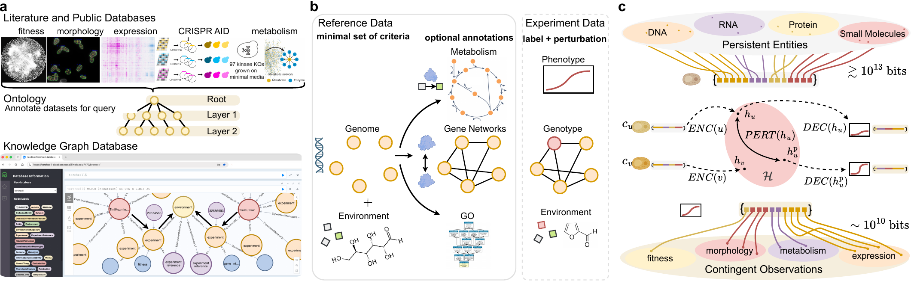

<p align="center">
  
</p>

<p align="center">
  <a href="https://github.com/Mjvolk3/torchcell/actions/workflows/style.yaml"></a>
  <a href="https://github.com/Mjvolk3/torchcell/actions/workflows/test.yaml"></a>
  <a href="https://github.com/Mjvolk3/torchcell/actions/workflows/mypy.yaml"></a>
  <a href="https://github.com/Mjvolk3/torchcell/actions/workflows/docs.yaml"></a>
  <a href="https://codecov.io/gh/Mjvolk3/torchcell"></a>
  <a href="https://github.com/Mjvolk3/torchcell/releases/latest"></a>
  <a href="https://github.com/Mjvolk3/torchcell/blob/main/pyproject.toml"></a>
</p>

<p align="center">
  
</p>

Documentation: <https://mjvolk3.github.io/torchcell/>

Database: <https://torchcell-database.ncsa.illinois.edu:7473/browser/> (Neo4j Browser over the served TorchCell knowledge graph)

Database releases and compatibility: <https://mjvolk3.github.io/torchcell/database/compatibility.html>

Datasets: <https://mjvolk3.github.io/torchcell/datasets/index.html>

Dataset downloads (the tc-data API): <https://mjvolk3.github.io/torchcell/guide/downloads.html>

## Install

torchcell needs Python 3.13 or newer.

```bash
pip install torchcell      # or: uv pip install torchcell
```

On a machine with no GPU, select the CPU build of torch. The environment is then 2.4 GB
in place of 7.0 GB, as measured in the
[install timings](https://mjvolk3.github.io/torchcell/guide/install-timings.html):

```bash
uv pip install --torch-backend cpu torchcell
pip install --extra-index-url https://download.pytorch.org/whl/cpu torchcell
```

## Download a dataset

Built datasets are served as versioned archives (the records LMDB plus its build
manifest) by the public `tc-data` endpoint on the database host, with Swagger at `/docs`.
The endpoint takes no key. With `TC_DATA_URL` set, a loader downloads its archive, checks
the sha256, and unpacks it instead of building from the publisher's files:

```python
import os

os.environ["TC_DATA_URL"] = "http://torchcell-database.ncsa.illinois.edu:8724"

from torchcell.datasets.ecoli.campos2018 import GrowthRateCampos2018Dataset

dataset = GrowthRateCampos2018Dataset(root="data/torchcell/ecoli_growth_rate_campos2018")
record = dataset[0]  # a dict: experiment, reference, publication
print(len(dataset), record["experiment"]["phenotype"]["fitness"])
```

The loader reads `TC_DATA_URL` from the process environment and does not read a `.env`
file itself. With the variable unset it builds from the publisher's files instead. An
archive is read by the releases that share the `major.minor` it was packaged with.

| Page | Datasets (records) | Archives packaged with |
| :-- | :-- | :-- |
| [Exploring the E. coli datasets](https://mjvolk3.github.io/torchcell/datasets/ecoli/tutorial.html) | Growth rate, Campos 2018 (3,664)<br>Cell shape and cell cycle, Campos 2018 (3,664)<br>Genetic interaction, Babu 2014 (42,705)<br>Metabolome, Fuhrer 2017 (3,806) | torchcell 1.8 |
| [Gene essentiality and single-mutant fitness](https://mjvolk3.github.io/torchcell/datasets/scerevisiae/essentiality-smf.html) | Gene essentiality, SGD (1,329)<br>Single-mutant fitness, Costanzo 2016 (20,484) | torchcell 1.5 |
| [Amino acids and betaxanthin](https://mjvolk3.github.io/torchcell/datasets/scerevisiae/amino-acid-betaxanthin.html) | Amino acids, Mulleder 2016 (4,678)<br>Amine peaks, Cooper 2010 (4,313)<br>Betaxanthin, Cachera 2023 (4,719) | torchcell 1.5 |

The first page is a download tutorial that loads each dataset and prints its records. The
other two describe what the experiments measured, the stored records, the value
distributions, and the query that returns them from the knowledge graph.
[Downloading datasets](https://mjvolk3.github.io/torchcell/guide/downloads.html) documents
the endpoint.

The full collection served by the knowledge graph (170 datasets, 73.1 million
experiments at release 2026.10.17) is listed on the
[Datasets](https://mjvolk3.github.io/torchcell/datasets/index.html) page.
