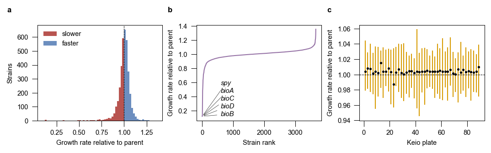
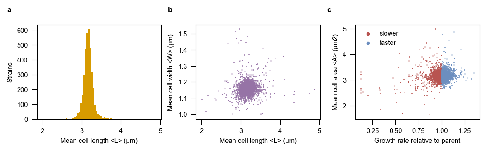
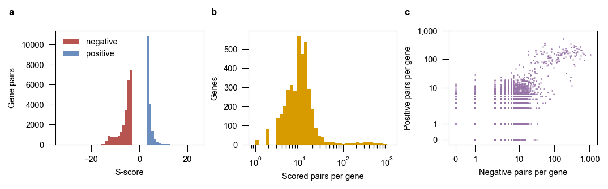
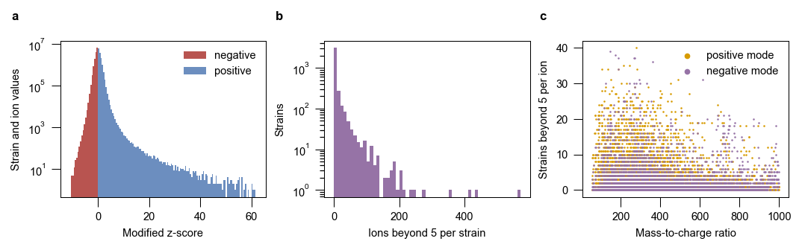

<!-- Generated by experiments/034-showcase-datasets/scripts/ecoli_download_tutorial_page.py (run 2026-11-25T03:26:28Z). Do not edit by hand. -->

```{note}
This page is the notebook [`ecoli_datasets.ipynb`](https://github.com/Mjvolk3/torchcell/blob/main/experiments/034-showcase-datasets/notebooks/ecoli_datasets.ipynb) with the outputs of one run. [Open it in Google Colab](https://colab.research.google.com/github/Mjvolk3/torchcell/blob/main/experiments/034-showcase-datasets/notebooks/ecoli_datasets.ipynb) to run it in the browser with nothing installed. The plotting code is collapsed; open **Show the plotting code** to read it.
```

# E. coli datasets in torchcell

[](https://colab.research.google.com/github/Mjvolk3/torchcell/blob/main/experiments/034-showcase-datasets/notebooks/ecoli_datasets.ipynb)

Four built *Escherichia coli* K-12 datasets, loaded from the public `tc-data` endpoint. The cells that load and read the data are the interface to copy. The plotting cells are collapsed: expand one to see how its figure is drawn. To run it with nothing installed, open it in Google Colab with the badge above and choose Runtime, Run all: the first cell installs `torchcell`. On your own machine, run the cells top to bottom in an empty directory with `torchcell` installed (Python 3.13 or newer). The stores download into `./data/torchcell/` and the figures are written to `./figures/`.

## Install

One line installs torchcell and everything the loaders need. On your own machine `pip install torchcell` is the same thing.

```python
%pip install -q --no-warn-conflicts "torchcell>=1.8.7"
```

## Setup

Setting `TC_DATA_URL` makes each loader download its built store, and `DATA_ROOT` is where the genome files go. `show` prints one part of a record as indented JSON.

```python
import hashlib
import json
import os
from pathlib import Path
from typing import Any

import numpy as np
import pandas as pd

from torchcell.datasets.artifact import content_sha256
from torchcell.datasets.client import DatasetClient
from torchcell.datasets.ecoli.babu2014 import GeneInteractionBabu2014Dataset
from torchcell.datasets.ecoli.campos2018 import (
    FEATURE_UNITS,
    MORPHOLOGY_ASSAY,
    GrowthRateCampos2018Dataset,
    MorphologyCampos2018Dataset,
)
from torchcell.datasets.ecoli.fuhrer2017 import MetabolomeFuhrer2017Dataset
from torchcell.endpoint_http import DEFAULT_URL
from torchcell.sequence.genome.standard import genome_for, standard_genomes

# A loader downloads its built store only when TC_DATA_URL is set. Without it the loader
# builds the store from the publisher's files, which is the developer path.
os.environ.setdefault("TC_DATA_URL", DEFAULT_URL)
os.environ.setdefault("DATA_ROOT", ".")  # genome files go to ./torchcell-genomes/

DATA = Path("data/torchcell")  # each dataset unpacks into DATA/<slug>/
pd.set_option("display.precision", 4)


def brief(value: Any, depth: int = 1) -> Any:
    """A record part with anything nested deeper than ``depth`` replaced by its size."""
    if isinstance(value, dict):
        kept = {k: v for k, v in value.items() if k != "provenance_gaps"}
        if depth < 0:
            return f"<{len(kept)} fields>"
        return {k: brief(v, depth - 1) for k, v in kept.items()}
    if isinstance(value, list):
        return f"<{len(value)} items>" if value else []
    return getattr(value, "value", value)  # an enum member prints as its value


def show(part: dict[str, Any]) -> None:
    """Print one part of a record as indented JSON, two levels deep."""
    print(json.dumps(brief(part), indent=2, default=str))
```

Figure style (collapsed): one row of three panels, red below and blue above a reference level.

<details><summary>Show the plotting code</summary>

```python
import matplotlib.pyplot as plt
from matplotlib.figure import Figure

from torchcell.utils import (
    PANEL_WIDTHS_MM,
    PLOT_PALETTE,
    mm_to_in,
    panel_label,
)

ORANGE, RED, PURPLE, YELLOW, BLUE, GRAY = PLOT_PALETTE[:6]
NEGATIVE, POSITIVE = RED, BLUE  # below and above a reference level, in every figure
plt.rcParams.update(
    {
        "font.family": ["Arial", "DejaVu Sans"],
        "font.size": 7,
        "axes.labelsize": 7,
        "axes.titlesize": 7,
        "xtick.labelsize": 7,
        "ytick.labelsize": 7,
        "legend.fontsize": 7,
        "axes.linewidth": 0.5,
        "xtick.major.width": 0.5,
        "ytick.major.width": 0.5,
        "legend.frameon": False,
        "figure.dpi": 150,  # size of a figure shown in a notebook
        "svg.fonttype": "none",  # text stays text in the SVG
        "svg.hashsalt": "torchcell",  # the same bytes on every run
    }
)
FIGURES = Path("figures")
FIGURES.mkdir(exist_ok=True)


def three_panels() -> tuple[Figure, Any]:
    """One row of three panels, 179 mm wide."""
    return plt.subplots(
        1,
        3,
        figsize=(mm_to_in(PANEL_WIDTHS_MM["full"]), mm_to_in(54)),
        layout="constrained",
    )


def save(figure: Figure, name: str) -> None:
    """Letter the panels a to c and write figures/<name>.svg and .png."""
    for axis, letter in zip(figure.axes, "abc", strict=True):
        panel_label(axis, letter)
    figure.savefig(FIGURES / f"{name}.svg", metadata={"Date": None})
    figure.savefig(FIGURES / f"{name}.png", dpi=200)
```

</details>

## What the endpoint serves

```python
client = DatasetClient.from_env()
print("endpoint", client.url)
SLUGS = (
    "ecoli_growth_rate_campos2018",
    "ecoli_morphology_campos2018",
    "gene_interaction_babu2014",
    "metabolome_fuhrer2017",
)
for slug in SLUGS:
    artifact = client.select(slug)  # newest archive the installed major.minor reads
    if artifact is None:
        raise SystemExit(f"{client.url} serves no {slug} archive this torchcell reads")
    print(slug)
    print(f"  loader   {artifact.dataset_class}")
    print(f"  archive  {artifact.archive}  ({artifact.archive_bytes:,} bytes)")
    print(f"  records  {artifact.n_experiments:,}")
    print(f"  release  knowledge graph {artifact.kg_version} ({artifact.kg_release})")
```

```text
endpoint http://torchcell-database.ncsa.illinois.edu:8724
ecoli_growth_rate_campos2018
  loader   GrowthRateCampos2018Dataset
  archive  ecoli_growth_rate_campos2018-1.8.4-ef455265.tar.xz  (144,152 bytes)
  records  3,664
  release  knowledge graph 4.0 (2026.10.17-4295f7ca)
ecoli_morphology_campos2018
  loader   MorphologyCampos2018Dataset
  archive  ecoli_morphology_campos2018-1.8.4-52643bef.tar.xz  (856,456 bytes)
  records  3,664
  release  knowledge graph 4.0 (2026.10.17-4295f7ca)
gene_interaction_babu2014
  loader   GeneInteractionBabu2014Dataset
  archive  gene_interaction_babu2014-1.8.4-412a73ed.tar.xz  (1,049,192 bytes)
  records  42,705
  release  knowledge graph 4.0 (2026.10.17-4295f7ca)
metabolome_fuhrer2017
  loader   MetabolomeFuhrer2017Dataset
  archive  metabolome_fuhrer2017-1.8.4-7eb33983.tar.xz  (81,780,576 bytes)
  records  3,806
  release  knowledge graph 4.0 (2026.10.17-4295f7ca)
```

## Growth rate (Campos 2018)

One record per Keio strain. The label is the maximal growth rate relative to the parent strain BW25113.

```python
growth = GrowthRateCampos2018Dataset(root=str(DATA / "ecoli_growth_rate_campos2018"))
print(f"{len(growth):,} records")
```

```text
3,664 records
```

A record is a dict with three keys: `experiment` (genotype, environment, phenotype), `reference` and `publication`.

```python
record = growth[0]  # a dict with three keys: experiment, reference, publication
experiment = record["experiment"]
show(experiment["genotype"]["perturbations"][0])
show(experiment["environment"])
show(experiment["phenotype"])
print("reference fitness", record["reference"]["phenotype_reference"]["fitness"])
print("source", record["publication"]["doi_url"])
```

```text
{
  "systematic_gene_name": "BW25113_1967",
  "perturbed_gene_name": "hchA",
  "gene_namespace": "ecoli_k12_bw25113_locus_tag",
  "identifier_mapping": {
    "source_identifier": "hchA",
    "route": "gene_symbol"
  },
  "provenance": "engineered",
  "state": "absent",
  "mechanism_so_id": "SO:0000159",
  "mechanism_so_name": "deletion",
  "description": "Gene deletion strain, with its collection, cassette and construction as stated",
  "perturbation_type": "deletion_strain",
  "deletion_type": "strain",
  "collection": "Keio collection",
  "cassette": "kanamycin-resistance cassette",
  "construction": {
    "strain_accession": null,
    "lab": null,
    "batch": null,
    "plate": "1",
    "well": "A001"
  }
}
{
  "media": {
    "name": "M9 with 0.1% (w/v) casamino acids and 0.2% (w/v) glucose (Campos 2018)",
    "state": "liquid",
    "is_synthetic": false,
    "base_medium": "M9",
    "components": "<6 items>",
    "dropouts": [],
    "provenance": "<1 items>"
  },
  "temperature": {
    "value": 30.0,
    "unit": "Celsius"
  },
  "perturbations": [],
  "aerobicity": "aerobic",
  "duration_hours": null,
  "duration_generations": null,
  "dilution_rate_per_hour": null
}
{
  "graph_level": "global",
  "label_name": "fitness",
  "label_statistic_name": "fitness_se",
  "fitness": 1.0201256910920211,
  "fitness_se": null,
  "fitness_std": null,
  "n_samples": 1,
  "fitness_uncertainty": null,
  "fitness_uncertainty_type": null,
  "sample_unit": "biological_replicate",
  "screen_id": null
}
reference fitness 1.0
source https://doi.org/10.15252/msb.20177573
```

All records as a table.

```python
rows = []
for r in (growth[i] for i in range(len(growth))):
    deletion = r["experiment"]["genotype"]["perturbations"][0]
    rows.append(
        {
            "gene": deletion["perturbed_gene_name"],
            "locus_tag": deletion["systematic_gene_name"],
            "plate": int(deletion["construction"]["plate"]),
            "fitness": r["experiment"]["phenotype"]["fitness"],
        }
    )
growth_table = pd.DataFrame(rows)
print(
    "fitness min {:.4f}  median {:.4f}  max {:.4f}".format(
        growth_table["fitness"].min(),
        growth_table["fitness"].median(),
        growth_table["fitness"].max(),
    )
)
growth_table.head(6)
```

```text
fitness min 0.1218  median 1.0042  max 1.3514
```

```{raw} html
<div>
<style scoped>
    .dataframe tbody tr th:only-of-type {
        vertical-align: middle;
    }

    .dataframe tbody tr th {
        vertical-align: top;
    }

    .dataframe thead th {
        text-align: right;
    }
</style>
<table border="1" class="dataframe">
  <thead>
    <tr style="text-align: right;">
      <th></th>
      <th>gene</th>
      <th>locus_tag</th>
      <th>plate</th>
      <th>fitness</th>
    </tr>
  </thead>
  <tbody>
    <tr>
      <th>0</th>
      <td>hchA</td>
      <td>BW25113_1967</td>
      <td>1</td>
      <td>1.0201</td>
    </tr>
    <tr>
      <th>1</th>
      <td>bglG</td>
      <td>BW25113_3723</td>
      <td>1</td>
      <td>1.1317</td>
    </tr>
    <tr>
      <th>2</th>
      <td>cytR</td>
      <td>BW25113_3934</td>
      <td>1</td>
      <td>0.8306</td>
    </tr>
    <tr>
      <th>3</th>
      <td>fnr</td>
      <td>BW25113_1334</td>
      <td>1</td>
      <td>0.9604</td>
    </tr>
    <tr>
      <th>4</th>
      <td>hupB</td>
      <td>BW25113_0440</td>
      <td>1</td>
      <td>1.0240</td>
    </tr>
    <tr>
      <th>5</th>
      <td>nagC</td>
      <td>BW25113_0676</td>
      <td>1</td>
      <td>0.9816</td>
    </tr>
  </tbody>
</table>
</div>
```

<details><summary>Show the plotting code</summary>

```python
figure, (left, middle, right) = three_panels()
edges = np.arange(0.10, 1.38, 0.02)
slower = growth_table["fitness"] < 1.0
left.hist(
    growth_table.loc[slower, "fitness"], bins=edges, color=NEGATIVE, label="slower"
)
left.hist(
    growth_table.loc[~slower, "fitness"], bins=edges, color=POSITIVE, label="faster"
)
left.axvline(1.0, color="black", linewidth=0.5, linestyle="--")
left.set(xlabel="Growth rate relative to parent", ylabel="Strains")
left.legend()

ranked = growth_table.sort_values("fitness").reset_index(drop=True)
middle.plot(ranked.index + 1, ranked["fitness"], color=PURPLE, linewidth=1)
for rank, row in ranked.head(5).iterrows():
    middle.annotate(
        row["gene"],
        (rank + 1, row["fitness"]),
        xytext=(600, 0.15 + 0.11 * rank),
        fontstyle="italic",
        va="center",
        arrowprops={"arrowstyle": "-", "linewidth": 0.3},
    )
middle.set(xlabel="Strain rank", ylabel="Growth rate relative to parent")

plates = growth_table.groupby("plate")["fitness"].quantile([0.25, 0.5, 0.75]).unstack()
right.vlines(plates.index, plates[0.25], plates[0.75], color=ORANGE, linewidth=1)
right.plot(plates.index, plates[0.5], "o", color="black", markersize=1.5)
right.axhline(1.0, color="black", linewidth=0.5, linestyle="--")
right.set(xlabel="Keio plate", ylabel="Growth rate relative to parent")
save(figure, "ecoli_growth_rate_campos2018")
```

</details>



### The same record as typed objects

`transform_item` validates a record through the pydantic classes of the schema.

```python
typed = growth.transform_item(record)  # the same record as validated pydantic objects
experiment = typed["experiment"]
print(type(experiment).__name__, type(experiment.phenotype).__name__)
print(
    experiment.genotype.perturbations[0].perturbed_gene_name,
    experiment.phenotype.fitness,
)
```

```text
FitnessExperiment FitnessPhenotype
hchA 1.0201256910920211
```

## Cell shape and cell cycle (Campos 2018)

The same strains from the same imaging screen, with cell-shape means and cell-cycle features.

```python
morphology = MorphologyCampos2018Dataset(root=str(DATA / "ecoli_morphology_campos2018"))
print(f"{len(morphology):,} records")
show(morphology[0]["experiment"]["phenotype"])
```

```text
3,664 records
{
  "graph_level": "global",
  "label_name": "morphology",
  "label_statistic_name": "morphology_coefficient_of_variation",
  "assay": "campos2018",
  "morphology": {
    "<L>": 3.19546621533025,
    "<W>": 1.17312345844031,
    "<A>": 3.23402304903965,
    "<V>": 2.73935580483487,
    "<SA>": 11.4016813687147,
    "<P>": 7.58374863028241,
    "<C>": 0.720139126605895,
    "<Ar>": 0.38481367194436,
    "<SA/V>": 4.20669389106828,
    "<NA>": 1.58381392077006,
    "rho_CD": 0.175309454457351,
    "CDN_C0": 0.686654877888511,
    "Rel.timing div": 0.646839306013814,
    "Rel.timing nuc": 0.578074023057654,
    "%2N": 0.331474592957771
  },
  "morphology_coefficient_of_variation": {
    "CV_L": 0.236850387516941,
    "CV_W": 0.0481438146291384,
    "CV_A": 0.260557043912679,
    "CV_V": 0.271618792599827,
    "CV_SA": 0.238477391654462,
    "CV_P": 0.206559266634767,
    "CV_C": 0.143766140830845,
    "CV_Ar": 0.247848604834858,
    "CV_SA/V": 0.0904532214293887,
    "CV_DR": 0.0617592186847581,
    "CV_NA": 0.280448549177046
  },
  "n_samples": 245,
  "sample_unit": "cell"
}
```

Means (`<...>`) go to `morphology` and coefficients of variation (`CV_...`) to `morphology_coefficient_of_variation`. The nucleoid and cell-cycle features exist only for strains imaged with a nucleoid channel.

```python
# The assay vocabulary names every feature a record can hold, with its unit.
features = pd.DataFrame(
    feature.model_dump(mode="json") for feature in MORPHOLOGY_ASSAY.features
).drop(columns="note")
print(features.to_string(index=False))
features
```

```text
        symbol                                                                name         group                statistic unit
           <L>                                                    Mean cell length morphological                     mean   µm
          CV_L                                             Cell length variability morphological coefficient_of_variation None
           <W>                                                     Mean cell width morphological                     mean   µm
          CV_W                                              Cell width variability morphological coefficient_of_variation None
           <A>                                                      Mean cell area morphological                     mean  µm2
          CV_A                                               Cell area variability morphological coefficient_of_variation None
           <V>                                                    Mean cell volume morphological                     mean  µm3
          CV_V                                             Cell volume variability morphological coefficient_of_variation None
          <SA>                                              Mean cell surface area morphological                     mean  µm2
         CV_SA                                       Cell surface area variability morphological coefficient_of_variation None
           <P>                                                 Mean cell perimeter morphological                     mean   µm
          CV_P                                          Cell perimeter variability morphological coefficient_of_variation None
           <C>                                                    Mean circularity morphological                     mean None
          CV_C                                             Circularity variability morphological coefficient_of_variation None
          <Ar>                                                   Mean aspect ratio morphological                     mean None
         CV_Ar                                            Aspect ratio variability morphological coefficient_of_variation None
        <SA/V>                                   Mean surface area-to-volume ratio morphological                     mean µm-1
       CV_SA/V                            Surface area-to-volume ratio variability morphological coefficient_of_variation None
         CV_DR                                          Division ratio variability morphological coefficient_of_variation None
          <NA>                                                  Mean nucleoid area morphological                     mean  µm2
         CV_NA                                           Nucleoid area variability morphological coefficient_of_variation None
        rho_CD                       Correlation in nucleoid and cell constriction    cell_cycle      pearson_correlation None
        CDN_C0 Nucleoid constriction degree at the initiation of cell constriction    cell_cycle     regression_intercept None
Rel.timing div                                Relative timing of cell constriction    cell_cycle inferred_relative_timing None
Rel.timing nuc                              Relative timing of nucleoid separation    cell_cycle inferred_relative_timing None
           %2N                                  Fraction of cells with 2 nucleoids    cell_cycle        fraction_of_cells None
```

```{raw} html
<div>
<style scoped>
    .dataframe tbody tr th:only-of-type {
        vertical-align: middle;
    }

    .dataframe tbody tr th {
        vertical-align: top;
    }

    .dataframe thead th {
        text-align: right;
    }
</style>
<table border="1" class="dataframe">
  <thead>
    <tr style="text-align: right;">
      <th></th>
      <th>symbol</th>
      <th>name</th>
      <th>group</th>
      <th>statistic</th>
      <th>unit</th>
    </tr>
  </thead>
  <tbody>
    <tr>
      <th>0</th>
      <td>&lt;L&gt;</td>
      <td>Mean cell length</td>
      <td>morphological</td>
      <td>mean</td>
      <td>µm</td>
    </tr>
    <tr>
      <th>1</th>
      <td>CV_L</td>
      <td>Cell length variability</td>
      <td>morphological</td>
      <td>coefficient_of_variation</td>
      <td>None</td>
    </tr>
    <tr>
      <th>2</th>
      <td>&lt;W&gt;</td>
      <td>Mean cell width</td>
      <td>morphological</td>
      <td>mean</td>
      <td>µm</td>
    </tr>
    <tr>
      <th>3</th>
      <td>CV_W</td>
      <td>Cell width variability</td>
      <td>morphological</td>
      <td>coefficient_of_variation</td>
      <td>None</td>
    </tr>
    <tr>
      <th>4</th>
      <td>&lt;A&gt;</td>
      <td>Mean cell area</td>
      <td>morphological</td>
      <td>mean</td>
      <td>µm2</td>
    </tr>
    <tr>
      <th>5</th>
      <td>CV_A</td>
      <td>Cell area variability</td>
      <td>morphological</td>
      <td>coefficient_of_variation</td>
      <td>None</td>
    </tr>
    <tr>
      <th>6</th>
      <td>&lt;V&gt;</td>
      <td>Mean cell volume</td>
      <td>morphological</td>
      <td>mean</td>
      <td>µm3</td>
    </tr>
    <tr>
      <th>7</th>
      <td>CV_V</td>
      <td>Cell volume variability</td>
      <td>morphological</td>
      <td>coefficient_of_variation</td>
      <td>None</td>
    </tr>
    <tr>
      <th>8</th>
      <td>&lt;SA&gt;</td>
      <td>Mean cell surface area</td>
      <td>morphological</td>
      <td>mean</td>
      <td>µm2</td>
    </tr>
    <tr>
      <th>9</th>
      <td>CV_SA</td>
      <td>Cell surface area variability</td>
      <td>morphological</td>
      <td>coefficient_of_variation</td>
      <td>None</td>
    </tr>
    <tr>
      <th>10</th>
      <td>&lt;P&gt;</td>
      <td>Mean cell perimeter</td>
      <td>morphological</td>
      <td>mean</td>
      <td>µm</td>
    </tr>
    <tr>
      <th>11</th>
      <td>CV_P</td>
      <td>Cell perimeter variability</td>
      <td>morphological</td>
      <td>coefficient_of_variation</td>
      <td>None</td>
    </tr>
    <tr>
      <th>12</th>
      <td>&lt;C&gt;</td>
      <td>Mean circularity</td>
      <td>morphological</td>
      <td>mean</td>
      <td>None</td>
    </tr>
    <tr>
      <th>13</th>
      <td>CV_C</td>
      <td>Circularity variability</td>
      <td>morphological</td>
      <td>coefficient_of_variation</td>
      <td>None</td>
    </tr>
    <tr>
      <th>14</th>
      <td>&lt;Ar&gt;</td>
      <td>Mean aspect ratio</td>
      <td>morphological</td>
      <td>mean</td>
      <td>None</td>
    </tr>
    <tr>
      <th>15</th>
      <td>CV_Ar</td>
      <td>Aspect ratio variability</td>
      <td>morphological</td>
      <td>coefficient_of_variation</td>
      <td>None</td>
    </tr>
    <tr>
      <th>16</th>
      <td>&lt;SA/V&gt;</td>
      <td>Mean surface area-to-volume ratio</td>
      <td>morphological</td>
      <td>mean</td>
      <td>µm-1</td>
    </tr>
    <tr>
      <th>17</th>
      <td>CV_SA/V</td>
      <td>Surface area-to-volume ratio variability</td>
      <td>morphological</td>
      <td>coefficient_of_variation</td>
      <td>None</td>
    </tr>
    <tr>
      <th>18</th>
      <td>CV_DR</td>
      <td>Division ratio variability</td>
      <td>morphological</td>
      <td>coefficient_of_variation</td>
      <td>None</td>
    </tr>
    <tr>
      <th>19</th>
      <td>&lt;NA&gt;</td>
      <td>Mean nucleoid area</td>
      <td>morphological</td>
      <td>mean</td>
      <td>µm2</td>
    </tr>
    <tr>
      <th>20</th>
      <td>CV_NA</td>
      <td>Nucleoid area variability</td>
      <td>morphological</td>
      <td>coefficient_of_variation</td>
      <td>None</td>
    </tr>
    <tr>
      <th>21</th>
      <td>rho_CD</td>
      <td>Correlation in nucleoid and cell constriction</td>
      <td>cell_cycle</td>
      <td>pearson_correlation</td>
      <td>None</td>
    </tr>
    <tr>
      <th>22</th>
      <td>CDN_C0</td>
      <td>Nucleoid constriction degree at the initiation...</td>
      <td>cell_cycle</td>
      <td>regression_intercept</td>
      <td>None</td>
    </tr>
    <tr>
      <th>23</th>
      <td>Rel.timing div</td>
      <td>Relative timing of cell constriction</td>
      <td>cell_cycle</td>
      <td>inferred_relative_timing</td>
      <td>None</td>
    </tr>
    <tr>
      <th>24</th>
      <td>Rel.timing nuc</td>
      <td>Relative timing of nucleoid separation</td>
      <td>cell_cycle</td>
      <td>inferred_relative_timing</td>
      <td>None</td>
    </tr>
    <tr>
      <th>25</th>
      <td>%2N</td>
      <td>Fraction of cells with 2 nucleoids</td>
      <td>cell_cycle</td>
      <td>fraction_of_cells</td>
      <td>None</td>
    </tr>
  </tbody>
</table>
</div>
```

```python
morphology_table = pd.DataFrame(
    {
        "gene": r["experiment"]["genotype"]["perturbations"][0]["perturbed_gene_name"],
        **r["experiment"]["phenotype"]["morphology"],
    }
    for r in (morphology[i] for i in range(len(morphology)))
).set_index("gene")
unit = FEATURE_UNITS.value  # feature symbol -> unit, as the release states it
print("table shape   ", morphology_table.shape)
print(
    "features per strain:",
    morphology_table.notna().sum(axis=1).value_counts().to_dict(),
)
print("units         ", {symbol: unit[symbol] for symbol in ("<L>", "<W>", "<A>")})
morphology_table.head(6)
```

```text
table shape    (3664, 15)
features per strain: {15: 3422, 9: 242}
units          {'<L>': 'µm', '<W>': 'µm', '<A>': 'µm2'}
```

```{raw} html
<div>
<style scoped>
    .dataframe tbody tr th:only-of-type {
        vertical-align: middle;
    }

    .dataframe tbody tr th {
        vertical-align: top;
    }

    .dataframe thead th {
        text-align: right;
    }
</style>
<table border="1" class="dataframe">
  <thead>
    <tr style="text-align: right;">
      <th></th>
      <th>&lt;L&gt;</th>
      <th>&lt;W&gt;</th>
      <th>&lt;A&gt;</th>
      <th>&lt;V&gt;</th>
      <th>&lt;SA&gt;</th>
      <th>&lt;P&gt;</th>
      <th>&lt;C&gt;</th>
      <th>&lt;Ar&gt;</th>
      <th>&lt;SA/V&gt;</th>
      <th>&lt;NA&gt;</th>
      <th>rho_CD</th>
      <th>CDN_C0</th>
      <th>Rel.timing div</th>
      <th>Rel.timing nuc</th>
      <th>%2N</th>
    </tr>
    <tr>
      <th>gene</th>
      <th></th>
      <th></th>
      <th></th>
      <th></th>
      <th></th>
      <th></th>
      <th></th>
      <th></th>
      <th></th>
      <th></th>
      <th></th>
      <th></th>
      <th></th>
      <th></th>
      <th></th>
    </tr>
  </thead>
  <tbody>
    <tr>
      <th>hchA</th>
      <td>3.1955</td>
      <td>1.1731</td>
      <td>3.2340</td>
      <td>2.7394</td>
      <td>11.4017</td>
      <td>7.5837</td>
      <td>0.7201</td>
      <td>0.3848</td>
      <td>4.2067</td>
      <td>1.5838</td>
      <td>0.1753</td>
      <td>0.6867</td>
      <td>0.6468</td>
      <td>0.5781</td>
      <td>0.3315</td>
    </tr>
    <tr>
      <th>bglG</th>
      <td>3.1495</td>
      <td>1.1772</td>
      <td>3.1965</td>
      <td>2.7158</td>
      <td>11.2757</td>
      <td>7.4770</td>
      <td>0.7325</td>
      <td>0.3897</td>
      <td>4.1760</td>
      <td>1.5272</td>
      <td>0.4017</td>
      <td>0.5812</td>
      <td>0.7282</td>
      <td>0.6562</td>
      <td>0.2691</td>
    </tr>
    <tr>
      <th>cytR</th>
      <td>3.1203</td>
      <td>1.2074</td>
      <td>3.2240</td>
      <td>2.7960</td>
      <td>11.4182</td>
      <td>7.4732</td>
      <td>0.7420</td>
      <td>0.4045</td>
      <td>4.1018</td>
      <td>1.5670</td>
      <td>0.5403</td>
      <td>0.5501</td>
      <td>0.6898</td>
      <td>0.6252</td>
      <td>0.2903</td>
    </tr>
    <tr>
      <th>fnr</th>
      <td>3.1126</td>
      <td>1.1413</td>
      <td>3.0587</td>
      <td>2.5081</td>
      <td>10.6631</td>
      <td>7.3717</td>
      <td>0.7219</td>
      <td>0.3790</td>
      <td>4.2452</td>
      <td>1.5483</td>
      <td>0.5705</td>
      <td>0.4603</td>
      <td>0.6780</td>
      <td>0.6117</td>
      <td>0.3047</td>
    </tr>
    <tr>
      <th>hupB</th>
      <td>3.3444</td>
      <td>1.0857</td>
      <td>3.1668</td>
      <td>2.4884</td>
      <td>10.9452</td>
      <td>7.7780</td>
      <td>0.6767</td>
      <td>0.3411</td>
      <td>4.3908</td>
      <td>1.4430</td>
      <td>0.5330</td>
      <td>0.5900</td>
      <td>0.7660</td>
      <td>0.7256</td>
      <td>0.2058</td>
    </tr>
    <tr>
      <th>nagC</th>
      <td>3.1478</td>
      <td>1.1609</td>
      <td>3.1520</td>
      <td>2.6341</td>
      <td>11.0576</td>
      <td>7.4745</td>
      <td>0.7244</td>
      <td>0.3834</td>
      <td>4.2069</td>
      <td>1.5803</td>
      <td>0.7041</td>
      <td>0.5140</td>
      <td>0.6832</td>
      <td>0.6237</td>
      <td>0.2982</td>
    </tr>
  </tbody>
</table>
</div>
```

The growth-rate dataset holds the same strains in the same order.

```python
# The two Campos 2018 datasets hold the same strains in the same order, so the growth
# rate of each strain sits beside its cell shape.
assert list(morphology_table.index) == list(growth_table["gene"])
shape_growth = morphology_table.assign(fitness=growth_table["fitness"].to_numpy())
rank_correlation = shape_growth["<A>"].rank().corr(shape_growth["fitness"].rank())
print(f"strains {len(shape_growth):,}")
print(f"Spearman correlation of cell area with growth rate {rank_correlation:.3f}")
```

```text
strains 3,664
Spearman correlation of cell area with growth rate 0.095
```

<details><summary>Show the plotting code</summary>

```python
figure, (left, middle, right) = three_panels()
left.hist(morphology_table["<L>"], bins=np.arange(2.0, 4.92, 0.04), color=ORANGE)
left.set(xlabel=f"Mean cell length <L> ({unit['<L>']})", ylabel="Strains")

middle.scatter(
    morphology_table["<L>"],
    morphology_table["<W>"],
    s=1.5,
    color=PURPLE,
    linewidths=0,
    rasterized=True,
)
middle.set(
    xlabel=f"Mean cell length <L> ({unit['<L>']})",
    ylabel=f"Mean cell width <W> ({unit['<W>']})",
)

slower = shape_growth["fitness"] < 1.0
for mask, color, label in ((slower, NEGATIVE, "slower"), (~slower, POSITIVE, "faster")):
    right.scatter(
        shape_growth.loc[mask, "fitness"],
        shape_growth.loc[mask, "<A>"],
        s=1.5,
        color=color,
        linewidths=0,
        rasterized=True,
        label=label,
    )
right.set(
    xlabel="Growth rate relative to parent",
    ylabel=f"Mean cell area <A> ({unit['<A>']})",
)
right.legend(markerscale=3)
save(figure, "ecoli_morphology_campos2018")
```

</details>



## Genetic interactions (Babu 2014)

One record per double mutant of the released high-confidence set. The label is the pair's S-score.

```python
interaction = GeneInteractionBabu2014Dataset(
    root=str(DATA / "gene_interaction_babu2014")
)
print(f"{len(interaction):,} records")
record = interaction[0]
for perturbation in record["experiment"]["genotype"]["perturbations"]:
    print(
        perturbation["perturbed_gene_name"],
        perturbation["systematic_gene_name"],
        "|",
        perturbation["collection"],
    )
show(record["experiment"]["phenotype"])
```

```text
42,705 records
thrA b0002 | Hfr Cavalli (Hfr C) donor query strains
dnaJ b0015 | Keio collection
{
  "graph_level": "hyperedge",
  "label_name": "gene_interaction",
  "label_statistic_name": "gene_interaction_p_value",
  "gene_interaction": -4.43348,
  "gene_interaction_p_value": null,
  "screen_id": "This Study",
  "n_samples": 8,
  "sample_unit": "colony",
  "gene_interaction_uncertainty": null,
  "gene_interaction_uncertainty_type": null
}
```

```python
rows = []
for r in (interaction[i] for i in range(len(interaction))):
    first, second = r["experiment"]["genotype"]["perturbations"]
    rows.append(
        {
            "gene_a": first["perturbed_gene_name"],
            "gene_b": second["perturbed_gene_name"],
            "id_a": first["systematic_gene_name"],
            "id_b": second["systematic_gene_name"],
            "s_score": r["experiment"]["phenotype"]["gene_interaction"],
        }
    )
pairs = pd.DataFrame(rows)
print("genes in any pair:", len(interaction.gene_set))
print("negative scores:", int((pairs["s_score"] < 0).sum()))
print("positive scores:", int((pairs["s_score"] > 0).sum()))
pairs.nsmallest(6, "s_score")
```

```text
genes in any pair: 3880
negative scores: 25239
positive scores: 17466
```

```{raw} html
<div>
<style scoped>
    .dataframe tbody tr th:only-of-type {
        vertical-align: middle;
    }

    .dataframe tbody tr th {
        vertical-align: top;
    }

    .dataframe thead th {
        text-align: right;
    }
</style>
<table border="1" class="dataframe">
  <thead>
    <tr style="text-align: right;">
      <th></th>
      <th>gene_a</th>
      <th>gene_b</th>
      <th>id_a</th>
      <th>id_b</th>
      <th>s_score</th>
    </tr>
  </thead>
  <tbody>
    <tr>
      <th>11807</th>
      <td>oppA</td>
      <td>topA</td>
      <td>b1243</td>
      <td>b1274</td>
      <td>-30.9240</td>
    </tr>
    <tr>
      <th>3959</th>
      <td>tig</td>
      <td>accD</td>
      <td>b0436</td>
      <td>b2316</td>
      <td>-28.1061</td>
    </tr>
    <tr>
      <th>15748</th>
      <td>sufC</td>
      <td>fdx</td>
      <td>b1682</td>
      <td>b2525</td>
      <td>-24.9893</td>
    </tr>
    <tr>
      <th>34365</th>
      <td>yahI</td>
      <td>gntY</td>
      <td>b0323</td>
      <td>b3414</td>
      <td>-24.2600</td>
    </tr>
    <tr>
      <th>34578</th>
      <td>rpoS</td>
      <td>gntY</td>
      <td>b2741</td>
      <td>b3414</td>
      <td>-23.9941</td>
    </tr>
    <tr>
      <th>3659</th>
      <td>bolA</td>
      <td>rpoS</td>
      <td>b0435</td>
      <td>b2741</td>
      <td>-23.9937</td>
    </tr>
  </tbody>
</table>
</div>
```

<details><summary>Show the plotting code</summary>

```python
figure, (left, middle, right) = three_panels()
edges = np.arange(-32, 25, 1)
negative = pairs["s_score"] < 0
left.hist(pairs.loc[negative, "s_score"], bins=edges, color=NEGATIVE, label="negative")
left.hist(pairs.loc[~negative, "s_score"], bins=edges, color=POSITIVE, label="positive")
left.set(xlabel="S-score", ylabel="Gene pairs")
left.legend()

# One row per gene: how many of its pairs score below zero and how many above.
per_gene = (
    pd.concat(
        [
            pairs[["id_a", "s_score"]].rename(columns={"id_a": "id"}),
            pairs[["id_b", "s_score"]].rename(columns={"id_b": "id"}),
        ]
    )
    .assign(negative=lambda t: t["s_score"] < 0, positive=lambda t: t["s_score"] > 0)
    .groupby("id")[["negative", "positive"]]
    .sum()
)
degree = per_gene["negative"] + per_gene["positive"]
middle.hist(degree, bins=np.logspace(0, np.log10(degree.max() + 1), 40), color=ORANGE)
middle.set(xscale="log", xlabel="Scored pairs per gene", ylabel="Genes")

right.scatter(
    per_gene["negative"],
    per_gene["positive"],
    s=1.5,
    color=PURPLE,
    linewidths=0,
    rasterized=True,
)
right.set(
    xscale="symlog",
    yscale="symlog",
    xlabel="Negative pairs per gene",
    ylabel="Positive pairs per gene",
)
for axis in (right.xaxis, right.yaxis):  # linear from 0 to 1, logarithmic above
    axis.set_ticks([0, 1, 10, 100, 1000], labels=["0", "1", "10", "100", "1,000"])
    axis.minorticks_off()
save(figure, "gene_interaction_babu2014")
```

</details>



## Metabolome (Fuhrer 2017)

One record per Keio strain. The label maps each detected ion to a modified z-score. An ion is a mass feature of the negative or the positive instrument mode, keyed `neg_0001`, `pos_0001` and so on, and `ions.csv` gives its mass-to-charge ratio.

```python
metabolome = MetabolomeFuhrer2017Dataset(root=str(DATA / "metabolome_fuhrer2017"))
print(f"{len(metabolome):,} records")
record = metabolome[0]
levels = record["experiment"]["phenotype"]["metabolite_level"]  # ion key -> z-score
print("strain", record["experiment"]["genotype"]["perturbations"][0]["strain_label"])
print("ions", len(levels), "first", dict(list(levels.items())[:4]))
ions = pd.read_csv(Path(metabolome.preprocess_dir) / "ions.csv")  # ion key -> m/z
# The ions are mass features of the two instrument modes, not named metabolites.
print(ions.groupby("mode")["deposit_mz"].agg(["size", "min", "max"]).to_string())
ions.head(4)
```

```text
3,806 records
strain aaeA
ions 7534 first {'neg_0001': -0.4309, 'neg_0002': -0.1195, 'neg_0003': -0.6621, 'neg_0004': 0.9284}
      size      min       max
mode                         
neg   3169  56.9972  998.7170
pos   4365  55.0177  998.7871
```

```{raw} html
<div>
<style scoped>
    .dataframe tbody tr th:only-of-type {
        vertical-align: middle;
    }

    .dataframe tbody tr th {
        vertical-align: top;
    }

    .dataframe thead th {
        text-align: right;
    }
</style>
<table border="1" class="dataframe">
  <thead>
    <tr style="text-align: right;">
      <th></th>
      <th>key</th>
      <th>mode</th>
      <th>ion_index</th>
      <th>deposit_mz</th>
      <th>table_ev1b_mz</th>
    </tr>
  </thead>
  <tbody>
    <tr>
      <th>0</th>
      <td>neg_0001</td>
      <td>neg</td>
      <td>1</td>
      <td>56.9972</td>
      <td>56.9962</td>
    </tr>
    <tr>
      <th>1</th>
      <td>neg_0002</td>
      <td>neg</td>
      <td>2</td>
      <td>57.0358</td>
      <td>57.0348</td>
    </tr>
    <tr>
      <th>2</th>
      <td>neg_0003</td>
      <td>neg</td>
      <td>3</td>
      <td>57.0574</td>
      <td>57.0565</td>
    </tr>
    <tr>
      <th>3</th>
      <td>neg_0004</td>
      <td>neg</td>
      <td>4</td>
      <td>58.0390</td>
      <td>58.0380</td>
    </tr>
  </tbody>
</table>
</div>
```

```python
ion_keys = list(levels)
strains, matrix_rows = [], []
for r in (metabolome[i] for i in range(len(metabolome))):
    perturbations = r["experiment"]["genotype"]["perturbations"]
    strains.append("+".join(p["perturbed_gene_name"] for p in perturbations))
    row_levels = r["experiment"]["phenotype"]["metabolite_level"]
    matrix_rows.append([row_levels[key] for key in ion_keys])
matrix = np.asarray(matrix_rows, dtype=np.float32)  # strains x ions
print("matrix shape", matrix.shape, matrix.dtype)
print("z-scores beyond 5 in absolute value:", int((np.abs(matrix) > 5).sum()))
print("records that name more than one gene:", sum("+" in name for name in strains))
pd.DataFrame(matrix[:5, :5], index=strains[:5], columns=ion_keys[:5])
```

```text
matrix shape (3806, 7534) float32
z-scores beyond 5 in absolute value: 31863
records that name more than one gene: 21
```

```{raw} html
<div>
<style scoped>
    .dataframe tbody tr th:only-of-type {
        vertical-align: middle;
    }

    .dataframe tbody tr th {
        vertical-align: top;
    }

    .dataframe thead th {
        text-align: right;
    }
</style>
<table border="1" class="dataframe">
  <thead>
    <tr style="text-align: right;">
      <th></th>
      <th>neg_0001</th>
      <th>neg_0002</th>
      <th>neg_0003</th>
      <th>neg_0004</th>
      <th>neg_0005</th>
    </tr>
  </thead>
  <tbody>
    <tr>
      <th>aaeA</th>
      <td>-0.4309</td>
      <td>-0.1195</td>
      <td>-0.6621</td>
      <td>0.9284</td>
      <td>-0.6906</td>
    </tr>
    <tr>
      <th>aaeB</th>
      <td>-1.8696</td>
      <td>1.1863</td>
      <td>1.7171</td>
      <td>0.3849</td>
      <td>0.7550</td>
    </tr>
    <tr>
      <th>aaeR</th>
      <td>1.3402</td>
      <td>-0.8219</td>
      <td>1.0256</td>
      <td>2.0786</td>
      <td>-0.5455</td>
    </tr>
    <tr>
      <th>aaeX</th>
      <td>0.2608</td>
      <td>-0.5211</td>
      <td>0.0221</td>
      <td>-0.8930</td>
      <td>0.4659</td>
    </tr>
    <tr>
      <th>aas</th>
      <td>1.1950</td>
      <td>0.2000</td>
      <td>-0.4579</td>
      <td>0.8433</td>
      <td>0.5156</td>
    </tr>
  </tbody>
</table>
</div>
```

<details><summary>Show the plotting code</summary>

```python
figure, (left, middle, right) = three_panels()
values = matrix.ravel()
edges = np.arange(-11.0, 62.5, 0.5)
left.hist(values[values < 0], bins=edges, color=NEGATIVE, label="negative")
left.hist(values[values >= 0], bins=edges, color=POSITIVE, label="positive")
left.set(yscale="log", xlabel="Modified z-score", ylabel="Strain and ion values")
left.legend()

beyond = np.abs(matrix) > 5
middle.hist(beyond.sum(axis=1), bins=np.arange(0, 580, 10), color=PURPLE)
middle.set(yscale="log", xlabel="Ions beyond 5 per strain", ylabel="Strains")

# Ionization mode is a property of the instrument run, not a sign of the value.
for mode, color in (("pos", ORANGE), ("neg", PURPLE)):
    of_mode = (ions["mode"] == mode).to_numpy()
    right.scatter(
        ions.loc[of_mode, "deposit_mz"],
        beyond.sum(axis=0)[of_mode],
        s=1.5,
        color=color,
        linewidths=0,
        rasterized=True,
        label={"neg": "negative mode", "pos": "positive mode"}[mode],
    )
right.set(xlabel="Mass-to-charge ratio", ylabel="Strains beyond 5 per ion")
right.legend(markerscale=3, loc="upper right")
save(figure, "metabolome_fuhrer2017")
```

</details>



## How each dataset names its genes

Every perturbation carries the gene symbol (`perturbed_gene_name`) and an identifier (`systematic_gene_name`) in the namespace `gene_namespace` names. The identifier differs by dataset, and the table says which kind each one stores and what it was mapped from.

```python
loaded = {
    "ecoli_growth_rate_campos2018": growth,
    "ecoli_morphology_campos2018": morphology,
    "gene_interaction_babu2014": interaction,
    "metabolome_fuhrer2017": metabolome,
}
# Every perturbation names its gene twice: perturbed_gene_name is the gene symbol and
# systematic_gene_name is the identifier in the namespace gene_namespace names.
rows = []
for slug, dataset in loaded.items():
    for r in (dataset[i] for i in range(len(dataset))):
        for p in r["experiment"]["genotype"]["perturbations"]:
            mapping = p["identifier_mapping"] or {}
            rows.append(
                {
                    "dataset": slug,
                    "symbol": p["perturbed_gene_name"],
                    "identifier": p["systematic_gene_name"],
                    "namespace": p["gene_namespace"],
                    "identifier_kind": p.get("identifier_kind") or "locus identifier",
                    "mapped_from": mapping.get("route") or "released as is",
                    "perturbation_type": p["perturbation_type"],
                }
            )
names = pd.DataFrame(rows)
how = ["dataset", "perturbation_type", "namespace", "identifier_kind", "mapped_from"]
gene_names = (
    names.groupby(how, sort=False)
    .agg(
        perturbations=("symbol", "size"),
        genes=("identifier", "nunique"),
        example_symbol=("symbol", "first"),
        example_identifier=("identifier", "first"),
    )
    .reset_index()
)
print(gene_names.to_string(index=False))
gene_names
```

```text
                     dataset   perturbation_type                   namespace                 identifier_kind    mapped_from  perturbations  genes example_symbol example_identifier
ecoli_growth_rate_campos2018     deletion_strain ecoli_k12_bw25113_locus_tag                locus identifier    gene_symbol           3664   3664           hchA       BW25113_1967
 ecoli_morphology_campos2018     deletion_strain ecoli_k12_bw25113_locus_tag                locus identifier    gene_symbol           3664   3664           hchA       BW25113_1967
   gene_interaction_babu2014     deletion_strain    ecoli_k12_mg1655_bnumber                locus identifier released as is          81777   3719           thrA              b0002
   gene_interaction_babu2014       marked_allele    ecoli_k12_mg1655_bnumber                locus identifier released as is           3503    150           holA              b0640
   gene_interaction_babu2014 released_identifier    ecoli_k12_mg1655_bnumber b-number with a Keio sub-number released as is             93      8           yaaV            b0033.1
   gene_interaction_babu2014 released_identifier    ecoli_k12_mg1655_bnumber                  Keio JW number released as is             33      2           fucT             JW5447
   gene_interaction_babu2014 released_identifier    ecoli_k12_mg1655_bnumber                     gene symbol released as is              4      1           xylU               cscR
       metabolome_fuhrer2017 released_identifier ecoli_k12_bw25113_locus_tag                      Keio JW id released as is           3830   3830           aaeA             JW3210
```

```{raw} html
<div>
<style scoped>
    .dataframe tbody tr th:only-of-type {
        vertical-align: middle;
    }

    .dataframe tbody tr th {
        vertical-align: top;
    }

    .dataframe thead th {
        text-align: right;
    }
</style>
<table border="1" class="dataframe">
  <thead>
    <tr style="text-align: right;">
      <th></th>
      <th>dataset</th>
      <th>perturbation_type</th>
      <th>namespace</th>
      <th>identifier_kind</th>
      <th>mapped_from</th>
      <th>perturbations</th>
      <th>genes</th>
      <th>example_symbol</th>
      <th>example_identifier</th>
    </tr>
  </thead>
  <tbody>
    <tr>
      <th>0</th>
      <td>ecoli_growth_rate_campos2018</td>
      <td>deletion_strain</td>
      <td>ecoli_k12_bw25113_locus_tag</td>
      <td>locus identifier</td>
      <td>gene_symbol</td>
      <td>3664</td>
      <td>3664</td>
      <td>hchA</td>
      <td>BW25113_1967</td>
    </tr>
    <tr>
      <th>1</th>
      <td>ecoli_morphology_campos2018</td>
      <td>deletion_strain</td>
      <td>ecoli_k12_bw25113_locus_tag</td>
      <td>locus identifier</td>
      <td>gene_symbol</td>
      <td>3664</td>
      <td>3664</td>
      <td>hchA</td>
      <td>BW25113_1967</td>
    </tr>
    <tr>
      <th>2</th>
      <td>gene_interaction_babu2014</td>
      <td>deletion_strain</td>
      <td>ecoli_k12_mg1655_bnumber</td>
      <td>locus identifier</td>
      <td>released as is</td>
      <td>81777</td>
      <td>3719</td>
      <td>thrA</td>
      <td>b0002</td>
    </tr>
    <tr>
      <th>3</th>
      <td>gene_interaction_babu2014</td>
      <td>marked_allele</td>
      <td>ecoli_k12_mg1655_bnumber</td>
      <td>locus identifier</td>
      <td>released as is</td>
      <td>3503</td>
      <td>150</td>
      <td>holA</td>
      <td>b0640</td>
    </tr>
    <tr>
      <th>4</th>
      <td>gene_interaction_babu2014</td>
      <td>released_identifier</td>
      <td>ecoli_k12_mg1655_bnumber</td>
      <td>b-number with a Keio sub-number</td>
      <td>released as is</td>
      <td>93</td>
      <td>8</td>
      <td>yaaV</td>
      <td>b0033.1</td>
    </tr>
    <tr>
      <th>5</th>
      <td>gene_interaction_babu2014</td>
      <td>released_identifier</td>
      <td>ecoli_k12_mg1655_bnumber</td>
      <td>Keio JW number</td>
      <td>released as is</td>
      <td>33</td>
      <td>2</td>
      <td>fucT</td>
      <td>JW5447</td>
    </tr>
    <tr>
      <th>6</th>
      <td>gene_interaction_babu2014</td>
      <td>released_identifier</td>
      <td>ecoli_k12_mg1655_bnumber</td>
      <td>gene symbol</td>
      <td>released as is</td>
      <td>4</td>
      <td>1</td>
      <td>xylU</td>
      <td>cscR</td>
    </tr>
    <tr>
      <th>7</th>
      <td>metabolome_fuhrer2017</td>
      <td>released_identifier</td>
      <td>ecoli_k12_bw25113_locus_tag</td>
      <td>Keio JW id</td>
      <td>released as is</td>
      <td>3830</td>
      <td>3830</td>
      <td>aaeA</td>
      <td>JW3210</td>
    </tr>
  </tbody>
</table>
</div>
```

## At a glance

The same rows for every dataset, counted from the loaded records: the shape of the labels, the genotype and how it was perturbed, and the growth condition.

```python
# The same rows for every dataset, counted from the loaded records: the shape of the
# labels, what the genotype is and how it was perturbed, and the growth condition.


def plain(value: Any) -> str:
    """A field as text; an enum shows its value."""
    return str(getattr(value, "value", value))


def tally(values: list[Any]) -> str:
    """The distinct values, most frequent first, with counts when there are several."""
    counts = pd.Series([plain(v) for v in values]).value_counts()
    if len(counts) == 1:
        return str(counts.index[0])
    return "; ".join(f"{value} ({n:,})" for value, n in counts.items())


def glance(dataset: Any) -> dict[str, str]:
    """One dataset's row values, in the order every dataset is shown in."""
    experiments = [dataset[i]["experiment"] for i in range(len(dataset))]
    perturbations = [p for e in experiments for p in e["genotype"]["perturbations"]]
    phenotypes = [e["phenotype"] for e in experiments]
    labels = [ph[ph["label_name"]] for ph in phenotypes]
    values = [x for v in labels for x in (v.values() if isinstance(v, dict) else [v])]
    width = max(len(v) if isinstance(v, dict) else 1 for v in labels)
    cells = len(experiments) * width  # a record may lack some of the label's values
    missing = cells - sum(x is not None and x == x for x in values)
    samples = [ph["n_samples"] for ph in phenotypes if ph.get("n_samples") is not None]
    media = [e["environment"]["media"] for e in experiments]
    symbols = {p["perturbed_gene_name"] for p in perturbations}
    # A strain is a genotype: its perturbed genes, each with how it was perturbed.
    strains = {
        tuple(
            sorted(
                (p["systematic_gene_name"], p["perturbation_type"])
                for p in e["genotype"]["perturbations"]
            )
        )
        for e in experiments
    }
    return {
        "Records": f"{len(experiments):,}",
        "Distinct strains (genotypes)": f"{len(strains):,}",
        "Label array (records x values)": f"{len(experiments):,} x {width:,}",
        "Missing label values": f"{missing:,} of {cells:,}",
        "Experiment type": tally([e["experiment_type"] for e in experiments]),
        "Label field": tally([ph["label_name"] for ph in phenotypes]),
        "Label attaches to": tally([ph["graph_level"] for ph in phenotypes]),
        "Measurements behind one record": (
            (
                f"{min(samples):,}"
                if min(samples) == max(samples)
                else f"{min(samples):,} to {max(samples):,}"
            )
            + " "
            + tally([ph.get("sample_unit") for ph in phenotypes])
            if samples
            else "not recorded"
        ),
        "Genes perturbed per record": tally(
            [len(e["genotype"]["perturbations"]) for e in experiments]
        ),
        "Perturbation type": tally([p["perturbation_type"] for p in perturbations]),
        "Perturbation mechanism": tally(
            [
                p.get("mechanism_so_name") or p.get("released_kind")
                for p in perturbations
            ]
        ),
        "Strain collection": tally([p.get("collection") for p in perturbations]),
        "Distinct gene symbols": f"{len(symbols):,}",
        "Gene identifier namespace": tally(
            [p["gene_namespace"] for p in perturbations]
        ),
        "Medium": tally([f"{m['base_medium']}, {m['state']}" for m in media]),
        "Temperature": tally(
            [
                f"{e['environment']['temperature']['value']:g} "
                f"{plain(e['environment']['temperature']['unit'])}"
                for e in experiments
            ]
        ),
    }


at_a_glance = pd.DataFrame({slug: glance(dataset) for slug, dataset in loaded.items()})
at_a_glance.index.name = "property"
for line in [
    " | ".join(["property", *at_a_glance.columns]),
    *(" | ".join([name, *row]) for name, row in at_a_glance.iterrows()),
]:
    print(line)
at_a_glance
```

```text
property | ecoli_growth_rate_campos2018 | ecoli_morphology_campos2018 | gene_interaction_babu2014 | metabolome_fuhrer2017
Records | 3,664 | 3,664 | 42,705 | 3,806
Distinct strains (genotypes) | 3,664 | 3,664 | 42,603 | 3,806
Label array (records x values) | 3,664 x 1 | 3,664 x 15 | 42,705 x 1 | 3,806 x 7,534
Missing label values | 0 of 3,664 | 1,452 of 54,960 | 0 of 42,705 | 0 of 28,674,404
Experiment type | fitness | morphology | gene interaction | metabolite
Label field | fitness | morphology | gene_interaction | metabolite_level
Label attaches to | global | global | hyperedge | metabolism
Measurements behind one record | 1 biological_replicate | 43 to 1,658 cell | 8 colony | not recorded
Genes perturbed per record | 1 | 1 | 2 | 1 (3,785); 2 (18); 3 (3)
Perturbation type | deletion_strain | deletion_strain | deletion_strain (81,777); marked_allele (3,503); released_identifier (130) | released_identifier
Perturbation mechanism | deletion | deletion | deletion (81,907); transgenic_insertion (3,503) | deletion
Strain collection | Keio collection | Keio collection | Hfr Cavalli (Hfr C) donor query strains (42,705); Keio collection (40,226); SPA-tag essential (2,479) | KEIO knockout collection
Distinct gene symbols | 3,664 | 3,664 | 3,876 | 3,806
Gene identifier namespace | ecoli_k12_bw25113_locus_tag | ecoli_k12_bw25113_locus_tag | ecoli_k12_mg1655_bnumber | ecoli_k12_bw25113_locus_tag
Medium | M9, liquid | M9, liquid | LB, solid | M9, liquid
Temperature | 30 Celsius | 30 Celsius | 32 Celsius | 37 Celsius
```

```{raw} html
<div>
<style scoped>
    .dataframe tbody tr th:only-of-type {
        vertical-align: middle;
    }

    .dataframe tbody tr th {
        vertical-align: top;
    }

    .dataframe thead th {
        text-align: right;
    }
</style>
<table border="1" class="dataframe">
  <thead>
    <tr style="text-align: right;">
      <th></th>
      <th>ecoli_growth_rate_campos2018</th>
      <th>ecoli_morphology_campos2018</th>
      <th>gene_interaction_babu2014</th>
      <th>metabolome_fuhrer2017</th>
    </tr>
    <tr>
      <th>property</th>
      <th></th>
      <th></th>
      <th></th>
      <th></th>
    </tr>
  </thead>
  <tbody>
    <tr>
      <th>Records</th>
      <td>3,664</td>
      <td>3,664</td>
      <td>42,705</td>
      <td>3,806</td>
    </tr>
    <tr>
      <th>Distinct strains (genotypes)</th>
      <td>3,664</td>
      <td>3,664</td>
      <td>42,603</td>
      <td>3,806</td>
    </tr>
    <tr>
      <th>Label array (records x values)</th>
      <td>3,664 x 1</td>
      <td>3,664 x 15</td>
      <td>42,705 x 1</td>
      <td>3,806 x 7,534</td>
    </tr>
    <tr>
      <th>Missing label values</th>
      <td>0 of 3,664</td>
      <td>1,452 of 54,960</td>
      <td>0 of 42,705</td>
      <td>0 of 28,674,404</td>
    </tr>
    <tr>
      <th>Experiment type</th>
      <td>fitness</td>
      <td>morphology</td>
      <td>gene interaction</td>
      <td>metabolite</td>
    </tr>
    <tr>
      <th>Label field</th>
      <td>fitness</td>
      <td>morphology</td>
      <td>gene_interaction</td>
      <td>metabolite_level</td>
    </tr>
    <tr>
      <th>Label attaches to</th>
      <td>global</td>
      <td>global</td>
      <td>hyperedge</td>
      <td>metabolism</td>
    </tr>
    <tr>
      <th>Measurements behind one record</th>
      <td>1 biological_replicate</td>
      <td>43 to 1,658 cell</td>
      <td>8 colony</td>
      <td>not recorded</td>
    </tr>
    <tr>
      <th>Genes perturbed per record</th>
      <td>1</td>
      <td>1</td>
      <td>2</td>
      <td>1 (3,785); 2 (18); 3 (3)</td>
    </tr>
    <tr>
      <th>Perturbation type</th>
      <td>deletion_strain</td>
      <td>deletion_strain</td>
      <td>deletion_strain (81,777); marked_allele (3,503...</td>
      <td>released_identifier</td>
    </tr>
    <tr>
      <th>Perturbation mechanism</th>
      <td>deletion</td>
      <td>deletion</td>
      <td>deletion (81,907); transgenic_insertion (3,503)</td>
      <td>deletion</td>
    </tr>
    <tr>
      <th>Strain collection</th>
      <td>Keio collection</td>
      <td>Keio collection</td>
      <td>Hfr Cavalli (Hfr C) donor query strains (42,70...</td>
      <td>KEIO knockout collection</td>
    </tr>
    <tr>
      <th>Distinct gene symbols</th>
      <td>3,664</td>
      <td>3,664</td>
      <td>3,876</td>
      <td>3,806</td>
    </tr>
    <tr>
      <th>Gene identifier namespace</th>
      <td>ecoli_k12_bw25113_locus_tag</td>
      <td>ecoli_k12_bw25113_locus_tag</td>
      <td>ecoli_k12_mg1655_bnumber</td>
      <td>ecoli_k12_bw25113_locus_tag</td>
    </tr>
    <tr>
      <th>Medium</th>
      <td>M9, liquid</td>
      <td>M9, liquid</td>
      <td>LB, solid</td>
      <td>M9, liquid</td>
    </tr>
    <tr>
      <th>Temperature</th>
      <td>30 Celsius</td>
      <td>30 Celsius</td>
      <td>32 Celsius</td>
      <td>37 Celsius</td>
    </tr>
  </tbody>
</table>
</div>
```

Gene symbols shared by each pair of datasets (the diagonal is the dataset's own count).

```python
# The gene symbol is the name every dataset carries, so it is the key to join on.
symbols = {slug: set(group["symbol"]) for slug, group in names.groupby("dataset")}
overlap = pd.DataFrame(
    {a: {b: len(symbols[a] & symbols[b]) for b in loaded} for a in loaded}
)
print(overlap.to_string())
overlap
```

```text
                              ecoli_growth_rate_campos2018  ecoli_morphology_campos2018  gene_interaction_babu2014  metabolome_fuhrer2017
ecoli_growth_rate_campos2018                          3664                         3664                       3176                   3154
ecoli_morphology_campos2018                           3664                         3664                       3176                   3154
gene_interaction_babu2014                             3176                         3176                       3876                   3510
metabolome_fuhrer2017                                 3154                         3154                       3510                   3806
```

```{raw} html
<div>
<style scoped>
    .dataframe tbody tr th:only-of-type {
        vertical-align: middle;
    }

    .dataframe tbody tr th {
        vertical-align: top;
    }

    .dataframe thead th {
        text-align: right;
    }
</style>
<table border="1" class="dataframe">
  <thead>
    <tr style="text-align: right;">
      <th></th>
      <th>ecoli_growth_rate_campos2018</th>
      <th>ecoli_morphology_campos2018</th>
      <th>gene_interaction_babu2014</th>
      <th>metabolome_fuhrer2017</th>
    </tr>
  </thead>
  <tbody>
    <tr>
      <th>ecoli_growth_rate_campos2018</th>
      <td>3664</td>
      <td>3664</td>
      <td>3176</td>
      <td>3154</td>
    </tr>
    <tr>
      <th>ecoli_morphology_campos2018</th>
      <td>3664</td>
      <td>3664</td>
      <td>3176</td>
      <td>3154</td>
    </tr>
    <tr>
      <th>gene_interaction_babu2014</th>
      <td>3176</td>
      <td>3176</td>
      <td>3876</td>
      <td>3510</td>
    </tr>
    <tr>
      <th>metabolome_fuhrer2017</th>
      <td>3154</td>
      <td>3154</td>
      <td>3510</td>
      <td>3806</td>
    </tr>
  </tbody>
</table>
</div>
```

## The genome behind each dataset

Every record names the genome assembly it is written against. The genomes that load by that id:

```python
for row in standard_genomes():  # every genome that loads by its assembly-set id
    print(f"{row.assembly_set:32} {row.organism} {row.strain} -> {row.class_name}")
```

```text
ecoli_B_REL606_ASM1798v1         Escherichia coli B REL606 -> EcoliBREL606Genome
ecoli_K12_BW25113_ASM75055v1     Escherichia coli K-12 BW25113 -> EcoliK12BW25113Genome
ecoli_K12_MG1655_ASM584v2        Escherichia coli K-12 MG1655 -> EcoliK12MG1655Genome
ecoli_K12_W3110_ASM1024v1        Escherichia coli K-12 W3110 -> EcoliK12W3110Genome
pputida_KT2440_ASM756v2          Pseudomonas putida KT2440 -> PPutidaKT2440Genome
scerevisiae_CENPK113-7D_ASM257140v2 Saccharomyces cerevisiae CEN.PK113-7D -> CenPk1137DGenome
sgd_S288C_R64-4-1_20230830       Saccharomyces cerevisiae S288C -> SCerevisiaeGenome
```

`genome_for(dataset)` looks the assembly up from the records, downloads its files into `./torchcell-genomes/` and returns the genome. Each file comes from its original source when the bytes there still match the recorded sha256 and from the torchcell mirror otherwise. `resolve_gene_name` maps an identifier the dataset stores to a locus tag of that genome and says how: `current`, `renamed` (an alias of one current gene), `non_gene_feature` (a locus the annotation does not class as a gene) or `retired` (not in the annotation).

```python
# genome_for reads the assembly set the records name, fetches its files (original
# source first, the torchcell mirror when the source fails or its bytes changed, every
# file checked against its sha256) and returns the genome object.
genomes = {slug: genome_for(dataset) for slug, dataset in loaded.items()}
resolved = {}  # slug -> {identifier the dataset stores -> how the genome resolves it}
for slug, dataset in loaded.items():
    genome = genomes[slug]
    resolved[slug] = {name: genome.resolve_gene_name(name) for name in dataset.gene_set}
    status = pd.Series([r.status.value for r in resolved[slug].values()]).value_counts()
    print(slug)
    print(f"  genome        {type(genome).__name__} ({genome.ASSEMBLY_SET})")
    print(f"  genome genes  {len(genome.gene_set):,}")
    print(f"  dataset genes {len(dataset.gene_set):,}: {status.sort_index().to_dict()}")
```

```text
ecoli_growth_rate_campos2018
  genome        EcoliK12BW25113Genome (ecoli_K12_BW25113_ASM75055v1)
  genome genes  4,303
  dataset genes 3,664: {'current': 3573, 'non_gene_feature': 91}
ecoli_morphology_campos2018
  genome        EcoliK12BW25113Genome (ecoli_K12_BW25113_ASM75055v1)
  genome genes  4,303
  dataset genes 3,664: {'current': 3573, 'non_gene_feature': 91}
gene_interaction_babu2014
  genome        EcoliK12MG1655Genome (ecoli_K12_MG1655_ASM584v2)
  genome genes  4,506
  dataset genes 3,880: {'current': 3726, 'non_gene_feature': 136, 'renamed': 1, 'retired': 17}
metabolome_fuhrer2017
  genome        EcoliK12BW25113Genome (ecoli_K12_BW25113_ASM75055v1)
  genome genes  4,303
  dataset genes 3,830: {'non_gene_feature': 151, 'renamed': 3632, 'retired': 47}
```

One record as model input: the genes of the genome are the nodes of the cell graph, the strain is the indices of the nodes it perturbs, and the phenotype is the label. A node carries its sequence, protein and GO terms.

```python
# One record as model input. The nodes of a cell graph are the genes of the genome; a
# strain is the indices of the nodes it perturbs, and the phenotype is the label.
slug = "gene_interaction_babu2014"
genome = genomes[slug]
nodes = list(genome.gene_set)  # sorted, so a node index is stable
node_index = {gene: i for i, gene in enumerate(nodes)}

experiment = interaction[0]["experiment"]
stored = [p["systematic_gene_name"] for p in experiment["genotype"]["perturbations"]]
targets = [resolved[slug][name].systematic_name for name in stored]
print("stored identifiers ", stored)
print("genome locus tags  ", targets)
print("perturbed nodes    ", [node_index[t] for t in targets], f"of {len(nodes):,}")
print("label              ", experiment["phenotype"]["label_name"])
for target in targets:
    gene = genome[target]  # sequence, protein and annotation of one node
    print(
        f"{gene.id} {gene.symbol}: {len(gene.seq):,} bp, "
        f"protein {len(gene.protein.seq):,} aa, GO terms {len(gene.go)}"
    )
```

```text
stored identifiers  ['b0002', 'b0015']
genome locus tags   ['b0002', 'b0015']
perturbed nodes     [1, 14] of 4,506
label               gene_interaction
b0002 thrA: 2,463 bp, protein 820 aa, GO terms 13
b0015 dnaJ: 1,131 bp, protein 376 aa, GO terms 22
```

## Check the records against the release

Hashing the loaded records reproduces the content hash the knowledge-graph release recorded.

```python
def experiment_id(record: dict[str, Any]) -> str:
    """The id the knowledge graph gives this record: sha256 of its experiment."""
    return hashlib.sha256(json.dumps(record["experiment"]).encode("utf-8")).hexdigest()


for slug, dataset in loaded.items():
    ids = (experiment_id(dataset[i]) for i in range(len(dataset)))
    digest = content_sha256(ids)  # one hash over every record of the dataset
    served = client.select(slug).content_sha256  # what the release recorded
    verdict = "matches" if digest == served else "DIFFERS FROM"
    print(f"{slug}  {digest}  {verdict} the release")
```

```text
ecoli_growth_rate_campos2018  a8ced65c7e68b1d673ad404f001dc47fb9807db7cc3b131282bf532d10f7e11c  matches the release
ecoli_morphology_campos2018  15d7c23e9300015d48426f8b7e813aec540bd5a9854e8392b7ab1eef19836e6b  matches the release
gene_interaction_babu2014  fb1f87b2c861a2df6e06bfe8abdcb71bbd46ff77fe56ba2c53996a65f2584f10  matches the release
metabolome_fuhrer2017  adeb2d85353f426d3a775eab4c09e99e97c47b9c3b96be6684c54cfa6d2162bd  matches the release
```
