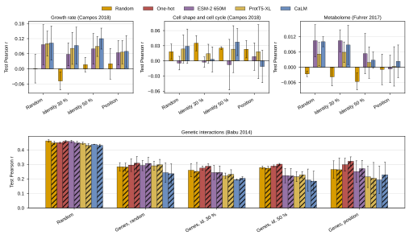

A first set of baselines: a frozen representation of each deleted gene and a ridge regression on top. They say how much of each label a linear readout of a gene representation recovers under each kind of split, and they are the floor a model that uses the cell graph should clear.

## Method

Five representations of a gene:

- **Random**: 1,280 standard-normal numbers per gene, fixed seed. It carries no biology.
- **One-hot**: the identity of the gene.
- **ESM-2 650M**: mean over residues of the last layer, protein sequence (1,280 numbers).
- **ProtT5-XL**: mean over residues of the ProtT5-XL-UniRef50 encoder, protein sequence (1,024).
- **CaLM**: mean over codons of the last layer, coding sequence (768).

A single-gene sample is its gene's representation. A gene-pair sample is the two representations concatenated in stored order (`concat`) or added (`sum`). Features are standardized with the training mean and standard deviation, and one ridge regression is fit per task, split and representation, on all targets at once. The penalty is the one of eight values from 0.1 to 1,000,000 with the lowest validation mean squared error. The test part is unlocked once per split, after that choice.

Sequences longer than 1,022 residues or codons are truncated (53 of 4,276 distinct proteins).

## Results

Each cell is the test Pearson correlation, averaged over the targets of the task, as the mean ± sample standard deviation over the seeds of a split family (five seeds for random splits, three for the others). `undefined` means the model predicted a constant, which is what a one-hot representation does for a gene it never saw in training.

*Test Pearson correlation of each linear probe, by split family. Bars are means over seeds and whiskers are sample standard deviations. In the pair panel, plain bars concatenate the two gene representations and hatched bars add them. A missing bar is an undefined correlation.*

### Growth rate (Campos 2018)

| Split family | Random | One-hot | ESM-2 650M | ProtT5-XL | CaLM |
| --- | ---: | ---: | ---: | ---: | ---: |
| Random | 0.001 ± 0.057 | undefined | 0.096 ± 0.079 | 0.100 ± 0.049 | 0.102 ± 0.067 |
| Sequence identity 30 % | -0.048 ± 0.036 | undefined | 0.058 ± 0.046 | 0.081 ± 0.063 | 0.093 ± 0.073 |
| Sequence identity 50 % | 0.017 ± 0.029 | undefined | 0.079 ± 0.061 | 0.089 ± 0.039 | 0.120 ± 0.041 |
| Chromosome position | 0.020 ± 0.061 | undefined | 0.064 ± 0.048 | 0.066 ± 0.046 | 0.069 ± 0.063 |

### Cell shape and cell cycle (Campos 2018)

Mean over the 15 morphology features.

| Split family | Random | One-hot | ESM-2 650M | ProtT5-XL | CaLM |
| --- | ---: | ---: | ---: | ---: | ---: |
| Random | 0.018 ± 0.015 | undefined | -0.004 ± 0.013 | 0.024 ± 0.028 | 0.029 ± 0.034 |
| Sequence identity 30 % | 0.035 ± 0.015 | undefined | -0.003 ± 0.010 | 0.014 ± 0.019 | 0.003 ± 0.025 |
| Sequence identity 50 % | 0.025 ± 0.003 | undefined | -0.008 ± 0.050 | 0.023 ± 0.046 | 0.037 ± 0.027 |
| Chromosome position | 0.023 ± 0.017 | undefined | 0.008 ± 0.027 | 0.018 ± 0.053 | -0.011 ± 0.032 |

### Metabolome (Fuhrer 2017)

Mean over the 7,534 ions.

| Split family | Random | One-hot | ESM-2 650M | ProtT5-XL | CaLM |
| --- | ---: | ---: | ---: | ---: | ---: |
| Random | -0.003 ± 0.001 | undefined | 0.010 ± 0.006 | 0.005 ± 0.005 | 0.010 ± 0.002 |
| Sequence identity 30 % | -0.004 ± 0.004 | undefined | 0.010 ± 0.004 | 0.006 ± 0.004 | 0.009 ± 0.008 |
| Sequence identity 50 % | -0.006 ± 0.003 | undefined | 0.005 ± 0.008 | 0.002 ± 0.006 | 0.003 ± 0.003 |
| Chromosome position | -0.001 ± 0.006 | undefined | -0.001 ± 0.005 | 0.000 ± 0.008 | 0.002 ± 0.006 |

### Genetic interactions (Babu 2014)

Pair representation: `concat`.

| Split family | Random | One-hot | ESM-2 650M | ProtT5-XL | CaLM |
| --- | ---: | ---: | ---: | ---: | ---: |
| Random | 0.461 ± 0.009 | 0.449 ± 0.005 | 0.457 ± 0.008 | 0.445 ± 0.008 | 0.437 ± 0.002 |
| Gene holdout, random | 0.283 ± 0.028 | 0.295 ± 0.044 | 0.291 ± 0.035 | 0.290 ± 0.030 | 0.243 ± 0.067 |
| Gene holdout, identity 30 % | 0.260 ± 0.045 | 0.274 ± 0.014 | 0.243 ± 0.048 | 0.221 ± 0.019 | 0.195 ± 0.004 |
| Gene holdout, identity 50 % | 0.278 ± 0.010 | 0.288 ± 0.008 | 0.222 ± 0.049 | 0.215 ± 0.035 | 0.192 ± 0.076 |
| Gene holdout, position | 0.265 ± 0.059 | 0.297 ± 0.044 | 0.251 ± 0.074 | 0.214 ± 0.073 | 0.193 ± 0.094 |

Pair representation: `sum`.

| Split family | Random | One-hot | ESM-2 650M | ProtT5-XL | CaLM |
| --- | ---: | ---: | ---: | ---: | ---: |
| Random | 0.448 ± 0.011 | 0.458 ± 0.007 | 0.448 ± 0.010 | 0.430 ± 0.012 | 0.430 ± 0.009 |
| Gene holdout, random | 0.281 ± 0.028 | 0.308 ± 0.047 | 0.306 ± 0.042 | 0.298 ± 0.037 | 0.235 ± 0.068 |
| Gene holdout, identity 30 % | 0.252 ± 0.061 | 0.287 ± 0.017 | 0.244 ± 0.044 | 0.231 ± 0.032 | 0.204 ± 0.011 |
| Gene holdout, identity 50 % | 0.274 ± 0.012 | 0.301 ± 0.006 | 0.221 ± 0.051 | 0.228 ± 0.023 | 0.185 ± 0.068 |
| Gene holdout, position | 0.263 ± 0.081 | 0.321 ± 0.030 | 0.271 ± 0.057 | 0.204 ± 0.109 | 0.228 ± 0.086 |

Under gene holdout the test pairs are of two kinds: one gene was never in a training pair, or both were not.

Pair representation: `concat`.

| Test pairs | Random | One-hot | ESM-2 650M | ProtT5-XL | CaLM |
| --- | ---: | ---: | ---: | ---: | ---: |
| Gene holdout, random, one gene new | 0.313 ± 0.021 | 0.322 ± 0.046 | 0.317 ± 0.029 | 0.312 ± 0.028 | 0.268 ± 0.059 |
| Gene holdout, random, both genes new | 0.087 ± 0.098 | undefined | 0.129 ± 0.083 | 0.150 ± 0.072 | 0.088 ± 0.133 |
| Gene holdout, identity 30 %, one gene new | 0.290 ± 0.043 | 0.303 ± 0.012 | 0.269 ± 0.053 | 0.249 ± 0.024 | 0.228 ± 0.012 |
| Gene holdout, identity 30 %, both genes new | 0.030 ± 0.106 | undefined | 0.104 ± 0.048 | 0.070 ± 0.024 | 0.002 ± 0.028 |
| Gene holdout, identity 50 %, one gene new | 0.313 ± 0.009 | 0.318 ± 0.006 | 0.256 ± 0.044 | 0.247 ± 0.031 | 0.224 ± 0.074 |
| Gene holdout, identity 50 %, both genes new | -0.004 ± 0.025 | undefined | 0.026 ± 0.068 | 0.028 ± 0.062 | 0.011 ± 0.093 |
| Gene holdout, position, one gene new | 0.292 ± 0.058 | 0.322 ± 0.043 | 0.280 ± 0.072 | 0.239 ± 0.070 | 0.219 ± 0.089 |
| Gene holdout, position, both genes new | 0.010 ± 0.036 | undefined | 0.045 ± 0.052 | 0.032 ± 0.071 | 0.022 ± 0.087 |

Pair representation: `sum`.

| Test pairs | Random | One-hot | ESM-2 650M | ProtT5-XL | CaLM |
| --- | ---: | ---: | ---: | ---: | ---: |
| Gene holdout, random, one gene new | 0.309 ± 0.018 | 0.336 ± 0.049 | 0.330 ± 0.036 | 0.320 ± 0.031 | 0.260 ± 0.059 |
| Gene holdout, random, both genes new | 0.111 ± 0.125 | undefined | 0.168 ± 0.090 | 0.155 ± 0.074 | 0.088 ± 0.144 |
| Gene holdout, identity 30 %, one gene new | 0.283 ± 0.059 | 0.316 ± 0.014 | 0.270 ± 0.043 | 0.254 ± 0.034 | 0.234 ± 0.010 |
| Gene holdout, identity 30 %, both genes new | 0.042 ± 0.073 | undefined | 0.097 ± 0.074 | 0.105 ± 0.033 | 0.024 ± 0.040 |
| Gene holdout, identity 50 %, one gene new | 0.308 ± 0.012 | 0.332 ± 0.004 | 0.253 ± 0.047 | 0.259 ± 0.016 | 0.215 ± 0.071 |
| Gene holdout, identity 50 %, both genes new | 0.012 ± 0.037 | undefined | 0.040 ± 0.077 | 0.042 ± 0.044 | 0.023 ± 0.043 |
| Gene holdout, position, one gene new | 0.293 ± 0.078 | 0.348 ± 0.027 | 0.302 ± 0.056 | 0.232 ± 0.095 | 0.258 ± 0.078 |
| Gene holdout, position, both genes new | -0.001 ± 0.056 | undefined | 0.068 ± 0.041 | 0.025 ± 0.167 | 0.045 ± 0.104 |

## What the numbers say

All of the following are read from the 380 runs in the tables (one run per task, split, representation and pair combination).

- **Single-gene tasks are close to unexplained by a linear readout of one gene's sequence.** The highest test Pearson of any growth-rate run is 0.20, and the three sequence models average 0.08 to 0.10 on growth rate against 0.00 for random features. On the imaging and metabolome tasks no representation is separated from random features by more than the spread over seeds.
- **One-hot is undefined on every single-gene split,** because each gene appears once: a test gene was never seen, and the model predicts the training mean.
- **On the pair task, random features and one-hot do as well as the sequence models.** With random pair splits all five representations reach 0.43 to 0.46. A linear probe is therefore reading which genes are in the pair (each gene's average interaction score), and the sequence models add nothing to that here.
- **Gene holdout removes most of it.** Test Pearson falls to 0.18 to 0.32, and for test pairs in which both genes are new it is 0.17 or lower for every representation, with seed spreads as large as the means.

## Limits

- The ridge penalty chosen on validation is the largest value of the grid (1,000,000) in 121 of the 380 runs, almost all on the single-gene tasks. In those runs the best linear model is nearly the training mean, and a larger penalty was not tried.
- Three seeds per split family (five for random) give wide standard deviations; differences between sequence models are within them in most rows.
- These are frozen mean-pooled embeddings with a linear readout. Nothing here says what a fine-tuned model, a nonlinear readout or a model that uses the cell graph reaches.
- The pair representation `concat` depends on the stored order of the two genes; the pairs were not also presented in the other order.

## Reproducing

Every number comes from `experiments/050-ecoli-benchmark/`: `embed_genes.py` (embeddings), `cluster_proteins.py` and `build_splits.py` (splits), `linear_probes.py` (the runs), `results_page.py` (these tables and the figure). The table of every run, with validation scores, the chosen penalty and four more metrics, is [`linear_probes.csv`](https://github.com/Mjvolk3/torchcell/blob/main/experiments/050-ecoli-benchmark/results/linear_probes.csv).
