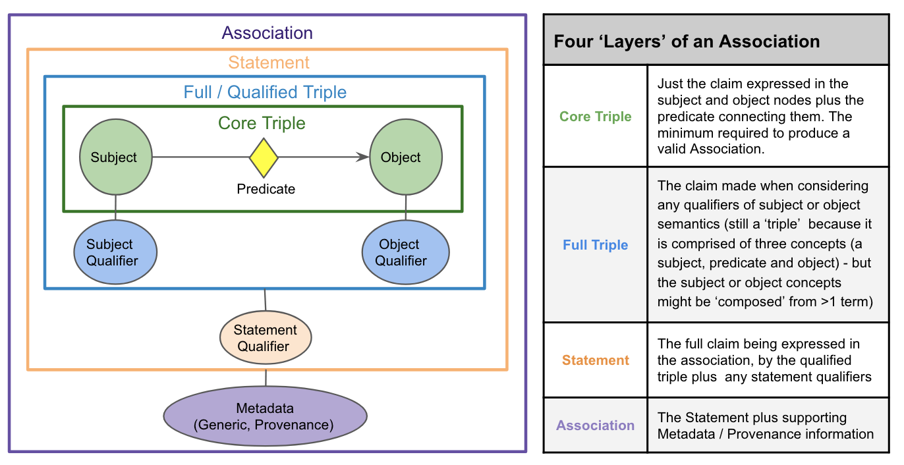
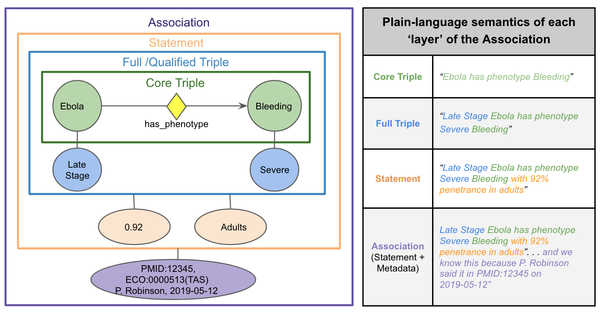

## Overview

`biocypher/config/torchcell_schema_config.yaml` defines the BioCypher schema that grounds torchcell data objects in the [Biolink Model](https://biolink.github.io/biolink-model/) ontology.

**Goal:** Map torchcell-specific entities (experiments, phenotypes, environments) to Biolink's standardized biological ontology, ensuring semantic interoperability and ontological correctness. For now the mapping is loose. We are trying to pave the way.

## Schema Structure

### Nodes (Entities)

- **Direct Biolink usage**: `dataset`, `genome`, `publication` - used as-is from Biolink
- **Inherited entities**: `experiment`, `fitness phenotype`, `media` - torchcell-specific types that inherit from Biolink classes via `is_a`

### Edges (Relationships)

- Map data relationships to Biolink predicates via `is_a`
- Example: `phenotype member of` (torchcell relationship) `is_a: participates in` (Biolink predicate)

## Key Design Decisions

### Experiments as Continuants

- `experiment` and `experiment reference` inherit from `information content entity` (not `activity`)
- Rationale: We store experimental observations (data records), not running processes

### Dataset Membership

- Uses `part of` predicate for `experiment member of` → `dataset`
- Rationale: Experiments are compositional components of datasets (not outputs produced by a process)

## Biolink Triple Structure

The Biolink model defines a core triple pattern for biological knowledge:

**Reference:** [Understanding the Biolink Model](https://biolink.github.io/biolink-model/understanding-the-model/)

## Visualization

See [[Mermaid diagrams|torchcell.ontology.mermaid_diagram]] for visual representation of the complete ontology mapping.

## 2026.01.21 - Flip Flopping on Mapping

Ontology mapping is inherently subjective - the "correct" parent class depends on which aspect of the entity you emphasize. For experiments, we've already changed mappings at least once:

**Previous:** `experiment is_a: activity` (emphasizing the experimental process/procedure)
**Current:** `experiment is_a: information content entity` (emphasizing the recorded observation/data)

Both mappings are defensible depending on perspective:

- If modeling the experimental **procedure** → `activity` or `protocol`
- If modeling the **execution** of that procedure → `process execution` or `activity`
- If modeling the **recorded results** → `information content entity` (our choice)

This ambiguity extends to other entities. For instance, `environment` could be:

- `environmental exposure` (the condition itself - our choice)
- `exposure event` (the time-bounded incident of exposure)
- `material entity` (the physical medium)

**Challenge:** Without clear guidelines, we risk inconsistency as the schema evolves. Different developers might make different mapping choices for similar entities.

**Future consideration:** Establish mapping principles or decision criteria (e.g., "always model stored database records as information/data entities, not processes") to ensure consistency. For now, the Mermaid diagrams help visualize these choices and catch obvious inconsistencies.

## 2026.10.15 - One `perturbation` class, `sequence variant perturbation` beneath it, `host_genome` and `genome.assembly_set` (ontology unification G)

Served perturbation-side classes after this change, each with its Biolink 3.2.1 parent (constitution principle 6; the reasoning is in the yaml comment above each class):

| class | is_a | why |
|---|---|---|
| `genome` | (Biolink's own `genome`, auto-mapped) | gains `assembly_set`, the registry id of the deposited set the reference pins |
| `perturbation` | `genotype` | every `GenePerturbationType` member of every host; gains `host_genome` (mandatory, the assembly-set vocabulary) |
| `sequence variant perturbation` | `perturbation` | a leaf that composes a `BacterialVariantCall`; the call's six columns; a child so a served `MATCH (:Perturbation)` returns every perturbation |
| `environment perturbation` | `environmental exposure` | unchanged |
| `phage perturbation` | `biotic exposure` | unchanged class; now emitted by the one environment method |
| `perturbation member of` | `genetically associated with` | sources `[perturbation, sequence variant perturbation]` |
| `perturbation of genome` (new, optional) | `is sequence variant of` | "holds between a sequence variant and a nucleic acid entity" (3.2.1); a perturbation is an edit stated against the host genome's deposited sequence; neither `located in` (material entities) nor `part of` says that |
| `crispr construct member of` | `part of` | target `perturbation` only |

Removed: `bacterial perturbation` (is_a genotype) and `bacterial sequence variant perturbation` (is_a genotype). They differed from `perturbation` by the host alone (principle 1), and choosing the lane by conf left a leaf the conf did not list with an edge and no node (audit C 1.3). The mermaid diagram and the `tc-onto` table change with it: 49 nodes, 15 edges.

Release-note text for KG 4.0 (lane M):

> **Graph classes.** The node labels `BacterialPerturbation` and `BacterialSequenceVariantPerturbation` are retired. Every gene perturbation of every host is a `Perturbation` node; a called sequence variant (Lim 2025, de Siqueira 2025, Menasalvas 2025, Guzman 2018) is a `SequenceVariantPerturbation` node, which also carries the `Perturbation` label (`is_a`). `Perturbation` gains `host_genome`, the deposited assembly set the record's identifiers are written against (`sgd_S288C_R64-4-1_20230830`, `ecoli_K12_MG1655_ASM584v2`, ...), and `Genome` gains `assembly_set` in the same vocabulary, so `MATCH (p:Perturbation), (g:Genome) WHERE p.host_genome = g.assembly_set` joins them by value; the `gene_namespace` property of the retired labels is replaced by `host_genome`. `PhagePerturbation` is unchanged. A new relationship type `PerturbationOfGenome` (Perturbation -> Genome) is declared but not written in this release. A query written as `MATCH (:BacterialPerturbation)` returns nothing; rewrite it against `:Perturbation` with a `host_genome` filter. Content ids are not comparable with KG 3.0 (P1 re-keyed every perturbation, genotype and experiment).
