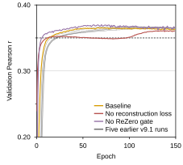
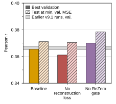
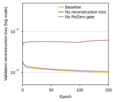

## 2026.10.27 - Arms frozen, SI panels and table for note:dango-full

`experiments/006-kuzmin-tmi/scripts/dango_ablation_si.py` pulls every run of W&B project `zhao-group/torchcell_006-kuzmin2018-tmi_dango_ablation` (trained by [[experiments.006-kuzmin-tmi.scripts.dango_ablation]]), asserts one finished run per arm and that every arm is one of `baseline`, `no_pretrain`, `no_rezero`, `no_pretrain_no_rezero`, and freezes:

- `experiments/006-kuzmin-tmi/results/dango_ablation_curves.csv`: one row per arm and epoch (val Pearson, val MSE, val reconstruction and interaction loss, val alpha, train Pearson, beta1, beta2, epoch wall s, runtime s, plus the summary test Pearson and MSE of the min-val-MSE checkpoint).
- `experiments/006-kuzmin-tmi/results/dango_ablation_arms.csv`: one row per arm (run id, slurm job id from the run name, best val r and epoch, val r and epoch at min val MSE, test r at that checkpoint, first epoch with val r >= 0.35 and >= 0.36, hours to 0.36, val r at epochs 50 and 100, final betas, val reconstruction loss first and last, median epoch wall s).
- `paper/nature-biotech/sections/tab-dango-ablation-arms.tex` (Supplementary Table `tab:dango-ablation-arms`).

`--from-csv` re-renders without W&B. The gray reference curves and the band in panel b are the five STRING v9.1 runs read from `experiments/010-kuzmin-tmi/results/dango_full_dataset_{runs,history}.csv` ([[experiments.010-kuzmin-tmi.scripts.dango_full_dataset_si]]); the script checks that their maxima all fall before epoch 150, so the 150-epoch window leaves their best r unchanged. The history scan returns every row whatever the `keys` argument, so each quantity is taken from the rows that carry it, one per epoch.

Scoring rule: best validation Pearson r is the maximum over epochs (an upward-biased order statistic); test is scored once, at the min-val-MSE checkpoint the trainer keeps. One seed per arm, 150 epochs, batch 64 on one NVIDIA RTX 6000 Ada GPU (GilaHyper). The both-off arm (job 6445) was held and has no run.

| arm | run | best val Pearson r (epoch) | val Pearson r at min val MSE (epoch) | test Pearson r at min val MSE | first epoch val r >= 0.35; >= 0.36 | val r at epoch 50; 100 | beta1, beta2 after epoch 149 | val reconstruction loss, epoch 0 to 149 | median epoch wall (s) |
|---|---|---|---|---|---|---|---|---|---|
| baseline | `qy17re1f` (6442) | 0.3654 (70) | 0.3652 (74) | 0.3711 | 13; 33 | 0.364; 0.364 | 0.071, 0.072 | 0.0019 to 0.0010 | 311 |
| no reconstruction loss | `s2bpfsqr` (6443) | 0.3611 (137) | 0.3606 (129) | 0.3705 | 12; 126 | 0.351; 0.351 | 0.092, 0.135 | 0.0047 to 0.0062 | 212 |
| no ReZero gate | `wlszxkke` (6444) | 0.3701 (70) | 0.3688 (58) | 0.3784 | 6; 17 | 0.368; 0.366 | none | 0.0019 to 0.0011 | 309 |

Five earlier v9.1 runs (2 to 4 GPUs at batch 64 per GPU, so 2 to 4 times fewer optimizer steps per epoch): best val r 0.3652 to 0.3676, r >= 0.35 at epochs 16 to 23, r >= 0.36 at epochs 39 to 66.

Reading, on one seed per arm. The reconstruction loss gives no head start to r = 0.35 (epoch 12 against 13) and no gain in test r at the kept checkpoint (0.3705 against 0.3711), but without it the model stalls near 0.35 until about epoch 100 and reaches 0.36 at epoch 126 against 33 (7.5 h against 3.0 h, although its epochs are 32% shorter); its best validation r is 0.004 below the baseline. So "the interaction objective alone reaches the same plateau" holds for test r at the kept checkpoint and not for the time to the plateau. Removing the ReZero gate is not worse and on this seed better and faster: 0.35 at epoch 6 and 0.36 at epoch 17, best val r 0.3701, test r 0.3784. Hypothesis (untested): a gate initialized at 0.01 scales down the attention branch's gradient early in training. The arm without the reconstruction loss tests the auxiliary joint loss of the TorchCell implementation, not the DANGO paper's staged pretraining.

Panels (third width, 57.8 x 52 mm; composed into `FigS-dango-ablation` by [[experiments.006-kuzmin-tmi.scripts.dango_ablation_compose_figure]]):

a. Validation Pearson r against epoch per arm, five earlier v9.1 runs in thin gray, dashed r = 0.35, y zoomed to 0.20 to 0.40.

b. Best validation r (line-color bar) and test r at the min-val-MSE checkpoint (fill-color hatched bar) per arm; gray band, the five earlier runs' best validation r range.

c. Validation reconstruction loss (unweighted) against epoch, log axis.

W&B runs:

https://wandb.ai/zhao-group/torchcell_006-kuzmin2018-tmi_dango_ablation/runs/qy17re1f
https://wandb.ai/zhao-group/torchcell_006-kuzmin2018-tmi_dango_ablation/runs/s2bpfsqr
https://wandb.ai/zhao-group/torchcell_006-kuzmin2018-tmi_dango_ablation/runs/wlszxkke
