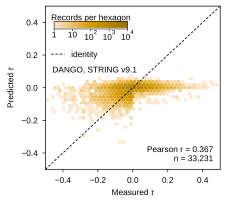
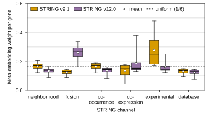

## 2026.10.26 - Panels e, f, g of FigS-dango-full-dataset

Script: `experiments/010-kuzmin-tmi/scripts/dango_full_dataset_panels_efg.py`. It draws the three panels that were reserved boxes in `FigS-dango-full-dataset` (SI note `note:dango-full`, `paper/nature-biotech/sections/si-note-dango-full.tex`) from the files [[experiments.010-kuzmin-tmi.scripts.dango_full_dataset_inference]] wrote, plus the CGT `c7671wgj` validation predictions of [[experiments.010-kuzmin-tmi.scripts.score_010_checkpoints_directly]]. No model is run. Before drawing, the script recomputes validation Pearson from the saved arrays and asserts it equals the recorded value (`dango_full_dataset_inference_check.csv` for DANGO, `cgt_direct_scoring.csv` for the CGT) to 1e-9. Panel e is third width at 52 mm (the height of the convergence panel, so it closes row 2); f and g are half width at 50 mm, which keeps the composed figure at 169.3 mm tall. Colors keep their meaning from panels a to d: DANGO STRING v9.1 amber, v12.0 lilac, CGT wheat.

Run from the repo root: `python experiments/010-kuzmin-tmi/scripts/dango_full_dataset_panels_efg.py`.

### e: predicted against measured tau

DANGO `014mprap` (STRING v9.1), minimum-validation-MSE checkpoint (epoch 81), on the experiment-006 validation split: n = 33,231, Pearson r = 0.3672 (same value as the inference check). Hexbin, 48 hexagons across [-0.5, 0.5], log count color scale (amber ramp), dashed identity line. Predictions span -0.334 to 0.064 (SD 0.0233); measured tau spans -0.990 to 0.914 (SD 0.0611). 25 records have |measured tau| > 0.5 and lie outside the axes; no prediction does. Frozen in `results/dango_full_dataset_panel_e_summary.csv`.

### f: absolute error against |tau|, DANGO beside the CGT

Panel dropped 2026.10.26 (see the section of that date below); its SVG and `dango_full_dataset_panel_f_bins.csv` were deleted, and the numbers below are the record of what it showed.

Each model on its own validation split: DANGO `014mprap` minimum-MSE on the experiment-006 split (33,231 records) and CGT `c7671wgj` best-Pearson checkpoint (epoch 24, val r 0.4619) on the experiment-010 split (37,673 records). The splits come from different builds and differ in membership; nothing is joined record by record. Fixed bins of measured |tau|, width 0.02, from 0 to 0.22 (about the 99th percentile: 0.210 in the 006 split, 0.218 in the 010 split). Line = median of |prediction - tau| per bin, band = interquartile range, dashed diagonal = the error of predicting 0 (which is |tau|).

| quantity | DANGO (006 val) | CGT (010 val) |
|---|---|---|
| share of records with \|tau\| < 0.02 | 35.5% | 34.4% |
| median abs error, \|tau\| < 0.02 | 0.0116 | 0.0150 |
| median abs error, \|tau\| 0.10 to 0.12 | 0.1023 | 0.0943 |
| median abs error, \|tau\| 0.20 to 0.22 | 0.1951 | 0.1722 |
| median abs error / median \|tau\|, bins 0.02 to 0.22 | 0.925 to 0.950 | 0.770 to 0.881 |
| median abs error, all records | 0.0276 | 0.0278 |
| records with \|tau\| >= 0.22 (beyond the axis) | 291 (0.9%) | 363 (1.0%) |

The CGT's median error is lower in every bin from 0.02 up; DANGO's is lower only below 0.02. DANGO's median error stays 5 to 7% below the error of predicting 0 in every bin from 0.02 to 0.22, the CGT's 12 to 23%. Hypothesis (untested): DANGO's narrow prediction range (panel e) is what keeps its error close to predicting 0 at large |tau| and below the CGT's near tau = 0; that link is not tested here. Frozen per bin (n, share, median, q25, q75, mean, median |tau|, ratio) in `results/dango_full_dataset_panel_f_bins.csv`, with an `above_top` and an `all` row per model.

### g: meta-embedding channel weights by STRING release

Per-gene softmax weight over the six STRING channels, all 6,607 genes, for `014mprap` (v9.1, epoch 81) and `9jpfy547` (v12.0, epoch 53), both minimum-MSE checkpoints. Box = interquartile range, black line = median, open circle = mean, whiskers = 5th to 95th percentile, no fliers, dashed line = 1/6.

| channel | v9.1 mean | v9.1 share > 1/6 | v12.0 mean | v12.0 share > 1/6 |
|---|---|---|---|---|
| neighborhood | 0.167 | 59.0% | 0.134 | 4.3% |
| fusion | 0.125 | 0.0% | 0.261 | 94.4% |
| co-occurrence | 0.166 | 57.5% | 0.136 | 0.9% |
| co-expression | 0.135 | 34.8% | 0.187 | 35.6% |
| experimental | 0.277 | 99.4% | 0.161 | 24.4% |
| database | 0.130 | 0.2% | 0.123 | 0.0% |

The largest channel is experimental with v9.1 and fusion with v12.0. The v12.0 co-expression weight is skewed (median 0.152, mean 0.187, 95th percentile 0.381). Frozen in `results/dango_full_dataset_panel_g_summary.csv` (mean, median, quartiles, 5th and 95th percentiles, min, max, share above 1/6).

### Not measured

- Only one DANGO checkpoint enters e and f, and one CGT replicate enters f; no spread over replicates is shown.
- f compares two error profiles on two different validation splits; a paired comparison needs both models scored on one split, which no run provides (no DANGO run on the experiment-010 build exists).

## 2026.10.26 - Error panel dropped; channel weights become f at third width

Owner's review of `FigS-dango-full-dataset`: the absolute-error-against-|tau| panel is dropped, because the DANGO against CGT comparison is carried by the Pearson values of panels a and b and by Fig. 2d. The script is renamed `experiments/010-kuzmin-tmi/scripts/dango_full_dataset_panels_ef.py` (front matter and docstring updated); `load_cgt`, `error_bins`, `panel_error_vs_tau`, the CGT label-table path and the bin constants are removed, so the script no longer reads the 010 build or the CGT predictions. `dango_full_dataset_panel_f_bins.csv` and `dango_full_dataset_error_vs_tau.{svg,png}` are deleted. The channel-weight panel, formerly g, is now f; its frozen summary keeps the name `dango_full_dataset_panel_g_summary.csv`, and both summary CSVs and the panel e SVG/PNG came out byte-identical on the re-run.

Run from the repo root: `python experiments/010-kuzmin-tmi/scripts/dango_full_dataset_panels_ef.py`.

### f: channel weights at third width

Third width (57.8 mm) at 52 mm, like every panel of the 2 x 3 figure. Six channels at 57.8 mm leave 7.4 mm per channel, too narrow for `neighborhood` (13.1 mm at 6 pt Arial) or `experimental` (12.2 mm) on one line, so the channel names are set in full at 45 degrees (anchored at their tick, `rotation_mode="anchor"`), which needs no abbreviation key in the caption; the bottom margin is 0.30 of the panel height to hold them. Both releases are kept per channel (boxes 0.32 wide at offsets of plus and minus 0.19), the dashed line stays at 1/6, the mean markers are 2.0 pt. The legend is one column in the upper left, over the first two channels, whose 95th percentiles stay at or below 0.34; a two-column legend cleared the experimental v9.1 whisker (95th percentile 0.48) by only about 1.3 mm. Values unchanged.
