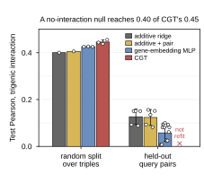

## 2026.10.13 - Figure 2 panel d, the additive null

Third-width panel for manuscript Figure 2 and the prelim's interactions figure, from the two tables the additive-baseline study wrote (`additive_baseline_gene_interaction.csv`, `query_pair_disjoint_cv.csv`; findings in [[experiments.010-kuzmin-tmi.additive-baseline-analysis]]). Test Pearson on the Kuzmin trigenic score: on the random split over triples the additive ridge (no capacity for interaction) reaches 0.400, additive plus query pair 0.406, the gene-embedding MLP 0.426 (three seeds, sd 0.001), the three CGT checkpoints 0.446 (sd 0.009). On the five query-pair-disjoint folds the additive models fall to 0.127 and 0.124 (sd 0.033) and the MLP to 0.058 (sd 0.037); the CGT has not been refit on those folds, which the panel marks. Bar is the mean, whisker the sample sd, every replicate an open circle.

