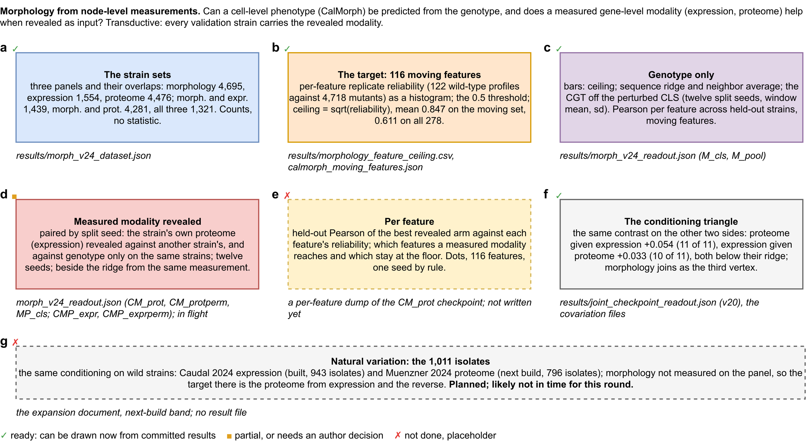

## 2026.10.11 - The morphology SI figure as a sketch

Writes `notes/assets/drawio/fig3-si-morphology-sketch.drawio.svg` (and a PNG preview) through the draw.io writer of `fig3_mockup_drawio.py`: seven boxes with the Figure 3 gate's status marks, no data. Panels: a the strain sets, b the 116 moving features and the ceiling, c genotype only, d a measured modality revealed (paired against the permuted and the genotype-only controls; in flight), e per feature (not written), f the conditioning triangle (v20), g the 1,011 isolates (planned, likely not in time). The sketch is the top section of `notes-tex/figure-3-gate` and is what the morphology experiments are run against. Export on GilaHyper: the desktop draw.io binary extracted from the .deb under `xvfb-run`, `DRAWIO=<binary>`.

