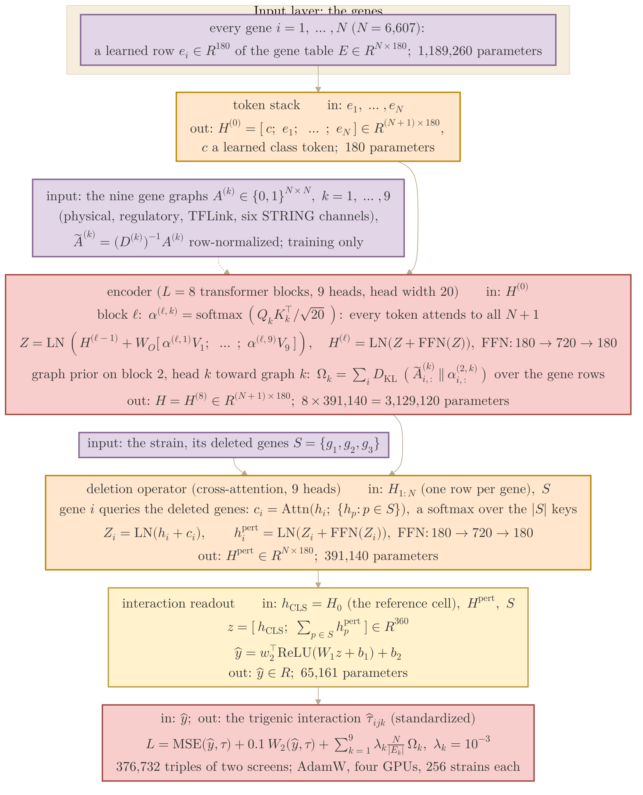
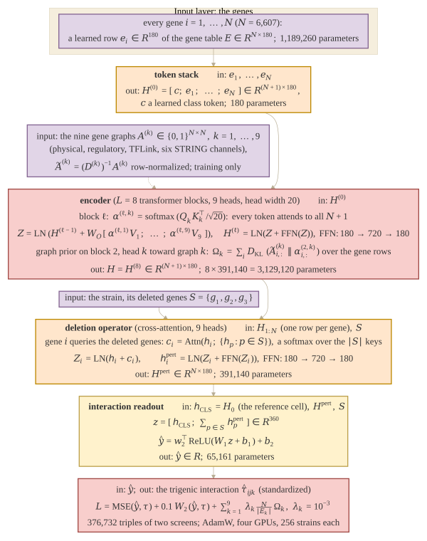

## 2026.10.31 - The trigenic Cell Graph Transformer drawn as a function

The model of the trigenic result (Fig. 2 of the manuscript, thesis Fig. 3.5d), configuration
`experiments/025-solid-growth/conf/cgt_s0_r_kl_000.yaml` (the 010 model copied verbatim onto the
025 build: hidden width 180, eight encoder blocks of nine heads, the KL prior on the nine heads
of the second block, a nine-head cross-attention deletion operator, the interaction readout).
Drawn in the function view of [[experiments.028-gene-essentiality.architecture-mermaid]]: every
box names what it takes in, the map, what it puts out and its parameter count, and the output
symbol of one box is the input symbol of the next. Rendered by
`bash notes/assets/publish/scripts/mermaid_pdf.sh notes/experiments.025-solid-growth.architecture-mermaid.md`
to `notes/assets/pdf-output/experiments.025-solid-growth.architecture-mermaid.pdf`. Colors are the
Type I / Type II palette of [[torchcell.models.equivariant_cell_graph_transformer.mermaid.colors]]:
inputs purple, the embedding and the deletion operator orange, the attention blocks and the output
red, the graph prior and the readout yellow.

### Coherence audit against the code (2026.10.31)

Checked against `torchcell/models/equivariant_cell_graph_transformer.py` on main
(`GraphRegularizedTransformerLayer.forward`, `EquivariantPerturbationTransform.forward`,
`PerturbationHead.forward`, `CellGraphTransformer.compute_graph_regularization_loss`,
`_normalize_adjacency_matrices`), `torchcell/losses/point_dist_graph_reg.py`
(`PointDistGraphReg.forward`), `experiments/025-solid-growth/scripts/equivariant_cell_graph_transformer.py`
(the model and loss construction) and `conf/cgt_s0_r_kl_000.yaml`. The parameter counts are the
model's own tally, `CellGraphTransformer.num_parameters` on an instance built from the config
over a 6,607-gene graph: gene table 1,189,260; class token 180; encoder 3,129,120 (each block:
Q, K, V and output projections 130,320, feed-forward 260,100, two norms 720); operator 391,140;
readout 65,161; total 4,774,861. Statements the code fixes, and that an earlier description got
wrong somewhere:

- The encoder is post-norm: `norm1(x + dropout(out_proj(attn)))` then `norm2(z + dropout(ffn(z)))`,
  with the feed-forward 180 to 720 to 180 and GELU. The thesis review of 2026-10-29 corrected the
  same point in Section 3.4.
- The operator runs on the gene rows only; the class token is not transformed, and the readout
  reads the reference cell's class token (`h_CLS = H[0]`). Every gene is a query and the
  deleted genes' encoded rows are the keys and values (`nn.MultiheadAttention`, nine heads).
- The readout sums the perturbed rows of the deleted genes (`pooling` defaults to `sum`; the
  config sets nothing, so the 025 runs sum where 010 averaged; at a constant three deletions
  the factor is absorbed by the first linear layer).
- The graph prior sits on `graph_reg_layer: 1`, the second block in reading order; head k of
  that block is pulled toward graph k (the nine `regularized_heads`); the KL runs over the
  gene-gene block with the class row and column excluded (`attention_weights[:, :, 1:, 1:]`),
  every row (`row_sampling_rate: 1.0`), and each graph's term is divided by its edge count over
  N (`kl_loss / (edges_k / gene_num)`) with `lambda_k = 1e-3` applied once.
- The loss is `PointDistGraphReg`: MSE at weight 1, the Wasserstein term at 0.1 (`geomloss`
  Sinkhorn, p = 2, blur 0.05, scaling 0.9; `use_buffer: false` selects the unbuffered
  `WeightedWassersteinLoss`, which has no minimum batch size, so the term is live on every
  batch of 256 although the config's `min_samples_for_wasserstein: 512` would gate the buffered
  version), and the model's graph term at weight 1.
- Labels are standardized over the 376,732 triples (`fit_on: subset`), so the readout predicts
  the standardized interaction.

