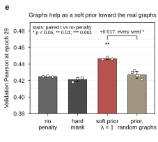

## 2026.10.13 - Figure 2 panel e, do the graphs help

Third-width panel for manuscript Figure 2 and the prelim's interactions figure, from the graph-regularization sweep's runs table and summary ([[experiments.025-solid-growth.scripts.graph_reg_sweep_readout]]; the full study in `notes-tex/025-graph-reg-sweep`). Validation Pearson at epoch 29 on the pinned 010 split, three seeds (five for the random arm): no penalty 0.425 (sd 0.0005), hard mask 0.421 (sd 0.003, paired p 0.16 vs no penalty), soft prior at lambda 1 toward the nine graphs 0.447 (sd 0.001, p 0.001), the same prior toward degree-matched rewirings 0.427 (sd 0.004, p 0.16). Prior minus random on the three shared seeds +0.0135, +0.0181, +0.0201, mean +0.017, t 8.8, p 0.013. Bar is the seed mean, whisker the sample sd, every seed an open circle.

