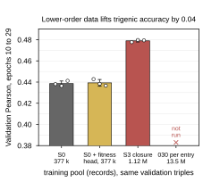

## 2026.10.13 - Figure 2 panel f, the training pool

Third-width panel for manuscript Figure 2 from `s3_closure_readout.csv` ([[experiments.025-solid-growth.scripts.s3_closure_readout]], re-run 2026-10-13 so the two 50-epoch S3 seeds are in). Score is the readout's rule, the mean validation Pearson over epochs 10 to 29 on the pinned 010 validation triples. S0 control (interaction head only) 0.4386 (sd 0.0024; seeds 0.4381, 0.4364, 0.4412), S0 with the joint fitness head 0.4392 (sd 0.0032; 0.4428, 0.4383, 0.4366), S3 closure with the joint fitness head 0.4789 (sd 0.0011; 0.4777, 0.4797, 0.4794; runs yb4gjh51, 8fuwsk48, srl1xzdf). The head alone adds nothing; the lower-order data adds 0.040. The 030 per-entry build is marked not run. The datasets, in one line: 010 is the 376,732 Kuzmin triples; 025 is the full solid-growth build (13.5 M genotypes) in which S0 is exactly those triples and S3 is their closure (5,694 singles, 739,219 doubles, the triples); 029 is the deletion-only successor; 030 keeps every source entry per genotype (13,525,088 entries).

