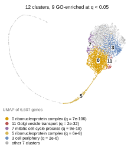
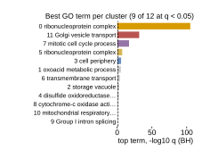
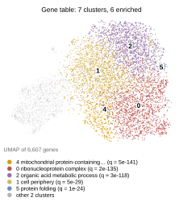

## 2026.10.13 - Wild-Type Gene Representations of the S3 Closure Transformer Cluster by GO

Question: do the strain-independent gene representations of the best trained 025 cell graph transformer form clusters, and are those clusters enriched for Gene Ontology terms?

### Model and checkpoint

- Config `cgt_s3_r_kl_fit_031` (S3 closure, joint fitness weight 1.0), overrides `+seed=2 trainer.max_epochs=50`, IGB `mmli` job 2409672, code from IGB worktree `025-fitness-joint-head-h`.
- W&B run `8fuwsk48` (seed 2, 50 epochs, finished):

<https://wandb.ai/zhao-group/torchcell_025-solid-growth_equivariant_cell_graph_transformer/runs/8fuwsk48>

- Selection rule: the best validation gene-interaction Pearson checkpoint (Lightning `ModelCheckpoint`, `save_top_k=1`, mode max). Epoch 43, val Pearson 0.5009 on the 37,673 pinned 010 triples. This is a max over 50 noisy epochs, so it is an upward-biased order statistic, not the run's typical score. Seed 3 (`srl1xzdf`) peaked at 0.4994 (epoch 42) by the same rule; seed 2 was chosen as the higher of the two complete runs.
- Source: `biologin.igb.illinois.edu:/home/a-m/mjvolk3/scratch/torchcell/models/checkpoints/compute-5-7-2409672_a77a071b1a74dc1d22b715e4511723a11f8fa52109d7888315078137d4319e2e/8fuwsk48-best-pearson-epoch=43-val/gene_interaction/Pearson=0.5009.ckpt`
- Local copy: `$DATA_ROOT/models/025-s3-closure/8fuwsk48/8fuwsk48-best-pearson-epoch=43-val_gene_interaction_Pearson=0.5009.ckpt`, sha256 `497793babccbffc28a0cf2a48814472afec1662dbcd14620b68e15072e2bddc7`, 97,547,451 bytes. The resolved run config (`wandb_config_resolved.yaml`, from the W&B API) and `manifest.json` (source path, sha256, retrieval command) sit beside it. The script refuses to run if either sha256 no longer matches.

### Load check (job 4830)

- The cell graph is rebuilt from the genome the way the trainer builds it. Its nine edge counts equal the cell graph W&B recorded for the run (physical 144,211 through STRING coexpression 1,002,806).
- `load_state_dict(strict=True)` on 160 tensors.
- Re-scoring the 37,673 validation triples gives Pearson 0.50072 against the recorded 0.5009 (difference 1.8e-4; DDP pads the final validation batch, so an exact match is not expected). A wrong gene order or a mis-loaded weight would not pass this.

### What is extracted

With `attention_mask.enabled: false`, the encoder runs once at batch 1 on `[CLS; preprocessor(table)]`, so both matrices below are the same for every strain ([[experiments.010-kuzmin-tmi.additive-baseline-analysis]], "What the 010 transformer actually computes").

- `gene_table.npy`: `model.gene_embedding.weight`, [6607, 180], the learnable input table.
- `encoder_H_genes.npy`: `representations["H_genes"]` after the 8th layer, [6607, 180].
- `gene_order.json`: the cell graph's sorted node list, the row order of both.

### Methods

- Clustering, the same for both matrices: center, PCA to 50 components, kNN graph with k = 15 (Euclidean, symmetrized union, unweighted), Leiden on modularity at resolution 1.0 (python-igraph `community_leiden`, Python `random` seeded 0). Clusters are renumbered by size, 0 the largest. UMAP of the same 50 components (n_neighbors 15, min_dist 0.3, random_state 0) is for display only. Silhouette is computed in the 50-component space.
- GO: the SGD GFF `Ontology_term` ids carried per gene (`genome[g].go`, 37,957 direct annotations; 48 ids absent from or obsolete in `go.obo` 2024-01-17 are skipped), propagated to every `is_a` ancestor with goatools. All 6,607 genes carry at least one term (the trainer's `drop_empty_go` guarantees it). 2,118 terms with 10 to 500 annotated genes are tested.
- Test: one-sided hypergeometric per cluster and term; one Benjamini-Hochberg correction over all cluster x term tests of a representation. A cluster counts as GO-enriched when its best term (smallest p) has q < 0.05.
- The model never sees GO: its inputs are the learnable table and nine gene graphs (physical, regulatory, TFLink, six STRING 12.0 channels) used as an attention prior, not GO. STRING's `database` channel imports curated pathway knowledge, so GO-correlated structure is not fully independent of the inputs.

### Results (job 4830; the analysis-only reruns 4834 and 4837 reproduced every number)

| representation | clusters | GO-enriched clusters (q < 0.05) | genes in enriched clusters | significant cluster x term tests | silhouette (PCA-50) | modularity |
|---|---|---|---|---|---|---|
| encoder output | 12 | 9 | 6,165 | 942 | 0.067 | 0.560 |
| gene table (control) | 7 | 6 | 5,430 | 1,907 | 0.001 | 0.463 |

Adjusted Rand index between the two clusterings: 0.141.

Encoder clusters. Best term by smallest p; "in train triple" counts cluster genes that occur in at least one pinned training triple (4,352 of the 6,607 genes do). S3 also trains on every single, so a gene outside a training triple can still appear in a training single.

| cluster | genes | in train triple | best GO term | namespace | k / K | fold | q |
|---|---|---|---|---|---|---|---|
| 0 | 1,699 | 916 | ribonucleoprotein complex | CC | 345 / 476 | 2.82 | 7.0e-106 |
| 1 | 1,315 | 1,192 | oxoacid metabolic process | BP | 92 / 276 | 1.67 | 5.5e-06 |
| 2 | 981 | 657 | storage vacuole | CC | 67 / 276 | 1.63 | 9.2e-04 |
| 3 | 722 | 544 | cell periphery | CC | 61 / 273 | 2.04 | 2.3e-06 |
| 4 | 534 | 465 | disulfide oxidoreductase activity | MF | 9 / 25 | 4.45 | 3.9e-03 |
| 5 | 316 | 9 | ribonucleoprotein complex | CC | 55 / 476 | 2.42 | 5.6e-08 |
| 6 | 300 | 283 | transmembrane transport | BP | 29 / 246 | 2.60 | 1.2e-04 |
| 7 | 194 | 189 | mitotic cell cycle process | BP | 40 / 233 | 5.85 | 8.5e-18 |
| 8 | 182 | 0 | cytochrome-c oxidase activity | MF | 3 / 12 | 9.08 | 9.0e-02 |
| 9 | 139 | 0 | Group I intron splicing | BP | 1 / 10 | 4.75 | 1.0 |
| 10 | 121 | 2 | mitochondrial respiratory chain complex III | CC | 1 / 10 | 5.46 | 1.0 |
| 11 | 104 | 95 | Golgi vesicle transport | BP | 39 / 178 | 13.92 | 2.2e-32 |

Gene-table clusters: 0 ribonucleoprotein complex (1,633 genes, q 1.9e-135), 1 cell periphery (1,626, q 5.2e-29), 2 organic acid metabolic process (1,549, q 2.9e-118), 3 no enriched term (1,177, best q 1.0), 4 mitochondrial protein-containing complex (555, q 5.0e-141), 5 protein folding (43, q 1.2e-24), 6 storage vacuole (24, q 3.1e-07).

Measured observations:

- The encoder output splits the 6,607 genes into 12 clusters, 9 of them GO-enriched at q < 0.05. The strongest are ribonucleoprotein complex (cluster 0, q 7e-106), Golgi vesicle transport (cluster 11, 104 genes, 13.9-fold, q 2e-32) and mitotic cell cycle process (cluster 7, 194 genes, 5.9-fold, q 9e-18).
- Four encoder clusters (5, 8, 9, 10; 758 genes) contain almost no gene from a training triple (11 of 758). In the UMAP they form the long arc away from the main body. All three encoder clusters with no term at q < 0.05 (8, 9, 10) are among these four.
- Each silhouette is computed in that matrix's own PCA-50 space, so the two values compare cluster separation within each representation, not distances across them.
- Which representation clusters more cleanly depends on the criterion, so neither wins outright. The encoder output has the higher silhouette (0.067 against 0.001, both low) and modularity (0.560 against 0.463) and more enriched clusters (9 against 6, but out of 12 against 7). The gene table carries twice as many significant cluster x term tests (1,907 against 942) and stronger top terms (mitochondrial protein-containing complex q 5e-141, organic acid metabolic process q 3e-118). The two partitions agree weakly (ARI 0.141).

Hypotheses (untested):

- Hypothesis (untested): the arc clusters are genes whose rows received little task gradient because they never occur in a perturbed training triple, so their position reflects initialization plus whatever the attention keys contribute, not learned function. Test: compare each gene's table-row distance from its initialization (needs the initial weights, which no checkpoint stores; seed 2 can be re-initialized from the config) against its training-record count.
- Hypothesis (untested): the large GO signal in the table partly reflects training coverage (essential genes are rare in the Kuzmin triples, and essential genes are enriched for ribosome and RNA-processing terms). Test: repeat the enrichment within the 4,352 training-triple genes only.

### Figures

Encoder output, colored by the five clusters with the smallest best-term q (the other clusters gray):



Best GO term per encoder cluster, -log10 q (BH), dashed line at q = 0.05:



Control, the learnable gene table under the identical recipe:



Figure style: third width (57.8 mm), Arial 6 pt (legend 5 pt), primaries of `torchcell.utils.PLOT_PALETTE`, no axes border (this figure family has none), true-size SVG.

### Outputs

- `experiments/025-solid-growth/results/wt_gene_embeddings/`: `encoder_H_genes.npy`, `gene_table.npy`, `gene_order.json`, `load_check.json`, `cluster_assignments.csv` (gene, in_train_triple, cluster and UMAP coordinates per representation), `go_enrichment.csv` (every test at q < 0.05 plus each cluster's best term), `summary.json` (pydantic `Summary`, includes the checkpoint manifest).
- `$ASSET_IMAGES_DIR/025-solid-growth/fig2_wt_gene_clusters{,_bars,_table_control}.{svg,png}`.

### Commands

```bash
# checkpoint selection (GilaHyper, W&B API): best val/gene_interaction/Pearson per run
#   8fuwsk48 epoch 43 0.5009; srl1xzdf epoch 42 0.4994
# one listing on the IGB login node
ssh mjvolk3@biologin.igb.illinois.edu 'ls -l /home/a-m/mjvolk3/scratch/torchcell/models/checkpoints/compute-5-7-2409672_a77a071b1a74dc1d22b715e4511723a11f8fa52109d7888315078137d4319e2e/'
# copy only the chosen checkpoint
rsync -av "mjvolk3@biologin.igb.illinois.edu:/home/a-m/mjvolk3/scratch/torchcell/models/checkpoints/compute-5-7-2409672_a77a071b1a74dc1d22b715e4511723a11f8fa52109d7888315078137d4319e2e/8fuwsk48-best-pearson-epoch=43-val/" "$DATA_ROOT/models/025-s3-closure/8fuwsk48/ckpt_src/"
# full run: load check, extraction, clustering, enrichment, panels (job 4830, 16 CPUs, no GPU)
sbatch -J 025-wtclust-w1-all experiments/025-solid-growth/scripts/gh_wt_gene_embedding_clusters.slurm
# analysis and panels only, from the saved matrices (job 4834)
sbatch -J 025-wtclust-w2-analyze --time=00:40:00 experiments/025-solid-growth/scripts/gh_wt_gene_embedding_clusters.slurm --analyze-only
```

Logs: `experiments/025-solid-growth/slurm/output/025-wtclust-w1-all_4830.out`, `025-wtclust-w2-analyze_4834.out`.
