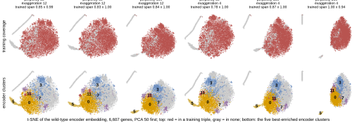

## 2026.10.13 - t-SNE beside the UMAP of Figure 2

Script: `experiments/025-solid-growth/scripts/wt_gene_embedding_tsne.py`. Reads the encoder embedding and the cluster assignments written by [[experiments.025-solid-growth.scripts.wt_gene_embedding_clusters]] (PCA to 50 first, as the UMAP had) and draws six t-SNE settings, perplexity 30 to 200 and early exaggeration 12 or 4, each colored by training coverage and by the five best-enriched encoder clusters.

What the grid shows (observed on this run, seed 0):

- The arc of the UMAP, the genes in no training triple, does not disappear under t-SNE. At every setting those genes form a thin detached sliver (two slivers at perplexity 30 to 100), and cluster 5, the second ribonucleoprotein cluster, is the sliver nearest the trained cloud.
- The trained genes take 78 to 100 percent of the panel's width and 94 to 100 percent of its height (the "trained span" in each title), against roughly 40 percent in the UMAP where the arc sets the frame. Perplexity 200 with exaggeration 4 gives the largest trained cloud (span 1.00 by 0.94) with the slivers pushed to the margin.
- Clusters 0, 3, 7 and 11 keep their UMAP arrangement in every t-SNE: 0 (ribonucleoprotein) at the bottom, 3 (cell periphery) at the top, 11 (Golgi) and 7 (mitotic cell cycle) between them.

Embeddings for every setting are saved to `experiments/025-solid-growth/results/wt_gene_embeddings/tsne.npz` (keys p<perplexity>_e<exaggeration>).

The sheet takes perplexity 30, exaggeration 4 (owner's pick, 2026-10-13, from the grid above); the script writes that setting's coordinates for the encoder and for the input gene table to `results/wt_gene_embeddings/tsne_coords.csv`.
