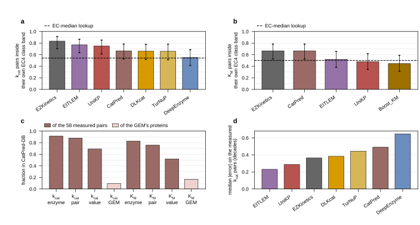
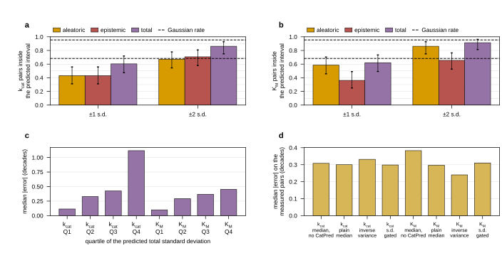

## 2026.09.12 - CatPred: admitted for K_M, rejected for k_cat, and the leakage that makes both readings fragile

### What CatPred is

Boorla and Maranas (2025), *Nature Communications* 16:2072, doi 10.1038/s41467-025-57215-9,
citation key `boorlaCatPredComprehensiveFramework2025`, MIT licensed. A fork of chemprop:
the substrate is a directed message-passing network over its 2D atom-bond graph; the enzyme
is a learned residue embedding carrying rotary positional information through multi-head
self-attention, concatenated with ESM-2 650M (`esm2_t33_650M_UR50D`) features and reduced by
an attentive pooling layer; the two meet in a fully connected head. **No EC number is an
input.** Structure features come from a pretrained E-GNN and are used only by the released
K_i model.

The head outputs a **mean and a variance** and is trained under a negative log-likelihood
loss, and the release is an ensemble of ten differently seeded copies. That makes it the
only predictor in our mirror of eight that returns a per-prediction uncertainty: the
aleatoric term is the mean of the ten predicted variances, the epistemic term the variance
of the ten means, both on the log10 scale (paper, Uncertainty Quantification in Methods).

Reported performance, Table 2 of the paper, mean over ten replicate models with the standard
error in parentheses:

| | k_cat held-out | k_cat OOD | K_M held-out | K_M OOD | K_i held-out | K_i OOD |
| --- | --- | --- | --- | --- | --- | --- |
| R2 | 0.6023 (0.0007) | 0.4042 (0.0038) | 0.6422 (0.0010) | 0.5332 (0.0022) | 0.6319 (0.0006) | 0.4462 (0.0012) |
| MAE (decades) | 0.7138 | 0.9870 | 0.5582 | 0.6528 | 0.8758 | 0.9875 |
| p1mag (%) | 75.91 | 61.43 | 83.91 | 79.04 | 67.84 | 60.50 |

Training data is CatPred-DB: 23,197 k_cat, 41,174 K_M and 11,929 K_i wild-type measurements
curated from BRENDA release 2022_2 and SABIO-RK as of November 2023, with a UniProt
accession, a substrate SMILES, an EC number and an NCBI taxonomy id on every row. Splits are
random 80-10-10 with no enzyme-substrate pair repeated across partitions; the
out-of-distribution set is the ~12 to 15 percent of the held-out set whose enzyme sequences
are at most 99 percent identical to any training sequence. Duplicate measurements are
reduced by the **maximum** for k_cat and the **geometric mean** for K_M and K_i.

**The released production weights were trained on train plus validation plus test.** Their
own `pretrained/production/kcat/args.json` records
`data_path: ../CatPred-DB/data/processed/splits_wpdbs/kcat-random_trainvaltest.csv`, and the
paper says the same in Methods: "The optimal values so obtained are used to train models on
the training+validation and training+validation+test datasets for testing and production
purposes respectively." So the R2 above describes the 80 percent-split models, not the
checkpoints mirrored here, and a pair anywhere in CatPred-DB is a pair these weights saw.

### Provenance record

Mirror `$DATA_ROOT/models/kinetics/catpred/`, manifest written by
`experiments/026-metabolism-flux/scripts/mirror_kinetic_models.py --models catpred`:
294 files, 54 with role `weights` totaling 217,832,979 bytes, `citation_key`
`boorlaCatPredComprehensiveFramework2025`, `retrieval_method` `direct_url`.

| artifact | source | bytes | hash |
| --- | --- | --- | --- |
| `capsule_data_update.tar.gz` (weights) | `https://catpred.s3.us-east-1.amazonaws.com/capsule_data_update.tar.gz` | 10,207,582,747 | sha256 `38d4f30215adc3538a10e7baee4df7be6c77dfe16db99f3c202c0497b985349b` |
| `CatPred-1.0.1.zip` (code) | Zenodo 10.5281/zenodo.14775002 | 85,722,027 | md5 `d0e7ab90cf667c15ea90b61fca6f371e` |
| `catpred-db.tar.gz` (training tables) | Zenodo 10.5281/zenodo.14775076 | 1,144,517,378 | md5 `38149eb47e149a1cee67ec80834365e1` |

The three archives are kept at
`$DATA_ROOT/data/enzyme_kinetics/weights/catpred_{capsule_data_update.tar.gz,code_1.0.1.zip,db.tar.gz}`
and the extraction recipe is the mirror manifest's `retrieval_command`. Only the k_cat and
K_M production ensembles and the six `*-random_*.csv` split tables were extracted into the
mirror; the K_i ensemble, the reproduce checkpoints and the 580 MB of pdbrecords were left
in the archive, which the sha256 pins.

**The value anchor is `pretrained/production/kcat/fold_0/model_0/model.pt`, sha256
`feec68cf1884bb14fc80abf8477aa3fc10f76781984ab2849e17e90bbfe8da90`.** One hash names the
build; the manifest resolves the other nineteen checkpoints.

Runner `experiments/026-metabolism-flux/scripts/run_catpred_pinned.py`, loader
`torchcell/datasets/kinetics/catpred.py`, registered in `KINETICS_CONFIGS` as `catpred`.
CPU only: all four GilaHyper GPUs were held by 027 training cells for the whole session, and
CatPred does not need one. Dependencies live in
`/scratch/projects/torchcell-scratch/envs/catpred/site-packages` (`typed-argument-parser`,
`docstring_parser`, `pandas-flavor`, `tensorboardX`, `descriptastorus`, `ipdb`, `ipython`,
`rotary_embedding_torch==0.6.5`), the same arrangement EITLEM uses for `fair-esm`.

**Three things had to be got right, and each was checked rather than assumed.**

1. **Output is log10.** `--selftest` reproduces the repository's own shipped
   `demo/batch_kcat_input_output.csv` first row: ours 0.1875471126, theirs 0.1875500416.
2. **The rotary pin is load-bearing.** With the environment's newer
   `rotary_embedding_torch` the released checkpoints raise
   `RuntimeError: The expanded size of the tensor (9) must match the existing size (8)`
   and produce nothing at all. `environment.yml` pins `0.6.5`.
3. **The repository's own postprocessing broadcasts row 0's uncertainty to every row.** In
   the shipped demo output rows 0 and 1 carry different predictions and identical
   `SD_total`, `SD_aleatoric` and `SD_epistemic`. The runner therefore recomputes all three
   from `<target>_mve_uncal_var` and the ten `<target>_model_i` columns instead of reading
   those columns.

**One deviation from the model's training convention, stated rather than hidden.** CatPred's
k_cat model was trained on the CONCATENATED SMILES of all reactants; the shared pair table
gives one substrate per row, which is what the other seven predictors were shown, so that is
what CatPred was shown. K_M has no such gap.

**One predictor property, measured.** CatPred drops any row whose substrate has no heavy
atom, because the D-MPNN has no atom-bond graph to build: **1,025 of the 7,456 pinned pairs**
are the bare proton yeast-GEM writes as `[H+]`, and they are recorded with the failure reason
`no_heavy_atom_substrate` rather than as silent NaN. Those rows cost only 5 catalytic units,
because the units that consume a proton consume something else too. Ordinary joining by
position would have been wrong here: CatPred returns fewer rows than it is given, so the
runner joins its output back on `(SMILES, sequence)`.

### Tables built

| version | rows | units | file sha256 |
| --- | --- | --- | --- |
| `catpred/processed/{k_cat,K_M}.parquet` | 6,724 | 3,712 | `a2e99adf62fb76924b460355494f920ae64b6dd3f4bf576fba66af3e8e7b0a87` (one file carries both columns) |
| `catpred/verified/k_cat.parquet` | 6,529 | 3,701 | `1556e280652312c6eb866ef04ef8f5c775d52b69b4ae02b1605f6aee2c488247` |
| `catpred/verified/K_M.parquet` | 6,529 | 3,701 | `3c2cf9944975ab32ff59adb2a7bf42a58d250dedf606fa1dc753513a11deab7f` |

Built by `build_kinetics_dataset.py --predictor catpred --device cpu` (7,456 pairs, 22 min
of wall clock on 128 cores, both parameters), then `improve_kinetic_coverage.py --stage predict --predictor catpred` (293 appended
pairs, 21.9 s) and `--stage predict-verified --predictor catpred` (1,120 re-predicted, 14.8 s).
Both parameters carry three extra columns the other seven do not:
`<parameter>_log10_sd_{total,aleatoric,epistemic}`.

### The training-overlap check

`experiments/026-metabolism-flux/scripts/catpred_training_overlap.py` ->
`results/catpred_training_overlap.json`. Three levels, matched on UniProt accession and on
the InChIKey connectivity block of the substrate, against
`CatPred-DB/data/*/[km|kcat]-random_trainvaltest.csv`, which is the table the production
weights were fit on.

| level | k_cat | K_M |
| --- | --- | --- |
| enzyme, the accession is in CatPred-DB | 53/58 (91.4 %) | 48/58 (82.8 %) |
| pair, the accession with a structure-matching substrate | **51/58 (87.9 %)** | **44/58 (75.9 %)** |
| value, the pair and a value within 0.1 decades of ours | 40/58 (69.0 %) | 30/58 (51.7 %) |

**The leak is concentrated exactly where scoring happens.** Across the whole GEM only
109/1,148 proteins (k_cat) and 193/1,148 (K_M) are in CatPred-DB, so 3,505 and 3,187 of the
3,709 catalytic units are genuine extrapolation, while 88 percent of the 58 pairs that CAN
be scored were fit on. Any accuracy or plausibility number for CatPred on those pairs is an
upper bound of a kind the other predictors' numbers are also subject to, but only CatPred's
can be quantified: it is the only one of the eight that released its training table with an
accession on every row. **No zero is claimed for the other seven; their overlap is
unmeasured, not absent.**

### The admission verdict

The rule is unchanged: rank on the `own_class_band` reading of the within-class study, and
keep a predictor whose **Wilson 95 percent lower bound** exceeds the EC-median lookup's
**point** fraction. Scored by
`within_class_plausibility.py --suffix _with_catpred` ->
`results/within_class_plausibility_with_catpred.json`, read through
`PredictorSelection.from_study`.

The denominator moved from 47 to 48 scorable pairs and the measured set from 57 to 58,
because `predictor_vs_measured.csv` was stale: it predated the 293-pair coverage extension of
2026-09-11, so re-running it against the current processed tables recovered one more measured
pair for the three predictors that were extended. DLKcat, DeepEnzyme, TurNuP and Boost_KM
were never re-run on those pairs, so they still score on 47, 47, 44 and 47.

**k_cat, lookup point 0.5417, threshold 33 of 48.**

| predictor | own-class | Wilson lower | verdict |
| --- | --- | --- | --- |
| EZKinetics | 40/48 = 0.8333 | 0.7042 | admitted |
| EITLEM | 37/48 = 0.7708 | 0.6346 | admitted |
| UniKP | 36/48 = 0.7500 | 0.6122 | admitted |
| **CatPred** | **32/48 = 0.6667** | **0.5254** | **rejected** |
| DLKcat | 31/47 = 0.6596 | 0.5167 | rejected |
| TurNuP | 29/44 = 0.6591 | 0.5114 | rejected |
| DeepEnzyme | 26/47 = 0.5532 | 0.4125 | rejected |

**K_M, lookup point 0.5000, threshold 31 of 48.**

| predictor | own-class | Wilson lower | verdict |
| --- | --- | --- | --- |
| EZKinetics | 32/48 = 0.6667 | 0.5254 | admitted |
| **CatPred** | **32/48 = 0.6667** | **0.5254** | **admitted** |
| EITLEM | 25/48 = 0.5208 | 0.3833 | rejected |
| UniKP | 23/48 = 0.4792 | 0.3447 | rejected |
| Boost_KM | 21/47 = 0.4468 | 0.3141 | rejected |

So the admitted sets become **EZKinetics, EITLEM, UniKP for k_cat** (unchanged) and
**EZKinetics plus CatPred for K_M**. CatPred misses the k_cat bar by a single hit: 33 of 48
would clear it at 0.5467 and 32 gives 0.5254 against 0.5417.

**K_i cannot be admitted by this rule and no path to admitting it is proposed.** There is no
K_i field in the phenotype schema, no K_i tier in the resolver, and no measured yeast K_i set
to score against, so the question the rule answers cannot be asked of it. The K_i ensemble is
not mirrored.

Raw accuracy on the same pairs, from `compare_predictors_to_measured.py`, agrees with the
split verdict and is worth recording because it is the sharper contrast: for k_cat CatPred is
sixth of seven (Spearman +0.470, median absolute error 0.49 decades, 72.4 percent within a
decade) and for K_M it is **first of five** (Spearman +0.783, median absolute error 0.29
decades, 94.8 percent within a decade).

**Figure 1.** CatPred beside the seven incumbents. **a**, Fraction of the measured k_cat
pairs landing inside the standard deviation of the pair's own EC4 class, with Wilson 95
percent intervals; the dashed line is the EC-median lookup's point fraction, and a predictor
is admitted when its lower whisker clears it. **b**, The same for K_M, where CatPred ties
EZKinetics and clears the line. **c**, How much of the scorable set CatPred was trained on,
at each of the three overlap levels, against the fraction of the GEM's own proteins that
CatPred-DB holds. **d**, Median absolute error in decades on the measured k_cat pairs, per
predictor. Generated by `experiments/026-metabolism-flux/scripts/plot_catpred_admission.py`.

### What admitting it changes in the tables

`experiments/026-metabolism-flux/scripts/catpred_table_impact.py` ->
`results/catpred_table_impact.json` and `.parquet`. Both parameters resolved twice through
`resolve_kcat_table` and `resolve_km_table`, once against the shipped plausibility file and
once against the CatPred-inclusive sibling.

| | k_cat | K_M |
| --- | --- | --- |
| admitted before | EZKinetics, EITLEM, UniKP | EZKinetics |
| admitted after | EZKinetics, EITLEM, UniKP | EZKinetics, CatPred |
| tier counts, before and after | 97 measured / 782 homolog / 2,831 predicted / 18 default, unchanged | identical, unchanged |
| units whose value moves | **0 of 3,728** | 2,824 of 3,728 |
| median move among those that move | 0 | 0.151 decades |
| p90 / max | 0 / 0 | 0.471 / 2.134 decades |
| past a factor of two | **0** | 667 units (17.9 %) |
| past one decade | 0 | 9 units |

**No catalytic unit's capacity bound changes, and that is structural rather than lucky.** The
flux layer's enzyme constraint is `|v_j| <= k_cat E`, saturation-free, so the bound scales
with k_cat alone; the k_cat admitted set is unchanged, so every bound is bit-identical. K_M
is resolved and stored and the layer does not yet consume it, so the 667 units whose K_M more
than doubles change nothing a training run sees today. They would matter the moment a
saturation term is written.

**Nothing shipped was overwritten.** CatPred's tables are new files with their own manifest
naming the sha256 they supersede; the seven incumbent `verified/` tables are untouched; and
the shipped `results/within_class_plausibility.json`, which
`PredictorSelection.from_study` reads and which every spawned DataLoader worker re-imports,
still names the old admitted sets. Promotion is a separate decision, taken when nothing is
training against the old one. `within_class_plausibility.py` and `kinetic_predictor_spread.py`
gained a `--suffix` argument for exactly this.

### Where the admitted predictors now disagree

`kinetic_predictor_spread.py --suffix _with_catpred` ->
`results/kinetic_predictor_spread_with_catpred.json`. The k_cat panel is unchanged (3,709
units, median 0.740 decades, 30.1 percent above one decade). The K_M panel is a different
object: it is now computed over the two ADMITTED predictors rather than over the
EZKinetics-EITLEM pair the previous rule had to borrow because one admitted predictor has no
spread. The admitted pair agrees far more closely, median **0.303** decades and **8.6
percent** above one decade on 3,701 units, against 0.522 and 23.9 percent for the borrowed
pair on 3,698 units (`results/kinetic_predictor_spread.json`, built 2026-09-11). That is a
DIFFERENT pair rather than a narrowing of the same one, and it is agreement rather than
accuracy.

### What the variance buys

`experiments/026-metabolism-flux/scripts/catpred_uncertainty.py` ->
`results/catpred_uncertainty.json`, on the 58 measured pairs.

**Calibration: under-dispersed, badly so for k_cat and mildly for K_M.** Coverage of the
total predicted interval is 35/58 = 0.603 at one standard deviation against a nominal 0.683
and 50/58 = 0.862 at two against 0.954 for k_cat, and 36/58 = 0.621 and 53/58 = 0.914 for
K_M. The summary statistic is the root mean square of the standardized residual, which is 1
for a calibrated interval: **2.62 for k_cat and 1.22 for K_M**. So a k_cat interval is off by
a factor of about two and a half, while a K_M interval is close to honest. Neither component
alone is a predictive interval, as expected: aleatoric alone gives rms z 4.62 and 2.00,
epistemic alone 5.77 and 2.70.

On the 7 k_cat and 14 K_M pairs absent from CatPred-DB the direction is the same and the
counts are too small to say more: total-interval rms z 3.19 and 1.51.

**Ranking: it works, and this is the part worth having.** Spearman between the predicted
total standard deviation and the absolute error is **+0.570 for k_cat (p = 3.0e-6)** and
**+0.621 for K_M (p = 1.9e-7)**, and the median absolute error rises monotonically across the
quartiles of the predicted standard deviation: 0.115, 0.326, 0.426, 1.118 decades for k_cat
and 0.100, 0.291, 0.368, 0.452 for K_M. A CatPred prediction in the lowest-uncertainty
quarter is an order of magnitude more accurate than one in the highest.

**Would a variance-weighted combination beat the plain median?** Four rules on the same
pairs, median absolute error in decades:

| rule | k_cat | K_M |
| --- | --- | --- |
| median over the incumbent set, no CatPred | 0.308 | 0.383 |
| plain median including CatPred | 0.300 | 0.297 |
| inverse-variance weighted mean | 0.332 | **0.240** |
| plain median, CatPred dropped where its s.d. exceeds its own median | 0.298 | 0.310 |

For k_cat every rule is inside the noise (Wilcoxon signed-rank p 0.32 to 0.44 against the
plain median), which is what a rejected predictor should look like. For K_M, adding CatPred
to the median is a real improvement over the incumbent single-predictor tier
(0.297 against 0.383, p = 0.0013), and inverse-variance weighting improves on the plain
median again (0.240 against 0.297) but **not significantly on 58 pairs, p = 0.098**. The
weighting is also the only one the data supports: no other predictor emits a variance, so
they all carry the median CatPred precision, which is an assumption rather than a
measurement.

**Every one of these numbers sits on a set that is 88 percent (k_cat) and 76 percent (K_M)
CatPred training data.** The calibration is therefore optimistic about the aleatoric term,
and for the epistemic term it measures the wrong thing: an ensemble agrees where it has been
fit.

**Figure 2.** What CatPred's per-prediction variance is worth. **a**, Fraction of the
measured k_cat pairs inside one and two predicted standard deviations, for the aleatoric,
epistemic and total terms, with Wilson 95 percent intervals; dashed lines are the Gaussian
rates 0.683 and 0.954. **b**, The same for K_M, where the total interval is close to its
nominal rate. **c**, Median absolute error inside each quartile of the predicted total
standard deviation, lowest quartile first, for both parameters. **d**, Median absolute error
of four ways of combining the admitted predictors, for both parameters. Generated by
`experiments/026-metabolism-flux/scripts/plot_catpred_admission.py`.

### How the flux layer could consume the variance, proposed and NOT built

Hypothesis (untested), offered as a design rather than a result. The capacity bound today is
`|v_j| <= k_cat(u) E(u)` with one number per unit. The variance gives a distribution over
that number, and there are three ways to spend it, in increasing order of cost:

1. **A per-unit confidence weight in the loss.** Down-weight the flux-consistency term on
   units whose k_cat carries a large predicted standard deviation, so the model is not asked
   to honor a bound nobody believes. Cheapest, and it needs no change to the constraint.
2. **A soft bound whose slack scales with the uncertainty.** Replace the hard bound with a
   hinge that begins to penalize at `k_cat * 10^{-sigma}` and saturates at
   `k_cat * 10^{+sigma}`, so a well-determined unit keeps a tight box and an uncertain one
   gets a wide one. This is the option that uses the ranking, which is the property actually
   established above.
3. **Sampling the bound during training.** Draw `log10 k_cat ~ N(mu, sigma^2)` per epoch, so
   the model sees the ensemble rather than its median. Most faithful and most expensive, and
   it needs the calibration to be honest, which for k_cat it is not.

Option 2 is the one the measurements support, because it needs the standard deviation only to
ORDER units and not to be numerically correct. Option 3 needs a recalibration first: an rms z
of 2.62 means the k_cat intervals would have to be widened by about that factor before a
sample from them means anything.

### Open, and not measured

- The k_cat verdict rests on a single hit at n = 48. A different measured set could flip it,
  and the honest statement is that CatPred is not established as better than an EC-median
  lookup for k_cat, not that it is worse.
- Whether admitting CatPred for K_M improves any PHENOTYPE prediction is not measured. K_M is
  stored and unused.
- `improve_parameter_coverage.py` and the `_consensus` parquets still describe the
  seven-predictor set, and the distribution, EC-class-variance and tier figures still draw
  seven. None is read by the flux layer.
- The shipped `within_class_plausibility.json` now names a predictor set that
  `predictor_vs_measured.csv` no longer matches, because the accuracy table was regenerated
  and the shipped study was not. Promoting `_with_catpred` to the shipped name resolves it.

### Scripts and artifacts

- `experiments/026-metabolism-flux/scripts/run_catpred_pinned.py`,
  `torchcell/datasets/kinetics/catpred.py`,
  `experiments/026-metabolism-flux/scripts/mirror_kinetic_models.py` (`catpred` spec)
- `experiments/026-metabolism-flux/scripts/catpred_training_overlap.py` ->
  `results/catpred_training_overlap.json`
- `experiments/026-metabolism-flux/scripts/catpred_uncertainty.py` ->
  `results/catpred_uncertainty.json`
- `experiments/026-metabolism-flux/scripts/catpred_table_impact.py` ->
  `results/catpred_table_impact.json`, `results/catpred_table_impact.parquet`
- `experiments/026-metabolism-flux/scripts/plot_catpred_admission.py` -> both figures above
- `results/within_class_plausibility_with_catpred.json`,
  `results/within_class_plausibility_betaxanthin_with_catpred.csv`,
  `results/kinetic_predictor_spread_with_catpred.json`,
  `results/predictor_vs_measured.{json,csv}` (regenerated, now eight predictors)
- `$DATA_ROOT/models/kinetics/catpred/`, `$DATA_ROOT/data/torchcell/kinetics/catpred/`

## 2026.09.12 - CatPred folded into every predictor comparison in the 026 report

The admission study above put CatPred in two figures of its own. This round puts it in the
figures the document already had, so a reader never sees a seven-predictor panel beside an
eight-predictor claim.

### What was regenerated, and whether the layout took it

Every one of these took the eighth series without a layout change. No figure had to be
restructured, and none was left out.

| figure | script | how CatPred enters |
| --- | --- | --- |
| 5, `kinetics_fig3` | `plot_kinetic_distributions.py` | two more ECDF curves, one per parameter, on the two overlaid panels |
| 6, `per_gene_agreement_k_cat` | `plot_per_gene_predictor_agreement.py` | picked up automatically: the script scans the kinetics mirror for any predictor with a processed parquet. The heat map goes 6x6 to 7x7 |
| 7, `within_class_plausibility_k_cat` | `plot_within_class_plausibility.py --suffix _with_catpred` | a seventh bar and a seventh dot series; both legends wrap to two rows |
| 8, `per_gene_agreement_K_M` | same as 6, `--parameter K_M` | heat map 4x4 to 5x5 |
| 9, `within_class_plausibility_K_M` | same as 7, `--parameter K_M` | a fifth bar and dot series |
| 10, `ec_class_variance` | `plot_ec_class_variance.py` | panels d and e gain a bar; the predictor set is derived from `predictor_vs_measured.csv` rather than listed |
| 16, `kinetics_tiers` | `plot_kinetics_tiers.py --suffix _with_catpred` | panel c, the admission rule, goes from seven predictors to eight |
| 17, `parameter_coverage` | `plot_parameter_coverage.py --suffix _with_catpred` | panel d gains a coverage bar per parameter; panel h goes from one admitted $K_M$ predictor to two |

Figures 16 and 17 were not in the first pass and were reworked here rather than annotated
around: both read the admitted set through `PredictorSelection.from_study`, so both gained
the same `--suffix` the study and the spread script already had. Nothing writes to the live
`within_class_plausibility.json` or `parameter_coverage_selected.json`; the CatPred-inclusive
run writes `_with_catpred` siblings and the figures are pointed at those.

### Color

CatPred keeps **slot 13, the muted tier's red `#9A6B66`**, in all eight figures. The vivid
six are spent on the incumbents, and the muted tier is the one the palette provides for a
new CATEGORY, since it separates by chroma; slots 7 to 12 separate by lightness, which is
reserved for two levels of one series. Slot 12, the muted orange, is the reference band in
the agreement and plausibility figures and was not available.

### What the numbers did

Two things moved at once and they should not be confused. **Adding CatPred** widened the
$k_{cat}$ disagreement and gave $K_M$ a second admitted predictor. **Regenerating
`predictor_vs_measured.csv`**, which was stale against the 2026-09-11 coverage extension,
recovered one measured pair for each of the five predictors that had been extended, so the
scorable set moved 57 to 58 and the own-class denominator 47 to 48. DLKcat, DeepEnzyme and
TurNuP were never rerun on the appended rows and still score on 47, 47 and 44.

| quantity | before | after |
| --- | --- | --- |
| $k_{cat}$ per-gene spread, median | 1.28 decades over six | **1.41 over seven** |
| $k_{cat}$ genes past one decade | 71 % | **80 %** |
| $k_{cat}$ spread over consensus range | 1.47 over six | **1.62 over seven** |
| $K_M$ per-gene spread, median | 0.81 over four | **0.94 over five** |
| $K_M$ genes past one decade | 36 % | **46 %** |
| $K_M$ spread over consensus range | 0.67 | **0.75** |
| EC-median lookup, Spearman | 0.430 on 57 | 0.428 on 58 |
| admitted for $K_M$ | EZKinetics | **EZKinetics, CatPred** |
| $K_M$ spread over the ADMITTED set | undefined, one predictor | **0.30 decades, 8.6 % past a decade** |

The last row is the one worth keeping. Until now the $K_M$ predicted tier was a single
model's output and the figures had to borrow the EZKinetics-EITLEM pair to show a spread at
all. There are now two admitted predictors and they agree to 0.30 decades.

### Captions, tables and claims that had to change

Three claims in the body were made false by the eighth predictor and were corrected rather
than left standing:

- "Every $k_{cat}$ predictor beats the EC-median lookup and no $K_M$ predictor does" is now
  "for $K_M$ only CatPred does by a margin", with the note that 44 of its 58 pairs are its
  own training data.
- "Two predictors do not beat a lookup table" became "one does not and two barely do":
  CatPred clears the lookup by 0.04 on Spearman.
- "TurNuP is the exception to the median agreement" became two exceptions, TurNuP at
  10.8 s$^{-1}$ and CatPred at 9.9 against the 4.0 to 4.6 the other five share.

Three tables went to eight predictors: the status table (`tab:predictors`, which also gained
the EZKinetics row it never had), the accuracy table (`tab:accuracy`, refreshed throughout
and given an $n$ column because the denominators now differ by predictor) and the
within-class table (`tab:within-class`). The log-base table gained CatPred's self-test row,
and the scales table's model row went from 1.28 over six predictors to 1.41 over seven.

### Gates

`make` and `make check` pass, 0 errors and 0 warnings, 11 cited and 0 missing. Every
regenerated figure was inspected on the rendered page rather than only as an SVG.
`ruff check` clean on all six edited plot scripts, which included removing one pre-existing
unused read in `plot_ec_class_variance.py`. Published to Zotero as version 12,
`026-kinetics-thermodynamics_2026-09-12-15-28-29_30fafc22.pdf`.

### Still open

- The `_consensus` parquets are still the 3,552-unit seven-predictor build, so the
  `all_predictors` reference row of `parameter_coverage_selected_with_catpred.json` (1.14
  decades) describes the old unit set. It is quoted as a reference and not as a result.
- Promoting `_with_catpred` to the shipped `within_class_plausibility.json` remains a
  separate decision: it changes the tier a running training cell resolves.
