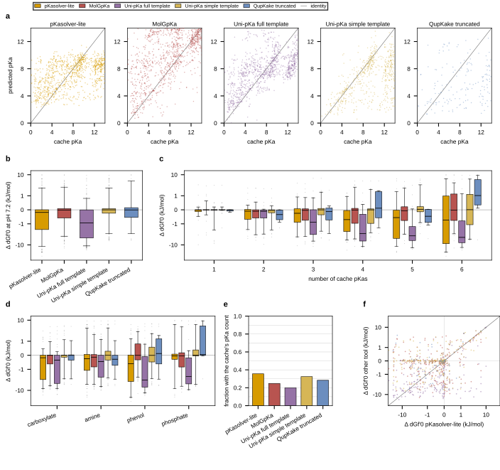

## 2026.09.09 - Can an open-source pKa predictor replace ChemAxon in the eQuilibrator path

### The question

eQuilibrator 3.0 prices a metabolite only if the compound is in its MetaNetX cache. Adding
a compound outside the cache calls ChemAxon `cxcalc` for dissociation constants, and
`cxcalc` is licensed. On this machine `get_chemaxon_status()` returns 2, meaning not
installed, so `LocalCompoundCache` opens read only and no compound can be created. That is
the blocker behind 665 unpriced yeast-GEM 9.0.2 metabolites in
`[[experiments.026-metabolism-flux.scripts.audit_unresolved_metabolites]]`.

Upstream `equilibrator-assets` master merged a `pkas_provided_externally` option on
2026-08-15 that skips the `cxcalc` call when the caller supplies pKas. It is unreleased:
the last PyPI tag is 0.6.0 from January 2024, and master is `0.6.0.post29+git.c79e371e`.

Three things were measured here: what the bridge actually expects, how well three
open-source predictors reproduce ChemAxon's own pKas, and how far the route reaches across
the unpriced metabolites.

### The bridge, verified against master

Clone: `https://gitlab.com/equilibrator/equilibrator-assets.git` at
`c79e371e0847457555c8b952a1b6b8623e7221ba` ("Merge branch 'feat/pkas-provided-externally'
into 'master'", 2026-08-15).

**What the flag does.** `LocalCompoundCache.__init__` gains a keyword that lifts read-only
mode without ChemAxon (`src/equilibrator_assets/local_compound_cache.py:85-94`):

```python
        elif pkas_provided_externally:  # no cxcalc, but the caller has pKas
            self.read_only = False
            self._read_only_message = None
            self._force_bypass = True
            logger.info(
                "cxcalc is not available, but pkas_provided_externally=True, so"
                " compounds will be created directly from their structures. The"
                " caller must supply specified_pkas for every structure passed"
                " to get_compounds() or add_compounds()."
            )
```

**What the data has to look like.** A dict keyed by the exact input string, whose value is
a list of macroscopic pKas (`local_compound_cache.py:261-266`):

```python
        specified_pkas : dict, optional
            A dictionary of user-specified pkas of form
            {mol_string: [pka1, pka2], ...}
            where mol_string is found in mol_strings, by default dict()
            The keys must match the strings in ``mol_strings`` exactly, since
            they are compared against the input before canonicalization.
```

Nothing else is passed. There is no charge of the most protonated species, no proton
count, and no magnesium constant in the interface. The charge and proton ladder are
derived from the structure: `_populate_compound_information` builds the atom bag from the
SMILES with `chemaxon.get_atom_bag`, which is pure Open Babel and does not shell out, and
`create_microspecies_mappings` then indexes the ladder off `atom_bag["H"]` and the count of
supplied pKas above pH 7. So the reference microspecies is whatever protonation state the
caller's SMILES is written in.

**The values are normalized the way cxcalc's were** (`generate_compound.py:83-85`), filtered
to the open interval (0, 14) and sorted descending:

```python
    return sorted(
        (p_ka for p_ka in map(float, p_kas) if min_ph < p_ka < max_ph), reverse=True
    )
```

**What still has to succeed.** Two things the pKas do not help with.

1. **Group decomposition.** `_populate_compound_information` (`generate_compound.py:118-131`)
   runs `group_decomposer.Decompose(...)` and returns `None` on
   `GroupDecompositionError` unless the compound is being stored empty. A compound with no
   group vector has no component-contribution estimate, so it is created and still not
   priceable.
2. **InChI or SMILES parseable by Open Babel**, since `create_compounds` calls
   `readstring(mol_format, s)` for the InChIKey and the canonical SMILES.

**Magnesium is not suppliable.** `specified_pkas` carries proton constants only, and a
compound built this way has an empty `magnesium_dissociation_constants` list. Measured cost
at pH 7.2, pMg 3.0: reconstructing the transform from the proton ladder alone reproduces
eQuilibrator's `Compound.transform` to 0.0000 kJ/mol for compounds with no Mg constants
(ids 2121, 32385, 1874) and differs by 0.3196 kJ/mol for UDP (id 20) and 1.1002 kJ/mol for
ADP (id 10), which do carry them. In the 300-compound validation sample, 7 compounds have
Mg constants.

**One shape the interface cannot express.** The guard is truthiness, not presence
(`local_compound_cache.py:128`):

```python
        missing = [s for s in mol_strings if not (specified_pkas or {}).get(s)]
```

An empty list means "this compound has no pKa between 0 and 14", which is the correct
answer for superoxide, and it raises `MissingPKasError` instead of creating a
single-microspecies compound. That is one of the pilot failures below.

### The free validation set

The cache stores the ChemAxon dissociation constants for every compound it holds, so it is
ground truth that no open-source predictor was trained to reproduce. 694,324 compounds are
in `~/.cache/equilibrator/compounds.sqlite`, 468,752 with a dissociation-constant list.

Sample drawn by `external_pka_benchmark.py sample --n 300 --seed 17`: mass under 600 Da,
elements within C, H, N, O, P, S, 3 to 50 heavy atoms, a group vector present so the
compound is genuinely priceable, and 1 to 6 pKas inside (0, 14). 115,720 candidates
scanned, 74,101 eligible, 300 kept, exactly 50 per pKa-count stratum. Group coverage by
SMARTS on the neutralized structure: amine 137, carboxylate 103, phenol 103, phosphate 44.
Every compound carries at least one of the four. The predictors are fed the neutral parent
(RDKit `Uncharger`) rather than the cache's major microspecies, since the cache SMILES is
already deprotonated.

### Micro to macro, and why sorting site pKas is wrong

pKasolver walks a protonation ladder itself and returns one value per step, which is
already the macroscopic shape eQuilibrator wants. QupKake and MolGpKa return SITE pKas for
one protonation state, so the ladder is built in the benchmark script: at each charge level
the macroscopic constant is the log-sum-exp over that level's site constants,

```
acidic step: pKa = -log10 sum_i 10^(-pKa_i)
basic step:  pKa =  log10 sum_j 10^(+pKa_j)
```

and the next level is entered through the dominant site (lowest site pKa going down,
highest going up). Holding only the dominant microstate at each charge is an approximation
to the full microstate graph and is exact whenever one microstate dominates its charge
level. Glutamate shows why the aggregation matters: MolGpKa's two carboxyl site pKas are
2.20 and 2.32, both measured from the fully protonated molecule, while the macroscopic
second pKa is 4.25. Sorting the site values and handing them over would put two
microspecies at pH 2.3 that do not exist.

### What each tool cost to get running

| tool | license | output | runnable today | install notes |
|---|---|---|---|---|
| pKasolver-lite | MIT | sequential macroscopic ladder | yes | needs PyG **2.0.1** exactly; the shipped weights use the old `GIN` MLP layout (`convs.N.nn.0/1/3`), and PyG 2.0.4 and later expect `convs.N.nn.lins.*`, so newer PyG fails `load_state_dict`. Also needs `torch==1.13.1`, prebuilt `torch-scatter`/`torch-sparse` CPU wheels, `class-resolver`, and the env's `bin` on `PATH` because it shells out to bare `python` |
| QupKake | BSD-3 | site pKas plus acidic/basic type | yes | needs PyG in the 2.4 to 2.5 band; PyG 2.8 makes `BaseTransform.forward` abstract and QupKake's `ToTensor` defines `__call__`, and `torch.load` needs `weights_only=False`. Its CSV input path calls `MMFFOptimizeMolecule` without catching a failed embedding, so one bad molecule aborts a whole batch; the benchmark embeds conformers itself and feeds SDF |
| MolGpKa | MIT | site pKas, acid and base dicts | yes | weights are in the repo; needs `torch-scatter` and `torch.load(weights_only=False)`. `load_model` reads the `.pth` from disk on every call, which dominates a ladder walk, so the benchmark caches it |
| Uni-Pka | Apache-2.0 | macroscopic from microstate free energies | not attempted here | Uni-Mol and CUDA workflow, research grade |
| Dimorphite-DL | Apache-2.0 | protonation states, no numeric pKa | n/a | already vendored inside pKasolver |
| OPERA | free | strongest acid and base only | no | cannot fill a 6-pKa ladder |

### Local or API

None of these tools is an API. Every one of them ships or can produce its own weights and
runs inference on this machine with no web service, no account and no license key, which is
the property that matters here, since the thing being replaced is exactly a licensed
binary. The single qualification is Uni-pKa, whose code is open but whose trained
checkpoint is not published: the repository ships a training and finetuning recipe, and the
only ready-made weights sit behind DP Technology's hosted Bohrium app, so a local Uni-pKa
means training it yourself first.

| tool | license | inference runs fully locally | CPU or GPU | output |
|---|---|---|---|---|
| pKasolver-lite | MIT (`pkasolver/LICENSE.md`) | yes, 50 weight files, 105 MB, in `pkasolver/trained_model_without_epik/` | CPU | sequential macroscopic ladder |
| QupKake | BSD-3-Clause (pip metadata, `LICENSE`) | yes, 3 checkpoints in `qupkake/models/`, and it ships its own xTB 6.4.1 binary at `qupkake/xtb-641/bin/xtb` | CPU, plus a mandatory GFN2-xTB call per molecule per rung, which is the throughput wall | site pKas with an acidic or basic type |
| MolGpKa | MIT, but the `LICENSE.md` header reads "Copyright (c) 2017-Present OpenNMT", so the copyright holder is not the authors | yes, `models/weight_acid.pth` and `models/weight_base.pth`, 6.0 MB each | CPU | site pKas, acid and base dicts |
| Uni-pKa | Apache-2.0 | code yes, weights no. No checkpoint in the repository; `infer_pka.sh` expects a `finetune_save/checkpoint_best.pt` the user produces, and the ready-made model is served from the Bohrium platform | GPU for the finetuning the local route requires; Uni-Mol on RDKit conformers, no QM step | macroscopic, from microstate free energies over an enumerated ensemble |
| Graph-pKa | MIT | code yes, and the hosted demo at `pka.simm.ac.cn` is optional; whether trained weights are committed is not verified | not verified | macroscopic, deconvoluted to site values |
| GR-pKa | MIT | yes, weights shipped under `model/` | GPU expected (CUDA in its dependency list), and it consumes precomputed quantum-chemical features, so a new molecule needs that QM step run | one strongest-acid and one strongest-base value |
| MF-SuP-pKa | no LICENSE file in the repository, so unstated | yes, weights shipped under `model/` | not verified | one strongest-acid and one strongest-base value, site-aware pooling |
| pKaLearn | MIT | yes, weights loaded from a local `Model/` directory | CPU stated, GPU requirement not verified | site pKas per ionizable center, plus the dominant state at a given pH |
| OPERA | MIT | yes, standalone desktop application, CLI and GUI | CPU | a macroscopic value; whether it can report more than the primary ionization is not verified |
| Dimorphite-DL | Apache-2.0 | yes, pip installable, rule based, and already vendored inside pKasolver | CPU | protonation states, no numeric pKa |
| dGPredictor | no LICENSE file in the repository, so unstated | yes, and the model is regenerated locally by `model_gen.py` from bundled KEGG-derived training data. ChemAxon Marvin is needed only for structures of novel compounds outside KEGG | CPU, linear and Bayesian ridge regression | not a pKa tool: standard reaction Gibbs energy |

Everything above the "not verified" marks was read from the files on disk under
`~/.claude/jobs/7a6382f2/tmp/pka-agent/` or from pip metadata in the tool's own conda
environment; the six repositories that are not on this machine were read from their GitHub
LICENSE, README and file listing. Two of them, MF-SuP-pKa and dGPredictor, have no license
file at all, which is a real obstacle rather than a formality: an unlicensed repository is
not open source and cannot be redistributed inside a pipeline we publish.

The practical consequence for this route: pKasolver-lite, QupKake and MolGpKa are all
usable today with no network, so the ChemAxon dependency is replaceable in kind. The choice
between them is accuracy and throughput, not access.

### Accuracy against the cache

Scoring: pKa MAE pairs the two lists by rank over the shorter one; count match is the
fraction whose predicted number of pKas in (0, 14) equals the cache's; the energy column is
the change in `dGf'0` at pH 7.2, I = 0.25 M, T = 303.15 K, pMg 3.0 when the predicted pKas
replace the cache's, with the reference microspecies and the untransformed formation energy
held fixed. The transform is rebuilt with the same `create_microspecies_mappings` the
compound-creation path calls, and it reproduces `Compound.transform` exactly for Mg-free
compounds, so the column isolates the pKa contribution.

Generated from `results/external_pka_benchmark.json`, itself written by
`external_pka_benchmark.py score --tools pkasolver molgpka qupkake qupkake-truncated`:

```bash
/scratch/projects/torchcell-scratch/envs/equilibrator/bin/python \
    experiments/026-metabolism-flux/scripts/external_pka_benchmark.py table
```

Scored at 2026-09-10T03:57:40.011251+00:00 over 300 sampled compounds at pH 7.2, I = 0.25 M, T = 303.15 K, pMg 3.

| tool | n attempted | n scored | right pKa count | pKa MAE | dGf'0 MAE (kJ/mol) | dGf'0 median (kJ/mol) | dGf'0 p90 (kJ/mol) |
|---|---|---|---|---|---|---|---|
| pkasolver-lite | 300 | 298 | 0.356 | 2.59 | 2.52 | 0.56 | 6.40 |
| molgpka | 300 | 294 | 0.248 | 2.83 | 1.21 | 0.34 | 3.20 |
| qupkake | 60 | 1 | 0.000 | 4.56 | 1.87 | 1.87 | 1.87 |
| qupkake-truncated | 60 | 60 | 0.283 | 3.61 | 1.35 | 0.38 | 5.08 |

**By number of cache pKas**

| key | tool | n attempted | n scored | right pKa count | pKa MAE | dGf'0 MAE (kJ/mol) |
|---|---|---|---|---|---|---|
| n_pka_1 | pkasolver-lite | 50 | 50 | 0.580 | 1.71 | 0.44 |
| n_pka_1 | molgpka | 50 | 47 | 0.489 | 3.21 | 0.30 |
| n_pka_1 | qupkake | 10 | 0 | n/a | n/a | n/a |
| n_pka_1 | qupkake-truncated | 10 | 10 | 0.300 | 1.71 | 0.05 |
| n_pka_2 | pkasolver-lite | 50 | 50 | 0.420 | 1.90 | 0.66 |
| n_pka_2 | molgpka | 50 | 49 | 0.245 | 2.64 | 0.91 |
| n_pka_2 | qupkake | 10 | 0 | n/a | n/a | n/a |
| n_pka_2 | qupkake-truncated | 10 | 10 | 0.400 | 2.10 | 0.45 |
| n_pka_3 | pkasolver-lite | 50 | 50 | 0.400 | 2.96 | 1.20 |
| n_pka_3 | molgpka | 50 | 50 | 0.240 | 3.04 | 1.24 |
| n_pka_3 | qupkake | 10 | 1 | 0.000 | 4.56 | 1.87 |
| n_pka_3 | qupkake-truncated | 10 | 10 | 0.500 | 2.57 | 1.27 |
| n_pka_4 | pkasolver-lite | 50 | 49 | 0.306 | 2.76 | 2.01 |
| n_pka_4 | molgpka | 50 | 49 | 0.245 | 2.83 | 1.51 |
| n_pka_4 | qupkake | 10 | 0 | n/a | n/a | n/a |
| n_pka_4 | qupkake-truncated | 10 | 10 | 0.500 | 3.94 | 1.57 |
| n_pka_5 | pkasolver-lite | 50 | 50 | 0.240 | 3.04 | 3.76 |
| n_pka_5 | molgpka | 50 | 49 | 0.204 | 2.83 | 1.28 |
| n_pka_5 | qupkake | 10 | 0 | n/a | n/a | n/a |
| n_pka_5 | qupkake-truncated | 10 | 10 | 0.000 | 5.12 | 0.89 |
| n_pka_6 | pkasolver-lite | 50 | 49 | 0.184 | 3.20 | 7.13 |
| n_pka_6 | molgpka | 50 | 50 | 0.080 | 2.47 | 2.00 |
| n_pka_6 | qupkake | 10 | 0 | n/a | n/a | n/a |
| n_pka_6 | qupkake-truncated | 10 | 10 | 0.000 | 6.24 | 3.86 |

**By functional group**

| key | tool | n attempted | n scored | right pKa count | pKa MAE | dGf'0 MAE (kJ/mol) |
|---|---|---|---|---|---|---|
| amine | pkasolver-lite | 137 | 137 | 0.241 | 2.68 | 1.92 |
| amine | molgpka | 137 | 137 | 0.066 | 3.65 | 1.35 |
| amine | qupkake | 30 | 0 | n/a | n/a | n/a |
| amine | qupkake-truncated | 30 | 30 | 0.300 | 3.23 | 1.40 |
| carboxylate | pkasolver-lite | 103 | 103 | 0.427 | 2.48 | 1.95 |
| carboxylate | molgpka | 103 | 100 | 0.290 | 3.20 | 1.00 |
| carboxylate | qupkake | 21 | 0 | n/a | n/a | n/a |
| carboxylate | qupkake-truncated | 21 | 21 | 0.381 | 2.97 | 0.86 |
| phenol | pkasolver-lite | 103 | 102 | 0.431 | 2.29 | 3.89 |
| phenol | molgpka | 103 | 102 | 0.353 | 1.52 | 1.18 |
| phenol | qupkake | 22 | 1 | 0.000 | 4.56 | 1.87 |
| phenol | qupkake-truncated | 22 | 22 | 0.273 | 4.37 | 1.81 |
| phosphate | pkasolver-lite | 44 | 43 | 0.256 | 3.56 | 3.28 |
| phosphate | molgpka | 44 | 42 | 0.262 | 2.60 | 2.33 |
| phosphate | qupkake | 8 | 0 | n/a | n/a | n/a |
| phosphate | qupkake-truncated | 8 | 8 | 0.375 | 3.56 | 3.29 |

**Reading the two QupKake rows.** A QupKake rung costs a full xTB wave over every
still-active compound, so the run was cut to 60 compounds, 10 per stratum, and was still
stopped after 4 of the up to 14 rungs, 5 hours and 20 minutes in. The rungs that did
finish are acidic 0, 1 and 2, plus the neutral-state prediction that doubles as basic
rung 0, since QupKake reports the acidic and the basic sites of one state in one file.
`salvage-qupkake` replays the walk from those files and reproduces the live run's
active counts exactly (57, then 46, then 32 compounds continuing), so the salvage is the
same computation, not a re-estimate. Only 1 of the 60 ladders had terminated by the time
the rungs ran out, and that single compound is the `qupkake` row. The
`qupkake-truncated` row scores all 60 with the rungs that ran, so 59 of its ladders are
short by an unknown number of pKas and its numbers bound QupKake rather than measure it.
**QupKake is unmeasured on this set.**

**What the two measured tools say.** MolGpKa carries the smaller energy error, 1.21
kJ/mol mean and 0.34 kJ/mol median, and holds it across every stratum including the
6-pKa one, where pKasolver-lite reaches 7.13 kJ/mol. pKasolver-lite gets the number of
pKas right more often, 0.356 against 0.248, and that gap is widest on the single-pKa
stratum, 0.580 against 0.489. The paired pKa MAE favors neither cleanly, 2.59 against
2.83, and it is the weaker of the two statistics here: it pairs by rank over the shorter
list, so a tool that returns too few pKas is scored on fewer, easier comparisons. The
energy column is the one the flux layer consumes.

### End-to-end pilot

Targets: the three betaxanthin intermediates that
`results/pathway_thermo_betaxanthin.json` reports as absent, plus the 16 metabolite rows
whose `final_blocker` is `structure_absent_from_cache`, which collapse to 6 distinct
chemicals. Nine targets in total.

**Three of the three betaxanthin compounds were never absent.** `pathway_thermo.py`
resolves with `cc.get_compound_by_inchi`, an exact string match, and the cache stores the
InChI of the MAJOR MICROSPECIES, whose final InChIKey block records the protonation state.
Searching the first two InChIKey blocks instead finds all three, each with a group vector
and ChemAxon pKas:

| compound | neutral InChIKey | cache id | cache InChIKey | cache pKas | dGf'0 at pH 7.2 (kJ/mol) | sigma |
|---|---|---|---|---|---|---|
| leucodopachrome | JDWYRSDDJVCWPB-LURJTMIESA-N | 2121 | ...-M | 13.3, 9.71, 5.27, 1.99 | -233.01 | 8.79 |
| betanidin | BBJUSJOGHYQDQX-WODDMCJRSA-N | 32385 | ...-L | 13.39, 9.64, 3.97, 3.4, 2.83 | -394.94 | 8.56 |
| betalamic acid | YQDKULBMDMPFLH-FSRBREEPSA-N | 1874 | ...-M | 5.18, 3.69, 1.25 | -365.98 | 8.49 |

The `blocker: absent_from_cache_needs_cxcalc_chemaxon_license` on those three rows is a
lookup artifact, not a licensing problem, and the fix is one line in `pathway_thermo.py`.

**Five targets went through the external-pKa path**, with pKasolver-lite supplying the
constants and `LocalCompoundCache(pkas_provided_externally=True)` on assets master creating
the compound:

| target | structure source | route outcome | predicted pKas | dGf'0 (kJ/mol) | sigma |
|---|---|---|---|---|---|
| phosphatidylethanolamine (1-16:1, 2-16:1) | MetaNetX MNXM739593 via ChEBI:138792 | priced, new compound id 694325 | 9.18, 7.22 | 1967.93 | 12.62 |
| N-(4-oxoglutarate)-L-cysteinylglycine | MetaNetX MNXM745469 via ChEBI:138256 | priced, new compound id 694326 | 8 values between 2.99 and 6.85 | -539.65 | 4.58 |
| ferroheme b | MetaNetX MNXM249 | failed group decomposition | 3.39, 3.30 | | |
| methionyl acetate | yeast-GEM smilesDB | failed group decomposition | 7.87 | | |
| superoxide | MetaNetX MNXM1107906 via ChEBI:18421 | `MissingPKasError` | none in (0, 14) | | |

**The sixth, 1-acylglycerophosphoethanolamine (16:1), has no structure in any namespace**,
so it never reaches a predictor.

Two things to read carefully in that table. The PE species is priced and its magnitude is
in the same family as the pipeline's existing lipids: the cache-priced
phosphatidylethanolamine (1-18:1, 2-16:1), C39H74NO8P, sits at 2413.32 kJ/mol with sigma
13.31, and a large positive transformed value is expected for a 70-proton molecule at pH
7.2. The cysteinylglycine adduct is priced but its pKa list is not credible: pKasolver
returned eight constants between 2.99 and 6.85 for a molecule with two carboxylates, one
thiol and two amides, which builds a ladder running to charge +6. The compound was created
and a number came out; the number should not be used.

So of nine targets: 3 were already priceable and mislabeled, 2 were newly priced (1 of them
with a pKa list that fails inspection), 2 failed group decomposition, 1 failed because the
interface cannot express an empty pKa list, and 1 has no structure at all.

### What the route can reach

From `external_pka_pilot.py reach`, over the 665 metabolites still unpriced after the
audit's recovery steps (376 distinct names):

| tier | n metabolites | n distinct names | what is missing | does an external pKa help |
|---|---|---|---|---|
| a. structure exists today | 16 | 6 | only the pKas | yes, and it is already done above |
| b. structure writable from the name | 409 | 206 | a structure writer | yes, after the writer |
| c. no structure can exist | 185 | 140 | nothing can be written | no |
| d. blocked by group decomposition | 50 | 24 | a group vector | no |
| e. composition-mismatched candidates only | 5 | | a correct match | no |

Tier b is the whole prize and it is lipids: PI 135, CL 62, TAG 56, PE 53, PA 25,
sphingolipid 12, PC 10, PG 9, acyl-CoA 9, fatty acyl chain 8, glycan 6, the rest 22. 338 of
the 409 carry an explicit acyl composition in the name, matching `\d{1,2}:\d`, for example
"phosphatidylethanolamine (1-16:1, 2-16:1)". Writing those structures is a headgroup
template plus the named chains, with the produced formula checked against the GEM's own
formula as the acceptance test. That script was not written here.

Tier c is a method ceiling: R, X or `*` in the formula means no single structure exists.
Tier d is a different ceiling: the structure is already in the cache and the group
decomposer refuses it, so pKas change nothing. Ferroheme b and methionyl acetate in the
pilot are that failure mode.

Upper bound if a lipid structure writer worked perfectly and every written structure both
decomposed and got usable pKas: 16 + 409 = 425 of 665, or 64 percent. Realistically the
group-decomposition rate on freshly written lipids is unknown and 2 of the 5 pilot
structures failed decomposition, so the reachable count is lower than 425 by an amount that
has not been measured.

## 2026.09.09 - Benchmark completed

### What changed since the placeholder

**MolGpKa finished the whole set.** 300 of 300 compounds, 11,783 s in one CPU process, or
39.3 s per compound for the full ladder walk, written to
`results/external_pka_predictions_molgpka.json`. It is now scored alongside pKasolver-lite.

**QupKake still has no measurement.** Its first 300-compound attempt returned 0 of 300, and
every record carries the same `RuntimeError: qupkake produced no output (1)` raised inside
its own pandas apply path. The 60-compound retry ran for 5 hours and 20 minutes and reached
4 of the up to 14 rungs before it was stopped, because each rung is a full GFN2-xTB wave
over every still-active compound and the machine is shared. `predict-qupkake` writes its
JSON only at the very end, so a new subcommand, `salvage-qupkake`, rebuilds the ladders from
the per-rung SDF files the stopped run left on disk. The replay reproduces the live run's
active counts exactly, and 1 of the 60 ladders had terminated, so QupKake enters the table
at n = 1 with a companion `qupkake-truncated` row that bounds it rather than measures it.

**Scoring and the table are regenerated, not typed.** `score` now covers four rows and a
new `table` subcommand prints the markdown straight from
`results/external_pka_benchmark.json`:

```bash
/scratch/projects/torchcell-scratch/envs/equilibrator/bin/python \
    experiments/026-metabolism-flux/scripts/external_pka_benchmark.py \
    score --tools pkasolver molgpka qupkake qupkake-truncated
/scratch/projects/torchcell-scratch/envs/equilibrator/bin/python \
    experiments/026-metabolism-flux/scripts/external_pka_benchmark.py table
```

**Uni-pKa was not attempted.** The GPUs on this machine were reserved for other work for the
evening, so the local Uni-pKa install and inference run was dropped rather than deferred to
a CPU that could not carry it. Uni-pKa also turns out to publish no checkpoint, so a local
run means finetuning it first, which makes it a larger piece of work than an install.

**The betaxanthin lookup is fixed.** Before the fix
`results/pathway_thermo_betaxanthin.json` read `"n_resolved": 2` of `"n_compounds": 5`, with
leucodopachrome, betanidin and betalamic acid each carrying
`"blocker": "absent_from_cache_needs_cxcalc_chemaxon_license"`. `pathway_thermo.py` now
resolves with `cc.search_compound_by_inchi_key(Chem.MolToInchiKey(molecule)[:25])`, matching
the skeleton and stereochemistry blocks instead of the whole InChI string, and the refreshed
file reads 5 of 5, each with exactly one cache match. The three recovered compounds land on
the cache's deprotonated microspecies keys, `JDWYRSDDJVCWPB-LURJTMIESA-M`,
`BBJUSJOGHYQDQX-WODDMCJRSA-L` and `YQDKULBMDMPFLH-FSRBREEPSA-M`, at -233.01, -394.94 and
-365.98 kJ/mol with sigma 8.79, 8.56 and 8.49. No external pKa was involved: the whole
pathway was always priceable and the license was never the blocker for it.

### The verdict

MolGpKa is the tool to use: it is the only one that ran the full 300-compound set, it
carries the smallest energy error at 1.21 kJ/mol mean, 0.34 kJ/mol median and 3.20 kJ/mol
at the 90th percentile, and it holds that error across all six pKa-count strata, while
pKasolver-lite degrades to 7.13 kJ/mol on the 6-pKa stratum. That error is small against
eQuilibrator's own uncertainty on the same kind of compound, which runs from 4.30 to 8.79
kJ/mol across the five betaxanthin intermediates and reached 12.62 kJ/mol on the pilot's
phosphatidylethanolamine, so substituting MolGpKa pKas for ChemAxon's moves `dGf'0` by well
under the uncertainty already attached to the number. What it does not do is enlarge the
model: only tier a, 16 of the 665 unpriced metabolites or 2.4 percent, is reachable with a
pKa predictor alone, and the 64 percent upper bound of 425 of 665 needs a lipid structure
writer that does not exist yet.

### Open items

- QupKake is unmeasured. A fair run needs about 14 xTB waves over the sample on a machine
  that is not shared, or a rewrite that batches the rungs.
- The lipid structure writer for tier b, 409 metabolites, 338 of which carry an explicit
  acyl composition in the name. It is the only thing that changes the reach number.
- Group decomposition is a separate ceiling that pKas do not touch: 50 tier-d metabolites,
  plus 2 of the 5 pilot structures.
- Magnesium constants cannot be supplied through `specified_pkas`. 7 of the 300 sampled
  compounds carry them, and the cost measured earlier is 0.32 kJ/mol for UDP and 1.10
  kJ/mol for ADP.
- pKasolver's eight-constant answer for the cysteinylglycine adduct shows that a per-compound
  sanity check on the returned ladder, count against ionizable groups, is needed before any
  of this feeds the flux layer.

## 2026.09.10 - Uni-pKa runs, and the protonation convention is worth 776 kJ/mol

### A correction to carry forward

The 2026.09.09 sections say Uni-pKa publishes no checkpoint, that its only ready-made
weights sit behind DP Technology's hosted Bohrium app, and that a local Uni-pKa therefore
means finetuning it first. That is wrong, and the tables above are wrong in the same two
rows. Trained weights are downloadable without an account, and Uni-pKa now has a measured
row in the accuracy table below. Everything else in those sections stands.

### Where the weights actually are

The Uni-pKa repository (`https://github.com/dptech-corp/Uni-pKa`, HEAD
`7cfbf6532d7e14f427abaed5859bd1001b4b6377`, 2025-04-01) has no releases, no tags and no
checkpoint, and both weight links in its README are dead: `bohrium.dp.tech/notebooks/
38543442597` and `bohrium.dp.tech/apps/uni-pka` each return HTTP 404, and AIS Square hosts
the datasets rather than the models. Reading the README is what produced the earlier
"weights no" conclusion, and the README is the one place that does not have them.

Three sources do, all HTTP 200 and none behind a login.

| source | what | verified |
|---|---|---|
| `huggingface.co/bindresearch/pkasso_unipka` | five folds, `fold_{0..4}/checkpoint_best.pt`, 571,250,635 bytes each, Apache-2.0, retrained by Bind Research on `dwar_iupac_no_overlap` | sha256 of all five match the registry pinned in the `unipkainfer` package (`unipkainfer/models.py:16-22`) against revision `e28a5917f80556f026acee909fd6b6989d915e54`, so these are the files the maintained tooling itself fetches |
| `huggingface.co/Lai-ao/uni-pka-ckpt_v2` | `t_dwar_v_novartis_a_b.pt`, 571,248,843 bytes, sha256 `48667090c330e745f0d91fd2eb159e04f41052d71b394e25d6ad2a2090d71c75` | the authors' own weights lifted from the Bohrium notebook; the checkpoint's internal paths still name a Uni-pKa co-author. No README and no license in that repo, so its provenance is inferred from the embedded paths rather than asserted |
| Zenodo `10.5281/zenodo.19627026` | a 7.7 GB apptainer image bundling the Bohrium model file, Apache-2.0 | not downloaded; the record's own description states the bundled model is under Apache 2.0 |

The five sha256 values of the folds used here:

```
fold_0 4d5a5fc955f29f456518a58e87de5e3c86737660c4cd512aa058cd049062a200
fold_1 6bf5e354860c717beb8d5eb3968a9ddbd526fc8e3defebdcad12074723f8b3b1
fold_2 718ae5153ce98fead33435c4afbf99ffda2f2a2fd993c2eb2c5ef0dd81345b58
fold_3 4b5b9cbf36f899c1d5cc0c9d85cf71a538a0d118d95b3f2e6eb98bd7bcc9d734
fold_4 76f280d7a9d16097ced43e585b31d0766dffafc49d8cdc63f191b04890388f23
```

Fetched with `curl -sL "https://huggingface.co/bindresearch/pkasso_unipka/resolve/main/fold_N/checkpoint_best.pt"` and staged with the repository at
`$DATA_ROOT/unipka/`.

**FC, GC and xC are charge descriptors, not model sizes**, and they appear nowhere in the
repository. They are defined in the JACS Au SI: FC is the formal charge read straight off
the SMILES and is the default, GC is Gasteiger's empirical charge, xC is the GFN2-xTB
partial charge. SAMPL8 MAE and RMSE in SI Table S2 are FC 0.631 and 0.878, GC 0.642 and
0.949, xC 0.619 and 0.927, so the three are within each other's spread and the default is
not the weak one. Only FC is obtainable: the released `unimol/examples/dict_charge.txt`
holds the three discrete states `1 0 -1` and cannot represent a continuous charge, and no
GC or xC checkpoint is published anywhere. **The row below is FC.**

**The install does not need the documented one.** The README asks for Uni-Core plus the
`unimol:latest-pytorch1.11.0-cuda11.3` docker image, whose fused CUDA kernels are not built
for this machine's sm_89 cards, and the newest prebuilt Uni-Core wheel is `cu118torch2.0.0`
for cp38 to cp310 only. `unipkainfer` 0.2.0 on PyPI is a pure-Python repackaging of Uni-pKa,
Uni-Mol and the minimal Uni-Core runtime with no compiled extension of any kind, verified by
listing the wheel: no `.so`, no `.cu`, no `.cpp`. The environment is
`/scratch/projects/torchcell-scratch/envs/unipka`, python 3.11 with `pip install
unipkainfer pydantic python-dotenv`, and it runs on torch 2.14.0+cu130.

### How Uni-pKa is scored, and why no aggregation happens on our side

Uni-pKa is the one tool here that produces a macroscopic constant itself. It consumes a
protonation ensemble written `A1,...,Am>>B1,...,Bn`, the acid macrostate against the base
macrostate, and its head returns the standard free energy of each microstate; the
macroscopic constant is formed inside its own loss (`unimol/losses/reg_loss.py:86-89`) as

```
pKa = (logsumexp(-G_acid) - logsumexp(-G_base)) / ln 10
```

which is the full ensemble average that `_macro_from_sites` only approximates for QupKake
and MolGpKa. So the ladder is built by handing the model one adjacent macrostate PAIR per
rung and reading its output, and nothing is aggregated afterwards. The macrostates come
from Uni-pKa's own microstate enumerator (`enumerator/main.py ensemble`), walking a SMARTS
protonation template out from the neutral parent. A rung exists wherever two adjacent
charge levels are both populated. Five folds are averaged, which is the protocol the
repository documents for its own metrics.

**The enumeration template is the setting that decides what the tool can say.** Measured on
these 300 compounds, `simple_smarts_pattern.tsv`, the enumerator's default for `ensemble`,
populates 2.01 adjacent macrostate pairs per compound; `smarts_pattern.tsv`, its default for
`reconstruct`, populates 5.08. The cache carries 3.5 pKas per compound on average. Under the
simple template a 5-pKa or 6-pKa ladder is unreachable no matter how good the network is,
and the stratum table below shows exactly that. Neither template ever populates the extreme
charge levels of the window, so widening the window is not the lever: with the simple
template levels -4 and +2 are empty for all 300 compounds, and with the full template
levels -6 and +3 are.

### The accuracy table, with Uni-pKa in it

Regenerated from `results/external_pka_benchmark.json`:

```bash
/scratch/projects/torchcell-scratch/envs/equilibrator/bin/python \
    experiments/026-metabolism-flux/scripts/external_pka_benchmark.py \
    score --tools pkasolver molgpka unipka unipka-simple-template qupkake qupkake-truncated
/scratch/projects/torchcell-scratch/envs/equilibrator/bin/python \
    experiments/026-metabolism-flux/scripts/external_pka_benchmark.py table
```

Scored at 2026-09-10T22:05:59 over 300 sampled compounds at pH 7.2, I = 0.25 M,
T = 303.15 K, pMg 3. `unipka` is the full enumeration template and
`unipka-simple-template` the simple one, run identically otherwise.

| tool | n attempted | n scored | right pKa count | pKa MAE | dGf'0 MAE (kJ/mol) | dGf'0 median (kJ/mol) | dGf'0 p90 (kJ/mol) |
|---|---|---|---|---|---|---|---|
| pkasolver-lite | 300 | 298 | 0.356 | 2.59 | 2.52 | 0.56 | 6.40 |
| molgpka | 300 | 294 | 0.248 | 2.83 | 1.21 | 0.34 | 3.20 |
| unipka | 300 | 300 | 0.200 | 2.54 | 2.94 | 1.11 | 7.93 |
| unipka-simple-template | 300 | 299 | 0.324 | 2.79 | 0.91 | 0.16 | 2.84 |
| qupkake | 60 | 1 | 0.000 | 4.56 | 1.87 | 1.87 | 1.87 |
| qupkake-truncated | 60 | 60 | 0.283 | 3.61 | 1.35 | 0.38 | 5.08 |

**Uni-pKa on the simple template carries the smallest energy error of any measured tool**,
0.91 kJ/mol mean against MolGpKa's 1.21, and the gap is wider at the median, 0.16 against
0.34, and at the 90th percentile, 2.84 against 3.20. Its worst compound is off by 9.34
kJ/mol where MolGpKa's is off by 14.18 and pKasolver-lite's by 34.15.

**Uni-pKa on the full template is the worst of the three on energy**, 2.94 kJ/mol, despite
having the best pKa MAE of any tool at 2.54 and the only clean 300 of 300 completion. That
is the opposite of what the enumeration counts predicted, and the stratum table says why.

| stratum | tool | right pKa count | pKa MAE | dGf'0 MAE (kJ/mol) |
|---|---|---|---|---|
| n_pka_1 | unipka-simple-template | 0.980 | 0.51 | 0.14 |
| n_pka_1 | unipka | 0.220 | 2.95 | 0.64 |
| n_pka_1 | molgpka | 0.489 | 3.21 | 0.30 |
| n_pka_2 | unipka-simple-template | 0.620 | 1.44 | 0.46 |
| n_pka_2 | unipka | 0.160 | 2.08 | 0.84 |
| n_pka_2 | molgpka | 0.245 | 2.64 | 0.91 |
| n_pka_3 | unipka-simple-template | 0.320 | 2.72 | 0.79 |
| n_pka_3 | unipka | 0.220 | 2.42 | 2.26 |
| n_pka_3 | molgpka | 0.240 | 3.04 | 1.24 |
| n_pka_4 | unipka-simple-template | 0.020 | 3.92 | 1.08 |
| n_pka_4 | unipka | 0.260 | 2.35 | 3.98 |
| n_pka_4 | molgpka | 0.245 | 2.83 | 1.51 |
| n_pka_5 | unipka-simple-template | 0.000 | 3.90 | 0.87 |
| n_pka_5 | unipka | 0.180 | 2.73 | 4.50 |
| n_pka_5 | molgpka | 0.204 | 2.83 | 1.28 |
| n_pka_6 | unipka-simple-template | 0.000 | 4.27 | 2.13 |
| n_pka_6 | unipka | 0.160 | 2.72 | 5.43 |
| n_pka_6 | molgpka | 0.080 | 2.47 | 2.00 |

On single-pKa compounds the simple template gets the count right 98 percent of the time and
the value to 0.51 pKa units, which is a different regime from every other tool here. It
never gets a 5-pKa or 6-pKa count right, and its energy error nevertheless stays the
smallest on the 5-pKa stratum, 0.87 against MolGpKa's 1.28, and only loses on the 6-pKa
stratum, 2.13 against 2.00.

### The full template overshoots, and overshooting is expensive

The full template was run precisely because the simple one cannot express a long ladder,
and it does fix the count in the direction expected: it populates 5.08 adjacent macrostate
pairs per compound against 2.01, and its pKa MAE is the best in the table at 2.54. It also
raises the energy error threefold, and both facts come from the same place.

The mean count error is the whole story, and the two templates miss in opposite directions.
The simple template returns **1.49 pKas FEWER** than the cache per compound; the full
template returns **1.42 MORE**. MolGpKa returns 2.08 more and pKasolver-lite 0.98 more. The
two errors are not symmetric in energy: the constants the simple template drops sit far
from pH 7.2 and barely move the Legendre transform, while the constants the full template
adds are near pH 7 by construction, since the enumerator walks outward from the neutral
parent and the rungs it reaches first are the ones the transform is most sensitive to. The
stratum table shows the cost growing monotonically with ladder length, 0.64, 0.84, 2.26,
3.98, 4.50 and 5.43 kJ/mol from the 1-pKa to the 6-pKa stratum, exactly where extra rungs
accumulate.

The plausibility check below scores the same effect independently: the full template is
flagged on 52.0 percent of compounds, the highest rate of any tool including MolGpKa, and
the simple template on 0.3 percent.

**The conclusion is that the enumeration template, not the network, is what to tune, and
that on this benchmark the conservative template wins.** A better answer than either is
almost certainly available by enumerating fully and then pruning the ensemble on the
model's own free energies before forming the ladder, which is what Uni-pKa's published
pipeline does for its own datasets and what this run does not do. That was not built here.

### The figure

`experiments/026-metabolism-flux/scripts/plot_external_pka.py`, drawn from
`results/external_pka_per_compound.csv`, with every number it shows written to
`results/external_pka_figure.json`.



**Panel a** pairs predicted against cache pKa by rank, one panel per tool, over 1,010 paired
values for pKasolver-lite, 1,021 for MolGpKa, 1,043 for full-template Uni-pKa, 596 for
simple-template Uni-pKa and 167 for the truncated QupKake. The simple template is the only
cloud that visibly follows the identity line: 0.374 of its paired values land within 1 pKa
unit against MolGpKa's 0.358, the full template's 0.267 and pKasolver-lite's 0.258, on half
as many pairs as any of them. The full template has the lowest pooled MAE of the five,
2.56, and the lowest within-1-unit fraction of the three complete tools, which is the same
tension the table shows. MolGpKa's cloud has a visible band of predictions along the top edge,
above pKa 12, at every cache value. Hypothesis (untested): those are the deep rungs of a
ladder walked on charged states, outside the neutral-molecule regime the model was trained
on, which is also what the plausibility check below flags it for. The pooled MAE over paired
values, 2.88 for Uni-pKa, is a different statistic from the table's 2.79, which is the mean
of per-compound MAEs; a tool that returns fewer pKas is scored on fewer, easier comparisons
in both.

**Panel b** is the signed dGf'0 shift per compound, and signed is the point: every tool's
median sits just below zero, so the errors are not centered bias but tail width.
pKasolver-lite's 5th percentile is -12.19 kJ/mol, MolGpKa's -3.93, Uni-pKa's -2.87.

**Panels c and d** split the same shift by pKa count and by functional group. Simple-template
Uni-pKa carries the smallest error in all four groups: amine 1.03 against MolGpKa's 1.35,
carboxylate 0.71 against 1.00, phenol 1.08 against 1.18, phosphate 1.75 against 2.33. Its
phosphate pKa MAE is the worst of any tool at 4.60, so the energy win there is not a pKa
win; the constants it misses on a phosphate ladder sit far from pH 7.2. The full template
is worse in every group, most sharply on phenol, 4.52 against 1.08, where its extra rungs
land closest to pH 7.2.

**Panel e** is the fraction with the cache's pKa count, 0.356 pKasolver-lite, 0.324
simple-template Uni-pKa, 0.248 MolGpKa, 0.200 full-template Uni-pKa. Read it with the mean
count error above, since the two templates miss the count about equally often and in
opposite directions.

**Panel f** is the per-compound shifts of each tool against pKasolver-lite, which is the
question of whether the predictors agree with each other rather than only with ChemAxon.
They do not. MolGpKa against pKasolver-lite correlates at r = 0.085 over 293 shared
compounds and agrees on the SIGN of the shift only 64 percent of the time; Simple-template Uni-pKa against
pKasolver-lite is r = 0.268 with sign agreement 61 percent. The median absolute difference
between two tools' shifts, 0.74 kJ/mol for MolGpKa and 0.62 for Uni-pKa, is larger than
Uni-pKa's own median error against ChemAxon, 0.16. Two predictors disagreeing with each
other more than the better one disagrees with the reference means an ensemble of them is
not a route to a better number, and it means a per-compound cross-check between tools is a
real detector of a bad ladder.

The per-compound signed shifts are also written wide, one column per tool, to
`results/external_pka_shift_by_compound.csv`, so a reader can see which predictor agrees
with ChemAxon on which compound.

### The protonation convention, which is worth 776 kJ/mol

The lipid structure writer priced 7 lipids both from the cache and through
`pkas_provided_externally` and found cache minus external of -777.5 kJ/mol
(`[[experiments.026-metabolism-flux.lipid-structure-writer]]`,
`results/lipid_priced.json`). Two new subcommands close it.

`microspecies-at-ph` builds each target's pH 7 major microspecies, and does not invent it:
pKasolver walks its own protonation ladder and every `States` record it returns carries
`ph7_mol`, the state the tool itself places at pH 7, so the structure and the pKas come
from one source. For every one of the 7 lipids it returns the zwitterion, for example
`COP(=O)([O-])OCC[NH3+]` where the writer had emitted `COP(=O)(O)OCCN`.

`reprice-microspecies` then prices each target from both conventions.

| target | dGf'0 from the written structure | dGf'0 from the pH 7 microspecies | cache dGf'0 | residual written | residual pH 7 |
|---|---|---|---|---|---|
| phosphatidyl-N,N-dimethylethanolamine (1-16:0, 2-18:1) | 3157.86 | 2374.95 | 2375.02 | -782.84 | 0.07 |
| phosphatidyl-N-methylethanolamine (1-16:0, 2-18:1) | 3058.76 | 2279.44 | 2279.54 | -779.22 | 0.10 |
| phosphatidylethanolamine (1-16:0, 2-16:1) | 2755.20 | 1978.95 | 1979.09 | -776.11 | 0.14 |
| phosphatidylethanolamine (1-16:0, 2-18:1) | 2939.89 | 2163.64 | 2163.78 | -776.11 | 0.14 |
| phosphatidylethanolamine (1-16:1, 2-18:1) | 2931.92 | 2155.67 | 2155.81 | -776.11 | 0.14 |
| phosphatidylethanolamine (1-18:0, 2-16:1) | 2939.89 | 2163.64 | 2163.78 | -776.11 | 0.14 |
| phosphatidylethanolamine (1-18:0, 2-18:1) | 3124.57 | 2348.32 | 2348.47 | -776.10 | 0.15 |

The residual falls from a mean of -777.51 kJ/mol to +0.13, range 0.07 to 0.15. **Submitting
the pH 7 major microspecies closes the gap.** What is left is the pKa difference itself, and
0.13 kJ/mol is the size the 300-compound benchmark predicts for a compound of this kind.

Two mechanisms worth writing down, because the first one hid the second on the first
attempt.

1. **Standard InChI normalizes mobile protons, so the bridge cannot tell the two
   conventions apart by key.** `COP(=O)(O)OCCN` and `COP(=O)([O-])OCC[NH3+]` both give
   InChIKey `CZOSTDZGCCEZTJ-PEZBUJJGSA-N` and both give the same atom bag,
   `{C: 37, O: 8, P: 1, N: 1, H: 72, e-: 380}`. Submit both to one local cache and the
   second call returns the compound the first created, and the measured difference is
   exactly zero, which is an artifact of the lookup rather than a result. The two
   conventions therefore have to be created in caches that cannot see each other, and
   `reprice-microspecies` takes two `--local-cache` paths for that reason.
2. **The group vectors do differ**, in two positions of the 163-long vector, one for the
   phosphate and one for the amine. That is where the 776 kJ/mol lives: the untransformed
   group-contribution term, not the Legendre transform.

**The 300-compound benchmark is not affected, and here is the number.** That benchmark never
creates a compound. `_transform_kj_per_mol` rebuilds only the Legendre transform and
re-references the cache's pKa list and the predicted pKa list to the SAME microspecies, the
cache's own atom bag, so the group-contribution term is absent from both sides of every
scored difference. The analogue of the lipid mistake inside it would be anchoring the ladder
to the neutral parent the predictors were fed instead. 193 of the 284 scored MolGpKa
compounds have a neutral parent whose proton count differs from the cache atom bag, and
scoring them against that reference instead moves dGf'0 by up to 46.95 kJ/mol, mean 5.41. So
the reference choice is load-bearing, the benchmark makes it correctly on both sides, and
the same mistake made there would have been large.

The pilot's two externally created compounds are unchanged by the convention, and for a
reason worth recording: the phosphatidylethanolamine came from MetaNetX already written as
its zwitterion, so it was submitted in the cache's convention all along, and the
cysteinylglycine adduct came from MetaNetX as the doubly deprotonated species, which is its
pH 7 state. Both price identically from either convention, 1967.93 and -539.65 kJ/mol.

### Magnesium: it can be accounted for, and a substructure table would make it worse

Answered by `external_pka_benchmark.py magnesium`, written to
`results/external_pka_magnesium.json`.

**How eQuilibrator stores and uses them.** `Compound.magnesium_dissociation_constants` is
not a column but a one-to-many relationship
(`equilibrator_cache/models/compound.py:94-100`) onto the `magnesium_dissociation_constant`
table, whose rows are `(compound_id, number_protons, number_magnesiums,
dissociation_constant)`. `Compound.transform` never reads it. It iterates
`self.microspecies` only (`compound.py:153-174`), and magnesium enters through the
`number_magnesiums` column of `compound_microspecies` via `_legendre_transform`
(`thermodynamic_constants.py:126-148`), where it gates both the `n_Mg (RT ln10 pMg - dGf_Mg)`
term and the `-4 n_Mg` ionic-strength correction. The constants are build-time input,
consumed once by `create_microspecies_mappings`
(`equilibrator_assets/thermodynamics.py:420-454`) to materialize the Mg-bearing microspecies
rows.

**Can they be attached after creation.** The compound returned by
`get_compounds(..., pkas_provided_externally=True)` is a live, session-attached ORM object on
a read-write session, so `compound.magnesium_dissociation_constants.append(...)` commits
fine. It is also thermodynamically inert: the microspecies were frozen at creation from an
empty Mg list, and a transform recomputed afterwards is bit-identical. The write only takes
effect if the microspecies are regenerated from the constants afterwards, and each constant's
`number_protons` must match an existing rung of the proton ladder or
`create_microspecies_mappings` raises `KeyError`. Writing the sqlite row directly has the
same non-effect for the same reason.

**Where eQuilibrator's own constants came from.** Not ChemAxon, which produces proton pKas
only. A shipped, hand-curated CSV,
`equilibrator_assets/data/magnesium_pkds.csv`, sha256
`b87ee2e6a89676953dc92f77bbaa641643ccb26051e8e78c2728f49cea6e2ba9`, 1,495 rows over 535
distinct compounds, all 1,495 carrying the `reference` value `Du 2018`, and keyed on
MetaNetX identifiers. The loader's comment cites
`10.1002/bit.22309` while the CSV's own reference column reads `Du 2018` on every row, an
inconsistency worth resolving before the table is cited. 534 of the cache's 694,324
compounds carry constants, 0.077 percent, and the coverage is nucleotides and CoA
thioesters: ATP, ADP, AMP, phosphate, pyrophosphate, citrate, GDP and UDP are all in it.

**What omitting them costs, at our conditions.** pH 7.2, I = 0.25 M, T = 303.15 K. The 7
compounds of the 300-compound sample that carry Mg constants, plus ADP and UDP for
continuity with the earlier section:

| compound | cache id | n Mg constants | omit at pMg 2 | omit at pMg 3 | omit at pMg 5 | pKd off by 2 at pMg 3 |
|---|---|---|---|---|---|---|
| L-phenylalanine | 91 | 2 | 0.0178 | 0.0018 | 0.0000 | 0.1588 |
| dAMP | 411 | 3 | 0.5337 | 0.0588 | 0.0006 | 2.8612 |
| CDP-choline | 269 | 2 | 0.0090 | 0.0009 | 0.0000 | 0.0811 |
| 5-formyl-THF | 848 | 4 | 9.4306 | 4.1165 | 0.1018 | 10.8696 |
| N-acetyl-D-glucosamine 1-phosphate | 74429 | 3 | 0.0809 | 0.0082 | 0.0001 | 0.6576 |
| ADP-ribose | 36269 | 3 | 0.0494 | 0.0050 | 0.0000 | 0.4197 |
| dGTP | 325 | 5 | 9.3664 | 4.0637 | 0.0992 | 10.8568 |
| ADP | 10 | 4 | 5.0062 | 1.1002 | 0.0135 | 11.1447 |
| UDP | 20 | 4 | 2.1552 | 0.3196 | 0.0034 | 6.2439 |

kJ/mol, computed as the full microspecies set minus the same set with the Mg-bearing rows
filtered out. ADP at 1.1002 and UDP at 0.3196 reproduce the 1.10 and 0.32 of the
2026.09.09 section to four decimals by an independent route, which is a check on both.
The cost is always non-negative: omitting magnesium always leaves the compound
under-stabilized. It is also strongly pMg-dependent, near zero at pMg 5 and up to 9.4
kJ/mol at pMg 2, and `equilibrator_api`'s physiological default is pMg 3, the column where
it matters.

**Could a tabulated set be carried to new compounds by substructure.** The measurement says
no, and says it cleanly. Bucketing every single-Mg constant in the shipped table by the
compound's count of ionizable phosphate steps, the substructure any such rule would key on:

| phosphate steps | n constants | n compounds | pKd mean | pKd sd | pKd range |
|---|---|---|---|---|---|
| 0 | 616 | 334 | 0.86 | 1.58 | -3.06 to 15.29 |
| 1 | 19 | 4 | 4.58 | 3.28 | -0.05 to 11.28 |
| 2 | 427 | 130 | 1.99 | 1.97 | -2.49 to 8.12 |
| 3 | 74 | 20 | 2.74 | 2.36 | -1.11 to 7.60 |
| 4 | 288 | 44 | 1.67 | 3.01 | -3.68 to 9.46 |
| 5 | 12 | 2 | 3.34 | 3.04 | -1.26 to 9.10 |

The within-bucket standard deviation is 1.6 to 3.3 log units and the ranges span more than
ten. A rule can only be as accurate as that spread, and the last column of the cost table
prices it: a pKd off by 2 log units, roughly one within-bucket sd, costs 10.87 kJ/mol on
5-formyl-THF and 11.14 on ADP, against 4.12 and 1.10 for leaving the constant out
altogether. **A substructure-derived magnesium constant is two to ten times worse than no
magnesium constant at all.**

**The answer in three sentences.** Magnesium constants can be accounted for, but only by
attaching real per-compound pKd values before the microspecies are generated, since
`Compound.transform` reads microspecies rather than constants and a post-hoc write is inert
until the ladder is rebuilt. eQuilibrator's own constants come from a hand-curated
535-compound table keyed on MetaNetX identifiers that a newly created compound does not
have, so nothing is inherited automatically. It is worth doing only for compounds with real
tabulated values: the omission costs 0.001 to 4.12 kJ/mol on the 7 sampled compounds at pMg
3, while guessing a constant by substructure costs 0.08 to 11.14, so guessing is worse than
omitting.

### The per-compound ladder sanity check

`external_pka_benchmark.py check` counts ionizable centers by SMARTS and flags any
prediction whose pKa count inside (0, 14) exceeds that count, or whose count is zero while
centers exist. The count is an upper bound rather than an estimate: fourteen classes,
including the amide and sulfonamide N-H that ChemAxon reports for activated amides and the
1,3-dicarbonyl carbon acids it reports for diketones, with phosphorus and sulfur oxyacids
contributing one step per terminal oxygen beyond the first. Two classes that describe the
same atom collapse onto one anchor, so an imidazole nitrogen is counted once.

ChemAxon's own lists are run through the same test, and that row is the counter's
false-flag rate rather than an error rate of ChemAxon.

| tool | n evaluated | over count | zero with centers | flagged | flag rate | mean excess pKas |
|---|---|---|---|---|---|---|
| chemaxon-cache | 300 | 26 | 0 | 26 | 0.087 | 1.12 |
| pkasolver-lite | 299 | 73 | 1 | 74 | 0.247 | 1.70 |
| molgpka | 300 | 139 | 6 | 145 | 0.483 | 2.55 |
| unipka | 300 | 156 | 0 | 156 | 0.520 | 1.56 |
| unipka-simple-template | 299 | 1 | 0 | 1 | 0.003 | 1.00 |
| qupkake | 1 | 0 | 0 | 0 | 0.000 | n/a |
| qupkake-truncated | 60 | 10 | 0 | 10 | 0.167 | 1.00 |

The counter flags 8.7 percent of ChemAxon's own lists, so a rate below that carries no
information and a rate above it does. MolGpKa is flagged on 48.3 percent of compounds, five
and a half times the floor, and returns 2.55 pKas more than the structure can support when
it is flagged. That is the same failure the ladder walk was expected to have: it walks on
charged states outside the neutral-molecule regime the model was trained on, and it keeps
finding sites. Simple-template Uni-pKa is flagged on 1 compound of 299, thirty times
below the floor, because its ladder length is fixed by a conservative enumerator before the
network is consulted; full-template Uni-pKa is flagged on 156 of 300, the highest rate in
the table. The check is therefore doing exactly what it was built for: it separates the two
Uni-pKa configurations, which differ in one setting and in nothing else, and it ranks them
the same way the energy column does without ever seeing ChemAxon's answer.

On the pilot compounds:

| target | centers | n centers | n pKas | flagged |
|---|---|---|---|---|
| ferroheme b | aromatic N 2, carboxylic acid 2 | 4 | 2 | no |
| phosphatidylethanolamine (1-16:1, 2-16:1) | amine 1, phosphate 1 | 2 | 2 | no |
| N-(4-oxoglutarate)-L-cysteinylglycine | amide N-H 2, carboxylic acid 2, thiol 1 | 5 | 8 | over count |
| methionyl acetate | amine 1 | 1 | 1 | no |

The check reproduces the concern raised by hand in the 2026.09.09 pilot and localizes it to
the one compound: the cysteinylglycine adduct's eight constants against five centers, and
nothing else in the pilot. Superoxide has no row because it has no predicted pKa at all.

### The three papers are mirrored

`scripts/lit_sync.py --no-group --limit 5`, run with `MINERU_DEVICE_MODE=cpu` so the OCR
did not take a GPU. The sync is GET-only against Zotero and writes only to the mirror.

| citation key | DOI | title |
|---|---|---|
| `panMolGpkaWebServer2021` | 10.1021/acs.jcim.1c00075 | MolGpka: A Web Server for Small Molecule pKa Prediction Using a Graph-Convolutional Neural Network |
| `abarbanelQupKakeIntegratingMachine2024` | 10.1021/acs.jctc.4c00328 | QupKake: Integrating Machine Learning and Quantum Chemistry for Micro-pKa Predictions |
| `luoBridgingMachineLearning2024` | 10.1021/jacsau.4c00271 | Bridging Machine Learning and Thermodynamics for Accurate pKa Prediction |
| `luoUnipKaAccuratePhysically` | 10.26434/chemrxiv-2023-lw5k0 | Uni-pKa: An Accurate and Physically Consistent pKa Prediction through Protonation Ensemble Modeling |

All four carry `provenance_complete: true` with `paper.pdf`, `paper.md` and the OCR layout
and image artifacts, and `tc-lit` now serves 602 keys against 598 before the run.

Two items in the same Zotero collection need curation and were left alone, since adding to
or editing the library is not something to do unasked. The ChemRxiv preprint exists twice
under one DOI, `HH3N93Y8` with a PDF and no date and `L8ZZBVR7` with a date and no PDF;
`capture_by_doi` re-resolves by DOI and takes the first match, which is currently the one
with the PDF only because it sorts later by modification date. The yearless key
`luoUnipKaAccuratePhysically` is the other consequence. Merging or deleting the PDF-less
duplicate fixes both. The JACS Au record `luoBridgingMachineLearning2024` is the one to cite
and has no duplicate.

### The revised verdict

**Uni-pKa on the simple enumeration template replaces MolGpKa as the tool to use.** It
carries the smallest energy error of any measured tool, 0.91 kJ/mol mean, 0.16 median, 2.84
at the 90th percentile, and it does so while returning a macroscopic constant that no
aggregation of ours had to construct. It is the only tool whose ladders are plausible: 1
flagged compound of 299 against MolGpKa's 145 of 300 and the full template's 156 of 300. It
is the only tool that gets single-pKa compounds essentially right, 0.980 count match and
0.51 pKa MAE. And its error sits well under eQuilibrator's own uncertainty on the same kind
of compound, which runs from 4.30 to 8.79 kJ/mol across the betaxanthin intermediates and
reached 12.62 on the pilot's phosphatidylethanolamine.

**The configuration is part of the recommendation, not a detail.** Uni-pKa on the full
template is the worst of the three complete tools at 2.94 kJ/mol, three times the simple
template's error, from the same weights and the same code. Anyone reporting "Uni-pKa" as a
single number without naming the enumeration template is reporting one of two answers that
differ by 3x.

Three qualifications, none of which changes the choice.

1. **Neither template gets the ladder length right, and the simple one is wrong in the
   cheaper direction.** It returns 1.49 pKas fewer than the cache per compound and never
   gets a 5-pKa or 6-pKa count right; the full template returns 1.42 more and costs 5.43
   kJ/mol on the 6-pKa stratum against the simple template's 2.13. Pruning a full
   enumeration on the model's own microstate free energies before forming the ladder is
   the obvious better answer and was not built here.
2. **The weights are a third-party retrain, not the authors' release.** The five folds used
   here are Bind Research's `pkasso_unipka`, sha256-pinned by the `unipkainfer` package.
   The authors' own checkpoint is downloadable too and would reproduce the paper's numbers
   more directly; it was not run here.
3. **Uni-pKa is a GPU tool in practice, and the GPU is not the expensive half.** The
   simple-template run took 121 seconds of inference over 603 rungs and five folds on one
   card and the full-template run 738 seconds over 1,523 rungs at batch 2, against
   MolGpKa's 11,783 seconds on CPU. The conformer generation that builds the LMDB is the
   long pole: 11 conformers per microstate, about 6 minutes for 603 rungs and 45 minutes
   for 1,523, scaling with the enumerated microstate count rather than the compound
   count.

**What none of this changes is the reach.** Only tier a, 16 of the 665 unpriced metabolites
or 2.4 percent, is reachable with a pKa predictor alone. What DID change is that the lipid
route is now correct rather than off by 776 kJ/mol, so tier b is reachable in principle,
and the 64 percent upper bound of 425 of 665 is a real target rather than an arithmetic one.

### Open items

- **Ensemble pruning**, which is the one change likely to beat both templates: enumerate
  fully, then drop the microstates the model itself scores as improbable before forming
  the ladder, instead of handing every enumerated microstate to the log-sum-exp. The full
  template's failure mode is that it adds real-but-improbable rungs near pH 7.2.
- A note on running the full template, since it cost a job. `gh_unipka_predict_full_
  template.slurm` job 1672 built its LMDB in 45 minutes and then died with a CUDA
  out-of-memory at batch 16: the model pads an acid pool and a base pool into one tensor
  per row, and a batch of 16 rows from a 704-microstate ensemble asked for 23.8 GB in one
  allocation on a 44 GiB card. Job 1676 at batch 2 with
  `PYTORCH_CUDA_ALLOC_CONF=expandable_segments:True` reused the built LMDB and finished in
  738 seconds. The LMDB persists in the work directory, so a GPU failure costs the
  inference and not the conformer build.
- QupKake is still unmeasured, at n = 1.
- The lipid structure writer's output should be resubmitted through
  `microspecies-at-ph` before any of it feeds the flux layer, since the -776 kJ/mol error
  is silent: the compound is created, decomposed and priced, and only a cache comparison
  reveals it.
- The `magnesium_pkds.csv` reference inconsistency: the loader cites one paper, the file's
  own reference column names another, on all 1,495 rows.
- Whether a per-compound cross-check between two predictors is a usable bad-ladder detector.
  Panel f says the tools disagree with each other more than the best one disagrees with
  ChemAxon, which is what would make such a check informative, and it has not been built.

## 2026.09.11 - The 300-compound set is superseded, and two engineering bugs found on the way

The 300-compound benchmark answered whether an open-source predictor can stand in for
ChemAxon at all. It cannot settle which one, and the selection has moved to a 2,400-compound
set scored at every working compartment pH: **[[experiments.026-metabolism-flux.pka-method-selection]]**.
The seed-17 300 are pinned into that set as a fixed subset, so nothing here is invalidated;
it becomes the subset the extended run's ensemble membership is fitted on.

Two things measured here should be carried forward rather than re-derived, and two
engineering faults were found that make earlier per-tool failure counts read wrong.

### The two faults, both of which look like tool limitations and are not

**pKasolver-lite writes its subprocess handoff to a FIXED filename in the current
directory.** `pkasolver.query._call_dimorphite_dl` shells out to `call_dimorphite_dl.py`,
which ends with `pickle.dump(mol, open("test.pkl", "wb"))`, and the parent reads `test.pkl`
back. Two processes in one directory overwrite each other's handoff, and the loser sees
`EOFError: Ran out of input` or an `AssertionError` on a half-written pickle. Measured: 14
shards in one working directory failed **89 of 172** compounds; the same shards in
per-shard directories failed **16 of 2,400**. The fix is one `cd` per worker, and it is in
`gh_pka_selection_cpu_predictors.slurm`.

**The same subprocess needs the env's `bin` first on `PATH`.** It is launched as a bare
`python`, so without that every compound fails inside the subprocess with
`ModuleNotFoundError: No module named 'pkasolver'` while the parent records a clean error.
That is why the first sharded submission looked like a 100 percent failure rate.

Neither fault affects the original 300-compound numbers, which were produced by a single
process in the repository root.

### MolGpKa is far cheaper than the 300-compound run suggested

The 300-compound run took 11,783 s in one process, 39 s per compound. The 2,400-compound
run took **1,889 CPU-seconds over 56 shards, 0.79 s per compound**, on a set whose compounds
are on average larger. Whatever dominated the earlier run, it was not the model. The
practical consequence is that MolGpKa over the whole unpriced set is minutes, not hours.

### Where MolGpKa actually fails, and it is the regime that matters

126 of 2,400 compounds come back with an EMPTY ladder and no error, which the record shape
counts as `ok` and the scoring counts as a failure. 93 of those 126 are lipid-like and 94
carry a phosphate. So the failure is concentrated exactly in the class the yeast-GEM fill-in
is spent on. That is what put a CASCADE into the ensemble list, and it is why the selected
method is a cascade rather than the single best tool.

### Files

- `experiments/026-metabolism-flux/scripts/external_pka_method_selection.py`
- `experiments/026-metabolism-flux/scripts/gh_pka_selection_cpu_predictors.slurm`
- `experiments/026-metabolism-flux/scripts/external_pka_benchmark.py`
  (`--shard`/`--n-shards`, `merge-shards`, the `EXTERNAL_PKA_SAMPLE` and
  `EXTERNAL_PKA_PRED_TEMPLATE` environment overrides, and `_transform_kj_per_mol(..., p_h)`)
