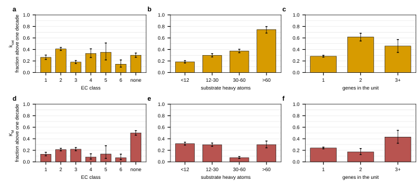
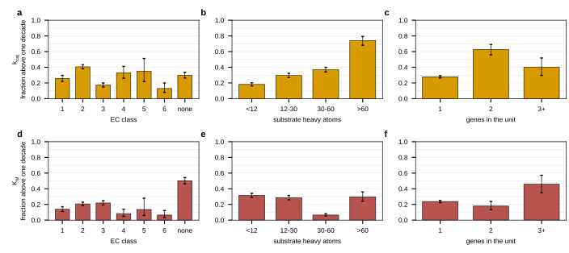

## 2026.09.10 - Closing the kcat and KM gap, and making the route portable

### Method

Four scripts, run in this order, all from the worktree root with
`PYTHONPATH=$PWD ~/miniconda3/envs/torchcell/bin/python`.

1. `experiments/026-metabolism-flux/scripts/kinetic_coverage_gaps.py` re-derives the tiers
   through the same functions the flux layer calls (`resolve_kcat_table`,
   `resolve_km_table`, `load_predicted_unit_table`) and attaches one blocker enum to every
   catalytic unit that is neither measured nor predicted by every admitted predictor. Two
   populations are kept separate: units on the organism-default tier, and units missing at
   least one admitted predictor.
2. `experiments/026-metabolism-flux/scripts/improve_kinetic_coverage.py --stage resolve`
   finds structures for the blocked units' substrates through two routes the input builder
   did not have, then `--stage predict` runs each admitted predictor over the new rows only
   and `--stage report` re-resolves the tables.
3. `experiments/026-metabolism-flux/scripts/kinetic_measured_tier_audit.py` audits the
   measured tier: organism purity, whether the row that supplied each value was assayed on
   a substrate the reaction consumes, the reach of four alternative match keys, and the
   measured-versus-predicted disagreement.
4. `experiments/026-metabolism-flux/scripts/kinetic_predictor_spread.py` asks where the
   admitted predictors disagree.

The portable path is `torchcell/metabolism/kinetics_pipeline.py`, exercised on yeast-GEM by
`experiments/026-metabolism-flux/scripts/kinetics_pipeline_yeast.py` and on a synthetic GEM
by `tests/torchcell/metabolism/test_kinetics_pipeline.py`.

### Every gap was the same gap

`results/kinetic_coverage_gaps_before.json`, over 3,728 catalytic units: 176 units had no
prediction from any admitted predictor and 170 of those were on the organism-default tier
for both parameters. The blocker was `substrate_structure_missing` for **all 176**. Zero
units were blocked by a missing UniProt accession, a missing sequence, a complex rule the
builder could not handle, a reaction without substrates, or a predictor failure. Predictor
failures exist at ROW level only: UniKP refuses a multi-component SMILES and lost 105 of
7,456 rows, and every one of those units kept a value from another row.

The 176 units drew on 86 distinct substrate metabolites that no route priced.

### Two routes closed 165 of the 176

`results/kinetic_coverage_structures.json`.

| route | substrates priced | what it is |
| --- | --- | --- |
| `annotation_xref` | 27 | the metabolite's ChEBI, KEGG, BiGG or MetaNetX id resolved through `chem_xref.tsv` to a CURRENT MNXM id, then to a SMILES in `chem_prop.tsv` |
| `supplied` | 48 | the formula-verified acyl-chain structures `lipid_structure_writer.py` writes |
| neither | 11 | no small-molecule structure exists for the species |

The cross-reference route matters because yeast-GEM annotates against an older MNXref
release: `MNXM417` for fructose 1,6-bisphosphate is not a row in MNXref 4.5 at all, so the
direct-id lookup returns nothing and the metabolite reads as structureless. That single
defect is why fructose-bisphosphate aldolase (FBA1, `r_0450`), the IMP cyclohydrolase step
(`r_0570`) and D-arabinose transport (`r_1707`) had no turnover number.

**Every candidate is accepted only on composition.** RDKit's formula for the candidate
SMILES must equal the GEM's formula for the metabolite, both moved to the neutral species by
adding one hydrogen per negative charge. Comparing at neutrality is what lets a GEM anion
match a catalog's neutral acid, and it is also what rejects, for the right reason, every
R-group placeholder: yeast-GEM writes an attachment point as `R` and MetaNetX as `*`, so
`C4H7O2SR` never equals `C4H7O2S*`.

The fix is deliberately **additive**. A metabolite the existing pipeline already priced is
never re-resolved, because re-pricing would move the per-unit median of the 3,552 units that
already had predictions and silently invalidate the predictor-selection study and the spread
analysis computed on them. Measured and not applied: the same routes would price **503 of
the 699 other unpriced metabolites**.

### Tier counts, before and after

Both tables resolved through the flux layer's own path. Before:
`results/kinetic_coverage_gaps_before.json`; after: `results/kinetic_coverage_closure.json`
and `results/kinetic_coverage_gaps.json`.

| parameter | tier | before | after |
| --- | --- | --- | --- |
| k_cat | measured | 148 (3.97 %) | 148 (3.97 %) |
| k_cat | predicted | 3,410 (91.5 %) | 3,570 (95.8 %) |
| k_cat | organism default | 170 (4.56 %) | **10 (0.27 %)** |
| K_M | measured | 148 (3.97 %) | 148 (3.97 %) |
| K_M | predicted | 3,410 (91.5 %) | 3,570 (95.8 %) |
| K_M | organism default | 170 (4.56 %) | **10 (0.27 %)** |

Units with a prediction from every admitted predictor: 3,552 before, **3,717 after** (of
3,728). The 293 new pair rows cover 165 units over 15 genes and 47 distinct molecules, and
were run through EITLEM, UniKP and EZKinetics at the pinned weights already in use
(`264d52bd…`, `fe908112…`, `bf7a8973…`); each predictor's processed directory carries a
`<parameter>_append_manifest.json` naming the rows appended and the sha256 of the new pair
table. Nothing already predicted was re-run, because these models are not bit-reproducible
across hardware and a rebuild would move values nothing asked to move.

### The 10 that remain, and what each would take

`results/kinetic_coverage_closure.json`, key `ceiling`. **None of the 10 is reachable with
an open-source structure tool**, and that is a statement about what the species are rather
than about effort.

| units | substrates | why | what it would take |
| --- | --- | --- | --- |
| 3 (`r_2148`, `r_2149`, `r_2150`; YHR067W) | 3-hydroxybutanoyl-, hexanoyl-, octanoyl-ACP | R-group placeholder | a GEM curation decision. The species has no structure until a representative acyl chain is chosen, and choosing one changes what the model asserts |
| 3 (`r_4239`, YGL017W; `r_4277`, YLR099C and YPR139C) | Arg-tRNA(Arg), generic protein, Acyl-CoA, 1-acyl-sn-glycerol 3-phosphate | R-group placeholder | as above |
| 2 (`r_4152`; YAL039C and YKL087C) | Cytochrome c | catalog structures exist, none matches the GEM's composition | a decision about what the GEM means. It writes only the heme part of a protein-bound species, so accepting a catalog structure would silently change the substrate |
| 2 (`r_4325`; YOR226C and YPL135W) | S-sulfanyl-[L-cysteine desulfurase], [disordered-form [Fe-S] cluster scaffold protein] | macromolecular species with no formula in the GEM | a predictor whose substrate may be a protein. All six mirrored predictors take a small-molecule SMILES, so this is a model class we do not have rather than an input we failed to find |

**The honest ceiling is not 0.27 percent.** The predictors were run on whatever SMILES the
input builder found, without the composition check this fix introduced. Re-testing every
structure the predictions rest on: 97 of 1,425 distinct substrate structures fail the check,
and **59 of the 3,717 predicted units rest only on structures that fail it**. Those units
have a number, and the number is for a molecule whose composition disagrees with the GEM's.
Fixing them means re-running the predictors on the corrected structures, which moves existing
values and so is a deliberate decision rather than a patch.

### Measured tier audit

`results/kinetic_measured_tier_audit.json`.

**Organism.** The tier is organism-pure. The mirror holds 1,126 rows, all
`Saccharomyces cerevisiae`, and the full 35,753-row Open Enzyme Database holds exactly those
1,126 for that organism, so nothing is inherited from another species. The slice carries 106
distinct accessions and 90 distinct EC numbers; 79 of the accessions are yeast-GEM genes.

**148 versus 138.** Both counts are right and they answer different questions. The flux
layer takes the minimum over a unit's member genes, so a unit is measured when **any** member
gene has a measured accession: 148. `within_class_plausibility.py` requires **all** member
genes: 138. Verified directly, and the wildtype filter makes no difference to either count.

**Half the measured tier was assayed on the wrong substrate.** `resolve_kcat_table` keys on
the accession and then picks the row assayed nearest 30 C, and never checks that the row's
substrate is one the reaction consumes. Matching the chosen row's substrate against the
reaction's substrates by InChIKey connectivity block: 72 of 148 match by structure, 2 by
name, and **74 do not match at all**. Those units carry a turnover number measured on a
molecule the reaction does not touch.

**Reach of four keys**, measured and not applied.

| key | units with a candidate row | with the substrate also matching |
| --- | --- | --- |
| accession, this organism (the current key) | 148 | 94 |
| EC number, this organism | 231 | 145 |
| EC number, any organism | 1,386 | 866 |

Running the portable pipeline under each key confirms it end to end: the accession key gives
148 measured, `ec_substrate_organism` gives 145, and `ec_substrate_any_organism` gives **869
of 3,728 (23.3 percent)** on the cross-organism homolog tier
(`results/kinetic_pipeline_yeast_*.json`). For yeast that is a comparison. For an organism
nobody has assayed it is the only measured tier there is, and it is what makes the pipeline
worth porting.

**Disagreement with the predictions.** Of the 147 measured units that also carry a
prediction, the median absolute difference is 0.248 decades, p90 1.063, max 1.936. Sixteen
are above one decade and **none is above two**, so there is no list to review under the
two-decade rule.

### Where the predictors disagree

`results/kinetic_predictor_spread.json`, figure below. Spread is the log10 range across the
admitted predictors on the 3,717 units all of them price. For k_cat that is EZKinetics,
EITLEM and UniKP; overall median 0.739 decades and 30.4 percent above one decade. For K_M
the code path admits EZKinetics alone, so a spread over the admitted set does not exist and
the panel is computed over EZKinetics and EITLEM, the pair the coverage figure's alternative
rule keeps; overall median 0.537 decades, 24.0 percent above one decade.

**The k_cat disagreement is concentrated, and substrate size is where it concentrates.**

| grouping | group | n | median decades | fraction above one decade |
| --- | --- | --- | --- | --- |
| substrate heavy atoms | <12 | 1,412 | 0.55 | 0.184 |
| substrate heavy atoms | 12-30 | 1,010 | 0.72 | 0.298 |
| substrate heavy atoms | 30-60 | 1,064 | 0.86 | 0.373 |
| substrate heavy atoms | >60 | 231 | 1.39 | **0.745** |
| EC class | 2 transferase | 1,413 | 0.87 | 0.408 |
| EC class | 3 hydrolase | 888 | 0.56 | 0.180 |
| EC class | 6 ligase | 124 | 0.54 | 0.145 |
| genes in the unit | 1 | 3,442 | 0.71 | 0.282 |
| genes in the unit | 2 | 203 | 1.20 | **0.616** |
| genes in the unit | 3 or more | 72 | 0.96 | 0.458 |

The size trend is monotone and the endpoints do not overlap in their Wilson intervals, so a
lipid or CoA thioester substrate is where the median over predictors is least meaningful.
K_M behaves differently: it is flat in substrate size and concentrated instead in reactions
with no EC annotation (0.502 above one decade against 0.073 to 0.218 for the annotated
classes).

**Figure.** Fraction of catalytic units whose admitted predictors disagree by more than one
decade, with Wilson 95 percent intervals. **a**, k_cat by EC class: 1 oxidoreductase, 2
transferase, 3 hydrolase, 4 lyase, 5 isomerase, 6 ligase, none no EC annotation. **b**, k_cat
by the median heavy-atom count of the unit's substrates. **c**, k_cat by the number of genes
in the catalytic unit. **d**, K_M by EC class. **e**, K_M by substrate heavy atoms. **f**,
K_M by genes in the unit. Group sizes are in the table above. Generated by
`experiments/026-metabolism-flux/scripts/kinetic_predictor_spread.py`.

### The portable pipeline

`torchcell/metabolism/kinetics_pipeline.py` takes a GEM, a proteome and a set of mirrors and
emits per-catalytic-unit k_cat and K_M with a tier, the predictor set, provenance and a
blocker enum for every unit it cannot resolve. Nothing in it names an organism, a gene, a
metabolite or a predictor. Stages: sequence, structure, measured, predicted. The admitted
predictor set is a computed stage rather than a list, so another organism re-decides it from
its own within-class statistics through `PredictorSelection.from_study`, and the measured
tier is an optional first stage whose key is chosen by `MeasuredKey`.

Run on yeast-GEM 9.0.2 with the accession key it reproduces the flux layer's counts exactly,
148 measured / 3,570 predicted / 10 default for both parameters, which is the check that the
portable path and the in-place path agree. Porting to another organism replaces
`kinetics_pipeline_yeast.py`, not the module: what has to exist is an SBML, a proteome FASTA
or gene-to-sequence JSON, optionally a gene-to-accession map, a structure database with a
cross-reference, and whatever predictors were run.

One inconsistency, unresolved and flagged. The code path's selection rule
(`PredictorSelection.from_study`, Wilson lower bound against the EC-median lookup on the
own-class band) admits EZKinetics, EITLEM and UniKP for k_cat and **EZKinetics alone** for
K_M. `parameter_coverage_selected.json`, written by `plot_parameter_coverage.py`, uses a
different rule (mean of the shared and own-class band fractions, top 3, drop anything at or
below the lookup) and admits EZKinetics and EITLEM for K_M. Both files are in the repo and
the flux layer follows the first. This is a decision to make, not a bug to patch.

### What was not run

The three predictors the study does NOT admit for k_cat (DLKcat, TurNuP, DeepEnzyme) and the
one for K_M (Boost_KM) were not run on the 293 new rows. Their parquets therefore stop at
3,552 units while the admitted three reach 3,717. Nothing the flux layer reads is affected,
since the median is over the admitted set, but a future re-run of the within-class study or
of the all-predictor spread would compare unequal unit sets.

### Scripts and results

- `experiments/026-metabolism-flux/scripts/kinetic_coverage_gaps.py` ->
  `results/kinetic_coverage_gaps.json`, `results/kinetic_coverage_gaps_before.json`
- `experiments/026-metabolism-flux/scripts/improve_kinetic_coverage.py` ->
  `results/kinetic_coverage_structures.json`,
  `results/kinetic_coverage_new_pairs.parquet`, `results/kinetic_coverage_closure.json`
- `experiments/026-metabolism-flux/scripts/kinetic_measured_tier_audit.py` ->
  `results/kinetic_measured_tier_audit.json`
- `experiments/026-metabolism-flux/scripts/kinetic_predictor_spread.py` ->
  `results/kinetic_predictor_spread.json` and the figure above
- `experiments/026-metabolism-flux/scripts/kinetics_pipeline_yeast.py` ->
  `results/kinetic_pipeline_yeast_uniprot.json`,
  `results/kinetic_pipeline_yeast_ec_substrate_organism.json`,
  `results/kinetic_pipeline_yeast_ec_substrate_any_organism.json`
- `torchcell/metabolism/kinetics_pipeline.py`,
  `tests/torchcell/metabolism/test_kinetics_pipeline.py`

## 2026.09.11 - Correctness over coverage: verified structures, a substrate-matched measured tier, and a homolog tier

Three things the previous section flagged as decisions were decided in favor of correctness,
and the coverage numbers moved in both directions as a result. The headline is no longer
"0.27 percent default": it is that every value in the shipped tables now rests on a
substrate structure whose composition matches the GEM's, and on a measurement of the
reaction the row was actually assayed on.

Every superseded table is still on disk. Predictor tables keep their unverified version at
`processed/<parameter>.parquet` and gain `verified/<parameter>.parquet` beside it, whose
manifest names the sha256 of the file it supersedes. The round-1 gap audit is kept as
`results/kinetic_coverage_gaps_round1.json`.

### 1. The 97 failing structures

`improve_kinetic_coverage.py --stage verify`, writing
`results/kinetic_structure_verification.json`.

Of the 1,425 distinct `(metabolite, SMILES)` pairs the predictions rested on, 97 failed the
composition check. Re-resolving them through the two verified routes repaired **30** (19 by
a direct current-id lookup, 11 through the cross-reference) and left **67** unrepairable:
35 tRNA species whose GEM formula is the placeholder `RH`, plus dolichols, glycans and
protein-bound cofactors. Consequences on the pair table: 82 pairs re-pointed at a corrected
structure, **208 pairs dropped**, and **19 catalytic units lost** their only structure.

Dropping is the point. A prediction computed for a molecule whose composition disagrees with
the GEM's is not a value for that reaction, so those 19 units fall to the organism default
with their blocker recorded rather than keeping a number that was never theirs.

The admitted predictors were re-run on the 82 re-pointed pairs, and all seven predictor
tables were rebuilt on the same verified pair set. Result, from
`closure.json` key `ceiling.structure_quality_by_version`:

| version | units with a prediction | units resting only on failing structures | distinct structures | failing |
| --- | --- | --- | --- | --- |
| `processed` (superseded) | 3,717 | 59 | 1,425 | 97 |
| `verified` (ships) | 3,698 | **0** | 1,358 | **0** |

How far the repair moved the numbers, predicted tier against predicted tier on the units
both versions price: **k_cat** 400 units changed, **none by more than one decade**, max 0.690.
**K_M** 172 units changed, 4 over one decade, max 1.287. So the structure repair is a small
correction in value and a real correction in what the values are about.

**The 59 units that rested only on failing structures**, which is the population the fix was
aimed at: **19 fall to the organism default** because nothing verifiable exists for their
substrates, and **40 are re-predicted on a repaired structure**. Of those 40, **none moves by
more than one decade** in either parameter (k_cat median 0.180 and max 0.238 decades, K_M
median 0.148 and max 0.742). Reproduced by
`experiments/026-metabolism-flux/scripts/improve_kinetic_coverage.py --stage report`, key
`structure_repair_movement`.

### 2. Measured now means substrate-matched, and there is a homolog tier

`resolve_kcat_table` and `resolve_km_table` run four tiers in order: a measurement of this
organism's own protein assayed on a substrate the reaction consumes; a measurement in any
organism whose EC number is annotated on the reaction and whose substrate matches; the
predictor median; the organism constant. The second is tagged
`open_enzyme_database_ec_homolog` and is deliberately **not** in `EXPERIMENTAL_SOURCES`, so
`flux_layer._tier_counts` counts it with the predictions and the experimental fraction 027
asserts on never inflates. `ParameterTable.tier_counts` reports all four; the flux layer's
`predicted` equals this table's `predicted` plus `homolog`.

**Where the 52 wrong-substrate units went.** The accession key admitted 148 units and 96
survive the substrate check. Of the 52 removed, **33 land on the homolog tier, 18 on the
predicted tier, and 1 on the default**. None keeps a value assayed on a molecule its
reaction does not consume.

**The homolog tier beats the predicted tier where both can be scored.** On the 87 units that
have a substrate-matched measurement of yeast's own protein plus both a homolog value and a
prediction, the homolog is closer to the measurement on **55 of 87**, with a median absolute
error of **0.094 decades against the prediction's 0.300**. That is the evidence the cascade
order rests on, and it is a real measurement rather than an assumption. Its limitation is
stated: those 87 units are ones yeast itself has been assayed on, so they are enzymes the
literature has studied, and the result may not transfer to the whole 782.

### 3. One K_M rule, one default

The repo held two selection rules. The figure's rule (mean of the shared and own-class band
fractions, top three, drop at or below the lookup) is gone; `plot_parameter_coverage.py` now
calls `PredictorSelection.from_study`, the rule the flux layer runs: the own-class EC4 band,
keeping a predictor whose **Wilson 95 percent lower bound** exceeds the EC-median lookup's
point fraction. Admitted: **EZKinetics, EITLEM and UniKP for k_cat; EZKinetics alone for
K_M**. EITLEM's K_M lower bound is 0.372 against the lookup's 0.489, so on 47 scorable pairs
it is not established as better than a table lookup. `parameter_coverage_selected.json` is
regenerated from that one rule, and a K_M spread over the admitted set is 0 by construction,
which is the honest consequence of admitting one predictor rather than a number to quote.

The organism default has one definition in both the resolver and the portable pipeline, in
`_organism_default`: the median of the values the **database tiers** placed in the table, per
catalytic unit. That is 9.60 1/s for k_cat and 0.147 mM for K_M, over 878 units. The 0.32
versus 0.20 mM disagreement is gone; it came from one path taking a per-unit median and the
other a per-gene median.

### 4. Every predictor on the same pair set

All seven tables rebuilt on the verified pairs, so the selection rule can be re-decided later
on a full matrix rather than on unequal unit sets.

| predictor | parameter | rows | units | pairs it left unpriced | newly predicted |
| --- | --- | --- | --- | --- | --- |
| EZKinetics | both | 7,541 | 3,698 | 0 | 82 |
| EITLEM | both | 7,541 | 3,698 | 0 | 82 |
| UniKP | both | 7,538 | 3,698 | 3 | 85 |
| DLKcat | k_cat | 7,538 | 3,698 | 3 | 378 |
| DeepEnzyme | k_cat | 7,538 | 3,698 | 3 | 378 |
| Boost_KM | K_M | 7,280 | 3,614 | 261 | 506 |
| TurNuP | k_cat | 5,506 | 2,499 | 2,035 | 2,075 |

TurNuP and Boost_KM still cover fewer units, for their own documented reasons rather than for
want of inputs: TurNuP maps a substrate onto its internal fingerprint set and refuses what it
cannot, and it went from 2,056 to 2,499 units on this run. UniKP refuses a multi-component
SMILES. Those are predictor properties and are reported, not patched.

### The final tables

Both parameters, 3,728 catalytic units, from `results/kinetic_coverage_closure.json`. The
four variants isolate the three changes.

| variant | measured | homolog | predicted | default |
| --- | --- | --- | --- | --- |
| unverified structures, accession key (what round 1 shipped) | 148 | 0 | 3,570 | 10 |
| verified structures, accession key | 148 | 0 | 3,551 | 29 |
| verified structures, substrate-matched measured tier | 96 | 0 | 3,602 | 30 |
| **plus the homolog tier (ships)** | **96** | **782** | **2,820** | **30** |

As fractions of 3,728: measured 2.58 percent, homolog 20.98, predicted 75.64, default 0.80.
The experimental fraction the 027 preflight asserts on is 0.0258, above its 0.02 floor.

**What moved, round-1 table to shipped.** k_cat: 1,159 of 3,728 units changed value, 305 by
more than one decade, 81 by more than two, median 0.343 decades among the changed, max 4.119.
K_M: 962 changed, 271 over one decade, 38 over two, median 0.534, max 4.095. Most of that is
the homolog tier replacing a prediction on 782 units, which the 87-unit contest above is the
evidence for.

### The 30 remaining defaults, by reason

`closure.json` key `ceiling`. Substrate rows, so a two-substrate unit contributes twice.

| rows | reason | reachable with open-source tools | what it would take |
| --- | --- | --- | --- |
| 17 | no candidate structure in any mirrored catalog | yes | one more name in the acyl-chain grammar of `lipid_structure_writer.py`. The substrates are dolichyl D-mannosyl phosphate, the phosphatidylethanolamine backbone and the GPI-anchor intermediates |
| 13 | R-group placeholder | no | a GEM curation decision, since the species has no structure until a representative chain is chosen |
| 8 | macromolecular species with no formula | no | a predictor whose substrate may be a protein |
| 2 | catalog structures exist, none matches the composition | no | a decision about what the GEM means by Cytochrome c |

So the honest ceiling is: 17 substrate rows are reachable by extending a structure writer we
already own, and the rest need either a modeling decision or a class of predictor that does
not exist in the mirror.

### The portable pipeline reproduces it

`kinetics_pipeline_yeast.py`, default key `uniprot_substrate` plus the
`ec_substrate_any_organism` homolog stage, gives **96 measured_protein / 782
measured_ec_other_organism / 2,820 predicted / 30 default**, default 9.6 1/s and 0.1467 mM,
identical to the in-place resolver on every count. That agreement is the check that the
portable path and the path the flux layer runs are the same computation. The pipeline gained
a second database stage (`homolog_key` + `homolog_mirror_dir`) so the four-tier cascade is
expressible for any organism, and the yeast runner is still the only file that names a yeast
path.

With the homolog key used as the ONLY database stage, which is the situation for a chassis
nobody has assayed, the pipeline gives **869 measured_ec_other_organism / 2,829 predicted /
30 default**: 23.3 percent of the model on measured chemistry with no organism-specific
assays at all.

### End-to-end check

`experiments/027-betaxanthin-metabolic/scripts/train_bx.py --arm flux_capacity --seed 0
--smoke --kcat-tier predicted --thermo-source union --head-normalize` builds the flux layer
on the new tables, passes the `min_kcat_experimental_fraction` preflight at 0.0258, and
trains. No change to `flux_layer.py` was needed, which was the design constraint on the
homolog tag.

### Figure

The spread analysis was recomputed on the verified tables (3,698 units, k_cat median 0.738
decades, 29.9 percent above one decade) and the conclusions are unchanged: the disagreement
is concentrated in large substrates and in multi-gene complexes.

**Figure.** Fraction of catalytic units whose admitted predictors disagree by more than one
decade, with Wilson 95 percent intervals, on the verified tables. **a**, k_cat by EC class:
1 oxidoreductase, 2 transferase, 3 hydrolase, 4 lyase, 5 isomerase, 6 ligase, none no EC
annotation. **b**, k_cat by the median heavy-atom count of the unit's substrates. **c**,
k_cat by the number of genes in the catalytic unit. **d**, K_M by EC class. **e**, K_M by
substrate heavy atoms. **f**, K_M by genes in the unit. K_M is computed over EZKinetics and
EITLEM because the admitted set for K_M is one predictor and one predictor has no spread.
Generated by `experiments/026-metabolism-flux/scripts/kinetic_predictor_spread.py`.

### Still open

- The `all_predictors` block of `parameter_coverage_selected.json` reads the `_consensus`
  parquets, which are still the 3,552-unit build and were not regenerated here. Its spread
  numbers describe the old unit set.
- Whether the homolog tier improves the flux layer's PHENOTYPE predictions is not measured.
  What is measured is that homolog values are closer to yeast measurements than predictions
  are, on the units where a yeast measurement exists.
- `arm["kcat_homolog_tier"] = False` turns the tier off for an ablation. No arm sets it.

### Artifacts added or replaced

- `results/kinetic_structure_verification.json`, `results/kinetic_verified_pairs.parquet`,
  `results/kinetic_verified_substrates.parquet`
- `results/kinetic_coverage_gaps_round1.json` (superseded round-1 audit),
  `results/kinetic_coverage_gaps.json`, `results/kinetic_coverage_closure.json`,
  `results/kinetic_measured_tier_audit.json`, `results/kinetic_predictor_spread.json`,
  `results/parameter_coverage_selected.json`
- `results/kinetic_pipeline_yeast_uniprot_substrate.json`,
  `results/kinetic_pipeline_yeast_ec_substrate_any_organism.json`
- `$DATA_ROOT/data/torchcell/kinetics/<predictor>/verified/<parameter>.parquet` plus
  `<parameter>_manifest.json` for all seven predictors, and
  `$DATA_ROOT/data/torchcell/kinetics/_features/verified_pairs.parquet`

## 2026.09.11 - The last writable substrates, and the table-version lineage

### Two more structures, and why only two

`experiments/026-metabolism-flux/scripts/kinetic_substrate_writer.py` is the kinetics-side
companion to the lipid writer: it covers the named compounds no mirrored catalog indexes and
whose formula carries no R, so the GEM has committed to a definite composition and the only
question is which molecule has it. **The chain length is derived rather than chosen**: the
writer builds the template for every length in a range and keeps the one whose RDKit formula
equals the GEM's, so a modeling decision becomes a lookup against a constraint the GEM
already made.

| metabolite | GEM formula | outcome |
| --- | --- | --- |
| dolichyl D-mannosyl phosphate | `C26H47O9P` | **written**, the formula selects dolichol-4 uniquely out of n = 2 to 11 |
| cis-dec-3-enoyl-CoA | `C31H52N7O17P3S` | **written**, the acyl-CoA template at n = 10 with a cis 3-ene |
| N,N'-diformyldityrosine | `C20H22N2O8` at charge -2 | refused: the 3,3' biaryl cross-link the name states computes to `C20H20N2O8`, and the GEM's formula neutralizes to `C20H24N2O8`, four hydrogens apart. Two N-formyltyrosines are `C20H22N2O8` NEUTRAL, so the GEM's formula and its charge do not describe the same species under either reading |
| phosphatidylethanolamine backbone | `C5H10NO4P` | refused: glycerophosphoethanolamine minus two waters, an R-group placeholder whose R was deleted from the formula instead of written. Any SMILES matching that composition is a different molecule |
| hydrogen sulfide | `HS` at charge 0 | refused: hydrogen sulfide is `H2S`, and `HS` at charge zero is a radical. A GEM formula defect, and writing `S` for it would hide that |

The dolichol matters more than its one row suggests: it was in the predictor tables with a
name-matched SMILES that failed the composition check, so the previous pass DROPPED it and
lost 11 units with it. With a verified structure those units come back.

### Tier table after the writer

| tier | count | fraction |
| --- | --- | --- |
| measured | 97 | 2.60 % |
| homolog | 782 | 20.98 % |
| predicted | 2,831 | 75.94 % |
| organism default | **18** | 0.48 % |

Structures repaired 31 of 97 failing, 66 unrepairable; 95 pairs re-pointed, 195 dropped, and
**8 units lost** rather than 19. All seven predictor tables were rebuilt on the new pair set
(7,554 pairs, 3,709 units), and the verified tables still carry zero failing structures
(1,359 distinct structures checked, none failing).

### The ceiling is now exhausted

The ceiling is reported per SUBSTRATE rather than per unit, because a unit with two
unresolved substrates carries two reasons and attributing a reason to the unit made a unit
look reachable when its other substrate was the reachable one. **A substrate the writer
tried and refused is recorded as unreachable whatever its reason class says**, since the
refusal is a measurement and the reason class is an inference from the formula.

28 substrate rows across the 18 default units, and **none is reachable with an open-source
tool**:

| rows | reason | why no tool closes it |
| --- | --- | --- |
| 14 | R-group placeholder | the species has no structure until a representative chain is chosen, which is a GEM curation decision |
| 7 | macromolecular species with no formula | needs a predictor whose substrate may be a protein; all seven mirrored predictors take a small-molecule SMILES |
| 5 | no candidate structure in any catalog | the writer tried all five and refused each: the PE backbone is a placeholder whose R was deleted, hydrogen sulfide's formula is not a molecule, and diformyldityrosine's formula and charge do not describe the named species |
| 2 | catalog structures exist, none matches | Cytochrome c, where the GEM writes only the heme part of a protein-bound species |

So the answer to "what would it take" is no longer a tooling gap for any of them. It is a
GEM curation decision for 14 rows plus the PE backbone and hydrogen sulfide, a model class
that does not exist in the mirror for 7, and a question about what the GEM means for
Cytochrome c and diformyldityrosine.

### Table-version lineage, so a results JSON can be dated from its tier counts

Two versions of every predictor table are on disk and neither was moved or renamed. Which
one a run used is readable from the `kcat_tier_counts` it recorded:

- **`processed`**, the round-1 tables, 3,717 units, unchecked substrate structures. Any cell
  submitted before roughly 00:30 CDT on 2026-09-11 reads these, and its kcat tier counts read
  **148 measured / 3,570 predicted / 10 default** with no homolog tier.
- **`verified`**, 3,709 units, every substrate structure composition-checked. Snapshots from
  after that point read these, and their counts read **97 / 782 / 2,831 / 18** in the
  four-way split, which the flux layer's three-way split reports as **97 measured / 3,613
  predicted / 18 default**.

A run whose counts are 96 / 782 / 2,820 / 30 read the intermediate verified tables built
between roughly 00:07 and 01:00 CDT, before the substrate writer landed.

Exact hashes, regenerated by
`improve_kinetic_coverage.py --stage versions` into `results/kinetic_table_versions.json`:

| predictor | parameter | version | units | sha256 |
| --- | --- | --- | --- | --- |
| boost_km | K_M | processed | 3,468 | `4b6ead4c370928184a1da6a544b6e22c7fe9d80aef9b9e2a6322a1bef9a30ec5` |
| boost_km | K_M | verified | 3,625 | `926f3fa1e2fc560d486d049fa1ac0b07f23db96ee0b5cda14e146da5b45ea092` |
| deepenzyme | k_cat | processed | 3,546 | `eda3a13fb70c247d09f2cc39f0c75157c1ec9db20f3312b36b1c9a2d4d102eb0` |
| deepenzyme | k_cat | verified | 3,709 | `996d502e96158cb01d80cfeb3dc38a475c2e1b18c48e3ea8abeb099aa2947ce8` |
| dlkcat | k_cat | processed | 3,552 | `3a0cbedd18c3f0fb01365163b112e1252c0e8826cdf1f949dce2bec8925b8f57` |
| dlkcat | k_cat | verified | 3,709 | `c735663ba6982f23c11c60913f79bffd9f35bfb41a8a5f9e01082ed2a100eaa5` |
| eitlem | k_cat | processed | 3,717 | `ea506e5c60d93419d1c813e4fabf047873bebcd22004a13e739103500d15b121` |
| eitlem | k_cat | verified | 3,709 | `7cd3d1f1fff85be486387a8cd16089eec39eb535c25ff518bce4d4c568779390` |
| eitlem | K_M | processed | 3,717 | `ea506e5c60d93419d1c813e4fabf047873bebcd22004a13e739103500d15b121` |
| eitlem | K_M | verified | 3,709 | `5b99f5d7aae26ab3c2301c22b17cacb300f8bdc3fb282829b0c704cf0fd902df` |
| ezkinetics | k_cat | processed | 3,717 | `de9a43befcb942fcd20e2ef054c313bacfefae0f102b4ac47d4e6cba6b31e054` |
| ezkinetics | k_cat | verified | 3,709 | `ab116c336f71312a4f53d04a2511121f2e5f8f9c34e7a0ea34ad7767f0dd894d` |
| ezkinetics | K_M | processed | 3,717 | `61af95c14516dda69bceafc8db099a2f76b5bb91b749775e211015655c4a198f` |
| ezkinetics | K_M | verified | 3,709 | `be180871f6f9ff85aa4a1b41610f64116edf1f2c45249d3f8316c27e36fc9d87` |
| turnup | k_cat | processed | 2,056 | `a3ff82eb2a1d404cc26e9bf1f2d704e4a338bc9788b4b4c0f36b20f824451886` |
| turnup | k_cat | verified | 2,503 | `42e78a08eeb060ac3676288d158af6ed5cd172e715e86be50a3fd4af8f1707cb` |
| unikp | k_cat | processed | 3,717 | `9ac0e00bf59c75d8811597944c4b32e6f18f3b991c7317b8b8eedbaef356c847` |
| unikp | k_cat | verified | 3,709 | `7b3f838606db7dd43d7e38380702da6edc330a02e8b52e9715b1cbfaac42c1e7` |
| unikp | K_M | processed | 3,717 | `9ac0e00bf59c75d8811597944c4b32e6f18f3b991c7317b8b8eedbaef356c847` |
| unikp | K_M | verified | 3,709 | `868bddce04185f5085c3a4ef5dc4f7ed93a3e43596112eb04ab5303a7d7484ae` |

EITLEM's and UniKP's two `processed` parameters hash the same because each of those runs
wrote one table carrying both parameter columns. The substrate map the measured tier matches
against is
`b93b3a8a733dd70ac4558b2ba745abf942804bfc5ba711d0d44bf23c74277400` and the verified pair
table is `22bb0551d184a4f8fb3c8df8b76d0f68367b571a3facbcb76c97092caf39d0d7`.

Both the substrate map and every verified parquet are now written to a temporary path and
renamed into place, because training cells re-import the resolver in spawned DataLoader
workers and an in-place `to_parquet` gives a concurrent reader a window on a truncated file.

### The arm key is additive

`build_flux_layer` reads `arm.get("kcat_homolog_tier", True)`. No entry of the `ARMS` dict
sets it, so all 11 arms take the default, and the default resolves the same table the key
being absent resolves: identical values and identical provenance, verified element by element
(97 / 782 / 2,831 / 18 for both). Setting it to False is the yeast-only ablation and gives
97 / 0 / 3,613 / 18. Nothing in the `ARMS` dict was edited.
