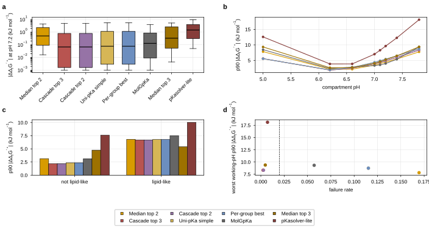

## 2026.09.11 - Choosing the pKa method on a set broad enough to choose on

### Why the 300-compound benchmark could not settle it

[[experiments.026-metabolism-flux.external-pka-route]] established that an open-source pKa
predictor can stand in for ChemAxon inside eQuilibrator's compound-creation path at all.
Three properties of that run stop it from settling WHICH predictor.

**It is 50 compounds per stratum.** A p90 on 50 compounds is the 5th largest of 50, and the
p90 is the statistic that matters for a fill-in: a method whose median is 0.2 kJ/mol and
whose p90 is 8 kJ/mol puts an 8 kJ/mol error on one reaction in ten, and one wrongly signed
reaction potential is what a second-law hinge acts on.

**It scored at one pH.** The build prices every metabolite at its compartment's own pH, and
those run from 5.0 in the extracellular space and the cell envelope to 7.8 in the
mitochondrial matrix (`build_equilibrator_thermo.COMPARTMENT_PH`); the flux layer's own
`CompartmentParameters` default adds 7.4. A pKa error propagates through the Legendre
transform most strongly where that pKa sits near the pH, so a method that is best at 7.2 is
not automatically best at 5.0, and the vacuole and the extracellular space are where the
transport reactions live.

**It stratified only by pKa count and functional group, and it excluded every lipid by
construction.** Its sampler capped mass at 600 Da and heavy atoms at 50. 409 of the 665
unpriced yeast-GEM metabolites are tier b, dominated by phosphatidylinositols, cardiolipins
and triacylglycerols, none of which fits under those caps. The benchmark was measuring a
regime the fill-in does not run in.

### The set

`experiments/026-metabolism-flux/scripts/external_pka_method_selection.py sample --n 2400`,
seed 17, writing `results/pka_selection_validation_set.json`.

**2,400 compounds** drawn from the eQuilibrator compound cache, filtered to compounds that
are group-decomposable (so they are actually priceable), organic over C H N O P S, 3 to 120
heavy atoms, under 1,600 Da, and carrying 1 to 6 ChemAxon pKas inside (0, 14). The draw is a
quota fill rather than a shuffle: a share is reserved for the lipid-like stratum, which a
plain random sample of the cache would not populate, and the rest is spread evenly over the
30 (pKa count x primary functional group) cells with the deficits refilled from the general
pool.

**The seed-17 300 are pinned in verbatim.** A pinned compound that the widened filter
dropped would silently change what the earlier numbers were computed on, so the sampler
raises rather than shipping a shorter pinned set.

Realized strata:

| axis | counts |
|---|---|
| pKa count | `n_pka_1` 418, `n_pka_2` 476, `n_pka_3` 386, `n_pka_4` 400, `n_pka_5` 313, `n_pka_6` 407 |
| primary group | phosphate 837, phenol 415, carboxylate 403, amine 378, none 367 |
| net charge at pH 7 | 0: 961, -1: 646, +1 or more: 347, -3 or less: 233, -2: 213 |
| molecular weight | <150 Da 52, 150 to 300 384, 300 to 500 723, 500 to 800 592, >=800 649 |
| lipid-like | 843 lipid-like, 1,557 not |

103,391 lipid-like compounds were available in the cache and 525 were taken; the remaining
318 lipid-like compounds in the set arrived through the quota and general fills. 14 of the
2,400 carry magnesium dissociation constants, which no external route can reproduce and
which is therefore an unclosable gap of the whole approach rather than of any one method.

**Lipid-like** is a SMARTS test, not a name test: eight consecutive acyclic CH2 groups plus
either a phosphate ester headgroup or an ester or amide carbonyl.

### What is scored, and at which pH

The quantity is the one the flux layer consumes: the Legendre transform that turns an
untransformed formation energy into `dGf'0`, rebuilt from the predicted pKa ladder with the
same `equilibrator_assets.thermodynamics.create_microspecies_mappings` the
compound-creation path calls, then re-referenced to the cache's own major microspecies so
that only the pKa contribution is compared. The reported error is
`|dGf'0(predicted) - dGf'0(ChemAxon)|`.

It is computed at pH 7.2 and at each of the eight working compartment pHs, 5.0, 6.2, 6.6,
7.0, 7.1, 7.2, 7.4 and 7.8, at I = 0.25 M, T = 303.15 K and pMg 3.0. The ladder is
decomposed into microspecies ONCE per compound and evaluated at every pH, which is what
makes eight pHs affordable.

**The ground truth is ChemAxon's own pKa list as the eQuilibrator cache stores it.** So this
measures agreement with the convention the cache is built in, not agreement with experiment.
That is the right target: the fill-in has to sit on one energy zero with the 2,113 compounds
the cache already prices, and a method that were closer to experiment but further from
ChemAxon would put a systematic offset between the two halves of the table.

### Ensembles are candidates, not a post hoc rescue

Five composite methods are scored beside the individual tools.

- **Median top 2 and median top 3**, per pKa RANK. A rank survives when more than half the
  contributing tools produced a pKa at that rank, and its value is the median over the
  tools that did. Taking the union of ranks instead would let the longest ladder decide the
  length, and ladder length is exactly what the tools disagree about.
- **Cascade top 2 and cascade top 3**: the best tool where it answers, the next where it
  does not. This is in the list because averaging cannot fix a COVERAGE gap. A median over
  tools is undefined exactly where the best tool returned nothing, and returning nothing is
  a common failure mode here rather than a rare one.
- **Per-group best**: each functional group takes the tool with the lowest p90 in that
  group. A group the pinned subset does not populate falls back to the overall pinned best
  rather than being dropped.

**Which tools are "top" is decided on the pinned 300, and the composites are then scored on
the 2,100 compounds that had no say in that ranking.** Both splits are in the output
(`methods` is the whole set, `methods_heldout` the 2,100), and the selection rule reads the
held-out one.

### The selection rule, written before the numbers

Recorded as a pydantic `SelectionRule` inside `results/pka_method_selection.json`, so a
future run of `decide` reproduces the decision from the same statistics.

> Choose the method with the lowest **worst per-pH p90** of `|dGf'0(predicted) -
> dGf'0(cache)|` over the working compartment pHs, subject to a **failure rate at or below
> 0.02**, evaluated on the compounds outside the pinned 300. Ties break on the median at
> pH 7.2, then on seconds per compound. Ensembles are allowed.

Three choices inside that, each with its reason.

- **p90 rather than the mean**, because the fill-in is a tail risk and the mean is
  dominated by the same compounds the median already reports.
- **The WORST pH rather than the mean over pHs**, because a metabolite is priced at its own
  compartment's pH and the method has to hold at all of them. Averaging would let a good
  cytosol score hide a bad vacuole one.
- **A failure-rate bound rather than scoring failures as large errors**, because a method
  that cannot answer is not a cheaper method, it is a gap, and a gap is what the next stage
  in the pipeline exists to handle.

**pKa-count match is reported and is deliberately NOT part of the rule.** A ladder can carry
the right number of pKas and the wrong values, and the transform is what the flux layer
consumes.

### What ran, and what did not

| tool | on the 2,400 set | cost |
|---|---|---|
| MolGpKa | yes, 2,400 of 2,400 attempted | 1,889 CPU-seconds over 56 shards, 0.79 s per compound |
| pKasolver-lite | yes, 2,400 of 2,400 attempted | 5,840 CPU-seconds over 24 shards, 2.4 s per compound |
| Uni-pKa, simple template | yes, 2,400 attempted | one GPU plus a 4,108-rung conformer LMDB build |
| Uni-pKa, full template | no | its enumerator produced 19,603 microstates for the 300-compound set and scored WORSE than the simple template there (dGf'0 MAE 2.94 against 0.91); the cost scales with the set and the earlier measurement does not motivate paying it |
| QupKake | attempted and abandoned | see below |

**QupKake was attempted on this set and abandoned, and the reason is a measurement.** Its
ladder is walked one rung at a time and each rung is a full xTB wave over every compound
still active, so the cost is set by the compound count rather than by the compounds that
still need a rung. Launched over 600 compounds with 3 rungs and 32 workers, it drove the
node's load average to 853 on 128 cores and starved the concurrent Uni-pKa conformer build,
whose rate fell from 50 compounds per minute to 6. It was killed after completing one rung
(`acidic_0`). On the earlier 300-compound set the same design got 60 compounds attempted and
only 1 ladder that terminated rather than being truncated, so its published numbers there
(`qupkake-truncated`, dGf'0 MAE 1.35 kJ/mol on 60 compounds) bound the tool rather than
measure it. It is not in the selection.

### The result

`results/pka_method_selection_scores.json`, held-out split (the 2,100 compounds outside the
pinned 300). Sorted by the statistic the rule reads.

| method | kind | failure rate | right pKa count | pKa MAE | dGf'0 MAE pH 7.2 | median | p90 | max | worst working p90 | at pH | s/compound |
|---|---|---|---|---|---|---|---|---|---|---|---|
| Median top 2 | ensemble | 0.1695 | 0.282 | 3.175 | 1.466 | 0.502 | 4.477 | 20.9 | **7.827** | 5.0 | 1.19 |
| **Cascade top 3** | **ensemble** | **0.0024** | 0.338 | 3.500 | 1.036 | 0.067 | 4.882 | 9.6 | **8.331** | 7.8 | 3.62 |
| Cascade top 2 | ensemble | 0.0029 | 0.338 | 3.501 | 1.037 | 0.068 | 4.892 | 9.6 | 8.333 | 7.8 | 1.19 |
| Uni-pKa simple | tool | 0.1152 | 0.354 | 3.558 | 1.157 | 0.077 | 5.411 | 9.6 | 8.745 | 7.8 | 0.40 |
| Per-group best | ensemble | 0.1152 | 0.354 | 3.558 | 1.157 | 0.077 | 5.411 | 9.6 | 8.745 | 7.8 | 3.62 |
| MolGpKa | tool | 0.0571 | 0.217 | 3.355 | 1.104 | 0.130 | 4.003 | 15.5 | 9.331 | 7.8 | 0.79 |
| Median top 3 | ensemble | 0.0048 | 0.364 | 3.079 | 1.795 | 0.331 | 5.247 | 36.8 | 9.382 | 7.8 | 3.62 |
| pKasolver-lite | tool | 0.0071 | 0.364 | 3.456 | 4.046 | 1.466 | 9.625 | 173.2 | 18.120 | 7.8 | 2.43 |

Errors in kJ/mol. The seconds for an ensemble are the sum over its members, which is an
upper bound for a cascade because the later members run only where the earlier one declined.

**The seconds column understates Uni-pKa by an order of magnitude and should not be read as
its cost.** Uni-pKa's own runner reports one total for the whole inference pass, 960 s over
2,400 compounds, and that total excludes the CPU half: enumerating the protonation ensembles
and generating conformers for 4,108 macrostate pairs took 110 minutes before the first fold
ran, or 2.8 s per compound, and it needs a GPU on top. MolGpKa's and pKasolver-lite's
numbers are real per-compound wall times from their own records. Every cascade containing
Uni-pKa inherits the understatement.

**The selected method is `cascade_top3`: Uni-pKa simple template, then MolGpKa, then
pKasolver-lite.** Worst working-pH p90 **8.331 kJ/mol at pH 7.8**, failure rate **0.0024**,
median at pH 7.2 **0.067 kJ/mol**, MAE 1.036, maximum 9.6. The decision and every number it
was decided on are in `results/pka_method_selection.json`.

Four things in that table are worth more than the winner.

**Ensembles win on the tail and lose on coverage, and the cascade is the only form that
gets both.** Median top 2 has the lowest p90 of anything, 7.827, and fails on 17 percent of
compounds, because a median is undefined at a rank where the best tool produced nothing. The
cascade has the coverage of the union of its members with the accuracy of the first one.

**No single tool is admissible except the worst one.** Uni-pKa fails 11.5 percent (243 of
2,400 empty ladders), MolGpKa 5.7 percent, and only pKasolver-lite clears the 2 percent
bound on its own, at more than twice everyone else's error. Composing was not a refinement
here, it was the only way to satisfy the rule.

**Cascade top 3 and cascade top 2 are a tie, and cascade top 2 is the defensible cheaper
choice.** 8.331 against 8.333 kJ/mol is a gap of 0.002 kJ/mol against errors of 8 kJ/mol,
0.02 percent, which is not a difference. The rule picks top 3 because the rule is
deterministic; the third member, pKasolver-lite, costs 2.4 s per compound and answers for
0.05 percent of the set. A run that wants the cheaper method should take cascade top 2 and
say so. On the 53 metabolites the method was then applied to, Uni-pKa answered for 52 and
pKasolver-lite for 1, and MolGpKa was never reached, so the cascade degenerates to its first
member there; it earns its place on the benchmark, not on the fill-in.

**pKa-count match does not track energy error, which is why it is not in the rule.**
pKasolver-lite has the joint-best count match, 0.364, and by far the worst energy, 18.1
kJ/mol. MolGpKa has the worst count match, 0.217, and the second-best single-tool energy.

### The error is not worst at pH 7.2, it is worst at the compartment extremes

| method | pH 5 | pH 6.2 | pH 6.6 | pH 7 | pH 7.1 | pH 7.2 | pH 7.4 | pH 7.8 |
|---|---|---|---|---|---|---|---|---|
| Cascade top 3 | 5.583 | 1.885 | 2.500 | 3.945 | 4.376 | 4.882 | 5.980 | 8.331 |
| Cascade top 2 | 5.585 | 1.885 | 2.502 | 3.946 | 4.389 | 4.892 | 5.980 | 8.333 |
| Uni-pKa simple | 5.556 | 1.937 | 2.752 | 4.385 | 4.891 | 5.411 | 6.482 | 8.745 |
| MolGpKa | 8.458 | 2.385 | 2.832 | 3.363 | 3.557 | 4.003 | 5.379 | 9.331 |
| Median top 2 | 7.827 | 2.188 | 2.171 | 3.503 | 4.014 | 4.477 | 5.460 | 7.762 |
| Median top 3 | 9.337 | 2.655 | 2.652 | 4.062 | 4.597 | 5.247 | 6.461 | 9.382 |
| pKasolver-lite | 12.579 | 3.870 | 3.883 | 7.015 | 8.280 | 9.625 | 12.267 | 18.120 |

p90 of `|ddGf'0|` in kJ/mol, held out. Every method is at its best near pH 6.2 to 6.6 and
degrades toward both ends, and the mitochondrial matrix at 7.8 is the worst working pH for
six of the eight methods. Scoring at pH 7.2 alone would have understated the cascade's
tail by 3.4 kJ/mol and would have ranked MolGpKa above Uni-pKa, which the working-pH
reading reverses.

*Hypothesis, untested:* the dip near 6.2 is where the transform is least sensitive to a
misplaced pKa for this compound population, since the cache's pKas cluster away from that
band. Nothing here measures that, and the ranking does not depend on it.

### Where the methods separate: lipids, and highly charged species

| stratum | Cascade top 3 | Uni-pKa simple | MolGpKa | pKasolver-lite |
|---|---|---|---|---|
| lipid-like (n=820) | 10.078 | 10.148 | 13.614 | 17.902 |
| not lipid-like (n=1,280) | 7.025 | 7.035 | 10.888 | 19.226 |
| mass >= 800 Da (n=649) | 10.233 | 10.273 | 13.587 | 28.739 |
| charge <= -3 (n=219) | 10.674 | 10.252 | 10.252 | 36.314 |
| charge 0 (n=857) | 5.847 | 5.749 | 8.941 | 12.940 |

Worst working-pH p90, kJ/mol, held out. The lipid stratum is 3 kJ/mol worse than the rest
for the selected method, which is the honest cost of the regime the fill-in runs in and
which the 300-compound benchmark could not see at all. The highly charged stratum is where
count match collapses: 0.009 for the cascade against 0.694 for MolGpKa, and yet MolGpKa's
energy there is no better. A ladder of the right length with the wrong values is not an
improvement.

### Figure

**Figure 1. The pKa method-selection benchmark, held-out compounds only.** **a**,
Distribution of `|ddGf'0|` at pH 7.2 per method as a box over the 2,100 held-out compounds
on a log axis, box at the quartiles and whiskers at the 10th and 90th percentiles, values
clipped up to 1e-3 kJ/mol so an exact reproduction of the cache ladder is plottable. **b**,
p90 of `|ddGf'0|` at each working compartment pH, one line per method; every method is at
its best near pH 6.2 and worst at the extremes. **c**, p90 at pH 7.2 split by the lipid-like
stratum, the regime the yeast-GEM fill-in runs in and the one the earlier 300-compound
sample excluded by construction. **d**, Failure rate against the worst working-pH p90, one
point per method, with the selection rule's failure-rate bound of 0.02 as the dashed line;
only the methods left of that line are admissible. Drawn by
`experiments/026-metabolism-flux/scripts/plot_pka_method_selection.py` from
`results/pka_method_selection_per_compound.csv`; every plotted number is in
`results/pka_method_selection_figure.json`.

### What the selected method was then used for

`experiments/026-metabolism-flux/scripts/external_pka_apply_selection.py`, writing
`results/external_pka_applied.json`. 53 targets, 50 priced over **66 yeast-GEM metabolite
rows**: the 48 lipids whose earlier external-pKa values carried the wrong protonation
convention, and 5 tier-a compounds. The convention change alone moves the lipids by a median
1,585 kJ/mol; the details and the three failures are in
[[experiments.026-metabolism-flux.lipid-structure-writer]].

Every re-priced compound carries its own provenance: the method and its members, each
member's version, the MolGpKa weight sha256s, the submitted SMILES and the pH 7 microspecies
it came from, the pKa ladder, the conditions, and the resulting `dGf'0` with its sigma.

## 2026.09.11 - Coverage ceiling after the selected method

The pKa method is one stage of a pipeline, and the question it exists to serve is how much
of yeast-GEM the flux layer can price. That is now computed by one callable rather than by a
chain of scripts: `torchcell/metabolism/thermo_pipeline.py`, described in
[[torchcell.metabolism.thermo_pipeline]], driven for this organism by
`experiments/026-metabolism-flux/scripts/thermo_pipeline_yeast9.py`.

### Where it stands

`results/reaction_thermo_coverage_final.json`, stages in precedence order
`equilibrator_recomputation -> external_pka_targets -> structure_writer_lipids ->
composition_surrogate -> shipped_metabolite_column -> audit_diagnosis`:

| level | priced | total | fraction |
|---|---|---|---|
| metabolites | 2,528 | 2,806 | 90.09 % |
| reactions | 3,738 | 4,131 | 90.49 % |
| reactions with nonzero FVA width | 2,691 | 2,845 | 94.59 % |
| reactions carrying a propagated sigma | 1,755 | 4,131 | 42.48 % |

By route, at the reaction level: 2,741 from the eQuilibrator recomputation alone, 846
`mixed` (assembled from more than one route, and flagged rather than attributed), 122 from
the written-structure lipids the cache already held, 16 from the shipped metabolite column,
6 filled directly from the shipped REACTION column, 5 from the external-pKa route, and 2
from a composition surrogate.

Against the earlier ladder, which reported the recommended union at 3,732 of 4,131 (90.3
percent): the staged pipeline reaches 3,738, and `ThermoSource.UNION` through
`resolve_reaction_delta_g` reaches 3,722 against `UNION_EXTERNAL`'s 3,738
(`results/thermo_union_reprice.json`). The 16-reaction gain is the re-priced external-pKa
targets and the written lipids reaching the table the flux layer actually reads.

### The ceiling, by what each remaining gap would take

393 reactions are unpriced. Every one carries the metabolites that block it and their
reason, so the gap can be split by what would close it rather than counted as one number:

| sole blocking reason | reactions | what it would take |
|---|---|---|
| `pseudo_metabolite` | 215 | nothing is possible: a SLIME backbone or a pool, whose formula is a DIFFERENCE formula and which is not a molecule |
| `placeholder_formula` | 98 | nothing is possible: an R, X or * in the formula means the species is a family of molecules |
| `no_structure_available` | 33 | a structure, from a namespace or a curator |
| `group_decomposition_failed` | 28 | a decomposition, or a tabulated value; see the tier-d probe below |
| `no_pka_prediction` | 4 | a pKa ladder inside (0, 14) |
| mixed reasons | 15 | at least one blocker of each kind |

**313 of the 393 are permanently closed** by the top two rows: the species blocking them are
not molecules, so no pKa predictor, structure writer or decomposer applies. That is 7.6
percent of the model, and it is a property of yeast-GEM's modeling conventions rather than a
shortfall of this work.

At the metabolite level the same split is 161 `placeholder_formula`, 55
`pseudo_metabolite`, 30 `group_decomposition_failed`, 29 `no_structure_available` and 3
`no_pka_prediction`, with one exclusion record each in `results/thermo_exclusions.json`
carrying the offending formula and the reactions it blocks.

### Tier d probed compound by compound: 0 of 29 close

`experiments/026-metabolism-flux/scripts/thermo_tier_d_probe.py`, writing
`results/thermo_tier_d_probe.json`. Tier d is the class where a structure exists and the
group decomposer refuses it, so a pKa predictor changes nothing by construction. Three
routes were tried per compound and each answer is recorded:

1. the **reactant-contribution** half of component contribution, which does not need a
   group vector, by calling `standard_dg_formation` on the cache compound;
2. a **composition surrogate**, admitted only where same-composition cache compounds agree
   within 5 kJ/mol, which is under RT ln(10) at 303 K;
3. neither.

Of the 30 metabolites: **20 are monatomic ions** (potassium, sodium, calcium, zinc, copper,
cadmium) and **10 are molecules with no defensible route** (L-methionine S-oxide,
4-nitrophenol, 4-nitrophenyl phosphate, ethylnitronate, porphyrin, triphosphate). The
reactant-contribution path reached none of them and no surrogate was admissible.
**0 of the 29 reactions they block would close.**

The monatomic ions are the honest remaining opportunity and they are a CURATION request,
not a computation: a bare ion has no group decomposition and never will, and its standard
formation energy is tabulated in the thermochemical literature. Sourcing that table would
close 28 reactions.

### So the ceiling is

- **now: 3,738 of 4,131 = 90.49 percent**, and 2,691 of 2,845 = 94.59 percent of the
  reactions that can carry flux, against 3,732 and 2,685 before this round;
- **without new data: 3,775 of 4,131 = 91.38 percent**, if every `no_structure_available`
  and `no_pka_prediction` blocker were resolved;
- **with a literature table of monatomic-ion formation energies: 3,803 of 4,131 = 92.06
  percent**, plus at most the 15 mixed-reason reactions, so **92.42 percent** is the hard
  ceiling;
- **the remaining 7.6 percent cannot be priced by anyone**, because the species blocking
  those reactions are not molecules.

### The betaxanthin route

The five heterologous intermediates (L-DOPA, dopaquinone, leucodopachrome, betanidin,
betalamic acid) are all in the compound cache and all priced, so the route's own reactions
are priceable the moment they are written into a model
(`results/pathway_thermo_betaxanthin.json`). What the GEM contributes is the yeast side the
cassette draws on: the tyrosine precursor, the NADPH/NADP pair, oxygen, water, the proton
and the 21-member amine-donor pool that `torchcell/metabolism/betaxanthin.py` itself names.
**All 25 anchors are priced**, and of the 934 yeast reactions touching an anchor, **875 are
priced, 93.68 percent**; the 59 that are not are blocked by a metabolite elsewhere in the
reaction.

## 2026.09.11 - Files, and what is not verified

### Scripts

- `experiments/026-metabolism-flux/scripts/external_pka_method_selection.py`
  (`sample`, `score`, `decide`, `table`)
- `experiments/026-metabolism-flux/scripts/gh_pka_selection_cpu_predictors.slurm`
- `experiments/026-metabolism-flux/scripts/external_pka_apply_selection.py`
  (`targets`, `ladders`, `unipka-input`, `unipka-ladders`, `microspecies`, `combine`,
  `price`)
- `experiments/026-metabolism-flux/scripts/plot_pka_method_selection.py`
- `experiments/026-metabolism-flux/scripts/thermo_dgpredictor_rows.py`
- `experiments/026-metabolism-flux/scripts/thermo_pipeline_yeast9.py`
- `experiments/026-metabolism-flux/scripts/thermo_tier_d_probe.py`
- `experiments/026-metabolism-flux/scripts/thermo_union_reprice.py`
- `experiments/026-metabolism-flux/scripts/external_pka_benchmark.py`, extended with
  `--shard`/`--n-shards`, `merge-shards`, the `EXTERNAL_PKA_SAMPLE` and
  `EXTERNAL_PKA_PRED_TEMPLATE` environment overrides, and a pH argument on the transform

### Modules

- `torchcell/metabolism/thermo_pipeline.py` and
  `tests/torchcell/metabolism/test_thermo_pipeline.py`
- `torchcell/metabolism/parameters.py`, thermodynamic half only:
  `DGPREDICTOR_ROWS_FILENAME`, `_shipped_reaction_column_kj`,
  `METABOLITE_TABLE_WITH_EXTERNAL_FILENAME`, `ThermoSource.UNION_EXTERNAL`

### Results

`pka_selection_validation_set.json`, `pka_selection_predictions_{molgpka,pkasolver,
unipka-simple-template}.json`, `pka_method_selection_scores.json`,
`pka_method_selection_per_compound.csv`, `pka_method_selection.json`,
`pka_method_selection_figure.json`, `external_pka_apply_*.json`,
`external_pka_applied.json`, `dgpredictor_reaction_rows.json`,
`thermo_pipeline_yeast9.json`, `reaction_thermo_coverage_final.json`,
`thermo_exclusions.json`, `thermo_tier_d_probe.json`, `thermo_union_reprice.json`

### Mirrors

- MolGpKa, commit `4dc835219baad18c2e705274ac54d49597703966`, mirrored from a throwaway
  agent directory into `$DATA_ROOT/pka/MolGpKa`. Weights:
  `weight_acid.pth` sha256 `e0cb05874937f17a4df6943f37beff1c76d14d760787c57d553ac56390147b39`,
  `weight_base.pth` sha256 `212021f43168208bd67a5c15750f9a176cf4d5906d73a85718f4b15ff8d4b95d`.
- Uni-pKa weights and enumerator: `$DATA_ROOT/unipka`, as recorded in
  `gh_unipka_predict.slurm`.

### Not verified

- **The ground truth is a convention, not an experiment.** Everything here is agreement
  with ChemAxon's pKa list as the eQuilibrator cache stores it. No comparison against
  measured pKas was made, and none is claimed.
- **Magnesium is an unclosable gap of the whole route.** `specified_pkas` carries proton
  constants only, so a compound created this way has no magnesium microspecies. 14 of the
  2,400 sampled compounds carry magnesium constants in the cache; every transform scored
  here is proton-only on both sides.
- **The seconds per compound for an ensemble are an upper bound**, the sum over its
  members, and no cascade was profiled with the later members skipped.
- **QupKake is absent from this set**, and its 300-compound numbers are a bound rather than
  a measurement because only 1 of its 60 ladders terminated.
- **The 5 kJ/mol surrogate admission bound is a judgment**, RT ln(10) at 303 K rounded down,
  not a measured threshold. 12 metabolites enter the table under it.
- **The compartment pHs are textbook organellar values**, not measurements: no primary
  yeast measurement of any of them is in the library
  ([[experiments.026-metabolism-flux.enzyme-constrained-thermodynamic-flux-layer]]). Every
  per-pH number here inherits that.
- **The 33 dGPredictor rows are identified by documentary provenance**, and the empirical
  cross-check on them was uninformative
  ([[experiments.026-metabolism-flux.yeast9-delta-g-provenance]]).

### What the flux layer needs in order to consume this

Nothing in `flux_layer.py` changes. `FluxLayerConfig.thermo_source` gains one admissible
value, `union_external`, and the layer already refuses a table whose source disagrees with
the config. A run that wants the new numbers sets that value and passes the table
`parameters.resolve_reaction_delta_g(gem, thermo_dir, source=ThermoSource.UNION_EXTERNAL)`
returns. The 027 cells running tonight use `shipped`, which is untouched by any of this.

## 2026.09.11 - Closing the reachable gap, and the ion table

The ceiling section above reported 90.49 percent of reactions priced with 91.38 percent
reachable without new data and 92.06 percent reachable with a table of ion formation
energies. Both reachable steps were then taken. Everything below is one rerun of
`thermo_pipeline_yeast9.py` and the scripts it reads.

### Where it lands

| level | before this round | after | ceiling |
|---|---|---|---|
| reactions | 3,738 / 4,131 (90.49 %) | **3,770 / 4,131 (91.26 %)** | 3,805 (92.11 %) |
| reactions with nonzero FVA width | 2,691 / 2,845 (94.59 %) | **2,714 / 2,845 (95.40 %)** | 2,727 (95.85 %) |
| metabolites | 2,528 / 2,806 (90.09 %) | **2,555 / 2,806 (91.06 %)** | |
| yeast reactions touching a betaxanthin anchor | 875 / 934 (93.68 %) | **887 / 934 (94.97 %)** | |

**35 reactions now separate the table from the hard ceiling**, and 326 of the 4,131 are
closed to any method at all. The three numbers partition the model exactly: 3,770 priced
plus 35 closable plus 326 permanently closed is 4,131, and that identity is asserted by
the ladder rather than checked by hand.

### 1. The stopping rule was wrong, and it was worth 9 reactions

`experiments/026-metabolism-flux/scripts/thermo_accession_sweep.py`.

The metabolite audit walks namespaces in a priority order and stops at the first that
resolves to a cache compound. That is the wrong rule: a namespace can resolve to a record
that carries no formation energy while another accession on the SAME metabolite resolves to
one that does. yeast-GEM's hydrogen sulfide is exactly that. Its MetaNetX accession resolves
to cache compound 97968, which has no energy, so all three copies were filed
`no_usable_structure_available`; its BiGG and ChEBI accessions both resolve to compound
74380, `[SH-]`, with a group vector and 11.57 kJ/mol.

The sweep tries every accession and accepts the first with a FINITE energy whose heavy-atom
composition matches the GEM formula. **12 of 530 candidates priced**: the three hydrogen
sulfide rows, which were blocking 9 reactions between them, plus dihydrobiopterin,
N,N'-diformyldityrosine and two 1-acylglycerophosphoethanolamines. Every other candidate
records what each of its accessions returned, so the 220 that carry no energy under any
namespace and the 298 that carry no accession at all are measurements rather than absences.

**The candidate list has to come from a FIXED upstream artifact, and getting that wrong is a
rebuild-order trap.** This script is also a pipeline stage. The first version asked the
pipeline what was still unpriced, which means every metabolite the sweep priced would be
absent from the next run's candidate list and the run after that would unprice it. The list
now comes from the eQuilibrator recomputation parquet, which the sweep never writes, and
running the sweep twice changes nothing.

The audit table was tried as that fixed input and is wrong for a second reason worth
recording: it lists hydrogen sulfide as recovered with an EMPTY final blocker while the
recomputation carries no value for it, so taking the audit's word would have skipped the one
metabolite the sweep exists to catch.

### 2. The ion table

`experiments/026-metabolism-flux/scripts/fetch_ion_formation_energies.py`, writing
`$DATA_ROOT/data/torchcell/ion_formation_energies/` and a copy in `results/`.

A bare ion is the one class of species component contribution cannot reach even in
principle: no groups to decompose, and not in the training reactions.
`thermo_tier_d_probe.json` measured that the cache holds a compound for potassium, sodium,
calcium, zinc, copper and cadmium, each WITH a group vector, and returns no formation energy
for any of them under any accession the GEM carries.

**Source and provenance.** CODATA Key Values for Thermodynamics (Cox, Wagman and Medvedev,
1989), retrieved by `curl` from a public copy, mirrored with its sha256, converted with
`pdftotext -layout`, and PARSED rather than transcribed: every number carries the verbatim
line it came from. Retrieval method, command, hashes and the pdftotext version are in the
table file.

**The Gibbs energy is derived, and the derivation is checked.** CODATA tabulates the
formation enthalpy and the entropy, not the Gibbs energy, so the table is derived from the
formation reaction `M(standard state) + z H+(aq) -> M^z(aq) + (z/2) H2(g)` with the source's
own `H+ aq 0 0` convention, which the script verifies is present before using it. One
expression covers cations and anions. Each derived value is then compared against the
independently published NBS value for the same ion, a different evaluation, and the run
fails outside 2 kJ/mol:

| ion | derived dfG(298.15 K) | NBS check | deviation |
|---|---|---|---|
| K+ | -282.510 | -283.27 | +0.76 |
| Na+ | -261.953 | -261.905 | -0.048 |
| Ca2+ | -552.806 | -553.58 | +0.774 |
| Zn2+ | -147.203 | -147.06 | -0.143 |
| Cu2+ | 65.040 | 65.49 | -0.45 |
| Cd2+ | -77.733 | -77.612 | -0.121 |
| Mg2+ | -455.375 | -454.8 | -0.575 |
| Cl- | -131.218 | -131.228 | +0.010 |

kJ/mol. Magnesium and chloride are carried for completeness; yeast-GEM prices both by
another route.

**The transform.** A bare ion has no dissociable proton and binds no magnesium here, so the
Legendre transform is the extended Debye-Huckel term alone and scales with the square of the
charge. `torchcell/metabolism/thermo_pipeline.py` carries its own copy of that expression
because it must import without eQuilibrator, and the fetch script ASSERTS the copy equals
`equilibrator_cache.thermodynamic_constants._legendre_transform` over a grid of charges,
ionic strengths and temperatures; the recorded deviation is 8.9e-16 kJ/mol.

**A GEM can declare the wrong charge, and this one does.** yeast-GEM declares potassium and
sodium with charge 0, the metal rather than the aqueous ion, while declaring calcium, zinc,
copper and cadmium correctly. The resolver matches on (element, charge) and, where the
model's charge matches no tabulated species and the element has exactly ONE tabulated ion,
uses that ion and records `charge_source: table_single_ion` per metabolite. The alternative
reading, a neutral potassium atom in solution, is not a species.

### 3. What the ion values do and do not change, measured

`experiments/026-metabolism-flux/scripts/thermo_ion_gauge_check.py`.

In a reaction elementally balanced in the ion's element, the ion's coefficients sum to zero
and its absolute energy cancels; so does the ionic-strength term where the compartments
share an ionic strength. That is an arithmetic claim, so it was measured rather than argued:
the whole pipeline was run twice, once as built and once with every ion shifted by 1,000
kJ/mol.

**22 reactions touch a tabled ion. 6 move. All 6 are elementally unbalanced**: `r_2020` and
`r_2049` (potassium and sodium sinks), `r_4593`, `r_4594`, `r_4596` and `r_4600` (chloride,
copper, zinc and calcium sinks). No balanced reaction moves by more than 1e-6 kJ/mol.

So the table's contribution to the usable part of the reaction table is its COVERAGE, not
its numbers, and the six reactions whose values do depend on the gauge are sinks, where a
standard reaction energy has no physical meaning in the first place. That is worth stating
plainly: the sourcing work makes the table complete and auditable; it does not change any
driving force the flux layer will act on.

### 4. A structure writer driven by the reaction, and a structure that was wrong

`experiments/026-metabolism-flux/scripts/thermo_acyl_transfer_writer.py`.

The lipid writer composes a structure from a NAME because yeast-GEM writes acyl composition
into lipid names. A stronger source of the same information is the reaction: in an acyl
transfer the product is the substrate alcohol with one hydrogen replaced by the acyl group,
and both the alcohol and the donor are already in the model with structures, so the
product's structure is determined by the stoichiometry.

Two products were composed and both passed the formula acceptance test: tyrosyl acetate from
`r_4687, alcohol acetyltransferase (tyrosol)` and methionyl acetate from `r_4690, alcohol
acetyltransferase (methionol)`. They price at 134.42 and 233.36 kJ/mol over 4 metabolite
rows, closing 6 reactions.

**This corrected a wrong structure.** `external_pka_pilot.json` carried methionyl acetate as
`CC(=O)OC(=O)C(CCSC)N`, the mixed anhydride of METHIONINE, formula `C7H13NO3S`. yeast-GEM
declares `C6H12O2S` and makes the species from METHIONOL. "Methionyl" was read as the
methionine acyl group when the model means the methionol alkyl group, and the pilot had no
formula acceptance test to catch it. The lipid writer has one; it is now applied here too,
and a composed structure that does not reproduce the GEM's formula is rejected rather than
priced.

**An empty pKa ladder has two causes and they are now told apart structurally.** A neutral
ester with no ionizable center should come back with no pKa inside (0, 14), and that is the
ANSWER rather than a failure; a tool that errored is a failure. The two are separated by a
SMARTS test for ionizable centers on the structure, not by reading a tool's error string,
because the three members word "there is nothing here" three different ways and one of them
words it as an error. A target with no matching center is created as a single microspecies
and recorded as `priced_no_ionizable_center`, its own outcome, so it is never read as an
external-pKa value.

### What remains, and what each piece would take

`results/reaction_thermo_coverage_final.json` carries the ladder as a pydantic record
(`ceiling_ladder`), computed from the per-reaction blocker records rather than entered:

| rung | reactions | flux carrying | what it would take |
|---|---|---|---|
| now | 3,770 (91.26 %) | 2,714 (95.40 %) | nothing; the table as built |
| structures and pKa ladders resolved | 3,795 (91.87 %) | 2,724 (95.75 %) | a structure for the 24 species that have none, a pKa ladder for the 1 that has none |
| everything chemically possible resolved | 3,805 (92.11 %) | 2,727 (95.85 %) | the above plus a decomposition or a tabulated value for the 10 structures the decomposer still refuses |
| permanently closed | 326 reactions | | nothing: 228 blocked by a species that is a modeling device, 108 by a placeholder formula |

The 24 species still needing a structure are the polymers (chitin, glucan, mannan, pectin,
starch, dextrin, whose formula is a repeat unit rather than a molecule), the metalloporphyrins
(heme a, heme o, siroheme, the cytochromes) and the protein-linked residues. The 10 the
decomposer still refuses are the non-ion half of tier d that
`thermo_tier_d_probe.json` measured: L-methionine S-oxide, 4-nitrophenol,
4-nitrophenyl phosphate, ethylnitronate, porphyrin and triphosphate, none of which the
reactant-contribution path reaches and none of which has an admissible same-composition
surrogate.

**Nothing further is reachable tonight.** Every remaining route was tried and each one
failed for a recorded reason, and the last 0.85 percentage points to the hard ceiling need a
structure, a decomposition or a curator, not more code.

## 2026.09.11 - Where every reaction stands

The last reachable work. 23 reactions now separate the table from the hard ceiling, against
35 before this round and 393 unpriced at the start of the night.

### One table

`results/reaction_thermo_coverage_final.json`. Every yeast-GEM 9.0.2 reaction is in exactly
one of three states, and the three totals partition the model: 3,779 + 23 + 329 = 4,131.

| state | reactions | by route or reason |
|---|---|---|
| **priced** | **3,779 (91.48 %)** | eQuilibrator recomputation or accession sweep 2,761; assembled from more than one route (`mixed`) 861; written-structure lipids the cache held 122; ion literature table 11; external-pKa route 9; shipped metabolite column 9; shipped reaction column 2; repeat-unit surrogate 2; composition surrogate 2 |
| **closable** | **23 (0.56 %)** | a structure is missing for 12; a decomposition for 10; a pKa ladder for 2. The three sum to 24 rather than 23 because one reaction is blocked by two closable species at once |
| **permanently closed** | **329 (7.96 %)** | a pseudo-metabolite blocks 228; a placeholder formula 108; a placeholder STRUCTURE, an attachment point, 3. These sum past 329 because a reaction can carry more than one permanent blocker |

Flux-carrying reactions, the ones with nonzero FVA width: **2,716 of 2,845 = 95.47 %**, and
the hard ceiling for that subset is 2,727 (95.85 %). Reactions carrying a propagated sigma:
1,755. Yeast reactions touching a betaxanthin anchor: **893 of 934 = 95.61 %**.

### Polymers: the repeat unit is the species, and the GEM says so

`experiments/026-metabolism-flux/scripts/thermo_polymer_repeat_unit.py`.

chitin is `C8H13NO5`, one N-acetylglucosamine residue, not a chain. A residue can be priced;
a chain of unspecified length cannot. **The precondition is that the model's stoichiometry is
per repeat unit, and it is checked rather than assumed**: every non-boundary reaction
carrying the species must mass-balance with the species counted as one residue. yeast-GEM
passes on chitin, glucan, dextrin and starch, including `r_0271` (chitin deacetylase) and
`r_0005` (1,3-beta-glucan synthase). Pectin FAILS, its hydrolysis `r_0365` does not
charge-balance, and it is left unpriced with that reason; mannan has no hydrolysis reaction
that identifies a monomer and is left unpriced with that reason.

**The monomer is read off the model, not the name**: `chitin + H2O <=> N-acetyl-D-glucosamine`
identifies it, and the formula arithmetic confirms it, since a residue is the monomer minus
one water.

**The bond correction is measured on this table's own energy zero.** Setting a residue to
monomer minus water asserts the glycosidic bond is worth nothing. This table already prices
**8 glycoside hydrolyses over 6 distinct disaccharides**, and they give a mean of **-12.101
kJ/mol with sd 6.813** (sucrose -23.39 and -23.38, maltose -14.23, turanose -13.06, trehalose
-11.46 and -11.45, isomaltose -6.78, glucosylfructose -3.70). Writing a disaccharide as two
residues plus one water gives `R = G(monomer) - G(H2O) - dG_hyd/2`, so the correction is
**+6.050 kJ/mol per residue** and the **sigma is 3.406 kJ/mol per residue**, in quadrature
with the monomer's own and multiplied by the residue count, treating residues as fully
correlated.

Priced: glucan -398.47 +/- 3.55, chitin -91.59 +/- 4.33, dextrin -490.66 +/- 7.10, starch
-640.31 +/- 7.34 kJ/mol, over 6 metabolite rows. **They carry the route
`repeat_unit_surrogate`, so one filter on the route excludes every one of them.** The stage
also sits last among the value-producing stages, so anything with better evidence wins first.

### Metalloporphyrins: the retrieval never reaches the right molecule

`experiments/026-metabolism-flux/scripts/thermo_structure_attempt.py`.

heme a, heme o and siroheme DO have structures in the compound cache through the GEM's own
ChEBI and BiGG accessions, and those cache compounds even carry group vectors. The
heavy-atom composition test rejects all of them: **the structure that resolves is the
IRON-FREE macrocycle** (heme a resolves to `C49H56N4O6` against the GEM's `C49H55FeN4O6`),
a different molecule. So this is not a decomposition failure that a fresh creation would fix
and not a pKa failure; the accessions the model cites do not point at the iron-containing
species at all. The same mismatch holds for ferroheme b. The remedy is a structure for the
metallated species, which is a curation request.

### Protein-linked residues are permanently closed, and the structure says so

Six species, `[protein]-L-lysine`, `[protein]-N(6)-acetyl-L-lysine`, the two cytochrome c
lysines, Cytochrome c and Apocytochrome c, have structures carrying an ATTACHMENT POINT:
`[NH3+]CCCC[C@H](N-*)C(-*)=O`. A `*` is a placeholder for the rest of the protein, so the
species is a residue inside a macromolecule rather than a molecule, and no structure, ladder
or decomposition gives it a formation energy of its own. They now carry
`UnpricedReason.PLACEHOLDER_STRUCTURE` and sit with the pseudo-metabolites and the
placeholder formulas in the permanently closed class. The test is on the structure, not the
name.

### A pipeline bug this surfaced

A diagnosis-only stage placed last returns `NOT_ATTEMPTED` for every metabolite it does not
cover, and that was overwriting the specific reasons earlier stages had stated, pushing 11
species into the generic fallback and moving the ceiling. `NOT_ATTEMPTED` now means "no
comment" and cannot erase a stated reason. Regression test:
`test_a_later_stage_with_nothing_to_say_does_not_erase_a_stated_reason`.

### What is left

**23 reactions**, and each needs something this pipeline cannot produce: a structure for the
metallated porphyrins and the remaining glycans, a group decomposition for the ten refused
structures that `thermo_tier_d_probe.json` already showed the reactant-contribution path
cannot reach, and one pKa ladder. **329 reactions can never be priced by anyone**, because
the species blocking them are not molecules.

The coverage question is answered: 91.48 percent priced, 95.47 percent of the reactions that
can carry flux, 0.56 percent still reachable and 7.96 percent closed to any method.

## 2026.09.11 - The numbers above were superseded the same day

The coverage figures in the section above were written from the pipeline run that finished
at 04:00 UTC. `results/reaction_thermo_coverage_final.json` was regenerated at 23:33 UTC by
a later run that adds stages this note does not describe (`curated_records`) and routes it
does not describe (`curated_structure`, `cancelled_participants`, `conserved_moiety`) plus
two new reasons (`recorded_not_admitted`, `group_in_null_space`).

Current state in that file: **3,801 of 4,131 reactions priced (92.01 %)** and **2,724 of
2,845 flux-carrying (95.75 %)**, against the 3,779 (91.48 %) and 2,716 (95.47 %) reported
above. Read the JSON, not this note, for the live numbers.

**One thing for whoever owns the newer stages.** The record now carries two different
priced counts and the partition identity this note asserts no longer closes:
`n_reactions_priced` is `result.reaction_counts.n_priced` = 3,801, while the ceiling
ladder's `now` rung is `result.reaction_counts_chemical.n_priced` = 3,535, a difference of
266. Both are computed in `_write_ceiling` from the same result. If the narrower
"chemical" base is deliberate, the ladder should say so in its own `note` field, because as
the file stands a reader summing `now` + closable + permanently closed gets 3,847 rather
than 4,131.
