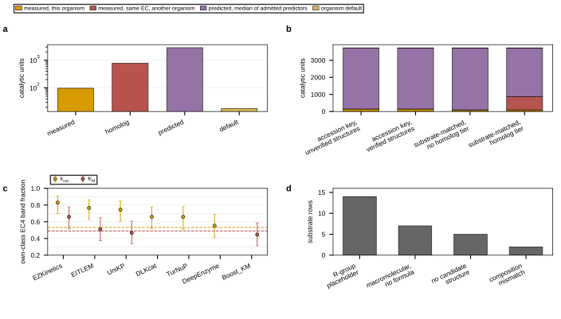

## 2026.09.11 - Kinetic tiers and the admission rule

Reads `results/kinetic_coverage_closure.json`,
`results/parameter_coverage_selected.json` and
`results/within_class_plausibility.json` (for the study's own Wilson intervals); writes
`results/kinetics_tiers_figure.json`.

Four panels: the four tiers of the shipped table (97 measured, 782 homolog, 2,831
predicted, 18 default over 3,728 catalytic units), the same counts across table versions,
the predictor admission rule drawn as a lower bound against the EC-median lookup, and the
28 substrate rows behind the 18 remaining defaults.

