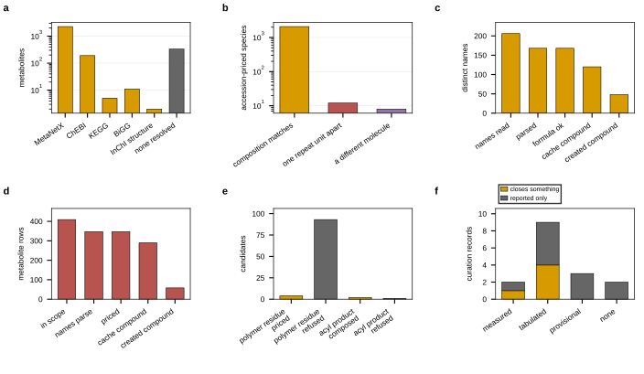

## 2026.09.11 - From a model species to a molecule

Reads `results/thermo_pipeline_figure.json`, `results/thermo_curation_closure.json`,
`results/lipid_names_parsed.json`, `results/lipid_coverage.json`,
`results/thermo_polymer_repeat_unit.json` and `results/thermo_acyl_transfer.json`; writes
`results/molecule_mapping_figure.json`.

Four mappings, each of which can be silently wrong: the accession namespace, the lipid
structure writer, the polymer repeat-unit and acyl-transfer writers, and the curation
records. The composition check over 2,414 accession-priced species is the panel that
matters most: 2,087 match, 12 are dolichols one isoprene unit apart, and 8 were priced as
a different molecule.

