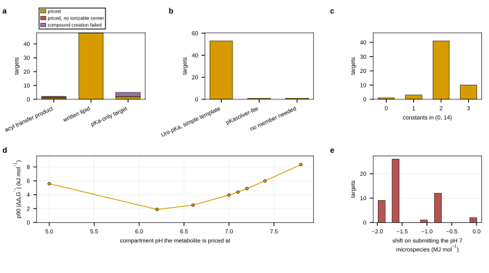

## 2026.09.11 - What the external pKa route was spent on

Reads `results/external_pka_applied.json`, `results/pka_method_selection.json` and
`results/pka_method_selection_figure.json`; writes
`results/pka_outside_equilibrator_figure.json`.

`plot_pka_method_selection.py` draws the benchmark that CHOSE the method; this draws what
the chosen cascade was then asked to do on yeast-GEM 9.0.2. 55 targets, 51 priced over 68
metabolite rows, with Uni-pKa on the simple template answering 53 and pKasolver-lite 1.

The two shifts a ladder controls differ by three orders of magnitude: the transform error
against the cache's own constants reaches a p90 of 8.33 kJ/mol at pH 7.8, while submitting
the neutral parent rather than the pH 7 major microspecies moves the answer by a median of
1,585 kJ/mol.

