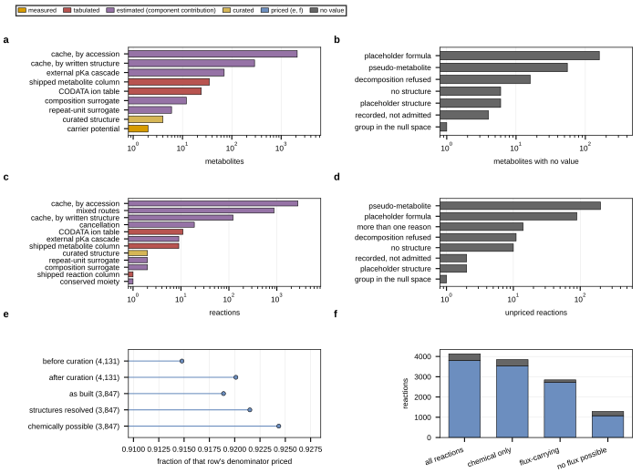

## 2026.09.11 - Route attribution for every thermodynamic value

Reads `results/reaction_thermo_coverage_final.json` and
`results/thermo_curation_closure.json`; writes
`results/thermo_recovery_routes_figure.json`. Nothing is recomputed here.

Six panels: metabolites by pricing route, metabolites by failure class, reactions by
route, unpriced reactions by their sole blocking class, the ceiling ladder, and coverage
under four denominators. Bars are colored by evidence class, one of measured, tabulated,
estimated by component contribution, or curated.

Headline counts as of this run: 2,559 of 2,806 metabolites priced, 3,801 of 4,131
reactions, 3,535 of the 3,847 chemical ones and 2,724 of the 2,845 that can carry flux.

Placed in `notes-tex/026-kinetics-thermodynamics/sections/4b-coverage.tex` and in
`notes-tex/metabolic-module-report/sections/2-parameters.tex`.
