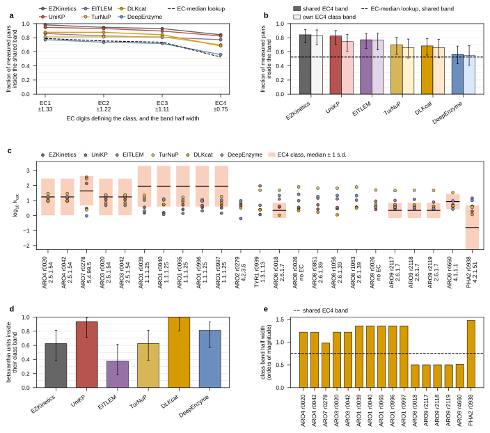
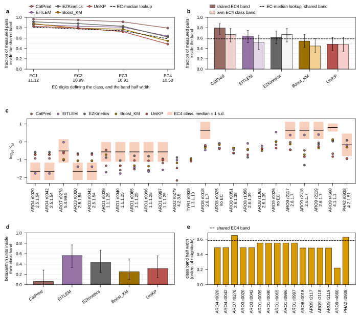

## 2026.09.08 - Five panels, one figure per parameter

`experiments/026-metabolism-flux/scripts/plot_within_class_plausibility.py --parameter k_cat|K_M`
reads `results/within_class_plausibility.json` and the betaxanthin CSV from
[[experiments.026-metabolism-flux.scripts.within_class_plausibility]] and draws: (a) fraction
inside the shared band against EC depth, one line per predictor, EC-median lookup dashed;
(b) EC4 shared band against own-class band with Wilson intervals; (c) the 23 betaxanthin
supply (gene, reaction) units against their EC4 class band across organisms; (d) the fraction
of the 16 scorable units inside, by predictor; (e) each unit's class band half width. One
color per predictor, the map imported from `plot_per_gene_predictor_agreement.py`.

