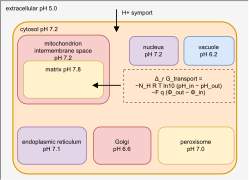

## 2026.09.10 - Where yeast-GEM 9's deltaG columns came from, and why they disagree with eQuilibrator

### The answer, first

H. G. Martin asked why yeast-GEM 9.0.2's shipped `model_metDeltaG.csv` and
`model_rxnDeltaG.csv` disagree with our eQuilibrator recomputation at all, since yeast9
almost certainly used a group-contribution method too. **The premise is right and the
disagreement is still expected, for three separate reasons, and only the third is about
thermodynamics.**

1. **The shipped columns are in kcal/mol and are labeled kJ/mol.** They are yETFL's values
   copied verbatim by `yeast-GEM/code/modelCuration/v8_7_0.m` (PR #330), and yETFL's model
   carries the field `thermo_units = 'kcal/mol'`. The yeast9 paper reports them as kJ/mol.
2. **The metabolite column was flattened across compartments.** matTFA transforms each
   formation energy at its own compartment's pH and ionic strength, so yETFL holds a
   different value per compartment. `v8_7_0.m` strips the compartment tag from the
   metabolite name, de-duplicates, and matches on the chemical, so every compartment copy
   gets one number. Exactly half the entries end up carrying another compartment's value.
3. **The estimator is a different group-contribution method.** yETFL used the group
   contribution method of Mavrovouniotis 1990 as packaged in matTFA's
   `thermo_data.thermodb`, with Alberty's transform, at 298.15 K, no magnesium. We use
   eQuilibrator 3 component contribution at 303.15 K, ionic strength 0.25 M, pMg 3.0.
   Different decomposition, different training corpus, different transform.

**Does matching the conditions close the gap? For transport reactions yes, for chemistry
no.** With the units corrected and our table rebuilt at yETFL's own compartment conditions:

| comparison | n | median abs diff (kJ/mol) | Pearson r |
|---|---|---|---|
| single compartment, as published | 1,231 | 16.25 | 0.537 |
| single compartment, units + conditions matched | 1,230 | **17.60** | 0.513 |
| transport (shipped nonzero), as published | 752 | 17.36 | 0.298 |
| transport (shipped nonzero), units + conditions matched | 752 | **5.61** | 0.751 |
| transport, all in comparison, matched | 1,023 | 0.57 | 0.739 |

The horizontal arm of the cross in Figure 3 was never a disagreement about thermodynamics.
It was two builds holding different compartment conditions plus a factor of 4.184. The
single-compartment cloud is the real estimator difference and does not move.

Source: `experiments/026-metabolism-flux/results/thermo_yeast9_provenance.json`, written by
`experiments/026-metabolism-flux/scripts/yeast9_delta_g_provenance.py --report` after
`--recompute` under the eQuilibrator environment.

### The provenance chain, read out of the artifacts

`v8_7_0.m` assigns, in preference order:

- `metDeltaG`: yETFL `metDeltaGFtr` matched by metabolite name with the compartment tag
  stripped; else ModelSEED `deltag` matched by `kegg.compound` id.
- `rxnDeltaG`: yETFL `rxnDeltaGR` matched by reaction id; else dGPredictor assigned by row
  position, `model.rxnDeltaG(3983:4062) = dgpred_rxnG.detaG(3983:4062)`.

yETFL is Oftadeh et al. 2021 (`10.5281/zenodo.4778047`), which states: "Using the
group-contribution method (GCM), we estimated the Gibbs free energies of formation for 1092
of 1326 total unique metabolites." Its Methods cite Mavrovouniotis 1990 for the method and
Alberty 1998 for the transform, and note that the standard Gibbs free energy of reactions
with at least one metabolite in a membranous compartment, 1304 reactions, was not
calculated by that procedure. dGPredictor is Wang et al. 2021, a Bayesian ridge fit
(`M12_model_BR.pkl`) over radius-1 and radius-2 molecular signatures, driven at pH 7.0,
ionic strength 0.1 M and 298.15 K, reporting kJ/mol.

**Measured facts.**

- Units: regressing our kJ/mol formation energies on yETFL's over 1,927 shared metabolites
  gives slope 4.187 through the origin at r = 0.987, against 4.184 kJ/kcal. yETFL prices
  cytosolic H2O at -37.21 and ATP at -564.41 against Alberty's -157.6 and -2292 kJ/mol.
- Identity: the shipped reaction column IS yETFL's `rxnDeltaGR` on 3,177 of 3,210
  reactions, max abs difference 5.0e-3, which is what `round(x,2)` leaves. The 33 others
  are the dGPredictor block, in kJ/mol, so the column mixes two unit systems.
- Compartment collapse: 1,162 of 2,324 shipped metabolite values equal their own
  compartment's yETFL value. p75 error 86.7 kJ/mol, mean 74.5 kJ/mol.

### The "unexplained 10.2" is yeast-GEM disagreeing with itself

`FluxLayer._transport_term` recorded a median 10.2 residual between the metabolite-sum
energy and the shipped reaction column on single-compartment reactions as unexplained. It
is fully explained, and it is in kcal/mol.

| metabolite values summed | proton | single compartment | transport |
|---|---|---|---|
| shipped column | included | 10.21 (n=2,021) | 2.91 (n=1,183) |
| shipped column | dropped | 2.37 | 2.78 |
| yETFL per compartment | included | 9.54 (n=2,005) | 0.0039 (n=1,169) |
| **yETFL per compartment** | **dropped** | **0.0024** | **0.0038** |

matTFA prices the proton at `-RT ln(10^-pH) = 9.54 kcal/mol` and then excludes it from every
reaction sum (`if ~strcmp(metFormulas{i},'H')` in `prepModelforTFA.m`), because the
transform already carries the reaction's pH dependence. yeast-GEM ships that number in the
metabolite column anyway, so a consumer that sums the column pays it once per net proton.
Within yETFL's own model the identity is exact: over 2,677 single-compartment reactions,
`sum_i S_ij dfG'_i` with the proton dropped reproduces `rxnDeltaGR` to max abs residual 0.0.

### Compartment conditions



The compartments at the pH values this pipeline applies, with the two transport steps and
the two terms of the transport free energy. Source
`notes/assets/drawio/yeast-compartments-ph.drawio`; exported headless per
[[drawio-headless-export-gilahyper]] and cropped with `gs -sDEVICE=bbox` then `pdfwrite`.
This is panel a of Figure 4 in the 026 document.

Every pH in use is a textbook value. **The library holds no primary measurement of any
yeast compartment pH.** The only in-library sources are two modeling papers that tabulate
them as parameters: `smithThermofluxGenerationAnalysis2026` Table 1 (cytosol 7.0,
mitochondrion 7.4, extracellular 5.0, pMg 14, T 298 K, I 0.25 M, plasma membrane 60 mV,
mitochondrial membrane 160 mV) and `oftadehGenomescaleMetabolicModel2021` through its
`yeast_compartment_data.json`. Nothing in the 026 document cites either through bibtex,
because that document's `references.bib` is deliberately empty and works are named in prose.

| comp | name | pipeline pH / I / Phi | yETFL pH / I / Phi | literature in library |
|---|---|---|---|---|
| c | cytoplasm | 7.2 / 0.25 / 0 | 7.00 / 0.25 / 0 | no primary source |
| ce | cell envelope | 5.0 / 0.25 / +60 | 7.00 / 0 / 0 | no primary source |
| e | extracellular | 5.0 / 0.25 / +60 | 5.00 / 0 / +60 | no primary source |
| er | endoplasmic reticulum | 7.1 / 0.25 / 0 | 7.20 / 0 / 0 | no primary source |
| erm | ER membrane | 7.1 / 0.25 / 0 | 7.20 / 0 / 0 | no primary source |
| g | Golgi | 6.6 / 0.25 / 0 | 6.35 / 0 / 0 | no primary source |
| gm | Golgi membrane | 6.6 / 0.25 / 0 | 6.35 / 0 / 0 | no primary source |
| im | mito intermembrane | absent from yeast-GEM 9 | 7.00 / 0 / 0 | no primary source |
| lp | lipid particle | 7.2 / 0.25 / 0 | 7.00 / 0.25 / 0 | no primary source |
| m | mitochondrion | 7.8 / 0.25 / -160 | 7.50 / 0.25 / -180 | no primary source |
| mm | mitochondrial membrane | 7.8 / 0.25 / -160 | 7.50 / 0.25 / -180 | no primary source |
| n | nucleus | 7.2 / 0.25 / 0 | 7.00 / 0 / -15 | no primary source |
| p | peroxisome | 7.0 / 0.25 / 0 | 8.20 / 0 / 0 | no primary source |
| v | vacuole | 6.2 / 0.25 / 0 | 6.17 / 0 / 0 | no primary source |
| vm | vacuolar membrane | 6.2 / 0.25 / 0 | 6.17 / 0 / 0 | no primary source |

pH is dimensionless, I in M, Phi in mV signed against the cytosol. Thermo-Flux Table 1 gives
potential magnitudes rather than signs; the signs in the pipeline column are assigned from
the direction of the gradients they describe. Written by
`yeast9_delta_g_provenance.py --compartments` to `results/compartment_conditions.json`.

**Curation requests** (identified, not added; adding needs an explicit go-ahead):

- Orij et al. 2009, in vivo cytosolic and mitochondrial pH in *S. cerevisiae* by ratiometric
  pHluorin.
- Brett et al. 2005 and Plant et al. 1999, vacuolar lumen pH in *S. cerevisiae*.
- Llopis et al. 1998, organelle pH by targeted fluorescent protein (matrix, Golgi, ER).
- A peroxisomal pH measurement for *S. cerevisiae*. The two tables in use differ by 1.2 pH
  units (7.0 vs 8.2) and nothing in the library settles it.

### The transport term, computed

`torchcell/metabolism/transport.py` computes Thermo-Flux Eq. (7) per reaction from the
stoichiometry, the compartment of each metabolite and its charge.

**Sign convention, fixed here because the paper does not fix it.** A species moves from the
compartment it appears in as a reactant (`out`) to the one it appears in as a product
(`in`), as written. `DeltapH = pH_in - pH_out` and `DeltaPhi = Phi_out - Phi_in`, so

```
Delta_r G^t = -N_H R T ln(10) (pH_in - pH_out) + q F (Phi_in - Phi_out)
```

which is the paper's `-N_H RT ln10 DeltapH - F q DeltaPhi` with those two definitions. This
matches matTFA's `calcDGtpt_RHS`, where the tabulated pair potential is `Phi_in - Phi_out`
(yETFL's `membranePot['c']['m'] = -180`, matrix negative relative to cytosol). Choosing the
other sign inverts every proton pump with no other symptom.

`N_H` counts only the explicit H+ species yeast-GEM carries per compartment. Thermo-Flux's
`N_H` also absorbs the protons released or bound when a reactant's average protonation
differs across a pH gradient; that needs a species distribution per compound and is not
computed here.

**Results on yeast-GEM 9.0.2** (`results/transport_terms.json`,
`results/transport_terms_yeast_gem_9.json`):

- 1,468 reactions cross a compartment boundary. 326 get a nonzero term, 183 move a proton,
  482 move charge.
- Against the shipped reaction column converted to kJ/mol, on the 287 reactions nonzero in
  both: sign agreement 0.847, Pearson r 0.804, median abs difference 7.04 kJ/mol against a
  median magnitude of 12.0, p90 18.9, max 120.8.
- Under yETFL's own compartment conditions instead: 299 in both, sign 0.823, r 0.813, median
  abs difference 6.08 kJ/mol. So the residual is mostly method, not conditions.

**Where they disagree.** 613 reactions have a nonzero shipped value and a zero computed one.
Those are the protonation term: a reactant with no explicit proton and no charge still
changes its transformed formation energy crossing into a different pH, and that is the
contribution left out above. 11 go the other way, computed nonzero against a shipped zero,
and those are reactions yETFL declined to price rather than priced as zero.

**Wiring.** `FluxLayerConfig.transport_delta_g_source` takes `off` (the default, and what
every 026/027 arm ran), `shipped` (recover from the GEM's own reaction column on the
reactions whose metabolite-sum energy is structurally zero; must now be read as kcal), and
`computed` (read the table `transport.py` writes, at `transport_terms_path`). Only
`computed` carries to a model that ships no thermodynamics.
`use_shipped_transport_delta_g` is kept as a deprecated alias so existing arm configs still
mean what they meant.

### Why there is an "ours" at all instead of calling eQuilibrator per reaction

The transform is not reimplemented. `Compound.transform` and
`ComponentContribution.standard_dg_formation` are eQuilibrator's own. What is ours is the
assembly: the stoichiometric sum, the alignment to the GEM's metabolite index, and the
zero-proton convention.

The assembly exists because the flux layer consumes metabolite-level quantities.
`FluxLayer.reaction_potential` in ANCHORED mode forms
`delta_r_g0 + RT * S^T log c + delta_r_g_transport + delta_g_offset` with `log c` a learned
per-metabolite vector, and in FREE mode `S^T mu` with `mu` per metabolite. A reaction-level
`Delta_r G'^o` cannot be decomposed back into either, and the square-root covariance factor
Sigma that gives `Q` is per metabolite as well. So the per-metabolite table is justified,
and panel c of Figure 4 should be read as a check of the assembly rather than as a
verification of a reimplemented transform. The caption now says that.

### Mirrored upstream artifacts

Copied to `$DATA_ROOT/data/torchcell/yetfl_thermo/` with sha256 recorded in
`results/thermo_yeast9_provenance.json` under `upstream_artifacts`, each with its
`source_url` and `retrieval_command`:

| file | sha256 | source |
|---|---|---|
| `yeast8_thermo_curated.mat` | `ec82ce09e76e5b5fc8a75fc86f86eb3c8510b1f5d02fa4434bfcce8bc833ea2f` | Zenodo 4778047, `input_models.zip` |
| `yeast_compartment_data.json` | `3b96940ad301622309758d501ac1276cfa90e1c6063d77d0d328868318e99dcb` | Zenodo 4778047, `info_yeast.zip` |
| `dgpred_rxnG.csv` | `0870ec4d64773fcea0fd6249d7922a42d4bc0af19f035cd0bf15886526aba6bd` | yeast-GEM `data/modelCuration/v8_7_0/` |
| `v8_7_0.m` | `7c8bfb5b0fd5f53e89ea182f528a30b18dd5938a81c2a7be10cc7c7c664edb70` | yeast-GEM `code/modelCuration/` |
| `run_dgpredictor.py` | `1d60f1c9963dd954ea7b888384f146b155e777a0b45fe4043fb83a6d02eb3ed8` | yeast-GEM `data/modelCuration/v8_7_0/code/` |

### Files

- `torchcell/metabolism/transport.py`
- `tests/torchcell/metabolism/test_transport.py`
- `torchcell/metabolism/flux_layer.py` (`_transport_term`, `transport_delta_g_source`,
  `transport_terms_path`)
- `experiments/026-metabolism-flux/scripts/yeast9_delta_g_provenance.py`
- `experiments/026-metabolism-flux/scripts/plot_equilibrator_thermo.py`
- `experiments/026-metabolism-flux/results/thermo_yeast9_provenance.json`
- `experiments/026-metabolism-flux/results/transport_terms.json`
- `experiments/026-metabolism-flux/results/transport_terms_yeast_gem_9.json`
- `experiments/026-metabolism-flux/results/compartment_conditions.json`
- `notes/assets/drawio/yeast-compartments-ph.drawio`
- `notes-tex/026-kinetics-thermodynamics/sections/3-thermodynamics.tex`

### Open

- The protonation contribution to `N_H` needs an eQuilibrator species distribution per
  transported compound. That is the 613-reaction shortfall above.
- Whether to correct the shipped column's unit at read time in
  `torchcell/metabolism/constraints.load_thermo_table`, which currently records
  `units = "kJ/mol"` for a kcal/mol file. Not changed here: that file belongs to another
  work item, and changing it silently rescales every arm that used `shipped`.
- Report the unit error upstream to SysBioChalmers/yeast-GEM.
