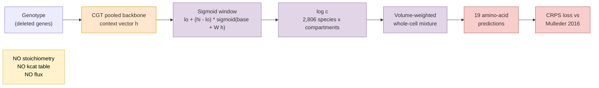
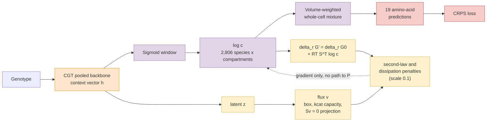
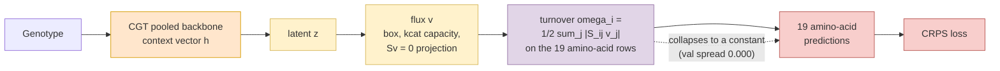

## 2026.09.14 - The three amino-acid readouts

### 1. context_concentration (the control: no flux layer)

### 2. flux_concentration (the wave-7 arm: same readout inside the anchored flux layer)

### 3. flux_metabolite (the turnover readout: the flux is the prediction)

