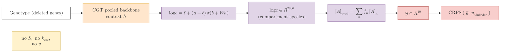
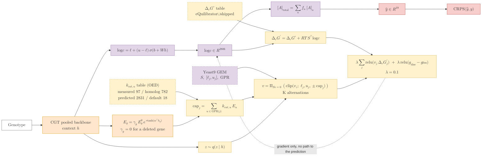
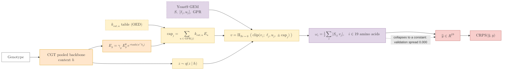

## 2026.09.14 - The three amino-acid readouts

Labels are KaTeX (`$$...$$`); multi-line labels use the triple-backslash row separator the
repo's mermaid rules require. Rendered by `notes/assets/publish/scripts/mermaid_pdf.sh`;
the PDFs are the figures of notes-tex/027-metabolic-flux-module section 5.7. Colors follow
the module figure: orange the gene-state path, purple the fixed stoichiometry and the
concentration state, yellow the parameter tables and the flux layer (dashed border = a fixed
table), red the prediction and the loss.

### 1. context_concentration (the control: no flux layer)

### 2. flux_concentration (the wave-7 arm: same readout inside the anchored flux layer)

### 3. flux_metabolite (the turnover readout: the flux is the prediction)

