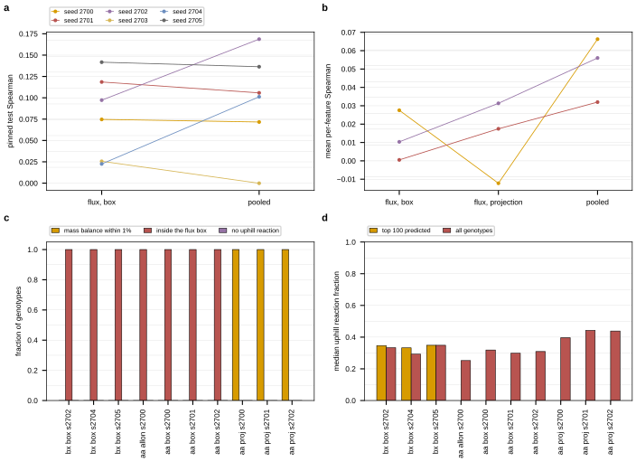
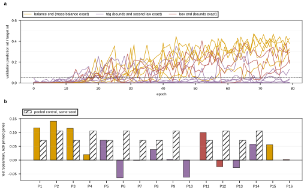

## 2026.09.11 - Overnight run: coverage closure, feasibility by construction, and the parity reads

Fourteen-hour autonomous run on GilaHyper (four RTX 6000 Ada), 2026-09-10 22:30 to
2026-09-11 18:00 CDT, driven by one session with four work-stream agents. The order of work
was set in advance: (1) push kcat, KM and reaction-energy coverage as far as provenance
allows and leave behind an organism-agnostic route for each; (2) switch every constraint on
and measure whether the top predicted strains violate mass balance or the second law (the
Genesis "metabolic grounding" criterion: at least 95 percent of the top 100 must not); (3)
read whether the module helps betaxanthin or amino-acid prediction at parity. Each stream
has its own note with the full method, per-cell tables and reruns; this note is the
cross-stream summary and the driver's record.

- Kinetics: [[experiments.026-metabolism-flux.kinetic-coverage-closure]] and
  `torchcell/metabolism/kinetics_pipeline.py`.
- Thermodynamics: [[experiments.026-metabolism-flux.pka-method-selection]],
  [[torchcell.metabolism.thermo_pipeline]], and the updated
  [[experiments.026-metabolism-flux.external-pka-route]].
- Flux layer: [[experiments.027-betaxanthin-metabolic.projection-head]] and
  [[torchcell.metabolism.flux_layer]].
- Trainer and cells: [[experiments.027-betaxanthin-metabolic.wave6]] and
  [[experiments.027-betaxanthin-metabolic.scripts.train_bx]].

### Tables

Generated by `experiments/027-betaxanthin-metabolic/scripts/overnight_summary_2026_09_11.py`
([[experiments.027-betaxanthin-metabolic.scripts.overnight_summary_2026_09_11]]) from the
result files each stream's own script wrote, and pasted verbatim from
`results/overnight_summary_2026_09_11.md`. Regenerate with:

```bash
PYTHONPATH=$PWD ~/miniconda3/envs/torchcell/bin/python \
    experiments/027-betaxanthin-metabolic/scripts/overnight_summary_2026_09_11.py
```

**Kinetic tiers, 3,728 catalytic units (kinetic_coverage_closure.json).**

| parameter | measured | homolog | predicted | default |
|---|---:|---:|---:|---:|
| k_cat | 97 | 782 | 2831 | 18 |
| K_M | 97 | 782 | 2831 | 18 |

Default units reachable with an open-source tool: 0.

**Reaction energy coverage ladder, yeast-GEM 9.0.2 (reaction_thermo_coverage_final.json).**

| rung | reactions priced | fraction | flux-carrying priced | fraction | what it would take |
|---|---:|---:|---:|---:|---|
| now | 3779 | 0.9148 | 2716 | 0.9547 | nothing; this is the table as built |
| structures and pka ladders resolved | 3792 | 0.9179 | 2724 | 0.9575 | a structure from a namespace or a curator for every species that has none, and a pKa ladder inside (0, 14) for every species whose ladder is empty |
| everything chemically possible resolved | 3802 | 0.9204 | 2727 | 0.9585 | the rung above plus a decomposition or a tabulated value for every structure the group decomposer refuses |

Permanently closed reactions by sole reason: pseudo_metabolite 216, placeholder_formula 98, placeholder_structure 2.

**pKa method selection (pka_method_selection.json).**

Rule: the worst per-pH p90 of |dGf'0(predicted) - dGf'0(cache)| over the working compartment pHs, failure rate at most 0.02, evaluated on 2100 compounds at pH 5.0, 6.2, 6.6, 7.0, 7.1, 7.2, 7.4, 7.8. Selected `cascade_top3` (ensemble: unipka-simple-template then molgpka then pkasolver); worst working-pH p90 8.331 kJ/mol at pH 7.8, failure rate 0.0024, median at pH 7.2 0.067 kJ/mol.

**Betaxanthin parity, box flux head at constraint scale 0 vs pooled, six seeds (three kcat table versions).**

| seed | 2700 | 2701 | 2702 | 2703 | 2704 | 2705 | mean | sd | n | t |
|---|---:|---:|---:|---:|---:|---:|---:|---:|---:|---:|
| nocstr | 0.0747 | 0.1185 | 0.0972 | 0.0256 | 0.0225 | 0.1417 | 0.0801 | 0.0488 | | |
| pooled | 0.0717 | 0.1058 | 0.1687 | -1.2e-04 | 0.1012 | 0.1364 | 0.0973 | 0.0581 | | |
| difference | 0.0030 | 0.0127 | -0.0715 | 0.0257 | -0.0787 | 0.0053 | -0.0172 | 0.0456 | 6 | -0.93 |

**Betaxanthin parity, seeds on one kcat table.**

| seed | 2700 | 2701 | 2703 | mean | sd | n | t |
|---|---:|---:|---:|---:|---:|---:|---:|
| nocstr | 0.0747 | 0.1185 | 0.0256 | 0.0729 | 0.0465 | | |
| pooled | 0.0717 | 0.1058 | -1.2e-04 | 0.0591 | 0.0541 | | |
| difference | 0.0030 | 0.0127 | 0.0257 | 0.0138 | 0.0114 | 3 | 2.10 |

**Amino-acid parity, box flux head vs pooled (mean per-feature Spearman, 19 features).**

| seed | 2700 | 2701 | 2702 | mean | sd | n | t |
|---|---:|---:|---:|---:|---:|---:|---:|
| nocstr | 0.0275 | 5.2e-04 | 0.0103 | 0.0128 | 0.0137 | | |
| pooled | 0.0663 | 0.0320 | 0.0560 | 0.0514 | 0.0176 | | |
| difference | -0.0387 | -0.0315 | -0.0457 | -0.0386 | 0.0071 | 3 | -9.41 |

**Amino-acid, projection head vs pooled.**

| seed | 2700 | 2701 | 2702 | mean | sd | n | t |
|---|---:|---:|---:|---:|---:|---:|---:|
| proj | -0.0122 | 0.0175 | 0.0313 | 0.0122 | 0.0222 | | |
| pooled | 0.0663 | 0.0320 | 0.0560 | 0.0514 | 0.0176 | | |
| difference | -0.0785 | -0.0145 | -0.0247 | -0.0392 | 0.0344 | 3 | -1.98 |

**Projection-head cells on betaxanthin (one results JSON each; pooled at the same seed for reference).**

| arm | seed | scale | thermo source | kcat table | selected epoch | test Spearman | pooled at seed | Genesis top-100 | balance <= 1e-2 | box exact | second law exact | balance median |
|---|---:|---:|---|---|---:|---:|---:|---:|---:|---:|---:|---:|
| anchored K20, box end | 2700 | 0 | union+ext | shipped | 71 | 0.1003 | 0.0717 | 0.00 | 0.00 | 1.00 | 0.00 | 0.298 |
| anchored K20, box end | 2701 | 0 | union+ext | shipped | 46 | -0.0239 | 0.1058 | 0.00 | 0.00 | 1.00 | 0.00 | 0.035 |
| anchored K20, box end | 2702 | 0 | union+ext | shipped | 49 | 0.0019 | 0.1687 | 0.00 | 0.00 | 1.00 | 0.00 | 0.343 |
| anchored, balance end | 2700 | 0.1 | union | interim | 72 | 0.1154 | 0.0717 | 0.00 | 1.00 | 0.00 | 0.00 | 1.5e-08 |
| anchored, balance end | 2701 | 0.1 | union | shipped | 74 | 0.0199 | 0.1058 | 0.00 | 1.00 | 0.00 | 0.00 | 2.9e-09 |
| anchored, sign-tightened, stochastic | 2700 | 0.1 | union+ext | shipped | 29 | 0.0380 | 0.0717 | 1.00 | 1.00 | 1.00 | 1.00 | 2.0e-11 |
| anchored, sign-tightened | 2700 | 0 | union+ext | shipped | 60 | -0.0006 | 0.0717 | 1.00 | 1.00 | 1.00 | 1.00 | 2.8e-08 |
| anchored, sign-tightened | 2701 | 0 | union+ext | shipped | 24 | 0.0023 | 0.1058 | 0.00 | 0.00 | 1.00 | 0.99 | 0.693 |
| anchored, sign-tightened | 2702 | 0 | union+ext | shipped | 31 | -0.0625 | 0.1687 | 0.00 | 0.00 | 1.00 | 1.00 | 0.068 |
| anchored, sign-tightened | 2700 | 0.1 | union+ext | shipped | 63 | 0.0719 | 0.0717 | 0.00 | 0.00 | 1.00 | 1.00 | 0.825 |
| anchored, sign-tightened | 2701 | 0.1 | union+ext | shipped | 32 | -0.0647 | 0.1058 | 0.00 | 0.00 | 1.00 | 1.00 | 1.003 |
| anchored, sign-tightened 5 kJ/mol margin | 2700 | 0 | union+ext | shipped | 25 | -0.0276 | 0.0717 | 0.00 | 0.00 | 1.00 | 0.00 | 0.139 |
| anchored, sign-tightened 5 kJ/mol margin | 2701 | 0 | union+ext | shipped | 77 | 0.0574 | 0.1058 | 0.00 | 0.00 | 1.00 | 0.00 | 0.044 |
| projection, balance end | 2700 | 0 | union | other | 35 | 0.1170 | 0.0717 | n/a | 1.00 | 0.00 | n/a | 1.4e-08 |
| projection, balance end | 2701 | 0 | union | other | 74 | 0.1413 | 0.1058 | n/a | 1.00 | 0.00 | n/a | 9.2e-09 |
| projection, balance end | 2702 | 0 | union | shipped | 75 | 0.0555 | 0.1687 | n/a | 1.00 | 0.00 | n/a | 9.9e-09 |

### Findings, each tied to its source

**Coverage is at its provenance ceiling for tonight's tools.** kcat and KM: 97 measured
(substrate-matched, this organism), 782 homolog (EC plus substrate, any organism), 2,831
predicted, 18 default of 3,728 units, both parameters. Every one of the 176 units that lacked
a prediction at the start was blocked by one cause, a missing substrate structure, closed
through MetaNetX cross-references and formula-verified structures (kinetic_coverage_gaps.json,
kinetic_coverage_closure.json). Two correctness findings were fixed rather than recorded: 74
of the 148 "measured" values had been taken from assays on a substrate the reaction does not
consume, and 59 predicted units rested on structures that fail the composition check
(kinetic_measured_tier_audit.json, kinetic_structure_verification.json). Reaction energies:
3,779 of 4,131 reactions priced (91.5 percent), 2,716 of 2,845 flux-carrying reactions (95.5
percent), 893 of 934 yeast reactions touching a betaxanthin anchor; 23 reactions are closable
only by curation (metalloporphyrin accessions resolve to the iron-free macrocycle; a few
glycans and decompositions) and 329 can never be priced (pseudo-metabolites, R-group
families, protein-linked residues), reaction_thermo_coverage_final.json. The pKa method was
chosen by a rule fixed before scoring, on 2,400 cache compounds at the eight compartment pHs
the layer uses: a cascade of Uni-pKa (simple template), MolGpKa, then pKasolver-lite, because
no single tool clears both the accuracy and the failure-rate bar (pka_method_selection.json).
A CODATA-sourced ion table with a verified Legendre transform adds coverage, not numbers: the
six reactions whose energy it moves are all elementally unbalanced sinks
(thermo_ion_gauge_check.json). Both routes are now one function each,
`kinetics_pipeline.py` and `thermo_pipeline.py`, with no organism, gene or file named inside,
tested on synthetic GEMs and reproducing the yeast-GEM numbers exactly.

**The wave-5 parity claim does not replicate.** Six seeds of the box flux head at constraint
scale 0 against pooled: paired difference -0.017, sd 0.046, t -0.93 (wave6_summary.json).
Wave 5's two seeds were the two smallest positives. Three kcat table versions sit under the
six seeds because the data mirror is not frozen with the code; the same-table subset (n = 3)
reads +0.014, sd 0.011. Neither direction is established.

**On amino acids the flux heads cost prediction.** Box head vs pooled, mean per-feature
Spearman over 19 features on 564 pinned genes: -0.039, sd 0.007, n = 3, all three seeds
agreeing; projection head vs pooled -0.039, sd 0.034. Switching the constraints on collapsed
the amino-acid box head at epoch 8 (job 1721), the wave-5 betaxanthin collapse on a second
phenotype.

**The projection head escapes the plateau at every seed and is not better than pooled
across seeds.** Scale 0: 0.117, 0.141 and 0.056 against pooled 0.072, 0.106 and 0.169 (jobs
1689, 1690, 1738), paired differences +0.045, +0.036, -0.113. Everything on at scale 0.1:
0.115 and 0.020 (jobs 1708, 1709), no collapse. The best arm of the night sits inside one
noise width of the control.

**Feasibility by construction is reachable but not reliable, and the second law is what
fights the signal.** The box head is never balanced (median ratio about 2, the theoretical
maximum). The plain projection head is balanced to 1e-8 but leaves 61 to 64 percent of
reactions outside their box. Tightening every reaction's box to the sign of the model's own
reaction energy and ending the projection on the box makes bounds and the second law exact
on every top-100 strain; balance then depends on the seed (2.8e-8, 0.69, 0.068 at seeds
2700 to 2702). The Genesis criterion was met once: job 1725, 0.98 to 1.00 of the top 100
strains balanced, in-box and downhill, with 99 of 100 strains feasible at every one of 64
sampler draws (wave6_projection_summary.json). That cell has zero predictive signal
(-0.0006), and so do the same arm's other seeds (0.002, -0.063). Across all twelve
projection cells, every one without the sign tightening sustained its escape (6 of 6) and
none with it did (0 of 6), so the tightening, not the box end, is what blocks learning
(analyze_projection.py). All feasibility reads are against the model's own reaction
energies; at standard state the fraction is 0.00 in every cell.

**The margin does not rescue it.** Tightening only reactions whose |ΔG| exceeds 5 kJ/mol
(jobs 1736, 1737) restored the escape but lost second-law exactness entirely (fraction with
no violation 0.00 on the top 100 at both seeds) and did not recover prediction (-0.028 and
+0.057, both below pooled), as its initialization measurement had predicted (flux density
0.067 to 0.184 with a 0.123 violation fraction). At seed 2702 the three families order
monotonically in how much exactness they take on: balance end 0.056, box end 0.002, sign
tightening -0.063. Hypothesis (untested): the learned sign pattern plus the balance
constraint admits only near-zero flux for most genotypes, so the projected flux is nearly
genotype-independent and the head reads nothing; the flux agent's suggested next steps are
to anneal the tightening in after the epoch 0 to 30 plateau and to check the learned
concentrations against the 19 measured amino acids already in the dataset.

**An incident changed how cells are launched.** Two cells died with a NameError in a
DataLoader worker while slurm showed RUNNING: spawned workers re-import the trainer and
torchcell every epoch, so a mid-edit state of flux_layer.py reached running jobs. Every cell
since 00:20 CDT was submitted through
`experiments/027-betaxanthin-metabolic/scripts/freeze_and_submit.sh`, which rsyncs the code
to `$DATA_ROOT/job-snapshots/<stamp>-<name>/`, verifies the imports, records the git HEAD
and sha256 of the files that matter, and submits from the snapshot. The trainer agent
independently built a frozen package for its cells for the same reason.

### Figures

Both figures are produced by the stream scripts named in their captions and are the same
files embedded in the wave-6 and projection-head notes.



Figure 1. Wave-6 parity contrasts and feasibility, `analyze_wave6.py`: the six-seed
betaxanthin contrast, the three-seed amino-acid contrast, and the top-100 feasibility
fractions per cell under the trainer's tolerance ladder.



Figure 2. The sixteen projection-head cells, `analyze_projection.py`: escape and
selection per cell, test Spearman against pooled at the same seed, and the top-100
balance, box and second-law fractions by family (balance end, box end, sign tightening).

### What is open

- Replace the median balance tolerance with a max-based one and report the fraction of
  reactions carrying flux: a median of zero on a vector that is 70 percent zeros passes
  trivially (patch named in the wave-6 note; train_bx.py).
- Rerun the betaxanthin parity contrast on one kcat table version; freeze the data mirror
  together with the code (extend freeze_and_submit.sh to copy the parquet versions the
  resolver reads).
- A head that is feasible and informative at once: annealing the sign tightening in after
  the plateau, Dykstra (implemented, tested, never trained), and the covariance path (wired,
  tested for shape and agreement with the shipped sigma, never trained).
- Curation: metallated porphyrin structures, the 23 closable reactions, the 18 default
  units (R-groups, formula-less macromolecules, cytochrome c).
- `build_flux_layer` should pass `null_space` for the projection parameterization (it
  rebuilds the SVD per run) and `delta_g_sqrt_cov` so an arm can reach the covariance path.
- `parameter_coverage_selected.json`'s all-predictor block still reads the stale 3,552-unit
  consensus parquets.

### Job ledger

Thirty-four cells on GilaHyper, all 80 epochs, 77 to 95 minutes each; per-cell tables with
job ids are in the wave-6 and projection-head notes. Driver's own cells: 1682, 1683, 1707,
1710 (parity seeds 2702 and 2703), 1727 to 1729 (projection head on amino acids), 1736 to
1739 (margin-tightened head at seeds 2700 and 2701, plain projection and box-end at seed 2702).
Killed: 1681, 1684 (worker NameError), 1691 to 1704 (cancelled and resubmitted frozen as
1708 to 1721).
