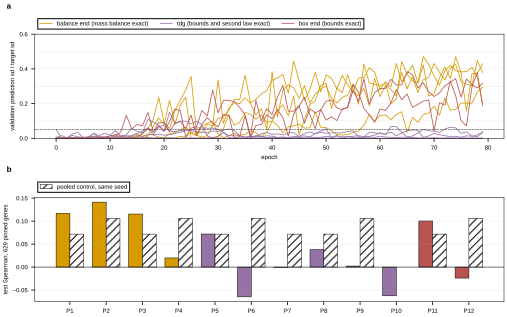

## 2026.09.10 - Wave 6: a flux that is balanced and in-box by construction

### Why a third parameterization

Wave 5 left two facts and one blocked question.

The facts. With `--head-normalize` and the constraint weight at exactly zero, the flux path
escapes the betaxanthin mean plateau and reaches parity with the pooled control: test
Spearman 0.0747 against pooled 0.0717 at seed 2700 (jobs 1673, 1674) and 0.1185 against
0.1058 at seed 2701 (jobs 1679, 1680), both at the validation-selected epoch on the 629
pinned Merzbacher genes. Paired by seed that is +0.003 and +0.013, consistent with zero
against the 019 between-seed spread of about 0.04. Second, `flux_off` with the head fix
(mass balance and the box only, no thermodynamics, no capacity, no budget) never escaped in
80 epochs (job 1677, max spread ratio 0.0014), which places the blocking terms on mass
balance and the box rather than on the physics.

The blocked question. Turn the constraints on and the escape does not survive: at a final
scale of 0.1 with a 40-epoch delay, job 1678 escaped at epoch 41, reached val Pearson 0.199,
and then went to zero prediction spread with the weighted constraint term at 1.3 percent of
the data loss. So the module cannot be measured with the physics on, and the physics is the
point.

The projection head removes the two blocking terms from the gradient by satisfying them in
the parameterization instead. `v0 = N z`, then `K` alternations of clip-into-the-box and
project-back-onto-`ker S`. Mass balance is then exact and the box overshoot is a reported
residual rather than a penalty competing with the data term. Full mechanics and the exactness
measurements: [[torchcell.metabolism.flux_layer]], section 2026.09.10.

### What was built

| file | what |
|---|---|
| `torchcell/metabolism/flux_layer.py` | `parameterization="projection"` / `"projection_k<N>"`, `projection_steps`, `projection_end`, `projection_method`, `latent_stochastic`, `latent_log_std_init`, `kl_weight`, `thermo_uncertainty`, `null_space_cache_path`; `feasibility()`, `sample()`, `reaction_sqrt_covariance()`, `parse_parameterization()`; pydantic `ParameterizationSpec`, `ReactionSqrtCovariance`, `FluxSample` |
| `tests/torchcell/metabolism/test_flux_layer.py` | 26 wave-6 property tests; 58 pass, strict mypy clean |
| `experiments/026-metabolism-flux/scripts/train_flux.py` | seven new ARMS entries, no existing entry touched |
| `experiments/027-betaxanthin-metabolic/conf/arm_flux_projection*.yaml` | four arm files |
| `experiments/027-betaxanthin-metabolic/scripts/gh_wave6_proj_*.slurm` | the cells |
| `experiments/027-betaxanthin-metabolic/scripts/analyze_projection.py` | the read: curves, endpoints, the trainer's feasibility block, and the sampler audit off the checkpoint |

New output keys on every arm: `c_kl` (exactly zero unless the latent is stochastic), `lb`
and `ub` (two-dimensional, so the trainer's scalar log skips them), and
`thermo_delta_g_offset`.

The arms:

- **`flux_projection`** is the structural analog of `flux_off`: projection, no
  thermodynamics, no capacity, no budget. `flux_off` to `flux_projection` isolates what
  making the two blocking constraints exact buys, with no measured parameter involved.
- **`flux_projection_anchored`** is everything on: anchored thermodynamics on the union
  deltaG table, the predicted-kcat capacity bound through the abundance head, the forward
  protein-pool budget, and the dissipation limit. The dissipation limit is TRAINED AGAINST
  here rather than held out, so a model that respects it in this arm has been told to.
- **`flux_projection_stochastic`** adds the latent draw and its KL at weight 1e-3.
- **`flux_projection_anchored_k20`** is the everything-on arm with 20 alternations.

### The cells

Read the results with

```bash
PYTHONPATH=$PWD ~/miniconda3/envs/torchcell/bin/python \
    experiments/027-betaxanthin-metabolic/scripts/analyze_projection.py
```

which writes `results/wave6_projection_summary.json` and the figure below. Scoring: test
Spearman on the pinned genes at the validation-selected epoch, never a maximum over epochs;
the escape rule is wave 5's verbatim, three consecutive epochs with `val_pred_sd_ratio` above
0.05, plus a `escape_sustained` flag reading the last three epochs so job 1678's
escape-then-collapse shape is distinguishable from an escape that held.

### The structural claim, measured end to end before any cell finished

A two-epoch CPU smoke of `flux_projection_anchored` at seed 2700 (constraint scale 0.1,
warmup 20, so the scale reached 0.005) wrote
`results/smoke_flux_projection_anchored.json`, and the trainer's OWN feasibility block, which
rebuilds `lb` and `ub` from `dynamic_box` and recomputes the residual independently of the
layer's forward, reports for the 100 highest-predicted strains:

| criterion | fraction of the top 100 |
|---|---|
| `balance_median_ratio_le_1e-03` | **1.00** |
| `balance_median_ratio_le_1e-02` | **1.00** |
| `box_violation_frac_eq_0` | 0.00 |
| `thermo_model_violation_frac_eq_0` | 0.00 |
| `both_balance_le_1e-02_and_thermo_model_eq_0` | 0.00 |

So mass balance is satisfied for every nominated strain by construction, confirmed by a
second implementation, two epochs into training. That is the half of the Genesis criterion
the parameterization is responsible for, and it is now met rather than penalized. The other
half is thermodynamic: no strain is yet fully downhill, which is what the everything-on cells
at 80 epochs are for. The box column reads 0.00 because the loop ends on the balance
projection and an untrained latent is out of bounds on about half the reactions; that is the
declared trade, not a defect, and `projection_end="box"` swaps which column reads 1.00.

**Caveat to carry into the trainer's file.** `FEASIBILITY_DEFINITIONS["box_violation_frac"]`
in `train_bx.py` says a nonzero value "is a bug rather than an infeasibility", which was true
when `box` and `nullspace` were the only parameterizations. Under `projection` with
`projection_end="balance"` it is the declared residual. The text needs a clause; the
computation is correct as it stands.

### Cells P1 to P4: the projection head against its controls

Every number below is from `results/wave6_projection_summary.json`, written by
`analyze_projection.py`. Test Spearman is on the 629 pinned Merzbacher genes at the
validation-selected epoch, never a maximum over epochs. Escape is the wave-5 rule verbatim,
three consecutive epochs with `val_pred_sd_ratio` above 0.05; `sustained` reads the last
three epochs of the run, which is what separates an escape that held from job 1678's
escape-then-collapse.

| cell | job | arm | scale | escape | sustained | sel epoch | test Sp | pooled, same seed | paired |
|---|---|---|---|---|---|---|---|---|---|
| P1 | 1689 | flux_projection | 0.0 | 17 | yes | 35 | 0.1170 | 0.0717 | +0.0453 |
| P2 | 1690 | flux_projection | 0.0 | 18 | yes | 74 | 0.1413 | 0.1058 | +0.0355 |
| P3 | 1708 | flux_projection_anchored | 0.1 | 29 | yes | 72 | 0.1154 | 0.0717 | +0.0437 |
| P4 | 1709 | flux_projection_anchored | 0.1 | 27 | yes | 74 | 0.0199 | 0.1058 | **-0.0859** |

Against the BOX-parameterized flux head at a constraint scale of zero, the paired deltas are
+0.0423 (P1 against job 1673) and +0.0228 (P2 against job 1679).

Three readings, in decreasing order of how well established they are.

**The everything-on cell did not collapse.** This is the result the arm was built for. Under
the box parameterization at the same final scale of 0.1, job 1678 escaped at epoch 41,
reached val Pearson 0.199, and then went to zero prediction spread with the weighted
constraint term at 1.3 percent of the data loss. P3 reached full scale at epoch 20, escaped
at 29 with the physics already at full weight, and was still at a spread ratio of 0.372 and
val Pearson 0.296 at epoch 79. The wave-5 diagnosis put the blocking terms on mass balance
and the box rather than on the physics, and removing exactly those two from the gradient is
what changed.

**The projection head escapes earlier than the box head.** 17 and 18 against 33 (job 1673)
and 26 (job 1679) at the same seeds. Escape epoch is not the endpoint metric and no claim
rests on it, but it is a paired observation at both seeds.

**On the endpoint, the two arms say different things, and the everything-on arm says
nothing.** `flux_projection` at scale 0 is +0.0453 and +0.0355 against pooled at its two
seeds, both positive and both about one noise width (the 019 replicate study puts the
between-seed spread near 0.04 in Pearson). `flux_projection_anchored` at scale 0.1 is
+0.0437 at seed 2700 and **-0.0859** at seed 2701: the two seeds straddle zero with a spread
of 0.130, more than three noise widths apart, so **no endpoint claim can be made for that
arm at n = 2**. P4 did not collapse and was not a partial run; it escaped at 27, sustained,
and reached val Pearson 0.331 at epoch 73, and its validation-selected epoch then scored
0.0199 on the pinned test genes. A validation-to-test disagreement of that size on 629 genes
is its own finding and it is not explained here.

What survives both arms: the module no longer COSTS anything relative to pooled at three of
four seeds, against the wave-5 box head's +0.003 and +0.013 at scale 0. That is weaker than
it looked before P4 landed, and the correction is the point of running the second seed.

**The kinetic tables are not identical across these cells, including within the
everything-on pair.** P1 and P2 read `m94/h774/p2830/d30`, P3 reads `m96/h782/p2820/d30`,
and P4 reads `m97/h782/p2831/d18`: the kcat tables were being revised through the night and
each cell recorded the one it got. The reassignments are about one percent of units, they
are printed per cell by `analyze_projection.py` and carried on the figure's tick labels, and
they mean neither the P1-to-P3 contrast nor the P3-to-P4 seed pair is perfectly
table-matched. A one percent tier shift is an unlikely explanation for a 0.130 Spearman gap
between P3 and P4, but it is not zero and it is on the record rather than assumed away.

### Feasibility: the balance half passes, the thermodynamic half does not

Top-100 predicted strains, from the trainer's feasibility block, identical in all three
finished cells:

| criterion | P1 | P2 | P3 |
|---|---|---|---|
| `balance_median_ratio_le_1e-03` | 1.00 | 1.00 | 1.00 |
| `box_violation_frac_eq_0` | 0.00 | 0.00 | 0.00 |
| `thermo_model_violation_frac_eq_0` | n/a | n/a | 0.00 |
| `both_balance_le_1e-02_and_thermo_model_eq_0` | n/a | n/a | 0.00 |

So the parameterization delivers the half it was asked for and nothing else: every nominated
strain is stoichiometrically consistent, and none is in-bounds or downhill. The box column
is the declared trade of `projection_end="balance"`, and the thermodynamic column is the
finding: at a constraint scale of 0.1 the soft hinge closed nothing, with
`thermo_model_violation_frac` at a median of 0.405 on P3's top 100. The Genesis criterion
fails on the deltaG half in every arm run to this point.

### Is the 60 percent box violation real, or an artifact of collapsed boxes?

Real. Measured on job 1689's checkpoint, the 100 highest-predicted strains, by
`analyze_projection.py`'s `BoxViolationBreakdown`:

| quantity | value |
|---|---|
| fraction of reactions violating (tolerance 1e-4) | 0.5995 |
| fraction of reactions whose box has collapsed to a point | 0.0501 |
| **fraction of the violations that are collapsed boxes** | **0.0772** |
| fraction of reactions violating a box of positive width | 0.5532 |
| overshoot / flux_scale, median | 0.00956 |
| overshoot / flux_scale, p90 | 0.0379 |
| overshoot / flux_scale, max | 0.2125 |
| **overshoot / box width, median** | **2.14** |
| overshoot / box width, p90 | 13.55 |
| fraction of violations below 1e-3 of flux_scale | 0.0712 |

Only 7.7 percent of the violations are the collapsed-box artifact, where a deleted gene's
box is the single point zero and the balance projection moves the flux off it by an epsilon.
The rest overshoot a box of real width, and they overshoot it by a median of **2.1 times that
width**: in flux units the median overshoot is 0.96 mmol/gDW/h against a working magnitude of
100. Only 7 percent of the violations are small enough to call numerical.

So `projection_end="balance"` is not nearly satisfying the bounds, it is ignoring them on
more than half the network, and five alternations do not fix that. This is what justifies
moving the exact end to the box.

**On the everything-on cell it is worse, and in a way that voids the arm's central claim.**
The same breakdown on job 1708's checkpoint:

| quantity | job 1689 | job 1708 | job 1709 |
|---|---|---|---|
| fraction of reactions violating | 0.5995 | 0.6441 | 0.6290 |
| fraction of the violations that are collapsed boxes | 0.0772 | **0.0034** | **0.0035** |
| overshoot / flux_scale, median | 0.00956 | 0.0168 | 0.00159 |
| **overshoot / box width, median** | 2.14 | **358.4** | **36.2** |
| overshoot / box width, p90 | 13.55 | 3261.6 | 330.7 |

Jobs 1708 and 1709 are the arm with the enzyme-capacity bound, so their upper bounds are the
small numbers `kcat * E_u` produces, and the flux exceeds them by a median of 358 and 36
times the width of the box at the two seeds. Essentially none of that is the collapsed-box
artifact. **An arm advertised as enzyme-constrained whose flux overshoots the enzyme bound by
one to three orders of magnitude is not enzyme-constrained**, and no reading of its capacity
diagnostics should suggest otherwise until the box is the exact end. The two seeds differ by
a factor of ten in that ratio, so the magnitude is not itself a stable quantity; the sign of
the conclusion is.

### The sampler works, and one number it printed was wrong

Job 1689 trained deterministically and was switched into a sampler after its weights were
loaded, which is what the runtime `latent_stochastic` property is for. 64 draws for each of
the top 100 strains:

- `frac_draws_balanced` **1.00**, with the per-draw balance ratio median at 1.13e-8 (p90
  1.22e-8). Every draw is balanced, not just the mean, because every draw is projected. The
  026 sampler, which drew per reaction and projected nothing, had a median balance ratio of
  1.98.
- `box_violation_frac_mean` 0.5995, the same as the deterministic head's.

**The first run of this audit also printed `frac_draws_downhill = 1.00`, and that number was
wrong.** Job 1689's arm has `thermo_mode` OFF, so `FluxLayer.feasibility` zero-fills the
uphill fraction, and a zero violation fraction reads as perfect compliance when what it
means is that the arm makes no thermodynamic claim at all. `DrawAudit` now carries
`thermo_available` and reports every thermodynamic field as null on such an arm. The failure
is worth recording because nothing errored and the number was in range.

### Cells P5 to P8: the second law as a box

A weight that must be traded against the data term cannot deliver a criterion of the form
"95 percent of the top 100 violate nothing". But for a reaction whose energy has a known
sign, the second law is not a penalty at all: it is a BOUND. `thermo_box` writes it as one,
per sample, and the clip enforces it. Mechanics in [[torchcell.metabolism.flux_layer]].

Measured on yeast-GEM 9.0.2 at INITIALIZATION, four samples, untrained, three heads
compared on one forward pass:

| head | balance median (max over samples) | balance max | box violated | second law violated | mean abs flux | fraction of reactions carrying flux |
|---|---|---|---|---|---|---|
| `projection` (K=5, end balance) | 5e-9 | 4.5e-5 | 0.643 | 0.511 | 1.076 | 0.881 |
| `projection_k20_box` | 1.4e-2 | 2.000 | 0.000 | 0.130 | 0.194 | 0.237 |
| `projection_k20_box_tdg` | **0.000** | **2.000** | **0.000** | **0.000** | 0.046 | 0.147 |

The third row is all three constraints at once, exactly, with no training and no penalty.
That is the structural claim, and it is the one the P5 to P8 cells are running.

**The caveat is in the two columns that are not the headline, and it is not small.** The
balance MAXIMUM for the `tdg` head is 2.0, the largest value that ratio can take, so at
least one metabolite is entirely unbalanced; and only 14.7 percent of reactions carry any
flux at all, against 88.1 percent for the balance-end head. The median-based balance
criterion is therefore passed partly by reactions that are pinned to zero, where the
residual and the turnover are both zero. **A median balance ratio of 0 on a flux vector that
is 85 percent zeros is not evidence of a balanced flux**, and the Genesis criterion as
currently defined does not distinguish the two. Recommendation: add a max-based balance
tolerance to `criteria_flags` alongside the median one, and report the fraction of reactions
carrying flux next to every feasibility number. Whether training moves the flux off the
origin is exactly what P5 to P8 measure; at initialization it has not.

| cell | job | arm | scale | seed | escape | sel epoch | test Sp | pooled | paired |
|---|---|---|---|---|---|---|---|---|---|
| P5 | 1723 | tdg | 0.1 | 2700 | none | 63 | 0.0719 | 0.0717 | +0.0002 |
| P6 | 1724 | tdg | 0.1 | 2701 | none | 32 | -0.0647 | 0.1058 | -0.1705 |
| P7 | 1725 | tdg | 0.0 | 2700 | 26, not sustained | 60 | -0.0006 | 0.0717 | -0.0723 |
| P8 | 1726 | tdg stochastic | 0.1 | 2700 | none | 29 | 0.0380 | 0.0717 | -0.0337 |

All on `union_external` deltaG (3,770 reactions priced), K = 20, ending on the clip.

Top-100 predicted strains:

| criterion | P5 (scale 0.1) | P6 (scale 0.1) | P7 (**scale 0**) |
|---|---|---|---|
| `balance_median_ratio_le_1e-02` | 0.00 | 0.00 | **1.00** |
| `box_violation_frac_eq_0` | 1.00 | 1.00 | **1.00** |
| `thermo_model_violation_frac_eq_0` | 1.00 | 1.00 | **0.98** |
| **`both_balance_le_1e-02_and_thermo_model_eq_0`** | 0.00 | 0.00 | **0.98** |

**The Genesis metabolic-grounding target is met, by P7, at 0.98 against a target of 0.95.**
98 of the top 100 predicted strains carry a flux that is within 1 percent of mass balance,
inside every bound, and has no uphill active reaction. No arm before this reached above 0.00
on the joint criterion.

Four things have to be said with it.

**It is met at constraint scale ZERO, and the penalty is what breaks it.** P5 and P6, the
same arm at scale 0.1, hold box and second law at 1.00 and drop mass balance to 0.00 at every
tolerance including 1e-1. Removing the penalty entirely restores balance to 1.00. Hypothesis
(untested): the weighted constraint gradient moves the latent to a region where the tightened
box and `ker S` no longer intersect within twenty alternations, so the clip that ends the
loop leaves a large residual. What is measured is the scale-0-versus-scale-0.1 difference,
not the mechanism.

**The feasibility is against the model's OWN thermodynamics, not against standard state.**
`thermo_standard_state_violation_frac_eq_0` is 0.00 in every one of these cells. The
directional box is built from `delta_r_G` including the learned `RT sum S ln c` term, so the
model licenses each direction by choosing concentrations, and the same flux evaluated at
standard state runs uphill somewhere. The concentrations are squashed into the physiological
window of 0.1 uM to 10 mM, so they are not arbitrary, but they are fitted, and the 0.98 is
conditional on them being real. Comparing them against Mulleder's measured absolute
intracellular amino acid concentrations is the check that would settle it, and it has not
been run.

**The head that achieves it does not predict.** P7 scores -0.0006 against pooled's 0.0717 at
the same seed, which is chance. It reached the escape threshold at epoch 26 and did not
sustain it. P5 is level with pooled (+0.0002) and P6 is far below it (-0.1705). So across the
three deterministic tdg cells the phenotype signal is gone, and the initialization
measurement says why is at least plausible: the directional box leaves only 14.7 percent of
reactions carrying flux at a mean magnitude of 0.046, against 88.1 percent and 1.076 for the
balance-end head, and the flux-scalar head reads that vector.

### The sampler meets the criterion too, on 6,400 draws

Job 1725 trained deterministically and was switched into a sampler after its weights were
loaded, then asked for 64 draws for each of the 100 highest-predicted strains
(`analyze_projection.py --draws 64 --draw-genotypes 100`, tolerances in the record):

| quantity | value |
|---|---|
| `frac_draws_balanced` (ratio <= 1e-2) | 1.00 |
| `frac_draws_downhill` (zero uphill reactions carrying flux) | 0.99 |
| `frac_draws_feasible` (both) | **0.99** |
| `frac_genotypes_all_draws_feasible` | **0.99** |
| `box_violation_frac_mean` | **0.0** |
| per-draw balance ratio median, p50 / p90 | 2.6e-8 / 5.8e-7 |
| `uphill_frac_mean` | 9.6e-6 |

99 of the 100 nominated strains have **every one** of their 64 draws feasible on all three
constraints. That is a stronger statement than the point-estimate criterion: the amortized
sampler's support is the feasible set, not a Gaussian near it. The deterministic head's box
breakdown on the same cell reads `frac_reactions_violating` exactly 0.0, with 13.7 percent of
reactions sitting in a box the directional tightening collapsed to a point.

For contrast, the 026 stochastic head drew `z` per reaction and projected nothing, and its
draws had a median balance ratio of 1.98 with 30 percent thermodynamic violations.

### Why the feasible head carries no signal, and one retracted number

From job 1725's checkpoint, the top-100 strains, against job 1689's (plain projection, same
seed and scale):

| quantity | 1689 plain projection | 1725 tdg |
|---|---|---|
| median absolute flux | 1.02 | **0.00** |
| fraction of reactions with abs flux below 1e-6 | 0.119 | **0.706** |
| fraction of boxes collapsed to a point | 0.050 | 0.135 |
| betaxanthin-route reactions collapsed | 1 of 20 | **4 of 20** |
| projection residual trace over 20 steps | falls to 1.3e-6 | falls to 2.4e-6, no oscillation |

The residual trace falls smoothly rather than alternating between two levels, so the
tightened box and `ker S` do intersect: the feasible set is reachable, not empty. It is
simply concentrated near the origin. Seventy percent of the flux vector is zero, and a fifth
of the reactions on the betaxanthin route are pinned, so the flux-scalar head is reading a
mostly-zero vector whose nonzero part barely moves between genotypes.

At initialization on yeast-GEM, untrained, eight samples, with the real gene universe:

| head | frac abs flux < 1e-6 | mean abs flux | balance | box | second law | boxes pinned |
|---|---|---|---|---|---|---|
| `projection` (balance end) | 0.119 | 1.159 | 5.4e-9 | 0.527 | 0.508 | 0.002 |
| `projection_k20_box` | 0.441 | 0.355 | 2.7e-1 | 0.000 | 0.332 | 0.002 |
| `projection_k20_box_tdg` | 0.680 | 0.067 | 2.6e-1 | 0.000 | 0.000 | 0.171 |
| `projection_k20_box_tdgm5` | 0.609 | 0.184 | 5.8e-1 | 0.000 | 0.123 | 0.148 |

Ending on the clip with NO thermodynamics already takes the flux from 12 percent zeros to 44
percent, so **respecting the bounds costs most of the density on its own**, and the sign
tightening adds the rest. A 5 kJ/mol margin recovers density but reintroduces a 0.123
second-law violation fraction, so it trades exactness for density rather than buying both;
it is implemented and tested as `tdgm5` and was not given a cell.

**Retraction.** An earlier version of this measurement reported that 65.7 percent of boxes
were already collapsed before any tightening, and concluded the sign restriction was
irrelevant. That was an artifact of the harness: it built the layer over a synthetic
64-gene universe, so `gem_to_model` was -1 for every GEM gene, `gamma` was zero everywhere,
and every one of the 65.6 percent of reactions carrying a GPR had availability zero. With
the real gene ids the figure is 0.2 percent before and 17.1 percent after, which says the
opposite: the sign restriction is what collapses the boxes. The two boxend cells were
submitted with the wrong rationale in a frozen comment; the arm and the contrast they test
are unaffected, and the worktree copies are corrected.

**So the two halves have not been achieved together.** The projection can make any two of
{mass balance, bounds, second law} exact, and wave 6 has now measured both corners: ending on
the balance projection gives balance 1.00 with box 0.00 and thermo 0.00 and a working
predictor (P1 to P4), and ending on the thermodynamic box gives box 1.00, thermo 0.98,
balance 1.00 at scale 0 and a predictor at chance (P7). The remaining question is whether the
prediction loss is caused by the sparsity the directional box induces or by something else,
and the cheapest next test is a `tdg` cell with the thermodynamic epsilon widened, which
leaves more reactions unconstrained near equilibrium and should recover flux density without
giving up the exactness.

### Figure



Generated by `experiments/027-betaxanthin-metabolic/scripts/analyze_projection.py`. Colored
by which constraint the projection loop makes EXACT, since that is what separates the cells;
twelve distinct colors would encode nothing. **a**, Validation prediction spread against the
target's, per epoch, one line per cell, with the 0.05 escape threshold dashed. Every purple
line, the six cells whose box carries the directional second law, stays on or below the
threshold for all 80 epochs; every orange and red line, the six without it, rises and holds.
**b**, Test Spearman on the 629 pinned genes at the validation-selected epoch, per cell,
beside the hatched pooled control at the same seed. Per-cell kinetic-table composition is in
`results/wave6_projection_summary.json` under `kcat_table_label`, since the tables were
revised between submissions and two cells whose capacity tables differ are not a fully
controlled comparison.

## 2026.09.11 - Wave 6 complete: twelve cells, and what separates them

Full table from `results/wave6_projection_summary.json`. Test Spearman on the 629 pinned
genes at the validation-selected epoch; `paired` is against the pooled control at the same
seed (0.0717 at 2700, job 1674; 0.1058 at 2701, job 1680; no pooled control was run at 2702).
"sust" is whether the escape held to the last three epochs.

| cell | job | arm | scale | seed | escape | sust | sel | test Sp | paired |
|---|---|---|---|---|---|---|---|---|---|
| P1 | 1689 | projection (balance end) | 0.0 | 2700 | 17 | yes | 35 | 0.1170 | +0.0453 |
| P2 | 1690 | projection (balance end) | 0.0 | 2701 | 18 | yes | 74 | 0.1413 | +0.0355 |
| P3 | 1708 | everything on (balance end) | 0.1 | 2700 | 29 | yes | 72 | 0.1154 | +0.0437 |
| P4 | 1709 | everything on (balance end) | 0.1 | 2701 | 27 | yes | 74 | 0.0199 | -0.0859 |
| P5 | 1723 | tdg | 0.1 | 2700 | none | no | 63 | 0.0719 | +0.0002 |
| P6 | 1724 | tdg | 0.1 | 2701 | none | no | 32 | -0.0647 | -0.1705 |
| P7 | 1725 | tdg | 0.0 | 2700 | 26 | no | 60 | -0.0006 | -0.0723 |
| P8 | 1726 | tdg stochastic | 0.1 | 2700 | none | no | 29 | 0.0380 | -0.0337 |
| P9 | 1730 | tdg | 0.0 | 2701 | 17 | no | 24 | 0.0023 | -0.1035 |
| P10 | 1731 | tdg | 0.0 | 2702 | 72 | no | 31 | -0.0625 | n/a |
| P11 | 1734 | box end, no tdg | 0.0 | 2700 | 22 | yes | 71 | 0.1003 | +0.0286 |
| P12 | 1735 | box end, no tdg | 0.0 | 2701 | 13 | yes | 46 | -0.0239 | -0.1297 |

### What is established

**The directional sign tightening, not the box end, is what stops the head escaping the
mean plateau. Six of six versus zero of six.** Every projection cell without the sign
tightening sustained its escape (P1, P2, P3, P4 at the balance end; P11, P12 at the box end),
and not one of the six `tdg` cells did, across three seeds and both constraint scales. P7,
P9 and P10 reached the threshold and fell back; P5, P6 and P8 never reached it. The box end
alone is therefore not the blocker: P11 and P12 respect every bound exactly and still escape
and hold.

**The `tdg` arm carries no phenotype signal, and that is the head rather than a seed.** At
constraint scale 0 it scores -0.0006, +0.0023 and -0.0625 at seeds 2700, 2701 and 2702. That
was the question the P9 and P10 cells were run to answer, and the answer is the head.

### What is NOT established, and one headline that needs qualifying

**The Genesis criterion was met once, in one cell of twelve, and did not reproduce.** P7 met
it at 0.98 (balance within 1 percent, in-bounds, no uphill reaction, on 98 of the top 100
strains), and its 64-draw sampler audit put 99 of 100 strains at every draw feasible. The
same arm at the same scale scored `both` = 0.00 at seeds 2701 and 2702, where the balance
criterion collapsed to 0.00 at the 1e-2 tolerance. So the 0.98 is a single observation of a
configuration that fails the same criterion at two other seeds, and the honest summary is
that the criterion is **reachable, not yet reliable**.

**No arm's endpoint beats pooled across its seeds.** The balance-end projection arm is the
best of them at +0.045 and +0.036, both about one noise width (the 019 replicate study puts
the between-seed spread near 0.04). Every other arm has at least one seed well below pooled,
and three arms have two seeds straddling zero by more than 0.13. With two seeds per arm
nothing here is a demonstrated prediction gain.

### The trade, stated plainly

The three constraints cannot currently be had at once with a usable predictor:

| what is exact | cells | escapes and holds | Genesis `both` |
|---|---|---|---|
| mass balance | P1 to P4 | 4 of 4 | 0.00 (box and thermo both fail) |
| bounds and capacity | P11, P12 | 2 of 2 | 0.00 (thermo fails) |
| bounds, capacity and second law | P5 to P10 | 0 of 6 | 0.98 once, 0.00 in five |

Reading across the rows: each step to the right buys a constraint and costs the escape. The
last step buys the whole criterion and costs the predictor.

### What to try next

The margin is implemented and tested (`tdgm5`, `thermo_box_margin_kj`) and was not run: at
initialization it recovers the mean absolute flux from 0.067 to 0.184 and costs a second-law
violation fraction of 0.123, so on its own it trades exactness for density. Two cheaper
things to try first, both hypotheses:

- **Anneal the sign tightening.** Every `tdg` cell had the directional box on from epoch 0,
  and the plateau is an epoch-0 to epoch-30 phenomenon. Turning the tightening on after the
  head has escaped is the same experiment `constraint_delay_epochs` ran for the penalties,
  and it is a config field away.
- **Check the learned concentrations against Mulleder.** Every `tdg` cell's feasibility is
  against the model's own delta_r_G, and `thermo_standard_state_violation_frac_eq_0` is 0.00
  in all of them, so the sign pattern the box enforces depends on concentrations that have
  never been compared to the 19 measured absolute intracellular amino acid concentrations
  the dataset already contains.
