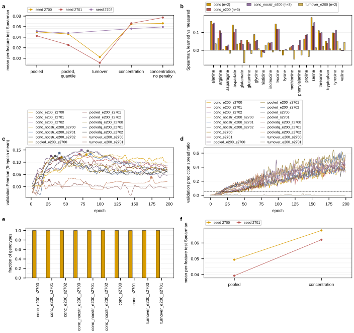

## 2026.09.12 - Round 2: curation closure, CatPred, one-table parity, flux-force heads, and the amino-acid concentration head

Twenty-four-hour autonomous run on GilaHyper (four RTX 6000 Ada), 2026-09-11 16:50 to
2026-09-12 16:50 CDT, driven by one session with five work-stream agents. The order of work
was set in advance: (1) write the curated thermodynamic records the last unpriced species
need and put an honest denominator under the coverage fraction; (2) score CatPred, the one
kinetic predictor in the mirror that emits a per-prediction variance, against the admission
rule the other seven were scored under; (3) rerun the betaxanthin parity contrast with every
flux cell on one kcat table and re-read feasibility under a balance rule that a mostly-zero
flux vector cannot pass; (4) replace the sign clamp with a differentiable flux-force
coupling; (5) supervise the flux layer's own learned concentration against Mulleder's
absolute amino acids instead of its turnover. Each stream has its own note with the full
method, per-cell tables and reruns; this note is the cross-stream summary and the driver's
record.

- Thermodynamic curation: [[experiments.026-metabolism-flux.thermo-curation-closure]] and
  `torchcell/metabolism/thermo_curation.py`.
- CatPred admission: [[experiments.026-metabolism-flux.catpred-admission]] and
  `torchcell/datasets/kinetics/catpred.py`.
- Betaxanthin parity and the balance rules:
  [[experiments.027-betaxanthin-metabolic.wave7-parity-one-table]].
- Flux-force heads: [[experiments.027-betaxanthin-metabolic.wave7-flux-force-head]] and
  [[torchcell.metabolism.flux_layer]].
- Amino-acid concentration readout:
  [[experiments.027-betaxanthin-metabolic.wave7-amino-acid-concentration]].

Round 1 of the same push, for the numbers this round corrects:
[[experiments.027-betaxanthin-metabolic.overnight-2026-09-11]].

### Tables

Generated by `experiments/027-betaxanthin-metabolic/scripts/round2_summary_2026_09_12.py`
([[experiments.027-betaxanthin-metabolic.scripts.round2_summary_2026_09_12]]) from the
result files each stream's own script wrote, and pasted verbatim from
`results/round2_summary_2026_09_12.md`. Regenerate with:

```bash
PYTHONPATH=$PWD ~/miniconda3/envs/torchcell/bin/python \
    experiments/027-betaxanthin-metabolic/scripts/round2_summary_2026_09_12.py
```

**Table 1. Reaction energy coverage before and after the curation round.**

| quantity | before | after |
|---|---:|---:|
| reactions priced, all 4131 | 3779 | 3801 |
| reactions priced, chemical 3847 | not reported | 3535 |
| metabolites priced | 2561 | 2559 |
| non-chemical reactions, outside the denominator | 0 | 284 |
| chemical reactions failing the elemental or charge balance check | not reported | 205 |

The chemical denominator exists only in the after run, so the two whole-model counts are the comparable pair and the chemical fraction is the honest one.

**Table 2. The chemical ladder, denominator 3847 reactions; the three states partition it exactly (True).**

| rung | reactions priced | fraction | flux-carrying priced | fraction | what it would take |
|---|---:|---:|---:|---:|---|
| now | 3535 | 0.9189 | 2724 | 0.9575 | nothing; this is the table as built |
| structures and pka ladders resolved | 3545 | 0.9215 | 2732 | 0.9603 | a structure from a namespace or a curator for every species that has none, and a pKa ladder inside (0, 14) for every species whose ladder is empty |
| everything chemically possible resolved | 3556 | 0.9244 | 2735 | 0.9613 | the rung above plus a decomposition or a tabulated value for every structure the group decomposer refuses |

**Table 3. Where the gains came from, and what a permanent gap is.**

| route | reactions gained |
|---|---:|
| cancellation | 22 |
| carrier pseudo pair | 7 |
| mannan residue value | 3 |
| conserved moiety | 1 |

| permanently closed reactions, sole reason | count |
|---|---:|
| pseudo metabolite | 202 |
| placeholder formula | 96 |
| placeholder structure | 3 |

| unpriced metabolites, reason | count |
|---|---:|
| placeholder formula | 159 |
| pseudo metabolite | 55 |
| group decomposition failed | 16 |
| no structure available | 6 |
| placeholder structure | 6 |
| recorded not admitted | 4 |
| group in null space | 1 |

| what the unpriced metabolite would take | count |
|---|---:|
| nothing is possible: an R, X or * in the formula means the species is a family of molecules and no single formation energy exists for it | 159 |
| nothing is possible: a modeling device (a pool, a SLIME backbone, a difference formula), not a molecule | 55 |
| a DECOMPOSITION is needed: the structure exists and component contribution refuses it, so a pKa predictor changes nothing; monatomic ions are in this class and their energies are tabulated in the thermochemical literature rather than predicted | 16 |
| a STRUCTURE is needed: a definite formula with no structure in any namespace and no writer that composes one from the name | 6 |
| nothing is possible: the only structure that resolves carries an attachment point, so the species is a residue inside a macromolecule rather than a molecule | 6 |
| a curated record EXISTS and its admission is computed or provisional, so it is reported and not priced; what it would take is a measured or tabulated source | 4 |
| a group NOBODY TRAINED ON: the structure decomposes and one of its groups is in the component-contribution null space, so the estimate has infinite variance. Different from a missing group definition: the group exists and no training compound carries it, so the remedy is a measurement of a compound that does, or a microspecies whose groups are covered | 1 |

**Table 4. The accession sweep, 2414 priced species: 2087 match the GEM's molecule, 12 are a consistent repeat-unit multiple, and 8 were priced from a different molecule, of which 6 are withdrawn.**

| metabolite | name | GEM formula | structure priced | shipped dGf'0 kJ/mol | disposition |
|---|---|---|---|---:|---|
| s_0773 | glycogen | C6H10O5 | C24H42O21 | -1127.2 | re-derived by the glycogen record |
| s_0774 | glycogen | C6H10O5 | C24H42O21 | -1370.9 | re-derived by the glycogen record |
| s_1578 | zymosterol intermediate 1c | C28H43O3 | C29H46O2 | 1257.2 | withdrawn |
| s_2920 | 3-oxo-cis-hexadec-9-enoyl-CoA | C37H62N7O18P3S | C37H60N7O17P3S | -575.1 | withdrawn |
| s_2923 | 3-oxo-cis-octadec-9-enoyl-CoA | C39H66N7O18P3S | C39H64N7O17P3S | -395.1 | withdrawn |
| s_4207 | trans-4-hydroxy-L-proline | C5H9NO3 | C5H4N4O4 | -119.0 | withdrawn |
| s_4295 | dimethylallyl phosphate | C5H9O4P | C8H8O | -512.4 | withdrawn |
| s_4313 | ITP | C10H11N4O14P3 | C4H4O4 | -2531.7 | withdrawn |

**Table 5. The 16 curated records, one row each; only measured and tabulated admissions reach a table a model reads.**

| slug | kind | admission | admitted | metabolites priced | reactions closed | closed by cancellation | what it would take |
|---|---|---|---|---:|---:|---:|---|
| chitobiosyl pp dolichol | polymer convention | tabulated | yes | 0 | 0 | 0 | a microspecies whose groups component contribution has seen |
| cytochrome b5 | carrier potential | provisional | no | 0 | 0 | 0 | a measured or tabulated source |
| cytochrome c | carrier potential | measured | yes | 2 | 7 | 0 | nothing |
| ethylnitronate | structure | tabulated | yes | 0 | 0 | 0 | a group decomposition, or a measured formation energy |
| ferroheme b | pka ladder | provisional | no | 0 | 0 | 0 | a measured or tabulated source |
| glycogen | polymer convention | tabulated | yes | 2 | 0 | 0 | nothing |
| gpi intermediate | formula correction | provisional | no | 0 | 0 | 0 | a measured or tabulated source |
| heme a | structure | tabulated | yes | 0 | 1 | 0 | a group decomposition, or a measured formation energy |
| heme o | structure | tabulated | yes | 0 | 1 | 0 | a group decomposition, or a measured formation energy |
| mannan | polymer convention | tabulated | yes | 2 | 3 | 0 | nothing |
| methionine s oxide | not found | none | no | 0 | 0 | 0 | a measured or tabulated source |
| nitrophenyl phosphate | structure | tabulated | yes | 0 | 0 | 0 | a group decomposition, or a measured formation energy |
| pectin | polymer convention | tabulated | yes | 0 | 0 | 0 | a group decomposition, or a measured formation energy |
| porphyrin | not found | none | no | 0 | 0 | 1 | a measured or tabulated source |
| siroheme | structure | tabulated | yes | 0 | 0 | 0 | a group decomposition, or a measured formation energy |
| triphosphate | pka ladder | measured | yes | 0 | 0 | 1 | a group decomposition, or a measured formation energy |

**Table 6a. CatPred admission for k_cat: the EC-median lookup scores 0.5417 on 48 scorable pairs, so a predictor needs 33 hits for its Wilson 95 percent lower bound to clear that point.**

| predictor | own-class hits | fraction | Wilson lower | verdict |
|---|---:|---:|---:|---|
| ezkinetics | 40/48 | 0.8333 | 0.7042 | admitted |
| eitlem | 37/48 | 0.7708 | 0.6346 | admitted |
| unikp | 36/48 | 0.7500 | 0.6122 | admitted |
| catpred | 32/48 | 0.6667 | 0.5254 | rejected |
| dlkcat | 31/47 | 0.6596 | 0.5167 | rejected |
| turnup | 29/44 | 0.6591 | 0.5114 | rejected |
| deepenzyme | 26/47 | 0.5532 | 0.4125 | rejected |

Admitted before: ezkinetics, eitlem, unikp. Admitted after: ezkinetics, eitlem, unikp. Of 3728 catalytic units 0 change value, median move 0.000 decades, p90 0.000, max 0.000, 0 past a factor of two and 0 past one decade.

**Table 6b. CatPred admission for K_M: the EC-median lookup scores 0.5000 on 48 scorable pairs, so a predictor needs 31 hits for its Wilson 95 percent lower bound to clear that point.**

| predictor | own-class hits | fraction | Wilson lower | verdict |
|---|---:|---:|---:|---|
| ezkinetics | 32/48 | 0.6667 | 0.5254 | admitted |
| catpred | 32/48 | 0.6667 | 0.5254 | admitted |
| eitlem | 25/48 | 0.5208 | 0.3833 | rejected |
| unikp | 23/48 | 0.4792 | 0.3447 | rejected |
| boost_km | 21/47 | 0.4468 | 0.3141 | rejected |

Admitted before: ezkinetics. Admitted after: ezkinetics, catpred. Of 3728 catalytic units 2824 change value, median move 0.151 decades, p90 0.471, max 2.134, 667 past a factor of two and 9 past one decade.

**Table 7. The training overlap, matched on UniProt accession and on the InChIKey connectivity block against the table the production weights were fit on.**

| parameter | enzyme | pair | value | GEM proteins in CatPred-DB | GEM units |
|---|---:|---:|---:|---:|---:|
| k_cat | 53/58 (91.4 %) | 51/58 (87.9 %) | 40/58 (69.0 %) | 109/1148 | 3709 |
| K_M | 48/58 (82.8 %) | 44/58 (75.9 %) | 30/58 (51.7 %) | 193/1148 | 3709 |

**Table 8. What the per-prediction variance is worth, on the measured pairs. The root mean square of the standardized residual is 1 for a calibrated interval.**

| parameter | pairs | pairs absent from CatPred-DB | median predicted sd, decades | coverage at 1 sd (nominal 0.683) | coverage at 2 sd (nominal 0.954) | rms z total | rms z aleatoric | rms z epistemic | Spearman, sd vs absolute error | p |
|---|---:|---:|---:|---:|---:|---:|---:|---:|---:|---:|
| k_cat | 58 | 7 | 0.492 | 0.603 | 0.862 | 2.62 | 4.62 | 5.77 | 0.570 | 3.0e-06 |
| K_M | 58 | 14 | 0.341 | 0.621 | 0.914 | 1.22 | 2.00 | 2.70 | 0.621 | 1.9e-07 |

| combination rule, median absolute error in decades | k_cat | K_M |
|---|---:|---:|
| incumbent median without catpred | 0.308 | 0.383 |
| inverse variance | 0.332 | 0.240 |
| plain median | 0.300 | 0.297 |
| sd gated | 0.298 | 0.310 |

Median absolute error inside each quartile of the predicted standard deviation, lowest first: k_cat 0.115, 0.326, 0.426, 1.118; K_M 0.100, 0.291, 0.368, 0.452 decades.

**Table 9a. Betaxanthin parity, the three wave-7 pairs, every flux cell on the shipped table.**

| seed | 2700 | 2701 | 2702 | mean | sd | n | t |
|---|---:|---:|---:|---:|---:|---:|---:|
| box flux head | 0.1278 | 0.0468 | 0.0157 | 0.0634 | 0.0579 | | |
| pooled | 0.0798 | 0.1384 | 0.1370 | 0.1184 | 0.0334 | | |
| difference | 0.0480 | -0.0916 | -0.1213 | -0.0550 | 0.0904 | 3 | -1.05 |

Every flux cell carries the shipped verified kcat table 97/782/2831/18.

**Table 9b. Betaxanthin parity, wave 7 pooled with the largest wave-6 same-table group.**

| seed | 2700 | 2701 | 2702 | 2700 | 2701 | 2703 | mean | sd | n | t |
|---|---:|---:|---:|---:|---:|---:|---:|---:|---:|---:|
| box flux head | 0.1278 | 0.0468 | 0.0157 | 0.0747 | 0.1185 | 0.0256 | 0.0682 | 0.0472 | | |
| pooled | 0.0798 | 0.1384 | 0.1370 | 0.0717 | 0.1058 | -0.0001 | 0.0888 | 0.0517 | | |
| difference | 0.0480 | -0.0916 | -0.1213 | 0.0030 | 0.0127 | 0.0257 | -0.0206 | 0.0688 | 6 | -0.73 |

This pool spans more than one kcat table. Wave 7 seeds are on the shipped verified table (97/782/2831/18); the wave-6 seeds pooled in here are on default=170/measured=148/predicted=3410. Reported because the six-seed combination was asked for, and labeled because the two halves are not replicates of one another.

**Table 9c. Betaxanthin parity, wave 6, its three kcat tables pooled.**

| seed | 2700 | 2701 | 2702 | 2703 | 2704 | 2705 | mean | sd | n | t |
|---|---:|---:|---:|---:|---:|---:|---:|---:|---:|---:|
| box flux head | 0.0747 | 0.1185 | 0.0972 | 0.0256 | 0.0225 | 0.1417 | 0.0801 | 0.0488 | | |
| pooled | 0.0717 | 0.1058 | 0.1687 | -0.0001 | 0.1012 | 0.1364 | 0.0973 | 0.0581 | | |
| difference | 0.0030 | 0.0127 | -0.0715 | 0.0257 | -0.0787 | 0.0053 | -0.0172 | 0.0456 | 6 | -0.93 |

This pool spans more than one kcat table. Reproduced here from the wave-6 result files so the two waves are computed by one script under one scoring rule.

Scoring rule for Tables 9a to 9c: pinned Merzbacher test Spearman on 629 genes at the epoch selected by the centered 5-epoch moving average of validation Pearson, never a maximum over epochs. The t is read for its sign and magnitude at this n and is not a significance claim.

**Table 10. Feasibility of the top 100 predicted strains for the 18 audited cells, under the three balance rules.**

| head | cell | jobs | flux-carrying | balance median | balance max | active max | active p95 | active rows | passes median | passes max | passes active | Genesis median | Genesis max | Genesis active |
|---|---|---:|---:|---:|---:|---:|---:|---:|---:|---:|---:|---:|---:|---:|
| boxforce | s2700 | 1767 | 0.280 | 1.2e-08 | 2.000 | 2.000 | 2.000 | 422 | 1.00 | 0.00 | 0.00 | 1.00 | 0.00 | 0.00 |
| boxforce | s2701 | 1770 | 0.291 | 2.8e-08 | 2.000 | 2.000 | 2.000 | 525 | 1.00 | 0.00 | 0.00 | 1.00 | 0.00 | 0.00 |
| boxforce | s2702 | 1771 | 0.298 | 1.4e-08 | 2.000 | 2.000 | 2.000 | 539 | 1.00 | 0.00 | 0.00 | 1.00 | 0.00 | 0.00 |
| force end | s2700 | 1755 | 0.357 | 1.047 | 2.000 | 2.000 | 2.000 | 809 | 0.00 | 0.00 | 0.00 | 0.00 | 0.00 | 0.00 |
| force end | s2701 | 1761 | 0.345 | 0.482 | 2.000 | 2.000 | 2.000 | 1148 | 0.00 | 0.00 | 0.00 | 0.00 | 0.00 | 0.00 |
| force end | s2702 | 1764 | 0.368 | 0.321 | 2.000 | 2.000 | 2.000 | 1437 | 0.00 | 0.00 | 0.00 | 0.00 | 0.00 | 0.00 |
| proj plain | s2700 | 1689 | 0.881 | 9.2e-09 | 4.0e-05 | 1.7e-05 | 1.7e-06 | 2039 | 1.00 | 1.00 | 1.00 | n/a | n/a | n/a |
| proj plain | s2701 | 1690 | 0.881 | 1.0e-08 | 1.2e-05 | 1.0e-05 | 1.7e-06 | 2053 | 1.00 | 1.00 | 1.00 | n/a | n/a | n/a |
| proj plain | s2702 | 1738 | 0.881 | 9.2e-09 | 1.7e-05 | 1.4e-05 | 1.7e-06 | 2040 | 1.00 | 1.00 | 1.00 | n/a | n/a | n/a |
| proj tdg | s2700 | 1725 | 0.286 | 3.5e-08 | 2.000 | 2.000 | 2.000 | 938 | 1.00 | 0.00 | 0.00 | 1.00 | 0.00 | 0.00 |
| proj tdg | s2701 | 1730 | 0.332 | 0.568 | 2.000 | 2.000 | 2.000 | 534 | 0.00 | 0.00 | 0.00 | 0.00 | 0.00 | 0.00 |
| proj tdg | s2702 | 1731 | 0.321 | 0.064 | 2.000 | 2.000 | 2.000 | 1086 | 0.00 | 0.00 | 0.00 | 0.00 | 0.00 | 0.00 |
| proj tdg stoch | s2700 | 1726 | 0.364 | 0.416 | 2.000 | 2.000 | 1.999 | 44 | 0.00 | 0.00 | 0.00 | 0.00 | 0.00 | 0.00 |
| proj tdgm5 | s2700 | 1736 | 0.324 | 0.084 | 2.000 | 2.000 | 2.000 | 1128 | 0.00 | 0.00 | 0.00 | 0.00 | 0.00 | 0.00 |
| proj tdgm5 | s2701 | 1737 | 0.352 | 0.103 | 2.000 | 2.000 | 2.000 | 1214 | 0.00 | 0.00 | 0.00 | 0.00 | 0.00 | 0.00 |
| w7 box | s2700 | 1743 | 0.958 | 1.997 | 2.000 | 2.000 | 2.000 | 1691 | 0.00 | 0.00 | 0.00 | n/a | n/a | n/a |
| w7 box | s2701 | 1752 | 0.970 | 1.998 | 2.000 | 2.000 | 2.000 | 1685 | 0.00 | 0.00 | 0.00 | n/a | n/a | n/a |
| w7 box | s2702 | 1757 | 0.939 | 1.998 | 2.000 | 2.000 | 2.000 | 1687 | 0.00 | 0.00 | 0.00 | n/a | n/a | n/a |

The active rule restricts the ratio to the rows whose turnover exceeds 1e-3 of the flux scale. A Genesis entry of n/a is an arm whose thermodynamics are off, so the layer carries no reaction energies of its own to test against. Every cell was recomputed from its checkpoint against the code tree it was trained with.

**Table 11. The flux-force arms and their controls on the betaxanthin head, seeds 2700 to 2702.**

| arm | channel | n | jobs | test Spearman | sd | escaped | sustained | second law exact | balance <= 1e-2 | Genesis, median rule | sign flips |
|---|---|---:|---|---:|---:|---:|---:|---:|---:|---:|---:|
| flux force, box clip last | `fluxforce_k20_box` | 2 | 1745, 1749 | 0.0769 | 0.0487 | 2 | 2 | 0.00 | 0.00 | 0.00 | 0.280 |
| sign clamp | `projection_k20_box_tdg` | 3 | 1725, 1730, 1731 | -0.0202 | 0.0366 | 3 | 0 | 1.00 | 0.33 | 0.33 | n/a |
| plain projection | `projection_k20_box` | 3 | 1734, 1735, 1739 | 0.0261 | 0.0656 | 3 | 3 | 0.00 | 0.00 | 0.00 | n/a |
| flux force, direction clip last | `fluxforce_k20_force` | 3 | 1755, 1761, 1764 | 0.0627 | 0.0151 | 3 | 3 | 1.00 | 0.00 | 0.00 | 0.516 |
| flux force, direction in the box throughout | `fluxforce_k100_boxforce` | 3 | 1767, 1770, 1771 | 0.0563 | 0.0758 | 1 | 0 | 1.00 | 1.00 | 1.00 | 2.2e-06 |

| contrast | n | mean paired difference | sd |
|---|---:|---:|---:|
| flux force, box clip last minus sign clamp | 2 | 0.0761 | 0.0467 |
| flux force, box clip last minus plain projection | 2 | 0.0387 | 0.1365 |
| sign clamp minus plain projection | 3 | -0.0463 | 0.0654 |
| flux force, direction clip last minus flux force, box clip last | 2 | -0.0225 | 0.0424 |
| flux force, direction clip last minus sign clamp | 3 | 0.0830 | 0.0511 |
| flux force, direction clip last minus plain projection | 3 | 0.0367 | 0.0754 |
| flux force, direction in the box throughout minus flux force, direction clip last | 3 | -0.0065 | 0.0654 |
| flux force, direction in the box throughout minus sign clamp | 3 | 0.0765 | 0.0984 |

Scoring rule: pinned Merzbacher test Spearman on 629 genes at the epoch selected by the centered 5-epoch moving average of validation Pearson, never a maximum over epochs. Escape is the first epoch beginning three consecutive epochs with a validation prediction spread above 0.05 of the target's, and sustained means the last three epochs are also above it. Sign flips are the mean over the last five epochs of the fraction of flux-carrying priced reactions whose sign the projection reversed, which only the flux-force channels report.

**Table 12. Amino-acid paired contrasts, mean per-feature test Spearman over the 19 Mulleder columns.**

| budget | contrast | seeds | differences | mean | sd | n | t |
|---|---|---|---|---:|---:|---:|---:|
| e200 | concentration minus pooled, CRPS | 2700, 2701, 2702 | 0.0147, 0.0238, 0.0051 | 0.0145 | 0.0093 | 3 | 2.69 |
| e200 | concentration, constraint scale 0 minus pooled, CRPS | 2700, 2701, 2702 | 0.0163, 0.0348, 0.0083 | 0.0198 | 0.0136 | 3 | 2.52 |
| e200 | turnover minus pooled, CRPS | 2700, 2701 | -0.0477, -0.0511 | -0.0494 | 0.0024 | 2 | -29.27 |
| e200 | concentration minus turnover | 2700, 2701 | 0.0624, 0.0748 | 0.0686 | 0.0088 | 2 | 11.08 |
| e200 | concentration minus concentration, constraint scale 0 | 2700, 2701, 2702 | -0.0015, -0.0110, -0.0032 | -0.0052 | 0.0051 | 3 | -1.79 |
| e200 | pooled, pinball minus pooled, CRPS | 2700, 2701, 2702 | -0.0040, -0.0171, -0.0034 | -0.0082 | 0.0078 | 3 | -1.83 |
| e200 | concentration minus pooled, pinball | 2700, 2701, 2702 | 0.0188, 0.0409, 0.0085 | 0.0227 | 0.0166 | 3 | 2.38 |
| e80 | concentration minus pooled, CRPS | 2700, 2701 | 0.0186, 0.0228 | 0.0207 | 0.0030 | 2 | 9.72 |

Scoring rule: mean per-feature test Spearman over the 19 Mulleder amino acids on 564 pinned genotypes at the epoch selected by the centered 5-epoch moving average of the mean per-feature validation Pearson, never a maximum over epochs.

**Table 13. The Mulleder measurements against the shipped concentration window.**

| quantity | value |
|---|---:|
| dataset | AminoAcidMulleder2016Dataset |
| records, measurements | 4678, 88882 |
| shipped window, M | 1e-07 to 1e-02 |
| measured range, M | 1.610e-06 to 9.548e-02 |
| measurements above the ceiling | 0.1063 |
| measurements below the floor | 0.0000 |
| amino acids exceeding the ceiling at some strain | 9 of 19 |
| window the wave-7 flux cells ran, M | 1e+00 |

Exceeding the ceiling: alanine, arginine, aspartate, glutamate, glutamine, glycine, serine, threonine, tyrosine.

**Table 14. The learned whole-cell concentration against the measured one, per cell, on the pinned test genotypes.**

| cell | seed | supervised | mean per-feature Spearman | mean median absolute error, decades | per-column Spearman range | at ceiling | at floor |
|---|---:|---|---:|---:|---|---:|---:|
| conc_e200 | 2700 | yes | 0.0648 | 0.037 | -0.090 to +0.169 | 0.000 | 0.000 |
| conc_e200 | 2701 | yes | 0.0663 | 0.036 | -0.039 to +0.135 | 0.000 | 0.000 |
| conc_e200 | 2702 | yes | 0.0562 | 0.036 | -0.044 to +0.142 | 0.000 | 0.000 |
| conc_nocstr_e200 | 2700 | yes | 0.0663 | 0.036 | -0.020 to +0.154 | 0.000 | 0.000 |
| conc_nocstr_e200 | 2701 | yes | 0.0773 | 0.036 | -0.023 to +0.169 | 0.000 | 0.000 |
| conc_nocstr_e200 | 2702 | yes | 0.0594 | 0.037 | -0.056 to +0.162 | 0.000 | 0.000 |
| conc | 2700 | yes | 0.0680 | 0.036 | -0.037 to +0.169 | 0.000 | 0.000 |
| conc | 2701 | yes | 0.0621 | 0.036 | -0.042 to +0.202 | 0.000 | 0.000 |
| turnover_e200 | 2700 | no | -0.0041 | 1.502 | -0.131 to +0.067 | 0.000 | 0.000 |
| turnover_e200 | 2701 | no | 0.0071 | 1.242 | -0.068 to +0.076 | 0.000 | 0.000 |

The level is supervised in every cell whose supervised column reads yes, so matching it is fitting; the held-out quantity is the ordering across strains, which is the Spearman column.

### Findings, each tied to its source

**1. The coverage denominator is now the chemical one, and on it the table prices 3,535 of
3,847 reactions.** 284 of yeast-GEM 9.0.2's 4,131 reactions are an exchange, a demand, a
sink or a biomass pseudoreaction, which are not elementally balanced and have no standard
reaction energy to find, so counting them made every fraction a different number from the
one it claimed to be. On the whole model the round moves 3,779 to 3,801 priced reactions;
on the 3,847 chemical reactions it reads 3,535, with a ladder of 3,535 now, 3,545 with every
structure and pKa ladder resolved, and 3,556 with everything chemically possible resolved,
and the three states partition the denominator exactly (Tables 1 and 2,
`thermo_curation_closure.json`, `reaction_thermo_coverage_final.json`).

**2. Sixteen curated records were written and eleven are admitted, and the two pricing
rules that landed with them close more reactions than the records do.** Cancellation closes
22 reactions, the carrier pseudo pair 7, mannan's residue value 3 and the conserved-moiety
route 1 (Tables 3 and 5). Only `measured` and `tabulated` admissions reach a table a model
reads; the three provisional records and the two whose search found nothing are loaded,
validated and reported, because a computed value is indistinguishable from a measured one once it is a
float in a parquet.

**3. Withdrawing a wrong price makes the coverage count go down, and six prices were
withdrawn.** The accession sweep compared all 2,414 accession-priced species against the
GEM's own formula: 2,087 match, 12 are a consistent repeat-unit multiple (the dolichol
family, structure at n = 1 against a GEM formula at n = 0), and 8 were priced from a
different molecule. Six of the eight are withdrawn by a composition guard, including ITP
priced as a four-carbon diacid at -2,531.7 kJ/mol and trans-4-hydroxy-L-proline priced as a
purine; the two glycogen species are re-derived per residue by the same dimer difference the
mannan record uses (Table 4).

**4. CatPred is rejected for k_cat by a single hit and admitted for K_M.** On 48 scorable
pairs the EC-median lookup scores 0.5417 for k_cat, so a predictor needs 33 hits for its
Wilson 95 percent lower bound to clear that point; CatPred has 32, giving 0.5254 (Table 6a).
For K_M the lookup scores 0.5000, the bar is 31 hits, and CatPred's 32 ties EZKinetics and
clears it (Table 6b). The honest statement is that CatPred is not established as better than
an EC-median lookup for k_cat, not that it is worse.

**5. Admitting CatPred for K_M changes no capacity bound and moves 2,824 of 3,728 K_M
values.** The flux layer's enzyme constraint is `|v_j| <= k_cat E`, saturation-free, so a
bound scales with k_cat alone and the k_cat admitted set is unchanged: 0 of 3,728 units
move. K_M is resolved, stored and not yet consumed, and 667 of the units whose K_M moves do
so by more than a factor of two (Table 6b). They would matter the moment a saturation term is written.

**6. CatPred's variance ranks its own errors and is not a calibrated interval.** The root
mean square of the standardized residual is 2.62 for k_cat and 1.22 for K_M against 1 for a
calibrated interval, while the Spearman between the predicted standard deviation and the
absolute error is +0.570 (p = 3.0e-6) and +0.621 (p = 1.9e-7), and the median absolute error
rises monotonically across the quartiles of the predicted standard deviation, 0.115 to 1.118
decades for k_cat (Table 8). So the ordering is usable and the numbers are not.

**7. Every CatPred number sits on a set the released weights were fit on.** The production
checkpoints were trained on train plus validation plus test, and 51 of the 58 measured k_cat
pairs and 44 of 58 K_M pairs are in that table at the pair level (Table 7). Across the whole
GEM only 109 and 193 of 1,148 proteins are in CatPred-DB, so 3,505 and 3,187 of the 3,709
catalytic units are genuine extrapolation. No zero is claimed for the other seven
predictors; their overlap is unmeasured, not absent.

**8. Correction: no wave-6 parity seed ever ran on the shipped kcat table.** The round-1
note reports a wave-6 same-table subset of three seeds reading +0.0138, sd 0.0114. Read off
each result file's own `flux_meta.kcat_tier_counts`, that subset is on the wave-5 table
(148 / 0 / 3,410 / 170), not on the shipped verified one (97 / 782 / 2,831 / 18), so there
was no same-table subset to pool and the +0.0138 describes a different parameter table.

**9. On one kcat table the betaxanthin parity contrast reads -0.0550, sd 0.0904, n = 3.**
Flux arm mean 0.0634, pooled 0.1184, per-seed differences +0.0480, -0.0916 and -0.1213
(jobs 1743, 1748, 1752, 1756, 1757, 1759; Table 9a). Pooling the three wave-7 pairs with the
largest wave-6 same-table group gives -0.0206, sd 0.0688, n = 6, and that pool spans two
kcat tables rather than one (Table 9b). Nothing here establishes the module as helping at
parity, and nothing establishes it as hurting: the three seeds span a range three times the
size of their mean, and a pooled arm rerun at the same seed moved by 0.008 and 0.033 between
waves, which is the noise floor of this endpoint.

**10. Correction: the one Genesis pass of round 1 was a median artifact, and the criterion
has never been met.** Job 1725 passes the trainer's median balance rule on 100 of 100 top
strains, and its maximum relative residual over the independent rows of S is 2.000, the
largest the statistic can take, on every one of them; that cell carries flux on 28.6 percent
of the 4,131 reactions, so the median row it passes on is a row of zeros. Across the 18
audited cells, four pass the median rule (1725, 1767, 1770, 1771) and none passes the max
rule or the turnover-thresholded rule (Table 10).

**11. Correction: the epsilon-floor explanation of the max rule is retracted.** The
objection was that a max over all independent rows could be decided by rows at the balance
floor, where two tiny same-sign fluxes give a ratio of exactly 2. Restricting the ratio to
the rows whose turnover exceeds 1e-3 of the flux scale leaves 422 to 1,691 rows per genotype
and the worst of them is still 2.000 in every arm except the plain projection, and so is the
95th percentile over those rows, so at least 5 percent of the rows that actually turn over
are maximally unbalanced (Table 10). The plain projection cells were never at 2.0: their
thresholded max is 1.0e-5 to 1.7e-5, and they are the only cells that balance under all
three rules, which is what `v = N z` guarantees.

**12. The flux-force coupling reaches the sign clamp's exactness while the clamp's cost
does not follow it.** The force end is exact on the second law on 100 of 100 top strains at
all three seeds, scores +0.0627 (sd 0.0151, n = 3) and sustains its escape from the mean
plateau in 3 of 3 cells, against the clamp's -0.0202 (sd 0.0366, n = 3) and 0 of 3; paired
by seed the force end is +0.0830 above the clamp (sd 0.0511, n = 3). The `boxforce` end,
which tightens the box to the licensed direction before the alternation, meets the trainer's
median Genesis criterion on 100 of 100 strains at every seed, the only arm in waves 6 and 7
to do that more than once, and scores +0.0563 (sd 0.0758, n = 3), +0.0765 above the clamp
paired (Table 11).

**13. Correction: escape tracks flux density, not the concentration gradient.** The
`boxforce` head passes gradient to the learned concentrations, which the sign clamp does
not, and it behaves like the clamp on the escape diagnostic: 0 of 3 sustained. Ordered by
the fraction of reactions carrying no flux at initialization, measured untrained on the real
GEM, the three arms below 64 percent sustained an escape in 8 of 8 cells and the two above
68 percent in 0 of 6 (Table 11). Hypothesis
(untested): a density threshold between 64 and 68 percent zeros is what decides the escape,
and the gradient path is neither necessary nor sufficient for it.

**14. Escape and signal are two different statements, and this wave separates them.**
Spearman is rank-based, so a head sitting near the mean plateau can still order the strains:
job 1770 predicts with a spread of 7 percent of the target's and scores +0.0996. The escape
flag stays worth reporting because a head with that spread cannot give a calibrated
magnitude.

**15. The turnover readout collapses on the identical configuration and the concentration
readout does not.** Holding the arm, the kcat table, the concentration window, the loss, the
budget and the seed fixed and changing only which quantity of the layer the 19 amino acids
are read off, the turnover cell ends as a constant predictor, validation prediction spread
0.000 of the target's, so its 0.0023 is the correlation of a constant plus jitter. Paired
over the two seeds both arms ran, concentration minus turnover is +0.0686, sd 0.0088
(Table 12).

**16. The concentration readout is ahead of the pooled control at every seed run.** Mean
per-feature test Spearman over the 19 Mulleder columns on 564 pinned genotypes: +0.0145,
sd 0.0093, n = 3 at the 200-epoch budget and +0.0207, sd 0.0030, n = 2 at 80 epochs, with
all five pairs positive and the smallest +0.0051 (Table 12). Three seeds against a
between-seed spread of about 0.01 in the difference is not a demonstrated gain; what it does
establish is that this readout does not cost prediction, which is what both wave-6 readouts
did.

**17. The learned whole-cell concentration matches the measured level to 0.036 decades and
orders strains weakly.** Mean median absolute error 0.036 to 0.037 decades across the six
supervised 200-epoch cells, with nothing pinned at either edge of the window, while the
per-column held-out Spearman runs from -0.090 to +0.202 (Table 14). The level is supervised,
so matching it is fitting; the ordering is what is held out. The turnover cells' own
unsupervised concentrations score -0.0041 and +0.0071 against the same measurement, so the
agreement in the concentration arm is supervision rather than a property the anchored layer
had all along.

**18. The shipped concentration window made 10.6 percent of the supervised values
unreachable.** Of 88,882 Mulleder measurements, 10.63 percent lie above the shipped 1e-2 M
ceiling and 9 of the 19 amino acids exceed it at some strain, glutamate and glutamine in
99.8 percent of strains, so the sigmoid saturates and the residual is charged to the model
rather than to the parameterization. Every wave-7 flux cell ran a 1 M ceiling instead
(Table 13). The cost is stated rather than hidden: two extra decades give the model
2 RT ln(10) = 11.6 kJ/mol more freedom per participating metabolite in each reaction energy.

**19. The pinball loss does not beat the Gaussian CRPS on this phenotype.** The pooled head
under the pinball loss scores -0.0082 against itself under CRPS, sd 0.0078, n = 3, all three
seeds negative at -0.0040, -0.0171 and -0.0034 (Table 12). Both are close to calibrated:
every PIT Kolmogorov-Smirnov distance is between 0.028 and 0.057 on 10,716 measurements, and
the concentration cells' distributions are as calibrated as the control's while their point
estimate is better.

### Figures

Every figure is produced by the stream script named in its caption and is the same file
embedded in that stream's own note.


Figure 1. The betaxanthin parity on one kcat table and the three balance rules,
`analyze_wave7_parity.py`. **a**, Pinned test Spearman for the box flux head and the pooled
control, one line per seed. **b**, The per-seed paired difference, wave 6 on its three kcat
tables beside wave 7 on the shipped table. **c**, Fraction of each cell's top 100 predicted
strains balanced to within 1 percent under the median rule, the max rule and the max over
rows turning over above 1e-3 of the flux scale. **d**, Fraction of reactions carrying flux
for the median genotype, which is what the four cells with a lone median bar trade away.


Figure 2. Five arms on the betaxanthin head at seeds 2700 to 2702,
`analyze_wave7_fluxforce.py`. **a**, Pinned Merzbacher test Spearman at the
validation-selected epoch. **b**, The epoch at which the validation prediction spread first
held three consecutive epochs above 0.05 of the target's, hatched where the last three
epochs fell back below it. **c**, Fraction of the top 100 strains meeting each feasibility
criterion, averaged over an arm's seeds. **d**, The fraction of flux-carrying priced
reactions whose sign the projection reversed, which only the flux-force channels report.



Figure 3. Supervising the flux layer's learned concentration, `analyze_wave7_aa.py`.
**a**, Mean per-feature test Spearman over the 19 Mulleder amino acids across the five
200-epoch arms, one line per seed. **b**, Per amino acid, the Spearman between the layer's
learned whole-cell log10 concentration and the measured one. **c**, The centered 5-epoch
moving average of validation Pearson for every 200-epoch cell, marked at the selected epoch.
**d**, Validation prediction spread over the target's per epoch, with the 0.05 escape
threshold dashed. **e**, Fraction of all 4,930 genotypes meeting each component of the
Genesis criterion per flux cell. **f**, The contrast of panel a at the 80-epoch budget, kept
separate because the selection rule searches a shorter curve.


Figure 4. CatPred beside the seven incumbent kinetic predictors,
`plot_catpred_admission.py`. **a**, Fraction of the measured k_cat pairs landing inside the
standard deviation of the pair's own EC4 class, with Wilson 95 percent intervals; the dashed
line is the EC-median lookup's point fraction. **b**, The same for K_M, where CatPred ties
EZKinetics and clears the line. **c**, How much of the scorable set CatPred was trained on
at each of the three overlap levels, against the fraction of the GEM's own proteins that
CatPred-DB holds. **d**, Median absolute error in decades on the measured k_cat pairs, per
predictor.


Figure 5. What CatPred's per-prediction variance is worth, `plot_catpred_admission.py`.
**a**, Fraction of the measured k_cat pairs inside one and two predicted standard
deviations, for the aleatoric, epistemic and total terms, with Wilson 95 percent intervals
and the Gaussian rates dashed. **b**, The same for K_M, where the total interval is close to
its nominal rate. **c**, Median absolute error inside each quartile of the predicted total
standard deviation, lowest first, for both parameters. **d**, Median absolute error of four
ways of combining the admitted predictors.

### What is open

- **The `boxforce` head balances only on the median.** It carries flux on 28 to 30 percent
  of reactions and its thresholded max residual is 2.000, so its Genesis pass is bought
  partly on zeros. Whether the residual 2.000 that every head shows is a forced exchange
  bound, a dead-end metabolite in yeast-GEM 9.0.2, or a genuine head failure is not answered
  here and is the next thing worth an hour.
- **Five of the six compartment fractional volumes are assumed.** Only the nucleus is
  sourced. The weights decide which compartment dominates the whole-cell average and
  therefore the physical reading of the per-compartment concentrations, and nothing
  supervises the split: at seed 2700 the mitochondrion carries 0.70 of alanine's whole-cell
  average on a 0.05 volume fraction.
- **The reaction-energy covariance is still unwired.** `build_flux_layer` does not pass
  `delta_g_sqrt_cov`, so no arm can reach the covariance path, which is implemented and
  tested for shape and never trained.
- **The flux channel is not in the serialized cell.** It reaches the layer through
  `TC_FLUX_PARAMETERIZATION`, so anything that rebuilds a wave-7 cell from its result file
  alone reconstructs the base arm. The fix is a `flux_parameterization` field on `ArmConfig`
  and `BxCell`.
- **The CatPred readings rest on a set the weights were fit on.** Recalibration on pairs
  absent from CatPred-DB is 7 and 14 pairs, which is too few to say more than that the
  direction is the same.
- **A 2.1 GB staging directory and a pip prefix are left under the CatPred mirror** and
  should be purged.
- **The shipped reaction-energy parquet still carries the glycogen and dolichol defects.**
  Every 026 and 027 cell trained on it; the corrected values are in the verified table only,
  and `ThermoSource` has no member that reaches that table.
- **Seeds 2703 to 2705 on the shipped kcat table** are what would make the one-table parity
  contrast n = 6. The slurm scripts exist.
- **Land the branch.** `feat/kinetics-equilibrator-datasets` carries this round's code,
  records and notes.

### Job ledger

Thirty-two wave-7 cells on GilaHyper, partition `main`, one RTX 6000 Ada each, submitted
through `freeze_and_submit.sh` or from `$DATA_ROOT/frozen-027-wave7`. The last amino-acid
cell, job 1775, the third pinball pooled seed, landed at 15:07 CDT while this note was being
written, and the amino-acid stream's own analysis was rerun so that its two pinball
contrasts read n = 3; Figure 3 is that rerun's figure. Three cells were still running,
observed in `squeue` at 15:08 CDT: jobs 1776, 1777 and 1778, the driver's plain projection
betaxanthin fill cells at seeds 2703, 2704 and 2705, 80 epochs, paired against the wave-5
pooled cells at those seeds, whose arm has no flux layer and is therefore insensitive to the
kcat table. Table 16 records which expected cells had landed when the summary was generated.

**Table 15. Job ledger, 32 wave-7 cells.**

| stream | cell | job or run | arm | seed | epochs | selected epoch | kcat table | score | endpoint |
|---|---|---|---|---:|---:|---:|---|---:|---|
| parity | wave7 parity nocstr s2700 | 1743 | flux capacity | 2700 | 80 | 66 | 97/782/2831/18 shipped | 0.1278 | betaxanthin |
| parity | wave7 parity pooled s2700 | 1748 | pooled | 2700 | 80 | 66 | none, no flux layer | 0.0798 | betaxanthin |
| parity | wave7 parity nocstr s2701 | 1752 | flux capacity | 2701 | 80 | 36 | 97/782/2831/18 shipped | 0.0468 | betaxanthin |
| parity | wave7 parity pooled s2701 | 1756 | pooled | 2701 | 80 | 54 | none, no flux layer | 0.1384 | betaxanthin |
| parity | wave7 parity nocstr s2702 | 1757 | flux capacity | 2702 | 80 | 60 | 97/782/2831/18 shipped | 0.0157 | betaxanthin |
| parity | wave7 parity pooled s2702 | 1759 | pooled | 2702 | 80 | 74 | none, no flux layer | 0.1370 | betaxanthin |
| flux force | wave7 ff fluxforce k20 box ue nocstr s2700 | 1745 | fluxforce k20 box | 2700 | 80 | 75 | 97/782/2831/18 shipped | 0.0425 | betaxanthin |
| flux force | wave7 ff fluxforce k20 box ue nocstr s2701 | 1749 | fluxforce k20 box | 2701 | 80 | 67 | 97/782/2831/18 shipped | 0.1114 | betaxanthin |
| flux force | wave7 ff fluxforce k20 force e200 s2700 | 1755 | fluxforce k20 force | 2700 | 200 | 185 | 97/782/2831/18 shipped | 0.0499 | betaxanthin |
| flux force | wave7 ff fluxforce k20 force e200 s2701 | 1761 | fluxforce k20 force | 2701 | 200 | 164 | 97/782/2831/18 shipped | 0.0589 | betaxanthin |
| flux force | wave7 ff fluxforce k20 force e200 s2702 | 1764 | fluxforce k20 force | 2702 | 200 | 108 | 97/782/2831/18 shipped | 0.0794 | betaxanthin |
| flux force | wave7 ff fluxforce k100 boxforce e80 s2700 | 1767 | fluxforce k100 boxforce | 2700 | 80 | 53 | 97/782/2831/18 shipped | -0.0312 | betaxanthin |
| flux force | wave7 ff fluxforce k100 boxforce e80 s2701 | 1770 | fluxforce k100 boxforce | 2701 | 80 | 19 | 97/782/2831/18 shipped | 0.0996 | betaxanthin |
| flux force | wave7 ff fluxforce k100 boxforce e80 s2702 | 1771 | fluxforce k100 boxforce | 2702 | 80 | 43 | 97/782/2831/18 shipped | 0.1004 | betaxanthin |
| amino acid | wave7 aa conc e200 s2700 | W&B mmb5zyvr | flux projection anchored, flux concentration | 2700 | 200 | 80 | 97/782/2831/18 shipped | 0.0648 | mulleder19 |
| amino acid | wave7 aa conc e200 s2701 | W&B 73l6xt1m | flux projection anchored, flux concentration | 2701 | 200 | 70 | 97/782/2831/18 shipped | 0.0663 | mulleder19 |
| amino acid | wave7 aa conc e200 s2702 | W&B jz0n20rv | flux projection anchored, flux concentration | 2702 | 200 | 73 | 97/782/2831/18 shipped | 0.0562 | mulleder19 |
| amino acid | wave7 aa conc nocstr e200 s2700 | W&B g9zj6pjn | flux projection anchored, flux concentration | 2700 | 200 | 86 | 97/782/2831/18 shipped | 0.0663 | mulleder19 |
| amino acid | wave7 aa conc nocstr e200 s2701 | W&B r9l0h8ry | flux projection anchored, flux concentration | 2701 | 200 | 86 | 97/782/2831/18 shipped | 0.0773 | mulleder19 |
| amino acid | wave7 aa conc nocstr e200 s2702 | W&B oh9d27fe | flux projection anchored, flux concentration | 2702 | 200 | 82 | 97/782/2831/18 shipped | 0.0594 | mulleder19 |
| amino acid | wave7 aa conc s2700 | W&B hys609hs | flux projection anchored, flux concentration | 2700 | 80 | 77 | 97/782/2831/18 shipped | 0.0680 | mulleder19 |
| amino acid | wave7 aa conc s2701 | W&B dr9eg7hb | flux projection anchored, flux concentration | 2701 | 80 | 75 | 97/782/2831/18 shipped | 0.0621 | mulleder19 |
| amino acid | wave7 aa pooled e200 s2700 | W&B 4h42yrug | pooled | 2700 | 200 | 44 | none, no flux layer | 0.0500 | mulleder19 |
| amino acid | wave7 aa pooled e200 s2701 | W&B 0tcfo06e | pooled | 2701 | 200 | 41 | none, no flux layer | 0.0425 | mulleder19 |
| amino acid | wave7 aa pooled e200 s2702 | W&B a1mcldj7 | pooled | 2702 | 200 | 29 | none, no flux layer | 0.0511 | mulleder19 |
| amino acid | wave7 aa pooled s2700 | W&B 9sglu3o5 | pooled | 2700 | 80 | 27 | none, no flux layer | 0.0494 | mulleder19 |
| amino acid | wave7 aa pooled s2701 | W&B o6xt0hqs | pooled | 2701 | 80 | 61 | none, no flux layer | 0.0393 | mulleder19 |
| amino acid | wave7 aa pooledq e200 s2700 | W&B rvfhzsko | pooled | 2700 | 200 | 32 | none, no flux layer | 0.0460 | mulleder19 |
| amino acid | wave7 aa pooledq e200 s2701 | W&B 59lut9y9 | pooled | 2701 | 200 | 41 | none, no flux layer | 0.0254 | mulleder19 |
| amino acid | wave7 aa pooledq e200 s2702 | W&B 9lx4nngq | pooled | 2702 | 200 | 35 | none, no flux layer | 0.0477 | mulleder19 |
| amino acid | wave7 aa turnover e200 s2700 | W&B 5vv2jm48 | flux projection anchored, flux metabolite | 2700 | 200 | 174 | 97/782/2831/18 shipped | 0.0023 | mulleder19 |
| amino acid | wave7 aa turnover e200 s2701 | W&B sr8bdxgh | flux projection anchored, flux metabolite | 2701 | 200 | 26 | 97/782/2831/18 shipped | -0.0086 | mulleder19 |

Betaxanthin cells score the pinned Merzbacher test Spearman on 629 genes; mulleder19 cells score the mean per-feature test Spearman over 19 columns on 564 genotypes. Both are read at the validation-selected epoch and neither is a maximum over epochs. The amino-acid summary carries no slurm id, so those rows are keyed by their W&B run instead.

**Table 16. Cells a stream expected and this run did not find.**

| stem | named by | landed |
|---|---|---|
| wave6_proj_flux_projection_s2703 | driver fill | no |
| wave6_proj_flux_projection_s2704 | driver fill | no |
| wave6_proj_flux_projection_s2705 | driver fill | no |
| wave7_aa_conc_nocstr_s2700 | amino acid | no |
| wave7_aa_conc_nocstr_s2701 | amino acid | no |
| wave7_aa_conc_nocstr_s2702 | amino acid | no |
| wave7_aa_conc_s2702 | amino acid | no |
| wave7_aa_pooled_s2702 | amino acid | no |
| wave7_aa_pooledq_e200_s2702 | driver fill | yes |
| wave7_aa_pooledq_s2700 | amino acid | no |
| wave7_aa_pooledq_s2701 | amino acid | no |
| wave7_aa_pooledq_s2702 | amino acid | no |
| wave7_aa_turnover_e200_s2702 | amino acid | no |
| wave7_aa_turnover_s2700 | amino acid | no |
| wave7_aa_turnover_s2701 | amino acid | no |
| wave7_aa_turnover_s2702 | amino acid | no |
| wave7_ff_fluxforce_k20_box_ue_nocstr_s2702 | flux force | no |
| wave7_parity_nocstr_s2703 | parity | no |
| wave7_parity_nocstr_s2704 | parity | no |
| wave7_parity_nocstr_s2705 | parity | no |
| wave7_parity_pooled_s2703 | parity | no |
| wave7_parity_pooled_s2704 | parity | no |
| wave7_parity_pooled_s2705 | parity | no |
