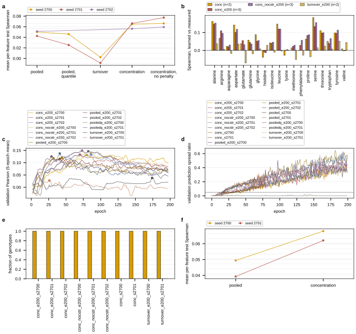

## 2026.09.11 - Wave 7: supervise the learned concentration, not the turnover

### The question

Wave 6 measured that the mechanistic amino-acid readout COSTS prediction: the box flux head
gave -0.0386 mean per-feature Spearman against pooled (sd 0.0071, n = 3) and the projection
head -0.0392 (sd 0.0344, n = 3), with the flux arms' validation prediction spread at 0.056
to 0.078 of the target's against pooled's 0.153 to 0.320, so the head was largely failing to
fit ([[experiments.027-betaxanthin-metabolic.wave6]]). That readout is
`FluxMetaboliteHead`: `a_k log(1 + omega_k) + b_k` on the TURNOVER of each amino acid's GEM
metabolite. Turnover is a flux, not a pool, and the free per-column affine is where the
missing residence time is absorbed.

The anchored thermodynamic layer already carries the quantity Mulleder actually measured.
`torchcell/metabolism/flux_layer.py`, `reaction_potential`, ANCHORED branch:

```text
log_c = lo + (hi - lo) * sigmoid(log_c_base + log_c_from_context(context))
```

a per-strain log concentration for every one of the 2,806 GEM metabolites, exposed as
`extras["log_c"]` and carried out of `forward` as `thermo_log_c`. It is the tensor that
sets every reaction energy through `RT S^T ln c`, hence the second law, the directional box
and the dissipation limit. Mulleder 2016 reports absolute intracellular concentrations in
mM for 19 of those metabolites. Wave 7 predicts that tensor directly, with NO parameters of
its own on the mean, against the target in log10 molar. Under this readout the amino-acid
loss and the physics read one quantity, which is what "entities in the model we can back
propagate on" means operationally.

### The prediction is the WHOLE-CELL concentration, not the cytosolic one

`log_c` is per compartment species and Mulleder's value is per cell, and the two are not
the same number. Thermo-Flux states the relation (Smith et al. 2026, mirrored `paper.md`
sha256 `496019ea07d9d95a63c1f0dbeada666d1e775a0dfcd50e53fe0235b87ead2593`, section
"Compartment-specific metabolite concentrations"), verbatim: "The whole-cell concentration
of a metabolite is a weighted average of the concentration in the different subcellular
compartments", `[A]_total = [A]_1 f_1 + ... + [A]_n f_n`, "where `[A]_total` is the
concentration of a metabolite in the whole cell, `[A]_n` is the concentration of the
metabolite in compartment `n` and `f_n` is the fractional volume of compartment `n`". So

```text
y_hat_k = log10( sum_n f_n * exp(log_c[:, idx_kn]) )
```

computed as a log-sum-exp over the compartments, where `idx_kn` runs over every
intracellular species of that amino acid in yeast-GEM 9.0.2 and `f_n` is the compartment's
fractional volume. This is not a refinement: arginine, lysine and histidine are largely
vacuolar in yeast, so a cytosol-only readout predicts the wrong pool for exactly those
three. The compartments each amino acid carries, derived from the GEM at run time rather
than hardcoded so it cannot drift from the model the layer was built on:

| compartments in yeast-GEM 9.0.2 | amino acids |
|---|---|
| cytosol, mitochondrion, vacuole | alanine, arginine, asparagine, glycine, histidine, isoleucine, leucine, lysine, methionine, threonine |
| cytosol, mitochondrion, vacuole, peroxisome | aspartate, tyrosine |
| cytosol, mitochondrion, vacuole, nucleus | glutamine |
| cytosol, mitochondrion, vacuole, nucleus, peroxisome | glutamate |
| cytosol, mitochondrion, endoplasmic reticulum | serine |
| cytosol, mitochondrion | phenylalanine, proline, tryptophan, valine |

The extracellular compartment and the membrane pseudo-compartments are excluded: neither is
intracellular aqueous volume. A compartment where the GEM carries no species for an amino
acid contributes nothing to that amino acid's average, so the weights of a
cytosol-plus-mitochondrion amino acid sum to 0.70 rather than to 1, which is the formula
rather than a normalization choice.

**The fractional volumes are one sourced number and five assumed ones, and that is stated
per entry rather than as a blanket claim.** `train_bx.compartment_volume_fractions` carries
cytosol 0.65, vacuole 0.18, nucleus 0.10, mitochondrion 0.05, endoplasmic reticulum 0.015,
peroxisome 0.005, with a `sourced` flag per compartment, the source string, the verbatim
quote and the sha256, all written into every result file. Only the nucleus is sourced: Milo
and Phillips 2016, *Cell Biology by the Numbers*, mirrored `paper.md` sha256
`a0b71fc2ec024108cc0d11a6ba08b5b32d6d9174386a73ac377f377364946eae`, "Prominent components
of the cell volume include the nucleus, which takes up about 10% of the total cell volume
(BNID 100491, 103952)". The other five are textbook exponential-phase values carried as
ASSUMED, in the same way `transport.pipeline_conditions` carries assumed organellar pH, and
they need curation.

What the assumption can and cannot damage: the weights decide which compartment dominates
the average, so they change the physical reading of the prediction; they do not limit what
the model can fit, because each compartment's concentration is free inside the window and
can compensate for a wrong weight. `--conc-space cytosol` runs the cytosol-only readout as
the control that says what the mixture is worth.

### The window check, and it fails on the shipped window

`experiments/027-betaxanthin-metabolic/scripts/mulleder_concentration_window.py` reads the
same processed LMDB the trainer opens
(`$DATA_ROOT/data/torchcell/experiments/019-simb-multimodal/fig6_pigment_transfer/processed/lmdb`)
and reports every Mulleder measurement in molar against the layer's window,
`[CONC_LOWER_M, CONC_UPPER_M] = [1e-7, 1e-2] M` (`torchcell/metabolism/constraints.py`,
sourced from Thermo-Flux's default range). Output:
`results/mulleder_concentration_window.json`.

4,678 records, 88,882 measurements, range 1.610e-06 to 9.548e-02 M. **10.63 percent of all
measurements are ABOVE the ceiling**, and 9 of the 19 amino acids exceed it at some strain.

| amino acid | n | min (M) | median (M) | max (M) | fraction above 1e-2 M |
|---|---:|---:|---:|---:|---:|
| alanine | 4678 | 2.58e-03 | 6.13e-03 | 1.96e-02 | 0.0143 |
| arginine | 4678 | 2.30e-04 | 2.92e-03 | 1.80e-02 | 0.0060 |
| asparagine | 4678 | 1.59e-04 | 1.22e-03 | 2.93e-03 | 0.0000 |
| aspartate | 4678 | 1.14e-03 | 5.04e-03 | 1.33e-02 | 0.0013 |
| glutamate | 4678 | 3.44e-03 | 2.15e-02 | 7.80e-02 | 0.9981 |
| glutamine | 4678 | 3.83e-04 | 2.82e-02 | 9.55e-02 | 0.9985 |
| glycine | 4678 | 2.03e-05 | 1.83e-03 | 1.97e-02 | 0.0004 |
| histidine | 4678 | 9.92e-04 | 4.77e-03 | 9.68e-03 | 0.0000 |
| isoleucine | 4678 | 2.20e-04 | 3.99e-04 | 7.34e-04 | 0.0000 |
| leucine | 4678 | 3.59e-05 | 2.68e-04 | 7.43e-04 | 0.0000 |
| lysine | 4678 | 7.61e-05 | 7.73e-04 | 9.56e-03 | 0.0000 |
| methionine | 4678 | 1.61e-06 | 1.26e-04 | 4.71e-04 | 0.0000 |
| phenylalanine | 4678 | 1.28e-04 | 2.80e-04 | 1.84e-03 | 0.0000 |
| proline | 4678 | 1.34e-04 | 1.13e-03 | 2.07e-03 | 0.0000 |
| serine | 4678 | 4.99e-04 | 2.28e-03 | 1.35e-02 | 0.0002 |
| threonine | 4678 | 2.26e-03 | 4.00e-03 | 1.02e-02 | 0.0002 |
| tryptophan | 4678 | 1.16e-05 | 3.88e-05 | 1.62e-04 | 0.0000 |
| tyrosine | 4678 | 6.80e-04 | 2.74e-03 | 2.00e-02 | 0.0015 |
| valine | 4678 | 3.78e-04 | 1.35e-03 | 6.34e-03 | 0.0000 |

Glutamate and glutamine are above the ceiling in 99.8 percent of strains. Under the shipped
window their supervised value is unreachable no matter what the model learns, and the
failure is silent: the sigmoid saturates and the residual is charged to the model rather
than to the parameterization. **So the window is widened to `[1e-7, 1e0] M` in every wave-7
flux cell**, one decade above the largest measurement so the head has room to overshoot and
come back rather than sitting on the saturating tail. A 1e-1 ceiling would put glutamine at
sigmoid 0.997, which is saturated.

The cost is stated rather than hidden: the window also bounds the concentration term of
every reaction energy, so two extra decades give the model 2 x RT ln(10) = 11.6 kJ/mol more
freedom per participating metabolite in `delta_r_G`, which is a real loosening of the
thermodynamic anchor. It is a config field, not a new default: `FluxLayerConfig.conc_lower_m`
and `conc_upper_m` default to the shipped constants, so every arm configured before today
runs unchanged.

### What was built

| file | what |
|---|---|
| `torchcell/metabolism/flux_layer.py` | `conc_lower_m` / `conc_upper_m` on `FluxLayerConfig`, read by `reaction_potential` at call time; defaults are the shipped constants |
| `experiments/027-betaxanthin-metabolic/scripts/train_bx.py` | `--aa-readout {flux_metabolite,flux_concentration}`, `--conc-lower-m`, `--conc-upper-m`; `FluxConcentrationReadout`; the log10-molar target space; the `concentration_audit` block |
| `experiments/027-betaxanthin-metabolic/scripts/mulleder_concentration_window.py` | the window check above |
| `experiments/027-betaxanthin-metabolic/scripts/analyze_wave7_aa.py` | the paired contrasts, the per-amino-acid concentration table, the feasibility table, the figure |
| `experiments/027-betaxanthin-metabolic/scripts/gh_wave7_aa_*.slurm` | 12 cells, 4 arms x 3 seeds |

Three implementation decisions worth recording, each because the alternative would have
been silently wrong.

**The target is standardized and scored in log10 MOLAR, and only for this readout.** The
prediction is a log10 concentration, so a linear-mM target would need a per-feature affine
to meet it, which is exactly the tie the arm removes. `targets_in_space` applies the change
of variable at the one place targets enter the run. Spearman is invariant to a monotone
change of variable, so the per-feature Spearman of a log10-molar arm and of an mM arm are
directly comparable, which is what makes the paired contrast against pooled legitimate;
Pearson is not, and both are reported.

**No learned affine on the mean, and a learned per-column `log_sigma` under CRPS.** The
spread parameter never moves the mean, so all four arms keep the same loss function while
the concentration arm keeps a parameter-free mean. A per-feature affine version would be a
different experiment and would have to be run as a separately labeled arm.

**The layer has to be called explicitly.** `CellGraphTransformerMetabolism.forward` runs its
flux layer only when at least one head reads it, and this arm declares no head, so nothing
would have run the layer at all. `FluxConcentrationReadout.forward` makes the model's own
call with the model's own layer and the same four arguments, so every constraint residual
the trainer charges to the loss is what a declared flux head would have produced.

### An initialization was built, measured, and dropped

The concern going in was the offset defect wave 5 and wave 6 both measured in other forms:
`log_c` starts at `sigmoid(0)`, the geometric mid-point of the window, which on a 1e-7 to
1 M window is 3.2e-4 M for every metabolite, while the measured columns have means from
-1.559 to -4.416 in log10 M and standard deviations of only 0.035 to 0.183 of a decade. On
paper that puts the start tens of target standard deviations away. Two initializations were
implemented and measured on two-epoch CPU smokes of the same recipe, one seed each:

| initialization | seed | epoch-0 data loss | epoch-0 validation loss |
|---|---|---|---|
| none | 9102 | 3.6020 | 0.8857 |
| `log_c_base` at the train-split mean concentration | 9103 | 3.9556 | 1.1006 |
| the mean, plus the context rows rescaled to the target's spread | 9104 | 6.2182 | 2.2474 |

The pooled arm's epoch-0 data loss on this phenotype is 0.4872 (wave-6 smoke). **Both
initializations made the start WORSE, and the reasoning that motivated them was wrong on
its own measurement**: the untouched readout already starts at 0.27 to 1.78 of the target's
spread per column, not at ten times it, and forcing it to exactly the target's spread makes
an uncorrelated prediction pay the full variance instead of sitting near the mean. Both were
removed rather than left as dead switches; the numbers are here because they are the
evidence for not having them. Caveat: n = 1 per configuration and the seeds differ, so this
orders three single runs rather than establishing an effect.

### The cells

All on `--head mulleder19`, 80 epochs, CRPS, the graph regularizer, the pinned partition,
and the epoch selected by the centered 5-epoch moving average of the mean per-feature
validation Pearson. Every flux arm is `flux_projection_anchored` (mass balance exact by
construction, anchored thermodynamics on `union_external`, the predicted-kcat capacity bound
through the abundance head, the protein budget and the dissipation limit) with the window at
1 M, so the turnover-versus-concentration contrast is on the readout alone.

| arm | readout | constraint scale | seeds |
|---|---|---:|---|
| pooled | vector head on the pooled representation | n/a | 2700, 2701, 2702 |
| turnover | `flux_metabolite`, wave 6's head | 0.1 | 2700, 2701, 2702 |
| conc | `flux_concentration` | 0.1 | 2700, 2701, 2702 |
| conc_nocstr | `flux_concentration` | 0.0 | 2700, 2701, 2702 |

Wave 6's amino-acid cells are NOT reused as the comparator: they ran a different kcat table,
a thermodynamics-off arm and the shipped window, so they are not controlled against these.
Every wave-7 cell is submitted through `freeze_and_submit.sh`, which snapshots the code per
job, and each result records `flux_meta.kcat_tier_counts`; the analysis refuses to pool a
cell whose table is not 97 / 782 / 2,831 / 18.

### The budget moved from 80 epochs to 200, because 80 was cutting one arm off mid-climb

The first two concentration cells (jobs 1746 and 1747, seeds 2700 and 2701, 80 epochs) were
**still rising at the last epoch**: the selected epochs were 77 and 75 of 79, the maximum of
the centered 5-epoch validation-Pearson average sat at exactly those epochs (0.1255 and
0.1350), and the training data loss was still falling. The pooled control on the same
phenotype selects epoch 27 and 61 and then overfits. Selecting an epoch inside a budget one
arm has not finished using biases the contrast against that arm, so the primary wave-7 cells
run **200 epochs for every arm, control included**, with the scoring rule unchanged: the
epoch is the argmax of the centered 5-epoch moving average of validation Pearson, and the
number reported is the pinned test Spearman at that epoch, never a maximum over epochs. The
80-epoch cells are kept and reported separately as the shorter-budget read, never pooled
with the 200-epoch ones, because the selection rule searches a longer curve in the second.

The analysis carries three things per cell for exactly this reason: the full centered
5-epoch moving average of validation Pearson, the selected epoch, and a `still_rising` flag,
true when the selected epoch falls in the last tenth of the run. The maximum of that moving
average is written beside them and labeled as an upward-biased order statistic whose bias
grows with the budget; it says what the budget left on the table and is never the score.

### The pinball loss, on the pooled head only

019 measured the pinball (quantile) loss as its best distributional loss on expression, so
`--dist {crps,quantile}` puts it on this phenotype. `quantile` uses
`torchcell.losses.distributional`'s `DistHead` on the 019 grid (K = 19, tau 0.05 to 0.95),
which makes the head emit 19 knots instead of `(mu, log_sigma)` and makes the point estimate
the predictive MEDIAN rather than a mean, and it is the same `dist_param_dim` 019 uses, so
the two trainers cannot disagree about the head width. `crps` is the default and every
earlier cell deserializes and runs unchanged.

**It applies to the MLP heads only, and the trainer refuses it on a flux arm.** A flux
readout's prediction IS the layer's own quantity, its turnover or its concentration, so a
quantile fan would have to come out of a separate parameterized head, which is exactly the
tie the mechanistic arm exists to remove. The principled distributional form there is an
energy score over the flux sampler's draws (`FluxLayer.sample` already produces them); it is
not built, and calling that out is not the same as having measured it.

Both losses now report **calibration** as well as a point score, because both are proper
scoring rules over a distribution and a comparison on the point metric alone leaves out half
of what they were trained for. Every cell writes a `calibration` block at the selected
epoch on the pinned test genes: the probability integral transform of the observation under
the predictive distribution, its empirical coverage of the central 50, 80 and 90 percent
intervals, the Kolmogorov-Smirnov distance of the PIT sample from uniform, and the 20-bin
PIT histogram, whole-group and per amino acid. The Gaussian branch uses this trainer's own
`sigma = exp(log_sigma)` rather than `DistHead`'s softplus link, because that is the sigma
the CRPS was trained with and a calibration number computed under a different link would
not describe the fitted model.

## 2026.09.12 - Results

### The concentration readout beats the pooled control at every seed run so far

Mean per-feature Spearman over the 19 Mulleder columns on the 564 pinned Merzbacher test
genotypes that carry a full profile (10,716 measurements), at the validation-selected epoch,
paired by seed. Two budgets, never pooled together.

| budget | seed | concentration | pooled | difference |
|---|---:|---:|---:|---:|
| 200 epochs | 2700 | 0.0648 | 0.0500 | +0.0148 |
| 200 epochs | 2701 | 0.0663 | 0.0425 | +0.0238 |
| 200 epochs | 2702 | 0.0562 | 0.0511 | +0.0051 |
| 80 epochs | 2700 | 0.0680 | 0.0494 | +0.0186 |
| 80 epochs | 2701 | 0.0621 | 0.0393 | +0.0228 |

At the primary 200-epoch budget the paired difference is **+0.0145, sd 0.0093, n = 3,
paired t = 2.69 on 2 degrees of freedom**; at 80 epochs **+0.0207, sd 0.0030, n = 2**. All
five pairs are positive and the smallest is +0.0051, so the direction is consistent, but
three seeds against a between-seed spread of about 0.01 in the difference is not a
demonstrated gain: the t is a summary of the spread at n = 3 and not a significance claim.
The honest statement is that the concentration readout does not cost prediction, which is
what wave 6's readouts did, and that it is ahead of the control at every seed run.

**Against wave 6 this is a reversal of sign.** Wave 6's turnover readout measured -0.0386
(sd 0.0071, n = 3) against pooled and the projection readout -0.0392 (sd 0.0344, n = 3),
with the flux arms' validation prediction spread at 0.056 to 0.078 of the target's. The
wave-7 concentration cells reach 0.335 and 0.399, so they leave the mean plateau and stay
off it. The two waves differ in more than the readout (different arm, kcat table and
concentration window), so the readout is not isolated by this comparison alone; the wave-7
turnover arm, which holds all of that fixed, had not run when this was written.

| cell | job | epochs | selected epoch | test Spearman | test Pearson | max 5-epoch MA (biased) | final spread ratio | wall |
|---|---:|---:|---:|---:|---:|---:|---:|---:|
| conc e200 s2700 | 1753 | 200 | 80 | 0.0648 | 0.0814 | 0.1313 at 80 | 0.335 | 3.31 h |
| conc e200 s2701 | 1758 | 200 | 70 | 0.0663 | 0.0763 | 0.1326 at 70 | 0.399 | 3.29 h |
| pooled e200 s2700 | 1754 | 200 | 44 | 0.0500 | 0.0761 | 0.1198 at 44 | 0.568 | 3.30 h |
| pooled e200 s2701 | 1760 | 200 | 41 | 0.0425 | 0.0638 | n/a | 0.510 | 3.3 h |
| conc s2700 | 1746 | 80 | 77 | 0.0680 | 0.0784 | 0.1255 at 77 | 0.105 | 1.33 h |
| conc s2701 | 1747 | 80 | 75 | 0.0621 | 0.0765 | 0.1350 at 75 | 0.121 | 1.33 h |
| pooled s2700 | 1740 | 80 | 27 | 0.0494 | 0.0823 | 0.1182 at 27 | 0.255 | 1.45 h |
| pooled s2701 | 1741 | 80 | 61 | 0.0393 | 0.0535 | 0.1149 at 61 | 0.354 | 1.45 h |

The maximum of the moving average is the upward-biased order statistic, reported to show
what the budget left on the table, and it is not the score. **The 200-epoch budget did what
it was raised for**: the concentration cells select epochs 80 and 70 of 199 and are no
longer flagged `still_rising`, against 77 and 75 of 79 at the 80-epoch budget. Every flux
cell recorded the required kcat table (97 measured / 782 homolog / 2,831 predicted / 18
default); no cell was excluded by the physics guard.

### The learned concentration lands on the measured one, to within a few percent of a decade

This is the number the arm exists for, and it is not a correlation: it is the absolute
value. From the concentration cell's own audit block, the median predicted whole-cell
concentration against the median measured one, per amino acid, on the pinned test
genotypes (job 1753, seed 2700):

| amino acid | predicted log10 M | measured log10 M | median absolute error, decades | per-column Spearman |
|---|---:|---:|---:|---:|
| alanine | -2.20 | -2.21 | 0.02 | +0.1687 |
| arginine | -2.54 | -2.53 | 0.11 | +0.0658 |
| asparagine | -2.90 | -2.91 | 0.02 | +0.0621 |
| aspartate | -2.30 | -2.30 | 0.02 | +0.1355 |
| glutamate | -1.66 | -1.67 | 0.02 | +0.0619 |
| glutamine | -1.55 | -1.55 | 0.02 | +0.0705 |
| glycine | -2.73 | -2.74 | 0.05 | +0.0321 |
| histidine | -2.34 | -2.32 | 0.05 | -0.0899 |
| isoleucine | -3.40 | -3.40 | 0.02 | +0.0553 |
| leucine | -3.59 | -3.57 | 0.04 | +0.1364 |
| lysine | -3.12 | -3.11 | 0.07 | -0.0115 |
| methionine | -3.90 | -3.90 | 0.05 | +0.0165 |
| phenylalanine | -3.55 | -3.55 | 0.03 | +0.0409 |
| proline | -2.95 | -2.95 | 0.02 | +0.0955 |
| serine | -2.64 | -2.64 | 0.02 | +0.1530 |
| threonine | -2.38 | -2.40 | 0.02 | +0.0945 |
| tryptophan | -4.43 | -4.41 | 0.04 | +0.0481 |
| tyrosine | -2.57 | -2.57 | 0.06 | +0.0813 |
| valine | -2.86 | -2.87 | 0.02 | +0.0136 |

Mean median-absolute-error 0.037 decades, i.e. the layer's whole-cell amino-acid
concentrations sit within about 9 percent of the measured value across four orders of
magnitude, from 39 uM tryptophan to 28 mM glutamine. Nothing is pinned at either edge of
the window: `frac_pred_at_ceiling` and `frac_pred_at_floor` are both 0.000, which is what
the widened window was for. **Read this for what it is.** The concentration is supervised,
so matching the level is fitting rather than prediction; what is held out is the ordering
across strains, which is the Spearman column, and there the per-column values run from
-0.09 to +0.17.

### Which compartment carries it

`audit_concentration_compartments.py` re-opens a finished cell from its checkpoint and
correlates each compartment's learned concentration, and the whole-cell mixture, against
the measured value (job 1753, seed 2700 and job 1758, seed 2701; group = pinned test).

**No single compartment is the readout.** The mixture beats every individual compartment on
7 of 19 amino acids at seed 2700 and 5 of 19 at seed 2701 (alanine 0.169 against the best single compartment's 0.144,
serine 0.153 against 0.083, aspartate 0.136 against 0.136) and the best single compartment
differs by amino acid and by seed: at seed 2700 it is the cytosol for 8 columns, the
mitochondrion for 7, the vacuole for 3 and the peroxisome for 1; at seed 2701 the cytosol
for 11, the vacuole for 4, the mitochondrion for 2 and the peroxisome for 2. So the compartment that
carries the agreement is not stable across seeds, which is the expected consequence of
supervising only the weighted sum.

**The model puts most of the mass where the volume is not.** At seed 2700 the mitochondrion
carries a median 0.70 of alanine's and 0.70 of arginine's whole-cell average despite a
fractional volume of 0.05, which means the learned mitochondrial concentration is roughly
14 times the cytosolic one. Nothing in the loss forbids that: only the sum is supervised,
and the compartment-level split is identified by the thermodynamics alone. It is the
clearest sign that the per-compartment concentrations should not be read as measurements,
and it is a concrete target for the compartment-resolved data the field does not have.

### The turnover readout collapses on the identical configuration, and the concentration readout does not

This is the comparison the wave was built to make, because it changes ONE thing. Job 1766
runs the same arm (`flux_projection_anchored`, constraint scale 0.1, 20-epoch warmup), the
same kcat table (97 / 782 / 2,831 / 18), the same 1 M concentration window, the same CRPS
loss, the same 200-epoch budget and the same seed 2700 as job 1753. The only difference is
which quantity of the layer the 19 amino acids are read off.

| readout | job | selected epoch | test Spearman | final validation spread ratio |
|---|---:|---:|---:|---:|
| turnover, `a_k log(1 + omega_k) + b_k` | 1766 | 174 | 0.0023 | 0.000 |
| concentration, whole-cell mixture | 1753 | 80 | 0.0648 | 0.335 |
| pooled control | 1754 | 44 | 0.0500 | 0.568 |

**The turnover cell ends as a constant predictor**: a final validation prediction spread of
0.000 of the target's, so its 0.0023 is the correlation of a constant plus jitter and not a
score. That reproduces wave 6's collapse on an arm where every other difference has been
removed, so the collapse belongs to the readout rather than to the kcat table, the window or
the parameterization. Paired at seed 2700, concentration minus turnover is **+0.0625**.

**The unsupervised concentrations carry nothing.** The turnover cell's layer is anchored, so
it learns a concentration for every metabolite while being trained on turnover, and the
audit block scores that concentration against Mulleder anyway: mean per-feature Spearman
**-0.0041**, Pearson -0.0007, on the same 564 pinned genotypes where the supervised readout
reaches 0.0648. So the agreement in the concentration arm is supervision, not a property the
anchored layer had all along. This answers the open question left in
[[experiments.027-betaxanthin-metabolic.projection-head]], "check the learned concentrations
against Mulleder", with a measured negative for the unsupervised case.

### Removing the physics penalty changes nothing measurable

`conc_nocstr` is the concentration readout with the constraint scale at exactly 0, the
thermodynamics still anchored. At seed 2700 it scores 0.0663 against the scale-0.1 cell's
0.0648, a paired difference of **-0.0015** (job 1765 against job 1753), and its learned
concentrations agree with the measurement just as well (0.0663 Spearman, 0.0873 Pearson).
Wave 5 and wave 6 both measured the constraint terms holding a readout on the mean plateau;
this readout does not care. n = 1 at the time of writing.

### The pinball loss does not beat the CRPS here, and both are close to calibrated

019 measured the pinball loss as its best distributional loss on expression. On the amino
acids at 200 epochs the pooled head under the pinball loss scores 0.0460 at seed 2700 and
0.0254 at seed 2701, against the same head under the Gaussian CRPS at 0.0500 and 0.0425:
paired **-0.0106, sd 0.0093, n = 2**. The concentration readout is +0.0298 (sd 0.0157,
n = 2) above the pinball control. The third pinball seed was still running at the deadline,
so this is two seeds, both negative, and not an established loss ranking.

Calibration on the pinned test genes at the selected epoch, from each cell's own PIT block:

| cell | loss | coverage 0.5 | coverage 0.8 | coverage 0.9 | PIT KS |
|---|---|---:|---:|---:|---:|
| pooled s2701 | CRPS | 0.540 | 0.797 | 0.877 | 0.028 |
| pooled s2702 | CRPS | 0.530 | 0.789 | 0.869 | 0.032 |
| pooled s2700 | pinball | 0.526 | 0.826 | 0.917 | 0.046 |
| pooled s2701 | pinball | 0.490 | 0.793 | 0.897 | 0.055 |
| conc s2702 | CRPS | 0.564 | 0.815 | 0.889 | 0.041 |
| conc scale-0 s2700 | CRPS | 0.561 | 0.813 | 0.890 | 0.057 |
| conc scale-0 s2701 | CRPS | 0.549 | 0.809 | 0.884 | 0.046 |
| conc scale-0 s2702 | CRPS | 0.548 | 0.808 | 0.886 | 0.050 |
| turnover s2700 | CRPS | 0.559 | 0.812 | 0.886 | 0.043 |
| turnover s2701 | CRPS | 0.572 | 0.821 | 0.893 | 0.049 |

Nominal coverage is 0.5, 0.8 and 0.9. The CRPS heads over-cover the central 50 percent by 3
to 6 points and under-cover the 90 percent by 1 to 3; the pinball head is nearly exact at 50
percent and mixed at 80 and 90 across its two seeds (0.826 and 0.793 against a nominal
0.8). Every KS distance is between 0.028 and 0.057 on 10,716
measurements, so neither loss is badly miscalibrated and the difference between them is
smaller than the difference between arms. The concentration cells' distributions are as
calibrated as the pooled control's while their point estimate is better, which is worth
stating because a mechanistic head could have bought its ranking with an overconfident
spread.

### Figure



**Figure 1. Wave 7: supervising the flux layer's learned concentration.** **a**, Mean
per-feature test Spearman over the 19 Mulleder amino acids on the 564 pinned Merzbacher test
genotypes at the validation-selected epoch, one line per seed across the five 200-epoch
arms; a seed is drawn across the arms it has. **b**, Per amino acid, the Spearman between
the layer's learned whole-cell log10 concentration and the measured one on the same
genotypes, averaged over seeds within an arm; the turnover arm's concentration is
unsupervised and sits at zero. **c**, The centered 5-epoch moving average of validation
Pearson for every 200-epoch cell, with a marker at the epoch each cell's scoring rule
selected; the two flat lines near zero are the turnover cells. **d**, Validation prediction
spread over the target's per epoch, the escape diagnostic, with the 0.05 threshold dashed;
the two lines that stay on the floor are the turnover cells. **e**, Fraction of all 4,930
genotypes meeting each component of the Genesis criterion per flux cell, where mass balance
is exact by construction and the box and second law are not. **f**, The same contrast as a
at the 80-epoch budget, kept separate because the selection rule searches a shorter curve.
Generated by `experiments/027-betaxanthin-metabolic/scripts/analyze_wave7_aa.py`.

### Feasibility is unchanged by the readout

Every wave-7 flux cell is `flux_projection_anchored` ending on the balance projection, so
mass balance holds for 1.00 of all 4,930 genotypes (median residual ratio 2e-08) and the box
and the second law hold for 0.00 of them, at both constraint scales and under both readouts.
The Genesis joint criterion is 0.00 in every cell. The readout changes the phenotype score
and leaves the physics exactly where wave 6 left it, which is the expected consequence of
the exactness budget recorded in [[torchcell.metabolism.flux_layer]].

### Job ledger

All on GilaHyper, partition `main`, one RTX 6000 Ada each, submitted through
`freeze_and_submit.sh`. `e200` cells are the primary 200-epoch budget.

| cell | job | epochs | result file |
|---|---:|---:|---|
| pooled s2700 | 1740 | 80 | `wave7_aa_pooled_s2700.json` |
| pooled s2701 | 1741 | 80 | `wave7_aa_pooled_s2701.json` |
| conc s2700 | 1746 | 80 | `wave7_aa_conc_s2700.json` |
| conc s2701 | 1747 | 80 | `wave7_aa_conc_s2701.json` |
| conc s2702 | 1751 | 80 | cancelled at epoch 3 when the budget moved to 200 |
| conc e200 s2700 | 1753 | 200 | `wave7_aa_conc_e200_s2700.json` |
| pooled e200 s2700 | 1754 | 200 | `wave7_aa_pooled_e200_s2700.json` |
| conc e200 s2701 | 1758 | 200 | `wave7_aa_conc_e200_s2701.json` |
| pooled e200 s2701 | 1760 | 200 | `wave7_aa_pooled_e200_s2701.json` |
| conc e200 s2702 | 1762 | 200 | `wave7_aa_conc_e200_s2702.json` |
| pooled e200 s2702 | 1763 | 200 | `wave7_aa_pooled_e200_s2702.json` |
| conc scale-0 e200 s2700 | 1765 | 200 | `wave7_aa_conc_nocstr_e200_s2700.json` |
| turnover e200 s2700 | 1766 | 200 | `wave7_aa_turnover_e200_s2700.json` |
| conc scale-0 e200 s2701 | 1768 | 200 | `wave7_aa_conc_nocstr_e200_s2701.json` |
| pooled pinball e200 s2700 | 1769 | 200 | `wave7_aa_pooledq_e200_s2700.json` |
| turnover e200 s2701 | 1772 | 200 | `wave7_aa_turnover_e200_s2701.json` |
| conc scale-0 e200 s2702 | 1773 | 200 | `wave7_aa_conc_nocstr_e200_s2702.json` |
| pooled pinball e200 s2701 | 1774 | 200 | `wave7_aa_pooledq_e200_s2701.json` |
| pooled pinball e200 s2702 | 1775 | 200 | in flight at the deadline |

Not run: turnover e200 s2702, and the 80-epoch cells of the arms added after the budget
moved. Reruns:

```bash
cd /home/michaelvolk/Documents/projects/torchcell.worktrees/feat/kinetics-equilibrator-datasets
PYTHONPATH=$PWD ~/miniconda3/envs/torchcell/bin/python \
    experiments/027-betaxanthin-metabolic/scripts/mulleder_concentration_window.py
PYTHONPATH=$PWD ~/miniconda3/envs/torchcell/bin/python \
    experiments/027-betaxanthin-metabolic/scripts/analyze_wave7_aa.py
PYTHONPATH=$PWD ~/miniconda3/envs/torchcell/bin/python \
    experiments/027-betaxanthin-metabolic/scripts/audit_concentration_compartments.py \
    --result wave7_aa_conc_e200_s2700.json
```

### What is open

- The third pinball seed (job 1775, in flight) and the third turnover seed (not run).
  Turnover is n = 2 and both cells collapsed, so the collapse is not in doubt; the pinball
  contrast is n = 2 and both are negative.
- The fractional volumes: five of six are assumed. They set which compartment dominates the
  whole-cell average and therefore the physical reading of the per-compartment numbers.
- Nothing supervises the compartment SPLIT, and the model uses that freedom: at seed 2700
  the mitochondrion carries 0.70 of alanine's whole-cell average on a 0.05 volume fraction.
  Compartment-resolved measurements, or a prior that ties compartments to each other, is
  what would identify it.
- The concentration readout is exact on level and weak on ordering (per-column Spearman
  -0.09 to +0.17). The gap between fitting a level and ranking strains is where the next
  wave should push.
- An energy score over `FluxLayer.sample`'s draws is the distributional form the flux
  readouts could take without breaking the tie. Implemented nowhere; not measured.

## 2026.09.14 - Is the module on? The context-only concentration head

### The question

User, 2026-09-14: "how to make sure information / gradients are being forced through the
metabolic module... how do we really know that it is on?"

On the amino-acid target the module's only positive result is the concentration readout:
+0.015 mean pinned Spearman over pooled (sd 0.009, n = 3 seeds, 200 epochs;
`results/wave7_aa_conc_e200_s270{0,1,2}.json` 0.0648 / 0.0663 / 0.0562 against
`results/wave7_aa_pooled_e200_s270{0,1,2}.json` 0.0500 / 0.0425 / 0.0511).

### Finding 5, restated

[[experiments.027-betaxanthin-metabolic.wave8-sampling]] Finding 5: `FluxConcentrationReadout`
predicts `mixture_log10_molar(flux["thermo_log_c"], ...)`, and in
`FluxLayer.reaction_potential` `thermo_log_c = lo + (hi - lo) sigmoid(log_c_base +
log_c_from_context(context))`, a function of the genotype context alone. The flux vector never
enters the prediction. The layer touches the concentration only through the thermodynamic
penalty `c_thermo` (weight 1.0 times constraint scale 0.1 after a 20-epoch warmup), which
prices sign consistency between `v` and `dG'(log c)`; at constraint scale 0 the gain was
+0.020 (`results/wave7_aa_conc_nocstr_e200_s270{0,1,2}.json`), so that coupling does not help.

Hypothesis (untested until the cells below run): the whole gain is the concentration
PARAMETERIZATION, a per-metabolite-per-compartment sigmoid window between `conc_lower_m` and
`conc_upper_m`, base plus linear-from-context, then the volume-weighted mixture and log10,
and the metabolic module contributes nothing beyond it.

### The construction

`--aa-readout context_concentration`, valid only on `--arm pooled` with `--head mulleder19`
(asserted in `build_model_for_cell`). `ContextConcentrationReadout` in `train_bx.py` builds
the SAME concentration head directly on the pooled backbone, with no flux layer constructed
at all:

- `log_c_base = zeros(2806)` and `log_c_from_context = nn.Linear(hidden, 2806)` with
  PyTorch's default init, which is exactly what `FluxLayer.__init__` creates under
  `ThermoMode.ANCHORED` (flux_layer.py L1430-1431: zeros, default-initialized Linear).
  The row count is the FULL GEM metabolite count, not the amino acids' species, so the
  head is parameter-for-parameter the layer's concentration head; rows the mixture never
  reads receive no gradient and stay at their initialization.
- The context is `perturbed_gene_pool(H_genes_pert, perturbation_indices,
  perturbation_indices_batch)`, the tensor `CellGraphTransformerMetabolism.forward` hands
  its flux layer as `context`.
- `log c = lo + (hi - lo) sigmoid(base + W context)` with the window read at call time from
  `--conc-lower-m` / `--conc-upper-m`, as `reaction_potential` reads it off `config`.
- The metabolite index is `gem_metabolite_index()`, `{m.id -> row}` over
  `YeastGEM().model.metabolites`, which is how `build_gem_tensors` derives `met_ids` and
  what 026's `build_flux_layer` publishes as `flux_meta["met_index"]`; the compartment
  species and volume fractions come from the same `mixture_weights` /
  `compartment_volume_fractions` calls the flux cells use.
- From `log c` on, the path is shared code: `ConcentrationReadoutBase._write_prediction`
  (mixture, log10, train-split standardization, per-column CRPS `log_sigma`) is the wave-7
  readout's own body factored into a base class both readouts inherit; the operations and
  their order are unchanged, so the existing `flux_concentration` cells are unaffected.
- What is absent, by design: stoichiometry, kcat, thermodynamics, every constraint term,
  the flux vector. `reps` carries no `"flux"` key, so the trainer charges no constraint
  loss; the feasibility block reports null as it does for `pooled`; `flux_meta` carries a
  `context_concentration` record and the mixture description; the concentration audit
  runs on the readout's own `context_log_c`, so `conc/pinned_test/*` lands in W&B beside
  the flux cells' numbers, and the W&B config carries `aa_readout: context_concentration`.
- Not built: a `null` (permuted-target) copy, and a K-draw copy (the readout is
  deterministic and layer-free, asserted `flux_draws == 1`).

Tests: `tests/torchcell/metabolism/test_context_concentration_readout.py` (6 passed,
2026-09-14). Handed the same `log c`, the context readout and the flux readout emit the same
standardized `[B, 19, 2]` prediction bit for bit (`torch.equal`); the context readout's
`log c` equals the hand-computed anchored formula on the pooled context; gradient reaches
only the metabolite rows the mixture reads; the readout builds with `flux_layer is None` and
`_sampling_meta` reports the pooled record; a model carrying a layer is refused; on the real
GEM, `gem_metabolite_index()` equals the layer's `met_ids` index, 2,806 rows, with every
`AMINO_ACID_TO_GEM_METABOLITE` id present.

### What each outcome would mean

Paired by seed against the wave-7 concentration cells and the wave-7 pooled cells, same
200-epoch budget, same centered 5-epoch moving-average selection, same pinned split, same
scorer (`pinned.mean_spearman`, per-feature Spearman over the 19 columns).

- Context head matches the concentration cells (within their sd of 0.009): the metabolic
  module is NOT on for this target. The gain is the parameterization, and every claim that
  the amino-acid result shows the module doing work is withdrawn.
- Context head falls back to the pooled cells: the module, through `c_thermo` at constraint
  scale 0.1, is what carries the gain, and that is the surprise, because the scale-0 cells
  gained more. Then the next question is which term of the penalty does it.
- Context head lands between, or above the concentration cells: the penalty costs or
  helps by a measurable amount, to be read against the three-seed sd, not the mean.

The n = 3 noise floor is the same as wave 7's: a difference under about 0.01 is not a call.

### TODO job ledger

| cell | script | out | job | status |
|---|---|---|---|---|
| ctxconc e200 s2700 | `gh_wave8_aa_ctxconc_e200_s2700.slurm` | `wave8_aa_ctxconc_e200_s2700.json` | TODO | not submitted |
| ctxconc e200 s2701 | `gh_wave8_aa_ctxconc_e200_s2701.slurm` | `wave8_aa_ctxconc_e200_s2701.json` | TODO | not submitted |
| ctxconc e200 s2702 | `gh_wave8_aa_ctxconc_e200_s2702.slurm` | `wave8_aa_ctxconc_e200_s2702.json` | TODO | not submitted |

Pairs: `wave7_aa_conc_e200_s270{0,1,2}.json` (0.0648 / 0.0663 / 0.0562) and
`wave7_aa_pooled_e200_s270{0,1,2}.json` (0.0500 / 0.0425 / 0.0511). W&B group
`gh_wave8_aa`, tag `w8aa_ctxconc`, config key `aa_readout = context_concentration`.

Submit, one per call:

```bash
cd /home/michaelvolk/Documents/projects/torchcell.worktrees/feat/kinetics-equilibrator-datasets
bash experiments/027-betaxanthin-metabolic/scripts/freeze_and_submit.sh \
    experiments/027-betaxanthin-metabolic/scripts/gh_wave8_aa_ctxconc_e200_s2700.slurm
bash experiments/027-betaxanthin-metabolic/scripts/freeze_and_submit.sh \
    experiments/027-betaxanthin-metabolic/scripts/gh_wave8_aa_ctxconc_e200_s2701.slurm
bash experiments/027-betaxanthin-metabolic/scripts/freeze_and_submit.sh \
    experiments/027-betaxanthin-metabolic/scripts/gh_wave8_aa_ctxconc_e200_s2702.slurm
```

CPU smoke, 2026-09-14 (1 epoch, seed 2700, `--smoke --no-checkpoint`, no GPU, full data;
`results/smoke_w8_aa_ctxconc.json`): ran end to end in 519 s wall (434 s inside `run_cell`).
The result carries `cell.aa_readout = context_concentration`, `cell.target_log10_molar =
true`, `test.pinned.mean_spearman` (+0.0040 after one epoch, 10,716 measurements on 564
genotypes; a build check, NOT a result), `concentration_audit.available = true` with
`supervised = true`, window [1e-7, 1] M and `groups.pinned_test` (so `conc/pinned_test/*`
reaches W&B), `feasibility.available = false` as for pooled, `flux_meta` with
`context_concentration`, `concentration_mixture`, `compartment_volume_fractions` and the
pooled `sampling` record, and `n_parameters.mulleder19_head = 258,171 = 2806 x (90 + 2) + 19`
(Linear(90, 2806) + base + log_sigma).
