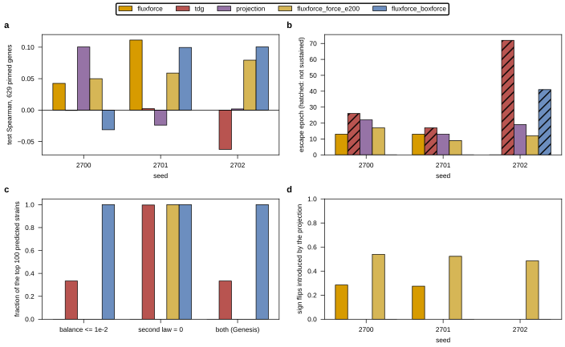

## 2026.09.11 - The Second Law as a Smooth Coupling

### The gradient finding this wave starts from

The directional box (`thermo_box`, channel suffix `_tdg`) tightens each priced reaction's
`[lb, ub]` to the sign of the model's own dG. Read `_thermo_tighten` in
`torchcell/metabolism/flux_layer.py`: the decision is `delta_g > eps` inside a
`torch.where`, and a boolean from a comparison carries no derivative, so **no gradient
reaches the learned log concentrations through the box**. The docstring's claim that the
model can move a pool until a reaction has the sign it needs is false for that path; the
only path left is the soft hinge `c_thermo`.

Pinned as a test,
`test_fluxforce_passes_gradient_to_the_concentrations_and_the_thermo_box_does_not`:
with a loss that is a function of the flux alone, `d(loss)/d(log_c_base)` is `None`
(autograd finds no path) on the `projection_k20_box_tdg` channel and is nonzero on
`fluxforce_k20_box`. The loss has to be flux-only, because through `c_thermo` both heads
pass gradient and that is a different path.

Measured context, wave 6: every projection cell WITHOUT the sign tightening sustained its
escape from the betaxanthin mean plateau (6 of 6, jobs 1689, 1690, 1738, 1734, 1735, 1739)
and none with it did (0 of 6, jobs 1723, 1724, 1725, 1730, 1731, 1726).

### The design

For every reaction the thermodynamic table prices and Thermo-Flux Box 2 does not exempt,
the direction and a magnitude factor come from the reaction energy through the flux-force
relation (Beard and Qian; the flux-force efficacy of Noor et al. 2014):

$$
v_j = m_j\,f(\Delta_rG_j),\qquad
f(x) = \frac{1-e^{x/RT}}{1+e^{x/RT}} = -\tanh\!\Big(\frac{x}{2RT}\Big),\qquad
m_j = \max(|v^\ell_j|,|v^u_j|)\,\sigma(z_j) \ge 0 .
$$

$f$ is the net of the forward and reverse rates when they stand in the ratio
$e^{-\Delta_rG/RT}$. Four properties follow, and each is a property of the function rather
than of a clamp around it:

- **the sign is structural**, $\operatorname{sign} v_j = -\operatorname{sign}\Delta_rG_j$,
  so $v_j\Delta_rG_j \le 0$ identically;
- **the magnitude is bounded** by the genotype box, $|v_j| \le m_j$, so availability, the
  deletion and the enzyme-capacity bound still bite exactly: $c_j = 0$ gives
  $v^\ell_j = v^u_j = 0$, hence $m_j = 0$ and a flux of exactly zero;
- **near equilibrium a reaction goes quiet** rather than being pinned, since $f \to 0$
  smoothly; the directional box makes no distinction between a reaction 0.1 kJ/mol from
  equilibrium and one 10 kJ/mol from it, and constrains both;
- **it is differentiable everywhere**, $f'(x) = -\operatorname{sech}^2(x/2RT)/2RT < 0$.

Unpriced and exempt reactions keep the sigmoid box they have always had. The flux is then
clipped to the genotype box, which is what zeroes an irreversible reaction whose energy
forbids its only allowed direction, and run through the existing alternating projection at
the configured `K` and end. `RT = 2.5205` kJ/mol at the layer's 303.15 K, so $2RT = 5.04$
kJ/mol is the scale on which the efficacy turns over.

Channel string: `fluxforce[_k<N>][_balance|_box]`, parsed next to `projection` by
`parse_parameterization`. There is deliberately no `tdg` token: stacking a sign clamp on
the flux-force relation would clip the very function whose gradient the channel exists to
deliver. `ThermoMode.ANCHORED` is required, with no fall back to the box head, because a
flux-force channel with no reaction energies is the box head wearing a thermodynamic name.

### What the projection costs, measured at initialization

The pre-projection flux satisfies the second law exactly. The alternating projection is
then free to move a reaction across zero, and when it does that reaction runs uphill. That
is the one second-law violation this channel produces, so it is counted rather than
inferred: `feas_sign_flip_frac` is the fraction of flux-carrying priced reactions whose
sign the projection reversed, logged every epoch, and `v_pre_projection` is carried in the
outputs so an audit can price the difference itself.

Untrained, real yeast-GEM 9.0.2, real gene universe, batch of 4, torch seed 0
(`scratchpad/sweep_init.py`, reproduced by the smoke run below):

| channel | magnitude logit bias | mean abs v pre | mean abs v | zeros | sign flips | second law violated | balance median | box violated |
|---|---|---|---|---|---|---|---|---|
| `fluxforce_k20_box` | 0 | 15.782 | 0.317 | 40.5% | 0.273 | 0.318 | 0.5971 | 0.000 |
| `fluxforce_k20_box` | -2 | 4.356 | 0.165 | 42.8% | 0.276 | 0.316 | 0.3902 | 0.000 |
| `fluxforce_k20_box` | -4 | 1.197 | 0.132 | 44.8% | 0.284 | 0.314 | 0.3690 | 0.000 |
| `fluxforce_k20_box` | -6 | 0.707 | 0.130 | 45.4% | 0.289 | 0.312 | 0.4109 | 0.000 |
| `fluxforce_k50_box` | 0 | 15.782 | 0.164 | 42.5% | 0.270 | 0.307 | 0.3327 | 0.000 |
| `fluxforce_k20_balance` | 0 | 15.782 | 0.403 | 12.0% | 0.507 | 0.513 | 0.0000 | 0.550 |
| `projection_k20_box` | 0 | n/a | 0.254 | 42.5% | n/a | 0.308 | 0.5593 | 0.000 |

Three readings, all at initialization and none of them a statement about a trained model:

1. **The sign-flip fraction is structural, not an artifact of the starting magnitude.**
   Biasing the magnitude logit by -6 takes the pre-projection mean absolute flux from 15.8
   to 0.7, a factor of 22, and moves the flip fraction from 0.273 to 0.289. Raising `K`
   from 20 to 50 moves it to 0.270. So the projection's damage is not something a better
   initialization or a longer alternation buys off, and no magnitude bias was added to the
   head: the default init already lands at a post-projection mean absolute flux of 0.317
   against the plain projection control's 0.254.
2. **After the projection, the untrained second-law violation fraction is the plain
   projection's.** 0.318 against 0.308. The exactness lives before the projection only.
   Whether training changes that is the question the cells answer, since the head now has
   a gradient to move the concentrations with and the untrained head has not used it.
3. **The balance end is the worse choice here.** Ending on the balance projection makes
   `Sv = 0` exact but flips 0.507 of the signs and leaves 0.550 of the reactions out of
   the box. The cells run the box end, which is also what both controls run.

### The cells

Three arms, paired by seed 2700, 2701 and 2702, everything held fixed except the
parameterization string: twenty alternations ending on the clip, everything on
(anchored thermodynamics, the abundance-head capacity bound, the forward protein budget,
the dissipation limit), constraint scale 0.0 with a 20-epoch warmup, `union_external` deltaG,
the shipped verified kcat table (`measured 97, homolog 782, predicted 2831, default 18`),
80 epochs, CRPS, graph regularization, head normalization, the betaxanthin head.

| arm | channel | cells |
|---|---|---|
| fluxforce | `fluxforce_k20_box` | wave 7, jobs 1745 (s2700), and s2701, s2702 |
| tdg (control) | `projection_k20_box_tdg` | wave 6 REUSED: jobs 1725, 1730, 1731 |
| projection (control) | `projection_k20_box` | wave 6 REUSED: jobs 1734, 1735, 1739 |

Both controls were checked before reuse and carry exactly the wave's kcat table and
`union_external` route, so no control cell was rerun. The arm's switches are the boxend
control's, taken from 026's ARMS registry by `base_arm`; the parameterization string
arrives through `TC_FLUX_PARAMETERIZATION` and is recorded by the layer in
`flux_meta.coverage.parameterization_raw`.

### Controls, recomputed by this wave's analysis script

`analyze_wave7_fluxforce.py`, scoring the test Spearman at the validation-selected epoch
(centered 5-epoch moving average of the validation Pearson, never a maximum over epochs)
and reading feasibility at the `all_top100` group:

| arm | n | test Spearman mean | sd | escaped | sustained | Genesis | balance <= 1e-2 | second law = 0 |
|---|---|---|---|---|---|---|---|---|
| tdg | 3 | -0.0202 | 0.0366 | 3 | 0 | 0.33 | 0.33 | 1.00 |
| projection | 3 | +0.0261 | 0.0656 | 3 | 3 | 0.00 | 0.00 | 0.00 |

Paired over the three seeds, tdg minus projection is -0.0463 with sd 0.0654 (n = 3). The
trade the flux-force channel is built to break is visible in one row pair: the sign clamp
buys the second law on every one of the top 100 strains and loses both the escape and the
signal; the plain projection keeps the escape and satisfies neither criterion.

Per seed, test Spearman on the 629 pinned Merzbacher genes: tdg -0.0006 (job 1725, s2700),
0.0023 (1730, s2701), -0.0625 (1731, s2702); projection 0.1003 (1734, s2700), -0.0239
(1735, s2701), 0.0019 (1739, s2702).

### The dissipation rate is now a readout on every anchored arm

The cellular Gibbs energy dissipation rate, `g_diss = sum over exchange reactions of
v_j dG_j` (Thermo-Flux after Niebel et al. 2019), is computed on every `ANCHORED` arm
whether or not it is penalized, and exposed as `g_diss_per_sample` `[B]`,
`thermo_g_diss_mean` and `g_diss_mean`. Units: mmol/gDW/h times kJ/mol is J/gDW/h, so
Niebel's yeast limit near 3.7 kJ/gDW/h is 3,700 in these numbers, which is what
`g_diss_limit` carries. Sign convention: this is the SIGNED sum, so a dissipating state is
negative and the magnitude is the rate. A model that stays under the limit unasked has
learned something; one trained under it has been told the answer, and only an unpenalized
readout can tell the two apart.

### An exemption the code does not implement, on this GEM

Thermo-Flux Box 2 exempts exchange reactions, the biomass reaction, and water transport
between compartments. Measured on yeast-GEM 9.0.2: the layer exempts 274 reactions of
4,131, all of them exchanges (the biomass reaction is inside that set), and **zero water
transports**. The rule in `__init__` matches the string `H2O` against the reaction ID, and
this GEM's IDs are `r_0001` style, so it never fires. There are 13 reactions that are a
water species moving between two compartments and nothing else, and none is exempt. Not
changed here, because changing the exemption set would move the numbers of every arm
already measured, and because the standard energy of a pure water transport cancels
structurally (the same species on both sides at one pH), leaving those 13 reactions at the
offset alone.

### Job ledger

| job | cell | state |
|---|---|---|
| 1744 | `gh_wave7_ff_smoke_s2700`, two epochs | cancelled while PENDING behind four 5-hour cells; the CPU smoke on the real GEM covered the layer |
| 1745 | `gh_wave7_ff_s2700`, `fluxforce_k20_box`, seed 2700 | submitted 2026-09-11 17:16 |

### Files

- `torchcell/metabolism/flux_layer.py`: the channel, `flux_force_efficacy`,
  `_fluxforce_flux`, the sign-flip readout, the unconditional dissipation readout.
- `tests/torchcell/metabolism/test_flux_layer.py`: twelve tests, including the gradient
  contrast.
- `experiments/027-betaxanthin-metabolic/conf/arm_flux_projection_anchored_fluxforce.yaml`
- `experiments/027-betaxanthin-metabolic/scripts/gh_wave7_ff_s{2700,2701,2702}.slurm`
- `experiments/027-betaxanthin-metabolic/scripts/analyze_wave7_fluxforce.py`

### First cell: job 1745, seed 2700

`fluxforce_k20_box`, everything on, constraint scale 0.0, 80 epochs, wall time 1 h 25 min.

| quantity | value |
|---|---|
| test Spearman, 629 pinned genes, at the validation-selected epoch 75 | +0.0425 |
| escape epoch (3 consecutive above sd_ratio 0.05) | 13 |
| escape sustained to the last three epochs | yes, sd_ratio 0.331 at epoch 79 |
| sign flips introduced by the projection, mean of the last five epochs | 0.2846 |
| second-law violation fraction, model dG, top-100 median | 0.2851 |
| second-law violation fraction, standard-state dG, top-100 median | 0.2331 |
| balance ratio median, top 100 | 1.593 |
| box violation fraction = 0 on the top 100 | 1.00 |
| Genesis key `both_balance_le_1e-02_and_thermo_model_eq_0` | 0.00 |
| `g_diss` mean over the last five epochs, J/gDW/h | +37,595 |

Paired against the same seed: +0.0431 against tdg (job 1725), -0.0578 against the plain
projection (job 1734). One seed is one seed; the arm reads at n = 1 until 2701 and 2702 land.

Three readings, and the first one is the point of the wave:

1. **The escape came back.** Epoch 13, sustained to the end, against 0 of 6 sustained
   escapes for the sign clamp in wave 6. The smooth coupling does not hold the head on the
   mean plateau the way the directional box does. With n = 1 this is consistent with the
   gradient finding and is not yet a measurement of it.
2. **The projection is the whole of the second-law violation, and that is now visible in
   one line.** The sign-flip fraction 0.2846 and the top-100 model violation median 0.2851
   agree to three decimals, which is what they should do if every violation is a reaction
   the projection moved across zero. Training did not reduce the flips; the head's own flux
   is exactly downhill and the projection then undoes a quarter of it.
3. **The balance residual is the loose end, and it is looser here than in the controls.**
   1.593 against the boxend control's 0.298, 0.036 and 0.343. Hypothesis (untested): the
   projection head starts at `v0 = N z`, which is already in `ker S`, while this channel
   starts at a per-reaction flux that is not, so twenty alternations ending on the clip
   have farther to travel. The measured lever is either the balance end, which makes
   `S v = 0` exact at 0.507 flips instead of 0.273 at initialization, or a larger `K`,
   which took the initialization balance median from 0.5971 to 0.3327 without moving the
   flips. Neither is run.

### Second cell: job 1749, seed 2701, and the arm at n = 2

| quantity | job 1745, s2700 | job 1749, s2701 |
|---|---|---|
| test Spearman at the selected epoch | +0.0425 (epoch 75) | +0.1114 (epoch 67) |
| escape epoch, sustained | 13, yes | 13, yes |
| validation moving average still rising at the budget | yes | no |
| sign flips, mean of the last five epochs | 0.2846 | 0.2749 |
| second-law violation, model dG, top-100 median | 0.2851 | 0.2675 |
| second-law violation, standard-state dG, top-100 median | 0.2331 | 0.2100 |
| balance ratio median, top 100 | 1.593 | 0.722 |
| Genesis key | 0.00 | 0.00 |
| `g_diss` mean, last five epochs, J/gDW/h | +37,595 | +24,471 |

Arm at n = 2: mean +0.0769, sd 0.0487, 2 of 2 escaped and sustained. Paired over the seeds
both arms ran: **+0.0761 against the sign clamp** (sd 0.0467, n = 2) and **+0.0387 against
the plain projection** (sd 0.1365, n = 2). With n = 2 the sd is a spread of two numbers, not
a standard error worth a t statistic.

The sign-flip fraction and the top-100 model violation median agree in both cells (0.2846
against 0.2851, 0.2749 against 0.2675), which is the accounting the channel was built to
expose: every second-law violation this head shows is a reaction the projection moved across
zero, not a direction the head chose.

### The variant the flip fraction motivated: end on the direction clip

The box end leaves the second law to the projection and the projection undoes it. The fix is
to make the LAST step the direction clip rather than the box clip: end the alternation on
the balance projection, then clip into the box tightened to the sign each reaction's energy
licenses. Bounds and the second law are then both exact, and the balance residual is the
reported leftover. Channel `fluxforce_k20_force`.

This is not the `tdg` head. On `tdg` the sign clamp is the whole mechanism, so the only path
from the flux to the concentrations is a step function and there is no gradient; here the
magnitude and the direction that enter the clip are already smooth functions of dG, and
`test_the_force_end_still_passes_gradient_to_the_concentrations` shows the derivative
survives. So the pair separates the two explanations of wave 6: if the force end sustains
its escape, the gradient is what the clamp cost; if it does not, the cause is that both
heads zero most of the flux.

Measured at initialization on the real yeast-GEM, untrained, against the box end: second-law
violation 0.000 (against 0.318), box violation 0.000, balance ratio median 0.392 (against
0.597), 63.8 percent of reactions at zero flux (against 40.5, and the sign clamp's 68.0),
and `d(flux sum)/d(log_c_base)` = 4.69 against the clamp's zero.

### The force end at 200 epochs: the exactness of the sign clamp, with the escape

Jobs 1755 (seed 2700) and 1761 (seed 2701), `fluxforce_k20_force`, everything on, constraint
scale 0.0, 200 epochs. The budget went to 200 because job 1745's validation moving average
peaked at epoch 75 of 80, so 80 epochs scored a curve that was still climbing.

| quantity | job 1755, s2700 | job 1761, s2701 |
|---|---|---|
| test Spearman at the selected epoch | +0.0499 (epoch 185) | +0.0589 (epoch 164) |
| escape epoch, sustained | 17, yes | 9, yes |
| second-law violation, model dG, top-100 median | **0.000** | **0.000** |
| top 100 with `thermo_model_violation_frac` exactly 0 | **1.00** | **1.00** |
| second-law violation, standard-state dG, top-100 median | 0.0276 | 0.0282 |
| box violation = 0 on the top 100 | 1.00 | 1.00 |
| balance ratio median, top 100 | 1.051 | 0.482 |
| Genesis key | 0.00 | 0.00 |
| sign flips, mean of the last five epochs | 0.5396 | 0.5229 |
| `g_diss` mean, last five epochs, J/gDW/h | +32,349 | +29,023 |

Arm at n = 2: mean +0.0544, sd 0.0063, 2 of 2 escaped and sustained. Paired by seed:
**+0.0536 against the sign clamp** (sd 0.0043, n = 2), +0.0162 against the plain projection
(sd 0.0942), and -0.0225 against the box end (sd 0.0424).

**This is the discriminator, and it answers the wave-6 question.** The sign clamp and the
force end reach the SAME exactness, 100 of 100 top strains with no second-law violation, and
they differ in one property: the clamp's direction comes from a step function that passes no
gradient to the concentrations, and the force end's comes from a smooth function that does.
The clamp sustained 0 of 6 escapes in wave 6 and scored -0.0202 over three seeds; the force
end sustained 2 of 2 and scored +0.0544. Consistent with the gradient being what the clamp
cost, at n = 2, and not a measurement of the mechanism itself.

### The sampler audit, job 1755

`audit_top_strain_feasibility.py --stochastic --draws 16` over the 100 genotypes with the
highest predicted betaxanthin, recomputed from the checkpoint and agreeing with the trainer's
own block to 0.04:

- **every draw is downhill**: `thermo_model_violation_frac_eq_0` = 1.00 both as a fraction of
  the 1,600 draws and as a fraction of genotypes whose every draw meets it;
- **every draw is in the box**: 1.00 on both;
- **no draw is balanced**: 0.00 at every tolerance down to 1e-1, and the Genesis keys under
  both the median rule and the max rule read 0.00.

The spread is not a calibrated posterior, since this cell was trained with a deterministic
head and its `log_std` was never supervised; the audit says so in its own note field.

### Where the balance goes, measured

Untrained on the real yeast-GEM, batch 4, torch seed 0, the flux at three points
(`scratchpad` probe, reproduced in the slurm header of the boxforce cell):

| K | after the alternation | after the direction clip | direction inside the box |
|---|---|---|---|
| 20 | 0.0000 balance, 0.550 box violated, 0.513 uphill | 0.4025 balance, exact | 0.0000 balance, 0.475 box violated |
| 50 | 0.0000, 0.499, 0.518 | 0.1805, exact | 0.0000, 0.398 |
| 100 | 0.0000, 0.448, 0.526 | 0.0574, exact | 0.0000, 0.357 |
| 200 | 0.0000, 0.420, 0.532 | 0.0000, exact | 0.0000, 0.331 |

Twenty alternations do not reach the intersection: the iterate is in `ker S` to machine
precision and more than half the reactions are outside the box. The final direction clip then
buys exactness and spends the balance, and `K` is the lever on exactly that gap.

**The balance MAXIMUM is 2.0 in every arm and at every K, wave 6 included** (tdg 2.0, boxend
2.0, tdgm5 2.0, on the top 100 of every cell). A ratio of 2 is the largest the statistic can
take and means a metabolite is produced and never consumed. The Genesis key is defined on the
MEDIAN; a max-based rule is not reachable on this GEM by any head run to date, which is a
property of the network and the box rather than of a parameterization.

### `boxforce`: the direction in the box from the start

Tightening the box to the licensed direction BEFORE the alternation puts every clip in the
loop on the directional box, so the balance projection converges against the set the flux
actually ends in. Channel `fluxforce_k<N>_boxforce`. It is the `tdg` geometry with the
flux-force magnitude and direction inside it, so unlike `tdg` the concentrations keep their
gradient.

Measured at initialization, real yeast-GEM, `fluxforce_k100_boxforce` on the trained-cell
recipe: balance ratio median **0.0017**, second-law violation **0.000**, box violation
**0.000**, sign flips **0.000**, `d(flux sum)/d(log_c_base)` = **0.679**, and 70.7 percent of
reactions carrying no flux against the force end's 64.5 and the sign clamp's 68.0. It is the
first setting that passes both halves of the Genesis criterion at initialization; whether a
trained head keeps both is job 1765's question. The sparsity is the risk, since the arm that
never sustained an escape is also the sparsest one.

### A footgun the channel introduced, stated plainly

The channel string reaches the layer through the environment variable
`TC_FLUX_PARAMETERIZATION`, read once in `train_bx.py` where the arm dict is assembled. That
keeps 026's ARMS registry as the single source of truth for the physics switches and it is
recorded in the result (`flux_meta.coverage.parameterization_raw`), but it is NOT part of the
serialized `cell`, so **anything that rebuilds a wave-7 cell from its result file alone
reconstructs the BASE arm**. The first sampler audit of job 1755 died on
`KeyError: 'flux_layer.latent_mlp.0.weight'`, which is the projection head's parameter and
exists only on the arm the rebuild wrongly chose. The audit succeeds when the variable is set
from the value the result records:

```bash
CH=$(python -c "import json;print(json.load(open('results/<stem>.json'))['flux_meta']['coverage']['parameterization_raw'])")
TC_FLUX_PARAMETERIZATION="$CH" python .../audit_top_strain_feasibility.py --result <stem>.json --stochastic
```

The durable fix belongs in `train_bx.py`, which this agent does not own: give `ArmConfig` and
`BxCell` a `flux_parameterization: str | None` field, thread it through `build_cell`, and
read it where the arm dict is built instead of the environment. Then the channel is inside
the serialized cell and every rebuild is correct without an environment variable.

### The force end at three seeds: the headline result of the wave

Job 1764 completes the triple: seed 2702, `fluxforce_k20_force`, 200 epochs, test Spearman
+0.0794 at the selected epoch 108, escape at epoch 12 and sustained, second-law violation
0.000 with 100 of 100 top strains at exactly zero, standard-state violation median 0.0324,
balance ratio median 0.320, sign flips 0.4852, `g_diss` +49,656 J/gDW/h.

| arm | channel | n | test Spearman | sd | escaped | sustained | second law = 0 on the top 100 | balance <= 1e-2 | Genesis | sign flips |
|---|---|---|---|---|---|---|---|---|---|---|
| flux force, direction clip last | `fluxforce_k20_force` | 3 | **+0.0627** | 0.0151 | 3 | **3** | **1.00** | 0.00 | 0.00 | 0.516 |
| flux force, box clip last | `fluxforce_k20_box` | 2 | +0.0769 | 0.0487 | 2 | 2 | 0.00 | 0.00 | 0.00 | 0.280 |
| sign clamp | `projection_k20_box_tdg` | 3 | -0.0202 | 0.0366 | 3 | **0** | **1.00** | 0.33 | 0.33 | n/a |
| plain projection | `projection_k20_box` | 3 | +0.0261 | 0.0656 | 3 | 3 | 0.00 | 0.00 | 0.00 | n/a |

Paired by seed, test Spearman:

| contrast | n | mean | sd |
|---|---|---|---|
| force end minus sign clamp | 3 | **+0.0830** | 0.0511 |
| force end minus plain projection | 3 | +0.0367 | 0.0754 |
| box end minus sign clamp | 2 | +0.0761 | 0.0467 |
| box end minus plain projection | 2 | +0.0387 | 0.1365 |
| force end minus box end | 2 | -0.0225 | 0.0424 |
| sign clamp minus plain projection | 3 | -0.0463 | 0.0654 |

**The trade wave 6 reported is not a law of the second law, it is a property of the sign
clamp.** The clamp and the force end reach the same exactness on the model's own dG, 100 of
100 top strains, and they differ in whether the direction is a step function or a smooth one.
The clamp sustained 0 of 6 escapes across wave 6 and 0 of 3 in the table above; the force end
sustained 3 of 3 and scores +0.083 above it, paired. Note the budgets differ, 200 epochs
against the clamp's 80, and the clamp's own curves were not still rising at 80 (its selected
epochs were 60, 24 and 31 of 80), so the budget is not the obvious explanation; a 200-epoch
clamp cell would settle it and was not run.

**Genesis is still open, and the blocker is now named.** No force-end cell met
`both_balance_le_1e-02_and_thermo_model_eq_0`, because the direction clip that buys the
second law throws away the balance the alternation had reached: the balance ratio medians are
1.051, 0.482 and 0.320. The `boxforce` end is the fix the probe points at, and job 1767 is
running it.

### `boxforce` meets the Genesis criterion and loses the phenotype

Job 1767, `fluxforce_k100_boxforce`, seed 2700, 80 epochs.

| quantity | value |
|---|---|
| Genesis key, top 100, trainer's median rule | **1.00** |
| balance ratio median, top 100 | 0.0 |
| second-law violation, model dG, top 100 | 0.0, with 100 of 100 strains at exactly zero |
| sign flips introduced by the projection | **0.000** |
| box violation = 0 on the top 100 | 0.81 |
| escape | **none**; `val_pred_sd_ratio` peaked at 0.0679 and never held three epochs above 0.05 |
| test Spearman at the selected epoch 53 | **-0.0312** |
| second-law violation, standard-state dG, top-100 median | 0.0239 |
| `g_diss` mean, last five epochs, J/gDW/h | +11,196 |

**This corrects the reading of the force-end result.** The `boxforce` head HAS the
concentration gradient the sign clamp lacks, and it behaves like the sign clamp: no escape,
a negative score, and a fully feasible flux. So the gradient is NOT what the clamp cost, and
the sentence written above the force-end table, that the trade "is a property of the sign
clamp", is too strong. What separates the arms that escape from the arms that do not is how
hard the direction binds during training, which shows up as flux density:

| arm | reactions carrying no flux at initialization | escape sustained | test Spearman |
|---|---|---|---|
| `fluxforce_k20_box` | 40.5% | 2 of 2 | +0.0769 (n = 2) |
| `projection_k20_box` | 42.5% | 3 of 3 | +0.0261 (n = 3) |
| `fluxforce_k20_force` | 63.8% | 3 of 3 | +0.0627 (n = 3) |
| `projection_k20_box_tdg` | 68.0% | 0 of 3 | -0.0202 (n = 3) |
| `fluxforce_k100_boxforce` | 70.7% | 0 of 1 | -0.0312 (n = 1) |

Hypothesis (untested): a density threshold between 64 and 68 percent zeros is what decides
the escape, and the gradient path is neither necessary nor sufficient for it. The three
arms below the threshold escaped in 8 of 8 cells and the two above it in 0 of 4.

**Two caveats on the Genesis 1.00, both from the audit's strict block.**

1. **The median rule passes partly on zeros.** Only 26.5 percent of reactions carry flux
   above 1e-4 mmol/gDW/h in this cell (`flux_active_frac`, median over all 4,930 genotypes),
   and a row with nothing flowing through it cannot fail to balance. Under the max rule,
   which asks every independent row to balance, the key reads **0.00**, and
   `balance_max_ratio` is 2.0, its largest possible value, in this arm and in every other
   arm measured in waves 6 and 7.
2. **The sampler agrees with the point estimate exactly.** 16 draws over the 100 top
   genotypes: `genesis_median_rule_thermo_model` = 1.00 both as a fraction of draws and as a
   fraction of genotypes whose every draw passes, `genesis_max_rule_thermo_model` = 0.00,
   agreement with the trainer's own block 0.0.

### Feasibility is a property of the population, not of the nominated tail

From the same strict block, the force-end cell (job 1755) over ALL 4,930 genotypes has a
balance ratio median of **0.0070**, which passes the 1e-2 tolerance, while its top 100
nominated strains sit at **1.05**. The strains the model pushes hardest are the ones whose
flux is least balanced. Any feasibility number quoted for this head has to name its group.

### `boxforce` replicated: Genesis 1.00 twice, and the escape rule and the score come apart

Job 1770, seed 2701, `fluxforce_k100_boxforce`, 80 epochs: Genesis key **1.00** again,
balance ratio median 0.0 and second-law violation 0.0 on the top 100, sign flips 0.000, no
escape (`val_pred_sd_ratio` peaked at 0.0749), and a pinned test Spearman of **+0.0996** at
the selected epoch 19.

| seed | job | test Spearman | escape | sd ratio max | Genesis, median rule | sign flips | `g_diss` |
|---|---|---|---|---|---|---|---|
| 2700 | 1767 | -0.0312 | none | 0.0679 | 1.00 | 0.000 | +11,196 |
| 2701 | 1770 | +0.0996 | none | 0.0749 | 1.00 | 0.000 | +13,785 |

Arm at n = 2: mean +0.0342, sd 0.0925. **The Genesis result replicates; the score does not
settle at n = 2 and its spread is larger than any effect in this wave.**

**A scoring nuance the pair exposes.** Spearman is rank-based and therefore scale-free, so a
head sitting on the mean plateau can still rank the strains: job 1770 predicts with a spread
of 7 percent of the target's and still scores +0.0996. "Escaped the plateau" and "has signal"
are two different statements and this arm separates them. The escape flag remains worth
reporting, because a head whose spread is 7 percent of the target's cannot give a calibrated
magnitude, but it is not a proxy for the score.

### `boxforce` at three seeds: Genesis 1.00 on every seed, and the signal holds after all

Job 1771 completes the triple. The reading two sections above, that this arm "loses the
phenotype", was drawn from seed 2700 alone and is **wrong at n = 3**.

| seed | job | test Spearman | selected epoch | escape | sd ratio max | Genesis, median rule | balance median | sign flips | box violation = 0 | `g_diss` |
|---|---|---|---|---|---|---|---|---|---|---|
| 2700 | 1767 | -0.0312 | 53 | none | 0.0679 | 1.00 | 0.0 | 0.000 | 0.81 | +11,196 |
| 2701 | 1770 | +0.0996 | 19 | none | 0.0749 | 1.00 | 0.0 | 0.000 | 1.00 | +13,785 |
| 2702 | 1771 | +0.1004 | 43 | epoch 41, not sustained | 0.1324 | 1.00 | 0.0 | 0.000 | 1.00 | +8,749 |

Arm: mean **+0.0563**, sd 0.0758, n = 3. Genesis on the trainer's median rule: **1.00 on
every seed**, the only arm in waves 6 and 7 to do that more than once. Paired by seed:
**+0.0765 against the sign clamp** (sd 0.0984) and **-0.0065 against the force end** (sd
0.0654), so its signal is indistinguishable from the force end's at three seeds and above
the clamp's.

**The corrected conclusion of the wave.** Full feasibility and the phenotype are not in
conflict; the sign CLAMP is. The clamp and the two flux-force ends that reach the same
exactness differ in whether the direction is smooth, and:

| arm | second law exact | Genesis (median rule) | test Spearman | escapes sustained |
|---|---|---|---|---|
| `projection_k20_box_tdg` (sign clamp) | yes | 0.33 (1 of 3 seeds) | -0.0202 (n = 3) | 0 of 3 |
| `fluxforce_k20_force` | yes | 0.00 | +0.0627 (n = 3) | 3 of 3 |
| `fluxforce_k100_boxforce` | yes | **1.00 (3 of 3 seeds)** | +0.0563 (n = 3) | 0 of 3 |
| `fluxforce_k20_box` | no | 0.00 | +0.0769 (n = 2) | 2 of 2 |
| `projection_k20_box` (no thermodynamics) | no | 0.00 | +0.0261 (n = 3) | 3 of 3 |

`boxforce` gets the whole criterion and a score above the clamp by +0.0765 paired. It does
not sustain an escape, and it does not need to for the RANK metric: Spearman is scale-free,
and two of its three cells score near +0.10 with a prediction spread under 15 percent of the
target's. A calibrated magnitude is a different claim and this arm does not support it.

Ordering of the five arms by score, +0.077, +0.063, +0.056, +0.026, -0.020, sits inside the
seed spread of every arm except the force end (sd 0.0151), so the ONLY differences this wave
establishes are against the sign clamp. Everything else is a ranking, not a measurement.

### Job ledger, complete

| job | channel | seed | epochs | test Spearman | escape | second law = 0 | Genesis |
|---|---|---|---|---|---|---|---|
| 1745 | `fluxforce_k20_box` | 2700 | 80 | +0.0425 | 13, sustained | 0.00 | 0.00 |
| 1749 | `fluxforce_k20_box` | 2701 | 80 | +0.1114 | 13, sustained | 0.00 | 0.00 |
| 1755 | `fluxforce_k20_force` | 2700 | 200 | +0.0499 | 17, sustained | 1.00 | 0.00 |
| 1761 | `fluxforce_k20_force` | 2701 | 200 | +0.0589 | 9, sustained | 1.00 | 0.00 |
| 1764 | `fluxforce_k20_force` | 2702 | 200 | +0.0794 | 12, sustained | 1.00 | 0.00 |
| 1767 | `fluxforce_k100_boxforce` | 2700 | 80 | -0.0312 | none | 1.00 | **1.00** |
| 1770 | `fluxforce_k100_boxforce` | 2701 | 80 | +0.0996 | none | 1.00 | **1.00** |
| 1771 | `fluxforce_k100_boxforce` | 2702 | 80 | +0.1004 | 41, not sustained | 1.00 | **1.00** |
| 1744 | smoke, two epochs | 2700 | 2 | cancelled while PENDING | | | |

Controls reused unchanged from wave 6 at the same three seeds and the same kcat table
(97/782/2831/18) and deltaG route (union_external): the sign clamp, jobs 1725, 1730, 1731,
and the plain projection, jobs 1734, 1735, 1739. The box-end arm has no seed 2702 cell; the
line moved to the force end before it was run.

Sampler audits, 16 draws over the top 100 predicted strains:
`audit_wave7_ff_force_e200_s2700.json` (job 1755) and
`audit_wave7_ff_boxforce_k100_s2700.json` (job 1767). Both agree with the trainer's own
block, the second to 0.0.

### What remains

- **The max balance rule is unreachable and that is not this head's fault.**
  `balance_max_ratio` is 2.0 on the top 100 of every arm in waves 6 and 7, so at least one
  metabolite is produced and never consumed in every flux any of these heads emits. Whether
  that is a forced exchange bound, a dead-end metabolite in yeast-GEM 9.0.2, or a genuine
  head failure is not answered here and is the next thing worth an hour.
- **The `boxforce` sparsity.** 26.5 percent of reactions carry flux above 1e-4 in job 1767.
  A criterion met on a mostly-off vector is met partly on the zeros.
- **The channel's provenance hole.** Move the parameterization string out of
  `TC_FLUX_PARAMETERIZATION` and into `ArmConfig` / `BxCell` in `train_bx.py`, which this
  agent does not own.
- **Not run:** the sign clamp at 200 epochs, which is the budget-matched control for the
  force end; `fluxforce_k20_balance`; a `boxforce` cell at 200 epochs.

### Figure



Figure. Wave 7, five arms on the betaxanthin head at seeds 2700 to 2702, everything
on, constraint scale 0.0, the shipped verified kcat table (97/782/2831/18) and the
union_external deltaG route. **a**, Pinned Merzbacher test Spearman on 629 genes at the
epoch the trainer selected by a centered 5-epoch moving average of the validation
Pearson. **b**, The epoch at which `val_pred_sd_ratio` first held three consecutive
epochs above 0.05, hatched where the last three epochs fell back below it; a missing
bar is a cell that never escaped, which is every `boxforce` cell except seed 2702 and
no `boxforce` cell sustained. **c**, Fraction of the 100 top predicted strains meeting
each criterion, averaged over the arm's seeds; a criterion at zero draws no bar, and
the flux-force box end and the plain projection are zero on all three. **d**, The
fraction of flux-carrying priced reactions whose sign the projection reversed, which
only the flux-force channels report; it is 0.000 on `boxforce` by construction.
Generated by `experiments/027-betaxanthin-metabolic/scripts/analyze_wave7_fluxforce.py`.

## 2026.09.12 - Wave 8: the degeneracy behind the Genesis pass

Wave 7 ended with two heads and one verdict. The plain projection balances genuinely and
violates the second law; `boxforce` satisfies the second law and meets the Genesis MEDIAN
rule while balancing trivially, on a flux that is mostly off. Wave 8 attacks the trivial
half.

### The degeneracy, quantified at initialization

Measured untrained on the real yeast-GEM, batch 4, torch seed 0, everything on, with the
new `c_density` readout (the hinge `relu(1 - omega_i / (1e-3 * flux_scale))` over the
independent rows of S, which is the audit's thresholded-balance statistic turned into a
loss term):

| channel | `c_density` | rows turning over | reactions carrying flux | balance median | second law violated |
|---|---|---|---|---|---|
| `fluxforce_k100_boxforce` | 0.8777 | **5.26%** | 28.94% | 0.0000 | 0.000 |
| `fluxforce_k20_force` | 0.5919 | 31.62% | 35.42% | 0.4025 | 0.000 |
| `projection_k20_box` | 0.4742 | 40.63% | 57.31% | 0.5597 | 0.308 |
| `fluxforce_k20_box` | 0.4393 | 44.66% | 59.29% | 0.5971 | 0.318 |

The head that passes the Genesis median rule is the one with 5.26 percent of rows carrying
throughput. That is the whole of the objection, in one column.

### Block 1: the turnover-density term

`FluxLayerConfig.density_weight` weights `c_density` in `constraint_loss`, and
`density_turnover_threshold` (1e-3 of `flux_scale`, the audit's primary) sets what counts as
turning over. Two properties are deliberate:

- **It is added OUTSIDE `constraint_scale`.** Every cell of waves 6 and 7 runs the physics
  ramp at 0.0, where a term inside the product is identically zero: the arm would report a
  density weight it never applied. The term is a countermeasure to a degenerate solution
  rather than a physical constraint being ramped in.
- **It is the criterion, not a proxy for it.** The trained term and the judging rule are the
  same statistic at the same threshold, so an improvement cannot be an artifact of scoring
  something else.

Strengths, chosen against the measured init value of 0.8777 and a data loss near 0.53:
**0.5** puts the term at roughly the data term, **2.0** puts it well above. Paired control:
jobs 1767, 1770, 1771 at weight 0.0.

### Block 2 first, on the bench: Dykstra doubles the density for free

`projection_method="dykstra"` had never been trained. Von Neumann's alternation reaches SOME
point of the intersection; Dykstra's correction reaches the NEAREST one to the pre-projection
flux, which is exactly the difference between "a feasible flux" and "the feasible flux this
genotype asked for". Measured at init, same batch and seed:

| channel | rows turning over | reactions carrying flux | balance median | second law | box | sign flips | s/forward |
|---|---|---|---|---|---|---|---|
| `fluxforce_k100_boxforce` | 5.26% | 28.94% | 0.0000 | 0.000 | 0.000 | 0.000 | 0.12 |
| `fluxforce_k100_boxforce_dykstra` | **11.42%** | 25.54% | 0.0000 | 0.000 | 0.000 | 0.000 | 0.08 |
| `fluxforce_k500_boxforce` | 1.50% | 24.12% | 0.0000 | 0.000 | 0.000 | 0.000 | 0.24 |
| `fluxforce_k500_boxforce_dykstra` | 4.46% | 20.53% | 0.0000 | 0.000 | 0.000 | 0.000 | 0.45 |
| `fluxforce_k100_force` | 13.64% | 32.11% | 0.0558 | 0.000 | 0.000 | 0.547 | 0.07 |
| `fluxforce_k100_force_dykstra` | 17.96% | 35.43% | 0.1347 | 0.000 | 0.000 | 0.514 | 0.05 |
| `fluxforce_k500_force` | 5.89% | 28.46% | 0.0000 | 0.000 | 0.000 | 0.588 | 0.47 |
| `fluxforce_k500_force_dykstra` | 9.80% | 34.30% | 0.0300 | 0.000 | 0.000 | 0.524 | 0.31 |

Two things fall out, and the second one corrects a wave-7 recommendation:

1. **Dykstra roughly doubles the fraction of rows that turn over at every setting** (5.26 to
   11.42, 1.50 to 4.46, 13.64 to 17.96, 5.89 to 9.80), with the second law, the box and the
   balance median unchanged, and at K = 100 it is not slower. It is a second, independent
   lever on the same degeneracy as the density term.
2. **More alternations make the flux SPARSER**, 5.26 percent of rows at K = 100 against 1.50
   at K = 500. Wave 7's note recommended raising K to buy balance; that buys it partly by
   emptying the network, and the recommendation is withdrawn.

The `_dykstra` token now parses on the flux-force channel, so a cell can ask for it.

### Block 4: the channel is serialized with the cell

`ArmConfig.flux_parameterization` (an arm file names its channel) and
`BxCell.flux_parameterization` / `BxCell.flux_density_weight` (both serialized into the
result). `build_model_for_cell` reads the cell first and the environment variable only when
the cell names nothing, so every wave-7 script and rerun still works while a rebuild from a
result file alone now reconstructs the right arm. `arm_flux_fluxforce_boxforce.yaml` is the
first arm to carry its channel, and the wave-8 cells set no environment variable at all.

### Block 1, first cell: the density term buys signal, and the honest rule still fails

Job 1781, `fluxforce_k100_boxforce` at density weight 0.5, seed 2700, 80 epochs, against job
1767, the same channel at weight 0.0 and the same seed.

| quantity | 1767, weight 0.0 | 1781, weight 0.5 |
|---|---|---|
| test Spearman, pinned, at the selected epoch | -0.0312 (epoch 53) | **+0.1155** (epoch 77) |
| Genesis, trainer median rule | 1.00 | 1.00 |
| Genesis, turnover-thresholded rule at 1e-3 | **0.00** | **0.00** |
| Genesis, max rule | 0.00 | 0.00 |
| `balance_active_max_ratio_1e-03`, top-100 median | **2.0** | **2.0** |
| `balance_active_p95_ratio_1e-03` | **2.0** | **2.0** |
| `balance_active_rows_1e-03` | 422 of 2,593 | **691 of 2,593** |
| reactions carrying flux, top 100 | 0.2802 | 0.3062 |
| rows turning over, last training epoch | not recorded | 0.2982, from 0.2010 at epoch 0 |
| second law = 0, box violation = 0, sign flips | 1.00 / 0.81 / 0.000 | 1.00 / **1.00** / 0.000 |

**What the term did.** `c_density` fell 0.7014 to 0.6134 within the run and the active-row
fraction rose 0.2010 to 0.2982, so the gradient moved throughput onto dead rows as designed,
and the training log reads `cstr 0.3067 scale 0.000`, which is the term surviving a
constraint ramp held at zero.

**What it did not do, and this is the finding.** Both cells were audited under the same
three rules (the weight-0.0 audit was rerun for it), and the pair separates cleanly: the
density term takes the rows that clear the turnover threshold from **422 to 691** of 2,593,
a 64 percent increase, and leaves the balance ratio on those rows at **2.0**, the largest
value the statistic takes, in BOTH cells. The 95th percentile is 2.0 in both as well, so it
is not a handful of borderline rows: at least 5 percent of the rows that DO carry throughput
are maximally unbalanced either way. Pricing dead rows put more rows in play without making
the rows in play balance, and the turnover-thresholded Genesis rule reads 0.00 for both.

**On the +0.1155.** n = 1. The weight-0.0 arm's own three seeds were -0.0312, +0.0996 and
+0.1004 (sd 0.0758), so this sits at the top of that spread and is not outside it; the
paired gain of +0.1467 at seed 2700 is one pair. Seeds 2701 and 2702 decide it.

**A confirmation that came free.** The audit of 1781 was run deliberately WITHOUT
`TC_FLUX_PARAMETERIZATION` and rebuilt the right arm from the cell's own
`flux_parameterization` field; the same audit of 1767, a pre-block-4 cell, died on
`KeyError: 'flux_layer.latent_mlp.0.weight'` until the variable was supplied. That is block
4 working and the footgun it closes, in one pair of runs.

### The dose-response at seed 2700: monotone in rows, flat at the ceiling in balance

All three cells audited under the same three rules (jobs 1767, 1781, 1784, seed 2700, the
same channel, table and budget, differing only in the density weight):

| density weight | job | test Spearman | rows clearing the turnover threshold | `balance_active_max_1e-03` | `balance_active_p95_1e-03` | reactions carrying flux | median rule | turnover rule | max rule |
|---|---|---|---|---|---|---|---|---|---|
| 0.0 | 1767 | -0.0312 | 422 of 2,593 | 2.0 | 2.0 | 0.2802 | 1.00 | 0.00 | 0.00 |
| 0.5 | 1781 | +0.1155 | **691** | 2.0 | 2.0 | 0.3062 | 1.00 | 0.00 | 0.00 |
| 2.0 | 1784 | +0.1334 | **810** | 2.0 | 2.0 | 0.3197 | 1.00 | 0.00 | 0.00 |

The row count is monotone in the weight, 422 to 691 to 810, a 92 percent increase at the
strong setting, and the balance ratio over those rows does not move at all: 2.0 at every
weight, at the max and at the 95th percentile. The term does exactly what it prices and
nothing beyond it.

**So the degeneracy has two parts and this separates them.** Wave 7 read the Genesis median
pass as "the flux is mostly off", and pricing the off rows fixes that half: nearly twice as
many rows carry throughput. The other half survives untouched, and it is the one the honest
rule tests: among the rows that DO carry throughput, at least 5 percent are maximally
unbalanced whatever the density weight. Hypothesis (untested): those rows are metabolites
whose only flux-carrying reactions are on one side of the balance, so no reweighting of the
objective can balance them and the fix is structural rather than a loss term.

Signal at this seed rises with the weight, -0.0312 to +0.1155 to +0.1334, both strengths
above the control; n = 1 per weight against a control arm whose own three seeds spread by
sd 0.0758, so the ordering is not yet a measurement.

### The stuck rows are NOT structural, and my hypothesis above is wrong

`audit_stuck_balance_rows.py` on job 1784 (density weight 2.0, seed 2700), 32 genotypes,
2,593 independent rows each. For every row at a balance ratio within 1e-3 of 2.0 and above
the turnover threshold, it asks whether any reaction touching that metabolite could supply
the opposite-sign contribution under the box the layer actually built, and attributes each
blocked reaction to the first stage of the box that excluded it.

| quantity | per genotype | total over 32 |
|---|---|---|
| rows above the turnover threshold | 818 | |
| stuck rows (ratio 2.0) | 288 | 9,219 |
| **fixable by the objective** (a counterpart reaction is OPEN and unused) | **278** | **8,889** |
| unfixable on the current bounds | 10 | 330 |
| rows with no counterpart reaction at all | 0 | 0 |

Cause of the 330 unfixable, over all 32 genotypes: **`gem_bound` 297, `availability` 33,
`capacity` 0, `sign_clamp` 0**.

**Retraction.** The hypothesis in the section above, that the stuck rows are metabolites
whose only flux-carrying reactions sit on one side and are therefore structurally
unbalanceable, is wrong: **96.4 percent of stuck rows have an open counterpart reaction the
flux does not use**. Neither the sign clamp nor the enzyme bound blocks a single row, so the
lever the coordinator asked about does not exist here, and the 3.6 percent that are blocked
are blocked by the GEM's own bounds and by knockouts, which are the two stages a loss term
was never going to reach anyway.

**What that leaves, and it is measured rather than inferred.** These cells run
`--constraint-scale 0.0`, and `constraint_loss` multiplies the whole physics sum, `c_balance`
included, by that scale. The balance penalty is therefore switched OFF in every wave-7 and
wave-8 cell, and the only thing balancing the flux at all is the projection, whose last step
on this channel is the direction clip. The log line `cstr 1.1794 scale 0.000` on job 1784 is
the whole loss being the density term and nothing else.

So the remedy for the honest rule is the one the density term already demonstrates the
mechanics of: a balance term that is added OUTSIDE the ramp, priced on the rows that turn
over rather than on all 2,593. That is a smaller change than a bounds edit and it is not the
cell that was queued, so it waits for a go-ahead rather than jumping the queue.
