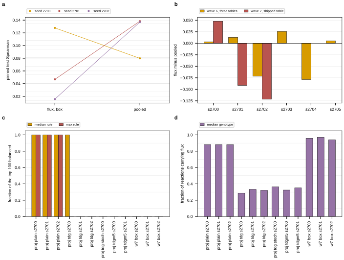
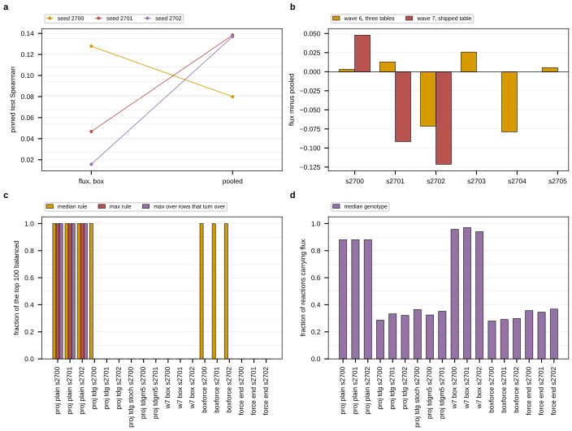

## 2026.09.11 - Wave 7: the betaxanthin parity on one kcat table, and the max-based feasibility rule

Wave 6 read the betaxanthin parity contrast (box flux head at constraint scale 0 against the
pooled control) as -0.017, sd 0.046, n = 6, and flagged that three kcat tables sat under the
six seeds. Wave 7 reruns the same recipe at the same seeds with every flux cell on one
table, and re-reads the feasibility of the wave-6 projection cells under a max-based balance
rule instead of the median.

Generating scripts:

- `experiments/027-betaxanthin-metabolic/scripts/verify_kcat_table.py` (resolve and hash the
  kcat table before submitting)
- `experiments/027-betaxanthin-metabolic/scripts/gh_wave7_parity_{nocstr,pooled}_s<seed>.slurm`
  (the cells)
- `experiments/027-betaxanthin-metabolic/scripts/audit_cells.py` and
  `audit_top_strain_feasibility.py` (re-audit a finished cell against the code it was trained
  with; the max rule and the flux-carrying fraction)
- `experiments/027-betaxanthin-metabolic/scripts/analyze_wave7_parity.py` (the contrasts, the
  feasibility table, the figure, `results/wave7_parity_summary.json`)

### The premise the wave-6 note left, corrected

The overnight note reports a wave-6 subset of three seeds "on one kcat table" reading +0.014,
sd 0.011. That subset is on the WAVE-5 table, not on the shipped verified one. Read off the
result files' own `flux_meta.kcat_tier_counts`:

| seed | wave-6 flux cell kcat table (measured / homolog / predicted / default) |
|---|---|
| 2700 | 148 / 0 / 3410 / 170 |
| 2701 | 148 / 0 / 3410 / 170 |
| 2702 | 96 / 782 / 2820 / 30 |
| 2703 | 148 / 0 / 3410 / 170 |
| 2704 | 148 / 0 / 3570 / 10 |
| 2705 | 148 / 0 / 3570 / 10 |

The shipped verified table is 97 / 782 / 2831 / 18, which is what the wave-6 PROJECTION cells
carry and what `verify_kcat_table.py` resolves today. **No wave-6 parity seed ran on it**, so
there is no same-table subset to pool wave 7 with, and the combined estimate equals the
wave-7 estimate. `analyze_wave7_parity.py` still computes the union, and records the empty
wave-6 contribution rather than asserting it.

### The table wave 7 runs on, verified before submission

`verify_kcat_table.py` resolves the kcat and KM tables through the same calls
`build_flux_layer` makes (predicted tier, homolog tier on, verified predictor mirrors) and
hashes every file the resolution read, copying each into
`$DATA_ROOT/frozen-027-wave7-kinetics/`. Resolved 2026-09-11 17:00 CDT:
`{measured: 97, homolog: 782, predicted: 2831, default: 18}`, matching the shipped table.

| role | sha256 (first 16) | path |
|---|---|---|
| verified_pairs | `b93b3a8a733dd70a` | `$DATA_ROOT/data/torchcell/kinetics/_features/verified_pairs.parquet` |
| plausibility study | `7184ea9488bb2570` | `experiments/026-metabolism-flux/results/within_class_plausibility.json` |
| OED S. cerevisiae records | `0e4aca9e0872e5b1` | `$DATA_ROOT/data/enzyme_kinetics/open_enzyme_database/scerevisiae/oed_records.json` |
| OED all-organism records | `b8d1e652a3e258d5` | `$DATA_ROOT/data/enzyme_kinetics/open_enzyme_database/all/oed_records.json` |
| predicted k_cat, eitlem | `7cd3d1f1fff85be4` | `$DATA_ROOT/data/torchcell/kinetics/eitlem/verified/k_cat.parquet` |
| predicted k_cat, ezkinetics | `ab116c336f71312a` | `$DATA_ROOT/data/torchcell/kinetics/ezkinetics/verified/k_cat.parquet` |
| predicted k_cat, unikp | `7b3f838606db7dd4` | `$DATA_ROOT/data/torchcell/kinetics/unikp/verified/k_cat.parquet` |
| predicted K_M, ezkinetics | `be180871f6f9ff85` | `$DATA_ROOT/data/torchcell/kinetics/ezkinetics/verified/K_M.parquet` |

Full record with byte counts and mtimes: `results/wave7_kcat_table_verification.json`. Every
wave-7 result file is checked against these counts again in `analyze_wave7_parity.py`, and a
cell that resolved anything else is excluded by name rather than averaged in.

### One freeze for the whole wave, because the code moved three times in ten minutes

`freeze_and_submit.sh` snapshots the worktree per submission, which is the right unit when
the code is still. It was not still: `torchcell/metabolism/flux_layer.py` changed at 16:55,
17:01 and 17:03 CDT and `train_bx.py` gained a `conc_lower_m` config field at 17:10, all
while the first wave-7 cell was already running. Per-submission snapshots would therefore
have given the six seeds up to four different flux layers, which is the wave-6 failure with
a different file.

So the snapshot `freeze_and_submit.sh` made for the first cell was copied once to
`$DATA_ROOT/frozen-027-wave7`, and later cells are submitted from that directory
(`cd $DATA_ROOT/frozen-027-wave7 && sbatch experiments/027-betaxanthin-metabolic/scripts/<cell>.slurm`),
which is what the first cell ran. The slurm scripts take `PROJECT_ROOT` from
`SLURM_SUBMIT_DIR`, so the whole import path, both training scripts and `conf/` resolve
inside the freeze, and `results/` and `slurm/` are symlinks back to the worktree.

| file in `$DATA_ROOT/frozen-027-wave7` | sha256 |
|---|---|
| `experiments/027-betaxanthin-metabolic/scripts/train_bx.py` | `c9862598f51712fb04ca16628ffa230764448c118b7427d1c949242a8ef7578e` |
| `experiments/026-metabolism-flux/scripts/train_flux.py` | `d347c3971b67450d35567e8d1e21b25fd5f5b61d86ba58f82fc38dd005d0dead` |
| `torchcell/metabolism/flux_layer.py` | `b4f6f753d3ab3b295fb118f9a3519cc0b717eee770831c3de3125bbf504af2c5` |
| `torchcell/metabolism/constraints.py` | `b84975cff15aba4c7d71c533eb433aba6422ee260d4a3f7932fe687184acd413` |
| `torchcell/metabolism/parameters.py` | `2eddd0abdbc81f6abadcf95c8f3793cf5eb44a3ae8320e73c1a92e1a76b94037` |

Each cell also records the sha256 of the `train_bx.py` and `flux_layer.py` it imported into
its own result file, so the freeze is checkable per cell rather than only per submission.

### The recipe, unchanged from wave 6 except for the pin

```
--arm flux_capacity --seed <seed> --epochs 80 --crps --graph-reg --head betaxanthin \
--kcat-tier predicted --thermo-source union \
--constraint-warmup-epochs 20 --constraint-scale 0.0 --head-normalize
```

and the control

```
--arm pooled --seed <seed> --epochs 80 --crps --graph-reg --head betaxanthin
```

The one deliberate difference from the wave-6 scripts is that wave 7 does NOT export
`TC_FROZEN=$DATA_ROOT/frozen-027-wave6`. That freeze predates the `kcat_homolog_tier` switch,
so a cell pinned to it cannot build the shipped table at all; the homolog tier is 0 in every
cell that used it.

**Both arms are rerun.** The pooled arm has no flux layer and is therefore insensitive to the
kcat table, so the six wave-6 pooled cells look reusable. They are not: they ran
`train_bx.py` `9ab493d9...`, and pairing a new flux cell against an old pooled cell would
put a trainer-version difference inside the contrast that the pairing was supposed to remove.

**Scoring rule**, fixed before the cells ran and identical to waves 5 and 6: the pinned
Merzbacher test Spearman (629 genes) at the epoch chosen by the centered five-epoch moving
average of validation Pearson. Never a maximum over epochs.

### The parity contrast on the shipped table, three seeds

Pinned Merzbacher test Spearman (629 genes) at the validation-selected epoch, every flux
cell carrying `kcat_tier_counts` 97 / 782 / 2831 / 18, checked in
`analyze_wave7_parity.py` against the tier counts each result file recorded:

| seed | flux, box | job | pooled | job | difference | flux spread | pooled spread |
|---|---:|---:|---:|---:|---:|---:|---:|
| 2700 | 0.1278 | 1743 | 0.0798 | 1748 | +0.0480 | 0.447 | 0.361 |
| 2701 | 0.0468 | 1752 | 0.1384 | 1756 | -0.0916 | 0.291 | 0.502 |
| 2702 | 0.0157 | 1757 | 0.1370 | 1759 | -0.1213 | 0.291 | 0.460 |

Flux arm mean 0.0634, SD 0.0579. Pooled arm mean 0.1184, SD 0.0334. **Paired difference
-0.0550, SD 0.0904, n = 3, paired t = -1.05 on 2 degrees of freedom.** The t is read for its
sign and magnitude at this n and is not a significance claim. Every cell ran its full 80
epochs and every one left the mean plateau (final validation prediction spread 0.29 to 0.50
of the target's), so none of these is a collapsed run.

**Combined with the wave-6 seeds, and the combination spans two tables.** The wave-6 seeds
that share one table with each other are 2700, 2701 and 2703 on the wave-5 table
(148 / 0 / 3410 / 170), which is not the shipped one, so there is no six-seed same-table
contrast to compute. Pooling those three with the three wave-7 pairs anyway gives
**-0.0206, SD 0.0688, n = 6, t = -0.73**, and it is a two-table number rather than a
one-table one. For reference, the wave-6 six-seed pool across all three of its tables reads
-0.0172, SD 0.0456, t = -0.93, and the wave-6 same-table subset alone reads +0.0138, SD
0.0114, n = 3.

**What the three estimates agree on.** Every contrast that pools more than one seed sits
between -0.06 and -0.02 with a spread wider than the effect, so the module is not
established as helping at parity in any of them. Nothing here establishes it as hurting
either: the wave-7 seeds span +0.048 to -0.121, a range three times the size of the
mean.

**Seed 2702 ran a different code state, and both of its arms ran the same one.** Jobs 1743,
1748, 1752 and 1756 imported `train_bx.py` `c9862598` and `flux_layer.py` `b4f6f753` out of
`$DATA_ROOT/frozen-027-wave7`; jobs 1757 and 1759 imported `7e165544` and `4c365ad1` out of
the job snapshot `20260911-223519-gh_wave7_parity_nocstr_s2702`, because the seed-2702 flux
cell was submitted through `freeze_and_submit.sh` while this session was interrupted and that
takes a fresh snapshot of the worktree. Its pooled partner was then submitted from the same
snapshot, so the PAIR is internally consistent and the paired difference is not a
code-version contrast; the difference is between seeds. Reading the diff, the `flux_layer.py`
change adds a `fluxforce` parameterization this arm does not use plus its documentation, and
the `train_bx.py` change adds the amino-acid concentration readout and the new W&B run
naming. **Hypothesis (untested):** neither reaches the `flux_capacity` box path. The three
kcat tables are identical across all six cells, which is the variable wave 7 controls.

**Fixing the kcat table did not shrink the seed spread.** The wave-7 differences have SD
0.0904 against wave 6's 0.0456 on its three-table pool. **Hypothesis (untested):** the
between-seed variance of this contrast is set by initialization rather than by the parameter
table, so the table heterogeneity wave 6 flagged was not what made its estimate noisy.

**Same seed, two tables.** Seeds 2700 and 2701 ran the same recipe in both waves, on
different kcat tables and different trainer versions, so the shift is not attributable to
either alone: the flux arm moved 0.0747 to 0.1278 at seed 2700 and 0.1185 to 0.0468 at seed
2701, while the pooled arm, which has no flux layer and therefore no kcat table, moved
0.0717 to 0.0798 and 0.1058 to 0.1384. **A pooled arm that moves by 0.008 and 0.033 between two runs
of the same recipe at the same seed is the noise floor of this endpoint**, and the larger of
those two is 60 percent of the effect being measured.

### The median balance rule passes vectors that do not balance, and the max rule says so

`audit_top_strain_feasibility.py` now reports, per genotype, the MAX over the independent
rows of S of the relative balance residual beside the median the trainer uses, and the
fraction of the 4,131 reactions carrying `|v| > 1e-6 * flux_scale = 1e-4` mmol/gDW/h. Both
come out of the same forward pass as the recomputation, and the Genesis criterion is
evaluated under each rule (balance within 1 percent AND no active reaction running uphill at
standard state).

Top 100 predicted producers, at each cell's validation-selected epoch, recomputed from the
saved checkpoint against the code tree that cell was trained with
(`analyze_wave7_parity.py`, `results/wave7_parity_summary.json`). `Genesis` is balance within
1 percent AND no uphill active reaction; the `model` column uses the layer's own reaction
energies, which exist only for the arms whose `thermo_mode` is on, and the `standard state`
column uses the tabulated `delta_r_G0 + delta_r_G_transport` for every arm.

| cell | job | balance median | balance max | carrying flux | median <= 1e-2 | max <= 1e-2 | Genesis model, median rule | Genesis model, max rule | Genesis standard state, either rule | audit delta |
|---|---:|---:|---:|---:|---:|---:|---:|---:|---:|---:|
| projection plain s2700 | 1689 | 9.2e-09 | 4.0e-05 | 0.881 | 1.00 | 1.00 | n/a | n/a | 0.00 | 0.000 |
| projection plain s2701 | 1690 | 1.0e-08 | 1.2e-05 | 0.881 | 1.00 | 1.00 | n/a | n/a | 0.00 | 0.000 |
| projection plain s2702 | 1738 | 9.2e-09 | 1.7e-05 | 0.881 | 1.00 | 1.00 | n/a | n/a | 0.00 | 0.000 |
| sign-tightened tdg s2700 | 1725 | 3.6e-08 | 2.000 | 0.286 | 1.00 | 0.00 | **1.00** | **0.00** | 0.00 | 0.010 |
| sign-tightened tdg s2701 | 1730 | 5.6e-01 | 2.000 | 0.332 | 0.00 | 0.00 | 0.00 | 0.00 | 0.00 | 0.090 |
| sign-tightened tdg s2702 | 1731 | 6.4e-02 | 2.000 | 0.321 | 0.00 | 0.00 | 0.00 | 0.00 | 0.00 | 0.220 |
| sign-tightened, stochastic s2700 | 1726 | 4.2e-01 | 2.000 | 0.364 | 0.00 | 0.00 | 0.00 | 0.00 | 0.00 | 1.000 |
| tdgm5, 5 kJ/mol margin s2700 | 1736 | 8.3e-02 | 2.000 | 0.324 | 0.00 | 0.00 | 0.00 | 0.00 | 0.00 | 0.847 |
| tdgm5, 5 kJ/mol margin s2701 | 1737 | 1.0e-01 | 2.000 | 0.352 | 0.00 | 0.00 | 0.00 | 0.00 | 0.00 | 0.969 |
| wave 7 box s2700 | 1743 | 1.997 | 2.000 | 0.958 | 0.00 | 0.00 | n/a | n/a | 0.00 | 0.000 |

Three things the max column changes.

**The one cell that met the Genesis criterion met it on a median.** Job 1725, the
sign-tightened projection head at seed 2700 and constraint scale 0, is the cell the wave-6
note reports as meeting the criterion on 1.00 of the top 100. The re-audit reproduces that
(1.00 under the median rule, agreement 0.010) and reads **0.00 under the max rule**: the
median relative residual over the independent rows is 3.6e-8 and the MAX over the same rows
is 2.000, the theoretical maximum, on every one of the 100. A max of 2 means at least one
metabolite has nothing it produces being consumed. That cell carries flux on 28.6 percent of
the 4,131 reactions, so the median row it passes on is a row of zeros. **Read under the max
rule, no sign-tightened cell balances at any tolerance in the ladder, and the Genesis
criterion has never been met.**

**The plain projection's balance is real.** Its max residual is 1.2e-5 to 4.0e-5, four orders
inside the 1 percent tolerance, and it carries flux on 88.1 percent of reactions, so the max
rule confirms what `v = N z` guarantees rather than demoting it. What that head fails is the
box and the second law, which is why its Genesis fraction is 0.00 for a different reason than
the tdg cells'.

**The wave-7 box arm is unbalanced by both rules and dense.** Median 1.997, max 2.000, 95.8
percent of reactions carrying flux: the constraint scale is 0, nothing in its loss asks the
vector to balance, and the max rule adds no information there. The flux-carrying fraction is
what separates it from the sign-tightened cells, which reach a passing median by switching
most reactions off.

Reproduction, over the twelve audited cells: six reproduce their trainer's fractions exactly
(0.000e+00, the three plain projection cells and the three wave-7 box cells) and one to
0.010. Five disagree, and every disagreement is confined to the balance criteria, the box and
the model's second law agreeing exactly in all of them. For the tdg and tdgm5 cells the
deltas sit almost entirely on the loosest 1e-1 tolerance, where the residual distribution is
dense (medians of 0.064 to 0.103 against a 0.1 threshold). **Hypothesis (untested):** those
are CPU-versus-GPU accumulation differences in the sparse `Sv` product, since the audits ran
on CPU and the cells trained on GPU.

**Job 1726, the stochastic cell, does not reproduce at all**, and this is a finding rather
than a tolerance question: the trainer recorded balance within 1e-3 on 100 percent of
genotypes and the recomputation from that cell's own checkpoint reads 0.00 at every balance
tolerance, a delta of exactly -1.000 on every balance criterion in every group, with a median
residual of 0.42. Switching the sampler on and taking 16 draws does not recover it: 0.00 of
the 1,600 (genotype, draw) pairs balance. **Hypothesis (untested):** the trainer's block for
that cell was computed on a flux vector the saved checkpoint does not describe. The arm
belongs to the projection-head work stream; this note records the failed reproduction rather
than diagnosing it.

A CPU re-audit does reproduce a GPU-trained cell exactly when the tree matches, which the six
exact rows show. The first attempt at the tdg s2701 audit disagreed by 0.13 purely because it
ran against the live worktree, whose `flux_layer.py` had changed twice in the six minutes
since that cell recorded its hash; `audit_cells.py` resolves the tree by content hash from
then on, and the same cell then came back at 0.09 on the loosest tolerance alone.

### Figure



**Figure 1. The betaxanthin parity on one kcat table, and the two balance rules.**
**a**, Pinned test Spearman on the 629 Merzbacher genes for the box flux head at constraint
scale 0 and the no-module pooled control, one line per seed; three seeds, all on the shipped
verified kcat table, and the two lines that cross are seeds 2701 and 2702.
**b**, The paired difference, flux minus pooled, per seed: wave 6 on its three kcat tables
beside wave 7 on the shipped table. Wave 7 has no bar at seeds 2703 to 2705, which were not
run. **c**, Fraction of each cell's top 100 predicted producers whose flux vector balances to
within 1 percent, under the median rule the trainer uses and under the max over the
independent rows. The sign-tightened cell at seed 2700 (job 1725) is the one that passes the
median rule and fails the max rule; the plain projection cells pass both; the wave-7 box
cells fail both. **d**, Fraction of the 4,131 reactions carrying more than 1e-4 mmol/gDW/h
for the median genotype of each cell, which is what makes a median balance pass cheap: the
sign-tightened cells run 29 to 36 percent of reactions, the plain projection 88 percent and
the wave-7 box cells 94 to 97 percent. Generated by
`experiments/027-betaxanthin-metabolic/scripts/analyze_wave7_parity.py`.

### Job ledger

Six wave-7 cells on GilaHyper, partition `main`, one RTX 6000 Ada each, 80 epochs, 89 to 95
minutes. Every one ran to completion; none was killed or resubmitted.

| cell | result file | job | code state | kcat table |
|---|---|---:|---|---|
| flux box s2700 | `wave7_parity_nocstr_s2700.json` | 1743 | frozen-027-wave7 | shipped |
| pooled s2700 | `wave7_parity_pooled_s2700.json` | 1748 | frozen-027-wave7 | none, no flux layer |
| flux box s2701 | `wave7_parity_nocstr_s2701.json` | 1752 | frozen-027-wave7 | shipped |
| pooled s2701 | `wave7_parity_pooled_s2701.json` | 1756 | frozen-027-wave7 | none, no flux layer |
| flux box s2702 | `wave7_parity_nocstr_s2702.json` | 1757 | snapshot 20260911-223519 | shipped |
| pooled s2702 | `wave7_parity_pooled_s2702.json` | 1759 | snapshot 20260911-223519 | none, no flux layer |

Ten wave-6 cells were re-audited rather than rerun: 1689, 1690, 1738 (plain projection), 1725,
1730, 1731 (sign-tightened), 1726 (sign-tightened, stochastic), 1736, 1737 (5 kJ/mol margin).
The wave-7 cells run from the freeze and therefore carry the OLD W&B run naming; refer to
them by job id.

Seeds 2703, 2704 and 2705 were not run on the shipped table. The wave-7 contrast is n = 3.

### Reruns

```bash
cd /home/michaelvolk/Documents/projects/torchcell.worktrees/feat/kinetics-equilibrator-datasets

# 1. Resolve and hash the kcat table, and refuse to proceed if it is not the shipped one.
PYTHONPATH=$PWD ~/miniconda3/envs/torchcell/bin/python \
    experiments/027-betaxanthin-metabolic/scripts/verify_kcat_table.py

# 2. Submit one cell, from the wave-7 freeze so every cell shares one code state.
cd /scratch/projects/torchcell-scratch/frozen-027-wave7
sbatch experiments/027-betaxanthin-metabolic/scripts/gh_wave7_parity_nocstr_s2703.slurm

# 3. Re-audit finished cells against the code each was trained with (CPU is about three
#    minutes per cell; drop CUDA_VISIBLE_DEVICES to use a GPU).
CUDA_VISIBLE_DEVICES="" PYTHONPATH=$PWD ~/miniconda3/envs/torchcell/bin/python \
    experiments/027-betaxanthin-metabolic/scripts/audit_cells.py \
    wave7_parity_nocstr_s2700 wave6_proj_flux_projection_anchored_tdg_ue_nocstr_s2700

# 4. Aggregate. Reads only finished files, so it is safe to rerun while a queue drains.
PYTHONPATH=$PWD ~/miniconda3/envs/torchcell/bin/python \
    experiments/027-betaxanthin-metabolic/scripts/analyze_wave7_parity.py
```

### What is open

- Seeds 2703 to 2705 on the shipped table, which is what would make the one-table contrast
  n = 6. The slurm scripts exist (`gh_wave7_parity_{nocstr,pooled}_s270{3,4,5}.slurm`).
- The wave-7 flux cells resolve the shipped table from the LIVE mirror. `verify_kcat_table.py`
  copies the eight files it read into `$DATA_ROOT/frozen-027-wave7-kinetics/` and hashes them,
  which detects drift but does not prevent it; the resolver would have to take a root for
  that, and `train_flux.py` belongs to another work stream.
- Job 1726's feasibility block does not reproduce from its checkpoint. Until that is
  diagnosed, the wave-6 claim that the Genesis criterion was met on that cell should not be
  quoted.
- The max rule is computed post hoc in the audit script. The trainer's own criterion is still
  the median one, so a cell's `feasibility` block still reports the number that passes on
  zeros; folding the max rule and `flux_active_frac` into `train_bx.py` belongs to whoever
  owns that file.
- Reported by the thermodynamics work stream and not verified here: the shipped reaction-energy
  table carries a glycogen mispricing, so the standard-state second-law reads in every 026 and
  027 cell that touches those reactions are suspect.

## 2026.09.12 - A third balance rule: the ratio over the rows that turn over

The flux-force work stream raised that a max over ALL independent rows can be decided by
rows at the `balance_epsilon` floor, where two tiny same-sign fluxes on an otherwise idle
metabolite give a ratio of exactly 2, which would make the max rule fail every head as
trivially as the median passes it. `audit_top_strain_feasibility.py` now computes the same
ratio restricted to the rows that TURN OVER, `omega_i > t * flux_scale`, at t = 1e-3 (the
primary) with 1e-2 and 1e-4 as the sensitivity, and reports its max, its 95th percentile and
the number of rows above the threshold. Eighteen cells were re-audited from their
checkpoints, each against the code tree it was trained with, and the boxforce cells need
`TC_FLUX_PARAMETERIZATION` restored from `flux_meta.coverage.parameterization_raw`, which
`audit_cells.py` now does per cell.

Top 100 predicted producers, median over genotypes of each per-genotype statistic:

| cell | jobs | balance median | balance max | rows above 1e-3 | active max 1e-3 | active p95 1e-3 | carrying flux | Genesis median / max / active |
|---|---:|---:|---:|---:|---:|---:|---:|---|
| projection plain s2700-02 | 1689, 1690, 1738 | 9.2e-09 to 1.0e-08 | 1.2e-05 to 4.0e-05 | 2039 to 2053 | 1.0e-05 to 1.7e-05 | 1.7e-06 | 0.881 | 0.00 / 0.00 / 0.00 |
| sign-tightened tdg s2700 | 1725 | 3.5e-08 | 2.000 | 938 | 2.000 | 2.000 | 0.286 | 1.00 / 0.00 / 0.00 |
| sign-tightened tdg s2701, s2702 | 1730, 1731 | 0.568, 0.064 | 2.000 | 534, 1086 | 2.000 | 2.000 | 0.332, 0.321 | 0.00 / 0.00 / 0.00 |
| sign-tightened, stochastic s2700 | 1726 | 0.416 | 2.000 | 44 | 2.000 | 2.000 | 0.364 | 0.00 / 0.00 / 0.00 |
| tdgm5 s2700, s2701 | 1736, 1737 | 0.084, 0.103 | 2.000 | 1128, 1214 | 2.000 | 2.000 | 0.324, 0.352 | 0.00 / 0.00 / 0.00 |
| wave 7 box s2700-02 | 1743, 1752, 1757 | 1.997 to 1.998 | 2.000 | 1685 to 1691 | 2.000 | 2.000 | 0.939 to 0.970 | 0.00 / 0.00 / 0.00 |
| boxforce k100 s2700-02 | 1767, 1770, 1771 | 1.3e-08 to 2.8e-08 | 2.000 | 422 to 539 | 2.000 | 2.000 | 0.280 to 0.298 | 1.00 / 0.00 / 0.00 |
| force end k20 s2700-02 | 1755, 1761, 1764 | 0.321 to 1.049 | 2.000 | 809 to 1437 | 2.000 | 2.000 | 0.345 to 0.368 | 0.00 / 0.00 / 0.00 |

**The epsilon-floor explanation does not hold, and the max rule survives it.** Restricting
to rows whose turnover exceeds 1e-3 of the flux scale, i.e. 0.1 mmol/gDW/h, leaves 422 to
1,691 rows per genotype and the worst of them is still at the theoretical maximum of 2.000
in every arm except the plain projection. The 95th percentile over those same rows is also
2.000, so it is not a handful of rows near the threshold either: at least 5 percent of the
rows that actually turn over are maximally unbalanced. The sensitivity runs the same way at
1e-2 (277 to 1,646 rows, still 2.000; the one exception is the stochastic cell, whose 5
qualifying rows give 1.84, which is a statistic over five rows and not a claim) and at 1e-4.

**The plain projection was never at 2.0.** Its per-genotype max over ALL rows is 1.2e-05 to
4.0e-05 and its thresholded max is 1.0e-05 to 1.7e-05, so the report that every arm reads
exactly 2.0 does not reproduce here: the projection cells balance under all three rules, and
they are the only cells that do.

**The boxforce family reproduces the median artifact exactly.** Jobs 1767, 1770 and 1771 read
a median residual of 1.3e-08 to 2.8e-08 and pass the median rule on 1.00 of the top 100,
while their thresholded max is 2.000 and only 28 to 30 percent of reactions carry flux. That
is the same shape as job 1725: a passing median bought by switching most of the network off.

**The Genesis criterion is 0.00 in all eighteen cells under both honest rules.** Under the
median rule four cells pass (1725, 1767, 1770, 1771); under the max rule and under the
turnover-thresholded rule, none.



**Figure 2. The same figure with the third rule and the flux-force cells.** **a**, The
wave-7 parity contrast, unchanged. **b**, The per-seed paired difference, unchanged.
**c**, Fraction of each cell's top 100 balanced to within 1 percent under the median rule,
the max rule, and the max over rows turning over more than 1e-3 of the flux scale; the three
projection cells are the only ones where the second and third bars stand, and the four cells
with a lone first bar (job 1725 and the three boxforce cells) are the median artifact.
**d**, Fraction of reactions carrying flux for the median genotype, which is what those four
cells trade away. Generated by
`experiments/027-betaxanthin-metabolic/scripts/analyze_wave7_parity.py`.
