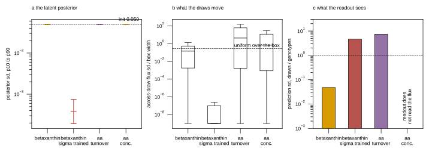

# Wave 8: can the flux module sample its own polytope?

## 2026.09.12 - The question, and the guidepost

Constraint-based methods read a genotype's phenotype off its flux polytope by SAMPLING it.
Flux Cone Learning (Merzbacher 2025, mirror
`/scratch/projects/torchcell-scratch/torchcell-library/merzbacherAccuratePredictionGene2025/paper.md`,
Methods L96-108, SI Table S2) is the closest published analogue to what our flux layer does,
and its yeast numbers are the guidepost this wave is measured against.

| Quantity | Flux Cone Learning, Yeast9 | Our flux layer, waves 5 to 7 |
|---|---|---|
| Sampler | OptGPSampler, thinning k = 5,000 | one Gaussian latent draw, no chain |
| Samples per genotype cone | 124 | 1 (`_latent` draws once per forward pass) |
| Genotypes sampled | 1,121 single deletions | every genotype in the batch, at forward time |
| Sample matrix | 143,716 rows x 4,130 fluxes | never materialized |
| What carries the phenotype signal | the cone's GEOMETRY, which fluxes a deletion forces | one point in the polytope |

Their released Yeast9 sample set covers SINGLE deletions. Our genotypes include doubles,
triples and combinatorial designs for which no sampled set exists or ever will, so a design
that depends on pre-sampled flux data cannot serve this project. Whatever wave 8 builds has
to get its signal from the genotype's own bounds at forward time.

## 2026.09.12 - Step 0: the latent spread, measured before any GPU

Script: `experiments/027-betaxanthin-metabolic/scripts/audit_latent_spread.py`.
Results: `experiments/027-betaxanthin-metabolic/results/wave8_latent_spread.json`.
Four trained checkpoints from `$DATA_ROOT/checkpoints-027/`, rebuilt exactly as
`analyze_projection.py` rebuilds a cell, measured on one real batch of 128 genotypes with
64 draws and 256 rays, on CPU.



**Figure 1. The latent posterior of four trained 027 cells, and what a draw from it moves.**
All four at seed 2700. **a**, the posterior standard deviation per latent dimension, p10 to
p90, against the value the spread head is initialized at, `exp(latent_log_std_init) =
exp(-3) = 0.0498`. Three of the four sit exactly on the initialization line because their
arm never turned the latent draw on, so the spread head received no gradient; the fourth is
the only 027 cell trained with `latent_stochastic`, and its posterior is 130x narrower than
the initialization. **b**, the across-draw flux standard deviation as a fraction of each
reaction's own box width, over all 128 genotypes and 4,131 reactions, against the
`1/sqrt(12) = 0.289` a uniform sample of that interval would give. **c**, the supervised
readout's prediction standard deviation across draws divided by its standard deviation
across genotypes; the amino-acid concentration readout has no bar because its prediction is
not a function of the flux at all.

### What the arms actually ran

`latent_stochastic` is set by exactly ONE entry of 026's `ARMS` registry
(`flux_projection_stochastic`, `experiments/026-metabolism-flux/scripts/train_flux.py`
L235). Every other flux arm, including every wave-6 and wave-7 projection cell, ran with
`latent_stochastic: false`, which makes `_latent` return `mu` deterministically and `c_kl`
exactly zero. The KL weight is therefore not the interesting number for those arms: the
spread head's zero-initialized weights and constant bias were never moved, so sigma is
`exp(-3) = 0.049787` for every dimension and every genotype (measured across-genotype sd of
sigma: 1.86e-8, i.e. float32 noise).

| Cell | arm | `latent_stochastic` | `kl_weight` x scale | `c_kl` first -> last | test Spearman |
|---|---|---|---|---|---|
| `wave6_proj_flux_projection_s2700` | flux_projection | false | 1e-3 x 0.0 = 0 | 0 -> 0 | 0.1170 |
| `wave6_proj_..._tdg_stoch_ue_s2700` | flux_projection_anchored_tdg_stochastic | **true** | 1e-3 x 0.1 = 1e-4 | 2.527 -> 7.870 | 0.0380 |
| `wave7_aa_turnover_e200_s2700` | flux_projection_anchored | false | 1e-3 x 0.1 = 1e-4 | 0 -> 0 | 0.0023 |
| `wave7_aa_conc_e200_s2700` | flux_projection_anchored | false | 1e-3 x 0.1 = 1e-4 | 0 -> 0 | 0.0648 |

The KL sits INSIDE the ramped constraint sum (`FluxLayer.constraint_loss` multiplies the
whole sum by `constraint_scale`), so the effective weight on `c_kl` is
`kl_weight * constraint_scale`.

### Finding 1: sigma is not collapsed on the deterministic arms, it is frozen at its init

Three of the four cells carry sigma = 0.049787 exactly, on every dimension. That is not a
collapse and it is not a learned value: it is `latent_log_std_init` untouched. Post-hoc
sampling from those checkpoints, which is what `analyze_projection.py --draws` and
`audit_top_strain_feasibility.py` do, therefore draws from an UNTRAINED spread. Every draw
audit in waves 6 and 7 was a draw from `exp(-3)`, not from anything the model learned.

### Finding 2: where sigma WAS trained, the objective collapsed it by 130x

The one cell trained with the latent draw on (`flux_projection_anchored_tdg_stochastic`,
seed 2700) ended with a median sigma of 3.857e-4 against the 4.979e-2 it started at, a
factor of 129. The KL decomposition attributes it: of the final `c_kl` of 7.870, the sigma
half `0.5 * mean(sigma^2 - 1 - 2 ln sigma)` is 7.387 and the mu half `0.5 * mean(mu^2)` is
0.0017. The KL is the only term that pushes sigma UP and at an effective weight of 1e-4 it
did not hold: `c_kl` rose monotonically from 2.527 at epoch 0 to 7.870 at epoch 79. So the
data and physics terms shrink the posterior, and the prior as weighted does not resist.

Caveat, stated because the number invites over-reading: that cell also never left the
betaxanthin mean plateau (`val_pred_sd_ratio` 0.0000 from epoch 5 to epoch 79, test Spearman
0.0380). Its sigma collapse is measured; whether the collapse causes the prediction collapse
or accompanies it is NOT measured. Hypothesis (untested): a deterministic head is the
easiest way to reduce a per-draw data loss, so any sampled arm without a spread-preserving
term will walk to sigma = 0.

### Finding 3: the draws do not explore the polytope, they overshoot it

At the frozen sigma the draw is not small relative to the polytope; it is LARGER than it.
Along random admissible latent directions from the box center, the box chord and one draw's
displacement `sigma_rms` compare as:

| Cell | admissible dim / 1,538 | zero-width reactions | chord p50 | `sigma_rms` | `sigma_rms` / chord p50 | rays where sigma exceeds the chord |
|---|---|---|---|---|---|---|
| betaxanthin projection | 1,351 | 211 | 2.69e-2 | 4.98e-2 | 1.85 | 1.000 |
| betaxanthin, sigma trained | 1,263 | 344 | 0.00 | 5.06e-4 | -- | 1.000 |
| aa turnover | 1,529 | 10 | 1.48e-7 | 4.98e-2 | 3.4e5 | 1.000 |
| aa concentration | 1,529 | 10 | 4.26e-7 | 4.98e-2 | 1.2e5 | 1.000 |

In flux space the same thing reads as the across-draw sd per reaction against that
reaction's box width, with `1/sqrt(12) = 0.289` the value a uniform sample of the interval
would give:

| Cell | sd / box width p50 | p90 | as a multiple of uniform | reactions moved |
|---|---|---|---|---|
| betaxanthin projection | 0.145 | 1.300 | 0.50 | 0.877 |
| betaxanthin, sigma trained | 0.000 | 0.0005 | 0.00 | 0.106 |
| aa turnover | 4.398 | 161.4 | 15.2 | 0.877 |
| aa concentration | 0.692 | 39.9 | 2.40 | 0.874 |

Two regimes, and neither is sampling. On the plain betaxanthin projection arm, whose box has
no enzyme-capacity bound, the draws land at half the spread of a uniform sample of the box:
that is the one arm where the latent draw is in the right ballpark. On the enzyme-constrained
amino-acid arms the capacity bound makes the box four to seven orders of magnitude narrower
than the draw, so every draw leaves the box by a wide margin and the alternating projection
clips it back onto a face. That is why 52 to 72 percent of the head's own reactions sit
exactly ON a bound.

### Finding 4: per-coordinate chords are the wrong instrument, and why that matters for Step 2

For all four cells, the fraction of the 1,538 basis directions that are BLOCKED, meaning
they move some reaction whose box has zero width, is exactly 1.000 -- with as few as 10
zero-width reactions. The polytope is not degenerate: the admissible subspace, the latent
moves that keep every blocked reaction pinned, has dimension 1,263 to 1,529 of 1,538. The
null basis is built from the stoichiometry alone and knows nothing about the bounds, so no
single latent coordinate is a feasible direction. Any sampler that works in these
coordinates has to respect that; the diagnostic gets it from an SVD of the zero-width block
`N[Z, :]`.

### Finding 5: the amino-acid concentration readout cannot respond to a draw at all

`FluxConcentrationReadout` (`train_bx.py` L1443) emits
`mixture_log10_molar(flux["thermo_log_c"], ...)`, and `thermo_log_c` is
`lo + (hi - lo) sigmoid(base + W context)`, a function of the genotype context alone. The
flux vector never enters. So a K-draw version of the wave-7 concentration cell is null by
construction, whatever K is, and the (b) arm of the planned K-draw experiment has to move to
a readout that reads the flux. The candidate, the wave-7 amino-acid TURNOVER readout, scores
0.0023 mean test Spearman against the pooled control's 0.0500, so it is a dead readout to
build a sampling experiment on.

### Step 0 conclusion

The K-draw experiment is NOT moot, but only one of the two planned arms survives contact
with the measurement.

- Arm (a), betaxanthin plain projection: alive. The readout moves with the draw (across-draw
  prediction sd is 4.75 percent of the across-genotype sd) and the draws cover half a uniform
  sample of the box. K draws will average over a real distribution.
- Arm (b), the amino-acid concentration head: dead by construction, the readout does not read
  the flux. Its turnover alternative reads the flux but scores below its own pooled control.

Two things must be fixed in the K-draw implementation, both consequences of the findings
above rather than preferences. First, K > 1 has to turn `latent_stochastic` ON, or the K
draws are K copies of `mu`; that also switches the KL on. Second, the spread has to be held
up against a data term that shrinks it, so the arm reports the posterior sd every epoch and
the KL weight is a knob the cell records rather than an inherited default.

## 2026.09.12 - Step 1: K draws per genotype, implemented

Arm (b), the amino-acid concentration head, is DROPPED on the Step 0 finding that its
readout is not a function of the flux. The whole budget goes to arm (a), betaxanthin plain
projection at constraint scale 0, 80 epochs.

### The contrast, and why both arms sample

The obvious pairing, K = 16 against the deterministic wave-7 cells 1776 to 1778, confounds
two changes: the draw count, and whether the model samples at all. Those cells ran
`latent_stochastic` off. So the contrast is run as PAIRS in which both arms carry
`--flux-latent-stochastic` and differ only in `--flux-draws`, and the deterministic cells
become a third column measuring what turning the draw on costs on its own.

| column | `flux_draws` | `latent_stochastic` | seeds | cells |
|---|---|---|---|---|
| K = 16 | 16 | on | 2703, 2704, 2705 | `gh_wave8_samp_k16_s270{3,4,5}.slurm` |
| K = 1, sampled | 1 | on | 2703, 2704, 2705 | `gh_wave8_samp_k1_s270{3,4,5}.slurm` |
| K = 1, deterministic | 1 | off | 2703, 2704, 2705 | jobs 1776, 1777, 1778 (wave 7) |

Everything else is `gh_wave7_fill_proj_projection_s270{3,4,5}.slurm` verbatim: plain
projection, constraint scale exactly 0.0, 20-epoch warmup on a scale that is zero anyway,
predicted kcat, union thermodynamics, normalized head, CRPS, graph regularizer, 80 epochs.
Score: pinned Merzbacher test Spearman at the validation-selected epoch under the centered
5-epoch moving average, paired by seed. Never a max over epochs.

### What K does, mechanically

`FluxLayerConfig.draws` is read at call time, like `stochastic`, so no caller signature
changes and `FluxLayer.sample` keeps owning the explicit-N audit path. Above 1, the layer
computes the genotype chain, the box and the reaction energies ONCE and then expands the
batch to `B*K` rows with `repeat_interleave`, so the draws of one genotype are contiguous
and a consumer reshapes to `[B, K, ...]` with a plain view. Every constraint residual is
already a mean over the batch axis, so it becomes the mean over draws for free.

- `e_g` and the `thermo_*` extras are NOT expanded, because neither depends on the draw.
  That is exactly why the concentration readout is incompatible with K > 1, and the trainer
  refuses the combination rather than misaligning rows.
- The draw is forced in EVAL as well as training when K > 1, since the arm's prediction is
  the average over draws and emitting mu K times would score a different estimator than the
  one trained.
- The layer refuses to build with K > 1 on a deterministic latent. K copies of mu are not K
  samples, and the failure would otherwise be a silent 16x compute bill for the K = 1 answer.

The training loss reads the unreduced `B*K` predictions against a target repeated K times,
so the data term is the mean over draws of the per-draw CRPS. The reported prediction is a
separate object: `FluxDrawEnsemble` moment-matches the per-draw Gaussians,

```text
mu_bar    = mean_k mu_k
sigma_bar^2 = mean_k sigma_k^2 + var_k(mu_k)
```

so disagreement between draws widens the predictive distribution instead of being discarded.
Averaging `log sigma` instead would report a K-draw ensemble as more confident than a single
draw. Every eval consumer, the validation Pearson, the test score and the calibration pass,
sees `[B, ...]` and needs no change.

Three new cell fields, all serialized: `flux_draws`, `flux_latent_stochastic`,
`flux_kl_weight`. The result's `flux_meta.sampling` block records the KL weight AND the
effective weight, which is the product with the constraint scale, since the KL sits inside
the ramped sum. Two new per-epoch logs: `latent_sigma_p50` and `latent_sigma_mean` from the
layer, and `flux_draw_pred_sd`, the across-draw sd of the head's own prediction in
standardized target units. The two can disagree, and the disagreement is informative: a wide
latent whose draws all clip onto the same box face moves the flux and not the phenotype.

### K = 1 is bit-for-bit, and the tests that say so

`tests/torchcell/metabolism/test_flux_layer.py` gains five tests. The load-bearing one
builds two layers under the same seed, one with `draws` unset and one with `draws=1`, calls
both under the same seed, and asserts `torch.equal` on `v`, `c_balance`, `c_box`, `c_kl` and
`c_parsimony`. The rest assert that K draws expand the batch and are grouped by genotype
(checked on the BOX, which is deterministic per genotype and so exactly constant within a
group), that the draw is taken in eval only when K > 1, that K > 1 on a deterministic latent
is refused, and that the posterior sd is reported exactly when there is one. All 83 tests in
the file pass.

### What K costs

`experiments/027-betaxanthin-metabolic/scripts/bench_flux_draws.py`, CPU, the real
yeast-GEM (4,131 reactions, 1,538-dimensional null basis), batch 128, forward plus backward
of the flux layer alone, median of 3:

| K | rows | median s | ratio to K = 1 | one `[rows, 4131]` float32 tensor |
|---|---|---|---|---|
| 1 | 128 | 0.073 | 1.00 | 2.0 MiB |
| 4 | 512 | 0.182 | 2.49 | 8.1 MiB |
| 16 | 2,048 | 0.813 | 11.14 | 32.3 MiB |

Sub-linear in K, 11.1x for 16x the rows, which is what the shared genotype chain should buy
and confirms nothing is recomputed per draw. These are CPU numbers and are NOT a prediction
of the GPU ratio: the backbone is untouched by K, so the epoch-time ratio depends on what
fraction of a GPU step the layer is. That fraction is measured from the first submitted
pair, and if K = 16 costs more than about 3x per epoch the remaining pairs run at K = 4.

## 2026.09.12 - Step 2 design: a sample-free flow-matching sampler

### The constraint that sets the design

Merzbacher's released Yeast9 sampling covers 1,121 SINGLE deletions. Our genotypes include
doubles, triples and combinatorial designs, and no sampled set for those exists or will. A
design that learns to imitate pre-sampled fluxes therefore cannot generalize to the
genotypes the project is for, whatever it scores on singles. Two routes remain, and they
differ in where the training signal comes from.

**(a) On-the-fly targets.** A short hit-and-run chain in latent coordinates inside
`{z : lb <= s N z <= ub}`, warm-started from the layer's own projected point, run for the
genotypes in the batch at forward time, and used as the flow's targets. Honest, but it puts
a Markov chain inside the training step: the chain length and thinning become
hyperparameters bounded by what a step can afford, and a chain short enough to afford is a
chain whose samples are correlated with the warm start, which is the model's own point. So
the target distribution is a function of the model, and the flow learns to reproduce a
biased sample of a distribution it is helping to define.

**(b) A sample-free objective.** No target samples at all. Train the flow so that its own
samples are feasible and spread out: maximize entropy subject to the feasibility penalties
the layer ALREADY computes. This is the route to take, for three reasons. It needs no chain
and no cached store, so it costs one flow evaluation per draw and generalizes to any
genotype by construction, single or combinatorial. Every term in it already exists and is
already normalized to be dimensionless: `c_box`, `c_balance`, `c_thermo`, `c_density`,
`c_parsimony`. And the uniform distribution on a polytope IS the maximum-entropy
distribution subject to staying inside it, so the objective's optimum is the target
constraint-based sampling asks for, rather than an approximation of a sample of it.

### The construction

**Coordinates.** The flow lives in the admissible subspace found in Step 0, not in the raw
1,538-dimensional latent. Every basis direction of the null space moves some reaction whose
box has zero width, so a flow that ignores that spends its capacity learning to undo the
blocked directions. The admissible subspace is the kernel of `N[Z, :]` with `Z` the
zero-width reactions of THAT genotype, measured at 1,263 to 1,529 dimensions across the four
audited cells. It is genotype-dependent, since a deletion closes reactions, so it is formed
per batch from the bounds the layer already has.

**The field.** Rectified flow / conditional flow matching (Lipman 2023, Tong 2023): a
velocity field `u_theta(z_t, t, c)` with `c` the same genotype context the latent MLP takes,
`z_0 ~ N(0, I)` restricted to the admissible subspace, `z_t = (1-t) z_0 + t z_1`. No noise
schedule and no DDPM. Sampling is 8 to 10 Euler steps followed by the existing alternating
projection, so mass balance and the box are exact at the end whatever the field does; the
flow's job is WHERE in the feasible set to land, never whether the point is feasible.

**The loss, with no target samples.** For a batch of flow samples `{v_i}` of one genotype,

```text
L = sum_j w_j c_j({v_i})  -  beta * H_hat({z_i})
```

where the first sum is the layer's existing constraint terms, unchanged and at their
existing weights, and `H_hat` is an entropy surrogate on the flow's own draws. The surrogate
is the open question and the first thing to settle empirically. Two candidates, in order of
how little machinery they need:

1. **A pairwise-repulsion energy**, `-mean_{i != i'} log ||z_i - z_i'||`, the Riesz energy
   whose minimizer over a convex body is asymptotically uniform on it. No density, no trace
   estimator, one `K x K` distance matrix per genotype per step.
2. **The exact log-density** by the instantaneous change of variables along the flow, with a
   Hutchinson trace estimator for the divergence. Correct, and roughly one extra
   backward per Euler step. Not built now; the pairwise energy is measured first and the
   exact density is the fallback if the pairwise term is what limits the result.

`beta` is the one new hyperparameter, and Step 0 says which direction it fails in: the data
term shrinks the posterior on its own, so `beta` too small collapses the flow to a point and
the diagnostic that catches it is already logged (`flux_draw_pred_sd` and the across-draw
flux sd against the box width).

**Phenotype fine-tune.** K flow samples per genotype through the existing readouts and
losses, gradients through the Euler steps, exactly as the Step 1 K-draw path does it. First
cell: betaxanthin, one seed, against its K = 1 and K = 16 partners. Extended to three seeds
only if the one-seed read is not clearly worse.

**What must be measured before it is called a sampler.** The Step 0 instruments answer this
directly: the across-draw flux sd against `1/sqrt(12)` of each reaction's box width, which
a uniform sample of the box would reach; the fraction of reactions the draws move; and the
across-draw prediction sd against the across-genotype sd. A flow whose coverage is below the
frozen-sigma draw of Step 0 is not an improvement over the Gaussian latent, whatever its
test Spearman does.

### The number that makes the enzyme-constrained arms a separate problem

The amino-acid arms carry the enzyme-capacity bound, and their boxes are consequently
1e-7 mmol gDW^-1 h^-1 wide at the median, against a plain projection box of order 1 to 10 in
the same units. The layer's working flux magnitude `flux_scale` is 100 mmol gDW^-1 h^-1, so
one draw at the frozen sigma displaces the flux by about 5 in those units, which is 1e5
times the box. Any sampler for those arms, this flow included, has to be scaled to the
genotype's own box rather than to `flux_scale`, or every draw lands outside and the
projection returns the same face. That is a property of the capacity bound and its
abundance prior (median 2.7e-6 mmol/gDW), not of the sampler.

### The KL is exactly zero in these cells, and the prior is the wrong shape anyway

Measured on the one-epoch smoke of the K = 4 path: `flux_meta.sampling` reads
`kl_weight 1e-3`, `constraint_final_scale 0.0`, `effective_kl_weight 0.0`. The KL sits
inside the ramped constraint sum, and the wave-7 recipe these cells copy runs that sum at a
scale of exactly zero, so the sampled arms carry NO prior on their posterior at all. Nothing
opposes the data term, and the data term shrinks sigma: with the mean held, a wider draw
spread raises the expected per-draw CRPS.

Hypothesis (untested), and the reason the cells still run as specified: sigma will decay in
both arms of every pair. That is not a reason to change the recipe, for two reasons. The
contrast is K, and both arms share the KL treatment exactly, so a shared decay does not bias
it. And `latent_sigma_p50` is now logged every epoch, so a null result comes with the
measurement that explains it instead of being a mystery.

Raising the KL weight is NOT the fix, and this is the argument that carries into Step 2. The
prior is N(0, I), so its optimum is sigma = 1. Step 0 measured that sigma = 0.0498 already
overshoots the box chord along random admissible directions by 1.85x on this very arm. A KL
weight large enough to stop the collapse therefore pulls the posterior 20x past the polytope
it is supposed to be sampling, and every draw lands outside the box for the projection to
clip back onto a face. An isotropic Gaussian prior in latent coordinates has no knowledge of
the genotype's bounds, so it cannot be the anti-collapse term. The term that can is the one
Step 2 is built on: entropy measured against the genotype's OWN box, which is maximized by
the uniform distribution on the polytope rather than by a fixed width.

### The GPU cost of K = 16, measured: 1.11x per epoch

Job 1783 (K = 16, seed 2703) wrote epochs 5 to 10 in 300 s, so 60.0 s per epoch. Its
deterministic partner job 1776, the same recipe and the same seed at K = 1, ran 80 epochs
plus startup, test and the feasibility pass in 82 min 07 s wall, about 54 s per epoch. The
ratio is 1.11, against the CPU benchmark's 11.1 for the layer alone.

The gap between the two numbers is the point: on a GPU the flux layer is a small share of a
step that is dominated by the transformer backbone, and the backbone does not see the extra
rows. K = 16 is therefore nearly free here, so all three pairs run at K = 16 and the K = 4
fallback is not needed. A cell is roughly 95 min, and the six run one at a time.

### Job ledger

| job | cell | K | `latent_stochastic` | seed | state |
|---|---|---|---|---|---|
| 1783 | `gh_wave8_samp_k16_s2703` | 16 | on | 2703 | COMPLETED, 01:23:22 |
| 1785 | `gh_wave8_samp_k1_s2703` | 1 | on | 2703 | running |
| 1776 | `gh_wave7_fill_proj_projection_s2703` | 1 | off | 2703 | COMPLETED, 01:22:07 (wave 7) |

## 2026.09.12 - Step 1 first cell: the posterior decays slowly, and the draws matter MORE over training

Job 1783, K = 16 at seed 2703, 80 epochs, completed in 1 h 23 min.

| epoch | `latent_sigma_p50` | `flux_draw_pred_sd` | `c_kl` | `val_pred_sd_ratio` | `val_pearson` |
|---|---|---|---|---|---|
| 0 | 4.891e-2 | 8.61e-3 | 2.605 | 0.0011 | -0.0069 |
| 10 | 4.245e-2 | 3.42e-3 | 2.649 | 0.0011 | +0.1337 |
| 20 | 3.542e-2 | 4.38e-3 | 2.771 | 0.0181 | -0.0041 |
| 40 | 2.901e-2 | 6.67e-3 | 2.972 | 0.3191 | +0.2410 |
| 60 | 2.526e-2 | 8.02e-3 | 3.086 | 0.2537 | +0.2250 |
| 76 | 2.306e-2 | 1.03e-2 | 3.177 | 0.4289 | +0.2487 |
| 79 | 2.257e-2 | 8.45e-3 | 3.212 | 0.0153 | +0.0463 |

Three readings, and the first corrects a hypothesis of mine from earlier today.

**The posterior decays, but it does not collapse.** Sigma fell from 4.891e-2 to 2.257e-2
over 80 epochs, a factor of 2.2, with the KL at an effective weight of exactly zero. I
predicted a collapse from the 130x seen on the wave-6 `tdg_stoch` cell; at this budget and
on this arm that is wrong, and the difference between the two cells is not isolated by
anything measured here. What both share is the direction: with no prior at all, sigma only
ever goes down.

**The draws move the phenotype MORE as training proceeds, not less.**
`flux_draw_pred_sd` fell to 3.42e-3 by epoch 10 while the head was still on the plateau,
then ROSE to 1.03e-2 by epoch 76 even as sigma kept shrinking. The two quantities are
different things, exactly as the Step 0 note said they could be: the head learned to read
the flux, so the same latent spread reaches further into the prediction. A sampled arm
cannot be diagnosed from the posterior width alone.

**The cell escaped the mean plateau.** `val_pred_sd_ratio` crossed 0.05 around epoch 20 and
reached 0.43 by epoch 76, with validation Pearson at +0.25. This is not a collapsed run.

Scores at seed 2703, one seed, no conclusion drawn yet:

| arm | job | select epoch | pinned test Spearman |
|---|---|---|---|
| K = 16, sampled | 1783 | 76 | 0.0440 |
| K = 1, sampled | 1785 | running | pending |
| K = 1, deterministic | 1776 | 75 | 0.1039 |

The 019 replicate study puts the between-seed spread near 0.04, so the 0.06 gap between the
K = 16 cell and the deterministic cell is at the noise scale at n = 1 and the within-pair
number is not in yet. Nothing is concluded until all three pairs are scored.
