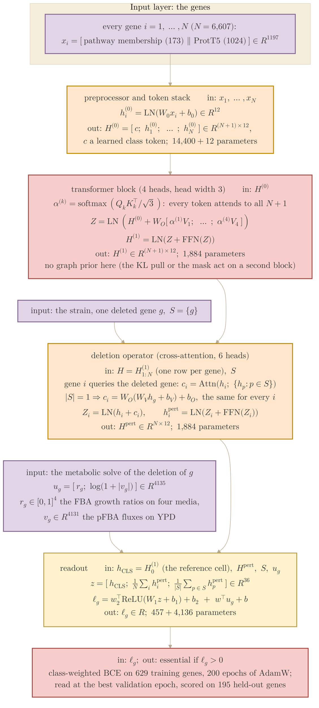
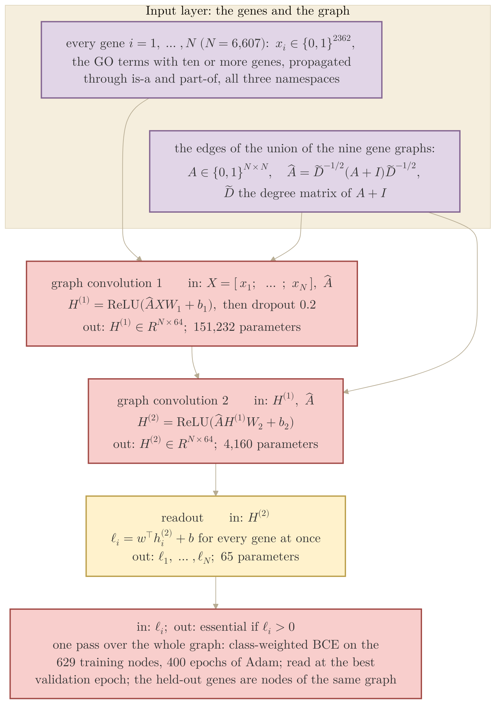

## 2026.10.27 - The two essentiality models drawn as mermaid diagrams with KaTeX

Author (2026-10-27, on Fig A.5): "we want more on model architecture... how big are these models,
num layers, if it can literally be drawn we should... or a mermaid diagram with latex, is also a
nice abstraction lets try both." This note is the mermaid abstraction, rendered by
`bash notes/assets/publish/scripts/mermaid_pdf.sh notes/experiments.028-gene-essentiality.architecture-mermaid.md`
to `notes/assets/pdf-output/experiments.028-gene-essentiality.architecture-mermaid-1.pdf` (the CGT)
and `-2.pdf` (the GCN). The literal module graph is `draw_cell_architecture.py` (torchview).
Every number is from the w49 cell's result file (`n_parameters`) and `graph_baselines.py`. Styled
like the Type I / Type II diagram (author, 2026-10-27: "the mermaid should be in our nat biotech style"):
the beige canvas and the fill / border pairs of
[[torchcell.models.equivariant_cell_graph_transformer.mermaid.colors]], inputs purple, embeddings
and the deletion operator orange, message passing red, the graph prior and the readout yellow,
the output red.

### The CGT of Fig 3.1 (w49: one open block, 22,773 parameters)

### The GCN of Fig 3.1 (GO input, 155,457 parameters)

Function view (author, 2026-10-27: "each next should contain outputs of previous box so it
is clear. we want the model as function view"): every box names what it takes in, the map,
what it puts out, and its parameter count, and the output symbol of one box is the input
symbol of the next. Self-contained: no reference to another figure inside a diagram.

#### Coherence audit against the code (2026-10-27)

Checked against `torchcell/models/equivariant_cell_graph_transformer.py`
(`GraphRegularizedTransformerLayer.forward`, `EquivariantPerturbationTransform.forward`),
`torchcell/models/cell_graph_transformer_metabolism.py` (`ProductScalarHead`,
`CellGraphTransformerMetabolism.forward`), `train_essentiality.py` (`FbaAffine`,
`FbaContextReadout`, `_select_epoch`, `fcl_train_pos_weight`, the solve encodings) and
`graph_baselines.py` (`Net.forward`, `run_arm`, `smoothed_argmax`), plus the w49 result
file `w49_pathfbapfbalogfree_h12l1p1_e200_s2700.json` (the stem `pattern_ladder_readout.json`
reports as w49) and the torchview drawing of the same cell. Two statements of the first
version were wrong and are corrected above:

- The deletion operator ran the other way round. The code has every gene token as the
  query and the deleted gene's token as the one key and value, so with one deletion the
  attended context is one vector shared by all genes, and the transform returns all N
  perturbed rows; the readout then pools them. The first version wrote the deleted gene as
  the query over the gene rows.
- The affine over the solve is free-initialized in w49 (`ess_solve_zero_init` false) and
  reads the pFBA vector as `log(1 + |v|)` (`ess_solve_encoding` log1p); the zero-init
  recipe is the `pfbazero` stem, whose seed-2700 cell scores 0.80, not the figure's 0.91.
- Also fixed: the readout takes three 12-vectors (class token, mean over all perturbed
  rows, mean over the deleted rows), 36 wide, not two; the loss runs on the 629 training
  genes (158 validation, 195 held out), not 787; the graph prior is inert here because its
  head map targets the second block and this cell has one.

Confirmed as written: post-LN in the block and in the operator, 4 heads of width 3,
FFN 12 to 48 to 12, every parameter count (preprocessor 14,400; class token 12; block
1,884; operator 1,884; readout 457 + 4,136 = 4,593; total 22,773), the GCN's two
convolutions with ReLU and dropout 0.2 between, its 2,362 GO columns and 155,457 parameters,
the 400-epoch arm (`graph_baselines_go400_s6.json`) as the one Fig 3.1 reports.

#### Layout (2026-10-27, later)

Both diagrams are single columns so that one shared scale prints them side by side at 165 mm
with text at 5.6 pt: the strain and the metabolic solve enter as purple input boxes placed
directly above the operator and the readout that consume them (invisible mermaid links
`~~~` pin their rank), because a side box or a long edge from the top makes dagre stagger
the whole column into a staircase twice as wide. Training details that do not change the
map (batch size, learning rate, weight decay, the class weights, the epoch rule) live in the
symbol table, not in the boxes. Composed by `compose_architecture_figure.py`
([[experiments.028-gene-essentiality.scripts.compose_architecture_figure]]).

#### Bold in KaTeX labels (2026-10-27, later)

Author: "can you use bold in these? it could help styling." `\textbf{}` was in the labels
but printed regular: mermaid renders KaTeX to MathML, and Chromium's MathML Core honors
`mathvariant="normal"` only, so bold and bold-italic were dropped at print. The render
script now passes `notes/assets/publish/scripts/mermaid_mathml.css` to mmdc, which maps
`mathvariant="bold"` and `"bold-italic"` to CSS weight and style and sets
`foreignObject { overflow: visible }` so no label glyph is clipped at its box edge
(Liberation Serif Bold is now embedded in the PDF). Every mermaid diagram rendered through
the script gets this, so an older diagram with `\textbf` in a label changes on its next
render.

## 2026.10.31 - Recovered to main, re-read against main's model code

This note, `notes/assets/publish/scripts/mermaid_mathml.css`, the `-C` line of
`mermaid_pdf.sh` and the two renders were untracked in worktree `docs/essentiality-figure-gate`
and in no commit anywhere (the thesis sheet `fig-ch03-essentiality-architecture.pdf` was composed
from them on 2026-10-27). They land on main through branch `fig/cgt-architecture-mermaid` so
the diagram can go into the manuscript's supplementary information beside the trigenic and the
multi-measurement models ([[experiments.025-solid-growth.architecture-mermaid]],
[[experiments.030-solid-growth-multi.architecture-mermaid]]). `compose_architecture_figure.py`
stays in that worktree with the rest of `experiments/028-gene-essentiality/`, which is not on
main; the manuscript sheet is composed by `paper/nature-biotech/scripts/compose_cgt_architecture_si.py`.

Re-read against main at `3d3759b58`: the post-norm block with the 4x feed-forward
(`GraphRegularizedTransformerLayer.forward`), the operator with every gene as a query over
the deleted gene's row as the one key and value (`EquivariantPerturbationTransform.forward`),
and the readout's three 12-wide pools (`ProductScalarHead.forward` in
`cell_graph_transformer_metabolism.py`: the class token, the mean over all perturbed rows,
the mean over the deleted rows) are as drawn. The solve affine, the training script and the
w49 result file are on the 028 branch only; those statements are unchanged from the
2026-10-27 audit above and were not re-run here.
