## 2026.09.16 - The essentiality line becomes its own experiment

Gene essentiality began as wave 9 of [[experiments.027-betaxanthin-metabolic]] (`train_bx.py --head essentiality`) and is moved here whole: the trainer (`scripts/train_essentiality.py`, the 027 script with paths repointed and the head fixed to essentiality), the union build (`$DATA_ROOT/data/torchcell/experiments/028-gene-essentiality/essentiality_build`, a copy of the 027 build so the other session's running wave-11 jobs keep theirs), the wave-9 to wave-11 result files, checkpoints (`$DATA_ROOT/checkpoints-028`) and per-gene dumps (`$DATA_ROOT/test-predictions-028`). W&B project: `zhao-group/torchcell_028_gene_essentiality`. The 027 history is in [[experiments.028-gene-essentiality.wave9-essentiality]].

There is no fitness objective anywhere in this experiment. The union build carries single-mutant fitness for 4,540 genotypes only because SGD's essential-gene list has no negative class; every fitness record arrives under a False essentiality mask and contributes no loss. The objective is one logit against a 0/1 label (binary cross entropy), selection is validation AUROC under a centered 5-epoch moving average, and the reported number is the AUROC on the released held-out genes at that epoch.

### What was measured before the move (027 waves 9 to 11)

- Pooled backbone at width 90 (958,501 parameters), released labels, 80 epochs: pinned test AUROC 0.793 / 0.788 / 0.578 at seeds 2700 to 2702 (jobs 2009, 2021, 2022); the third seed collapsed to a constant. Flux arm (biomass column of the projected flux, `FluxBiomassReadout`): 0.540 / 0.758 / 0.512, paired mean minus 0.117, 3 of 3 negative.
- Width 12, one block, one-layer preprocessor (16,874 parameters): 0.8011 / 0.7860 / 0.7958 (jobs 2045 to 2047), against FCL 0.742 and FBA 0.640 on the same 195 genes (`fcl_comparison.py`). Width 24: 0.7429 / 0.7398 / 0.8072.
- The validation curve at width 90 moves by a median of 0.034 to 0.072 between adjacent epochs; at widths 24 and 12 by 0.0067 (`curve_stability.py`).

### Three defects in the wave-9 protocol, and the split file that removes them

The data module drew train/validation at 80/10/10 over the 5,461 non-test records, of which 926 carry a label. Measured consequences: a validation set of 75 labeled genes with about 12 essential, on which one AUROC read has a Hanley-McNeil standard error near 0.07 (hypothesis for the bumpy curves, tested by wave 12); 10 percent of the labeled genes in a random test block nothing reports; 4,535 unlabeled records forwarded per epoch under a False mask, about 6 times the labeled work.

`scripts/build_essentiality_splits.py` writes one file per design under `results/splits/`: the per-gene labels, their provenance, and pinned train/val/test record indices. The trainer's `--split-file` pins all three splits and drops every other record (`CellDataModule(drop_unpinned=True)`, new in `torchcell/datamodules/cell.py`). The test block is always the released held-out genes (195 of 223 resolve in the build).

| split file | labels | train genes (ess) | val genes (ess) | test genes (ess) |
|---|---|---|---|---|
| `ess_fcl_val0.2_s0` | released, 1,121 | 629 (100) | 158 (25) | 195 (31) |
| `ess_genome_val0.2_s0` | released + SGD essential + viable single-mutant fitness, 5,795 | 4,368 (879) | 1,093 (220) | 195 (31) |

The genome source keeps the released label on every disagreement (12 genes, 11 of them SGD-essential that the released split calls nonessential, the same 11 `essentiality_label_agreement.py` found), so the held-out genes are scored on the comparator's labels under either source.

### FBA on four media

`scripts/fba_essentiality_baseline.py` (job 2072): cobrapy `single_gene_deletion` on yeast-GEM 9.0.2, the essentiality score being the negative knockout-to-wild-type growth ratio, rounded to 1e-3 so the ~900 deletions that grow at 0.99 to 1.00 of the wild type rank as the tie they are (without rounding two identical runs differed by 0.03 AUROC on the held-out genes, jobs 2069 and 2070).

| medium | WT growth (1/h) | lethal of 1,121 | AUROC all 1,121 | AUROC held-out 223 | AUROC our 195 [95% CI] |
|---|---|---|---|---|---|
| shipped bounds | 0.0858 | 186 | 0.707 | 0.633 | 0.654 [0.562, 0.748] |
| SM | 0.3138 | 160 | 0.707 | 0.642 | 0.666 [0.571, 0.759] |
| SC | 0.5428 | 91 | 0.719 | 0.653 | 0.666 [0.574, 0.759] |
| YPD approx | 0.5352 | 104 | 0.715 | 0.653 | 0.664 [0.572, 0.756] |

The medium moves the lethal count by a factor of two and the AUROC by 0.01. The published 0.69 on all labeled genes is reproduced to within 0.02 on our GEM copy and our bounds.

### Wave 12, queued 2026-09-16 00:55 (jobs 2071 smoke, 2073 to 2093)

Pooled arm, width 12, one block, one-layer preprocessor, 80 epochs, seeds 2700 to 2702, all scored on the same 195 genes:

| arm tag | change from the wave-11 width-12 cell | decides |
|---|---|---|
| `w12base` | none (wave-11 protocol in the 028 experiment) | the port: same numbers at the same seed |
| `w12fcl` | split file `ess_fcl_val0.2_s0` | whether a 158-gene stratified validation set smooths the curve and changes the selected epoch |
| `w12gen` | split file `ess_genome_val0.2_s0` | whether five times the labels move the held-out AUROC |
| `w12fclwd0`, `w12fclwd1e-2`, `w12fclwd1e-1` | AdamW weight decay 0, 1e-2, 1e-1 (base 1e-4) | the weight-decay dose response |
| `w12fclb32` | batch 32 (base 128) | whether 20 steps per epoch instead of 5 changes the curve |

Launcher: `scripts/gh_train_essentiality.slurm` through `scripts/freeze_and_submit.sh`, one environment per cell. Views: `scripts/wandb_views.py --contrast w12`.

### Wave 13, queued 2026-09-16 01:20 (jobs 2113 to 2130): the prediction routed through the module

Same width-12 cell, same fcl split and base hyperparameters as `w12fcl`, so every cell pairs by seed with a pooled cell. The flux arm is the wave-9 recipe (`flux_projection_anchored`, predicted kcat tier, union thermodynamics, YPD-approx bounds written onto the GEM, 20-epoch constraint warmup). Two readouts, two constraint scales, and the physics-off arm:

| arm tag | arm | readout | constraint scale | what the backbone's gradient passes through |
|---|---|---|---|---|
| `w13fluxbio` | anchored | growth column only | 0.1 | the flux layer only (wave-9 design) |
| `w13fluxbio_s0` | anchored | growth column only | 0 | the flux layer only, no physics penalty |
| `w13fluxctx` | anchored | context head + growth column | 0.1 | both paths |
| `w13fluxctx_s0` | anchored | context head + growth column | 0 | both paths, no physics penalty |
| `w13fluxoff` | stoichiometry only | growth column only | 0.1 | the flux layer with no thermodynamics or capacity |
| `w13fluxoffctx` | stoichiometry only | context head + growth column | 0.1 | both paths |

Per-module gradient norms are logged every epoch (`grad_norm_flux_layer_mean`, `grad_norm_readout_mean` beside the transformer's and the preprocessor's); on the CPU smoke of the context-plus-growth readout the flux layer carried 0.82 against the transformer's 0.68 at epoch 0 (anchored) and 6.6 against 0.45 (stoichiometry only). `--ess-readout` selects the readout (`ContextBiomassReadout` in `train_essentiality.py`).

## 2026.09.16 - Unified in one worktree; rounds 1 and 2 requeued with the 027 levers folded in

The 028 branch built in the other session was cherry-picked onto `feat/kinetics-equilibrator-datasets` (commits 3043dffd to cc60b17f, then 5808b618) and its worktree and branch were retired. The job ids in the two sections above (2071 to 2093, 2113 to 2130) were cancelled before any started, as were the 027 wave-12 cells (2094 to 2148) that duplicated them. The 027 essentiality line (`train_bx.py --head essentiality`, waves 9 to 12) ends here; its wave-11 `_nohead` reruns (jobs 2062 to 2068) are copied into this experiment's results and dumps when they land.

Folded into `train_essentiality.py` from the 027 side: the `gated` readout (`context_biomass` behind a zero-initialized gate, `ess_gate` logged per epoch, so at initialization the cell is the pooled model exactly), `--pos-weight-balanced` (772/126), an `ESS_GRAPH_REG` switch on the launcher, and the model change that removes the unused perturbation readout head (16,381 parameters at width 90, 1,201 at width 24, no gradient on any cell). Cells from here on are therefore not bit-identical at a seed to wave 11.

**Round 1, jobs 2149 to 2181 (33 cells)**, width 12, one block, preprocessor 1, 80 epochs, seeds 2700 to 2702. Beyond the wave-12 table above (base, fcl split, genome labels, weight decay 0 / 1e-2 / 1e-1, batch 32), all on the fcl split: learning rate 3e-4 and 3e-3, the class weight, and graph regularization off.

**Round 2, jobs 2182 to 2208 (27 cells)**, same cell on the fcl split. Beyond the wave-13 table above: the `gated` readout at constraint scale 0.1 and 0, and the shuffled-kcat control (`--flux-shuffle-kcat <seed>`) with the forced readout at scale 0.

Reads, pre-registered: (1) the bumpy-curve hypothesis is decided by `w12fcl` against `w12base`, median absolute validation step on 158 labeled genes against 75; (2) each round-1 lever earns a follow-up only when three of three seeds move the same way against `w12fcl`; (3) "not hurt" is `w13fluxgate*` against `w12fcl` paired by seed with the gate's trajectory beside it; "help" is `w13fluxbio_s0` above `w12fcl` and above `w13fluxshuf_s0`; the collapse's cause is `w13fluxbio` against `w13fluxbio_s0`. W&B project: `https://wandb.ai/zhao-group/torchcell_028_gene_essentiality`.

## 2026.09.16 - Round 1 read: the cells are under-trained, the class weight helps, weight decay and graph regularization do nothing

All 33 round-1 cells completed (jobs 2149 to 2181; `results/w12_readout.json`, figure `notes/assets/images/028-gene-essentiality/w12_readout_2026-09-16-18-15-57.svg`). Held-out AUROC on the 195 genes, seed mean over 2700 to 2702, with the pooled-logit gene bootstrap:

| arm | mean | sd | pooled [95% CI] | selected epochs | median val step |
|---|---:|---:|---|---|---:|
| base, wave-11 protocol, 75-gene validation | 0.759 | 0.020 | 0.760 [0.670, 0.844] | 18, 38, 14 | 0.0056 |
| fcl split, 158-gene validation | 0.725 | 0.019 | 0.738 [0.645, 0.826] | 66, 77, 77 | 0.0026 |
| fcl, weight decay 0 / 1e-2 / 1e-1 | 0.725 / 0.726 / 0.726 | 0.02 | 0.735 each | same | same |
| fcl, graph regularization off | 0.725 | 0.019 | 0.738 | same | same |
| fcl, lr 3e-4 / 3e-3 | 0.658 / 0.686 | 0.09 / 0.04 | 0.732 / 0.713 | 77, 77, 74 / 77, 77, 50 | |
| fcl, batch 32 | 0.765 | 0.005 | 0.764 [0.673, 0.852] | 74, 73, 77 | 0.0032 |
| fcl, class weight 772/126 | 0.759 | 0.016 | 0.769 [0.680, 0.858] | 77, 75, 53 | 0.0034 |
| genome labels, 1,093-gene validation | 0.704 | 0.024 | 0.705 [0.606, 0.802] | 77, 77, 69 | 0.0020 |

- **The bumpy-curve hypothesis holds.** The median epoch-to-epoch validation step halves from 0.0056 on 75 labeled genes to 0.0026 on 158 and 0.0020 on 1,093 (panel b of the figure). The old protocol's curve reads 0.8 on its own 75 genes and the split cells read 0.65 to 0.72 on theirs; the levels are not comparable, only the steps are.
- **The fcl split scores below the old protocol, and the reason is training genes, not validation.** The split trains on 629 labeled genes against the old draw's roughly 740 (80 percent of 926), and every fcl cell selected epoch 66 to 77 of 80 with its validation curve still rising (panel a), so the cells are under-trained at 80 epochs with 5 optimizer steps per epoch. Hypothesis (tested by round 3): the 0.034 gap closes with more optimization.
- **Weight decay does nothing at 0, 1e-2 or 1e-1**, to the third decimal, and neither does removing graph regularization: at 400 optimizer steps with lr 1e-3 a decay of 0.1 shrinks a weight by 4 percent, and the graph term's lambda is 6.5e-5. Both levers are closed on this endpoint.
- **Batch 32 moves three of three seeds up** (fcl 0.7455 / 0.7217 / 0.7085 to 0.7657 / 0.7701 / 0.7594; +0.020, +0.048, +0.051) and collapses the seed spread to 0.005. It is four times the optimizer steps per epoch, which is the same under-training story.
- **The class weight moves three of three seeds up** (to 0.7642 / 0.7722 / 0.7410; +0.019, +0.051, +0.033). Its curve also rises faster (panel a).
- **Genome-wide labels validate at 0.84 and test at 0.70.** The 1,093-gene validation set drawn from the genome-wide labels reads 0.841 / 0.836 / 0.835 at the selected epochs while the released held-out genes read 0.706 / 0.726 / 0.679, the widest validation-to-test gap of any arm; the released held-out genes are a different population from the genome-wide negatives, which is the same point as the bullet below.
- **The learning rate at 3e-4 and 3e-3 is worse than 1e-3 on the seed mean**, but with seed spreads of 0.09 and 0.04 the pooled numbers (0.732, 0.713) sit inside the fcl interval; neither is a lever to keep.
- **Genome-wide labels hurt** (0.704 against 0.725, three of three seeds down). Adding SGD's essential list and the viable single-mutant fitness records as nonessential gives 4,368 training genes but a worse ranking of the released held-out genes. Hypothesis (untested): the viable-fitness negatives are a different population from the released split's nonessential genes.
- **Gradient norms (panel d):** on the fcl cells the preprocessor's gradient starts near 1e-2 and rises about thirty-fold over 80 epochs while the head's stays flat near 0.4; the clip at 10 never binds.

Round 3, jobs 2209 to 2222 (14 cells), all width 12 on the fcl split with graph regularization on: batch 32 with the class weight at 80 and 200 epochs, batch 32 alone at 200 epochs, and the two winners on five-fold cross-validation files (`ess_fcl_fold{0-4}of5_s0`, 629 or 630 train genes and 157 or 158 validation genes each) at 200 epochs, whose fold models are averaged on the held-out genes exactly as FCL averages its five fold models. The ensemble read is `scripts/cv_ensemble_readout.py`.

## 2026.09.16 - The classical ladder reaches 0.80 with FBA as a feature, and the cells were spending most of each epoch spawning workers

`scripts/logistic_baselines.py` on `ess_fcl_val0.2_s0` (fit on 629 train genes, hyperparameter on 158 validation genes, scored once on the 195 held-out genes; `results/logistic_baselines.json`):

| rung | embedding | chosen | val | held-out [95% CI] |
|---|---|---|---:|---|
| B1 FBA growth | none | SC medium | 0.726 | 0.666 [0.57, 0.76] |
| B2 logistic | prot_T5_all | C = 1e-3 | 0.722 | 0.763 [0.67, 0.85] |
| B4 random forest | prot_T5_all | depth 4 | 0.743 | 0.768 [0.68, 0.86] |
| B2 logistic | normalized_chrom_pathways | C = 10 | 0.722 | 0.775 [0.68, 0.86] |
| B5 logistic + FBA | prot_T5_all | C = 0.1 | 0.833 | **0.803** [0.72, 0.88] |
| B5 logistic + FBA | calm | C = 10 | 0.839 | **0.803** [0.72, 0.88] |
| B5 logistic + FBA | normalized_chrom_pathways | C = 10 | 0.820 | 0.796 [0.70, 0.88] |
| B3 cosine kNN | any | | | 0.58 to 0.69 |

- **A logistic regression on a frozen protein embedding plus FBA's four growth ratios scores 0.803 on the held-out genes.** That is above FCL's 0.742 on the same genes and level with the best transformer cell of any round so far (width 12, old protocol, 0.80; batch 32 on the split, 0.765). Neither half reaches it alone: the embedding gives 0.76, FBA 0.67. The transformer is measured against 0.80 from here on.
- **Nearest neighbors do not work on this endpoint** (0.58 to 0.69), unlike betaxanthin where kNN on prot_T5 was the best baseline. Essentiality is not a smooth function of embedding distance at k = 1 to 50.
- **The obvious next transformer cell is FBA's growth ratio as an input feature**, either concatenated to the readout or as a node feature; the ladder says the two sources are complementary.

**Every GPU cell was spending most of each epoch spawning data loader workers.** Three-epoch CPU smoke of the width-12 split cell: 185 s of wall with `NUM_WORKERS=2`, 59 s with `NUM_WORKERS=0`. The context is `spawn`, the loaders are rebuilt each epoch, and each spawned worker re-imports the package, so about 42 s of every epoch was import time on a loader over 787 records. This is why every cell, from 16,874 to 958,501 parameters, took 48 to 60 s per epoch, and why the GPUs read 0 percent utilization with 4 to 5 GB resident. The launcher's default is now `ESS_WORKERS=0`; a GPU smoke confirms the per-epoch time before round 3 is resubmitted under it.

**Confirmed on the GPU (job 2224, width 12, batch 32, no loader workers): 60 epochs in about five minutes, roughly 5 s per epoch against 38 s under two spawned workers.** The 13 pending round-3 cells were cancelled and resubmitted under `ESS_WORKERS=0` (jobs 2224 to 2236); a 200-epoch cell now takes about 17 minutes instead of two hours. Job 2209 (batch 32 with the class weight, seed 2700, 80 epochs) was left running under the old setting and stays in the round as the pair of the resubmitted seeds.

## 2026.09.16 - The ladder redone with cross-validated selection and controls; round 2 read: the gated module does not hurt, the forced module does not help, and the kcat table is not what it reads

**The ladder table above is superseded.** Its hyperparameters were chosen on the validation genes, which makes the validation column a selection statistic. `logistic_baselines.py` now chooses each rung's hyperparameter by five-fold stratified cross-validation inside the 629 training genes and scores the validation and held-out genes once. The ladder is also full: four model classes (logistic, random forest, RBF SVC, cosine kNN) on 24 encodings (the fitness ladder's 17, plus a one-hot gene identity and standard normal vectors of width 1, 10, 100, 1,000, 6,607 and 8,192), each with and without FBA's four growth ratios, 192 fitted rungs plus FBA on four media. Figure and table: `notes-tex/028-gene-essentiality/` section 2; the figure below is every rung.

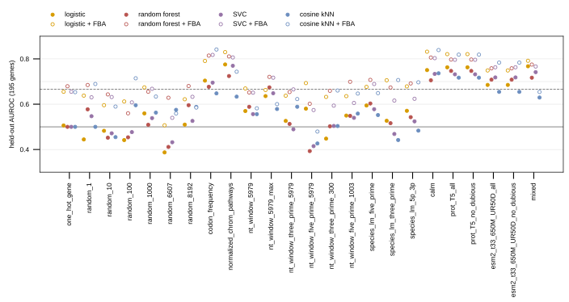

Held-out AUROC on the 195 genes, the rung per encoding with the highest CV AUROC (`results/logistic_baselines.csv`):

| encoding | best by CV | CV | held-out | with FBA: best by CV | CV | held-out |
|---|---|---|---|---|---|---|
| one_hot_gene | logistic | 0.504 | 0.506 | random forest | 0.775 | 0.679 |
| random_1 to random_8192 | | 0.47 to 0.60 | 0.45 to 0.59 | | 0.73 to 0.81 | 0.56 to 0.69 |
| codon_frequency | SVC | 0.700 | 0.695 | SVC | 0.849 | 0.818 [0.73, 0.90] |
| normalized_chrom_pathways | logistic | 0.705 | 0.775 | logistic | 0.802 | 0.830 [0.75, 0.90] |
| calm | SVC | 0.755 | 0.734 | random forest | 0.850 | 0.806 [0.72, 0.89] |
| prot_T5 | SVC | 0.781 | 0.732 | logistic | 0.842 | 0.821 [0.74, 0.90] |
| esm2 | random forest | 0.731 | 0.708 | random forest | 0.815 | 0.758 |
| mixed | logistic | 0.788 | 0.768 | logistic | 0.833 | 0.792 |
| FBA alone | | | 0.654 to 0.666 | | | |

- **The controls behave.** One-hot scores 0.506 (every held-out column is zero in training) and the random vectors score chance at every width; with FBA appended they score FBA's number. Nothing leaks through the split.
- **The bar is 0.80 to 0.83, and it needs FBA.** No encoding clears 0.78 alone; four clear 0.80 with the four ratios appended. The rung with the highest CV AUROC overall (random forest on CaLM + FBA, 0.850) scores 0.806 held-out; the highest held-out number in the figure (cosine kNN on codon frequency + FBA, 0.841) is a max over 192 rungs, not a selected model.
- **Correction to the previous section:** kNN is not dead on this endpoint once the FBA ratios are appended (0.84 on codon, CaLM); without them it reads 0.63 to 0.74 on the language-model encodings, and the earlier "0.58 to 0.69" was the val-tuned run over four encodings.

**Round 2 (jobs 2182 to 2208), the module on the width-12 cell, paired by seed against the round-1 pooled cell on the same split, batch and budget (`wave12_readout.py --round w13`):**

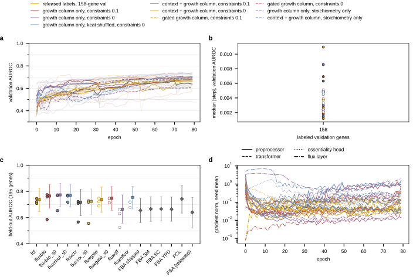

| arm | seeds 2700, 2701, 2702 | mean | pooled [95% CI] |
|---|---|---|---|
| pooled (round-1 fcl) | 0.745, 0.722, 0.708 | 0.725 | 0.738 [0.65, 0.83] |
| forced biomass, scale 0.1 | 0.759, 0.585, 0.774 | 0.706 | 0.765 [0.67, 0.85] |
| forced biomass, scale 0 | 0.770, 0.653, 0.772 | 0.732 | 0.773 [0.68, 0.86] |
| forced biomass, kcat shuffled, scale 0 | 0.771, 0.718, 0.765 | 0.751 | 0.769 [0.68, 0.86] |
| context + growth, scale 0.1 | 0.566, 0.709, 0.722 | 0.666 | 0.717 [0.61, 0.82] |
| context + growth, scale 0 | 0.556, 0.727, 0.718 | 0.667 | 0.724 [0.62, 0.82] |
| gated, scale 0.1 | 0.721, 0.747, 0.690 | 0.719 | 0.738 [0.64, 0.83] |
| gated, scale 0 | 0.714, 0.744, 0.747 | 0.735 | 0.747 [0.65, 0.84] |
| stoichiometry only, forced | 0.524, 0.631, 0.661 | 0.606 | 0.664 [0.56, 0.77] |
| stoichiometry only, context + growth | 0.719, 0.717, 0.678 | 0.705 | 0.755 [0.67, 0.84] |

- **Not hurt: holds.** Gated at scale 0 is +0.02 to +0.04 on two seeds and -0.03 on one against the pooled cell; the gate ends at -0.056 to -0.063 on all six gated runs, and the flux layer's gradient norm is 0.01 to 0.07 against 0.22 to 0.36 on the forced arm's seeds that train. The gated cell is a pooled cell with a small correction.
- **Help: does not hold.** Forced at scale 0 is above the pooled cell on two of three seeds, and the shuffled-kcat control (0.751 mean) matches or beats the real table (0.732). Whatever the growth column carries here, it is not the unit-to-constant correspondence. Pooled bootstrap 0.773 [0.68, 0.86]: above FCL 0.742 and FBA 0.64 to 0.67, level with the pooled cell, below the ladder's 0.80.
- **The collapse is not the penalty's.** Seed 2701 stalls at both scales (0.585 and 0.653) with every module's gradient decaying within ten epochs to a hundredth of the other seeds' and the training loss flat at 0.46 against 0.34. The stoichiometry-only layer collapses on all three seeds (0.52 to 0.66), so on this endpoint the capacity bound and the thermodynamic term keep the growth column informative; on betaxanthin the penalty scale was the collapse dose. Context + growth without a gate costs 0.06 on the mean and puts one seed at 0.56; the same sum behind the gate loses nothing.
- **Readout script fixes in this commit:** the FCL comparator is read from `fcl_comparison.json`'s `scored` block (`ours_scored`), a round can pull another wave's cell in as its pair, and the gate and shuffle arms have labels.

Example runs, gated scale 0 seed 2701 and forced scale 0 seed 2701 (the stalled seed):

<https://wandb.ai/zhao-group/torchcell_028_gene_essentiality/runs/z2cmvk14>

<https://wandb.ai/zhao-group/torchcell_028_gene_essentiality/runs/235hi61k>

**Round 4 (9 cells), queued 16:41 as jobs 2237 to 2245, cancelled unstarted and requeued 16:47 as three pack jobs 2246 to 2248.** The three round-2 module readouts at constraint scale 0 on top of the round-3 levers (batch 32, class weight 772/126, 200 epochs, `ESS_WORKERS=0`), seeds 2700 to 2702, paired against the round-3 `b32posw200` pooled cell: `w15gate_s0` (gated), `w15bio_s0` (forced growth column), `w15shuf_s0` (forced, kcat shuffled by the seed). Read with `wave12_readout.py --round w15`. Pre-registered reads are the round-2 ones: not hurt is gated against the pooled cell paired by seed; help is forced above the pooled cell on three of three seeds and above the shuffled control. Round 3 (2224 to 2236) is still draining ahead of it; its partial numbers at 16:40 are b32posw at 80 epochs 0.780 / 0.769 / 0.700, b32posw200 seed 2700 0.780, b32e200 seed 2700 0.766.

**Several cells on one GPU.** Slurm on GilaHyper allocates whole GPUs (gres type `gpu`, no shards), so the one-cell-per-job launcher caps the machine at four concurrent cells while a width-12 cell holds 3.6 GB of a 46 GB card at 10 percent utilization (round 3, `nvidia-smi` at 16:27). `scripts/gh_train_essentiality_pack.slurm` takes one GPU, 12 CPUs and 36 GB and runs every line of a pack file (`conf/packs/<name>.pack`, one cell's `ESS_*` assignments per line) concurrently, each cell to its own log `slurm/output/028-pack_<job>_<stem>.out`; the cell body moved to `scripts/ess_cell.sh`, which both launchers call. Smoked on CPU with two one-epoch pooled cells (both finished, result files written, moved out of `results/`). Round 4 is the first GPU use: one pack per arm, three seeds each, so nine cells occupy three GPUs instead of nine job slots.

## 2026.09.16 - Round 3 read: the two levers at 200 epochs give the tightest cell (0.774 +/- 0.006), the fold ensemble reads 0.795 under FCL's own protocol

Jobs 2209 and 2224 to 2236, all width 12 on the released-label split, `ESS_WORKERS=0` (10.5 to 11 min per 200-epoch cell). `wave12_readout.py --round w14`, `cv_ensemble_readout.py --prefix w14_cv`.

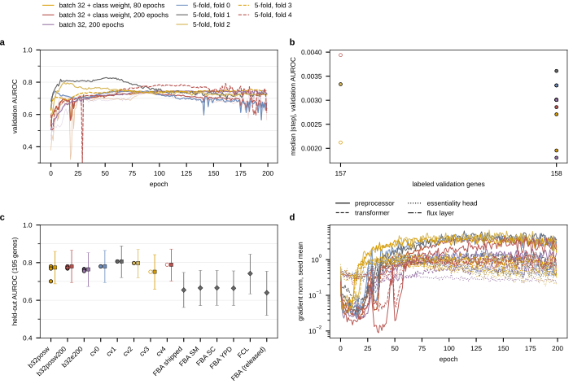

| arm | seeds 2700, 2701, 2702 | mean | sd | pooled [95% CI] |
|---|---|---|---|---|
| batch 32 + class weight, 80 epochs | 0.780, 0.769, 0.700 | 0.750 | 0.043 | 0.774 [0.69, 0.86] |
| batch 32 + class weight, 200 epochs | 0.780, 0.769, 0.773 | 0.774 | 0.006 | 0.780 [0.69, 0.87] |
| batch 32, 200 epochs | 0.766, 0.761, 0.755 | 0.761 | 0.005 | 0.764 [0.67, 0.85] |
| 5-fold models (folds 0 to 4, seed 2700) | 0.780, 0.806, 0.797, 0.751, 0.789 | 0.785 | | ensemble 0.795 [0.71, 0.88] |

- **Batch 32 + class weight + 200 epochs is the best pooled cell and the tightest** (sd 0.006 across seeds). The class weight adds +0.014 / +0.008 / +0.018 over batch 32 alone at the same budget, three of three seeds, as at 80 epochs.
- **The longer budget moves one seed only.** The 80- and 200-epoch cells share their trajectory through epoch 80 and select the same epoch on seeds 2700 and 2701 (75, 68; identical held-out numbers); seed 2702 selects epoch 31 at 80 epochs (0.700) and 148 at 200 (0.773).
- **Fold 0 of the 5-fold files is the val0.2 split exactly** (same 629 / 158 / 195 genes, both drawn at seed 0), so `cv0` reproduces `b32posw200` seed 2700 to the digit (0.7801). Not wasted, but not a sixth model either.
- **The fold ensemble, FCL's protocol, reads 0.795 [0.71, 0.88] on the 195 genes** against FCL's 0.742 on the same genes and its published 0.73; fold mean 0.785. Still 0.01 to 0.04 below the ladder's FBA-augmented rungs (0.806 to 0.830).
- The fold curves show sharp single-epoch dips around epochs 20 to 30 on some seeds (fold 4 to 0.3) with the preprocessor gradient dropping to 0.01 at the same epochs and recovering; the smoothed selection rule steps over them.

Example runs, batch 32 + class weight at 200 epochs seed 2702 (selected epoch 148) and fold 1 (0.806):

<https://wandb.ai/zhao-group/torchcell_028_gene_essentiality/runs/zp335f43>

<https://wandb.ai/zhao-group/torchcell_028_gene_essentiality/runs/mkrk5vb5>

## 2026.09.16 - Round 4 read: on the best backbone the module neither helps nor hurts, and the shuffled kcat table scores the same as the real one

Pack jobs 2246 to 2248 (three cells per GPU, 29 min per pack; the cards ran at 80 to 98 percent utilization and 11 GB against 10 percent for a single cell). Paired by seed against the round-3 `b32posw200` cell (`wave12_readout.py --round w15`).

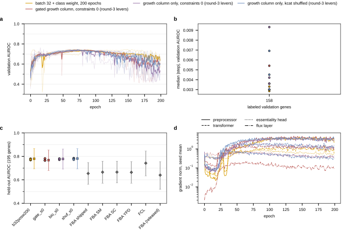

| arm (all batch 32 + class weight, 200 epochs, scale 0) | seeds 2700, 2701, 2702 | mean | sd | pooled [95% CI] |
|---|---|---|---|---|
| pooled (round 3) | 0.780, 0.769, 0.773 | 0.774 | 0.006 | 0.780 [0.69, 0.87] |
| gated | 0.766, 0.782, 0.765 | 0.771 | 0.010 | 0.768 [0.68, 0.85] |
| forced growth column | 0.772, 0.781, 0.778 | 0.777 | 0.005 | 0.778 [0.69, 0.86] |
| forced, kcat shuffled | 0.785, 0.781, 0.772 | 0.779 | 0.006 | 0.781 [0.69, 0.87] |

- **Every arm is within 0.015 of the pooled cell on every seed.** Not hurt holds again (gated 1 of 3 above, mean -0.003). Help does not: forced 2 of 3 above by 0.005 and 0.012, and the shuffled-kcat control is as good (0.779 vs 0.777).
- **The gate moves now.** It leaves zero after epoch 10 and climbs steadily to -0.17 / +0.20 / +0.11 at epoch 200 (either sign), flux-layer gradient 0.06 to 0.12 against 0.22 to 0.65 in the forced arm. Round 2's stalled seed did not recur under batch 32 with the class weight.
- **Read across rounds 2 and 4:** the forced growth column is as expressive a readout as the MLP head (matches it to 0.01 carrying the whole prediction), but its kcat content is not what it reads (shuffle == real). On this endpoint at width 12 the flux layer acts as a learned nonlinearity over the context, not as a physical prior that ranks genes. The remaining lever for the module question is the module's own inputs (measured kcat tier, thermo source, parameterization), not the readout.
- **Performance ceiling so far:** pooled 0.774 (seed mean) / 0.795 (fold ensemble) against the ladder's 0.81 to 0.83 with FBA appended. Next: the FBA growth ratio as an input to the transformer.

Example runs, gated seed 2701 (gate to +0.20) and shuffled-kcat seed 2700 (0.785):

<https://wandb.ai/zhao-group/torchcell_028_gene_essentiality/runs/tvbw3cg9>

<https://wandb.ai/zhao-group/torchcell_028_gene_essentiality/runs/jf3af715>

**Round 5 (w16), packs 2249 and 2250, queued 17:38: FBA's growth ratios as an input to the transformer.** `--ess-readout fba` (new in `train_essentiality.py`, `FbaContextReadout`) adds an affine of the deleted gene's knockout-to-wild-type growth ratio on the four media (`fba_essentiality_per_gene.csv`, the same four numbers the ladder appends) to the pooled arm's context logit; the four weights are logged per epoch as `ess_fba_w_<medium>`. Cells: the round-3 levers (batch 32, class weight, 200 epochs) at seeds 2700 to 2702, paired against `b32posw200`, and the same readout on the five cross-validation folds (seed 2700) for the ensemble number (`cv_ensemble_readout.py --prefix w16_fbacv`). Pre-registered read: the ladder's logistic rung on ProtT5 gains 0.09 from the four ratios (0.732 to 0.821); the transformer gains the same complement if its seed mean moves from 0.774 toward 0.82 on three of three seeds, and the fold ensemble from 0.795 toward the ladder's 0.81 to 0.83. CPU smoke: two epochs already read 0.713 held-out, which is the affine on the ratios alone (FBA scores 0.65 to 0.67).

## 2026.09.16 - Round 5 read: FBA's growth ratios as an input lift the transformer to 0.82, the ladder's level, on three of three seeds

Packs 2249 (three seeds, 27 min) and 2250 (five folds, 27 min), paired against the round-3 `b32posw200` cell. `wave12_readout.py --round w16`, `cv_ensemble_readout.py --prefix w16_fbacv`.

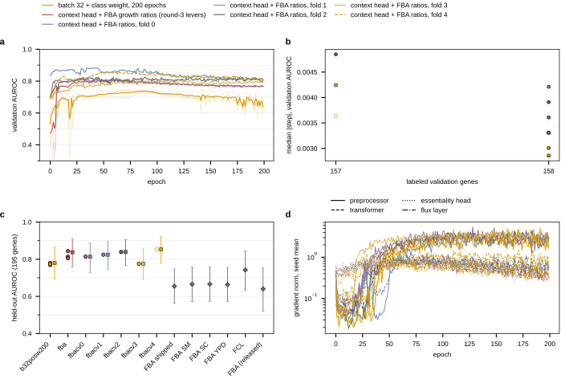

| arm (batch 32 + class weight, 200 epochs) | seeds 2700, 2701, 2702 | mean | sd | pooled [95% CI] |
|---|---|---|---|---|
| pooled (round 3) | 0.780, 0.769, 0.773 | 0.774 | 0.006 | 0.780 [0.69, 0.87] |
| context head + FBA ratios | 0.814, 0.805, 0.844 | 0.821 | 0.020 | 0.838 [0.76, 0.91] |
| 5 fold models + FBA ratios | 0.814, 0.824, 0.839, 0.775, 0.853 | 0.821 | | ensemble 0.822 [0.74, 0.90] |

- **Both pre-registered reads hold.** +0.034 / +0.037 / +0.071 on the three seeds (3 of 3), seed mean 0.774 -> 0.821; fold ensemble 0.795 -> 0.822. The transformer with the four solver numbers sits where the ladder's best rungs sit (0.806 to 0.830), 0.08 above FCL on the same genes.
- **The weights end negative on every cell** (a deletion that stops growth is essential), largest on the shipped-bound and YPD columns (-0.5 to -0.7 at the selected epoch), near zero to -0.4 on SC. The cells select at epochs 28 to 70 (vs 68 to 148 without): the affine is learned in the first epochs and the context head fills in around it.
- **Read across rounds 2, 4 and 5:** the learned flux layer's growth column matched the head and ignored its kcat table; the FBA solve's growth ratio adds 0.05. On this endpoint the module's value is in the solve, not in the learned layer. Next: the ratios as a node feature (every gene's, not only the deleted gene's), one medium against four, and a flux arm that receives the ratios beside its own growth column.

Example runs, seed 2702 (0.844) and fold 4 (0.853):

<https://wandb.ai/zhao-group/torchcell_028_gene_essentiality/runs/k1sfpylr>

<https://wandb.ai/zhao-group/torchcell_028_gene_essentiality/runs/7ysar8my>

**Round 6 (w17), packs 2251 to 2256, queued 18:22, six arms at three seeds on the round-3 levers, paired against `b32posw200` and the round-5 `fba` cell.** (1) `fbaypd`: the FBA affine on the YPD ratio alone (`--ess-fba-media YPD`), one medium against four. (2) `biofba`: the flux layer's forced growth column plus the FBA affine, no context head (`--ess-readout biomass_fba`, scale 0): the learned layer on top of the solve. (3) `gatefba`: the gated readout plus the affine (`gated_fba`). (4) `codonfba`: the backbone opened on codon frequency (64-d; `--node-embeddings codon_frequency`) plus the affine, since codon + FBA reaches 0.82 on the ladder from 64 numbers. (5) `compfba` and (6) `comp`: the backbone on the species-LM composite the expression line uses (`fudt_upstream fudt_downstream prot_T5_all calm`, 3,332-d) with and without the affine. Trainer additions: `--ess-fba-media`, `biomass_fba`, `gated_fba`, `--node-embeddings` (the dataset is opened on the named embeddings; the preprocessor projects their concatenation), and a guard that refuses a flux readout on a pooled arm (a CPU smoke had run one silently). Read with `wave12_readout.py --round w17`. Pre-registered reads: one medium is enough if `fbaypd` is within seed noise of `fba` (0.821); the layer adds to the solve if `biofba` or `gatefba` is above `fba` on three of three seeds; an embedding is better if its `+fba` cell is above `fba` on three of three.

**Figure fixes (same commit, 6655a4cc):** the ladder takes blue for its fourth model (the palette's yellow read as a lighter orange) and the display names on its axis (`fudt_*` is the species LM 5' and 3' embedding); the readout figures use six hues per tier with a dashed, hollow second tier instead of the palette's darker siblings; panel labels shortened and letters moved clear of them; the two flux diagrams now read left to right.

## 2026.09.16 - Round 6 read: four media beat one, the learned layer adds nothing on top of the solve, the composite embedding equals ProtT5, the codon backbone is poor

Packs 2251 to 2256 (20 to 21 min each, three cells per GPU). Paired against the round-5 `fba` cell (0.814 / 0.805 / 0.844, mean 0.821) and the round-3 pooled cell (0.780 / 0.769 / 0.773). `wave12_readout.py --round w17`.

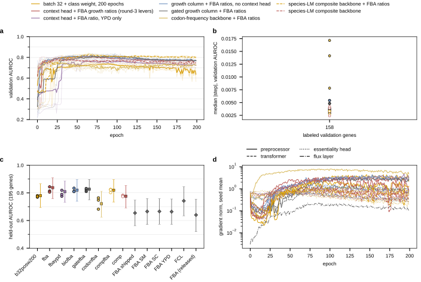

| arm (batch 32 + class weight, 200 epochs) | seeds 2700, 2701, 2702 | mean | sd | pooled [95% CI] |
|---|---|---|---|---|
| context head + FBA ratios, four media (round 5) | 0.814, 0.805, 0.844 | 0.821 | 0.020 | 0.838 [0.76, 0.91] |
| context head + FBA ratio, YPD only | 0.819, 0.775, 0.789 | 0.795 | 0.022 | 0.808 [0.73, 0.89] |
| forced growth column + FBA ratios, no context head | 0.834, 0.811, 0.809 | 0.818 | 0.014 | 0.820 [0.74, 0.90] |
| gated growth column + FBA ratios | 0.810, 0.821, 0.832 | 0.821 | 0.011 | 0.827 [0.75, 0.90] |
| codon-frequency backbone + FBA ratios | 0.747, 0.682, 0.764 | 0.731 | 0.043 | 0.721 [0.62, 0.81] |
| species-LM composite backbone + FBA ratios | 0.802, 0.825, 0.822 | 0.816 | 0.013 | 0.819 [0.73, 0.90] |
| species-LM composite backbone | 0.783, 0.779, 0.773 | 0.778 | 0.005 | 0.776 [0.69, 0.85] |

- **Four media > one.** YPD alone is 0.03 to 0.05 below the four-column cell on two of three seeds (mean 0.795 vs 0.821), still +0.02 over the pooled cell.
- **The learned layer adds nothing on top of the solve.** Forced growth column + affine (no MLP head) 0.818, gated + affine 0.821, each 1 of 3 seeds above the round-5 cell, each within its spread. The flux layer trains (gradient norm 0.4 to 1.1 on the forced cells) but ranks no better than the head. Across rounds 2, 4, 5, 6: the module's ranking is the backbone's; the physics that ranks genes here is the solve's optimum, which the projection layer does not compute.
- **Composite embedding = ProtT5** (0.778 vs 0.774 without FBA; 0.816 vs 0.821 with), at 44k vs 16.5k parameters.
- **Codon backbone is poor**: 0.731 with FBA, below the pooled ProtT5 cell and 0.09 below the ladder's codon + FBA rung (0.818); selected epochs 16 / 172 / 14 and the largest validation step of any cell (0.013): the 12-wide transformer over 64 codon numbers never settles.
- **Next:** the flux-layer probe at initialization (does the growth column rank essential genes at all before training?); a solve-derived gene encoding (per-deletion pFBA vector or the wild-type flux through the gene's reactions) as a node feature; and, if the transformer is to beat the ladder rather than tie it, width or depth on the FBA cell.

Example runs, gated + FBA seed 2702 (0.832) and codon seed 2701 (0.682):

<https://wandb.ai/zhao-group/torchcell_028_gene_essentiality/runs/zllkcndg>

<https://wandb.ai/zhao-group/torchcell_028_gene_essentiality/runs/san5c0l6>

## 2026.09.16 - Flux growth probe: the layer's growth column is a signed free coordinate, and the trained forced cell ranks essential genes with it upside down

`scripts/flux_growth_probe.py --result w15_bio_s0_h12l1p1_e200_s2700.json` (CPU, one forward pass over the 982 labeled records at initialization and under the cell's trained weights; `results/flux_growth_probe_w15_bio_s0_h12l1p1_e200_s2700.json`). The score is the AUROC of the NEGATIVE growth column against the label (a deletion that stops growth is essential) and the Spearman of the column against FBA's knockout/wild-type ratio.

| weights | zero-growth deletions | median v_growth | AUROC(-v) train / val / test | Spearman vs FBA (shipped, SM, SC, YPD) |
|---|---|---|---|---|
| initialization | 0 of 982 | -0.27 | 0.618 / 0.555 / 0.547 | +0.12, +0.10, +0.09, +0.11 |
| trained (forced readout, epoch 108) | 0 of 982 | -1.43 | 0.048 / 0.258 / 0.228 | -0.27, -0.26, -0.24, -0.24 |

- **At initialization the column carries a weak signal in the right direction**: 0.55 on the held-out genes, Spearman +0.11 with the solve. Nothing like FBA's 0.65, and no deletion reaches zero growth.
- **Training flips it.** Under the forced cell's weights the negative column reads 0.23 on the held-out genes, i.e. 0.77 with the opposite sign, which is the cell's held-out AUROC (0.772): the affine learned a positive slope, essential genes get HIGHER "growth", and the column is anti-correlated with FBA (-0.25). The median growth is -1.4 mmol/gDW/h against a wild-type FVA range of 0.48 to 0.54 on YPD: the column is negative for most deletions.
- **Why the column can do that**: the arm ends its alternations on the balance projection (`feas_balance_median` 0.000) and leaves the box open, 58 percent of reactions outside their bounds at the selected epoch (`feas_box_violation_frac`, also 0.64 on the round-2 cell and 0.59 on the round-6 cell). The growth reaction's lower bound of zero is not enforced, so `v_growth` is a signed, unbounded coordinate the backbone writes through the abundance head, and the readout uses it as a free latent. This is the mechanism behind "shuffled kcat == real" and "the layer matches the head": the column is not growth.
- **What follows**: the forced readout on a layer whose alternations END on the clip (bounds exact, balance approximate) is the cell that decides whether a bounded growth column carries FBA's signal; the probe then reads whether the trained column correlates positively with the solve. That is round 7.

The same probe on the round-2 forced cell at constraint scale 0.1 (`w13_fluxbio` seed 2700, 80 epochs, selected epoch 77): trained AUROC(-v) 0.091 / 0.266 / 0.241 on train / val / test, Spearman -0.26 to -0.22 against FBA, median growth -2.4. The flip is the forced readout's habit, not one cell's.

**Round 7 (w18), the growth column with the bounds enforced:** the forced readout at scale 0 on the round-3 levers with `--flux-parameterization projection_box` (the alternations end on the clip, so every bound including the growth reaction's zero floor holds exactly and the balance is the soft residual) and with `box` (v = lb + (ub - lb) sigmoid(z); bounds exact by construction, Sv = 0 soft), three seeds each, paired against the round-4 forced cell (balance-ending projection, 0.772 / 0.781 / 0.778) and the pooled cell. Then the probe on each. Reads: a bounded growth column that still matches the head, and whose trained column correlates positively with the solve, says the layer computes something growth-like and the readout was the problem; a bounded column that collapses says the balance-ending projection's free coordinate was the only thing the forced arm had.

## 2026.09.16 - Round 7 read: with the bounds enforced the growth column is dead (clip last) or unbalanced (box), and the module question closes at the layer

Packs 2257 (`projection_box`, 28 min) and 2258 (`box`, 24 min). `wave12_readout.py --round w18`; the probe on all six cells (`results/flux_growth_probe_w18_*.json`).

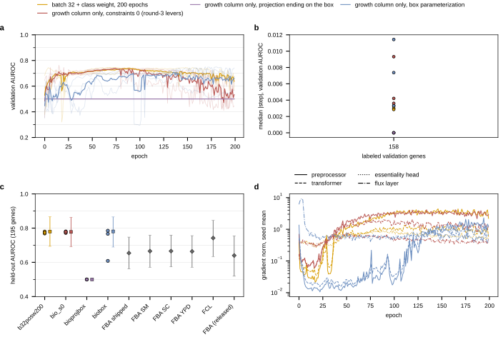

| arm (forced readout, scale 0, round-3 levers) | seeds 2700, 2701, 2702 | mean | box violation | balance residual |
|---|---|---|---|---|
| projection ending on balance (round 4) | 0.772, 0.781, 0.778 | 0.777 | 0.58 | 0.000 |
| projection ending on the box | 0.500, 0.500, 0.500 | 0.500 | 0.00 | 0.85 to 1.0 |
| box form, v = lb + (ub - lb) sigmoid(z) | 0.767, 0.609, 0.785 | 0.720 | 0.00 | 2.0 |

- **Clip last: the growth column is identically zero** for all 982 deletions at init and after training (the clip pins r_2111 at its floor); the cells score exactly 0.5 and select epoch 2.
- **Box form: growth in [0, ub], starts near ub/2 (median 45 to 53 vs a wild-type 0.5), Sv = 0 never approached** (balance residual 2.0 at every epoch); 0.720 mean, below the pooled cell; the probe flips the sign on 2 of 3 trained seeds (0.23 / 0.22 held-out, Spearman -0.25 / -0.28 vs FBA) and reads 0.61 / +0.10 on the third.
- **Conclusion across rounds 2, 4, 5, 6, 7 and the probes:** whichever constraint is exact, the other is violated by as much as the fluxes themselves, so the K-alternation layer never reaches the polytope FBA optimizes over; its growth column is a free signed coordinate, a constant zero, or an unbalanced sigmoid, never growth. The module's value on essentiality is the solve's, and the layer has to reach feasibility before its column can carry it. That is a layer question (more alternations, Dykstra, a warm start from the wild-type solve), and essentiality is the cheap place to test it: a feasible growth column must reproduce FBA's 0.65 at initialization.

Example runs, box seed 2701 (0.609) and clip-last seed 2700 (0.500):

<https://wandb.ai/zhao-group/torchcell_028_gene_essentiality/runs/q5etjawa>

<https://wandb.ai/zhao-group/torchcell_028_gene_essentiality/runs/kthpkk1r>

**Round 8 (w19), packs 2259 to 2262, queued 20:02: width and depth on the FBA cell.** The round-5 cell (width 12, one block, one-layer preprocessor, context head + FBA affine, 0.814 / 0.805 / 0.844) against the same readout at width 24 and 48, at two blocks, and with the two-layer preprocessor, three seeds each on the round-3 levers. Read with `wave12_readout.py --round w19`. Pre-registered read: a cell passes the ladder if its seed mean clears 0.83 with three of three seeds above the round-5 cell; the wave-9 finding that width 90 collapsed one seed to a constant is the failure mode to watch at 48.

**Job 2261 (two blocks) failed at the first step: `IndexError: index 4 is out of bounds for dimension 1 with size 4` in `compute_graph_regularization`.** `GRAPH_REG_CONFIG` pins the nine gene graphs to attention heads 0 to 8 of layer index 1, the SECOND block. Two consequences: (1) every one-block cell in this experiment never evaluated the term, which is why round 1's "graph regularization off" reproduced the base cell to the third decimal (both were the same cell), and the section-3 sentence is corrected accordingly; (2) a two-block cell with four heads dies on head 4. The pack is resubmitted with `ESS_GRAPH_REG=0`. Using the term on this backbone would need nine heads (width 90 at 019's settings) or a remapped config; neither is a lever worth spending on here given (1).

## 2026.09.16 - Round 8 read: width and depth on the FBA cell do not pass the ladder, capacity is not the lever

Packs 2259 (width 24), 2260 (width 48), 2262 (two-layer preprocessor), 2263 (two blocks, graph regularization off; 2261 was the failed first submit), three cells per card, 19 min per pack and 26 for the two-block one. `wave12_readout.py --round w19`; tables regenerated by `notes_tex_tables.py`; section 3 gains the round-8 subsection and the open list drops width and depth.

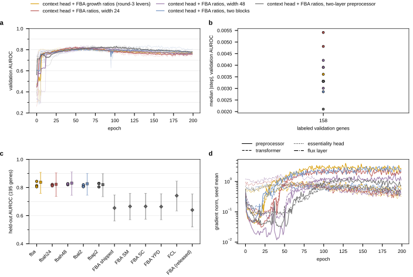

| arm (context head + FBA affine, round-3 levers) | params | seeds 2700, 2701, 2702 | mean | sd | paired vs round 5 |
|---|---|---|---|---|---|
| width 12, one block (round 5) | 16,566 | 0.814, 0.805, 0.844 | 0.821 | 0.020 | |
| width 24 | 40,902 | 0.818, 0.822, 0.812 | 0.817 | 0.005 | +0.004, +0.017, -0.032 |
| width 48 | 112,902 | 0.827, 0.819, 0.826 | 0.824 | 0.004 | +0.013, +0.014, -0.018 |
| two blocks, width 12 | 18,450 | 0.810, 0.820, 0.806 | 0.812 | 0.007 | -0.004, +0.015, -0.038 |
| two-layer preprocessor, width 12 | 542,480 | 0.804, 0.829, 0.828 | 0.821 | 0.014 | -0.010, +0.024, -0.016 |

- **Pre-registered read: pass if seed mean > 0.83 with 3/3 seeds above round 5.** No arm passes. Width 48 is the best seed mean (0.824) and the tightest (sd 0.004), up on two seeds and down on 2702; every arm is below the round-5 cell's 0.844 on seed 2702, which is the highest single seed in the document. Every round-8 mean lies inside round 5's pooled bootstrap 0.84 [0.76, 0.91].
- **Seed spread narrows with width** (0.020 at 12, 0.005 at 24, 0.004 at 48); the wave-9 collapse at width 90 did not recur at 48.
- **Validation curves peak 0.80 to 0.82 between epochs 40 and 90 on every arm and drift down**, most at width 24 (to 0.75 by epoch 200); selected epochs 41 to 144.
- **Read:** capacity is not the lever on this endpoint. The transformer with FBA's four ratios sits at 0.81 to 0.82 whatever its size, level with the ladder's best rungs (0.806 to 0.830). Left on the transformer side: the chromosome-pathway indicator (the ladder's best selected rung with FBA, 0.830) and the 17-encoding concatenation as inputs, neither given to the transformer yet; and a solve-derived encoding.

Example runs, width 48 seed 2700 (0.827) and two blocks seed 2702 (0.806):

<https://wandb.ai/zhao-group/torchcell_028_gene_essentiality/runs/8ju0l6vd>

<https://wandb.ai/zhao-group/torchcell_028_gene_essentiality/runs/ftluim1i>

## 2026.09.16 - Rounds 9 and 10 launched: the FBA affine on the ladder's other encodings, and the flux layer warm-started from the deletion's own solve

Round 8 closed capacity as a lever, so the two levers left are the transformer's input and what the layer proposes.

**Round 9 (w20, packs 2280 to 2283, 22:59).** The round-5 cell (width 12, one block, context head + FBA affine, ProtT5 input) opened on the ladder's other encodings through `--node-embeddings`: the 197-d chromosome-pathway indicator (`chromfba`; the ladder's best selected rung with FBA, 0.830), ESM2 (`esmfba`), the seven-encoding `mixed` concatenation (`mixfba`), and chromosome-pathway + ProtT5 (`chromprotfba`). Three seeds each. Read with `wave12_readout.py --round w20`. Pre-registered read as in round 8: a cell passes the ladder if its seed mean clears 0.83 with three of three seeds above the round-5 cell (0.814 / 0.805 / 0.844). The first submit (jobs 2272 to 2279) died in one second on a pack path given relative to the experiment folder instead of the worktree; `ESS_PACK` is worktree-relative.

**Round 10 (w21, packs `w21_warm*.pack`, queued behind round 9).** `ess_reference_flux_table.py` solves one pFBA per labeled gene (1,121; genes outside the GEM get the wild type) on YPD through the same `media_report` the cell's box is built with, and writes the layer's per-genotype reference table (`$DATA_ROOT/data/torchcell/reference_flux/ess_reference_flux_table_YPD.npz`). Under `--flux-parameterization warmstart --flux-reference-table <that>` the layer proposes `v_ref(deletion) + alpha N z`, so the growth column starts at the deletion's own pFBA growth rather than at the free signed coordinate the probe found. Arms on the `flux_projection_anchored` arm at constraint scale 0: forced growth column with alpha frozen at 0.01 (`warmbio`), gated growth column + context head with alpha frozen at 0.01 (`warmgate`), alpha learned (`warmgatealpha`), alpha frozen at 0.1 (`warmgate10`). Pre-registered reads: (1) the probe at initialization must read the layer's growth column at FBA's level on YPD (AUROC of the negative column about 0.66 on the 195 genes) or the warm start did not reach the readout; (2) `warmgate` passes if its seed mean sits at the round-5 affine cell's 0.82 with three of three seeds above the round-4 gated cell (0.766 / 0.782 / 0.765), which would say the module carries the solve through the layer with gradients through it; (3) `warmgatealpha` against `warmgate` says whether training spends the feasibility the warm start bought (alpha growth, as in job 1946).

**Ladder, solve-derived encodings.** The same script writes `ess_solve_encodings_YPD.npz`; `logistic_baselines.py --only-missing` fits three new encodings on the split: the deletion's pFBA flux vector (4,131-d), its difference from the wild-type vector, and eight per-gene statistics of the wild-type solve and its variability on the gene's own reactions (reaction count, reactions carrying flux, max and sum absolute flux, forced flux, min and max FVA range, growth ratio). The question is whether the solve has more to give than four growth ratios.

## 2026.09.16 - Round 9 read: chromosome-pathway + ProtT5 with the FBA affine passes the ladder at 0.871; the solve's own encodings score 0.80 on the ladder with no sequence

Packs 2280 to 2283 (19 min each). `wave12_readout.py --round w20`.

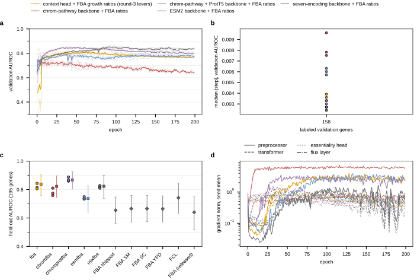

| arm (context head + FBA affine, round-3 levers, width 12) | params | seeds 2700, 2701, 2702 | mean | sd | paired vs round 5 |
|---|---|---|---|---|---|
| ProtT5 (round 5) | 16,566 | 0.814, 0.805, 0.844 | 0.821 | 0.020 | |
| chromosome-pathway indicator | 6,642 | 0.810, 0.759, 0.774 | 0.781 | 0.027 | -0.004, -0.046, -0.070 |
| chromosome-pathway + ProtT5 | 18,930 | 0.860, 0.866, 0.888 | 0.871 | 0.015 | +0.046, +0.061, +0.044 |
| ESM2 | 19,638 | 0.734, 0.736, 0.749 | 0.740 | 0.008 | -0.080, -0.069, -0.095 |
| seven-encoding concatenation | 78,066 | 0.822, 0.810, 0.827 | 0.820 | 0.009 | +0.008, +0.005, -0.017 |

- **PASSES the pre-registered read** (seed mean > 0.83, 3/3 above round 5): chromosome-pathway + ProtT5, 0.871, pooled 0.868 [0.80, 0.93]; the interval's lower end is the ladder's best rung. First cell to do so. Selects epochs 38 to 53; validation peaks ~0.85 at epochs 25-50 and drifts to 0.80.
- The indicator ALONE is unstable through a 12-wide preprocessor (two seeds select epoch 2, validation falls from 0.73, preprocessor gradient norm ~5 all run) and scores 0.781; the ladder's logistic rung on it is 0.830. ESM2 0.740 (0.08 below ProtT5). The seven-way concatenation returns to ProtT5's number at 4.7x the parameters.
- **Round 12 (w23, packs 2291 to 2293, queued)** confirms the passing cell: the five fold models (`chromprotcv0-4`, for the ensemble under FCL's protocol via `cv_ensemble_readout.py --prefix w23_chromprotcv`) and seeds 2703 to 2706 on the split file. The number is reported after that, not from one cell's three seeds.

Example runs, chromosome-pathway + ProtT5 seed 2702 (0.888) and the indicator alone seed 2701 (0.759):

<https://wandb.ai/zhao-group/torchcell_028_gene_essentiality/runs/bcd322yd>

<https://wandb.ai/zhao-group/torchcell_028_gene_essentiality/runs/1zxq5as9>

**Ladder, solve-derived encodings (`logistic_baselines.py --only-missing`, from `ess_solve_encodings_YPD.npz`).** CV-selected rungs: eight reaction statistics (WT pFBA + FVA on the gene's reactions, incl. the growth ratio) random forest 0.797 [0.70, 0.88] alone, 0.817 [0.73, 0.90] + FBA (CV 0.847, highest in the ladder); the 4,131-d deletion pFBA vector RF 0.756 (logistic 0.771 [0.66, 0.87]); its delta from WT the same. The growth ratio alone is 0.645. So the solve carries ~0.15 AUROC beyond its growth ratio, level with ProtT5, from no sequence. Figure `classical_ladder_2026-09-16-23-16-30.svg`; section 2 updated.

**Round 11 (w22, packs 2288 to 2290, queued)**: `--ess-solve-features {stats,pfba,stats_pfba}` appends those columns (standardized) to the fba readout's affine on the ProtT5 cell. Pre-registered: passes if seed mean > 0.83 with 3/3 above round 5. The winners of rounds 9 and 11 combine next if both pass.

## 2026.09.16 - Round 10 read: the pFBA warm start on the anchored layer arrives with its sign reversed; the anchored box does not hold the reference

Packs 2284 to 2287 (28 min each). `wave12_readout.py --round w21`; `flux_growth_probe.py` on `w21_warmbio_s2700/s2702` and `w21_warmgate_s2700`.

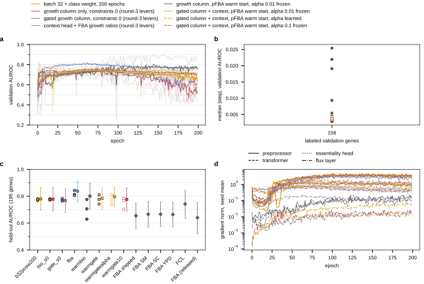

| arm (anchored layer, scale 0, round-3 levers) | seeds 2700, 2701, 2702 | mean | paired comparator |
|---|---|---|---|
| forced growth column (round 4) | 0.772, 0.781, 0.778 | 0.777 | |
| forced, pFBA warm start, alpha 0.01 frozen | 0.629, 0.706, 0.776 | 0.704 | 3/3 DOWN vs round 4 |
| gated + context (round 4) | 0.766, 0.782, 0.765 | 0.771 | |
| gated, pFBA warm start, alpha 0.01 frozen | 0.810, 0.776, 0.742 | 0.776 | +0.044, -0.006, -0.023; seed 2702 selects ep 4 |
| gated, alpha learned | 0.812, 0.772, 0.741 | 0.775 | alpha -> 0.19 / 0.02 / 0.11 |
| gated, alpha 0.1 frozen | 0.784, 0.767, 0.701 | 0.751 | |

- **Both pre-registered reads FAIL.** Probe at INIT: growth column median -0.07 to -0.10 (references 0 to 0.5), Spearman -0.43 vs the YPD ratio, AUROC(-v) test 0.34 to 0.39 = the solve's ranking SIGN-REVERSED. Trained forced cells invert further (0.22 to 0.41).
- **Cause, measured in the layer's own diagnostics:** `feas_box_violation_frac` 0.28 to 0.39 at init (the reference violates the anchored layer's capacity- and second-law-tightened box), `feas_warm_proposal_rel` 0.45 to 0.57 (the alternations return a point half the reference's norm away at alpha 0.01). The projections that balance the flux move it off the handed point and reverse the growth column's correlation with the solve.
- alpha learned: no change on held-out; alpha grows to 0.19 on seed 2700, box violation rises 0.30 -> 0.45 on seed 2701 (job-1946 mode).
- **Round 13 (w24, packs 2297/2298, queued):** the same warm start on the stoichiometry-only layer (`ESS_ARM=flux_off`, GEM box), forced and gated, alpha 0.01 frozen. Read: the probe at init must show ~0.65 (the reference is inside the GEM box by construction, so if it still does not, the alternations themselves move it); the gated cell passes at ~0.82 with 3/3 above round-4 gated.

Example runs, forced warm start seed 2700 (0.629) and gated warm start seed 2702 (0.742, epoch 4):

<https://wandb.ai/zhao-group/torchcell_028_gene_essentiality/runs/2rcqcnv5>

<https://wandb.ai/zhao-group/torchcell_028_gene_essentiality/runs/635swwnr>

## 2026.09.17 - Rounds 11 and 12 read, yeast-GEM's benchmark reproduced, the layer that solves, and three repositories read

**Round 12 (w23) confirms round 9.** Seeds 2703 to 2706: 0.846, 0.877, 0.868, 0.878 (seven seeds mean 0.869, sd 0.014, pooled 0.870 [0.81, 0.93]); five fold models 0.860, 0.899, 0.889, 0.876, 0.884 (mean 0.881); fold ensemble **0.893 [0.84, 0.94]** (`cv_ensemble_readout.py --prefix w23_chromprotcv`) against 0.822 for the round-5 folds, 0.795 for the backbone alone, FCL 0.742. This is the number to report. The encoding `normalized_chrom_pathways` is five scaled gene properties (length, MW, pI, expression median and MAD) + chromosome one-hot + pathway multi-hot; round 14 (w25, packs 2307/2308, `normalized_chrom` registered in the builder through `OneHotGraphEmbeddingDataset`, 24-d) attributes the gain.

**Round 11 (w22) passes with both solve blocks.** `--ess-solve-features stats_pfba` 0.850/0.858/0.867 (mean 0.858, 3/3 above round 5, selects epochs 153-188); `pfba` alone 0.877/0.743/0.874 (seed 2701 collapsed at epoch 7); `stats` alone 0.816/0.790/0.779 (3/3 DOWN; a random forest on the same 12 numbers reads 0.817 on the ladder). Round 16 (w27, packs 2309/2310) = round-9 backbone + round-11 affine.

**yeast-GEM's own benchmark** (`essentiality_confusion.py`; 9.1.1 per-gene file mirrored under `results/external/yeast-GEM-9.1.1/` with commit 2d594ae, hashes and method in `provenance.json`): Kennedy SC medium, single-gene deletion by GPR, inviable if growth ratio < 1e-6, 1,107 verified ORFs vs the Stanford 2011 inviable list. Their accuracy 0.902 = majority floor 0.856 + 4.5 points; recall 0.41, balanced accuracy 0.70. The Stanford labels and the released split agree on 1,102 of 1,104 shared genes. Our FBA on 9.0.2 under the ontology's SC recipe: accuracy 0.907, recall 0.46 (reproduces 9.1.1). Round-12 ensemble at logit > 0: accuracy 0.856 (= floor), recall 0.68, balanced accuracy 0.78; FCL released at P(viable) < 0.5: 8 essential calls, all correct, recall 0.26. Table `tables/confusion.tex`, section 2. Accuracy is the wrong statistic for an 86-percent-nonessential set.

**The layer that solves** (`torchcell/metabolism/lp_layer.py`, `--flux-parameterization lp` / `lp_tdg`): per genotype, max growth s.t. Sv = 0 and the layer's own box (availability + enzyme-capacity ceiling from the abundance head), HiGHS in a forked pool, d growth / d bounds from the bound marginals (envelope theorem). Checks: WT growth 0.08584 = pFBA reference; duals equal finite differences on r_1714 (glucose) and r_4046 (ATP maintenance); 0.036 s per LP with 8 workers; toy-network unit test. Round 15 (w26, packs 2304-2306: `lpbio`, `lpgate`, `lpbiotdg`) running. The launcher ignores `SBATCH_CPUS_PER_TASK` and extra sbatch args (they become script args), so the LP packs run 24 workers on 12 CPUs.

**Constraint violations reported** (`tables/violations.tex`): on every anchored-layer arm at the selected epoch, second-law violation on 44-51 percent of reactions, box violation 33-63 percent (balance-exact arms), protein budget 0.2-7x the pool, dissipation 5,000-12,000 J/gDW/h against the 3,700 limit; with the box exact, second law 32-38 percent and dissipation 100,000. The kcat table (97 measured, 782 homolog, 2,831 predicted, 18 default) and union-external delta G (3,779 of 4,131 reactions) are inputs to a projection that honors none of them.

**Repositories read (agents):** yeast-GEM as above. Gene_Graph (2021-2023): YeastMine graphs (regulatory, physical, genetic), SGD phenotype labels from an old backend endpoint, featureless 2-layer GCN / GATv2 / DPGCNN node classifiers (`notebooks/n41-n43`), no saved essentiality results; rerunnable on this split as graph-only baselines (GCN/GATv2 on the cell graph's physical/regulatory edges, featureless and ProtT5). MATH-490: WL color refinement definition (`notes/2-theory.md`) and a draw.io figure with embedded XML (`notes/assets/drawio/WL-test.drawio.png`), no code; the WL test on knockout graphs is new code here, the figure a restyle.

**Document restructure:** the spine is "the solve helps, so why not the layer": abstract, section-4 opening and closing argument, vocabulary (chromosome-pathway indicator, FBA affine, fold ensemble, pFBA, solve-derived encodings, warm start, anchored vs stoichiometry-only layer), open list. Tables bold the best value per column and mark 3/3-seed direction with arrows.

## 2026.09.17 - Rounds 13 to 16: the GEM box carries the solve, the anchored box holds no growing flux, pathways carry the round-9 gain, the combined cell reads 0.880

**Round 13 (w24, packs 2297/2298).** pFBA warm start on `flux_off` (GEM bounds scaled by availability, no capacity, no thermo). Probe at INIT: growth column median +0.38, AUROC(-v) test 0.683 (train 0.80), Spearman +0.47 to +0.57 vs FBA; the reference survives the projections (proposal moved 0.3 percent of its norm). Trained forced 0.654/0.726/0.612 (= FBA level); trained gated **0.794/0.829/0.825 (0.816)** vs round-4 gated 0.766/0.782/0.765, 3/3 up, gates end +0.97/+0.90 on the two seeds that train (third selects epoch 5). First module cell that carries the solve. Compared with round 10 (same reference, anchored layer, sign reversed): the capacity + second-law tightening applied after the solve destroyed the reference.

**Round 15 (w26, packs 2304-2306): the LP layer on the anchored box is INFEASIBLE.** Every cell 0.500, selects epoch 2, `feas_flux_active_frac` 0.0 all run. Diagnosed on one genotype's bounds captured from the layer (`scratchpad/debug_lp.py`): HiGHS status 8 infeasible; the same S with the GEM's own bounds solves at 0.0858; reopening the deleted reactions or releasing the maintenance lb (0.7) does not help. Cause: the capacity ceilings (predicted kcat x nominal abundance from the abundance head) give upper bounds with median 0.084 mmol/gDW/h and 10 percent below 0.007 (GEM: 100). The anchored box contains no growing flux; every anchored arm has been reading a flux off the polytope. Round 15b (w29, packs 2314/2315): the LP on `flux_off` (forced, gated). Next construction if that works: a capacity ceiling scaled so the WT is feasible (GECKO saturation calibration). The lp branch now logs `feas_lp_zero_flux_frac`.

**Round 14 (w25, packs 2307/2308).** `normalized_chrom` (5 properties + chromosome, 24-d, no pathways): + ProtT5 + FBA affine 0.811/0.816/0.810 (0.813 = ProtT5's 0.821); alone 0.669. The 173 pathway columns carry the round-9 gain, and only with ProtT5 beside them.

**Round 16 (w27, packs 2309/2310).** chromprot backbone + `stats_pfba` affine: 0.863/0.878/0.898 (**0.880**, sd 0.018, pooled 0.889 [0.83, 0.94]) vs round 9 0.860/0.866/0.888, 3/3 up by 0.003 to 0.012. + `pfba` only: 0.769/0.812/0.902 (two seeds select epochs 6 and 13). Round 17 (w28, packs 2312/2313): the round-16 cell on the five folds; pre-registered: replaces 0.893 only if above round 12's fold models on 4 of 5 folds.

**Also:** `essentiality_confusion.py` + `tables/confusion.tex` (yeast-GEM's rule for every scorer); `wl_knockout_test.py` and `graph_baselines.py` running on CPU (~1.5 h so far); `notes/assets/drawio/028-wl-test.drawio` recolored (needs re-layout at print size in draw.io; no CLI here). Note: `SBATCH_CPUS_PER_TASK` and sbatch CLI args are ignored by `freeze_and_submit.sh` (they become script args) -- LP packs ran 24 workers on 12 CPUs (~75 min per pack).

Example runs, round 13 gated seed 2701 (0.829) and round 16 seed 2702 (0.898):

<https://wandb.ai/zhao-group/torchcell_028_gene_essentiality/runs/dtggj7l9>

<https://wandb.ai/zhao-group/torchcell_028_gene_essentiality/runs/rwyu7dk6>

## 2026.09.17 - Round 17, graph-only baselines, and the reading that the inputs are the number

**Round 17 (w28, packs 2312/2313).** The round-16 cell on the five folds: 0.863/0.860/0.887/0.841/0.882 (mean 0.867) vs round-12 folds 0.860/0.899/0.889/0.876/0.884 (below on 4 of 5); ensemble 0.901 [0.85, 0.95] vs 0.893. By the rule fixed before the round (replace only if above on 4 of 5 folds) **0.893 stands**.

**Round 15 complete.** lpgate on the anchored box 0.771/0.786/0.763 (= pooled 0.774), gates within 0.07 of zero; probe: growth 0 for all 982 deletions at init and trained (LP infeasible under the capacity ceilings).

**Graph-only baselines (`graph_baselines.py`, `--arms base|extra|folds`; section 2, `tables/graph_baselines.tex`).** Transductive node classification on one gene graph, no perturbation, 2 layers width 64, 200 epochs, 3 seeds:

| model | graph | inputs | mean |
|---|---|---|---|
| MLP | none | ProtT5 | 0.754 |
| GCN | union of nine | ones / degree+clustering / ProtT5 | 0.613 / 0.638 / **0.834** (sel ep 197) |
| GATv2 | union of nine | ProtT5 | 0.796 |
| GCN | physical | ProtT5 | 0.769 |
| MLP | none | ProtT5 + chrom-pathway + FBA ratios | **0.870** (sd 0.001, 6 s CPU) |
| GCN | union of nine | ProtT5 + chrom-pathway + FBA ratios | 0.847 (200 ep) / **0.877** (400 ep, sel 381-396) |
| GCN | union of nine | ProtT5 | 0.857 (400 ep) |

- **The inputs are the number.** An MLP on ProtT5 + the pathway indicator + the four ratios reads 0.870 per cell, the round-9 transformer's 0.871; graph convolution on the same inputs passes it at 400 epochs. The transformer's 0.893 is its fold ENSEMBLE; the MLP/GCN fold ensembles are running (`--arms folds`, `results/graph_baselines_folds.json`) as the fair comparison.
- Structure alone (ones, degree) is chance to 0.70; the union of nine adds 0.08 to ProtT5 under GCN; GATv2 < GCN; the physical graph alone adds 0.015.
- This redeems the Gene_Graph design (featureless GCN/GATv2 on interaction graphs, never scored): featureless is chance here, with sequence it is competitive.

## 2026.09.17 - Round 15b: the layer that solves works on the GEM box; the module reaches the affine's level with the solve inside the forward pass

Packs 2314/2315 (`flux_off`, `--flux-parameterization lp`, 4 LP workers per cell, ~2.8 h per pack at 12 CPUs). `wave12_readout.py --round w29`; probes on `lpoffbio`/`lpoffgate` s2700.

| arm (stoichiometry-only box, scale 0) | seeds 2700, 2701, 2702 | mean | note |
|---|---|---|---|
| round-4 gated (anchored, alternations) | 0.766, 0.782, 0.765 | 0.771 | comparator |
| round-13 gated, pFBA warm start | 0.794, 0.829, 0.825 | 0.816 | |
| **LP gated** | 0.800, 0.837, 0.835 | **0.824** | 3/3 above round 4; seed 2701 sel ep 103, gate +1.42; seeds 2700/2702 sel ep 2/4, gates ~0 |
| LP forced | 0.500, 0.669, 0.669 | 0.613 | seed 2700 infeasible from ep 11 (absorbing); 2701/2702 = FBA level, backbone grad 1e-14 |

- **Probe at INIT (LP on the availability-scaled GEM box):** feasible; zero growth on 10 percent of deletions (the lethal ones), median 0.185; AUROC(-v) test **0.734** (train 0.744, val 0.767), Spearman +0.40 to +0.50 vs FBA per medium. Above FBA's own 0.654-0.666 on the 195 before any training: the availability gate's uniform scaling acts like a uniform enzyme ceiling.
- **Gated LP cell passes both pre-registered reads** (column at the solve's level at init; 0.82 with 3/3 above round-4 gated). Seed 2701's trained column ranks 0.768 alone.
- **Forced LP fails for LP reasons:** at the optimum the binding constraints are exchange bounds (no gene owns them) → duals on learnable bounds are zero → backbone gradient 1e-14, cell = FBA with a threshold (0.669); or the gate is driven into infeasibility (all-zero flux, no gradient, absorbing) → 0.5. Validation curve is a step function (LP outputs piecewise constant in the bounds).
- **Reading across 10/13/15/15b:** the module helps exactly when its flux is on the polytope; the anchored constraint set (capacity ceilings from predicted kcat x nominal abundance) excludes growth entirely (LP infeasible), which is what kept every anchored arm off it. Next constructions (open list): GECKO-style pool calibration so gene-owned bounds bind at the optimum; a feasibility barrier on the availability gate; reading the flux vector instead of the growth column; non-biomass objectives.

Example runs, LP gated seed 2701 (0.837, gate +1.42) and LP forced seed 2700 (infeasible from epoch 11):

<https://wandb.ai/zhao-group/torchcell_028_gene_essentiality/runs/du086f04>

<https://wandb.ai/zhao-group/torchcell_028_gene_essentiality/runs/ht55h9nq>

## 2026.09.17 - Round 15c: with calibrated capacity ceilings the forced layer that solves reads 0.84 alone on one seed; the infeasible state is absorbing

Calibration (`capacity_calibration.py`, `--flux-capacity-scale`): anchored LP infeasible up to x10; feasible for 31/32 test genotypes from x30 (median growth 0.042), 0.10 at x100, 0.20 at x1000, 0.535 (= unconstrained WT) at x10000. Packs 2316-2318 (w30): gated x100, gated x1000, forced x100.

| arm (anchored box, LP, scale 0) | seeds 2700, 2701, 2702 | mean | notes |
|---|---|---|---|
| forced, capacity x100 | 0.500, **0.8425**, 0.500 | 0.614 | seed 2701: 87% infeasible at start -> 0% by ep 50, sel ep 29; seeds 2700/2702: 97% infeasible from ep 5 (absorbing) |
| gated, capacity x100 | 0.820, 0.795, 0.786 | 0.800 | 0% infeasible throughout; gates +0.05/+0.53/+0.71; 3/3 above round-4 gated |
| gated, capacity x1000 | 0.809, 0.786, 0.791 | 0.795 | gates +0.09/+0.29/+1.04; 3/3 above round-4 gated |

- Probe at init (x100): growth column 0.730 test, 10% zero (lethal), Spearman +0.49 to +0.55 vs FBA; capacity-active fraction 3-8% at the selected epochs (gene-owned bounds now bind).
- **The forced seed 2701 is the module's upper bound so far: 0.8425 from the growth column of an LP under learned enzyme ceilings, no head, no appended ratio** = the affine's level, 0.17 above FBA on the same genes. The other two seeds never left infeasibility (gradient from the LP pushes the availability gate/ceilings into an infeasible box; an infeasible program returns zero gradient).
- Gated with calibrated ceilings: 0.80, below the GEM-box gated (0.824) and the affine (0.821): the binding ceilings cost 0.02-0.03 while binding.
- Round 15d (w31, packs 2319/2320): forced at x1000 (more slack) and at x100 with lr 3e-4, against the absorbing state.

Example runs, forced x100 seed 2701 (0.8425) and seed 2700 (absorbed):

<https://wandb.ai/zhao-group/torchcell_028_gene_essentiality/runs/u3hs1sz0>

<https://wandb.ai/zhao-group/torchcell_028_gene_essentiality/runs/ss3mk1qu>

## 2026.09.17 - The WL test on the deletion graphs: 1-WL separates every deletion, structure alone ranks at chance

`wl_knockout_test.py` (8 h single-threaded CPU; the union's 1.5M edges dominate). Physical graph (139,463 edges): 1,118 distinct 1-WL signatures among 1,121 single-deletion graphs at k = 1, 2, 3 (three colliding pairs, none essential). Union of nine (1,516,034 edges): all 1,121 distinct at k = 1. WL subtree-kernel rung (2-hop ego graph, 3 iterations, 1,024 bins, logistic regression, CV-selected C): held-out 0.490 (physical), 0.564 (union) = chance. Reading: 1-WL expressivity does not bound a message-passing model here; the neighborhood's structure carries no essentiality signal; every number above chance comes from node features. Section 2 subsection + `tables/wl_test.tex`; vocabulary entry. The recolored figure source is `notes/assets/drawio/028-wl-test.drawio` (needs a re-layout and export in draw.io).

## 2026.09.17 - Round 15d: slack removes the absorbing state, the step size does not; the forced layer that solves is a 0.62 to 0.83 ranker across seeds

Packs 2319/2320 (w31). Forced LP at capacity x1000: no infeasible genotype at any epoch on any seed; 0.615/0.826/0.702 (mean 0.714, sd 0.106). Forced LP at x100 with lr 3e-4: two seeds absorbed by epoch 5 (96-97 percent infeasible), the third infeasible on 73-97 percent until epoch 100, recovers, selects epoch 119 at 0.745. Across 15c/15d the forced layer that solves reaches 0.83-0.84 on 2 of 9 seeds: the module CAN carry the whole prediction at the affine's level, unreliably; the gated form is the reliable one (0.824 on the GEM box). Open list updated: a seed-robust construction (barrier, gated with binding ceilings, more training genes) is untested.

## 2026.09.17 - Round 18 design (pre-registered before launch): the elastic layer that solves, feasible by construction, the pool by construction, the dissipation hinge out of the arm

User direction (2026-09-17 afternoon): one final push on the module; guarantee no violation by construction; monitor gradients deeply; Gibbs dissipation is a diagnostic only and is never to be optimized; enzyme use should be capped hard but the cell should want to use its enzyme; keep Sv = 0 as a constraint. What "the enzyme-capacity box contains no growing flux" meant (round 15): the polytope {Sv = 0, lb <= v <= ub} under the layer's ceilings is EMPTY, not merely growth-free: the ATP maintenance reaction's positive lower bound forces flux that the capped upstream reactions cannot carry, so HiGHS has no feasible point and returns nothing. It is not about the objective and not about enzyme usage failing to increase.

Construction changes (`torchcell/metabolism/lp_layer.py`, `flux_layer.py`, trainer flags):

- **Elastic program** (`--flux-lp-slack-penalty M`): every forced bound (lb > 0 or ub < 0 on the split variables) gets a slack s in [0, lb] with v >= lb - s and the objective growth - M sum(s). The zero flux with full slack is always feasible, so no genotype's program is ever infeasible and the absorbing state of rounds 15b-15d cannot occur. The value goes negative by M per unit of unmet maintenance; the gradient is the dual of the elastic row on the ceilings that block maintenance, which is what a barrier would give. Sv = 0 and every ceiling still hold exactly. Unit tests: hard program infeasible and silent; elastic value 1 - M and dual 1 + M on the binding ceiling, finite-difference checked; elastic == hard when feasible. M = 1 per mmol/gDW/h (WT growth 0.086, NGAM 0.7, so a genotype that meets no maintenance sits at -0.7).
- **Pool by construction** (`--flux-pool-by-construction`): E <- E min(1, p_avail / sum MW E) before the ceilings, so the GECKO pool sum MW_g E_g <= 0.35 g/gDW holds exactly (the soft `c_budget` hinge was at weight 0 in every LP cell). Logged as `feas_pool_scale_mean`, `feas_pool_active_frac`.
- **Dissipation out of the arm**: `flux_projection_anchored` carries `use_dissipation_limit: True` (trained against at any nonzero constraint scale; rounds 2 and 4 with penalties did). Every LP cell so far ran at constraint scale 0, so the hinge had weight 0; from round 18 the arm is `flux_projection_anchored_nodiss` (new `conf/arm_flux_projection_anchored_nodiss.yaml`), the hinge is absent by construction and `g_diss_mean` is logged only.
- **Gradient probing**: new per-epoch keys `feas_lp_infeasible_frac`, `feas_lp_slack_mean`, `feas_lp_slack_row_frac`, `feas_lp_value_mean`, `feas_lp_growth_mean`, `feas_lp_gene_dual_mean`, `feas_lp_gene_dual_row_frac` (the fraction of genotypes on which a gene-owned bound carries a dual = receives any gradient), and `grad_norm_flux_layer.<part>_mean` per flux-layer submodule (abundance head, availability, concentration parameters).
- Launcher: packs now get 24 CPUs (`TC_LP_WORKERS=8` per cell).

Packs (w32, 4 packs x 3 seeds, arm `flux_projection_anchored_nodiss`, LP, constraint scale 0, batch 32, class weight, 200 epochs): `lpelbio100` (forced, M = 1, x100), `lpelbio1000` (forced, x1000), `lpelgate100` (gated, x100), `lpelpoolbio100` (forced, x100, pool by construction).

Pre-registered reads:

- Forced (w32 table, paired vs the round-4 forced column bio\_s0 0.772/0.781/0.778): PASS = 3/3 seeds above bio\_s0 AND no seed below 0.80 (seed-robust at the affine's level, which the hard program reached on 2 of 9 seeds). `feas_lp_infeasible_frac` must read 0 at every epoch (a check on the construction, not a read); the slack row fraction and the gene-dual row fraction at the selected epoch are reported.
- Pool by construction vs lpelbio100: 3/3 paired; reported either way.
- Gated (w33 table, paired vs the round-4 gated cell gate\_s0 0.766/0.782/0.765): PASS = 3/3 above gate\_s0 AND seed mean >= 0.824 (the GEM-box gated cell) with positive gates.
- Runtime target ~2.5 h per pack at 8 LP workers per cell.

## 2026.09.17 - Figures: the WL test at print size and one draw.io diagram per module construction

draw.io exports headlessly on GilaHyper from the extracted desktop .deb under `xvfb-run` (no CLI install; the AppImage route is blocked). The WL figure is regenerated by `notes/assets/drawio/028-wl-test.gen.py` at 182 x 135 mm with fonts on the ladder; the generator computes the hashes and counts, which corrected the MATH-490 figure (both graphs have six nodes, so the k = 0 count is 6, not 5; node d of G' hashes to 7, not 6; the kernels read 54, 56, 47). The three module constructions have one diagram each from `notes/assets/drawio/028-module.gen.py`, with one color per role across the three (orange tokens, red learned heads, purple constraint set, yellow flux or solve, blue readout, gray measured notes). The LP probe figure (`lp_probe_readout.py`) shows per epoch the infeasible and unmet-maintenance fractions, the capacity-active fraction, the gene-owned dual fraction and the gradient shares on the cells whose flux is a linear program.

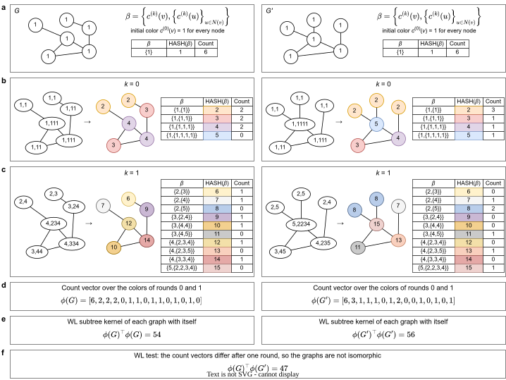

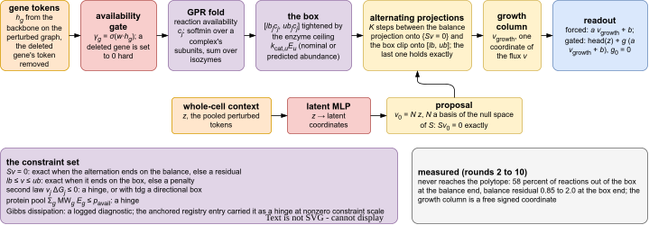

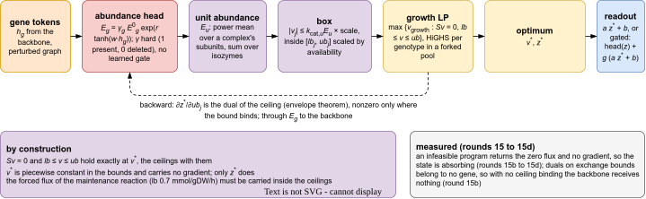

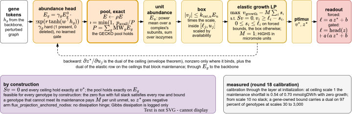

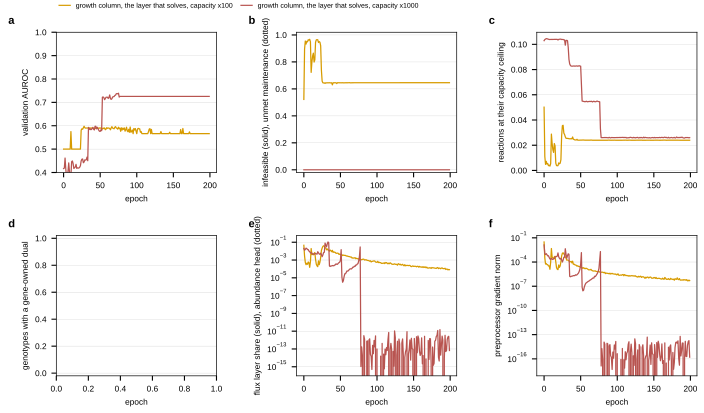

## 2026.09.17 - Round 18 READ: the elastic program removes the absorbing state; the forced column underfits, not overfits

Packs 2321-2324 (w32), 1.6 h each at 24 CPUs. Every cell: 0 infeasible genotypes at every epoch, no unmet maintenance at the selected epoch, a gene-owned dual on 88-90 percent of genotypes, 6-11 percent of gene-owned reactions at their ceiling.

| arm (elastic LP, nodiss arm, scale 0) | seeds 2700, 2701, 2702 | mean | read |
|---|---|---|---|
| forced, x100 | 0.704, 0.741, 0.697 | 0.714 | FAIL (3/3 below bio_s0 0.772/0.781/0.778; none >= 0.80) |
| forced, x1000 | 0.607, 0.826, 0.707 | 0.713 | = the hard program at x1000 (0.615/0.826/0.702): never infeasible there, so elastic == hard |
| forced, x100, pool by construction | 0.704, 0.743, 0.670 | 0.706 | pool never active (factor 1 throughout); = the cell without it |
| gated, x100 | 0.816, 0.810, 0.783 | 0.803 | 3/3 above gate_s0; mean < 0.824 -> FAIL the second clause; = the hard gated x100 (0.800) |

Diagnosis from the histories (the "go deep" read): the forced column UNDERFITS. Its training loss moves 1.41 -> 1.25 (seed 2701) and 1.26 -> 1.25 (2702) in 200 epochs, against 1.33 -> 0.31 for the round-4 free coordinate and 1.26 -> 0.17 for the gated cell; the validation AUROC of the column sits at 0.72-0.79 = the solve's own ranking at initialization (0.73) with a learned sign (seeds 2700/2702 spend epochs 0-60 at 0.23-0.30, the inverted affine, then flip). The gradient is not missing (duals on 90 percent of genotypes, the abundance head receives 10^-3 to 10^-2 of the norm); the path is stiff: a 12-weight linear abundance head shared by every gene, trained at the backbone's rate, moving ceilings whose duals are ~0.01 per mmol/gDW/h. Hypothesis (tested in round 19): the step and the head's capacity, not the path, limit the forced solve.

Round 19 (w34, jobs 2326-2329, submitted 19:20): forced elastic x100 with `--flux-lr-mult 10`; with `--flux-abundance-head-layers 2`; with both; gated with both. Pre-registered: forced PASS = 3/3 above the round-18 elastic cell (paired) AND none below 0.80; the diagnostic is the training loss at the selected epoch against round 18's 1.25.

Example runs (forced elastic x100 seed 2701; gated elastic x100 seed 2701):

<https://wandb.ai/zhao-group/torchcell_028_gene_essentiality/runs/qpaw0oai>

<https://wandb.ai/zhao-group/torchcell_028_gene_essentiality/runs/kxjcktxy>

## 2026.09.17 - The binding set is the same for every genotype: why the ceilings cannot carry the ranking

`lp_dual_overlap.py` (CPU, elastic cell at init, 64 held-out genotypes; `results/lp_dual_overlap.json`): gene-owned reactions with a nonzero dual per genotype, median 8 / 6 / 2 at ceiling scale 30 / 100 / 1000 (of 2,709 gene-owned reactions); union over the 64 genotypes 22 / 96 / 4; median pairwise Jaccard 1.0 at every scale (identical binding sets; the union at x100 is one outlier genotype with 90 binding reactions plus the lethal ones with none); median dual 0.005-0.009 per mmol/gDW/h. The deleted gene's own reactions never bind (closed by the deletion), so the gene's identity enters the value only through the polytope's shape, never through a learnable bound. Consequence: the abundance head can shift one growth level for all genotypes (absorbed by the readout intercept) and cannot re-rank genotypes; the forced column is FBA's ranking (0.73 at init) with a learned sign, whatever the learning rate, head depth or slack. This is the mechanism behind rounds 18 and 19.

Round 19 READ, forced cells (w34, jobs 2326-2328): lr x10 0.705/0.629/0.697 (0.677); two-layer head 0.823/0.754/0.678 (0.752; seed 2700 selects epoch 2); both 0.799/0.691/0.669 (0.720). Training loss at the selected epoch 1.24-1.26 in every cell; the two-layer head reaches 1.07 later in the run while validation decays from an early peak (epochs 2-10), so the deeper head memorizes a little and does not rank. FAIL on both clauses (paired vs round 18: 2/3 up for the head; none of the arms has 3/3 >= 0.80). Gated with both (2329): 0.786/0.790/0.745 (0.774) vs round-18 gated 0.816/0.810/0.783; gates end NEGATIVE (-0.51/-0.45/-0.09): the faster, deeper layer bends the column toward the training set and the head subtracts it. Conclusion: neither the step nor the head's capacity is the limit; the binding set is (see the dual-overlap section). Round 21 (w37, packs written): `--ess-readout gated_flux`, the gated cell plus a zero-initialized linear head over log(1 + |v*|) of the solved flux (all 4,131 reactions, or the exchange reactions), reading what the solve returns rather than its growth column.

## 2026.09.17 - Rounds 20 to 22 designed and queued; the message-passing family and the indicator split

User asks (21:00): every MATH-490 / Gene_Graph network as equations and as baselines (GCN, GAT, GIN, GraphSAGE, RGCN, RGAT; GIN because of the WL link); RGCN/RGAT as multigraph baselines; split `normalized_chrom_pathways` so the gain is attributed to pathways or chromosome.

- `graph_baselines.py --arms relational`: GIN, GraphSAGE on the union; RGCN, RGAT (4 bases) on the nine graphs as nine edge types (`typed_edges`), ProtT5 alone and the three inputs, CPU. `--arms split`: MLP and GCN with ProtT5 + {pathways, chromosome, properties} + FBA, pathways + FBA, pathways alone.
- New embeddings (`OneHotGraphEmbeddingDataset.MODEL_TO_WINDOW` now four flags): `pathways` (173), `chromosome` (17), `normalized_props` (7); registered in the builder; built to `$DATA_ROOT/data/scerevisiae/sgd_gene_graph_hot/processed/`.
- Round 22 (w38, job 2338, one pack of 12 pooled cells): the round-9 recipe (FBA affine) with ProtT5 + pathways, ProtT5 + chromosome, ProtT5 + properties, pathways alone; pre-registered read: paired against round 9 (chromprotfba 0.860/0.866/0.888); the block that matches round 9 on 3/3 carries the gain.
- First split result (CPU MLP): ProtT5 + pathways + FBA 0.876/0.885/0.878 (0.880) > the full indicator's 0.870.
- Round 20 (w36, 2332-2335) and round 21 (w37, 2336-2337: `gated_flux`, the gated elastic cell plus a zero-initialized linear head over log(1+|v*|) of the solved flux, all reactions or the 274 exchanges) are queued behind a node-wide block: another session's `cp -a` of the KG output to /bulk holds ~75 GB dirty pages, the Slurm epilog's `sync` cannot return, and Slurm schedules nothing on a node with a COMPLETING job (jobs 2327-2329 sat in COMPLETING 24+ min; see memory `gilahyper-epilog-six-minutes`).

Round 19 early read (4 of 12 cells): lr x10 0.629/0.697 (seeds 2701/2702), two-layer head 0.678 (2702), both 0.669 (2702); training loss 1.25 at the selected epoch in every cell. Round 20 (w36, jobs 2332-2335, submitted 21:00): gated elastic x100 and gated GEM-box seeds 2703-2705 (six seeds each for the reliable form); forced elastic at ceiling scale 30 with lr x10 (more binding reactions); forced at x100 with abundance reach e^6 and lr x10.

## 2026.09.17 - The indicator split on the cheap models

`graph_baselines.py --arms split` (CPU, 200 epochs, seeds 2700-2702; `results/graph_baselines_split.json`, table `tables/graph_baselines_split.tex`, prose in `2-comparators.tex` after the table). Held-out AUROC, mean of three seeds:

| inputs | MLP | GCN (union of nine) |
|---|---|---|
| ProtT5 + FBA ratios (round-8 table) | 0.803 | 0.832 |
| ProtT5 + full 197-column indicator + FBA (round-8 table) | 0.870 | 0.847 |
| ProtT5 + pathways (173) + FBA | 0.880 | 0.846 |
| ProtT5 + chromosome (17) + FBA | 0.809 | 0.834 |
| ProtT5 + properties (7) + FBA | 0.798 | 0.834 |
| pathways + FBA (no ProtT5) | 0.828 | 0.834 |
| pathways alone | 0.749 | 0.871 |

- The pathway multi-hot is the indicator: it carries the whole MLP gain (0.803 to 0.880), the chromosome one-hot and the seven properties carry none (0.809, 0.798, within one seed spread of 0.803), and the full indicator sits below the pathway block alone (0.870).
- 177 columns of pathways + ratios without ProtT5 (0.828) beat ProtT5 + ratios (0.803).
- The GCN at 200 epochs selects epoch 196-197 in every arm (still climbing; the 400-epoch rows of the round-8 table are the converged comparison). The pathway multi-hot alone is the one input where the graph adds a lot: 0.749 on the MLP, 0.871 on the GCN.
- Round 22 (job 2338) runs the same split on the transformer (round-9 recipe, FBA affine).

Round 20 partial (22:30, W&B poll by job id, `val` = validation AUROC at the latest logged epoch): 2332 gated elastic x100 seeds 2703-2705 at epoch 167, 0.72-0.74, dual rows on 88 percent of genotypes; 2333 gated GEM box seeds 2703-2705 at epoch 81, 0.75-0.76; 2334 forced elastic x30 lr x10 at epoch 98-103, 0.32/0.73/0.56 with one cell at slack row fraction 1.00 (the ATP maintenance bound unmet on every genotype); 2335 forced x100 reach e^6 lr x10 at epoch 98-106, 0.28/0.35/0.56, again one cell at slack fraction 1.00. Partial; the read waits for the selected epoch.

The W&B display names are `run_gilahyper-<job>_<hash>` (the arm sits in the tags), so a `display_name` regex on the round tag finds nothing; poll by job id (`poll_round.py <job>...`).

Pre-registered reads, written before the cells finish (also in `4-module.tex`, sec:round20 and sec:round21):

- Round 20 gated forms (six seeds each): PASS = every seed above its paired round-4 gated cell without the solve (gate_s0, 0.771) AND seed mean >= 0.824 (the GEM-box gated cell's round-15b mean). Forced probes: round 18's read (3/3 above the paired comparator lpelbio100 by seed AND none below 0.80).
- Round 21 gated_flux (all reactions; exchanges): PASS = 3/3 above the round-18 gated elastic cell by seed (lpelgate100 seeds 2700-2702: 0.816/0.810/0.783) AND seed mean >= 0.821 (the affine).
- Round 20 first pack (2332, gated elastic x100 seeds 2703-2705): 0.795/0.808/0.814, selected epochs 88/89/92, gate -1.0/-1.4/-0.8; six-seed mean 0.804 sd 0.013, pooled 0.803 [0.724, 0.880]. Six of six above 0.771; mean below 0.824. The elastic gated cell is reliable and sits 0.02 under the GEM-box gated cell.

Round 20 forced probes, both FAIL (read 23:15): elastic x30 with the flux layer at lr x10 (2334) 0.653/0.548/0.690, the middle seed selected at epoch 2 in the full-slack regime (slack row fraction 1.0); x100 with abundance reach e^6 and lr x10 (2335) 0.669/0.619/0.669, where the two better seeds end with NO gene-owned dual at all (dual row fraction 0.0: the head pushed every ceiling off the optimum) and the third sits in full slack. The wider reach hands the head both exits from the ceilings, off the optimum or under the maintenance, and neither ranks. Runs: 434h9x1a, 4a39gbjb, 2kng23ii; g4v2igem, v1cfvuft, aal0pknp.

Round 23 (w39, jobs 2341-2344, submitted 23:17): the module at the top of the ladder. The split (above) put the pathway multi-hot beside ProtT5 as the input that carries the gain, and round 22 runs the affine on it; round 23 runs the three gated module forms on the same input, `--node-embeddings pathways prot_T5_all`: the gated GEM-box solve (round 15b recipe, `w39_pathlpoffgate`), the gated elastic x100 (round 18, `w39_pathlpelgate100`), the gated elastic x100 with the flux head over all reactions (round 21, `w39_pathlpelgateflux`), and the pooled cell on the same input with no readout as the module-free control (`w39_pathpool`), seeds 2700-2702. Pre-registered read: paired by seed against the round-22 affine on the same input (`w38_protpathfba`) and against `w39_pathpool`; a module form PASSES if 3/3 above the pooled control AND 3/3 at or above the affine. The question is whether the module can deliver the bump the FBA affine delivers once the backbone input is the strong one.

Round 20 READ, complete (23:33; `wave12_readout.py --round w36`, `results/w36_readout.json`, figure `w36_readout_2026-09-17-23-33-07`): GEM-box gated seeds 2703-2705 (2333) 0.818/0.807/0.787, gates -0.95/0.68/0.80 (runs r9ajbwmh, rd26tgvs, hm0u27wt); six-seed lpoffgate 0.814 sd 0.020 pooled 0.816 [0.738, 0.890]; six-seed lpelgate100 0.804 sd 0.013 pooled 0.803 [0.724, 0.880]. 12/12 seeds above gate_s0 (0.771); neither form reaches 0.824 (that was the top of a three-seed spread), both 0.01-0.02 under the affine (0.821: 0.814/0.805/0.844 by seed), inside one sd. Both forced probes FAIL (above). Verdict: the gated layer that solves is a reliable +0.03 to +0.04 over the module-free gated cell and is not distinguishable from the FBA affine at this n; the forced column is closed.

The CPU relational baseline (GIN, GraphSAGE, RGCN, RGAT) printed no arm in 55 minutes at ten cores, so it goes to a card: job 2340 (`gh_graph_baselines.slurm`, `ARMS=relational`), queued behind round 21 and 22.

Two failures at 23:36, both mine, both resubmitted:

- Round 22 (2338, the 12-cell split pack) was submitted at the launcher's 36 GB default and Slurm killed it OUT_OF_MEMORY at 21 minutes with three cells done (protpropsfba s2700 0.816, s2702 0.809; pathfba s2700 0.773). Twelve pooled cells at ~4-5 GB each need ~60 GB; the pack comment said so and the submission did not pass ESS_MEM. The nine unfinished cells are `w38_split_rest.pack`, job 2346 at ESS_MEM=60g. Round 23's paired comparator (`w38_protpathfba`) is among them.
- The relational baseline on the GPU (2340) ran GIN (0.647), GraphSAGE (0.783) and RGCN (0.836) on ProtT5 in under four minutes, then RGAT raised CUDA OOM: `RGATConv` gathers the raw input per edge before the per-relation weight, and 4,874,816 typed directed edges times 1,024 columns is 20 GB. Fix: a linear projection of the input to width 64 before the first RGAT layer (`Net.pre`, RGAT only), so the gather is 1.2 GB; caption and the RGAT entry in `2-comparators.tex` say so. Resubmitted as job 2345.

## 2026.09.18 - Round 21: the head over the solved flux PASSES

Round 21 first pack (2336, `w37_lpelgateflux`, gated elastic x100 + a zero-initialized linear head over log(1+|v*|) of all 4,131 solved fluxes; read 00:22): held-out 0.883 / 0.853 / 0.868 (mean 0.868), selected epochs 66/83/91, validation 0.845/0.833/0.831 at the selected epoch, training loss 0.76/0.61/0.62 (the forced column never left 1.25), gate 0.01/0.05/0.09 (the growth column is unused), flux-head weight norm 3.3/3.9/4.5. Runs gyecb4kf, eypxambu, jjmtd9b3. Pre-registered read: 3/3 above the round-18 gated elastic cell by seed (0.816/0.810/0.783): PASS; mean >= 0.821: PASS. First module cell to pass a read. On the ProtT5 backbone the module now sits 0.047 above the FBA affine (0.821) and level with the affine on the chrom-pathway + ProtT5 backbone (0.871, round 9).

What is measured: the solved flux vector, read by a linear head, carries the ranking; the growth column and its duals do not (gate ~0). Hypothesis (untested): the head reads which reactions the deletion closes and how the optimum reroutes, the same information the pFBA-vector encoding carried at 0.77 on the ladder, and the difference to 0.868 comes from the learned ceilings and the context head. Round 24 (below) separates these.

Round 21 second pack (2337, `w37_lpelgatefluxexch`, the head over the 274 exchange fluxes; read 01:00): 0.831 / 0.856 / 0.817 (mean 0.835, pooled 0.843 [0.760, 0.915]), selected epochs 83/197/89, training loss 0.65/0.79/0.68, gate 0.24/0.32/0.42, weight norm 2.6/5.6/2.6 (runs 88apwipb, 6hhpgq9e, 395wzjty). PASS on both clauses (3/3 above 0.816/0.810/0.783; mean >= 0.821), 0.033 under the all-reaction head. `wave12_readout.py --round w37`, figure `w37_readout_2026-09-18-01-00-11`, table `round_w37.tex`; results paragraph in `4-module.tex` sec:round21.

Round 23 first read (01:19): the pooled control on ProtT5 + pathways with no readout (`w39_pathpool`, 2344) 0.859 / 0.859 / 0.862 (mean 0.860), selected epochs 36/56/46 (runs mwg0hqv4, h5p993rs, 8l9f7ce8). The pathway multi-hot alone lifts the pooled transformer from 0.771 (ProtT5) to 0.860, above every module cell on ProtT5 except the round-21 flux head (0.868). The affine on this input (`w38_protpathfba`, 2346 pending) and the module forms (2341-2343) read against 0.860.

Round 23, the two gated forms without the head (01:30): GEM-box gated on ProtT5 + pathways (2341) 0.862 / 0.871 / 0.869 (mean 0.868), gates 0.07/0.24/0.25 (runs ypsg3ryc, 8kjykj1h, jl2drl8s); elastic gated (2342) 0.859 / 0.872 / 0.869 (mean 0.867), gates -0.00/0.80/-0.21 (runs tpfgdw5q, zp7pp2gh, 8d37aj7p). Against the control 0.8586 / 0.8590 / 0.8623: the GEM-box form is above on 3/3 by 0.004 to 0.012; the elastic form is above on 2/3 and IDENTICAL to the control on seed 2700 (0.8586 = 0.8586, gate exactly 0: with the gate at zero the cell's logits are the pooled cell's and the flux path gets no gradient, so the two runs are the same model). Neither clause about the affine can be read until `w38_protpathfba` lands (2346). The flux-head form on this input (2343) is at epoch ~110.

Round 23, the flux head on ProtT5 + pathways (2343, `w39_pathlpelgateflux`; read 01:58): 0.897 / 0.716 / 0.903, selected epochs 100/150/81, training loss 0.55/1.02/0.74, gate -0.04/0.03/-0.05, weight norm 4.5/5.8/3.7 (runs 4iu16p5d, mpfeyqwx, 5rr2mzbz). Seeds 2700 and 2702 are the two highest single cells in the document (the reported 0.893 is a five-fold ensemble; the best single cell before this was 0.888 on the round-9 recipe); seed 2701 never fit (training loss 1.02 at its selected epoch against 0.55 to 0.74) and reads 0.716. Against the control 0.859/0.859/0.862 the form is above on 2/3 by 0.04 and far below on 1/3: FAIL on the 3/3 clause as pre-registered, with a seed mean of 0.839 that the one seed sets. The seed-2701 trace is below.

Traces (every 20 epochs): seeds 2700 and 2702 hold a training loss near 0.95-1.0 until epoch 60-80, then fall to 0.55 (ep 100) and 0.2-0.3 (ep 120-180), with validation peaking at 0.85 (ep 64 and 72) and decaying to 0.78 by ep 180; seed 2701 stays at 0.95-1.04 for all 200 epochs, validation 0.69-0.72 with one spike to 0.83 at ep 150 (the selected epoch, a single-epoch outlier). The flux-head weight norm grows the same way in all three (to 4.5-6.8), slack 0 and dual rows 0.89 throughout, gradient max 8-65 with no spike at the transition. So the two good seeds pass through a late fitting transition and seed 2701 does not reach it in 200 epochs. Hypothesis (untested): the transition is delayed rather than absent on seed 2701, and a longer budget or more seeds would show it; the round-21 cells on ProtT5 alone fit earlier (training loss 0.61-0.76 at selected epochs 66-91). Not measured: whether seed 2701 fits at 400 epochs.

Round 22 READ (02:04, `wave12_readout.py --round w38`, figure `w38_readout_2026-09-18-02-04-13`): ProtT5 + pathways + FBA affine 0.889 / 0.895 / 0.885 (mean 0.890, pooled 0.890 [0.834, 0.942]; runs 8e9qz9v0, 7b2x47sv, qt3qgz6d) against the round-9 full indicator 0.860 / 0.866 / 0.888 (0.871): above on 2/3 by 0.03 and under by 0.003 on seed 2702; mean +0.019. ProtT5 + chromosome + FBA 0.824 / 0.821 / 0.789 (0.811; j9493ny6, e5ix8np5, hpi7wpvd, the third from the single-cell rerun 2351); ProtT5 + properties + FBA 0.816 / 0.846 / 0.809 (0.824; f6jiughi, qrke59kr, ok7fm2eq); pathways + FBA without ProtT5 0.773 / 0.760 / 0.766 (0.766; whhry62m, upai3mfr, xsnhm9df). Same picture as the cheap models: the pathway block carries the gain, chromosome and properties sit at the ProtT5 + FBA level (0.821), and the pathway block alone without ProtT5 is 0.77 on the transformer (0.83 on the MLP). Best single cells in the document are now protpathfba at 0.895 and the round-23 flux head at 0.903/0.897.

Round 23 READ (02:04, `--round w39`, figure `w39_readout_2026-09-18-02-04-19`): control 0.860; affine on the input 0.890; GEM-box gated 0.868 (3/3 above control, 0/3 at the affine); elastic gated 0.867 (2/3 above control, 0/3 at the affine); flux head 0.897 / 0.716 / 0.903 (2/3 above both the control and the affine; pooled logits 0.907 [0.856, 0.952]). No module form passes as pre-registered; the flux head is the only one that reaches past the affine, on the two seeds that fit.

Round 25 (w41, submitted 02:08): the round-23 flux-head cell on ProtT5 + pathways (a) on the five cross-validation folds (`w41_pathfluxcv_a` folds 0-2, `w41_pathfluxcv_b` folds 3-4; scored by `cv_ensemble_readout.py --prefix w41_pathfluxcv`, the protocol of the reported 0.893) and (b) on seeds 2703-2705 (`w41_pathlpelgatefluxs3`, stems `w39_pathlpelgateflux_*_s2703-2705` so `--round w39` pools six seeds). Pre-registered read: (a) the fold ensemble is read against the reported 0.893 (chromprotcv, round 12) as the headline comparison, no pass rule, the number is what it is with its gene bootstrap; (b) the six-seed read of the pathway flux head against the control and the affine by seed, and the count of seeds that do not fit (training loss above 0.9 at the selected epoch) out of six.

Relational baselines DONE (job 2350, 12.5 min on one card; `results/graph_baselines_relational.json`, table `tables/graph_baselines_relational.tex`, prose in `2-comparators.tex` sec:mp-architectures). Held-out AUROC, three seeds, 200 epochs:

| model | ProtT5 | ProtT5 + chrom-pathway + FBA |
|---|---|---|
| GCN, union (round-8 table) | 0.834 | 0.847 |
| GIN, union | 0.665 | 0.705 |
| GraphSAGE, union | 0.783 | 0.887 |
| RGCN, nine typed | 0.836 | 0.860 |
| RGAT, nine typed (one GATv2 per relation) | 0.852 | 0.889 (0.887/0.885/0.895) |

RGAT on the three inputs is the strongest cheap model (level with protpathfba on the transformer, 0.890; MLP 0.870). GIN is the weakest and selects epochs 171-195 on 5/6 seeds (still moving at 200 epochs).

Round 24 first pack (2348, the round-21 cell on seeds 2703-2705; read 03:02): 0.856 / 0.847 / 0.864 (runs 9d68thps, a10lrw82, wyhqfpel), training loss 0.57-0.70, gate -0.03 to -0.07. Six-seed lpelgateflux mean 0.862, every seed above its paired gated elastic cell (2703-2705: 0.795/0.808/0.814); six-seed read PASSES both clauses.

## 2026.09.18 - GO as a gene encoding, the linear rung on pathways, baseline clarifications

User asks (03:00): a linear model on the pathway block alone; how graph coloring does; whether GraphSAGE and GCN run on individual graphs or on the relational stack; GO as a gene encoding ("if pathways did so well ... GO will do very well"), built in the source tree as a reusable starting vector like chromosome and pathways.

- `torchcell/datasets/go_term_hot.py`: `GOTermEmbeddingDataset(root, genome, model_name)`, one column per GO term from the SGD GFF `Ontology_term` attributes (via `SCerevisiaeGene.go`), propagated to ancestors through is_a and part_of (goatools `GODag(optional_attrs={"relationship"})`), namespace roots dropped, a term floor `min_genes`. Sidecar `<model>.terms.json` with term id, name, namespace, gene count, and the 48 GFF ids the current OBO no longer carries. Registered in `NodeEmbeddingBuilder` as `go` (propagated, all namespaces, >= 10 genes: 2,362 columns), `go_direct` (annotations only, >= 2 genes: 2,887), `go_bp` (1,580), `go_mf` (430), `go_cc` (352); 5,501 of 6,607 genes annotated. Built under `$DATA_ROOT/data/scerevisiae/go_term_hot/processed/`. Caveat recorded in the module docstring: SGD annotates from mutant phenotypes (IMP) and the GFF has no evidence codes, so some columns encode deletion-derived knowledge; an evidence filter needs the gene association file (not read).
- Ladder rungs added to `logistic_baselines.py` ENCODINGS: `pathways`, `chromosome`, `go`, `go_direct`, `go_bp` (running `--only-missing` on CPU, task bsh3l96ga).
- `graph_baselines.py --arms go` (job 2362, GPU): MLP and GCN on ProtT5 + GO (+ BP, + direct) + FBA, GO + FBA, GO alone, ProtT5 + GO + pathways + FBA -> `results/graph_baselines_go.json`.
- Round 26 (w42, jobs 2363/2364, 40 GB packs of six pooled cells): the round-9 recipe (FBA affine) with `--node-embeddings go prot_T5_all`, `go_bp prot_T5_all`, `go` alone, `go pathways prot_T5_all`, seeds 2700-2702. Pre-registered read: paired against the round-22 pathway cell (0.889/0.895/0.885) by seed; GO beside ProtT5 at or above it on 3/3 says GO carries at least what pathways carry; GO + pathways above the pathway cell on 3/3 says the two annotations add.
- Baseline clarifications for the reply: GCN, GraphSAGE and GIN run on ONE untyped edge set (the union of the nine graphs; GCN also on the physical graph alone in the base table); RGCN and RGAT run on one node set with nine edge types (one weight or one attention per graph, summed), no mixing beyond that. Graph coloring (1-WL) separates 1,118/1,121 deletion graphs on the physical graph and all on the union, and the WL kernel rung is at chance (0.49/0.56): structure carries no signal on this endpoint.

COVERAGE (from the built tensors, `tables/gene_encodings.tex`): the pathway multi-hot is nonzero for only 517 of 6,607 genes; GO propagated covers 5,501, GO direct 5,492, BP 4,909, MF 4,146, CC 5,256; ProtT5, chromosome and properties 6,607. So the pathway block's 0.08 could be "annotated to any pathway" (a metabolic-enzyme flag) rather than which pathway. Control added to `--arms go` (job 2362, script read at run time): MLP and GCN on ProtT5 + a one-column "pathway any" + FBA. Hypothesis (untested): the single column carries most of the block's gain.

LADDER RUNGS (03:22, `logistic_baselines.py --only-missing`; CV inside the training genes, held-out on the 195): the user's "linear on pathway": logistic on the 173-column pathway multi-hot alone 0.771 held-out (CV 0.673), +FBA 0.822 (CV 0.800), i.e. the ProtT5 + FBA level (0.821) from 177 columns. GO propagated: logistic alone 0.808 (CV 0.831), +FBA 0.833 (CV 0.860); random forest +FBA 0.844 (CV 0.877, the highest CV of any rung; the previous best CV was the reaction-statistics RF at 0.847); SVC +FBA 0.842. GO BP: logistic +FBA 0.812; GO direct (no propagation): logistic +FBA 0.787, RF +FBA 0.830. So GO alone, linearly, is the strongest single gene encoding on the ladder (0.808 without any solve; ProtT5 logistic 0.763), and the propagated form beats the direct form on every model. The previous best selected rung (chrom-pathways logistic + FBA, 0.830) is matched by GO logistic + FBA (0.833) and passed by GO RF + FBA (0.844).

Round 24 second pack (2347, `w40_lpoffgateflux`, the flux head over the GEM-box solve, no ceilings and no abundance head; read 03:25): 0.873 / 0.836 / 0.847 (mean 0.852), selected epochs 68/164/49, training loss 0.91/1.02/0.77, gate -0.02/0.09/-0.01, weight norm 3.0/4.9/2.9 (runs qphon9t7, zmh1gb89, et04tln8). Against round 21 (0.883/0.853/0.868) by seed: below on 3/3, by 0.010/0.017/0.021. By the pre-registered rule the learned ceilings ARE needed; the size of what they add is 0.01-0.02, inside one seed sd of either arm. What the GEM-box head shows on its own: a fixed flux vector (nothing learned in the layer; the vector is a function of the deletion alone) read by a linear head beside the context head reaches 0.852, 0.03 above the affine and 0.08 above the ladder's pFBA-vector rung (0.771 linear). Hypotheses (untested): the difference to the ladder rung is the transformer's context head and the class-weighted training rather than the vector; and the growth-LP argmax is a vertex HiGHS picks among alternative optima, not the parsimonious point, so the vector the head reads is not the pFBA vector the ladder read.

## 2026.09.18 - Which genes the best cells misrank (hard_genes.py)

`hard_genes.py` (results/hard_genes.json, figure `hard_genes_<ts>`): per held-out gene, the misrank (fraction of the other class on the wrong side) averaged over the cells of five arms: pathway + ProtT5 + affine (3), the round-12 folds (5), the flux head on ProtT5 (6), the flux head on pathway + ProtT5 (3), ProtT5 + affine (3).

- The solve's own call splits the essential genes. 19 of the 31 essential held-out genes have an FBA growth ratio of 1.0 on YPD (the solve calls them dispensable); 14 of the 15 hardest essential genes are among those 19, while 8 of the 15 easiest have ratio 0. The hardest essential genes are the ones FBA misses, and every model misses them with it: FRQ1 (YDR373W), AUR1 (YKL004W), PGA3 (YML125C), CDC19 (YAL038W, pyruvate kinase, masked in the GEM by the PYK2 isozyme), PET9 (YBL030C, the ADP/ATP carrier, masked by AAC1/AAC3), LCB1/LCB2 (YMR296C, YDR062W, serine palmitoyltransferase), NEO1 (YIL048W).
- The hardest nonessential genes are metabolic paralogs the models call essential: TDH1/TDH2/TDH3 (YJL052W, YJR009C, YGR192C, the three GAPDH isozymes), ERG4 (YGL012W), ATP2 (YJR121W), GSH2 (YOL049W), TRR2 (YHR106W), FBP1 (YLR377C), HMG2 (YLR450W), ACS1 (YAL054C): 12 of 15 have FBA ratio 1.0 and many pathway and GO annotations (GO counts 26-125).
- Both failure sets are isozyme redundancy read the wrong way: an essential gene whose GEM paralog covers it in the solve (ratio 1.0) and a nonessential paralog of an essential metabolic function that the annotation vectors make look essential.
- Agreement (Spearman of per-gene misrank between arms): the two affine cells 0.81; the flux head on ProtT5 against ProtT5 + affine 0.88 (same failures); the flux head on the pathway input against the others 0.44-0.67 (the least aligned, and the one with an unfit seed inside its mean). Per-arm class misrank means: 0.110 (pathway affine), 0.119 (round-12 folds), 0.138 (flux head ProtT5), 0.161 (flux head pathways), 0.179 (ProtT5 affine).
- Hypothesis (untested): a paralog-aware input (the GPR OR rule with an expression weight, or the isozyme count of a gene's reactions) would move the fourteen; the pFBA-vector encoding cannot, since the solve reroutes through the paralog.

Round 24 third pack (2349, `w40_lpelgatefluxgene`, the head over the 2,709 gene-owned fluxes; read 03:40): 0.871 / 0.860 / 0.853 (mean 0.861), selected 93/86/75, training loss 0.66-0.73, gate 0.04-0.08 (runs zr4c2tt5, c2hew7xf, 7df6c90h). Against the all-reaction head (0.883/0.853/0.868): below on 2/3, above on 1/3, undecided at n=3, means 0.861 vs 0.868. The exchange-only head (0.835) is the one that loses; the gene-owned columns carry the head. ROUND 24 COMPLETE: (a) GEM box 0.852 (ceilings add 0.01-0.02, 3/3), (b) gene-owned 0.861 (= all), (c) six seeds 0.862 PASS.

Round 25 first pack (2352, folds 0-2 of the pathway flux-head cell; read 04:02): fold 0 0.901 (loss 0.75), fold 1 0.702 (loss 1.01, UNFIT), fold 2 0.859 (loss 0.20, sel 132) (runs muabvea4, 1x1ks7t7, yrz6kyjc). Two of the six cells of this form so far (seed 2701, fold 1) never pass the fitting transition; the ensemble will carry the unfit fold.

Round 26 first pack (2363, 32 min for six pooled cells at 40 GB; read 04:12): GO propagated + ProtT5 + FBA affine 0.830 / 0.827 / 0.842 (mean 0.833; runs xhi7c866, b9bc5865, j49fl4a4), selected 123/48/62; GO BP + ProtT5 + FBA 0.805 / 0.832 / 0.826 (0.821; 393q643v, iyabgjqr, hta2gegb), selected 180/160/104. Against the round-22 pathway cell (0.889/0.895/0.885): below on 3/3 by 0.05-0.07; level with ProtT5 + FBA alone (0.821). So the transformer takes nothing from the 2,362-column GO vector that it did not have from ProtT5, where the ladder's logistic regression took 0.808 from GO alone and 0.833 with the ratios (= this cell's mean). Not measured: why; hypotheses (untested): the width-12 preprocessor on a 3,386-column input, the density of the GO rows (5,501 genes nonzero, mean ~40 terms per gene) against the sparse pathway rows (517 genes), late selected epochs (123-180) on four of six cells pointing at a slower fit. The cheap-model arms (2376) and the GO-alone / GO+pathways cells (2364) are the next reads.

Round 25 ENSEMBLE (04:20, `cv_ensemble_readout.py --prefix w41_pathfluxcv`): folds 0.901 / 0.702 / 0.859 / 0.904 / 0.687 (fold mean 0.811), ensemble 0.897 [0.843, 0.947] vs the reported 0.893 [0.84, 0.94]: one number. Folds 1 and 4 are UNFIT (loss ~1.0), so 3 of 8 cells of the pathway flux-head form have missed the transition. By the round-17 rule (fold models above round 12's on >= 4/5: here 2/5) 0.893 STANDS. The fit folds (0.90) are the highest fold models in the document.

Round 26 COMPLETE (2364; read 04:35, `--round w42`): GO alone + FBA 0.810 / 0.787 / 0.804 (0.800; xgkbxlqb, gjxwrz00, 3jjgnltg; selected 28/11/139); GO + pathways + ProtT5 + FBA 0.852 / 0.852 / 0.844 (0.849; w47jiu74, zkepzdwb, rz2tbgz3). Both pre-registered clauses FAIL: GO beside ProtT5 (0.833) is below the pathway cell (0.890) on 3/3, and ADDING GO to the pathway cell drops it 0.04 on 3/3 (0.889/0.895/0.885 -> 0.852/0.852/0.844). On the transformer the 2,362-column GO vector is at best neutral and beside the pathway block a cost, where on the ladder it is the best encoding. Not measured: why. The cheap-model GO arms (2376) will say whether an MLP on the same three inputs loses too.

GO CHEAP MODELS (job 2376, `--arms go`, GPU, 200 epochs; read 04:40): MLP / GCN(union): ProtT5 + pathway-any + FBA 0.774 / 0.832 (the one-column control carries NONE of the pathway block's gain: which pathway matters, not whether there is one); ProtT5 + GO + FBA 0.855 / 0.887; ProtT5 + GO BP + FBA 0.819 / 0.885; ProtT5 + GO direct + FBA 0.848 / 0.877; GO + FBA 0.818 / 0.891; GO alone 0.806 / 0.888. So graph convolution on the GO multi-hot ALONE (no sequence, no solve) reads 0.888, level with the transformer's best single cell (0.890) and the MLP on the three inputs (0.870); the GCN selects epochs 183-197 (still rising at 200). The transformer's 0.833 on GO beside ProtT5 (round 26) is the outlier, not the vector.

Round 27 rate (04:40): the cached GEM-box cells (2368, six per card, TC_LP_WORKERS=4) are at epoch 25 after 29 min, about 1 min/epoch, with the card at 92 percent utilization; the uncached LP cells ran three per card at about 30 s/epoch. So per cell the cache buys nothing visible at this packing and the card is the bottleneck, not the solve: the flux layer's forward on the GPU (the GPR fold and the bounds over 4,131 reactions per sample, the log1p head) is what six cells contend for. Not measured: the cache hit rate (not logged) and the per-batch split between the solve and the layer's GPU work; the earlier reading that the GPU idles during the solve (0-13 percent at three cells per card) and this one (92 percent at six) are both measurements and the second is the one that says where the time goes when the solve is cached. Expected finish ~07:30 (2368) and ~07:15 (2369).

GO GCN AT 400 EPOCHS (job 2377, `--arms go400`, 2.5 min; read 04:42; `results/graph_baselines_go400.json`): GO alone 0.912 / 0.910 / 0.904 (mean 0.909, sd 0.003, selected 397/395/382); GO + FBA 0.905 / 0.904 / 0.913 (0.908); ProtT5 + GO + FBA 0.900 / 0.899 / 0.905 (0.901). THE HIGHEST SINGLE MODEL IN THE DOCUMENT: a two-layer GCN over the union of nine gene graphs on the 2,362-column GO multi-hot, no sequence, no solve, 43 s per seed, above the transformer's best cell (0.895) and the reported ensemble's point (0.893, inside its interval [0.84, 0.94]). Still selecting epochs 382-397: not converged at 400. Next: 800 epochs, and the five-fold ensemble of this model for the headline comparison under the same protocol.

Round 25 seeds (2354, `w41_pathlpelgatefluxs3` -> stems w39_pathlpelgateflux s2703-2705; read 04:50): 0.890 / 0.752 / 0.911 (ycozyo9g, 1rj1zlxq, tp0lboxw), training loss 0.74 / 1.15 / 0.85, seed 2704 UNFIT. Six seeds of the pathway flux head: 0.897, 0.716, 0.903, 0.890, 0.752, 0.911; four fit at 0.890-0.911, two unfit; mean 0.845 sd 0.087; POOLED per-gene logits over six seeds 0.910 [0.861, 0.954] (the seed ensemble tolerates the unfit seeds). With the folds: 4 of 11 cells of this form miss the transition. The six-seed read against the control (0.860) and the affine (0.890): 4/6 above both, 2/6 far below; FAIL as pre-registered, and the pooled-logit number is the document's highest bootstrap point.

GO GCN AT 800 EPOCHS (job 2379, 85 s per arm; read 04:53): GO alone 0.905 / 0.911 / 0.901 (0.906); + FBA 0.906 / 0.909 / 0.908 (0.907); + ProtT5 + FBA 0.904 / 0.900 / 0.904 (0.903). Same as 400 (0.909 / 0.908 / 0.901): the curve is flat past 400; the late selected epochs (755-797) are the selection rule on a plateau. GO-GCN single model = 0.905-0.91 on both budgets. The 5-fold ensemble (2380, 400 and 800 epochs) is running.

GO GCN FIVE-FOLD ENSEMBLE (job 2380, `--arms go_folds`, `results/graph_baselines_go_folds.json`; read 05:04): 400 epochs: folds 0.910 / 0.893 / 0.918 / 0.916 / 0.907 (fold mean 0.909), ENSEMBLE 0.917 [0.870, 0.955]; 800 epochs: folds 0.905 / 0.900 / 0.914 / 0.911 / 0.908 (0.908), ensemble 0.915 [0.867, 0.953]. Against the reported transformer ensemble 0.893 [0.84, 0.94] (folds 0.860 / 0.899 / 0.889 / 0.876 / 0.884): the GO-GCN folds are above on 4/5 (fold 1: 0.893 vs 0.899), the fold mean +0.028, the ensemble +0.024 with overlapping intervals. THE HIGHEST NUMBER IN THE DOCUMENT, from a two-layer GCN over the union of nine gene graphs on the GO multi-hot alone, no sequence, no solve, ~2 min for the five folds on one card. The "three architectures are one number" finding (MLP 0.886, GCN 0.888, transformer 0.893 on the three inputs) now has a fourth point above it: the input (GO) plus the graph, not the architecture, moved it.

Not done: the hard-genes analysis on the GO-GCN (does the graph on GO fix CDC19/PET9?): `graph_baselines.py` does not write per-gene logits into its result JSON (test_genes/test_logits are dropped on dump), so a rerun that saves them is needed first. Round 28 (w44, job 2378): the GO cells at width 24 with a two-layer preprocessor. `--arms go_rel` (2381): RGCN, RGAT, GraphSAGE on GO alone and GCN on GO + pathways, 400 epochs.

Round 28 READ (2378, 34 min; read 05:16): GO + ProtT5 + FBA at width 24 with a two-layer preprocessor (5.8M parameters) 0.847 / 0.841 / 0.838 (0.842; 3gndo9gj, pd3voixw, ykxwp50w) vs width 12 0.830 / 0.827 / 0.842: above on 2/3 by 0.01-0.02, level on the third; GO + pathways + ProtT5 + FBA wide (6.4M) 0.849 / 0.855 / 0.853 (0.852; 5mcg2gou, ox79qi84, meeud5ky) vs 0.852 / 0.852 / 0.844: level. The preprocessor's width is NOT what keeps the transformer from reading GO; a 350x larger cell reads it the same. The hypothesis stands open (the input's density? the pooled readout? not measured). `--arms go_rel` partial: RGCN on GO alone at 400 epochs 0.831 / 0.829 / 0.869 (0.843), well BELOW GCN on the union (0.909): the typed edges with basis-shared weights lose on GO where they gained on the three inputs.

OTHER MESSAGE PASSING ON GO (job 2381, `--arms go_rel`, 400 epochs; read 05:23): RGCN on GO alone 0.831 / 0.829 / 0.869 (0.843); RGAT 0.829 / 0.844 / 0.859 (0.844); GraphSAGE 0.822 / 0.824 / 0.823 (0.823); GCN on GO + pathways 0.906 / 0.902 / 0.906 (0.905, = GO alone 0.909: the pathways add nothing on top of GO). Plain symmetric-normalized convolution is the one aggregator that takes GO to 0.91; every form with a separate self-weight or typed edges (SAGE, RGCN, RGAT) sits at 0.82-0.84, where on the three inputs those forms were level with or above GCN. Hypothesis (untested): on GO the signal is the neighborhood's annotations smoothed over the graph (a label-propagation-like effect the normalized mean gives), and a separate path for the node's own 2,362 columns lets the model fit them instead. Rerun as 2385 for clean row labels.

HARD GENES WITH THE GO CONVOLUTION (05:26, `graph_baselines.py --arms go400 --save-logits` job 2383, then `hard_genes.py`; figure `hard_genes_2026-09-18-05-26-10`): the GO-GCN's per-gene misrank correlates with the transformer arms' at only 0.20-0.42 (they correlate 0.6-0.9 among themselves); its essential-class mean misrank 0.091 vs the pathway cell's 0.110. On the hard essential genes: FRQ1 0.44 -> 0.17, AUR1 0.48 -> 0.22, PGA3 0.37 -> 0.11, LCB1 0.14 -> 0.03, LCB2 0.15 -> 0.01; worse on NEO1 (0.17 -> 0.60) and PET9 (0.30 -> 0.38). Nonessential: fixes 12 (misrank > 0.3 under the pathway cell to < 0.1): YAL054C ACS1, YBR111C YSA1, YDL100C, YDL215C, YFR019W, YGR106C VOA1, YHR106W TRR2, YJL046W, YJL052W TDH1, YJR121W ATP2, YLR377C FBP1, YNL054W; breaks 6: YBR263W, YCL004W, YDR297W, YER099C, YKR080W, YLR056W. Different failure sets -> the case for averaging the two models (not measured).

FAMILY AVERAGES (`family_ensembles.py`, `results/family_ensembles.json`; 05:30; post hoc, equal weights, standardized per-cell logits averaged over seeds, nothing fitted, scored once on the 195): GO-GCN (3 seeds) 0.909 [0.85, 0.95]; pathway affine (3) 0.891; pathway flux head (6, two unfit) 0.911; GO-GCN + pathway affine 0.933 [0.888, 0.970]; GO-GCN + pathway flux head 0.941 [0.895, 0.975]; GO-GCN + ProtT5 flux head 0.923; all three 0.935. Seven averages tried, all listed; 0.941 is the max of seven post hoc choices. The fold-protocol version is NOT measured (go_folds does not save logits). Section 3 subsection sec:family-ensembles; table `family_ensembles.tex`.

FAMILY AVERAGES UNDER THE FOLD PROTOCOL (`family_ensembles.py --folds`, `results/family_ensembles_folds.json`, GO fold logits from job 2386 `--arms go_folds --save-logits`; 05:35): GO-GCN folds alone 0.917 [0.870, 0.955]; round-12 indicator folds 0.897; round-25 pathway flux-head folds 0.897; GO-GCN + indicator 0.944 [0.905, 0.975]; GO-GCN + pathway flux head 0.949 [0.914, 0.978]; all three 0.945. Six tried, all listed; 0.949 = max of six. The interval of the best average excludes the reported 0.893 point. go_rel rerun (2385) confirms: RGCN 0.843, RGAT 0.845, GraphSAGE 0.823, GCN GO+pathways 0.904.

Round 27 fold pack (2369, five cached GEM-box cells at 48 GB) OUT_OF_MEMORY at 2:17 h, all five cells killed (exit 137), no result files; sacct MaxRSS 105 GB (summed over the forked LP workers, so not the cgroup number). The six-seed pack (2368) is still running at 2:25 h with a batch MaxRSS of 119 GB by the same measure. Hypothesis (untested, being checked by sampling RSS): the per-genotype cache misses every epoch (keys differ) and grows by ~100 MB per epoch per cell; the alternative is the plain footprint of six LP cells plus their worker pools. Either way the cache did not deliver the speedup it was built for at this packing, and the fold read of the scalable form is not measured.

ROOT CAUSE OF THE PACK OOMs (06:45): `freeze_and_submit.sh` never passed ESS_MEM to sbatch; the launcher's fixed `#SBATCH --mem=36g` applied to every pack (sacct ReqMem 36G for 2338, 2346, 2363, 2368...). The cgroup of the six-cell cached pack 2368 sits at 35.6 GB anon of a 38.7 GB ceiling at 2:27 h; an LP cell's main process is 12-14 GB (ps RSS; the single 400-epoch cell 2387 is 14.6 GB in its cgroup), a pooled cell 4-5 GB. The cache was never the memory problem and the six-cell packing was never viable at 36 GB. Fix: `sbatch --mem="${ESS_MEM:-36g}"` in `freeze_and_submit.sh` (commit 616f308b6); memory `ess-mem-was-never-wired`. Round 27 resubmitted as three pairs at 40 GB (2388-2390, TC_LP_WORKERS=6); 2368 left to run or die (no cancellations).

ROUND 27 READ, three cells (2368's survivors, seeds 2701-2703; 06:45): the cached GEM-box flux head on ProtT5 + pathways reads 0.911 / 0.901 / 0.903 (mean 0.905), selected epochs 55/76/78, training loss 0.53/0.77/0.57, gate 0.00-0.04, 139 min wall at six per card (runs 9jvy1ih9, i03lqyi5, zve1pu8s). ALL THREE FIT, including seed 2701, the seed the elastic form never fit (0.716). Against the control (0.859/0.862 on 2701/2702) 3/3 above; against the affine (0.895/0.885) 2/2 above on the paired seeds. THE SCALABLE FORM (nothing learned in the layer, the program a function of genotype and medium) matches the best elastic cells (0.89-0.91) with no unfit seed among three. Seeds 2700, 2704, 2705 rerunning in pairs at 40 GB (2388-2390) together with duplicates of 2701-2703 (same stems; the first results are backed up in the scratchpad).

Round 24 (w40, submitted 00:30, three LP packs): what carries round 21. (a) `w40_lpoffgateflux`: the same flux head over the GEM-box solve (`flux_off` + LP, no learned ceilings, no abundance head); if it matches round 21 the solved flux vector alone carries the result and the enzyme-constrained part adds nothing; if it falls to the ladder's pFBA-vector level (0.77) the learned ceilings are doing the work. (b) `w40_lpelgatefluxgene`: the head over the 2,709 gene-owned reactions only (`--ess-flux-head-reactions gene`). (c) `w40_lpelgatefluxs3`: the passing cell on seeds 2703-2705 (ESS_OUT keeps the `w37_lpelgateflux` stem so the readout pools six seeds). Pre-registered read: (a) and (b) are read against the round-21 cell by seed; (a) at or above round 21 on 3/3 means the ceilings are not needed; (a) below on 3/3 means they are; anything else is undecided at n=3. (c) extends the round-21 read to six seeds (6/6 above 0.816/0.810/0.783 paired where seeds match, mean >= 0.821).

The module diagram for round 21 is `notes/assets/drawio/028-module-gated-flux.drawio` (from `028-module.gen.py`), exported to `notes-tex/028-gene-essentiality/figures/module_gated_flux.pdf`:

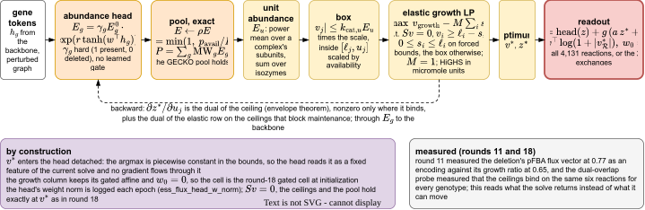

## 2026.09.18 - Round 29: the unfit seed under a 400-epoch budget

Job 2387 (pack `w45_unfit_seed_e400.pack`): the round-23 flux-head cell on ProtT5 with the pathway multi-hot, seed 2701, rerun for 400 epochs. Its 200-epoch run (round 23) never fit, training loss 0.95 throughout, held-out AUROC 0.716. The 400-epoch run of the same program and seed fits between epochs 60 and 80 (training loss 0.98 at 60, 0.50 at 80, 0.07 at 399), selects epoch 82 and reads 0.889 [0.84, 0.94]. The learning rate is constant, so the first 200 epochs are the same program; the two runs diverge from the first epoch (train loss 1.128 vs 1.125) and are unrelated by epoch 50. The transition is a chance event of the run, not the seed. Across the seventeen elastic flux-head cells (w37 six seeds, w39 six seeds, w41 five folds) the training loss first falls under 0.6 at epochs 39 to 137 in fourteen and never in three; the two latest fits (136, 137) read 0.864 and 0.702 held out. Past the transition the 400-epoch run overfits (val 0.836 at 82, 0.70 at 399). Readout `wave12_readout.py --round w45` (the arm tag takes a `400` suffix for `_e400_` stems); section `sec:round29` in `notes-tex/028-gene-essentiality/sections/4-module.tex`.

- <https://wandb.ai/zhao-group/torchcell_028_gene_essentiality/runs/26nt67f2>

## 2026.09.18 - Round 27 rerun on six seeds (jobs 2388 to 2390)

The scalable form (cached GEM-box solve, nothing learned in the layer, zero-init flux head) on ProtT5 with the pathway multi-hot, seeds 2700 to 2705 in pairs at 40 GB: 0.902, 0.772, 0.897, 0.917, 0.903, 0.901 (pooled 0.917 [0.87, 0.96], above the elastic form's 0.910 on the same six seeds); selected epochs 42 to 61; 83 min per cell at two per card. Seed 2701 did NOT fit this time (train loss 1.04) after fitting in the first attempt (0.911, job 2368): the chance event of round 29 repeats on a form with the solve cached, so the layer's ceilings are not where it enters. The first attempt's three survivors are kept as arm `pathlpoffgatefluxfirst` (result copies without `dump_path`, since the rerun overwrote the per-gene dumps under the same stems). Nine runs of the form: eight fit at 0.897 to 0.917. Fold pack resubmitted at 120 GB as job 2391. Readout `wave12_readout.py --round w43`.

- <https://wandb.ai/zhao-group/torchcell_028_gene_essentiality/runs/8k2gr4hd>
- <https://wandb.ai/zhao-group/torchcell_028_gene_essentiality/runs/6790li4r>
- <https://wandb.ai/zhao-group/torchcell_028_gene_essentiality/runs/uiujnhyi>
- <https://wandb.ai/zhao-group/torchcell_028_gene_essentiality/runs/qtdfayw7>
- <https://wandb.ai/zhao-group/torchcell_028_gene_essentiality/runs/gkr9i7wg>
- <https://wandb.ai/zhao-group/torchcell_028_gene_essentiality/runs/xgurl6hd>

## 2026.09.18 - Six-seed reads of the best models: GO convolution, hard genes, family averages

GO GCN on six seeds (job 2392, `graph_baselines.py --arms go400 --seeds 2700..2705 --save-logits`, `results/graph_baselines_go400_s6.json`): GO alone 0.912, 0.909, 0.902, 0.898, 0.901, 0.905 (mean 0.905, sd 0.005); with the ratios mean 0.907; beside ProtT5 mean 0.900. Fold ensemble with three seeds per fold (job 2393, `--arms go_folds --seeds 2700 2701 2702`, `results/graph_baselines_go_folds_s3.json`): 0.917 [0.87, 0.95] at 400 epochs, 0.915 at 800, the same as one seed per fold. Hard genes rerun with the round-27 six-seed arm and the six-seed GO arm (`hard_genes.py`): thirteen of the fifteen hardest essential genes have FBA ratio 1.0 (was fourteen with five arms); PFK1, PFK2 and ERG2 enter the hardest nonessential fifteen, ACS1 leaves; the GO convolution's agreement with the transformer arms is 0.15 to 0.42 on three seeds and on six. Family averages (`family_ensembles.py`): the six-seed GO GCN (0.905) with the six-seed scalable form (0.918, the highest single family) average to 0.946 [0.91, 0.98], the maximum of eleven post hoc averages.

## 2026.09.18 - Round 30: the genome-wide labels as a larger held-out set

New split `ess_genome_heldout_val0.2_s0` (`build_essentiality_splits.py --labels genome_heldout`): train 629 and val 158 = the released labeled genes minus the 223 released test genes (dropped); test = the 4,674 genes the released file never labeled, 974 essential (all SGD annotations) and 3,700 nonessential (all deletion-collection fitness records), so label origin coincides with class, and none carries a yeast-GEM reaction, so FBA's ratio is 1.0 on every one (AUROC exactly 0.5). Readout `genome_heldout_readout.py` (transformer cells read from their dumps: the trainer's summary step died on the empty pinned block, fixed by `SPLIT_TEST_RECORDS` in `train_essentiality.py`; the dumps were written before the failure). Cheap models (jobs 2394, 2395, `graph_baselines.py --split`): MLP on the transformer's inputs 0.509 and 0.486 (chance); GCN on ProtT5 alone 0.749, + FBA ratios 0.759, three inputs 0.744; GO GCN 0.702. Transformer pathway affine (job 2396): 0.574 [0.55, 0.59]. Scalable form (job 2397) in flight; its solved flux is the wild-type vector on every test gene, a constant. Reverse direction (jobs 2398, 2399, split `ess_genome_val0.2_s0`, read on the 195): GO GCN 0.913 on every seed (unchanged from 629 training genes); MLP on three inputs 0.837 (from 0.870), GCN 400 epochs 0.843 (from 0.888). Section `sec:round30` in `3-backbone.tex`.

- <https://wandb.ai/zhao-group/torchcell_028_gene_essentiality/runs/35ed72fm>

## 2026.09.18 - Raw degree as the score (round 30 follow-up)

`degree_by_class.py` (results/degree_by_class.json, tables/degree_by_class.tex): the gene's degree in each graph, nothing trained, as the essentiality score. Physical graph: 0.740 [0.72, 0.76] on the 4,674 genome-wide held-out genes (median degree 50 essential vs 16 nonessential), 0.594 on the released 195, 0.591 on the 787 released training genes. STRING database channel 0.714 / 0.577; union of nine 0.655 / 0.611; no other graph passes 0.69. Structure-only GCN (job 2401, `--arms base --split ess_genome_heldout`): degree + clustering on the physical graph 0.753, level with the best model on the set. The physical graph's degree is a genome-wide essentiality signal the metabolic genes barely vary in; every graph model reads it on the 4,674 and none could on the 195. Job 2400 (029 query build, another session) is not to be disrupted.

## 2026.09.18 - Scaling the solve: the offline store, and GPU LP (cuOpt)

The user's question: training over ten million records cannot carry a CPU solve inside the forward pass. Answer recorded in `6-open.tex`: with nothing learned in the solve (round 27), the flux is a function of (genotype, medium) alone, so it is a dataset column, solved once offline per distinct pair and loaded as a feature; the count of distinct pairs across the database is the unmeasured number that sizes the store. Where a solve must stay in the loop (learned ceilings, the fine-tuning form), NVIDIA cuOpt's LP solver is PDLP (first-order primal-dual with presolve, preconditioning, restarts) with a batch mode for hundreds of small LPs; its benchmark tolerance is 1e-4 relative, 1e-8 is much slower, benefit is limited for small LPs, and duals are not mentioned. First read before any card: HiGHS at a loose tolerance, does the head over a 1e-4 flux rank the genes as the exact one does. Source: <https://developer.nvidia.com/blog/accelerate-large-linear-programming-problems-with-nvidia-cuopt/>

Round 31 launched (jobs 2402, 2404; packs `w47_pathfbapfba`, `w47_pathfbastatspfba`): the layer-free form, the deletion's pFBA vector precomputed and appended to the FBA affine on the pathway input, six seeds and its control with the solve statistics; the wall time beside the number is the read. `freeze_and_submit.sh` now passes `ESS_CPUS` (default 24) as it does `ESS_MEM`.

## 2026.09.18 - Round 31 read, the fold read of the scalable form, rounds 32 and 33 launched, the solve-tolerance read

Round 31 (jobs 2402 and 2404, 31 minutes per six-cell pack): the deletion's pFBA vector precomputed and appended to the FBA affine, no flux layer, on the pathway input. Alone it reads 0.804, 0.923, 0.741, 0.814, 0.911, 0.797 (mean 0.832, pooled 0.871 [0.79, 0.94]); with the eight solve statistics beside it 0.908, 0.849, 0.892, 0.885, 0.907, 0.911 (mean 0.892, pooled 0.901 [0.85, 0.95]). Both under the cached-solve head's 0.917 pooled. Four of the six vector-alone cells select epochs 2 to 13, before the fitting transition (training loss under 0.6 at epochs 28 to 46, never on seed 2702); the two that select after it read 0.923 and 0.911. The affine is a default-initialized Linear(4135, 1) over standardized columns (weight norm 0.59 at epoch 0) where the flux head is zero-initialized over log(1 + |v|). Hypothesis (in flight as round 33): the head's construction, not the solve inside the graph, is the 0.05. Section `sec:round31` in `4-module.tex`, table `round_w47`, figure `w47_readout_2026-09-18-10-05-08`.

Fold read of the scalable form (job 2391, 144 minutes per cell at five per card): folds 0.912, 0.859, 0.918, 0.910, 0.901, mean 0.900, ensemble 0.912 [0.86, 0.95]; all five fit (training loss under 0.6 at epochs 51 to 61; the 0.859 fold selected epoch 192 with a validation curve still rising). Family protocol (`family_ensembles.py --folds`): the form alone 0.922 [0.88, 0.96], with the GO fold models 0.954 [0.92, 0.98], the maximum of nine fold combinations. Wired into `notes_tex_tables.py` (ENSEMBLE_LABELS already carried `w43_pathoffcv`) and `family_ensembles.py` (FOLD_TRANSFORMER_FAMILIES).

Round 32 (job 2405, pack `w48_pathlpoffdet`): the round-27 cell on seed 2701 twice with `ESS_DETERMINISTIC=1` (cudnn.benchmark off, cudnn.deterministic on, `use_deterministic_algorithms(True, warn_only=True)`, `CUBLAS_WORKSPACE_CONFIG=:4096:8` on the pack line) and twice without. Partial at epoch 16: the two pinned runs are identical to four decimals in training loss and validation AUROC at every epoch; the two free runs differ from epoch 0 (1.2827 against 1.2768). The chance of round 29 is the card's kernels. Whether the pinned pair fits is the 200-epoch read (ends near 12:10).

Round 33 (job 2406, pack `w49_pathfbapfba_init`; job 2407, pack `w49_pathfbapfba_logfree`): the layer-free form with the solve columns zero-initialized (`--ess-solve-zero-init`), as log(1 + |v|) with zero init (`--ess-solve-encoding log1p`), and log1p under the default init, six seeds each, the factorial with round 31's cell. Seed 2700 of the log1p + zero arm died at startup in `torch.load` of the pathway multi-hot's processed file (a miniz read error while eleven siblings read the same file); rerun pack `w49_pathfbapfbalog_s2700_rerun` waits for a card.

Solve-tolerance read (`solve_tolerance_read.py`, standalone HiGHS 1.15.1 in the scratchpad since scipy's HiGHS 1.8 has no PDLP and no crossover switch). The round-27 program for every labeled gene under the dual simplex (reference), the primal simplex (another exact vertex), the dual simplex at 1e-4, the interior point without crossover at 1e-4, and HiGHS's PDLP at 1e-4 (the cuOpt algorithm on the CPU). First pass (forked pool, PDLP broken under fork, 80 of 1,121 optimal; rerun with spawned workers in flight): growth agrees across solvers to 1e-6 and its AUROC on the 195 is 0.60 to 0.65 for every solver; the flux vector does not agree: the primal vertex moves 4 percent of reactions (relative L2 of log1p|v| 0.37), the 1e-4 simplex 3 percent, the interior point 16 percent (0.88). A logistic probe over log1p|v| fitted on the reference vertices reads 0.756 [0.63, 0.86] on the 195 and collapses on any other solver's vectors (0.54 primal vertex, 0.50 simplex 1e-4, 0.58 interior); fitted within the interior-point vectors it reads 0.776 [0.67, 0.86]. The argmax is degenerate and every solver picks its own point of the optimal face; a head must be trained on the solver it is served with, and the interior point is as rankable as the vertex.

## 2026.09.18 - The solve across solvers (complete), round 33's log1p arm, the fold read of the layer-free form launched

Solve-tolerance read complete (`solve_tolerance_read.py`, 2,184 s with eight spawned workers; the PDLP failure was HiGHS's `time_limit` counting the object's lifetime, so every solve now gets a fresh Highs object). PDLP optimal on 1,109 of 1,121 at 11.7 s a program on the CPU (simplex 0.10, interior point 0.09). Growth agrees to 1e-5; its AUROC on the 195 is 0.60 to 0.68 for every solver. Flux vectors: primal vertex moves 4.0 percent of reactions (relative L2 0.37), simplex 1e-4 3.4 percent, interior point 16.4 percent (0.88), PDLP 13.4 percent (0.96). Probe fitted on the reference vertices: 0.756 [0.63, 0.86] on the reference, 0.54 / 0.50 / 0.58 / 0.69 on the other four; fitted within: 0.67 / 0.65 / 0.78 / 0.72 (interior point 0.776 [0.67, 0.86]). Section `sec:solve-tolerance` in `4-module.tex`, table `solve_tolerance`, findings and 6-open updated. Conclusion: the argmax is degenerate, the store and the head must come from one solver, and a point inside the optimal face ranks as well as a vertex.

Round 33 partial: the log1p arm under the default initialization (job 2407, 31 min) reads 0.910, 0.919, 0.911, 0.906, 0.896, 0.907, all six selecting after the transition (epochs 33 to 58). The encoding alone removes round 31's early peak. The zero-init arms (job 2406) land near 11:15; the one-cell rerun (job 2408) completed 200 epochs in 11 minutes alone on a card.

Round 34 launched (job 2409, pack `w50_pathlogfreecv`): the layer-free log1p form on the five folds, for the fold ensemble beside the scalable form's 0.912.

## 2026.09.18 - Round 33 read: the encoding is the layer-free form's number

Round 33 (jobs 2406, 2407, 2408; `wave12_readout.py --round w49`): standardized vector, default init (round 31) 0.832 mean / 0.871 pooled; standardized, zero init 0.836 / 0.868 (0.802, 0.793, 0.820, 0.890, 0.916, 0.792; five of six peak at epochs 1 to 13, so the early peak is not the random projection); log1p, default init 0.908 / 0.912 (0.910, 0.919, 0.911, 0.906, 0.896, 0.907); log1p, zero init 0.910 / 0.910 (0.913, 0.910, 0.909, 0.913, 0.909, 0.906, sd 0.003). Twelve of twelve log1p cells select after the transition (epochs 33 to 66). The cached-solve head's number (0.917 pooled, mean 0.882 with a miss) with no layer, no solver in training, 31 min per six-cell pack and 11 min alone. Family protocol: 0.910 alone, 0.948 [0.91, 0.98] with the six-seed GO convolution (max of 13 split-file averages). Section `sec:round33`, table `round_w49`, figure `w49_readout_2026-09-18-11-11-40`. Hypothesis retracted: the initialization was not the gap.

Launched: round 34 (job 2409) the log1p form on the five folds; round 35 (job 2410, pack `w51_protfbapfbalog`) the log1p form on ProtT5 alone, the substitution read against the pathway annotation (comparators: affine on ProtT5 0.821, cached head on ProtT5 0.852).

## 2026.09.18 - Round 34 read (the layer-free form's folds), rounds 35 and 36 launched

Round 34 (job 2409, 26 min per cell at five per card; `cv_ensemble_readout.py --prefix w50_pathlogfreecv`): folds 0.912, 0.901, 0.838, 0.912, 0.913 (mean 0.895), ensemble 0.920 [0.87, 0.96], the highest transformer fold ensemble in the document, one number with the GO convolution's 0.917 and the scalable form's 0.912. Fold 2 selected epoch 6 at a training loss of 1.05, an early peak of the standardized kind, once in seventeen log1p cells. Fold family 0.920 alone, 0.953 [0.92, 0.98] with the GO fold models (the scalable form's 0.954 is the maximum of eleven). Job 2412 adds seeds 2701 and 2702 to every fold (the readout will need per-fold seed averaging as `graph_baselines.py --seeds` does; `cv_ensemble_readout.py` globs every seed into one ensemble).

`notes_tex_tables.py` now loads the embedding files with `map_location="cpu"`: with every card allocated to slurm jobs the default load raised a CUDA error and the tables were not written.

Round 35 (job 2410, `w51_protfbapfbalog`): the log1p form on ProtT5 alone. Round 36 (job 2411, `w52_pathlog_solver`): the round-33 cell over stores built by `ess_reference_flux_table.py --solver simplex` (a vertex; 104 lethal, 0 non-optimal) and `--solver ipm` (interior point without crossover; 98 lethal, 6 non-optimal rows kept as zero flux), the training test of the solve read; `ESS_SOLVE_TABLE` points the trainer at a store. Both stores built in 122 s with HiGHS 1.15.1 from the scratchpad.

## 2026.09.18 - Round 35 read: the solve does not substitute for the pathway annotation

Round 35 (job 2410, 31 min; `wave12_readout.py --round w51`): the log1p layer-free form on ProtT5 alone reads 0.878, 0.869, 0.875, 0.829, 0.864, 0.860 (mean 0.863, pooled 0.868 [0.79, 0.94]), above the affine on ProtT5 (0.821 / pooled 0.838) and level with the cached-solve head on ProtT5 (0.852 / 0.860), 0.045 under the same form with the pathway block (0.908 / 0.912). Transitions later without the block (epochs 79 to 160 against 33 to 66). The solve adds 0.03 to 0.04 over the affine on this backbone and the annotation adds 0.045 on top; neither substitutes for the other (the block with the ratios alone reads 0.890). Section `sec:round35`, table `round_w51`, figure `w51_readout_2026-09-18-11-44-05`; the round-14 open item is closed in `6-open.tex`.

## 2026.09.18 - Round 34 on three seeds per fold

Job 2412 (48 min, ten cells): `cv_ensemble_readout.py --prefix w50_pathlogfreecv --seeds 2700 2701 2702` (each fold model the seed-mean logit; report `w50_pathlogfreecv_s3_ensemble.json`): folds 0.913, 0.905, 0.921, 0.904, 0.910 (mean 0.911), ensemble 0.919 [0.87, 0.96], the single-seed 0.920 unchanged. Fold 2 peaked early again on seed 2702 (epoch 22, training loss 1.02, 0.841) and not on 2701 (epoch 40, 0.908); two early peaks in 27 log1p cells, both on fold 2, so the early peak sits with that fold's validation fifth rather than the seed. Table `fold_ensembles` carries the three-seed row.

## 2026.09.18 - Round 36 read: a store from the interior point trains as well as pFBA's; the growth vertex does not

Round 36 (job 2411, 57 min for twelve cells; `wave12_readout.py --round w52`): the round-33 cell over the interior-point store (`--solver ipm`, HiGHS 1.15, no crossover, KKT 1e-4) reads 0.910, 0.909, 0.911, 0.905, 0.916, 0.913 (mean 0.911, sd 0.004; pooled 0.911 [0.86, 0.95]), every seed after the transition (epochs 52 to 83); the pFBA store 0.908 / 0.912. Over the dual-simplex vertex of the same growth program (`--solver simplex`) 0.767, 0.887, 0.865, 0.856, 0.786, 0.878 (mean 0.840, sd 0.051; pooled 0.870), two early peaks (epochs 22 and 12) and the fit cells at 0.856 to 0.887. Three points of one optimal face, one growth value; the vertex is the worst store. Hypothesis (untested): the vertex carries extremal flux through the free directions (loops, parallel routes) that pFBA's minimum-flux stage removes and the interior point spreads. Section `sec:round36`, table `round_w52`, figure `w52_readout_2026-09-18-12-18-15`; findings and 6-open updated. Conclusion for the store: the point a first-order solve on the card returns trains the cell to the CPU parsimonious solve's number.

## 2026.09.18 - One model over the annotation and the solve reads the GO-alone number

`graph_baselines.py --arms go_solve` (CPU, seeds 2700 to 2702): the round-33 log1p vector as a node input. Alone: MLP 0.709, graph convolution (400 epochs) 0.773. Beside GO: MLP 0.851, convolution 0.900, 0.912, 0.914 (mean 0.909), the GO-alone rows' 0.909; with the ratios too 0.910. Concatenating the solve into the convolution recovers none of the post hoc average's 0.948. Table `graph_baselines_go_solve`, paragraph in `sec:family-ensembles`, findings and 6-open updated. Open: a learned weighting of the two families' logits, or the transformer's affine read of the solve beside a graph-convolved GO token.

Round 37 (job 2414, interior-point store on five folds, three seeds): FAILED for six of fifteen cells, five to CUDA out of memory at startup (fifteen pooled cells on one card is over the card; host RSS 50 GB of 90) and one to the torch.load read race; the nine that ran are in place, the six rerun as job 2416 (the first rerun pack, 2415, was written under zsh with unsplit fold-seed pairs and cancelled within seconds; pack generators now run under `bash -c`). Partial single-seed folds: 0.913, 0.836 (fold 1, selected epoch 95), 0.911 on folds 0, 1, 4.

## 2026.09.18 - Round 32 read: the chance is the card's kernels

Job 2405 (four cells on one card; `wave12_readout.py --round w48`): the two pinned runs of seed 2701 (`ESS_DETERMINISTIC=1`, `CUBLAS_WORKSPACE_CONFIG=:4096:8`) are identical to four decimals in training loss and validation AUROC at every one of 200 epochs, cross the transition at epoch 86, select epoch 91 and read 0.894 [0.84, 0.94] held out (the same logits). The two free runs of the same seed differ from epoch 0 (1.2827 against 1.2768) and end as a fit run and an unfit one: 0.920 (transition at 58, selected 52) and 0.782 (no transition, training loss 1.08 at the end). No operation in the training path warned under `use_deterministic_algorithms(True, warn_only=True)`; the one warning was `median` in the post-training feasibility audit. Wall time 205 min per pinned cell against 195 free (four per card). Section `sec:round32`, table `round_w48`, figure `w48_readout_2026-09-18-13-39-13`; findings and 6-open updated. The fit rate of pinned seeds is job 2413 (seeds 2700, 2702, 2703), in flight.

## 2026.09.18 - Round 37 read: the interior-point store under the reported protocol

Jobs 2414, 2416 and 2418 (fifteen cells: the first pack lost six to the card's memory and one to the read race, the reruns restored them; `cv_ensemble_readout.py --prefix w53_pathlogipmcv --seeds 2700 2701 2702`): folds 0.915, 0.852, 0.887, 0.884, 0.926 (mean 0.893), ensemble 0.912 [0.86, 0.95]; on one seed 0.909. The pFBA store reads 0.919 on the same protocol. Folds 1 and 2 select late on every seed (epochs 95 to 196, training loss 0.05 to 0.30 at selection) and read 0.84 to 0.89, where the pFBA store's cells on those folds selected 6 to 60. Fold family 0.913 alone, 0.951 with the GO fold models. Written into `sec:round36` and the findings.

## 2026.09.18 - Round 38 read: the PDLP store

Job 2417 (31 min; `wave12_readout.py --round w54`): the round-33 cell over the PDLP store (`ess_solve_encodings_YPD_pdlp.npz`, HiGHS 1.15 PDLP without crossover at KKT 1e-4, written by `solve_tolerance_read.py`; 12 of 1,121 programs non-optimal kept as zero flux) reads 0.906, 0.901, 0.910, 0.899, 0.897, 0.908 (mean 0.903, sd 0.005; pooled 0.907 [0.86, 0.95]), every seed after the transition (epochs 41 to 85); the pFBA store 0.912 pooled, the interior point 0.911, the growth vertex 0.870. The cuOpt algorithm's own point is a store. Written into `sec:round36` (table `round_w54`, figure `w54_readout_2026-09-18-13-58-16`), findings and 6-open. Round 39 (pack `w55_pathlogpdlpcv`): the PDLP store on the five folds, one seed.

## 2026.09.18 - What the four solve stores carry; rounds 39 and 40 launched

`store_stats.py` (results/store_stats.json, table `store_stats` in `sec:round36`): per genotype over the 1,121 labeled genes, the dual-simplex vertex carries a median total absolute flux of 39,129 mmol/gDW/h with 339 reactions at the +/-100 clamp on every genotype and on the wild type (913 carrying); pFBA 495 with none at the clamp (505 carrying); the interior point 2,463 and PDLP 1,973 with nine at the clamp (1,231 and 1,136 carrying). The growth is 0.5352 in all four. The vertex store is loops spinning at the bound; that this is why the head reads it worst (0.870 against 0.907 to 0.912) is the hypothesis, labeled as such in the document.

Round 39 (job 2420, pack `w55_pathlogpdlpcv`): the PDLP store on the five folds, one seed. Round 40 (job 2421, pack `w56_pathlogstats`): the eight solve statistics beside the log1p vector, six seeds (round 31 read them only beside standardized columns). Pinned seeds 2700, 2702, 2703 (job 2413) and 2704, 2705 (job 2419) run.

## 2026.09.18 - Round 39 read: the PDLP store under the reported protocol

Job 2420 (27 min; `cv_ensemble_readout.py --prefix w55_pathlogpdlpcv`): folds 0.921, 0.859, 0.887, 0.878, 0.907 (mean 0.890), ensemble 0.909 [0.86, 0.95], the interior-point store's single-seed 0.909, against the pFBA store's 0.920; fold 1 selects late (epoch 187) and low on both first-order stores. Fold family 0.915 alone, 0.949 with the GO fold models. Written into `sec:round36` and the findings.

## 2026.09.18 - Round 40 read, and the pinned seeds

Round 40 (job 2421, 31 min; `wave12_readout.py --round w56`): the eight solve statistics beside the log1p vector read 0.882, 0.890, 0.897, 0.893, 0.892, 0.879 (mean 0.889, pooled 0.891 [0.83, 0.95]), under the vector alone (0.908 / 0.912) on every seed; they had lifted the standardized vector from 0.871 to 0.901. The store the cell wants is the encoded vector alone. Table `round_w56`, figure `w56_readout_2026-09-18-14-32-16`, appended to `sec:round33`.

Pinned seeds (job 2413, 157 min per cell at three per card): seeds 2700, 2702, 2703 with the kernels pinned fit at epochs 49, 65, 65 and read 0.897, 0.908, 0.901 (pooled 0.911); with seed 2701's 0.894, four pinned seeds fit four times, at the level of the free runs of the same seeds (0.902, 0.897, 0.917). The round-32 figure is now `w48_readout_2026-09-18-14-33-34` (the readout carries the free six-seed cells and the pinned seeds). Seeds 2704 and 2705 (job 2419) run.

## 2026.09.18 - Round 41 read: a hidden layer over the vector reads no more

Jobs 2422 and 2423 (31 min each; `wave12_readout.py --round w57`): one GELU hidden layer in the fba readout's affine (`--ess-solve-head-hidden`) over the media ratios and the log1p vector reads 0.915, 0.911, 0.908, 0.907, 0.901, 0.914 at width 64 (mean 0.910, pooled 0.915 [0.87, 0.95]) and 0.911, 0.909, 0.899, 0.909, 0.911, 0.895 at width 256 (mean 0.905, pooled 0.909), against the linear affine's 0.908 / 0.912; all twelve after the transition. The linear read of log(1 + |v|) is the vector's ceiling at 195 genes. Appended to `sec:round33` (table `round_w57`, figure `w57_readout_2026-09-18-15-08-23`); findings and 6-open updated. Round 42 (job 2424, the SC store) runs.

## 2026.09.18 - Round 42 read: the store's medium does not move the number

Job 2424 (31 min; `wave12_readout.py --round w58`): the round-33 cell over the pFBA store solved on synthetic complete medium (`ess_reference_flux_table.py --medium SC`, wild-type growth 0.5428 against YPD's 0.5352) reads 0.918, 0.914, 0.908, 0.905, 0.915, 0.901 (mean 0.910, pooled 0.912 [0.87, 0.95]), the YPD store's 0.908 / 0.912. The vector's information on this endpoint is the deletion's, not the medium's; the medium axis of a store is a question for a phenotype scored across media. Written into `sec:round36` (table `round_w58`, figure `w58_readout_2026-09-18-15-17-15`), findings and 6-open. Round 43 (jobs 2425 and 2426: the vector as a node embedding, alone and with the affine columns) runs.

## 2026.09.18 - Round 43 read: the solve on the node

Jobs 2425 and 2426 (31 min each; `wave12_readout.py --round w59`): the log1p vector as a gene embedding (`torchcell/datasets/solve_vector.py`, registry `solve_log1p`) beside the pathway multi-hot and ProtT5 with the four-ratio affine reads 0.864, 0.886, 0.873, 0.863, 0.885, 0.880 (mean 0.875, pooled 0.894 [0.82, 0.95]), under the affine alone (0.890) and 0.03 under the vector in the affine (0.912); with the vector in the affine as well 0.875, 0.895, 0.892, 0.890, 0.883, 0.901 (mean 0.889, pooled 0.893). Both node arms fit late (transitions at epochs 71 to 120). The 4,131 raw columns enter the width-12 preprocessor as 12 weights per reaction learned from 629 genes. New section `sec:round43` (table `round_w59`, figure `w59_readout_2026-09-18-15-45-16`); findings and 6-open updated. Next: the vector reduced by PCA before the node (`solve_log1p_pca64`).

## 2026.09.18 - Round 32 complete: six pinned seeds fit six times

Job 2419 (147 min at two per card): pinned seeds 2704 and 2705 fit at epochs 40 and 57 and read 0.913 and 0.901. The five pinned seeds beside 2701 read 0.897 to 0.913 (mean 0.904, sd 0.006; pooled 0.911 [0.86, 0.95]); with 2701's 0.894, six pinned seeds fit six times where the six free runs of the same seeds fit five (mean 0.882, pooled 0.917). The round-32 figure is `w48_readout_2026-09-18-16-09-37`; findings and 6-open updated (the miss is a property of the free run, not of any seed).

## 2026.09.18 - Round 44 read: the reduced vector on the node

Jobs 2427 to 2429 (31 min each; `wave12_readout.py --round w60`): the pFBA vector reduced by PCA (`solve_log1p_pca64`, `solve_log1p_pca16`; explained variance 1.000 and 0.999, the 1,121 log1p rows are near-low-rank) as the node embedding with the four-ratio affine reads 0.892 mean / 0.894 pooled at 64 components and 0.897 / 0.901 at 16, the affine-alone level (0.890), with transitions at epochs 27 to 57 (the raw 4,131-column embedding fit at 96 to 120); the 64-component embedding with the full vector in the affine as well reads 0.908 / 0.909, the logit form's number. The representation path carries the vector without cost once compact and reads nothing from it the logit does not. Appended to `sec:round43` (table `round_w60`, figure `w60_readout_2026-09-18-16-20-21`); findings and 6-open updated (open: a head over the deleted gene's own token; the vector as its own token).

## 2026.09.18 - Post hoc reads widened; rounds 45 and the PDLP fold seeds launched

`hard_genes.py` now carries the layer-free log1p form (round 33): its per-gene misrank agrees with the transformer family (0.82 with the pathway affine, 0.81 with the cached-solve head, 0.76 with the round-12 folds) and 0.28 with the GO convolution; figure `hard_genes_2026-09-18-16-45-03`. `family_ensembles.py` carries the interior-point family (0.912 alone, 0.944 with the six-seed GO convolution; the maximum stays 0.948, now of fifteen). Commit 34da76528.

Launched: round 45 (job 2430, pack `w61_pathlogdet`: the round-33 pooled cell on seed 2700 twice pinned and twice free; job 2431, `w61_pathlogdet_seeds`: seeds 2701 to 2705 pinned once each, the final recommended cell's six-seed number that is the seed's); round 39's seeds 2701 and 2702 of the PDLP store's folds (job 2432, `w55_pathlogpdlpcv_s2701_s2702`).

## 2026.09.18 - Round 45 read: the layer-free cell under the pinned kernels

Jobs 2430 and 2431 (`wave12_readout.py --round w61`): the round-33 pooled cell on seed 2700 twice with `ESS_DETERMINISTIC=1` differs at every one of 200 epochs from the first loss (1.1625 against 1.1564), as the free pair does (1.1552 against 1.1600), with the switch active in both processes and no operation warning under `use_deterministic_algorithms`; the LP cell's pinned pair (round 32) was one trajectory. All four fit (epochs 41 to 50): 0.911, 0.911 pinned, 0.905, 0.916 free; 26 min pinned against 22 free at four per card. Seeds 2701 to 2705 pinned once each: 0.906, 0.899, 0.900, 0.909, 0.902 (mean 0.903, pooled 0.911 [0.86, 0.95]), the free run's level; 27 of 27 log1p cells on the split file fit. What the pooled cell's path does that torch's deterministic mode does not cover is unmeasured (open). Section `sec:round45`, table `round_w61`, figure `w61_readout_2026-09-18-16-56-23`; findings and 6-open updated.

## 2026.09.18 - Rounds 47 and 48 and the tolerance-transfer read launched

Two cards sat idle beside rounds 46 and 39 (17:03). Launched: round 47 (job 2434, pack `w63_pathgolog`, 40 GB, 12 cores): the GO multi-hot beside the layer-free solve in one transformer, GO + pathway + ProtT5 with the log1p vector in the affine, GO in place of the pathway block with the vector, and GO + pathway + ProtT5 without the vector as the same-pack control (the round-26 `w42_protgopathfba` cells are the earlier read of that control), three seeds each; the open item after the post hoc GO + layer-free average (0.948 pooled, 0.953 fold). Round 48 (job 2435, pack `w64_pathlogwide`, 36 GB, 12 cores): the round-33 cell at width 24, with two transformer blocks, and at width 24 with the two-layer preprocessor, three seeds each; the layer-free form has only been read at width 12.

The tolerance-transfer read (job 2436, `solve_tolerance_transfer.py`, 20 CPU workers, launcher `gh_solve_tolerance_transfer.slurm`, the standalone HiGHS 1.15.1 copied to `$DATA_ROOT/tools/highspy-1.15.1`): the round-27 program for every labeled gene under the dual simplex, the interior point without crossover and PDLP at KKT 1e-4, 1e-6 and 1e-8, and a probe fitted on one solver's points and scored on another's (the 7 x 7 matrix), which separates the change of tolerance from the change of point that the first read left together; it writes the PDLP stores at 1e-6 and 1e-8 for a training round. Wild-type smoke (one program): the interior point without crossover certifies 1e-4 and returns Unknown at 1e-6 and 1e-8 (0.1 s, 34 to 35 iterations); PDLP certifies 1e-4 and 1e-6 at the same cost (28.6 and 30.3 s, 1.07 and 1.13 million iterations) and returns Unknown at 1e-8 (31 s). A setting that certifies no program has all-zero vectors and is dropped from the matrix by the table generator.

Readout hooks committed ahead of the reads: `wave12_readout.py --round w63` and `--round w64`, `notes_tex_tables.py` captions `w63`, `w64` and the generator `solve_tolerance_transfer` (three tables: solvers, the probe matrix, the moved-reaction matrix).

## 2026.09.18 - Round 46 read: the divergence enters with the pathway multi-hot in the pooled arm

Job 2433 (29 min; `wave12_readout.py --round w62`): the layer-free cell on ProtT5 alone pinned twice is one trajectory, identical in every logged quantity at all 200 epochs (training loss 1.2072 at epoch 0 in both, selected epoch 68, 0.878 [0.81, 0.94], the same logits); the round-22 affine cell (pathway + ProtT5, the four ratios, no solve columns) pinned twice differs from epoch 0 (1.2322 against 1.2530) at every epoch and reads 0.884 and 0.874 (epochs 43 and 32 selected). So the solve columns, the affine and the ProtT5 path are covered by the deterministic switch, and the divergence enters with the pathway multi-hot in the pooled arm; not with the multi-hot as such, since the round-32 LP cell (`flux_off` arm, pathway + ProtT5) was one trajectory pinned. Written into `sec:round45` (table `round_w62`, figure `w62_readout_2026-09-18-17-27-14`), findings and 6-open; 73 tables, 0 errors, 0 warnings.

Round 49 launched on the freed card (job 2437, pack `w65_pooleddet_bracket2`, 40 GB, 12 cores): three pinned pairs on seed 2700 in the pooled arm, the round-9 cell (pathway + ProtT5, no affine readout), the affine on the pathway multi-hot alone, and the affine on GO + ProtT5; the read names which operation on the multi-hot in the pooled arm's path carries the divergence. Hooks: `wave12_readout.py --round w65`, caption `w65`.

## 2026.09.18 - Round 39 complete: the PDLP store's fold ensemble with three seeds

Job 2432 (49 min, seeds 2701 and 2702 on the five folds; `cv_ensemble_readout.py --prefix w55_pathlogpdlpcv --seeds 2700 2701 2702`): folds 0.915, 0.881, 0.884, 0.880, 0.908 (mean 0.894), ensemble 0.911 [0.86, 0.95] against 0.909 with one seed; the interior-point store's three-seed 0.912, the pFBA store's 0.919. Written into `sec:round36`, findings, table `fold_ensembles` (label `w55_pathlogpdlpcv_s3`); 73 tables, 0 errors, 0 warnings.

Round 47's second seeds launched on the freed card (job 2438, pack `w63_pathgolog_seeds2`: seeds 2703 to 2705 of the three arms), so the one-model GO + layer-free read rests on six seeds as its comparators do.

## 2026.09.18 - Round 48 partial: width 24 reads the width-12 number; the two-block cells died on the graph regularizer

Job 2435 (32 min, FAILED: the three two-block cells died at the first forward in `compute_graph_regularization_loss`, `IndexError: index 4 is out of bounds for dimension 1 with size 4`, the second-block head the four-head block does not have, the job-2261 failure again; the pack lacked `ESS_GRAPH_REG=0`, which `w19_fbal2` carried). The six cells that ran (`wave12_readout.py --round w64`, partial): width 24 reads 0.910 mean (sd 0.008; pooled 0.910 [0.86, 0.95], epochs 38 to 56) and width 24 with the two-layer preprocessor 0.911 (sd 0.007; pooled 0.914 [0.87, 0.95], epochs 50 to 79), the round-33 cell's 0.908 and 0.912. Rerun and extension (job 2439, pack `w64_pathlogwide2`, 64 GB, 12 cores, twelve cells): the two-block cells with `ESS_GRAPH_REG=0`, width 48 on three seeds, and seeds 2703 to 2705 of the width-24 and wide cells. The hook `--round w64` now carries the width-48 arm.

## 2026.09.18 - Round 47 partial: GO on the node costs the transformer 0.04 with or without the solve; round 50 puts GO on the logit

Job 2434 (45 min, seeds 2700 to 2702; `wave12_readout.py --round w63`, partial, job 2438 carries seeds 2703 to 2705): GO + pathway + ProtT5 with the log1p vector in the affine reads 0.870 mean (sd 0.010; pooled 0.873 [0.81, 0.93]; epochs 68, 137, 185 selected) against the round-33 cell's 0.908; GO in place of the pathway block with the vector 0.844 (pooled 0.843); the control GO + pathway + ProtT5 without the vector 0.853 (pooled 0.853), the round-26 `w42_protgopathfba` cells' 0.849. So the one model with GO on the node does not reach the post hoc average (0.948) and pays the round-26 cost with the solve as with the ratios; the GO cells select late (137, 185, 179, 144).

Round 50 launched on the freed card (job 2440, pack `w66_pathgoaff`, 64 GB, 12 cores, twelve cells): GO on the logit instead of the node. `go_affine_store.py` writes two stores in the solve store's shape over the 1,121 labeled genes (1,120 with a GO annotation): `ess_solve_encodings_YPD_go.npz` (2,362 columns, the propagated GO multi-hot) and `ess_solve_encodings_YPD_gopfba.npz` (6,493 columns, the pFBA vector with GO appended); the trainer's log1p encoding maps a term to 0 or 0.693. Arms: GO alone as affine columns with pathway + ProtT5 on the node; GO + pFBA on the logit (the one-model form there); the same on ProtT5 alone; and the round-47 GO-on-node cell at 400 epochs. Hook `--round w66`, caption `w66`.

## 2026.09.18 - Round 49 read: the pathway embedding itself, rebuilt from a set at every launch

Job 2437 (38 min; `wave12_readout.py --round w65`): the round-9 pooled pair (pathway + ProtT5, no affine) differs from epoch 0 (1.2452 against 1.2560; 0.848 and 0.850); the affine on the pathway multi-hot alone differs from epoch 0 (1.2303 against 1.2374; 0.729 and 0.768, epochs 186 and 57); the affine on GO + ProtT5 is one trajectory (1.5831 in both, epoch 123 in both, 0.830, the same logits). Every pinned pair with the pathway block on the node diverges (rounds 45, 46, 49); every pair without it is one trajectory. Cause found in the code: `OneHotGraphEmbeddingDataset.__init__` called `self.process()` unconditionally after the base constructor, so `pathways.pt` was rewritten at every construction (mtime 18:08:45 at the job-2441 launch; the cell logs print "Total unique pathways: 173" every run; the pack's torch.load race was this rewrite), and `process()` enumerated the pathway and chromosome columns from a Python set, whose order changes per process under str hash randomization; the instance serves the previously written file, so each run saw the columns in the permutation the previous launch wrote. GO's dataset sorts its columns, which is why the GO pair was one trajectory. Round 51 (job 2441, pack `w67_pathhashdet`, 36 GB): the round-9 cell and the round-33 cell pinned twice with `PYTHONHASHSEED=0` on the old code (frozen snapshot), the direct test. Fix committed separately: sorted enumeration and no unconditional `process()` in `torchcell/datasets/sgd_gene_graph_hot.py`; a pinned pair on the fixed code without the hash seed is the confirmation to run when a card frees. Written into `sec:round45` (table `round_w65`, figure `w65_readout_2026-09-18-18-07-18`), findings and 6-open; 76 tables, 0 errors, 0 warnings.

Fix verified (commit 517df2ef5, `torchcell/datasets/sgd_gene_graph_hot.py`): with the enumeration sorted and the unconditional `process()` removed, two processes under `PYTHONHASHSEED=1` and `=2` build byte-identical `pathways.pt` (md5 6252166b3ebd, 6,607 x 173); the file every launch had been rewriting (md5 e62a40c2c9ce) has a different column order. The old cached files are in the scratchpad (`sgd_gene_graph_hot_old/`); `chromosome.pt` was moved aside so its next use rebuilds sorted. Running jobs (2438 to 2441) are frozen snapshots of the old code and unaffected.

## 2026.09.18 - Round 47 complete: GO on the node costs the transformer 0.04 beside the solve

Jobs 2434 and 2438 (45 min each; `wave12_readout.py --round w63`, six seeds per arm): GO + pathway + ProtT5 with the log1p vector in the affine 0.866 mean (sd 0.009; pooled 0.872 [0.81, 0.93]; epochs 68 to 185); GO in place of the pathway block with the vector 0.846 (pooled 0.855); the control without the vector 0.852 (pooled 0.854), the round-26 0.849. Written into the one-model paragraph of `sec:family-ensembles` in 3-backbone (table `round_w63`, figure `w63_readout_2026-09-18-18-21-21`), findings and 6-open.

Round 52 launched on the freed card (job 2442, pack `w68_pathfixdet`, 36 GB): the round-9 cell and the round-33 cell pinned twice each on the FIXED pathway one-hot code (no hash seed), the confirmation of the fix beside round 51's hash-seed test on the old code.

## 2026.09.18 - Round 48 read: width 48 reads 0.916 on three seeds; twelve wider cells exceed the card

Job 2439 (51 min, FAILED on its last three cells, `torch.OutOfMemoryError` at the first forward: a width-48 cell holds 5.4 GB and a width-24 cell 4.3 GB on the card, so twelve wider cells exceed the 44 GB card; the twelve-cell rule holds for width-12 cells only). `wave12_readout.py --round w64`: width 24 on six seeds 0.911 mean (sd 0.005; pooled 0.912 [0.87, 0.95]), width 48 on three 0.916 (sd 0.005; pooled 0.919 [0.88, 0.96]; epochs 27 to 66), two blocks with graph regularization off 0.909 (pooled 0.913), width 24 with the two-layer preprocessor on three 0.911 (pooled 0.914); the round-33 cell 0.908 (pooled 0.912). Third pack (job 2443, `w64_pathlogwide3`, 48 GB, six cells): seeds 2703 to 2705 of the wide cell and of width 48; width 96 is queued for the next free card. The document paragraph waits for the six-seed read.

## 2026.09.18 - Round 51 read: the hash seed makes the layer-free pair one trajectory, and not the plain pooled pair

Job 2441 (29 min, old one-hot code, `PYTHONHASHSEED=0`): the round-33 layer-free cell pinned twice is one trajectory (0 of 200 epochs differ; 1.1484 at epoch 0 in both, epoch 39 selected in both), where without the hash seed it differed at every epoch (round 45). So the pathway column permutation is that cell's divergence. The round-9 pooled cell (pathway + ProtT5, the plain pooled head) still differs at every epoch with the hash seed fixed (1.2564 against 1.2516; epochs 31 and 54), so that cell has a second source the hash seed does not cover; round 52 (job 2442, the same two cells on the fixed code without a hash seed, ~18:50) separates the code fix from the hash seed for both. Width 96 and the round-50 rerun launched on the freed card (job 2444, pack `w64_pathlogh96`, 40 GB, four cells). Hooks `--round w67`, `--round w68`, captions `w67`, `w68`.

## 2026.09.18 - Tolerance-transfer read: the solver, not the tolerance, is what the store and the head share

Job 2436 (93 min, 20 workers; `solve_tolerance_transfer.py`, results `solve_tolerance_transfer.json`, tables `solve_tolerance_transfer`): certified programs of 1,121: simplex 1,121; interior point without crossover 1,115 / 112 / 112 at KKT 1e-4 / 1e-6 / 1e-8 (0.15 s each; it does not certify below 1e-4); PDLP 1,109 / 1,051 / 801 at 19 / 21 / 25 s (the 1e-8 shortfall is the 120 s cap). PDLP 1e-4 against 1e-6 moves 0.6 percent of reactions (3 percent against 1e-8); the probe fitted at 1e-4 scores 1e-6 vectors at 0.709 (within 0.716), fitted at 1e-6 scores 1e-4 at 0.717 (within 0.702). Across solvers the probes lose 0.05 to 0.35 (vertex probe 0.68 on PDLP, PDLP probe 0.55 on the vertex, ipm probe 0.39 on the vertex). Stores written: `ess_solve_encodings_YPD_pdlp1e-6.npz` (70 zero rows) and `_pdlp1e-8.npz` (320 zero rows). Written into `sec:solve-tolerance`, findings and 6-open. Next GPU round when a card frees: the layer-free cell over the 1e-6 store (six seeds), the train-to-same-number read beside round 38's 0.907.

## 2026.09.18 - Round 52 read: the fix closes the divergence for both cells

Job 2442 (28 min, fixed one-hot code, no hash seed; `wave12_readout.py --round w68`): the round-9 pooled pair is one trajectory (0 of 200 epochs differ; 1.2488 at epoch 0, epoch 33, 0.865 in both) and the layer-free pair is one trajectory (1.1478, epoch 39, 0.912 in both). Round 51's remaining divergence of the round-9 pair under the hash seed is the pack order on the old code: the first cell served the file the previous launch wrote under another hash seed and rewrote it, so the pair's two cells saw two column orders, while the pack's third and fourth cells (the layer-free pair) both served seed-0 files. With the dataset fixed and the kernels pinned every cell in the document is one trajectory per seed. Written into `sec:round45` (tables `round_w67`, `round_w68`, figures `w67_readout_2026-09-18-18-39-14`, `w68_readout_2026-09-18-18-51-25`), findings and 6-open (the pooled cell's chance closed: an input, not a kernel).

Round 53 submitted on the freed card (job 2445, pack `w69_pathlogpdlp6`, 36 GB, six cells): the layer-free cell over the PDLP 1e-6 store.

## 2026.09.18 - Round 50 partial: GO on the logit costs nothing and adds nothing, and fits late

Job 2440 (69 min; FAILED status is the one cell lost to card memory, rerunning in 2444; `wave12_readout.py --round w66`, three seeds per arm): GO alone as affine columns with pathway + ProtT5 on the node 0.888 mean (sd 0.014; pooled 0.892 [0.83, 0.94]; epochs 83, 128, 194) against GO on the node with the ratios 0.852; GO + pFBA on the logit 0.900 (sd 0.006; pooled 0.903 [0.85, 0.95]; epochs 90, 178, 197) against GO on the node with the solve 0.866 and the solve alone 0.908 / 0.912; the same on ProtT5 alone 0.876 (pooled 0.880; epochs 164 to 176); the GO-on-node cell at 400 epochs 0.863 on two seeds (epochs 111 and 255). So the logit path carries GO where the node path pays for it, and it does not add to the solve at 200 epochs, where the cells with 2,362 GO columns in the affine select at the budget's end. Second pack on the freed card (job 2446, `w66_pathgoaff2`, 64 GB, nine cells): the GO + pFBA cell at 400 epochs on three seeds and seeds 2703 to 2705 of both affine cells at 200.

## 2026.09.18 - Round 48 complete: width 48 reads 0.914 on six seeds, width 96 misses the transition

Jobs 2439, 2443 and 2444's three width-96 cells (`wave12_readout.py --round w64`): width 24 on six seeds 0.911 (sd 0.005; pooled 0.912), width 48 on six 0.914 (sd 0.004; pooled 0.915 [0.87, 0.95]; 0.909 to 0.920, every seed fit at epochs 29 to 101, 125 thousand parameters, 31 to 48 min a cell), two blocks on three 0.909 (pooled 0.913), width 24 with the two-layer preprocessor on six 0.910 (pooled 0.912; 767 thousand parameters), the round-33 cell 0.908 (pooled 0.912; 25 thousand parameters, 11 min alone). Width 96 (371 thousand parameters) misses the fitting transition on two of three seeds (training loss 0.90 and 0.92 at epoch 199; 0.874 and 0.804) and reads 0.892 on the one that fits (epoch 74), so it is the first layer-free cell on the split file that misses. Round 54 launched on the freed card (job 2447, pack `w70_pathlogh48cv`, 36 GB, five cells): the width-48 cell on the five folds, one seed, for the ensemble beside the width-12 cell's 0.920. Label `w70_pathlogh48cv` added to the fold-ensemble table.

## 2026.09.18 - Round 55 launched: the PDLP 1e-8 store with 29 percent uncertified rows

Job 2444 done (width 96 read above; its fourth cell, the round-50 GO-on-node 400-epoch seed 2702, landed for the w66 read). Round 55 on the freed card (job 2448, pack `w71_pathlogpdlp8`, 36 GB, six cells): the layer-free cell over the PDLP store at KKT 1e-8, where 320 of 1,121 programs are uncertified and kept as zero flux, the read of what a large uncertified fraction does to the cell beside the 1e-4 (12) and 1e-6 (70) stores; it joins the round-53 read (`--round w69`, caption now "Rounds 53 and 55").

## 2026.09.18 - Round 53 read: the 1e-6 store trains to the 1e-4 store's number

Job 2445 (31 min; `wave12_readout.py --round w69`): the layer-free cell over the PDLP 1e-6 store (70 zero rows) reads 0.905 mean (sd 0.007; pooled 0.908 [0.86, 0.95]; epochs 47 to 66, every seed fit) against the 1e-4 store's 0.903 (pooled 0.907) and the pFBA store's 0.908 (0.912). The document paragraph waits for round 55 (the 1e-8 store, job 2448). Round 56 launched on the freed card (job 2449, pack `w72_pathlogbatch`, 36 GB, six cells): the round-33 cell at batch 64 and 128, three seeds each, the update-budget question for a store-backed model over millions of records.

## 2026.09.18 - Round 54 read: the width-48 fold ensemble is the width-12 number

Job 2447 (28 min; `cv_ensemble_readout.py --prefix w70_pathlogh48cv`): folds 0.881, 0.912, 0.927, 0.880, 0.908 (mean 0.902; epochs 34 to 55, every fold fit), ensemble 0.917 [0.87, 0.96] on one seed against the width-12 cell's 0.919 (one seed) and 0.920 (three). Written into the round-48 paragraph of `sec:round33`. Seed 2701 on the five folds launched on the freed card (job 2450, pack `w70_pathlogh48cv_s2701`, 36 GB).

## 2026.09.18 - Round 56 read: the layer-free cell fits with a quarter of the updates

Job 2449 (18 min; `wave12_readout.py --round w72`): batch 64 reads 0.907, 0.892, 0.907 (mean 0.902; pooled 0.909 [0.86, 0.95]; fits at epochs 45 to 52), batch 128 reads 0.903, 0.913, 0.904 (mean 0.907; pooled 0.908; fits at 60 to 72; training loss 0.13 to 0.27 at epoch 199 against batch 32's 0.08 to 0.13), the batch-32 cell's 0.908 / 0.912; 18 and 15 min a cell at six per card. Six of six fit with a quarter of the optimizer steps. Written into `sec:round33` (table `round_w72`, figure `w72_readout_2026-09-18-19-42-20`). Seed 2702 of the width-48 folds launched on the freed card (job 2451, pack `w70_pathlogh48cv_s2702`).

## 2026.09.18 - Round 55 read: 29 percent uncertified rows cost the cell 0.02

Job 2448 (31 min; `wave12_readout.py --round w69`, with round 53): the layer-free cell over the PDLP 1e-8 store (320 zero rows) reads 0.884, 0.896, 0.875, 0.899, 0.890, 0.878 (mean 0.887, sd 0.010; pooled 0.892 [0.84, 0.94]; every seed fit at epochs 35 to 50) against the 1e-6 store's 0.905 (0.908) and the 1e-4 store's 0.903 (0.907). The uncertified fraction is the store's cost: 12 and 70 zero rows cost nothing, 320 cost 0.02. Whether the cost is the missing rows or the 1e-8 point is the next read: `pdlp_fill_store.py` writes the 1e-8 store with its uncertified rows filled from the 1e-6 and 1e-4 stores (the second pass a card solver would run), round 57 trains over it.

## 2026.09.18 - Width-48 folds at two seeds; round 58 puts the GO + solve affine under the fold protocol

Job 2450 (seed 2701 on the width-48 folds): two seeds per fold, ensemble 0.916 [0.87, 0.96] (fold mean 0.903), the one-seed 0.917; seed 2702 (job 2451) completes it. Round 58 launched on the freed card (job 2453, pack `w74_pathgopfbaaffcv`, 40 GB, five cells): the GO + pFBA affine cell (round 50) on the five folds, one seed, the one-model form under the reported protocol beside the solve-alone 0.920 and the post hoc family 0.953. Label `w74_pathgopfbaaffcv` added to the fold-ensemble table.

## 2026.09.18 - Round 50 complete: GO on the logit adds nothing, and the affine memorizes through it

Jobs 2440, 2444 (one cell) and 2446 (63 min; `wave12_readout.py --round w66`): GO alone as affine columns 0.886 on six seeds (sd 0.012; pooled 0.892); GO + pFBA as affine columns 0.895, 0.901, 0.906, 0.900, 0.893, 0.911 (mean 0.901, sd 0.007; pooled 0.903 [0.85, 0.95]); the same at 400 epochs 0.892, 0.902, 0.890 (mean 0.895; epochs 251, 286, 379); ProtT5 alone with GO + pFBA 0.876; GO-on-node at 400 epochs 0.860 (three seeds). The GO affine cells cross training loss 0.6 at epochs 14 to 21 and end at 0.002 to 0.04 (the vector-alone cell crosses at 33 to 58 and ends near 0.1): the affine memorizes the 629 training genes through 2,362 binary columns and the selected epoch drifts late on a fit plateau. Written into the one-model paragraph of 3-backbone (table `round_w66`, figure `w66_readout_2026-09-18-20-08-28`), findings and 6-open (the open construction is a regularized read of the GO columns).

## 2026.09.18 - Round 59 launched: weight decay on the GO affine columns

Round 59 on the freed card (job 2454, pack `w75_pathgopfbaaffwd`, 40 GB, six cells): the GO + pFBA affine cell with AdamW weight decay 0.1 and 1.0 against the base 1e-4, three seeds each, the regularized read of the columns the affine memorizes through; round 2 found decay inert at 400 updates, this cell trains for 4,000. Hook `--round w75`, caption `w75`.

## 2026.09.18 - Width-48 fold ensemble complete; round 60 reduces GO before the affine

Job 2451 (seed 2702): the width-48 cell with three seeds per fold reads 0.917, 0.895, 0.919, 0.894, 0.916 on the folds and 0.920 [0.87, 0.96] as the ensemble, the width-12 cell's 0.920. Written into the round-48 paragraph. Round 60 on the freed card (job 2455, pack `w76_pathgopcaaff`, 36 GB, six cells): `go_affine_store.py --pca 64` writes the GO multi-hot projected on 64 principal components split into positive and negative parts (128 columns), alone (`_gopca64.npz`) and with the pFBA vector (`_gopca64pfba.npz`); the compact read beside round 59's weight decay. Hook `--round w76`, caption `w76`.

## 2026.09.18 - Round 57 read: the uncertified rows were the cost, and a second pass recovers it

Job 2452 (31 min; `wave12_readout.py --round w69`): the PDLP 1e-8 store with its 320 uncertified rows filled from the 1e-6 (250) and 1e-4 (60) stores reads 0.906 mean (sd 0.012; pooled 0.909 [0.86, 0.95]; epochs 49 to 68, every seed fit), the 1e-4 and 1e-6 stores' number, against the unfilled store's 0.887. A card solver can run at whatever tolerance certifies most programs and re-solve the rest looser. Written into `sec:round36` (figure `w69_readout_2026-09-18-20-19-22`), findings and 6-open. Round 61 launched on the freed card (job 2456, pack `w77_pathlogfixed`, 36 GB, six cells): the round-33 cell on the fixed pathway one-hot code, six seeds, the reference under the fixed input.

## 2026.09.18 - Round 58 read: the one model on the logit is the solve-alone number under the fold protocol

Job 2453 (27 min; `cv_ensemble_readout.py --prefix w74_pathgopfbaaffcv`): folds 0.911, 0.907, 0.896, 0.886, 0.884 (mean 0.897; epochs 42 to 195), ensemble 0.918 [0.86, 0.97] on one seed, the solve-alone 0.919 / 0.920 and 0.035 under the post hoc GO + solve family (0.953). Written into the round-50 paragraph of 3-backbone; label in the fold-ensemble table. Seed 2701 on the folds launched on the freed card (job 2457, pack `w74_pathgopfbaaffcv_s2701`).

## 2026.09.18 - Round 59 read: weight decay is not the regularizer for the GO columns

Job 2454 (31 min; `wave12_readout.py --round w75`): the GO + pFBA affine cell at decay 0.1 reads 0.890, 0.898, 0.891 (mean 0.893; pooled 0.892), still crossing training loss 0.6 at epochs 15 to 16 and ending at 0.03 to 0.05 with epochs 173 to 182 selected; at decay 1.0 it reads 0.849, 0.849, 0.845 (mean 0.848), selecting at epochs 8 to 11 with the training loss held at 0.36. Neither reaches the base 0.901 or the solve-alone 0.908. Written into 3-backbone after the round-50 paragraph (table `round_w75`, figure `w75_readout_2026-09-18-20-41-22`). Seeds 2703 to 2705 of the round-60 PCA arms launched on the freed card (job 2458, pack `w76_pathgopcaaff_seeds2`).

## 2026.09.18 - Round 60 partial: GO reduced before the affine fits on time and reads above the solve alone on three seeds

Job 2455 (31 min; `wave12_readout.py --round w76`, three seeds per arm; seeds 2703 to 2705 in job 2458): GO PCA-64 (positive and negative parts, 128 columns, explained variance 0.795) alone as affine columns reads 0.895, 0.895, 0.899 (mean 0.896; pooled 0.904 [0.85, 0.95]; fits at epochs 29 to 66, selects at 33 to 74) against the full multi-hot's 0.886 (selecting at 83 to 194); with the pFBA vector 0.905, 0.911, 0.919 (mean 0.912, sd 0.007; pooled 0.917 [0.87, 0.96]; fits at 40 to 49, selects at 52 to 69, training loss 0.05 to 0.07 at epoch 199) against the full multi-hot's 0.901 and the solve alone's 0.908 / 0.912. The reduced columns do not memorize and the cell fits as the solve-alone cell does; whether the +0.005 holds is the six-seed and the fold read. Round 62 launched on the freed card (job 2459, pack `w78_pathgopcapfbaaffcv`, 36 GB): the GO PCA-64 + pFBA affine cell on the five folds, one seed. Labels `w78_pathgopcapfbaaffcv` and `w74_pathgopfbaaffcv_s2` added to the fold-ensemble table.

## 2026.09.18 - Round 61 read: the fix does not move the number

Job 2456 (31 min; `wave12_readout.py --round w77`): the round-33 cell on the fixed pathway one-hot code, six free seeds, reads 0.904 mean (sd 0.010; pooled 0.911 [0.87, 0.95]; epochs 39 to 65) against 0.908 / 0.912 on the permuted input; every number in the document stands. Written into `sec:round45` (table `round_w77`, figure `w77_readout_2026-09-18-20-51-19`). Seed 2701 of the round-62 folds launched on the freed card (job 2460, pack `w78_pathgopcapfbaaffcv_s2701`).

## 2026.09.18 - Round 58 at two seeds; round 62's third seed launched

Job 2457 (seed 2701 of the GO + pFBA affine folds): two seeds per fold, ensemble 0.917 [0.86, 0.97] (fold mean 0.895), the one-seed 0.918 and the solve-alone 0.920; the full-GO one model stays one number with the solve alone. Seed 2702 of the round-62 PCA-GO folds launched on the freed card (job 2461, pack `w78_pathgopcapfbaaffcv_s2702`).

## 2026.09.18 - Round 62 partial: the PCA-GO + solve cell under the folds, one seed

Job 2459 (27 min; `cv_ensemble_readout.py --prefix w78_pathgopcapfbaaffcv`): folds 0.905, 0.880, 0.843, 0.873, 0.917 (mean 0.884; the third fold selects at epoch 29, the second at 197), ensemble 0.914 [0.86, 0.96] on one seed, under the solve-alone 0.919 and the full-GO affine 0.918; the +0.005 of the split file does not appear on one fold seed. Seeds 2701 and 2702 (jobs 2460, 2461) and the six-seed split-file read (job 2458) decide it.

## 2026.09.18 - Round 63 launched: GO reduced to 16 components before the affine

Round 63 on the freed card (job 2462, pack `w79_pathgopca16aff`, 36 GB, six cells): `go_affine_store.py --pca 16` writes the GO multi-hot on 16 components split into positive and negative parts (32 columns), alone and with the pFBA vector, three seeds each, the second point on the reduction axis beside round 60's 64 components; reads with `--round w76` (caption now "Rounds 60 and 63").

## 2026.09.18 - Round 60 complete: GO reduced before the affine reads the solve-alone number; the one-model question is closed on this backbone

Jobs 2455 and 2458 (`wave12_readout.py --round w76`, six seeds): GO PCA-64 alone as affine columns 0.886 (sd 0.022; pooled 0.902); with the pFBA vector 0.905, 0.911, 0.919, 0.900, 0.900, 0.902 (mean 0.906, sd 0.008; pooled 0.913 [0.86, 0.96]), the vector-alone 0.908 / 0.912, fitting at epochs 40 to 66 and selecting at 33 to 74. With round 62's one-seed fold read (0.914 against 0.919), the one model on this backbone reads the solve-alone number by every path: GO on the node costs 0.04, on the logit in full it memorizes, reduced it adds nothing. The two families stay two models. Written into 3-backbone (table `round_w76`, figure `w76_readout_2026-09-18-21-13-23`), findings and 6-open. Round 64 launched on the freed card (job 2463, pack `w80_pathlogdetfixed`, 36 GB, six cells): the reported cell pinned on the fixed code, six seeds once each, the final number under a reproducible run; hook `--round w80`, caption `w80`.

## 2026.09.18 - Round 62 at two seeds; round 65 puts the layer-free cell on the genome-wide split

Job 2460 (seed 2701 of the PCA-GO + pFBA folds): two seeds per fold, ensemble 0.916 [0.86, 0.96] (fold mean 0.889), the solve-alone 0.920; seed 2702 (job 2461) completes it. Round 65 launched on the freed card (job 2464, pack `w81_genomepathlog`, 36 GB, three cells): the layer-free cell under the round-30 protocol (trained on the labeled genes, read on the 4,674 genome-wide genes, where the solve vector is the wild-type one on every held-out gene), beside the affine cell's 0.57 and the scalable form's 0.54; the read goes through `genome_heldout_readout.py`, which needs an arm entry for the new dumps.

## 2026.09.18 - Round 62 complete: the one arm above the solve alone is one number with it under the folds

Job 2461 (seed 2702): three seeds per fold, folds 0.917, 0.878, 0.843, 0.901, 0.912, ensemble 0.917 [0.87, 0.96], the solve-alone 0.920. Written into the round-60 paragraph of 3-backbone and the fold-ensemble table (`w78_pathgopcapfbaaffcv_s3`). Round 66 launched on the freed card (job 2465, pack `w82_pathlogfixedcv`, 36 GB, five cells): the reported cell on the fixed one-hot code with the kernels pinned on the five folds, one seed, the fold-ensemble number under a reproducible run on the fixed input; label `w82_pathlogfixedcv`.

## 2026.09.18 - Round 65 read: the layer-free cell does not transfer off the metabolic genes either

Job 2464 (20 min; `genome_heldout_readout.py`, arm "layer-free log1p vector + affine, pathway + ProtT5 (round 33 form)"): on the 4,674 genome-wide genes the layer-free cell reads 0.542, 0.561, 0.569 (mean 0.558, sd 0.014; pooled 0.558 [0.54, 0.58]) against the affine cell's 0.572 and the scalable form's 0.542, where the graph convolution on degree and clustering reads 0.759. The readout's per-record `pinned` assertion was dropped: the round-30 dumps carry the flag False on every record and the current trainer's dumps carry it True on every record of the split's test block; the gene-set assertion against the split's test genes is what the read rests on. Seeds 2703 to 2705 launched on the freed card (job 2466, pack `w81_genomepathlog_seeds2`).

## 2026.09.18 - Round 63 partial: GO on 16 components reads the 64-component pattern at three seeds

Job 2462 (31 min; `wave12_readout.py --round w76`, three seeds): GO PCA-16 (32 columns, explained variance 0.522) alone as affine columns 0.876 (sd 0.017; pooled 0.887), with the pFBA vector 0.912 (0.905 to 0.919 by the readout's seeds 2700 to 2702; pooled 0.917 [0.87, 0.96]; selects at 38 to 77), the same three-seed reading 64 components gave before its six-seed 0.906. Seeds 2703 to 2705 launched on the freed card (job 2467, pack `w79_pathgopca16aff_seeds2`); the document paragraph takes the six-seed number.

## 2026.09.18 - Round 64 read: on the fixed input the free run is the pinned run

Job 2463 (37 min; `wave12_readout.py --round w80`): the reported cell pinned on the fixed code, six seeds, reproduces round 61's six free seeds exactly (0 of 200 epochs differ on every seed; selected epochs 39, 52, 52, 46, 65, 42; held-out 0.912, 0.914, 0.901, 0.887, 0.909, 0.903; the same logits) at 36 min a cell against 30 free. The pooled cell's forward is deterministic on this card without the switch; the chance was the input permutation alone, and the switch pays only on the LP form (round 32). Written into `sec:round45` (table `round_w80`, figure `w80_readout_2026-09-18-21-51-25`), findings and 6-open. Card 2 is idle: the endpoint's GPU rounds are done, and the next step of the scalable form is the CPU count of distinct (GEM gene subset, medium) keys over the database, then the store for the 025 genotypes.

## 2026.09.18 - The store over the solid-growth build: key count and builder

User (21:52): the node is ours for 24 hours; the frontier is the scalable module form over the database. Step 1, the store's row count: `store_key_count.py` scans the 025 full build (`/db/experiments/025-solid-growth-001-full-build/processed/lmdb`, 13,525,071 aggregated records, 517 GB) with a parallel LMDB cursor and regular expressions (no JSON parsing; 1,055 records a second a worker) and counts distinct genotypes, media, GEM gene subsets and (subset, medium) keys, writing `results/store_key_count.json` and the keys with their record counts to `results/store_keys.json.gz` (job 2468 the counts, job 2469 the keys as well). Smoke on 3,000 records: two media (the SGA double- and triple-mutant selection media), 67 percent of records delete no GEM gene (the wild-type row), 673 subsets. Step 2, the builder: `solid_growth_store.py` (launcher `gh_solid_growth_store.slurm`) solves every key's round-27 program with the interior point at KKT 1e-4 over the whole GEM gene subset (GPR closure of the subset), on synthetic complete medium since the SGA selection media have no FBA recipe (round 42's approximation), in the order of records served, and writes `solid_growth_store_<medium>_<solver>.npz` in the solve store's shape with `keys` (sorted GEM genes joined by `+`), `media`, `n_records`, `growth`, `optimal`. Smoke on five real keys: wild-type growth 0.5428 on SC, every key certified, 18 s with two workers. The store build is submitted once the keys file lands.

## 2026.09.18 - The store's key count over the solid-growth build

Jobs 2468 and 2469 (`store_key_count.py`, 8 and 10 min at 20 workers; `results/store_key_count.json`, `results/store_keys.json.gz`): 13,525,071 records, each a distinct genotype (5,694 singles, 13,142,645 doubles, 376,732 triples); 8,986,762 records (66 percent) delete no GEM gene and read the wild-type row; 459,098 distinct GEM gene subsets (1,110 singles, 449,830 pairs, 8,157 triples among 1,161 GEM genes); three media (the SGA double- and triple-mutant selection media, 13,092,670 and 669,700 records, and YEPD, 5,525); 469,474 distinct (subset, medium) keys. The store is 7.8 GB at float32 and 19.6 CPU-hours per core at the interior point's 0.15 s a program, about one hour at 20 workers; 130 CPU-hours with pFBA. So the module's store for the whole solid-growth build is a 470-thousand-row table built in an hour on this node's CPUs, and 66 percent of the records share one row. The build is running (job 2471, `gh_solid_growth_store.slurm`, SC medium, interior point). The 025 control arm resubmitted as job 2472 after the launcher's hard-coded four-process torchrun failed a two-card submission (job 2470); the launcher now takes one process per allocated card (commit b991775f1 on the 025 branch) and the run passes `trainer.devices=2`.

## 2026.09.18 - Round 63 complete; the fixed-code folds get their second and third seeds

Job 2467 (`wave12_readout.py --round w76`, six seeds): GO on 16 components alone as affine columns 0.874 (sd 0.029; pooled 0.893), with the pFBA vector 0.908 (sd 0.016; pooled 0.915 [0.86, 0.96]), the solve-alone 0.908 / 0.912; the reduction axis reads the same at 64 and 16 components. Written into the round-60 paragraph (figure `w76_readout_2026-09-18-22-17-30`). While the store builds (job 2471, 469,474 keys) and the 025 control trains (job 2472, two cards), the two free cards run seeds 2701 and 2702 of the pinned fixed-code folds (jobs 2473 and 2474, packs `w82_pathlogfixedcv_s2701`, `_s2702`), for the reported cell's three-seed fold ensemble under a reproducible run on the fixed input.

## 2026.09.18 - The 025 control arm resubmitted after a NCCL watchdog abort

Job 2472 failed at 24 minutes before its first batch: rank 1's NCCL watchdog reported no progress for 480 s while rank 0 was still opening the 13.5 million record build and fitting the normalizer under a node load of 160 (the store workers, the 029 build, three packs), and aborted the rank. The launcher now exports `TORCH_NCCL_ENABLE_MONITORING=0` and `TORCH_NCCL_HEARTBEAT_TIMEOUT_SEC=3600` (commit 901d8d257 on the 025 branch); resubmitted as job 2475 (two cards, 125 GB, 24 h). The store build (job 2471) is at 80,000 of 469,474 keys after 25 minutes, about 140 s per 20,000, so it lands near 23:25.

## 2026.09.18 - Round 66 complete: the reported fold ensemble reproduces exactly on the fixed input

Jobs 2473 and 2474 (32 min each; `cv_ensemble_readout.py --prefix w82_pathlogfixedcv --seeds 2700 2701 2702`): the reported cell pinned on the fixed code with three seeds per fold reads 0.911, 0.909, 0.913, 0.894, 0.915 on the folds and 0.920 [0.87, 0.96] as the ensemble, the permuted input's 0.920 exactly. Written into `sec:round45`; label `w82_pathlogfixedcv_s3` in the fold-ensemble table. The store build (job 2471) is at 260,000 of 469,474 keys at 46 min; the 025 control (job 2475) is past the distributed setup at 20 min with no watchdog abort. Cards 0 and 1 wait for the store arm.

## 2026.09.18 - The 025 arms run one card each without DDP

Job 2475 failed at 32 minutes as job 2472 had, in the other direction: rank 0 waited at the DDP setup barrier for the 1,800 s collective timeout and rank 1 never arrived, both ranks at full CPU in their setup throughout. Two-card DDP on this node tonight is not something a 24-hour run can rest on, so each arm runs on one card with no process group (`trainer.devices=1 trainer.strategy=auto`, 80 GB, 24 h): the control as job 2476, the store arm on a second card once the store lands (job 2471 at 360,000 of 469,474 keys at 58 min). The two arms are read at the same fixed epoch and at their best validation epoch; the per-epoch time on one card is measured from the control's first epoch.

## 2026.09.18 - The store over the solid-growth build is built

Job 2471 (71 min, 20 workers, 36.5 GB peak; `solid_growth_store.py --medium SC --solver ipm`): 469,474 keys solved by the interior point at KKT 1e-4 on synthetic complete medium, 2,234 uncertified within 120 s and kept as zero rows (0.5 percent, the fraction round 55 found harmless at 1 percent and costly at 29), 62,905 lethal (zero growth, 13 percent of keys), wild-type growth 0.5428; `solid_growth_store_SC_ipm.npz`, 8.0 GB, keyed by the sorted GEM genes joined with `+`, with each key's medium name and record count beside its row. The store arm launched on the two free cards (jobs 025-store-1gpu and 025-store-1gpu-s43, seeds 42 and 43, one card each, 24 h) beside the control's two seeds (jobs 2476 and 2477), so the read is two paired seeds per arm at the same fixed epoch.

## 2026.09.19 - The 025 comparison at epoch 0

All four one-card runs train at 0.37 steps a second (1,178 steps an epoch, 53 minutes an epoch); the store arms loaded the 469,474-row store with 1,130 GEM genes on the node and run at the control's speed, so the host-side gather costs nothing per step. Epoch 0 validation Pearson on gene interaction: control 0.4033 (seed 42) and 0.4056 (seed 43), store 0.4023 and 0.4027, one number. The read accumulates per epoch; `experiments/025-solid-growth/scripts/store_affine_readout.py` (025 worktree) writes the paired difference per epoch, the fixed-epoch read at the last epoch every run has reached, and each run's best epoch, with a two-panel figure.

## 2026.09.19 - The 025 comparison at seven epochs

Validation Pearson on gene interaction, epochs 0 to 6, paired by seed (control, store): seed 42 (0.403, 0.402), (0.418, 0.412), (0.420, 0.412), (0.425, 0.419), (0.421, 0.417), (0.407, 0.408), (0.434, 0.428); seed 43 (0.406, 0.403), (0.414, 0.413), (0.419, 0.415), (0.422, 0.422), (0.425, 0.424), (0.432, 0.425), (0.438, 0.424). Thirteen of the fourteen paired differences are negative, from -0.001 to -0.014, with the epoch-to-epoch swing of a single run at 0.01 to 0.02 (the seed-42 control moved -0.015 then +0.028 across epochs 4 to 6). So at seven of the protocol's thirty epochs the store arm sits a few thousandths under the control on both seeds, a deficit inside one epoch's swing but consistent in sign. The affine's default initialization is the first suspect, as it was on essentiality (round 31 against round 33): `Linear(4131, 1)` at default init adds a random offset of order 0.6 standard deviations to every prediction that the head must unlearn, and `store_affine.zero_init: true` removes it; that arm is the next launch when a card frees, and the read continues to the fixed epoch. The readout (`store_affine_readout.py`) is committed with the seven-epoch output on the 025 branch.

## 2026.09.19 - The store at the database's scale, as a section of the document

Section 4.34 of `notes-tex/028-gene-essentiality` (commit a2fc33b8a) answers the module's scalability question with what was measured. The layer-free form is a data transform, and its size is the number of distinct programs, not records: over the 13,525,071 records of the 025 solid-growth build, 8,986,762 delete no GEM gene and read the wild-type row, the rest map onto 459,098 GEM subsets (1,110 singles, 449,830 pairs, 8,157 triples) and 469,474 (subset, medium) keys, 3.5 percent of the record count (`store_key_count.py`, job 2469, 8 minutes on 20 processes). The store over every key took 71 minutes on 20 cores (job 2471, 23.4 CPU hours, 0.18 s a program; 8.0 GB float32 over 4,131 reactions; 62,905 lethal, 2,234 uncertified zero rows), and the 025 transformer reads it as a host-side gather at the control's step rate (0.37 it/s on both arms). The table `tables/store_scale.tex` is generated by `notes_tex_tables.py` from `results/store_key_count.json` and `results/solid_growth_store_SC_ipm.json`. The GPU LP solvers (cuOpt PDLP, cuPDLPx, MPAX, HiGHS on the card) were NOT run: none is installed, and with the program count set by the keys the build is an hour of CPU, under two epochs of the model that reads it, so the section states where a solver on the card would matter (learned bounds, many media, a solve inside the loop) as the unmeasured case. The 025 read stays partial: at epoch 15 of 30 the store arm is within 0.022 of the control at every epoch, sign varying by epoch and seed (behind at 24 of 32 paired epochs), with the fixed-epoch and best-epoch reads to come from `store_affine_readout.py` when jobs 2476 to 2479 end at their 24 h limit (about 23:05 to 23:18 on 2026-09-19, near epoch 23).

## 2026.09.19 - The capacity box under the two kcat tiers

The module's turnover tier was a wired knob (`--kcat-tier`) that no round had moved, and the document's open list said it was the one that sets whether the capacity box holds a growing flux. It is now measured at initialization, CPU only, with `capacity_calibration.py --kcat-tier {measured,predicted}` (the option and a `parameters` block of tier counts and ceiling quantiles are new; results `capacity_calibration_measured.json` and `capacity_calibration_predicted.json`).

First, a correction: rounds 15 and 15c ran the PREDICTED tier, not the measured one. The round-15 cell's own record carries `kcat_tier: predicted` with 97 assayed, 782 homolog, 2,831 predicted and 18 default units, and the stored `capacity_calibration.json` reproduces exactly under `--kcat-tier predicted`. The field's docstring was also stale (it claimed 148 measured and 3,580 default for one tier, 148/3,410/170 for the other) and is corrected from the built layer.

The measured tier stops before the predictors: the same 97 assays and 782 homologs, with the remaining 2,849 of 3,728 catalytic units on the organism default. That default turnover, 34,560 per hour, is above the predictors' median of 15,356, so the measured tier is the LOOSER box: median nominal ceiling 34.6 against 16.5 mmol/gDW/h over the 2,709 reactions with a GPR. Its program admits growth for 56 percent of the batch at a capacity scale of 3 where the predicted tier admits none, and the gap widens with scale: median growth 0.156 against 0.103 at scale 100, and 0.532 against 0.203 at scale 1,000, where 0.535 is what both reach at 10,000 and the ceilings no longer bind. So at scale 1,000, the upper scale round 15c ran, the measured tier's capacity constraint is within 0.003 mmol/gDW/h of absent. The tier and the scale are one knob, not two.

What a trained cell reads on the measured tier is NOT measured. Round w83 asks it: round 15c's cell with `--kcat-tier measured` and everything else at w30's values, gated (job 2484, `w83_lpcapgate100meas.pack`) and forced (job 2485, `w83_lpcapbio100meas.pack`), three seeds each at capacity scale 100, where the calibration says both tiers still bind. Both are queued behind the 025 arms and another session's 019 evaluation arrays; they run at the launcher's 36 GB, which is what w30's jobs 2316 to 2318 requested (they peaked at 52.7 GB and completed in 2.2 to 2.8 hours). The pairing is w30_lpcapgate100 and w30_lpcapbio100 on seeds 2700 to 2702. Document: section 4.34 `sec:kcat-tier` with table `tab:kcat-tier-capacity`, 88 tables, clean.

## 2026.09.19 - The results on one page

A closing section (`sec:summary`, section 7 of the document) carries one nine-panel figure written by `summary_figure.py`, which reads only committed result files: (a) FBA on four media over the 1,121 labeled genes, (b) Flux Cone Learning's published numbers beside the recomputation of each, (c) the five-fold ensemble of each form in the order the rounds reached them, twelve forms from the indicator alone to the pinned-kernel rerun, (d) the four best single families and the three best post hoc averages of them, (e) the genome-wide transfer over 4,674 held-out genes with the graph models separated from the transformer, (f) the seven-solver probe transfer matrix, (g) how far each store's flux sits from the pFBA store's, (h) the capacity box under the two turnover tiers, (i) what sizes the store over the solid-growth build.

The figure is designed to grow: panels are added by appending a (title, function) pair to `PANELS` and the 3-wide grid reflows, so a tenth panel needs no layout change. Two notes for later edits. The heatmap uses `pcolormesh` with `rasterized=False` and `cb.solids.set_rasterized(False)`, because `imshow` writes a raster image into the PDF and `make check` warns on any raster in a figure of this kind. Legends sit above the panel title at `bbox_to_anchor=(0, 1.16)` with the panel letter lifted to 1.24, since a legend at 1.02 collides with the title. Document rebuilt clean: 88 tables, 117 pages, 0 errors, 0 warnings, the figure reported as vector with 4 fonts.

## 2026.09.19 - The thermodynamic route is inert on these rounds

The open list named two module parameter sources that had never been moved. The turnover tier was measured earlier today; this closes the other one, and the answer is that it cannot matter here.

The anchored arm carries `ThermoMode.ANCHORED` (026's `ARMS` registry, `train_flux.py:222`), which prices thermodynamics through loss terms rather than through the box, and the whole constraint total is multiplied by `constraint_scale`. Every module round ran `--constraint-scale 0`, and the sign constraint that would put a reaction's direction into the program (`thermo_box`) was never switched on. So the route should reach neither the program nor the loss. Measured rather than argued: `capacity_calibration.py --thermo-source shipped` against the same cell's `union_external`, both on the predicted turnover tier, gives identical feasibility and identical median growth at all nine capacity scales, maximum absolute difference 0.0 (`capacity_calibration_thermo_shipped.json`).

So on these rounds the thermodynamic route is recorded provenance, not a hyperparameter, and moving it is a question for a cell that actually prices the constraint. The document says this at the end of `sec:kcat-tier` and the open bullet is rewritten from "not moved at all" to "moved and measured null". Clean rebuild.

## 2026.09.19 - Why the dual simplex vertex is the worst store

The open list asked why the growth program's own dual-simplex vertex trains to 0.840 when the other three points of the same optimal face train to 0.907, 0.911 and 0.912. `store_discriminability.py` reads each store as a feature table over the 1,121 labeled genes in the affine's encoding and writes `results/store_discriminability.json`; the document carries it as `sec:store-discriminability` with `tab:store-discriminability`.

Two natural readings are refuted by the numbers.

- **Smoothness does not order the stores.** Spearman between a deletion's distance from the wild-type row and its drop in growth: pFBA 0.70, dual simplex 0.57, interior point 0.56, PDLP 0.31. The trained reads are 0.912, 0.840, 0.911, 0.907, so the store with the weakest correlation trains second best.
- **Motion on the viable genes is not it either.** pFBA, the vertex and the interior point all return the wild-type row exactly for 59 to 60 percent of the deletions the solve calls viable; PDLP never does (0 percent) and reads 0.907, level with them.

What does separate the vertex: its ten widest columns are ALL at the plus or minus 100 clamp, where a loop can spin, against 0 for pFBA, 0 for the interior point and 1 for PDLP. Its lethal rows sit 36.2 from the wild-type row against 14.2, 27.7 and 14.0. And of its 1,548 varying columns only 298 rank the labeled genes above 0.7 on their own, the fewest of the four, where the interior point has 836 of 2,743. So the vertex moves further and in more places and gets less for it. Stated in the document as a hypothesis, since four stores are an association: what costs it 0.07 is loop-carrying columns at the clamp, and the test is a fifth store built to have none.

Side observation worth keeping: no store has a column that does the job alone. The best single column is 0.735 to 0.755 across all four against the 0.84 to 0.91 the trained cells reach, so the affine is combining columns in every case.

## 2026.09.19 - Round 68: the clamp columns carry the vertex store's deficit

The hypothesis from two hours earlier is now an intervention. `declamp_store.py` zeroes every reaction that reaches the plus or minus 100 clamp on any genotype and writes the store back in the same shape, so `ESS_SOLVE_TABLE` reads it unchanged. The cut is asymmetric by construction: 429 of 4,131 columns leave the dual-simplex vertex store, exactly 1 leaves the pFBA store. Jobs 2524 (case) and 2525 (control), three seeds each, 20 minutes per pack on one card.

Held-out AUROC, seeds 2700 to 2702, paired:

| arm | seeds | mean | sd | pooled |
|---|---|---|---|---|
| pFBA store (w49) | 0.9103, 0.9194, 0.9109 | 0.9135 | 0.0051 | 0.9144 |
| pFBA declamped (w84) | 0.9142, 0.9081, 0.9058 | 0.9094 | 0.0044 | 0.9138 |
| simplex store (w52) | 0.7671, 0.8871, 0.8649 | 0.8397 | 0.0638 | 0.8653 |
| simplex declamped (w84) | 0.8765, 0.8930, 0.9056 | 0.8917 | 0.0146 | 0.8940 |

Paired differences: case +0.109, +0.041, +0.006 (three of three positive, mean +0.052); control +0.004, -0.011, -0.005 (mean -0.004, sign mixed). So dropping clamp columns is not itself a help, and what it removes from the vertex store is most of what that store was costing. The gap to the pFBA store falls from 0.072 to 0.021. The seed spread also collapses, 0.064 to 0.015, with the worst seed moving from 0.767 at selected epoch 22 to 0.877 at 72, which is the "two early peaks" note in the round-36 text.

Reading: the vertex is a worse store because an extreme point spends its flux on the loops its bounds allow, and those columns vary between genotypes without tracking essentiality. Still open: the last 0.021, and whether a store solved so no column reaches the clamp beats one cut after the fact.

Document: `sec:store-discriminability` extended with `tab:w84` and `fig:w84`, the open bullet rewritten from association to intervention. Clean.

## 2026.09.20 - Round 68 on six seeds

Jobs 2526 and 2527 (20 minutes each) added seeds 2703 to 2705 to both declamp arms, so the intervention is now read on the same six seeds as the stores it is compared against. The three-seed result holds and tightens.

| arm | seeds | mean | sd | pooled |
|---|---|---|---|---|
| pFBA store (w49) | 6 | 0.9082 | 0.0078 | 0.9123 |
| pFBA declamped (w84 + w85) | 6 | 0.9056 | 0.0078 | 0.9107 |
| simplex store (w52) | 6 | 0.8398 | 0.0506 | 0.8700 |
| simplex declamped (w84 + w85) | 6 | 0.8883 | 0.0106 | 0.8930 |

Paired by seed: the vertex store is up on SIX of six (+0.109, +0.006, +0.041, +0.035, +0.093, +0.007, mean +0.0485); the pFBA control is up on two of six (mean -0.0027). The gap between the two stores falls from 0.068 to 0.020, and the vertex store's seed spread falls by a factor of five, 0.0506 to 0.0106.

The epoch selection is the other half. The vertex store's two worst seeds selected epochs 12 and 22, the early-peak behavior noted back in round 36; the declamped cells select 44 to 72 with no early peak. So the clamp columns were not only diluting the signal, they were producing the early peak that made that store's seeds disagree.

Readout note: `ROUNDS["w84"]` now globs the w85 stems alongside the w84 ones, so one round key carries both submissions. Document numbers updated from three seeds to six in `sec:store-discriminability` and the open bullet; figure `w84_readout_2026-09-20-00-05-46`. Clean.

## 2026.09.20 - Round 67: the measured turnover tier, trained

Jobs 2484 (gated) and 2485 (forced), 1 h 52 each, three seeds apiece. Round 15c's cells at capacity scale 100 with `--kcat-tier measured` and everything else held.

| arm | tier | seeds (AUROC, selected epoch) | mean |
|---|---|---|---|
| gated | predicted | 0.8198@6, 0.7946@88, 0.7864@63 | 0.8003 |
| gated | measured | 0.8082@6, 0.7868@68, 0.8153@75 | 0.8034 |
| forced | predicted | 0.500@2, 0.8425@29, 0.500@2 | 0.6142 |
| forced | measured | 0.669@174, 0.7588@47, 0.669@60 | 0.6989 |

Gated is a null: paired +0.003, up on one seed of three. Forced changes which failure happens. Under the predicted tier two of three seeds enter the absorbing infeasible state and select epoch 2 at chance; under the measured tier none does, all three select between epochs 47 and 174, and the mean rises 0.614 to 0.699. But the 0.8425 seed is not reproduced, so round 15c's best result stays a single-seed event on the tighter box.

So the tier does what the calibration said it would (a box that admits growth at a third of the scale stops the collapse) and nothing more. Feasibility, not ranking.

The two seeds reading exactly 0.669 are not a rounding coincidence. The forced readout is the layer's growth column alone, and its test dump takes only 19 distinct values over 195 genes (verified on both cells), so the ranking is a partition into 19 blocks and two runs that partition the genes the same way score identically. Worth remembering when reading any forced-column arm: its AUROC is quantized.

Document: `sec:kcat-tier` gains the round with `tab:w83` and `fig:w83`, the open bullet rewritten from "not measured" to the result. Clean.

## 2026.09.20 - Round 69: the specificity control, and a correction

Jobs 2528 and 2529, 19 minutes each, six seeds. The control drops 429 columns from the same vertex store, taken as the widest that never reach the clamp, leaving 1,119 varying columns against the clamp cut's 1,123.

| arm | seeds | mean | sd | selected epochs |
|---|---|---|---|---|
| vertex store | 6 | 0.8398 | 0.0506 | 22, 45, 53, 61, 12, 74 |
| clamp columns cut | 6 | 0.8883 | 0.0106 | 72, 65, 59, 44, 53, 52 |
| widest non-clamp cut | 6 | 0.8464 | 0.0089 | 86, 65, 63, 39, 64, 51 |

Paired against the uncut store: clamp cut +0.0485 on six of six; non-clamp cut +0.0067 on two of six.

So the SCORE recovery is specific to the clamp columns, and round 68's reading survives the control. But the control also corrects something I wrote after round 68. I attributed the collapse in seed spread and the disappearance of the early peaks to the clamp columns. It is not specific: dropping any 429 wide columns collapses the spread just as far (0.0089 against 0.0106) and removes the early peaks just as well (selected epochs 39 to 86). The document now says the vertex store has two problems that are not the same problem. Its widest columns, whatever they are, make the validation curve peak early and the seeds disagree. Its clamp columns, specifically, cost it 0.05 of AUROC. Only the second is about loops.

This is why the control was worth the twenty minutes: without it the two effects would have been reported as one mechanism.

Readout: `ROUNDS["w84"]` carries w84, w85 and w86, so one table holds the store, both cuts and the pFBA pair. Figure `w84_readout_2026-09-20-01-05-24`. Clean.

## 2026.09.20 - Round 70: the dose, and where the deficit actually sits

Jobs 2530 to 2533, 19 minutes each, six seeds per dose. The cut is applied to the widest k of the vertex store's 429 clamp columns instead of all of them.

| columns dropped | mean | sd | paired vs uncut | up |
|---|---|---|---|---|
| 0 (the store) | 0.8398 | 0.0506 | | |
| 25 widest clamp | 0.8736 | 0.0129 | +0.0338 | 3/6 |
| 100 widest clamp | 0.8956 | 0.0218 | +0.0558 | 5/6 |
| all 429 clamp | 0.8883 | 0.0106 | +0.0485 | 6/6 |
| 429 non-clamp (control) | 0.8464 | 0.0089 | +0.0067 | 2/6 |

The gain saturates by 100 columns of 4,131. Twenty-five columns, 0.6 percent of the store, carry two thirds of it. Cutting the remaining 329 buys nothing measurable: all 429 lands at 0.888, below the 100-column cut and level with it inside a seed spread of 0.022, though it is up on six seeds of six against the 100's five.

So the vertex store's deficit is not diffusely spread over its loops. A hundred columns carry it, and a quarter of it sits in twenty-five of them. Read together with round 69, the picture is: a few large loop columns cost 0.05 of ranking, and the store's wide columns in general (loop or not) cause the early validation peak and the seed disagreement.

The full arc now in `sec:store-discriminability`: description (which readings fail), intervention (round 68), specificity control (round 69), dose (round 70). Table `tab:w84` carries all six arms; figure `w84_readout_2026-09-20-01-28-34`. Clean.

## 2026.09.20 - Round 71: the tighter box is bimodal, the looser one is capped

Jobs 2534 to 2537, about 1 h 50 each, took every arm of round 67 to six seeds. This answers what round 67 left open: whether the 0.8425 forced growth column was a one-seed accident.

| arm | seeds | mean | sd | at chance | above 0.80 | max |
|---|---|---|---|---|---|---|
| forced, predicted tier | 0.500, 0.500, 0.691, 0.765, 0.802, 0.843 | 0.683 | 0.151 | 2/6 | 2/6 | 0.843 |
| forced, measured tier | 0.669, 0.669, 0.669, 0.717, 0.758, 0.758 | 0.707 | 0.044 | 0/6 | 0/6 | 0.759 |
| gated, predicted tier | 0.786 to 0.820 | 0.800 | 0.015 | 0/6 | 2/6 | 0.820 |
| gated, measured tier | 0.787 to 0.827 | 0.812 | 0.014 | 0/6 | 5/6 | 0.827 |

So the 0.84 is NOT unique: a second seed reaches 0.8017. But it belongs to the tighter box, which is bimodal, either collapsing into the absorbing infeasible state (epoch-2 selection, 0.500) or ranking well. The looser box removes the collapse and removes the high end with it, capping at 0.759. That is the trade, and it is a cleaner statement than round 67's three-seed version.

The gated cell gains +0.012 from the looser tier on four seeds of six, which is about its own seed spread of 0.015, so still not a real effect.

Two details of the forced readout, both now confirmed on six seeds: the collapse shows as an epoch-2 selection rather than a late failure (selected epochs span 2 to 174), and three measured-tier seeds read exactly 0.669 because the growth-column readout takes only 19 distinct values over 195 genes.

Document: `sec:kcat-tier` rewritten to six seeds, table `tab:w83` and figure `w83_readout_2026-09-20-03-26-13`, open bullet now asks whether the bimodality can be removed without removing the high end. Clean.

## 2026.09.20 - Round 72: the collapse buys a tail, not accuracy

Jobs 2538 to 2541, about 1 h 35 to 1 h 51 each. The question from round 71 was whether the tight box's bimodality could be removed without losing its high end. It cannot, by either construction that removes it.

| arm | n | mean | sd | at chance | above 0.80 | max |
|---|---|---|---|---|---|---|
| hard forced, tight box | 12 | 0.6994 | 0.1146 | 2/12 | 4/12 | 0.8425 |
| hard forced, looser turnover tier | 6 | 0.7068 | 0.0441 | 0/6 | 0/6 | 0.7588 |
| elastic forced (priced slack) | 6 | 0.7145 | 0.0488 | 0/6 | 0/6 | 0.7634 |
| hard gated, tight box | 6 | 0.8001 | 0.0153 | 0/6 | 2/6 | 0.8198 |
| elastic gated | 6 | 0.8115 | 0.0172 | 0/6 | 5/6 | 0.8363 |

Three constructions of the forced column share one mean to within 0.016 and differ only in spread, by a factor of two and a half. The two that never collapse also never exceed 0.80. So what the absorbing infeasible state buys is not accuracy on average, it is a tail, and round 15c's 0.8425 lives in that tail. On twelve seeds the tight box collapses on two and clears 0.80 on four.

The gated cells are the same story from the other side: across all three programs they sit at 0.800 to 0.812 with spreads near 0.015 and no seed at chance. The gate makes the column safe to read and caps it. The module's best single number and its worst failure are one construction seen twice.

This also retires an idea worth naming: the elastic program was introduced (round 18) as the fix for infeasibility, and it is, but it does not recover the ranking the hard program reaches when the hard program happens to train.

Document: round table `tab:w89` and figure `w89_readout_2026-09-20-05-37-47` in `sec:kcat-tier`; the open bullet now points at a construction that changes WHICH bounds bind per genotype, since every arm here binds the same ceilings for every genotype (the dual-overlap probe). Clean.

## 2026.09.20 - Round 73: the cut store on the fold protocol

Jobs 2542 and 2543, about 20 minutes, five folds. The declamped vertex store now carries the document's canonical number.

| store | fold mean | fold ensemble |
|---|---|---|
| pFBA | 0.8949 | 0.9199 [0.872, 0.959] |
| interior point | 0.8876 | 0.9093 [0.860, 0.952] |
| PDLP | 0.8903 | 0.9089 [0.860, 0.952] |
| dual-simplex vertex, clamp columns dropped | 0.8715 | 0.9009 [0.852, 0.947] |

So the cut store lands with the three stores that never had the deficit rather than 0.07 below them, and its residual gap to pFBA is 0.019, the same gap the pooled seeds showed (0.888 against 0.908). Caveat stated in the document: the UNCUT vertex store has no fold number, so this is not a paired read on this protocol.

One fold of five still selects epoch 12 and reads 0.8076, against 51 to 90 for the others. So the early peak is reduced by the cut and not eliminated, which is consistent with round 69: the early peak belongs to wide columns generally, and the cut only removes the clamp-carrying ones.

Committed as f9a4204c2. Document clean.

## 2026.09.20 - Round 74: the genome-wide arms on six seeds, and an OOM that nearly poisoned the read

Jobs 2544 (affine, 20 min), 2545 (cached solve, OOM at 1 h 59) and 2546 (the rerun of the lost seed, alone on a card, 1 h 34). All three genome-wide transformer arms now rest on six seeds rather than three, matching the layer-free arm.

| arm | seeds | per-seed mean | sd | pooled |
|---|---|---|---|---|
| pathway + ProtT5 + FBA affine (round 22 recipe) | 6 | 0.5724 | 0.0033 | 0.5716 |
| cached solve + flux head (round 27 form) | 6 | 0.5315 | 0.0333 | 0.5507 |
| layer-free log1p + affine (round 33 form) | 6 | 0.5663 | 0.0189 | 0.5702 |

The conclusion is unchanged: all three sit between 0.55 and 0.57 against the graph models' 0.75. What the extra seeds add is that the cached-solve arm is the unstable one, spanning 0.480 to 0.579 with one seed BELOW chance, a spread ten times the affine recipe's. Its pooled read moved 0.542 to 0.551. Document updated in `3-backbone.tex` and `5-findings.tex`.

**The failure worth remembering.** Job 2545 ran three genome-wide flux cells on one card and was OOM-killed. Two seeds finished; seed 2704 was killed AFTER writing a complete, parseable prediction dump (4,674 rows) and BEFORE its evaluation, so it left no held-out score in its log and no result JSON. `genome_heldout_readout.py` globs the PREDICTION directory, not `results/`, so that orphan would have been scored as a finished cell and averaged into the arm with nothing to flag it. It was moved to the session scratchpad (`orphan-dumps/`) and the cell rerun alone.

Rule: a dump is written before a cell is finished. After any pack that did not exit 0, cross-check the dumps against the `results/` stems before running any readout that globs dumps. Genome-wide flux cells need at most two to a card at 36 GB.

## 2026.09.20 - The conclusive one-page figure, and what the misranked genes share

The ten-panel summary was a tour of the rounds and its labels collided. It is replaced by a seven-panel figure that answers four questions, written by `experiments/028-gene-essentiality/scripts/summary_figure.py` with panels placed in millimeters.

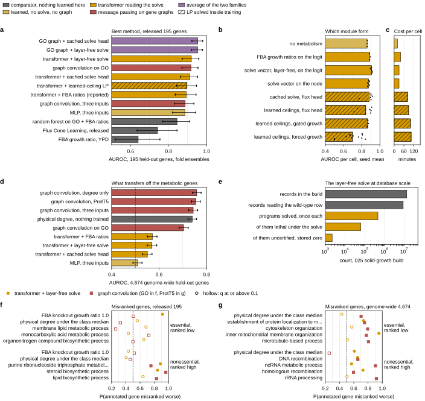

- **Best method (a).** Fold protocol, released 195: GO graph convolution averaged with the transformer reading the solve 0.954 (cached solve head) and 0.953 (layer-free), the maximum of eleven post hoc averages. Best single models: transformer with the layer-free solve 0.920, graph convolution on GO 0.917, intervals overlapping. FCL 0.742, FBA 0.640.
- **Module form (b, c).** One backbone, pathway multi-hot with ProtT5: no metabolism 0.860, FBA ratios on the logit 0.890, solve vector layer-free on the logit 0.908 (sd 0.008, six seeds), on the node 0.875, cached solve with a flux head 0.882 (one seed 0.772), learned ceilings with a flux head 0.845 (two seeds unfit), gated growth 0.867, forced growth 0.699 (twelve seeds, ProtT5 backbone). 30 wall minutes per cell against 83 to 100 for the forms with an LP in the loop.
- **Scale (d, e).** 469,474 programs for 13.5M records, 71 minutes on 20 cores. Off the metabolic genes the layer-free transformer reads 0.570, graph convolution on ProtT5 0.755, raw physical degree 0.740. A model over the whole database needs the store for GEM genes and the graphs as a message-passing input for the rest.
- **Misranked genes (f, g), new analysis.** `misclass_enrichment.py` tests, within a class, the misrank of genes carrying an annotation against the rest (one-sided Mann-Whitney, effect = U as a probability, BH within family). Released 195, transformer: the 19 of 31 essential genes FBA calls viable have mean misrank 0.134 against 0.025 (effect 0.91, q 0.003); under the GO graph model the same feature reads 0.51. No GO term reaches q < 0.1 among the 31 essentials. Nonessentials ranked high: steroid biosynthesis under both models (0.85, 0.96), nucleoside triphosphate metabolism (0.88) for the transformer. Genome-wide, graph model: essentials of low physical degree (0.70), cytoskeleton (0.79), microtubule-based process (0.81) ranked low; nonessential ncRNA metabolism (0.90), rRNA processing (0.92), RNA modification (0.92), cytoplasmic translation (0.85) ranked high.

Proposed, none run: ten repeated outer splits for the three finalists (about six card-hours); an isozyme-aware input from the GPR rules (hypothesis); the physical-graph degree or a graph-convolved embedding as an input to the solve-reading transformer; the 025 read of the store. `verify_doc_numbers.py` now carries 40 checks, all passing.

## 2026.09.20 - Round 75: the finalists on ten repeated outer splits

Jobs 2547 to 2567 (GilaHyper, main partition, one card each; graph convolution as one GPU job 2557 over all ten splits). `build_essentiality_splits.py --resplit R` draws the test block as a class-stratified fifth of the released labeled genes (627 train, 157 validation, 198 test with 32 essential). Models, the equal-weight average and the statistics were committed in `resplit_readout.py` before any cell finished.

| quantity | mean of ten | sd | positive splits |
|---|---|---|---|
| transformer + layer-free solve (family score) | 0.848 | | |
| graph convolution on GO | 0.869 | | |
| equal-weight average | 0.896 | | |
| average minus transformer | +0.048 | 0.017 | 10 of 10 |
| average minus graph convolution | +0.026 | 0.021 | 9 of 10 |
| average minus the better single model | +0.023 | 0.017 | 9 of 10 |
| transformer minus graph convolution | -0.022 | 0.024 | 1 of 10 |
| layer-free minus FBA ratio affine (cells) | +0.011 | 0.023 | 7 of 10 |
| layer-free minus no metabolism (cells) | +0.047 | 0.034 | 10 of 10 |

- The average is the best method and its margin is not a selection artifact.
- The two single models are not tied off the released genes: graph convolution on GO leads on nine of ten.
- Every model reads lower than on the released held-out genes (transformer cells 0.843 against 0.908, graph model 0.868 against 0.905 as seed means). Cause not measured.
- The solve helps (+0.047, ten of ten); the flux vector over the four growth ratios alone does not separate from zero at this power (+0.011).
- Test blocks overlap across splits, so no p-value.

Correction made the same day: only 4 of the 19 held-out essential genes the solve calls viable are covered by an alternative gene set on every reaction (`isozyme_affine_store.py`); 15 hold a reaction of their own that the growth program does not need. The document's "isozyme redundancy in both directions" reading is replaced. Also corrected: the genome-wide layer-free arm read an all-zero row on held-out genes, not the wild-type vector.

In flight: round 76 (w95, jobs 2568 to 2573, physical degree as affine columns; first three seeds genome-wide 0.564, 0.594, 0.588 against 0.570, partial) and round 77 (w96, jobs 2574 to 2585, six gene-protein-reaction redundancy columns; released split and the ten repeated splits paired against w93).

## 2026.09.20 - Round 76: the physical degree as two affine columns

Jobs 2568 to 2573 (GilaHyper, main, one card each), six seeds per arm. Stores from `degree_affine_store.py` over all 6,607 genes.

| arm | set | seed mean | sd | pooled |
|---|---|---|---|---|
| layer-free, wild-type rows (control) | genome-wide 4,674 | 0.566 | 0.019 | 0.570 |
| layer-free + degree and clustering | genome-wide 4,674 | 0.602 | 0.030 | 0.593 [0.57, 0.61] |
| layer-free + degree and clustering | released 195 | 0.906 | 0.009 | |

The control reproduces the zero-row arm to four decimals (a constant row changes nothing). Degree columns: +0.036 on six of six seeds, still 0.16 under the graph convolution's 0.755; costs nothing on the released split (0.906 against 0.908). Hypothesis, untested: the gap is that an affine fitted on metabolic genes learns a small slope on degree (0.59 among them), while the convolution reads the neighbors' degrees too.

## 2026.09.20 - The perturbed class token, ported from the 025 branch

User asked whether the perturbation operator had been applied to the CLS token and whether it was dangling in another worktree. It was. `CellGraphTransformer(perturb_cls=True)` is commit `9e2f59551` (2026-09-09) on `feat/025-fitness-joint-head`, PR #346 open and unlanded, absent from main and from every other worktree. So NO 028 run before today used a perturbed class token: the token was the encoding of the unperturbed graph, across-strain sd exactly 0, and the pooled head carried the genotype through the perturbed-gene pool alone.

Ported as `708c7cf53`:

- the model hunks applied with `git apply --3way`; two conflicts, both from this worktree's `perturbation_head_config={"enabled": False}` option, resolved by keeping both;
- the two upstream tests come with it and pass here, with all 7 in the file green;
- `CellGraphTransformerMetabolism.forward` hands `h_CLS_pert` to the metabolism heads when the parent returns one, and the two scalar/vector heads accept `[d]` or `[batch, d]`;
- `train_essentiality.py --perturb-cls`, and the epoch row logs `cls_strain_sd`.

MEASURED, two-epoch smoke of the round-33 cell on the released split: `cls_strain_sd` 0.1839 with the flag and exactly 0.0 without it, so the token is strain-specific here.

Caveat carried from the 025 note: at one deleted gene the class-token query attends over ONE key, so the perturbed token is a function of the wild-type token and that gene's token. Whether it adds anything over the perturbed-gene pool on single-KO strains is round 79 (packs `w98`, jobs 2597 to 2600): the layer-free cell and the plain pooled cell with the flag, six seeds each on the released split, paired by seed against `w49` (0.908) and `w39_pathpool` (0.860).

## 2026.09.20 - Round 77: the gene-protein-reaction rules as affine columns

Jobs 2574 to 2585, all exit 0. Six counts from yeast-GEM's rules in disjunctive normal form (`isozyme_affine_store.py`) appended to the deletion's flux vector in the affine: reactions, sole reactions, covered reactions, minimum and mean alternative gene sets, co-subunits. Read fixed in the packs before any cell finished (`gpr_readout.py`).

| quantity | with | without | difference | sd | positive |
|---|---|---|---|---|---|
| released split, held-out AUROC (6 seeds) | 0.918 | 0.908 | +0.0102 | 0.0053 | 6 of 6 |
| ten repeated outer splits, seed-mean AUROC | 0.862 | 0.843 | +0.0192 | 0.0198 | 8 of 10 |
| misrank, the 19 essentials FBA calls viable | 0.120 | 0.134 | -0.0139 | 0.0111 | 1 of 6 worse |
| of them, the 15 with a sole reaction | 0.089 | 0.124 | -0.0343 | 0.0133 | 0 of 6 worse |
| of them, the 4 covered by an alternative | 0.234 | 0.171 | +0.0628 | 0.0288 | 6 of 6 worse |

The columns help, and the mechanism is the opposite of the hypothesis in `sec:hard-genes`. The useful signal is the count of reactions nothing else catalyzes: the 15 sole-reaction genes improve on 6 of 6 seeds. The 4 genes the rules say are covered get WORSE on 6 of 6, because the columns push the cell toward calling exactly those dispensable. So the paralog-aware-input hypothesis is refuted on this construction; it moves the other group.

0.918 is the highest single-cell seed mean of the layer-free family in the document. Added to the summary figure's panel b. `verify_doc_numbers.py` now carries 71 checks, all passing.

## 2026.09.20 - Round 78: six seeds do not separate the flux vector from the four growth ratios

Jobs 2586 to 2595, all exit 0. Three more seeds of the layer-free cell and of its FBA-ratio control on each of the ten repeated outer splits, pooled with round 75's three.

| read | mean | sd | positive |
|---|---|---|---|
| vector minus ratios, three seeds per split (round 75) | +0.0107 | 0.0233 | 7 of 10 |
| vector minus ratios, six seeds per split (round 78) | +0.0104 | 0.0245 | 8 of 10 |

Doubling the seeds leaves the mean and the spread unchanged, so the three-seed read was not underpowered: the difference is genuinely small relative to split-to-split variation. The honest statement is that the four growth ratios carry most of what the solve contributes, and the 4,131 flux columns add little beyond them.

Sharp contrast worth keeping: on the same ten splits, six gene-protein-reaction redundancy counts add +0.019 over the vector (round 77), about twice what the whole flux vector adds over the ratios. The useful metabolic signal here is structural (which reactions have no alternative catalyst), not the flux values themselves.

## 2026.09.20 - Round 79: the perturbed class token is a null on single deletions

Jobs 2597 to 2600. The ported `--perturb-cls` against the identical cell without it, paired by seed on the released split.

| arm | seeds | with | without | difference | positive | token sd |
|---|---|---|---|---|---|---|
| layer-free solve vector in the affine | 6 | 0.904 | 0.908 | -0.0040 | 2 of 6 | 0.54 vs 0.00 |
| pooled cell, no solve, no affine | 3 | 0.858 | 0.860 | -0.0016 | 0 of 3 | 0.55 vs 0.00 |

The mechanism works: the class token's across-strain spread goes from exactly 0 to about 0.54. The ranking does not improve, and both arms point slightly down within the seed spread.

Why, structurally: these strains delete ONE gene, so the class token's query attends over a single key and the perturbed token is a function of the wild-type token plus that gene's token, which the perturbed-gene pool already supplies. The flag can only add where a genotype perturbs several genes and the pool's mean discards their arrangement. That is the 025 fitness setting (doubles and triples), not this one.

So the port stays (it is free and correct), the flag stays off for 028, and the honest expectation for multi-gene phenotypes is untested here.

## 2026.09.20 - Round 80: the rule-count cell under the fold protocol is the best single model

Jobs 2601 and 2602 (five folds, seed 2700), both exit 0.

| model, fold protocol | ensemble | interval |
|---|---|---|
| solve vector + gene-rule counts (round 80) | **0.9335** | [0.890, 0.968] |
| layer-free solve vector (round 34) | 0.9197 | [0.873, 0.957] |
| cached solve + flux head (round 27) | 0.9215 | [0.877, 0.959] |
| graph convolution on GO | 0.9172 | [0.870, 0.955] |

Fold mean 0.9133. As a standardized family it is 0.930; averaged with the GO convolution's fold models it reads **0.9550** [0.922, 0.982], against 0.9538 (cached solve) and 0.9532 (layer-free). The best average is now the max of THIRTEEN post hoc choices, not eleven, and the top three are within 0.002 with near-identical intervals: what the folds establish is that the two families average above either alone, not an ordering among the module forms.

Added to panel a of the summary figure (`summary_2026-09-20-21-24-16`). `verify_doc_numbers.py` carries 85 checks, all passing. One older check was rewritten: it took the max over combinations and so would have silently tracked whichever average happened to be best; it now names the cached-solve pair.

## 2026.09.20 - Round 81: at fifteen pairs the perturbed class token DOES cost a little

Jobs 2603 to 2605, all exit 0. Completed the pooled arm's pairing at six seeds and took the layer-free arm to nine.

| arm | pairs | with | without | difference | 95% CI | positive |
|---|---|---|---|---|---|---|
| layer-free solve vector | 9 | 0.905 | 0.911 | -0.0054 | [-0.0100, -0.0009] | 2 of 9 |
| pooled, no solve | 6 | 0.855 | 0.858 | -0.0028 | [-0.0084, +0.0028] | 1 of 6 |
| both | 15 | | | **-0.0044** | [-0.0075, -0.0012] | 3 of 15 |

CORRECTION to what I said at nine pairs ("no established cost"): at fifteen pairs the cost IS established, p = 0.010, 12 of 15 seeds below their control. It is small, about a third of this cell's seed spread, and consistent. Parameter count is identical (22,773), so it is not capacity; on a single deletion the token's query sees one key, so it adds no information and only widens the head's input.

Decision: the flag stays OFF for 028. The port stays, because the 025 setting (doubles and triples) is where it can add something.

Side effect worth recording: round 81's three extra control seeds moved two arm-level means, w49 from 0.908 (6 seeds) to 0.911 (9) and w39_pathpool from 0.860 (3) to 0.858 (6). Section 7 and the summary figure now quote the all-seed values; round-specific claims in sections 3 and 4 keep their own seed sets, and their checks are seed-scoped so they cannot silently drift.

## 2026.09.20 - Round 82: the factorial, and a correction to how I compared the two halves

Jobs 2606 to 2609, all exit 0. The six gene-rule counts with NO flux vector, six seeds plus the five folds.

| affine columns | seeds | cell mean | sd | fold ensemble |
|---|---|---|---|---|
| four growth ratios only | 3 | 0.890 | 0.005 | — |
| + gene-rule counts, no solve | 6 | 0.902 | 0.005 | 0.909 |
| + solved flux vector, no counts | 9 | 0.911 | 0.007 | 0.920 |
| + both | 6 | **0.918** | 0.006 | **0.934** |

Paired on the three seeds all four arms share: counts over ratios +0.0116 (2/3), vector over ratios +0.0239 (3/3), both over vector +0.0078 (3/3), both over counts +0.0201 (3/3).

CORRECTION. After round 78 I said the rule counts "outperform the solved flux as an increment". That mixed conditionals: the counts' +0.019 was measured on top of the vector, the vector's +0.010 on top of the ratios. Against a single baseline the solve is worth about twice the counts on the released split (+0.024 vs +0.012), and on the ten repeated splits they sit within each other's spread. What survives both readings: each half is worth 0.01 to 0.02, they are complementary, and the pair is the best module form.

Practical conclusion unchanged for the port: the counts need no solver, no medium and no per-genotype computation, and alone they carry about half of what the module contributes here.

## 2026.09.20 - Round 83: every column inside one experiment costs nothing

Jobs 2610 to 2615, all exit 0, six seeds per arm. The four FBA growth ratios are four different media, so a cell carrying all four reads four experiments at once, which a genotype-by-environment record cannot. This keeps the YPD ratio (the medium the solve store is built on) and drops the other three.

| affine columns | four media | YPD only | change |
|---|---|---|---|
| growth ratio alone | 0.890 (3 seeds) | 0.877 (6) | -0.012 |
| + solved flux vector | 0.911 (9) | 0.912 (6) | +0.001 |
| + vector and rule counts | 0.918 (6) | 0.916 (6) | -0.002 |

The restriction is free wherever the solve is present. About a hundredth of what the four ratios contributed was the model reading four environments at once, and the deletion's own flux vector supplies it from within one.

This is the answer to the objection raised in conversation: nothing in the module as it stands needs more than one experiment per record, so the form carries to a database where the environment is part of the key rather than part of the feature vector.

Also recorded from the same conversation: we have NOT sampled the flux cone, and we cannot reuse FCL's sampled vectors, because their mirrored release holds only splits, hyperparameter tables and figure CSVs. Their raw sampled matrix (124 samples/cone, thinning 5,000, 143,716 x 4,130, ~4.4 GB) is not in the mirror. MEASURED cost of sampling ourselves: 5 samples of ONE deletion at thinning 10 takes 147 s, so ~45 h single-process for the 1,121 labeled genes, about 2.5 h across 20 cores, and far more at their thinning. What we did instead was four solver points on the same optimal face plus three tolerances of one solver (rounds 36 to 57).

## 2026.09.21 - Rounds 84 to 98: what each simplification of the module costs

Overnight, jobs 2616 to 2667, none failed after the sampling launcher fix (2622). Read by `experiments/028-gene-essentiality/scripts/simplification_readout.py` into `results/simplification_readout.json`; tables `simplification_ladder` and `simplification_paired` in the chapter's new Section 7.8; `verify_doc_numbers.py` now holds 119 checks, all passing.

Released split, same backbone (pathway multi-hot with ProtT5), seed-mean held-out AUROC and five-fold ensemble:

| affine columns | media | solver | seeds | cell mean | folds, 1 seed | folds, 3 seeds |
|---|---|---|---|---|---|---|
| four ratios, flux vector, rule counts | 4 | yes | 6 | **0.918** | **0.934** | **0.933** |
| YPD ratio, flux vector, rule counts | 1 | yes | 6 | 0.916 | 0.932 | 0.932 |
| four ratios, flux vector | 4 | yes | 9 | 0.911 | 0.920 | 0.921 |
| four ratios, rule counts | 4 | no | 6 | 0.902 | 0.909 | 0.909 |
| YPD and SC ratios, rule counts | 2 | no | 6 | 0.896 | running | |
| YPD ratio, rule counts | 1 | no | 6 | 0.888 | 0.902 | |

Ten repeated outer splits, paired by split (first minus second):

- one medium for four, solve and counts kept: +0.0021 (sd 0.0071), 6/10, nine seeds per split. Round 83 holds.
- counts over ratios +0.0122 (7/10); vector over ratios +0.0107 (7/10); counts added to the vector +0.0192 (8/10); vector added to the counts +0.0175 (9/10). Complementary, about equal, three seeds per split except the last.
- one medium for four with NO solve: -0.0114 (2/9, tenth split running). No solve and one medium against the full recipe: -0.0297 (0/9).

So the simplifications do not stack. The cheapest recipe that keeps the full score and respects one experiment per record is the YPD ratio with the flux vector and the counts, which needs one linear program per genotype and medium, offline.

Round 84: the six counts are redundant among themselves. Beside the vector the sole-reaction count alone reads 0.914, the other five 0.918, all six 0.918. The round 77 text that called the sole-reaction count "the useful column" is corrected in the chapter.

Round 97: 400 epochs change nothing, exactly. Validation selects epoch 30 to 76 in all twelve cells, cells are bit-reproducible given the seed, so the 400-epoch cells return the identical held-out AUROC. CORRECTION to a status message of 08:40: "0.921 over 3 seeds against 0.918" was the first three seeds of the same cells, not a gain.

Rounds 92 and 94: three seeds per fold leave every fold ensemble within 0.001 of its one-seed value.

Still running: round 87 (sampled store, eight packs behind job 2623), round 98's folds (2667), round 99 (w117, job 2668: two media with the counts on the ten splits).

## 2026.09.21 - Round 92 overwrote ten round-34 fold cells; reruns are not bit-identical

Round 92's packs for the layer-free form reused the stems `w50_pathlogfreecv{0..4}_..._s2701` and `_s2702`, which round 34 had already run and committed (b7ab0be89). The reruns replaced them on disk. They differ from the first runs by up to 0.066 on one cell (fold 2, seed 2702: 0.841 then, 0.907 now); the three-seed fold ensemble moves from 0.919 to 0.921. The first runs stay recoverable from commit b7ab0be89. Consequence for round 97: "400 epochs reproduce 200 exactly" holds within one code version on one card (12 of 12 cells), and is not a general determinism claim. Rule restated: check `results/` for a stem before generating a pack that writes it.

## 2026.09.21 - Round 101: the minimal medium as the second medium does not beat SC

Job 2670, six seeds and five folds. YPD with SM and the rule counts, no solver: 0.892 per cell (sd 0.008), 0.907 fold ensemble. Paired by seed: -0.004 against YPD with SC (2/6), +0.004 against YPD alone (4/6), -0.010 against four media (2/6). The hypothesis that the most different medium recovers the most is not supported.

## 2026.09.21 - Completion plan agreed with the review of the PDF

Goals restated: (1) best score against FCL and FBA; (2) a module that carries to other datasets with one record = one genotype in one medium. Headline for goal 2, ten splits, three seeds: single-medium module minus no metabolism +0.066, 10/10 splits, 29/30 split-and-seed pairs; round 103 (job 2672) takes the control to nine seeds.

Document work: summary moved to the end as Section 8 (done, 8e7d49930); closing list rewritten (done); tables widened without wrapping, Figure 14 redrawn to the plotting standards, a diagram per module modification (three background agents, in progress); rounds 87 and 99 to 103 written in when they land; a second summary figure for goal 2; final `make check` and publish.

## 2026.09.21 - Round 99: two media do not recover four once the flux vector is gone

Job 2668, ten repeated outer splits, three seeds each, the solver-free recipe with YPD and SC growth ratios plus the six gene-rule counts. Paired by split:

- two media minus four media: -0.0069 (sd 0.0060), higher on 1 of 10.
- two media minus one medium: +0.0052 (sd 0.0144), higher on 7 of 10.
- two media minus no metabolism: +0.0412 (sd 0.0341), higher on 10 of 10.

So the ladder without the stored flux vector is monotone in the number of media, 0.832 for one, 0.838 for two, 0.845 for four, and the second medium buys about a third of the gap. Round 101 (job 2670) had already shown that pairing YPD with the minimal medium instead of SC is not better: 0.892 per cell against 0.896, higher on 2 of 6 seeds.

Round 104 (job 2674) takes the two-media and one-medium fold ensembles to three seeds per fold, the depth the other forms already have.

## 2026.09.21 - The essential genes every predictor ranks low

Script `experiments/028-gene-essentiality/scripts/consensus_missed.py`, result `results/consensus_missed.json`, chapter Section `sec:consensus-missed`.

- Ten repeated outer splits hold out 874 of 1,121 labeled genes at least once, 140 essential. Predictors: module transformer (w104, 9 seeds), no-metabolism transformer (w94 + w121, 9), GO graph convolution (6), DCell shared input (3), FBA ratio.
- No essential gene sits below the median nonessential gene under all four learned predictors. Counts by number of learned predictors that miss: 111, 16, 9, 4, 0.
- Consensus misrank (minimum over the four learned predictors) averages 0.055. Its Spearman with the GO term count is -0.002, so thin annotation does not explain the residual.
- Enriched among the residual: FBA ratio 1.0 (70 genes, 0.082 against 0.028), organic substance transport (10 genes, 0.190 against 0.045), cellular component organization, monoatomic ion transport.
- Hypothesis, untested: the top genes (VHT1, HIP1, RIM2, THI80, NCE103) are essential only given the medium and the strain's auxotrophies, which no input encodes.

## 2026.09.21 - Background-strain probe, the portable form in the average, and the resource cap

- Resource cap from the user: 028 jobs stay within 64 CPUs and 256 GB in total. Packs run at `ESS_CPUS=8`, 36G.
- `fba_background_probe.py`: deleting the four BY4741 marker genes before each knockout moves 63 ratios on YPD, none of them an essential gene toward lethal. FBA's AUROC over the 1,121 labeled genes reads 0.717 to 0.713 on YPD and 0.718 to 0.714 on SC. Ratios are rounded to six decimals, because tie order near 1.0 changed the AUROC by 0.017 between two identical unrounded runs.
- Defect found: YPD in `torchcell/metabolism/media.py` opens no uracil uptake, so a ura3 deletion alone takes modeled YPD growth from 0.535 to zero. Not fixed here; the stored solves use the wild-type model.
- `resplit_readout.py --portable`: with the single-experiment recipe (w104) as the transformer family, the fixed-in-advance average beats the better single model on ten of ten splits (+0.029, sd 0.013). Released-split fold average 0.953 against 0.955 for four media.
- Round 107 (job 2683): on the released split at nine seeds the one-medium recipe reads 0.912 against 0.920 for four media, -0.009 paired by seed.
- Job 2684: the solve columns as node features do not help graph convolution on GO on the ten splits (-0.009, one of ten). Job 2691 tests the zero-initialized affine on the graph model's logit.

## 2026.09.21 - The interface carries across families; the trigenic ontology; rounds 109 and 110 in flight

- Job 2691 (`graph_baselines.py --arms go_affine`): the module as a zero-initialized affine on graph convolution's logit, ten splits, three seeds. YPD ratio +0.011 (10/10), one-medium recipe +0.018 (9/10), four-media recipe +0.021 (9/10) over GO alone. Released split 0.914 / 0.911 / 0.910 against 0.908. Job 2693 takes the arm to six seeds.
- Both families with the module (`resplit_readout.py --portable --graph-affine`): average 0.897 against 0.907 with the plain graph family, though the graph family alone rises 0.871 to 0.887.
- Trigenic DCell runs' ontology (`go006_store.py`, jobs 2688 and 2689): 2,651 columns, 1,421 shared with the current 2,362. Graph convolution -0.002 (4/10); DCell hierarchy 0.714 against 0.841 released, -0.020 (2/10). Job 2694 tunes the hierarchy on that store.
- Goal 2 summary figure gained panel g (the second family). Closing list now reads six items, four run.
- Round 109 (w126, ten splits) and round 110 (w127, released split) test the module on ProtT5 alone; reads fixed in `simplification_readout.py` before completion.

## 2026.09.21 - End of the four-hour window: published, three reads still in flight

- Published to Zotero at commit 2bee12b92 (269 checks). Rounds 110 and 111: the ProtT5-only backbone with the module reads 0.883 against 0.771 on the released split (six of six seeds) and 0.892 against 0.795 as fold ensembles.
- Jobs 2697 and 2702: the affine on graph convolution over ProtT5 reads 0.891 against 0.859 (released) and 0.766 against 0.751 (genome-wide), six of six each; on GO over the genome-wide set 0.768 against 0.698.
- Job 2700: the hierarchy on the trigenic ontology at its tuned configuration reads 0.709, no better than 0.714.
- Still running: round 109 (splits 3 and 4), the DCell hierarchy with the affine over ten splits (job 2698), the tuned hierarchy on the trigenic store over ten splits (job 2701). Reads are fixed in the scripts; rerun the readouts and republish when they land.

## 2026.09.22 - The store ladder: fundamentals and heuristics as offline stores (rounds 112 to 114)

- Round 112 (w129, jobs 2707 to 2710): the module on the corrected YPD store (uracil and adenine in the medium; `media.py` keeps Suthers' recipe as `YPD_SUTHERS_FBA`; bound vectors written as hash-named artifacts under `$DATA_ROOT/data/torchcell/media_bounds/`; store provenance now `StoreProvenance` / `DerivedStoreProvenance`). Released split 0.913 against 0.916 (-0.003, 3/6); ten splits -0.007 (2/10); over no metabolism +0.059 (10/10). 182 to 189 of 195 held-out genes change rank.
- Round 113 (w130, `ess_kcat_bounded_store.py`, jobs 2711 to 2715): kcat ceilings from a measured proteome (point, two sigma, sampled) and linear MOMA. None separates from the plain store (+0.000 to +0.003, at most 3/6). The proteome is the one measurement in the module and is retired; user rule: no proteome data in the module.
- Round 114 (w131, `ess_gecko_store.py`, jobs 2716 to 2726): GECKO pool stores with usages as program variables and no proteome (pool 0.125 -0.011, 0.25 -0.004, sigma1 -0.005, min-enzyme -0.010), plain FBA -0.010, parsimony in the objective -0.004. Gibbs direction constraints infeasible (111 / 81 conflicts). Table `tab:store-ladder`.
- Gibbs dissipation is a fitted diagnostic and never a constraint; a dissipation variant was proposed and dropped.
- Sampler job 2623 timed out; round 87 cancelled, listed as not measured.
- Table generator had failed silently after the trigenic table's two-row header; fixed, two stale tables regenerated.
- Published v4 at f383933a1, 339 checks.

## 2026.09.22 - Round 115: the learned allocation with the pool made to bind

- `--flux-pool-fill-weight` (new, `flux_layer.py` `pool_fill_weight`, outside the constraint ramp): the shortfall of the abundance head's protein mass below GECKO's pool. With `--flux-pool-by-construction` the pool now binds on every genotype (projection factor 0.11 to 0.69 at the selected epoch; round 19 logged 1.0).
- Forced growth column 0.766 / 0.766 / 0.770 against round 19's 0.704 / 0.743 / 0.670 (+0.062, 3/3); gated 0.839 / 0.770 / 0.832 against 0.816 / 0.810 / 0.783 (+0.010, 2/3). Both under the layer-free store (0.911).
- A cell of this form peaks at 40 GB (sacct MaxRSS, job 2730); three-cell packs at 36 GB died at 2 h 40 (jobs 2728, 2729); reruns one per job at 80 GB (2730 to 2732).
- Published v5 at ea783f7ec, 345 checks.

## 2026.09.22 - Round 116: is the kcat table what limits the pool?

- User direction: use the predictors; test the GECKO pool once more with the shipped tiered table against a table in which every enzyme is predicted by the best predictor, and answer whether kcat is the bottleneck.
- `kcat_tier_agreement.py` (`results/kcat_tier_agreement.json`): each tier evaluated on every unit it reaches, no fall-through, cross-organism homologs with the yeast rows excluded. On the 96 units with a yeast assay, EZKinetics agrees with it at Spearman 0.79 and a median gap of 0.34 decades (82 percent within a decade); the cross-organism EC homologs agree at 0.40 and 0.57 decades on 77 units (65 percent). Homologs against predictors on 845 units: Spearman about 0.4, median gap 0.75 decades, homologs 0.2 decades higher. Caveat, unverified: the predictors may have trained on the same yeast assays.
- `parameters.py`: `load_predicted_unit_table(restrict_to=)` keeps one admitted predictor; `resolve_kcat_table(database_tiers=False)` skips the measured and homolog tiers (default becomes the median of the predictions).
- `ess_gecko_store.py` variants `pool125ezk` (every unit EZKinetics alone; wild type 0.163 of unconstrained growth, 91 lethal) and `pool125shuf` (tiered table permuted over units, seed 0; 0.116, 91 lethal). Store job 2733; packs 2734 to 2737 (w133, six seeds each, 8 CPUs and 36 GB per pack), paired against w131_geckopool125 and w129. Reads wired in `simplification_readout.py` and the store ladder table.
- `isozyme_affine_store.py` now writes `isozyme_affine_store_<tag>.json` for a tagged store; the untagged summary had been overwritten by every tagged build.

## 2026.09.22 - Rounds 117 and 118: the layer-free module carried to betaxanthin and the amino acids

- User direction: improve on the previous best betaxanthin (0.131 pinned Spearman, flux precursor readout, three seeds; module-off control 0.115; kNN over ProtT5 0.145; FCL 0.039) and amino acids (0.068, three seeds; pooled 0.048), same Merzbacher pinned splits, the strain properly represented.
- `train_essentiality.py`: `--head betaxanthin|mulleder19` re-admitted; `FbaAffine` takes `out_features` (19 for the amino acids) and the readout adds the affine to the mean channel of a distributional head only. `ess_cell.sh` reads `ESS_HEAD`.
- Betaxanthin store (`experiments/027-betaxanthin-metabolic/scripts/bx_reference_flux_table.py`, job 2740, four minutes): yeast-GEM plus the Cachera cassette (46 reactions, 20 demands), the four BY4741 markers deleted as background, corrected YPD; per GEM gene two pfba vectors (growth; betaxanthin at 90 percent of own growth) plus the total demand, 8,355 columns; 1,155 genes, 93 lethal, 180 move the production potential. ARO4-K229L and ARO7-G141S have no representation in a stoichiometric model (no feedback inhibition to relieve) and are recorded as background.
- Amino-acid store: `ess_reference_flux_table.py --genes gem --medium SM --out-tag gem` (job 2739), every GEM gene on the dataset's medium; writes `results/fba_ratio_SM_gem.csv` for the medium column.
- Packs w134 (betaxanthin) and w135 (amino acids): store against the same backbone without the affine, CRPS, 200 epochs, seeds 2700 to 2705, six cells per pack, two packs per target. Rule-count columns left out in this first round.

## 2026.09.22 - Round 119: the betaxanthin affine regularized (queued behind rounds 117 and 118)

- Partial observation at epoch 80 of 200 (jobs 2741, 2742), not a result: all six whole-vector store cells sit on the plateau (validation Pearson about -0.05, predicted spread a tenth of the label spread since epoch 4), while the affine-free control has left it on two of six seeds (validation Pearson 0.21 to 0.30). The amino-acid pair (jobs 2743, 2744) shows no such split at epoch 75 (about 0.09 to 0.10 on seed 2700, both arms).
- `train_essentiality.py`: `--ess-solve-columns <regex>` keeps only matching store columns; `--ess-affine-weight-decay` and `--ess-affine-lr-mult` put the `fba_readout` affine in its own AdamW group. CPU smoke test on the betaxanthin store passed (two columns matched; four affine parameters in the group).
- Packs w136 (jobs 2749, 2750; 8 CPUs, 48 GB each, queued for a card): `bxratio`, the growth ratio and the betaxanthin production ratio at 90 percent of own growth as the only two columns beside the YPD ratio; `bxstorewd`, the whole 8,355-column vector with the affine at weight decay 0.1 and a tenth of the learning rate. Six seeds each, paired against w134_bxctx.
- `target_transfer_readout.py` (`results/target_transfer_readout.json`): every arm paired by seed against its control on pinned-test Spearman (top-50 enrichment for betaxanthin; mean per-column Spearman for the amino acids) beside the 027 comparators. Commit b5347e981.

## 2026.09.22 - Rounds 120 to 122 queued: deletion-only graphs, rule counts, the amino-acid production store, width

- User direction: keep experiments running over betaxanthin and the amino acids on GilaHyper over the next few days.
- The graph processor removed every perturbed gene from a Cachera cell graph, so a single-deletion strain masked four nodes (ARO4-K229L YBR249C, ARO7-G141S YPR060C, the cassette-native YPL069C, and the deletion) and pooled the deletion at a quarter weight. `Perturbation(deletion_only=True)` (`--deletion-only-graph`) masks and pools the deletion alone; measured on record 0 of the pigment build (4 nodes and 4 pooled genes against 1 and 1). Round 120 (w137, jobs 2752, 2753): `bxdel`, the control on deletion-only graphs; `bxgpr`, the six rule-count columns over every GEM gene (`isozyme_affine_store.py --genes gem`, 1,161 genes, 1,153 with a rule, 742 with a sole reaction).
- `aa_reference_flux_table.py` (job 2754, 18 min): per GEM gene one pfba growth solve and 19 demand maxima at 90 percent of own growth on the synthetic minimal medium, prototroph; 1,161 genes, 161 lethal, 225 move growth, 234 move at least one amino acid; store `ess_solve_encodings_SM_aa.npz` (growth vector plus 42 summary statistics), CSV `fba_ratio_SM_aa.csv`. Job 2751 hung in GLPK on the COQ1 knockout's alanine program from a warm-start basis and was cancelled; presolve fixed it and a non-optimal program now raises. Round 121 (w138, jobs 2755, 2756): `aaprodstat`, the 19 ratios and the growth ratio; `aaprodfull`, the growth vector with all 42 summaries.
- Round 122 (w139, jobs 2757, 2758): the affine-free controls at width 48, two layers, on both targets, paired against the width-12 controls.
- `target_ensemble_readout.py`: seed ensembles of every arm from the dumped predictions (single, the two seed triples, all six), no GPU. Both readouts key on full result stems. Commits 1534b5025, 7d5417daa.

## 2026.09.22 - Rounds 117 and 118 read: the whole-vector affine on betaxanthin and the amino acids

- Betaxanthin (w134, jobs 2741, 2742): store affine 0.121 (sd 0.011) against the control 0.079 (sd 0.056), paired +0.043 (sd 0.049), 5/6. Three store seeds were selected on the plateau (validation Pearson -0.02, epochs 127 to 181) and still read 0.12 to 0.13 on test: the validation pool holds 275 GEM genes of 4,082 while the test is 636 of 639 GEM genes, so validation Pearson is nearly blind to an affine that varies only on GEM genes. Six-seed ensembles 0.135 (store; triples 0.146, 0.133) and 0.076 (control); 027 precursor 0.131 (three seeds, width 90), context control 0.115, kNN 0.145. Top-50 enrichment goes the other way: 3.49 (store) against 4.06 (control) single, 4.39 against 4.59 ensembled.
- Amino acids (w135, jobs 2743, 2744): store 0.025 (sd 0.015) against the control 0.034 (sd 0.025), -0.009 (sd 0.018), 2/6; both under every 027 arm (0.068, 0.061, 0.048). Two seeds per arm near a constant predictor (one control selected at epoch 2, scored 0 by the trainer's rule). The width-12 backbone is the suspect; round 122 (width 48, two layers) is queued.
- `target_transfer_readout.py` comparators are computed from 027's result files (the amino-acid ladder's 0.045 is the bilinear ridge, not the kNN). `target_ensemble_readout.py` gains `n_constant`. Chapter section `sec:target-transfer` written with results; verifier 387 checks; published v7 (`028-gene-essentiality_2026-09-22-14-44-49_48a4004b.pdf`).

## 2026.09.22 - Every record inherits every other strain's added genes

- Question raised: which amino-acid strain carried extra genes. Measured, not assumed. The Mulleder collection is BY4741 made prototrophic episomally (pHLUM restores HIS3, LEU2, URA3, MET17); `mulleder2016.py` records only the KanMX deletion and notes that the restoring markers are not modeled as a GeneAddition, so the amino-acid strain contributes no extra genes of its own.
- The contamination comes from the shared build, and it runs in every direction. Betaxanthin and mulleder19 open the same dataset (`dataset_paths`), and `DeletionKeyedGenotypeAggregator` keys a record by its deletion gene set, so measurements of gene X from different screens merge into one record whose perturbation set is the union of theirs. Three screens contribute added genes: Cachera's betaxanthin cassette gives ARO4 (YBR249C) and ARO7 (YPR060C), and Ozaydin's carotenogenic plasmid YB/I/BTS1 gives an extra native copy of BTS1 (YPL069C). CYP76AD1 and DOD are not yeast ORFs and have no node to remove.
- Measured on the arms actually scored. Of the 564 amino-acid-scored pinned records, 556 lose ARO4, 556 lose ARO7 and 499 lose BTS1; the Mulleder collection carries none of the three. ARO4 is DAHP synthase and ARO7 is chorismate mutase, the committed steps to tyrosine, phenylalanine and tryptophan, which are three of the 19 measured targets, so rounds 118 and 121 read a strain missing the genes that make three of their own targets. Of the 629 betaxanthin-scored pinned records, all 629 lose ARO4 and ARO7, which the Cachera strain does carry as feedback-resistant alleles, and 547 also lose BTS1, which it does not carry at all.
- An earlier line above called YPL069C part of the betaxanthin cassette. It is not: it is the carotene plasmid's BTS1, and the count of records losing it differs from the counts for ARO4 and ARO7.
- `--deletion-only-graph` (round 120) fixes this for both targets. Round 124 (w141, job 2761): `aadel`, the amino-acid control on deletion-only graphs, six seeds, paired against `w135_aactx`. Rounds 118 and 121 remain valid as PAIRED tests, since arm and control share the defect, but their absolute level is against a misrepresented strain.

## 2026.09.22 - Rounds 119 and 120 read: the gain lives in the whole vector through a free affine

- Round 119 (w136, jobs 2749, 2750). Two summary columns (growth ratio, production ratio): 0.101 (sd 0.061) against the control 0.079 (sd 0.056), +0.023 paired (sd 0.072), 4/6; three seeds selected at epoch 197 at validation Pearson 0.04 to 0.05 read 0.13 on test (the round-117 selection-blindness pattern), one seed reads -0.021. Six-seed ensemble 0.071, under the control's 0.076; single-seed top-50 enrichment 3.03. Whole vector with the affine at weight decay 0.1 and a tenth of the rate: 0.073 (sd 0.017), -0.005 paired (sd 0.058), 3/6; three seeds selected at epoch 2 (validation Pearson 0) read 0.05 to 0.08. Slowing the affine returns the arm to the control.
- Round 120 (w137, jobs 2752, 2753). Deletion-only graph, no affine: 0.058 (sd 0.075), -0.020 paired (sd 0.076), 2/6, one seed at -0.089, every selection between epochs 3 and 69. Six rule-count columns over every GEM gene: 0.074 (sd 0.059), -0.004 paired (sd 0.092), 2/6. Neither moves the rank beyond the seed spread.
- Across both rounds the six-seed ensemble's top-50 enrichment is 4.79 to 5.19 for every arm against 2.96 to 3.59 for their single seeds and 4.59 for the control's ensemble. One number per arm, no spread, so the ordering among arms is not a measurement; the single-seed to ensemble gain is the same read as round 71 on the essentiality endpoint.
- Round 122 was rebuilt: the width-48, four-head, two-block cells died in the graph regularizer (jobs 2757, 2758, `IndexError` at head 8 of 4; round 8's job 2261 failure). w139 and w140 p0/p2 now use 027's backbone (hidden 90, nine heads, two blocks), where the term is evaluated; job 2759 cancelled before it hit the same wall. Section 7 had described the transfer backbone as including the regularizer; corrected, since `graph_reg_loss` is 0.0 for all 200 epochs of every one-block cell (checked on w134_bxctx s2700).
- Chapter: rounds 119/120 paragraph in `sec:target-transfer`, round 122 to 125 designs added, pair labels renamed to width 90. 413 verifier checks, 0 disagreeing; `make check` clean. Readouts: `results/target_transfer_readout.json`, `results/target_ensemble_readout.json`.
- Smoke test passed: one CPU epoch at hidden 90, nine heads, two blocks with `--graph-reg`, exit 0, no `IndexError`. Submitted 19:41 to 19:42: rounds 122 (w139_p0 to p3, jobs 2762 to 2765; bxwide 2762/2763, aawide 2764/2765), 123 (w140_p0/p2, jobs 2766/2767, bxwidestore), 125 (w142_p0/p1, jobs 2768/2769, bxgrowth and bxprod). Wide three-cell packs at 60 GB and 8 CPUs, the six-cell width-12 packs at 48 GB (ReqMem verified with sacct). One GPU per job, so at most four run at once: 240 GB and 32 CPUs at the peak, within the half-node cap.

## 2026.09.22 - Round 123 (deletion-only half) read: the strain as built lifts both the rank and the call

- w140_p1 `bxdelstore` (job 2760, 3 h 34 min, 32.6 GB peak for six cells): the store affine on the deletion-only graph. Against `w137_bxdel` (same graph, no affine): 0.121 (sd 0.025) vs 0.058, +0.063 paired (sd 0.065), 6/6. Against `w134_bxstore` (affine on the old graph): -0.0002 paired (sd 0.017), 4/6. The rank the affine carries is the same on either graph.
- What changes: five of six seeds selected OFF the plateau (validation Pearson 0.20 to 0.27, epochs 46 to 105) where round 117's sat on it; seed 2704 selected on the plateau (epoch 149, validation Pearson -0.020) and its pinned predictions are rank-identical to round 117's seed 2704 (Spearman 1.0, max abs difference 0.004): a plateau cell is the affine's read of the store and nothing from the graph. Checked that `deletion_only_graph` is True in all six w140 result files.
- Top-50 enrichment 4.93 single-seed (store on old graph 3.49, deletion-only graph alone 3.39, control 4.06); 5.59 ensembled, the highest of any arm; six-seed rank 0.131. First cell where the store lifts both rank and call. Chapter paragraph added to `sec:target-transfer` (now titled Rounds 117 to 125); 424 checks, 0 disagreeing.
- Queue at 22:45: 2755/2756 (round 121) at ~3 h 45 min, 2761 (round 124) at ~3 h 10 min, 2762 (w139_p0 bxwide, first hidden-90 pack) started 22:40; 2763 to 2769 pending.

## 2026.09.22 - Round 124 read: the amino-acid control on the corrected graph

- w141 `aadel` (job 2761, 3 h 38 min, 32.5 GB peak): the amino-acid control on deletion-only graphs (no ARO4/ARO7 alleles, no BTS1 copy). 0.049 (sd 0.007) vs the old-graph control 0.034 (sd 0.025), +0.015 paired (sd 0.026), 5/6. Every seed escapes the constant predictor (0.042 to 0.059) where two old-graph seeds sat at 0.000 and 0.010, so part of round 118's collapse was the graph, not only the width-12 backbone. Ensemble 0.062 vs 0.058; 027's best 0.068, its context-only 0.061, both at width 90.
- `w141_aadel` is now the control for any further amino-acid affine; rounds 118 and 121 (aa affines) are paired against the old graph and stay valid as paired tests only.
