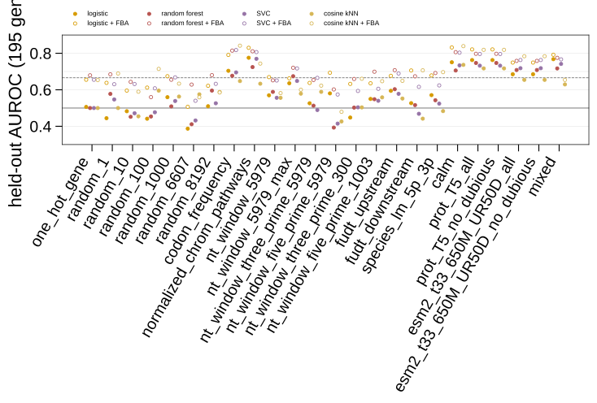
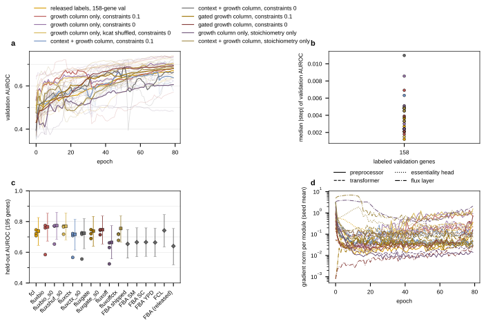
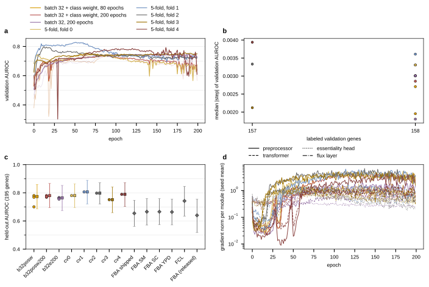
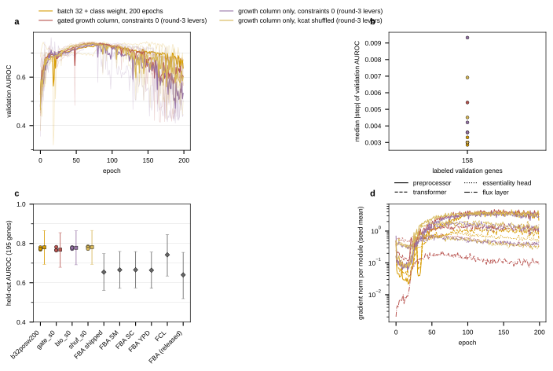

## 2026.09.16 - The essentiality line becomes its own experiment

Gene essentiality began as wave 9 of [[experiments.027-betaxanthin-metabolic]] (`train_bx.py --head essentiality`) and is moved here whole: the trainer (`scripts/train_essentiality.py`, the 027 script with paths repointed and the head fixed to essentiality), the union build (`$DATA_ROOT/data/torchcell/experiments/028-gene-essentiality/essentiality_build`, a copy of the 027 build so the other session's running wave-11 jobs keep theirs), the wave-9 to wave-11 result files, checkpoints (`$DATA_ROOT/checkpoints-028`) and per-gene dumps (`$DATA_ROOT/test-predictions-028`). W&B project: `zhao-group/torchcell_028_gene_essentiality`. The 027 history is in [[experiments.028-gene-essentiality.wave9-essentiality]].

There is no fitness objective anywhere in this experiment. The union build carries single-mutant fitness for 4,540 genotypes only because SGD's essential-gene list has no negative class; every fitness record arrives under a False essentiality mask and contributes no loss. The objective is one logit against a 0/1 label (binary cross entropy), selection is validation AUROC under a centered 5-epoch moving average, and the reported number is the AUROC on the released held-out genes at that epoch.

### What was measured before the move (027 waves 9 to 11)

- Pooled backbone at width 90 (958,501 parameters), released labels, 80 epochs: pinned test AUROC 0.793 / 0.788 / 0.578 at seeds 2700 to 2702 (jobs 2009, 2021, 2022); the third seed collapsed to a constant. Flux arm (biomass column of the projected flux, `FluxBiomassReadout`): 0.540 / 0.758 / 0.512, paired mean minus 0.117, 3 of 3 negative.
- Width 12, one block, one-layer preprocessor (16,874 parameters): 0.8011 / 0.7860 / 0.7958 (jobs 2045 to 2047), against FCL 0.742 and FBA 0.640 on the same 195 genes (`fcl_comparison.py`). Width 24: 0.7429 / 0.7398 / 0.8072.
- The validation curve at width 90 moves by a median of 0.034 to 0.072 between adjacent epochs; at widths 24 and 12 by 0.0067 (`curve_stability.py`).

### Three defects in the wave-9 protocol, and the split file that removes them

The data module drew train/validation at 80/10/10 over the 5,461 non-test records, of which 926 carry a label. Measured consequences: a validation set of 75 labeled genes with about 12 essential, on which one AUROC read has a Hanley-McNeil standard error near 0.07 (hypothesis for the bumpy curves, tested by wave 12); 10 percent of the labeled genes in a random test block nothing reports; 4,535 unlabeled records forwarded per epoch under a False mask, about 6 times the labeled work.

`scripts/build_essentiality_splits.py` writes one file per design under `results/splits/`: the per-gene labels, their provenance, and pinned train/val/test record indices. The trainer's `--split-file` pins all three splits and drops every other record (`CellDataModule(drop_unpinned=True)`, new in `torchcell/datamodules/cell.py`). The test block is always the released held-out genes (195 of 223 resolve in the build).

| split file | labels | train genes (ess) | val genes (ess) | test genes (ess) |
|---|---|---|---|---|
| `ess_fcl_val0.2_s0` | released, 1,121 | 629 (100) | 158 (25) | 195 (31) |
| `ess_genome_val0.2_s0` | released + SGD essential + viable single-mutant fitness, 5,795 | 4,368 (879) | 1,093 (220) | 195 (31) |

The genome source keeps the released label on every disagreement (12 genes, 11 of them SGD-essential that the released split calls nonessential, the same 11 `essentiality_label_agreement.py` found), so the held-out genes are scored on the comparator's labels under either source.

### FBA on four media

`scripts/fba_essentiality_baseline.py` (job 2072): cobrapy `single_gene_deletion` on yeast-GEM 9.0.2, the essentiality score being the negative knockout-to-wild-type growth ratio, rounded to 1e-3 so the ~900 deletions that grow at 0.99 to 1.00 of the wild type rank as the tie they are (without rounding two identical runs differed by 0.03 AUROC on the held-out genes, jobs 2069 and 2070).

| medium | WT growth (1/h) | lethal of 1,121 | AUROC all 1,121 | AUROC held-out 223 | AUROC our 195 [95% CI] |
|---|---|---|---|---|---|
| shipped bounds | 0.0858 | 186 | 0.707 | 0.633 | 0.654 [0.562, 0.748] |
| SM | 0.3138 | 160 | 0.707 | 0.642 | 0.666 [0.571, 0.759] |
| SC | 0.5428 | 91 | 0.719 | 0.653 | 0.666 [0.574, 0.759] |
| YPD approx | 0.5352 | 104 | 0.715 | 0.653 | 0.664 [0.572, 0.756] |

The medium moves the lethal count by a factor of two and the AUROC by 0.01. The published 0.69 on all labeled genes is reproduced to within 0.02 on our GEM copy and our bounds.

### Wave 12, queued 2026-09-16 00:55 (jobs 2071 smoke, 2073 to 2093)

Pooled arm, width 12, one block, one-layer preprocessor, 80 epochs, seeds 2700 to 2702, all scored on the same 195 genes:

| arm tag | change from the wave-11 width-12 cell | decides |
|---|---|---|
| `w12base` | none (wave-11 protocol in the 028 experiment) | the port: same numbers at the same seed |
| `w12fcl` | split file `ess_fcl_val0.2_s0` | whether a 158-gene stratified validation set smooths the curve and changes the selected epoch |
| `w12gen` | split file `ess_genome_val0.2_s0` | whether five times the labels move the held-out AUROC |
| `w12fclwd0`, `w12fclwd1e-2`, `w12fclwd1e-1` | AdamW weight decay 0, 1e-2, 1e-1 (base 1e-4) | the weight-decay dose response |
| `w12fclb32` | batch 32 (base 128) | whether 20 steps per epoch instead of 5 changes the curve |

Launcher: `scripts/gh_train_essentiality.slurm` through `scripts/freeze_and_submit.sh`, one environment per cell. Views: `scripts/wandb_views.py --contrast w12`.

### Wave 13, queued 2026-09-16 01:20 (jobs 2113 to 2130): the prediction routed through the module

Same width-12 cell, same fcl split and base hyperparameters as `w12fcl`, so every cell pairs by seed with a pooled cell. The flux arm is the wave-9 recipe (`flux_projection_anchored`, predicted kcat tier, union thermodynamics, YPD-approx bounds written onto the GEM, 20-epoch constraint warmup). Two readouts, two constraint scales, and the physics-off arm:

| arm tag | arm | readout | constraint scale | what the backbone's gradient passes through |
|---|---|---|---|---|
| `w13fluxbio` | anchored | growth column only | 0.1 | the flux layer only (wave-9 design) |
| `w13fluxbio_s0` | anchored | growth column only | 0 | the flux layer only, no physics penalty |
| `w13fluxctx` | anchored | context head + growth column | 0.1 | both paths |
| `w13fluxctx_s0` | anchored | context head + growth column | 0 | both paths, no physics penalty |
| `w13fluxoff` | stoichiometry only | growth column only | 0.1 | the flux layer with no thermodynamics or capacity |
| `w13fluxoffctx` | stoichiometry only | context head + growth column | 0.1 | both paths |

Per-module gradient norms are logged every epoch (`grad_norm_flux_layer_mean`, `grad_norm_readout_mean` beside the transformer's and the preprocessor's); on the CPU smoke of the context-plus-growth readout the flux layer carried 0.82 against the transformer's 0.68 at epoch 0 (anchored) and 6.6 against 0.45 (stoichiometry only). `--ess-readout` selects the readout (`ContextBiomassReadout` in `train_essentiality.py`).

## 2026.09.16 - Unified in one worktree; rounds 1 and 2 requeued with the 027 levers folded in

The 028 branch built in the other session was cherry-picked onto `feat/kinetics-equilibrator-datasets` (commits 3043dffd to cc60b17f, then 5808b618) and its worktree and branch were retired. The job ids in the two sections above (2071 to 2093, 2113 to 2130) were cancelled before any started, as were the 027 wave-12 cells (2094 to 2148) that duplicated them. The 027 essentiality line (`train_bx.py --head essentiality`, waves 9 to 12) ends here; its wave-11 `_nohead` reruns (jobs 2062 to 2068) are copied into this experiment's results and dumps when they land.

Folded into `train_essentiality.py` from the 027 side: the `gated` readout (`context_biomass` behind a zero-initialized gate, `ess_gate` logged per epoch, so at initialization the cell is the pooled model exactly), `--pos-weight-balanced` (772/126), an `ESS_GRAPH_REG` switch on the launcher, and the model change that removes the unused perturbation readout head (16,381 parameters at width 90, 1,201 at width 24, no gradient on any cell). Cells from here on are therefore not bit-identical at a seed to wave 11.

**Round 1, jobs 2149 to 2181 (33 cells)**, width 12, one block, preprocessor 1, 80 epochs, seeds 2700 to 2702. Beyond the wave-12 table above (base, fcl split, genome labels, weight decay 0 / 1e-2 / 1e-1, batch 32), all on the fcl split: learning rate 3e-4 and 3e-3, the class weight, and graph regularization off.

**Round 2, jobs 2182 to 2208 (27 cells)**, same cell on the fcl split. Beyond the wave-13 table above: the `gated` readout at constraint scale 0.1 and 0, and the shuffled-kcat control (`--flux-shuffle-kcat <seed>`) with the forced readout at scale 0.

Reads, pre-registered: (1) the bumpy-curve hypothesis is decided by `w12fcl` against `w12base`, median absolute validation step on 158 labeled genes against 75; (2) each round-1 lever earns a follow-up only when three of three seeds move the same way against `w12fcl`; (3) "not hurt" is `w13fluxgate*` against `w12fcl` paired by seed with the gate's trajectory beside it; "help" is `w13fluxbio_s0` above `w12fcl` and above `w13fluxshuf_s0`; the collapse's cause is `w13fluxbio` against `w13fluxbio_s0`. W&B project: `https://wandb.ai/zhao-group/torchcell_028_gene_essentiality`.

## 2026.09.16 - Round 1 read: the cells are under-trained, the class weight helps, weight decay and graph regularization do nothing

All 33 round-1 cells completed (jobs 2149 to 2181; `results/w12_readout.json`, figure `notes/assets/images/028-gene-essentiality/w12_readout_2026-09-16-10-32-55.svg`). Held-out AUROC on the 195 genes, seed mean over 2700 to 2702, with the pooled-logit gene bootstrap:

| arm | mean | sd | pooled [95% CI] | selected epochs | median val step |
|---|---:|---:|---|---|---:|
| base, wave-11 protocol, 75-gene validation | 0.759 | 0.020 | 0.760 [0.670, 0.844] | 18, 38, 14 | 0.0056 |
| fcl split, 158-gene validation | 0.725 | 0.019 | 0.738 [0.645, 0.826] | 66, 77, 77 | 0.0026 |
| fcl, weight decay 0 / 1e-2 / 1e-1 | 0.725 / 0.726 / 0.726 | 0.02 | 0.735 each | same | same |
| fcl, graph regularization off | 0.725 | 0.019 | 0.738 | same | same |
| fcl, lr 3e-4 / 3e-3 | 0.658 / 0.686 | 0.09 / 0.04 | 0.732 / 0.713 | 77, 77, 74 / 77, 77, 50 | |
| fcl, batch 32 | 0.765 | 0.005 | 0.764 [0.673, 0.852] | 74, 73, 77 | 0.0032 |
| fcl, class weight 772/126 | 0.759 | 0.016 | 0.769 [0.680, 0.858] | 77, 75, 53 | 0.0034 |
| genome labels, 1,093-gene validation | 0.704 | 0.024 | 0.705 [0.606, 0.802] | 77, 77, 69 | 0.0020 |

- **The bumpy-curve hypothesis holds.** The median epoch-to-epoch validation step halves from 0.0056 on 75 labeled genes to 0.0026 on 158 and 0.0020 on 1,093 (panel b of the figure). The old protocol's curve reads 0.8 on its own 75 genes and the split cells read 0.65 to 0.72 on theirs; the levels are not comparable, only the steps are.
- **The fcl split scores below the old protocol, and the reason is training genes, not validation.** The split trains on 629 labeled genes against the old draw's roughly 740 (80 percent of 926), and every fcl cell selected epoch 66 to 77 of 80 with its validation curve still rising (panel a), so the cells are under-trained at 80 epochs with 5 optimizer steps per epoch. Hypothesis (tested by round 3): the 0.034 gap closes with more optimization.
- **Weight decay does nothing at 0, 1e-2 or 1e-1**, to the third decimal, and neither does removing graph regularization: at 400 optimizer steps with lr 1e-3 a decay of 0.1 shrinks a weight by 4 percent, and the graph term's lambda is 6.5e-5. Both levers are closed on this endpoint.
- **Batch 32 moves three of three seeds up** (fcl 0.7455 / 0.7217 / 0.7085 to 0.7657 / 0.7701 / 0.7594; +0.020, +0.048, +0.051) and collapses the seed spread to 0.005. It is four times the optimizer steps per epoch, which is the same under-training story.
- **The class weight moves three of three seeds up** (to 0.7642 / 0.7722 / 0.7410; +0.019, +0.051, +0.033). Its curve also rises faster (panel a).
- **Genome-wide labels validate at 0.84 and test at 0.70.** The 1,093-gene validation set drawn from the genome-wide labels reads 0.841 / 0.836 / 0.835 at the selected epochs while the released held-out genes read 0.706 / 0.726 / 0.679, the widest validation-to-test gap of any arm; the released held-out genes are a different population from the genome-wide negatives, which is the same point as the bullet below.
- **The learning rate at 3e-4 and 3e-3 is worse than 1e-3 on the seed mean**, but with seed spreads of 0.09 and 0.04 the pooled numbers (0.732, 0.713) sit inside the fcl interval; neither is a lever to keep.
- **Genome-wide labels hurt** (0.704 against 0.725, three of three seeds down). Adding SGD's essential list and the viable single-mutant fitness records as nonessential gives 4,368 training genes but a worse ranking of the released held-out genes. Hypothesis (untested): the viable-fitness negatives are a different population from the released split's nonessential genes.
- **Gradient norms (panel d):** on the fcl cells the preprocessor's gradient starts near 1e-2 and rises about thirty-fold over 80 epochs while the head's stays flat near 0.4; the clip at 10 never binds.

Round 3, jobs 2209 to 2222 (14 cells), all width 12 on the fcl split with graph regularization on: batch 32 with the class weight at 80 and 200 epochs, batch 32 alone at 200 epochs, and the two winners on five-fold cross-validation files (`ess_fcl_fold{0-4}of5_s0`, 629 or 630 train genes and 157 or 158 validation genes each) at 200 epochs, whose fold models are averaged on the held-out genes exactly as FCL averages its five fold models. The ensemble read is `scripts/cv_ensemble_readout.py`.

## 2026.09.16 - The classical ladder reaches 0.80 with FBA as a feature, and the cells were spending most of each epoch spawning workers

`scripts/logistic_baselines.py` on `ess_fcl_val0.2_s0` (fit on 629 train genes, hyperparameter on 158 validation genes, scored once on the 195 held-out genes; `results/logistic_baselines.json`):

| rung | embedding | chosen | val | held-out [95% CI] |
|---|---|---|---:|---|
| B1 FBA growth | none | SC medium | 0.726 | 0.666 [0.57, 0.76] |
| B2 logistic | prot_T5_all | C = 1e-3 | 0.722 | 0.763 [0.67, 0.85] |
| B4 random forest | prot_T5_all | depth 4 | 0.743 | 0.768 [0.68, 0.86] |
| B2 logistic | normalized_chrom_pathways | C = 10 | 0.722 | 0.775 [0.68, 0.86] |
| B5 logistic + FBA | prot_T5_all | C = 0.1 | 0.833 | **0.803** [0.72, 0.88] |
| B5 logistic + FBA | calm | C = 10 | 0.839 | **0.803** [0.72, 0.88] |
| B5 logistic + FBA | normalized_chrom_pathways | C = 10 | 0.820 | 0.796 [0.70, 0.88] |
| B3 cosine kNN | any | | | 0.58 to 0.69 |

- **A logistic regression on a frozen protein embedding plus FBA's four growth ratios scores 0.803 on the held-out genes.** That is above FCL's 0.742 on the same genes and level with the best transformer cell of any round so far (width 12, old protocol, 0.80; batch 32 on the split, 0.765). Neither half reaches it alone: the embedding gives 0.76, FBA 0.67. The transformer is measured against 0.80 from here on.
- **Nearest neighbors do not work on this endpoint** (0.58 to 0.69), unlike betaxanthin where kNN on prot_T5 was the best baseline. Essentiality is not a smooth function of embedding distance at k = 1 to 50.
- **The obvious next transformer cell is FBA's growth ratio as an input feature**, either concatenated to the readout or as a node feature; the ladder says the two sources are complementary.

**Every GPU cell was spending most of each epoch spawning data loader workers.** Three-epoch CPU smoke of the width-12 split cell: 185 s of wall with `NUM_WORKERS=2`, 59 s with `NUM_WORKERS=0`. The context is `spawn`, the loaders are rebuilt each epoch, and each spawned worker re-imports the package, so about 42 s of every epoch was import time on a loader over 787 records. This is why every cell, from 16,874 to 958,501 parameters, took 48 to 60 s per epoch, and why the GPUs read 0 percent utilization with 4 to 5 GB resident. The launcher's default is now `ESS_WORKERS=0`; a GPU smoke confirms the per-epoch time before round 3 is resubmitted under it.

**Confirmed on the GPU (job 2224, width 12, batch 32, no loader workers): 60 epochs in about five minutes, roughly 5 s per epoch against 38 s under two spawned workers.** The 13 pending round-3 cells were cancelled and resubmitted under `ESS_WORKERS=0` (jobs 2224 to 2236); a 200-epoch cell now takes about 17 minutes instead of two hours. Job 2209 (batch 32 with the class weight, seed 2700, 80 epochs) was left running under the old setting and stays in the round as the pair of the resubmitted seeds.

## 2026.09.16 - The ladder redone with cross-validated selection and controls; round 2 read: the gated module does not hurt, the forced module does not help, and the kcat table is not what it reads

**The ladder table above is superseded.** Its hyperparameters were chosen on the validation genes, which makes the validation column a selection statistic. `logistic_baselines.py` now chooses each rung's hyperparameter by five-fold stratified cross-validation inside the 629 training genes and scores the validation and held-out genes once. The ladder is also full: four model classes (logistic, random forest, RBF SVC, cosine kNN) on 24 encodings (the fitness ladder's 17, plus a one-hot gene identity and standard normal vectors of width 1, 10, 100, 1,000, 6,607 and 8,192), each with and without FBA's four growth ratios, 192 fitted rungs plus FBA on four media. Figure and table: `notes-tex/028-gene-essentiality/` section 2; the figure below is every rung.

Held-out AUROC on the 195 genes, the rung per encoding with the highest CV AUROC (`results/logistic_baselines.csv`):

| encoding | best by CV | CV | held-out | with FBA: best by CV | CV | held-out |
|---|---|---|---|---|---|---|
| one_hot_gene | logistic | 0.504 | 0.506 | random forest | 0.775 | 0.679 |
| random_1 to random_8192 | | 0.47 to 0.60 | 0.45 to 0.59 | | 0.73 to 0.81 | 0.56 to 0.69 |
| codon_frequency | SVC | 0.700 | 0.695 | SVC | 0.849 | 0.818 [0.73, 0.90] |
| normalized_chrom_pathways | logistic | 0.705 | 0.775 | logistic | 0.802 | 0.830 [0.75, 0.90] |
| calm | SVC | 0.755 | 0.734 | random forest | 0.850 | 0.806 [0.72, 0.89] |
| prot_T5 | SVC | 0.781 | 0.732 | logistic | 0.842 | 0.821 [0.74, 0.90] |
| esm2 | random forest | 0.731 | 0.708 | random forest | 0.815 | 0.758 |
| mixed | logistic | 0.788 | 0.768 | logistic | 0.833 | 0.792 |
| FBA alone | | | 0.654 to 0.666 | | | |

- **The controls behave.** One-hot scores 0.506 (every held-out column is zero in training) and the random vectors score chance at every width; with FBA appended they score FBA's number. Nothing leaks through the split.
- **The bar is 0.80 to 0.83, and it needs FBA.** No encoding clears 0.78 alone; four clear 0.80 with the four ratios appended. The rung with the highest CV AUROC overall (random forest on CaLM + FBA, 0.850) scores 0.806 held-out; the highest held-out number in the figure (cosine kNN on codon frequency + FBA, 0.841) is a max over 192 rungs, not a selected model.
- **Correction to the previous section:** kNN is not dead on this endpoint once the FBA ratios are appended (0.84 on codon, CaLM); without them it reads 0.63 to 0.74 on the language-model encodings, and the earlier "0.58 to 0.69" was the val-tuned run over four encodings.

**Round 2 (jobs 2182 to 2208), the module on the width-12 cell, paired by seed against the round-1 pooled cell on the same split, batch and budget (`wave12_readout.py --round w13`):**

| arm | seeds 2700, 2701, 2702 | mean | pooled [95% CI] |
|---|---|---|---|
| pooled (round-1 fcl) | 0.745, 0.722, 0.708 | 0.725 | 0.738 [0.65, 0.83] |
| forced biomass, scale 0.1 | 0.759, 0.585, 0.774 | 0.706 | 0.765 [0.67, 0.85] |
| forced biomass, scale 0 | 0.770, 0.653, 0.772 | 0.732 | 0.773 [0.68, 0.86] |
| forced biomass, kcat shuffled, scale 0 | 0.771, 0.718, 0.765 | 0.751 | 0.769 [0.68, 0.86] |
| context + growth, scale 0.1 | 0.566, 0.709, 0.722 | 0.666 | 0.717 [0.61, 0.82] |
| context + growth, scale 0 | 0.556, 0.727, 0.718 | 0.667 | 0.724 [0.62, 0.82] |
| gated, scale 0.1 | 0.721, 0.747, 0.690 | 0.719 | 0.738 [0.64, 0.83] |
| gated, scale 0 | 0.714, 0.744, 0.747 | 0.735 | 0.747 [0.65, 0.84] |
| stoichiometry only, forced | 0.524, 0.631, 0.661 | 0.606 | 0.664 [0.56, 0.77] |
| stoichiometry only, context + growth | 0.719, 0.717, 0.678 | 0.705 | 0.755 [0.67, 0.84] |

- **Not hurt: holds.** Gated at scale 0 is +0.02 to +0.04 on two seeds and -0.03 on one against the pooled cell; the gate ends at -0.056 to -0.063 on all six gated runs, and the flux layer's gradient norm is 0.01 to 0.07 against 0.22 to 0.36 on the forced arm's seeds that train. The gated cell is a pooled cell with a small correction.
- **Help: does not hold.** Forced at scale 0 is above the pooled cell on two of three seeds, and the shuffled-kcat control (0.751 mean) matches or beats the real table (0.732). Whatever the growth column carries here, it is not the unit-to-constant correspondence. Pooled bootstrap 0.773 [0.68, 0.86]: above FCL 0.742 and FBA 0.64 to 0.67, level with the pooled cell, below the ladder's 0.80.
- **The collapse is not the penalty's.** Seed 2701 stalls at both scales (0.585 and 0.653) with every module's gradient decaying within ten epochs to a hundredth of the other seeds' and the training loss flat at 0.46 against 0.34. The stoichiometry-only layer collapses on all three seeds (0.52 to 0.66), so on this endpoint the capacity bound and the thermodynamic term keep the growth column informative; on betaxanthin the penalty scale was the collapse dose. Context + growth without a gate costs 0.06 on the mean and puts one seed at 0.56; the same sum behind the gate loses nothing.
- **Readout script fixes in this commit:** the FCL comparator is read from `fcl_comparison.json`'s `scored` block (`ours_scored`), a round can pull another wave's cell in as its pair, and the gate and shuffle arms have labels.

Example runs, gated scale 0 seed 2701 and forced scale 0 seed 2701 (the stalled seed):

<https://wandb.ai/zhao-group/torchcell_028_gene_essentiality/runs/z2cmvk14>

<<https://wandb.ai/zhao-group/torchcell_028_gene_essentiality/runs/235hi61k>

**Round 4 (9 cells), queued 16:41 as jobs 2237 to 2245, cancelled unstarted and requeued 16:47 as three pack jobs 2246 to 2248.** The three round-2 module readouts at constraint scale 0 on top of the round-3 levers (batch 32, class weight 772/126, 200 epochs, `ESS_WORKERS=0`), seeds 2700 to 2702, paired against the round-3 `b32posw200` pooled cell: `w15gate_s0` (gated), `w15bio_s0` (forced growth column), `w15shuf_s0` (forced, kcat shuffled by the seed). Read with `wave12_readout.py --round w15`.

**Several cells on one GPU.** Slurm on GilaHyper allocates whole GPUs (gres type `gpu`, no shards), so the one-cell-per-job launcher caps the machine at four concurrent cells while a width-12 cell holds 3.6 GB of a 46 GB card at 10 percent utilization (round 3, `nvidia-smi` at 16:27). `scripts/gh_train_essentiality_pack.slurm` takes one GPU, 12 CPUs and 36 GB and runs every line of a pack file (`conf/packs/<name>.pack`, one cell's `ESS_*` assignments per line) concurrently, each cell to its own log `slurm/output/028-pack_<job>_<stem>.out`; the cell body moved to `scripts/ess_cell.sh`, which both launchers call. Smoked on CPU with two one-epoch pooled cells (both finished, result files written, moved out of `results/`). Round 4 is the first GPU use: one pack per arm, three seeds each, so nine cells occupy three GPUs instead of nine job slots.

## 2026.09.16 - Round 3 read: the two levers at 200 epochs give the tightest cell (0.774 +/- 0.006), the fold ensemble reads 0.795 under FCL's own protocol

Jobs 2209 and 2224 to 2236, all width 12 on the released-label split, `ESS_WORKERS=0` (10.5 to 11 min per 200-epoch cell). `wave12_readout.py --round w14`, `cv_ensemble_readout.py --prefix w14_cv`.

| arm | seeds 2700, 2701, 2702 | mean | sd | pooled [95% CI] |
|---|---|---|---|---|
| batch 32 + class weight, 80 epochs | 0.780, 0.769, 0.700 | 0.750 | 0.043 | 0.774 [0.69, 0.86] |
| batch 32 + class weight, 200 epochs | 0.780, 0.769, 0.773 | 0.774 | 0.006 | 0.780 [0.69, 0.87] |
| batch 32, 200 epochs | 0.766, 0.761, 0.755 | 0.761 | 0.005 | 0.764 [0.67, 0.85] |
| 5-fold models (folds 0 to 4, seed 2700) | 0.780, 0.806, 0.797, 0.751, 0.789 | 0.785 | | ensemble 0.795 [0.71, 0.88] |

- **Batch 32 + class weight + 200 epochs is the best pooled cell and the tightest** (sd 0.006 across seeds). The class weight adds +0.014 / +0.008 / +0.018 over batch 32 alone at the same budget, three of three seeds, as at 80 epochs.
- **The longer budget moves one seed only.** The 80- and 200-epoch cells share their trajectory through epoch 80 and select the same epoch on seeds 2700 and 2701 (75, 68; identical held-out numbers); seed 2702 selects epoch 31 at 80 epochs (0.700) and 148 at 200 (0.773).
- **Fold 0 of the 5-fold files is the val0.2 split exactly** (same 629 / 158 / 195 genes, both drawn at seed 0), so `cv0` reproduces `b32posw200` seed 2700 to the digit (0.7801). Not wasted, but not a sixth model either.
- **The fold ensemble, FCL's protocol, reads 0.795 [0.71, 0.88] on the 195 genes** against FCL's 0.742 on the same genes and its published 0.73; fold mean 0.785. Still 0.01 to 0.04 below the ladder's FBA-augmented rungs (0.806 to 0.830).
- The fold curves show sharp single-epoch dips around epochs 20 to 30 on some seeds (fold 4 to 0.3) with the preprocessor gradient dropping to 0.01 at the same epochs and recovering; the smoothed selection rule steps over them.

Example runs, batch 32 + class weight at 200 epochs seed 2702 (selected epoch 148) and fold 1 (0.806):

<https://wandb.ai/zhao-group/torchcell_028_gene_essentiality/runs/zp335f43>

<<https://wandb.ai/zhao-group/torchcell_028_gene_essentiality/runs/mkrk5vb5>

## 2026.09.16 - Round 4 read: on the best backbone the module neither helps nor hurts, and the shuffled kcat table scores the same as the real one

Pack jobs 2246 to 2248 (three cells per GPU, 29 min per pack; the cards ran at 80 to 98 percent utilization and 11 GB against 10 percent for a single cell). Paired by seed against the round-3 `b32posw200` cell (`wave12_readout.py --round w15`).

| arm (all batch 32 + class weight, 200 epochs, scale 0) | seeds 2700, 2701, 2702 | mean | sd | pooled [95% CI] |
|---|---|---|---|---|
| pooled (round 3) | 0.780, 0.769, 0.773 | 0.774 | 0.006 | 0.780 [0.69, 0.87] |
| gated | 0.766, 0.782, 0.765 | 0.771 | 0.010 | 0.768 [0.68, 0.85] |
| forced growth column | 0.772, 0.781, 0.778 | 0.777 | 0.005 | 0.778 [0.69, 0.86] |
| forced, kcat shuffled | 0.785, 0.781, 0.772 | 0.779 | 0.006 | 0.781 [0.69, 0.87] |

- **Every arm is within 0.015 of the pooled cell on every seed.** Not hurt holds again (gated 1 of 3 above, mean -0.003). Help does not: forced 2 of 3 above by 0.005 and 0.012, and the shuffled-kcat control is as good (0.779 vs 0.777).
- **The gate moves now.** It leaves zero after epoch 10 and climbs steadily to -0.17 / +0.20 / +0.11 at epoch 200 (either sign), flux-layer gradient 0.06 to 0.12 against 0.22 to 0.65 in the forced arm. Round 2's stalled seed did not recur under batch 32 with the class weight.
- **Read across rounds 2 and 4:** the forced growth column is as expressive a readout as the MLP head (matches it to 0.01 carrying the whole prediction), but its kcat content is not what it reads (shuffle == real). On this endpoint at width 12 the flux layer acts as a learned nonlinearity over the context, not as a physical prior that ranks genes. The remaining lever for the module question is the module's own inputs (measured kcat tier, thermo source, parameterization), not the readout.
- **Performance ceiling so far:** pooled 0.774 (seed mean) / 0.795 (fold ensemble) against the ladder's 0.81 to 0.83 with FBA appended. Next: the FBA growth ratio as an input to the transformer.

Example runs, gated seed 2701 (gate to +0.20) and shuffled-kcat seed 2700 (0.785):

<https://wandb.ai/zhao-group/torchcell_028_gene_essentiality/runs/tvbw3cg9>

<<https://wandb.ai/zhao-group/torchcell_028_gene_essentiality/runs/jf3af715>

**Round 5 (w16), packs 2249 and 2250, queued 17:38: FBA's growth ratios as an input to the transformer.** `--ess-readout fba` (new in `train_essentiality.py`, `FbaContextReadout`) adds an affine of the deleted gene's knockout-to-wild-type growth ratio on the four media (`fba_essentiality_per_gene.csv`, the same four numbers the ladder appends) to the pooled arm's context logit; the four weights are logged per epoch as `ess_fba_w_<medium>`. Cells: the round-3 levers (batch 32, class weight, 200 epochs) at seeds 2700 to 2702, paired against `b32posw200`, and the same readout on the five cross-validation folds (seed 2700) for the ensemble number (`cv_ensemble_readout.py --prefix w16_fbacv`). Pre-registered read: the ladder's logistic rung on ProtT5 gains 0.09 from the four ratios (0.732 to 0.821); the transformer gains the same complement if its seed mean moves from 0.774 toward 0.82 on three of three seeds, and the fold ensemble from 0.795 toward the ladder's 0.81 to 0.83. CPU smoke: two epochs already read 0.713 held-out, which is the affine on the ratios alone (FBA scores 0.65 to 0.67).>> Pre-registered reads are the round-2 ones: not hurt is gated against the pooled cell paired by seed; help is forced above the pooled cell on three of three seeds and above the shuffled control. Round 3 (2224 to 2236) is still draining ahead of it; its partial numbers at 16:40 are b32posw at 80 epochs 0.780 / 0.769 / 0.700, b32posw200 seed 2700 0.780, b32e200 seed 2700 0.766.>
