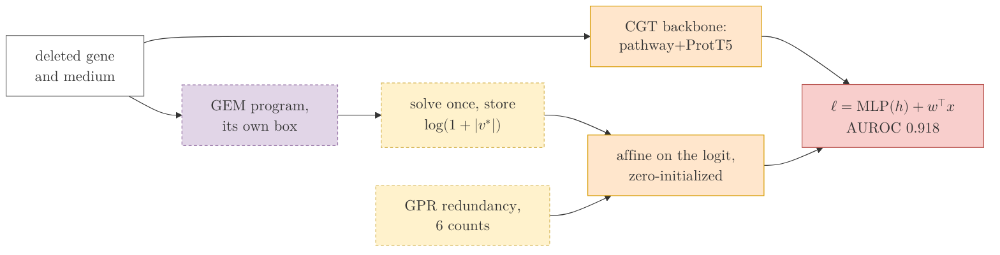
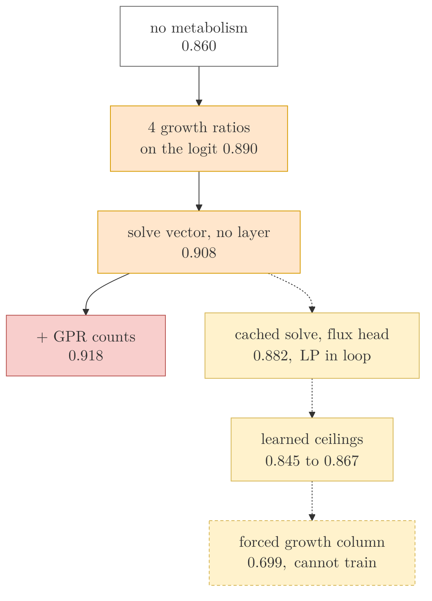

## 2026.09.20 - Where the metabolic module stands on gene essentiality

Colors follow `experiments.028-gene-essentiality.mermaid.readouts`: orange the learned
backbone, purple the fixed genome-scale model, yellow a fixed table or a learned flux
layer (dashed border = fixed), red the prediction, gray an input. Rendered by
`notes/assets/publish/scripts/mermaid_pdf.sh`.

### 1. The form that works: the solve is a data transform, not a layer

### 2. Every form tried, by what it scores on the released held-out genes

### 3. What changed since the module ran on betaxanthin and the amino acids

The module that ran in 026 and 027 was a LAYER: alternating projections inside the forward
pass, with the readout taken from its flux. Measured there, it cost prediction on every
target. Betaxanthin box head against pooled, paired, was $-0.017$ (sd 0.046, n = 6); the
19 amino acids were $-0.039$ on the box head (sd 0.007, n = 3, every seed agreeing) and
$-0.039$ on the projection head; and every flux readout drove the prediction spread ratio
from 0.37 to 0.46 down to 0.06 and below, with the penalized cell's flux varying
$2.5 \times 10^{-7}$ of the flux scale across 933 genotypes.

028 explains why and replaces the construction:

- the layer's projections never reach the polytope the solve optimizes over. With the
  balance exact, the box is violated on 58 percent of reactions, the second law on half,
  the protein pool by up to seven times and the dissipation limit by three;
- the capacity box as parameterized contains no growing flux at all. The predicted
  turnover tier times the nominal abundances caps the median reaction at 0.084
  mmol/gDW/h, so every anchored arm in 026 and 027 read a flux off the polytope;
- the growth column is a free signed coordinate the readout learns to use with either
  sign, and the same six gene-owned ceilings bind whichever gene is deleted, so a forced
  growth column cannot be trained at any step size, head or reach;
- solved on the model's own box the program is feasible, and its flux vector read through
  a zero-initialized linear head is worth $+0.048$ over the backbone.

So the form to carry back is the store, not the layer: solve once per genotype and
medium, offline, cache $\log(1+|v^*|)$, and read it as affine columns. It costs nothing
on the card, holds mass balance and the bounds exactly, and cannot hurt at
initialization. Two properties of the store were measured here and transfer: the argmax
is degenerate, so the store and the head must come from ONE solver (the growth program's
own dual-simplex vertex trains to 0.840 where the parsimonious store trains to 0.908),
and the columns that reach the $\pm 100$ clamp carry the whole deficit.
