## 2026.09.16 - The three essentiality readouts

Labels are KaTeX (`$$...$$`); multi-line labels use the triple-backslash row separator the
repo's mermaid rules require. Rendered by `notes/assets/publish/scripts/mermaid_pdf.sh`; the
PDFs are the figures of notes-tex/028-gene-essentiality section 4. Colors follow the module
figure: orange the gene-state path, purple the fixed stoichiometry, yellow the parameter
tables and the flux layer (dashed border = a fixed table), red the prediction and the loss.

### 0. color key (one row, rendered once and placed above the three readouts)

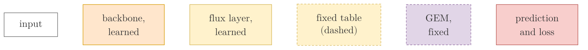

### 1. pooled (the backbone alone, no flux layer)

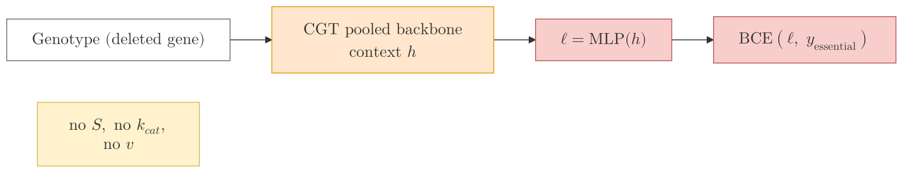

### 2. biomass (forced: the growth column is the only path to the logit)

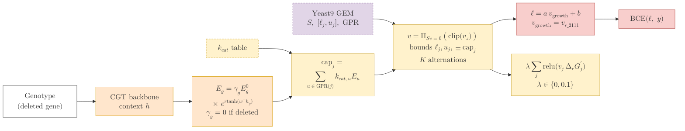

### 3. gated (optional: the pooled head plus a zero-initialized gate on the growth affine)

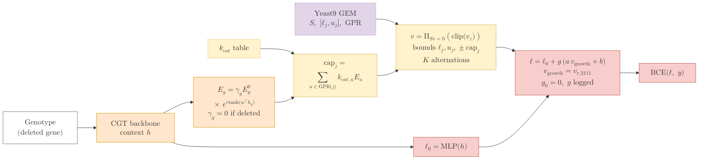

## 2026.09.21 - One diagram per module form that was trained

Same palette, key and node vocabulary as the three readouts above, one diagram for each
form of the metabolic module that was trained after them, in the order the forms first
ran. `mermaid_pdf.sh` numbers the PDFs by position in this file, so diagram `N` below is
`experiments.028-gene-essentiality.mermaid.readouts-(N+1).pdf` and lands in
`notes-tex/028-gene-essentiality/figures/readout_N.pdf`. Keep new diagrams at the END of
this file so the numbering of the earlier ones never shifts. The layer itself (the
alternating projections, the layer that solves, the elastic program, the flux head, the
solve on the model's own box) is drawn in draw.io by `notes/assets/drawio/028-module.gen.py`.

### 4. fba affine (round 5: FBA's growth ratios as an affine on the logit, no layer)

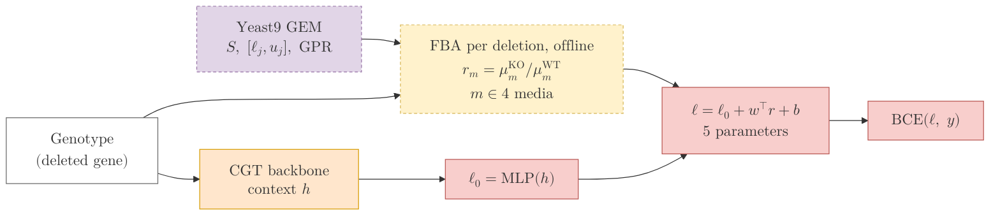

### 5. gated plus fba affine (round 6: the alternating layer beside the solve)

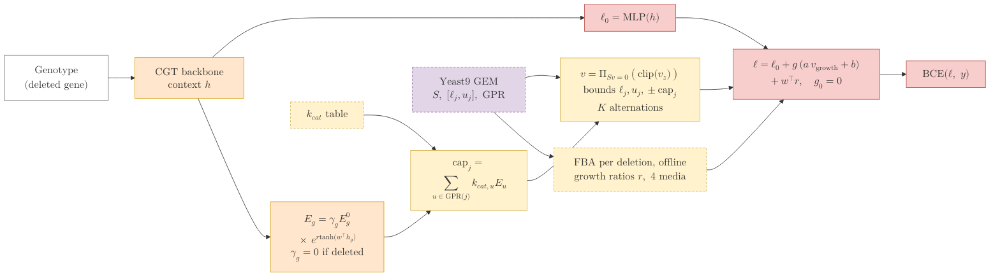

### 6. box form (round 7: the bounds exact, no balance projection)

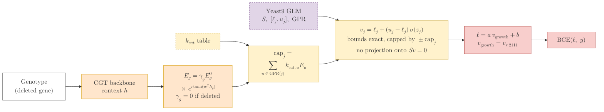

### 7. warm start, anchored (round 10: the proposal starts at the deletion's own pFBA flux)

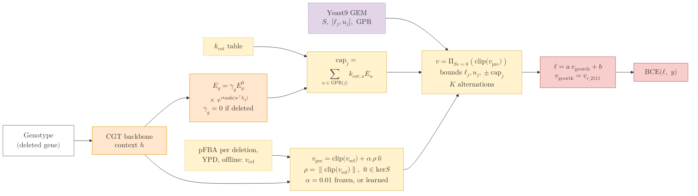

### 8. warm start, GEM box, gated (round 13: the same proposal on the stoichiometry-only layer)

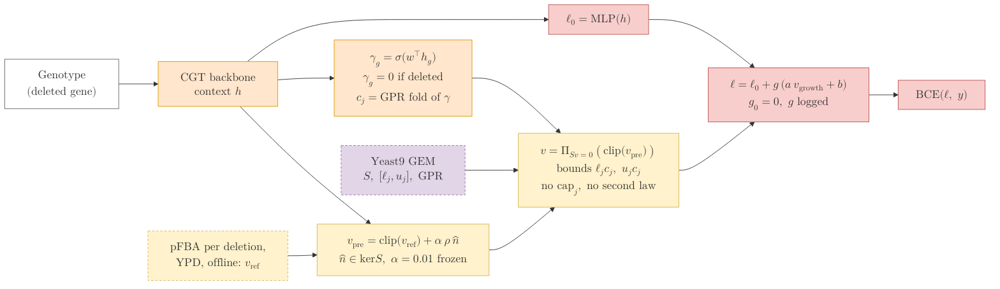

### 9. widened affine (round 11, rerun in round 31: solve features as standardized affine columns)

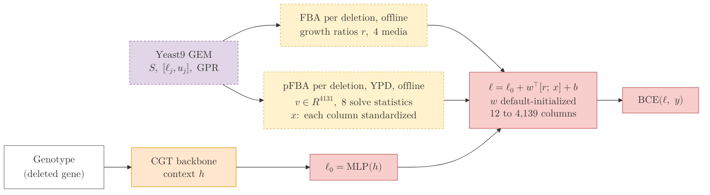

### 10. solve on the GEM box with a flux head (round 24, cached in round 27)

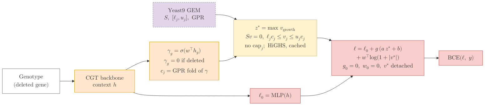

### 11. layer-free (round 33: the solve is a stored transform, read by a zero-initialized affine)

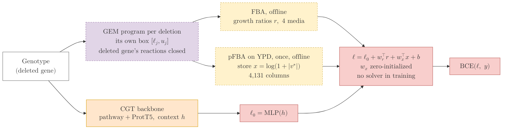

### 12. layer-free, a store from another solver's point (rounds 36, 38 and 42)

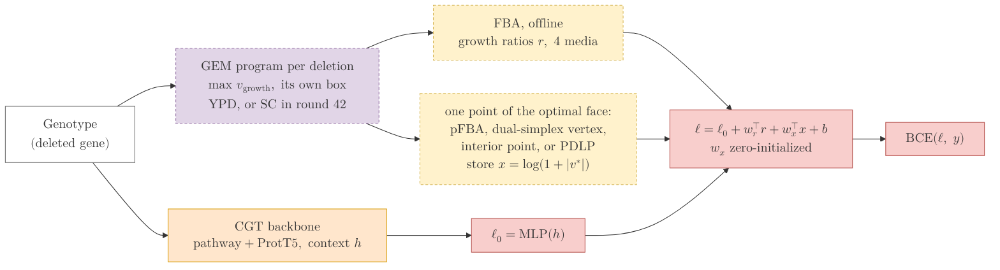

### 13. layer-free, a hidden layer in the affine (round 41)

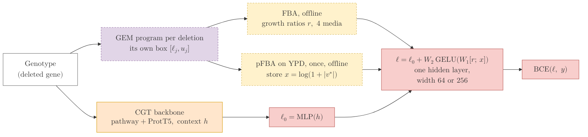

### 14. the solve on the node (rounds 43 and 44: the stored vector as a gene embedding)

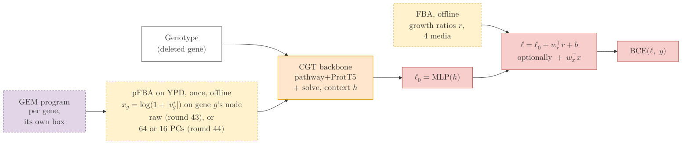

### 15. layer-free, the clamp columns dropped from the vertex store (rounds 68 to 70)

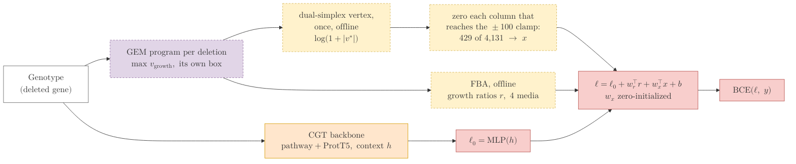

### 16. the store at the database's scale (the 025 solid-growth build)

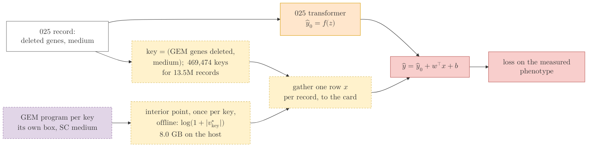

### 17. layer-free plus the gene-rule counts (round 77)

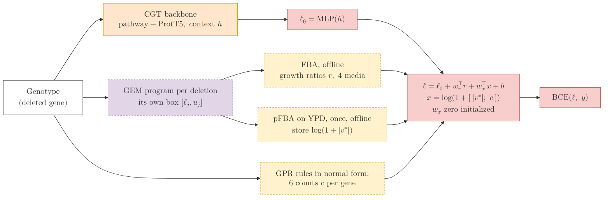

### 18. layer-free with the class token through the perturbation operator (round 79)

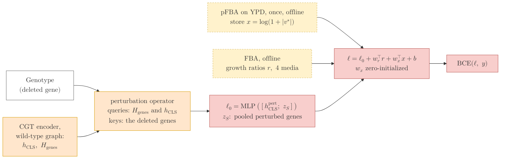

### 19. the counts without the flux vector (round 82, and the fewer-media recipes of rounds 84 to 98)

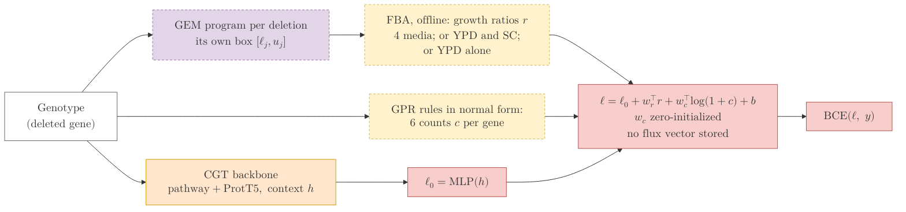

### 20. every column inside one experiment (round 83)

```mermaid
flowchart LR
  G["$$\begin{gathered}\text{Record: genotype}\\\ \text{(deleted gene) on YPD}\end{gathered}$$"] --> B["$$\begin{gathered}\text{CGT backbone}\\\ \text{pathway} + \text{ProtT5},\ \text{context } h\end{gathered}$$"]
  B --> H["$$\ell_0 = \mathrm{MLP}(h)$$"]
  G --> P["$$\begin{gathered}\text{GEM program per deletion}\\\ \text{its own box, YPD only}\end{gathered}$$"]
  P --> F["$$\begin{gathered}\text{FBA, offline: one ratio}\\\ r_{\text{YPD}} = \mu^{\text{KO}} / \mu^{\text{WT}}\end{gathered}$$"]
  P --> ST["$$\begin{gathered}\text{pFBA on YPD, once, offline}\\\ \text{store } \log(1 + |v^*|)\end{gathered}$$"]
  G --> R["$$\begin{gathered}\text{GPR rules: } 6 \text{ counts } c\\\ \text{(no environment)}\end{gathered}$$"]
  ST --> S["$$\begin{gathered}\ell = \ell_0 + w_r\, r_{\text{YPD}} + w_x^\top x + b\\\ x = \log(1 + [\,|v^*|;\ c\,])\\\ \text{one genotype, one medium}\end{gathered}$$"]
  R --> S
  F --> S
  H --> S
  S --> L["$$\mathrm{BCE}(\ell,\ y)$$"]
  style G fill:#FFFFFF,stroke:#666666
  style B fill:#FFE6CC,stroke:#D79B00
  style P fill:#E1D5E7,stroke:#9673A6,stroke-dasharray:4 3
  style F fill:#FFF2CC,stroke:#D6B656,stroke-dasharray:4 3
  style ST fill:#FFF2CC,stroke:#D6B656,stroke-dasharray:4 3
  style R fill:#FFF2CC,stroke:#D6B656,stroke-dasharray:4 3
  style H fill:#F8CECC,stroke:#B85450
  style S fill:#F8CECC,stroke:#B85450
  style L fill:#F8CECC,stroke:#B85450
```
