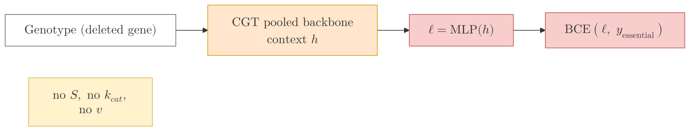
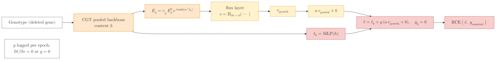

## 2026.09.16 - The three essentiality readouts

Labels are KaTeX (`$$...$$`); multi-line labels use the triple-backslash row separator the
repo's mermaid rules require. Rendered by `notes/assets/publish/scripts/mermaid_pdf.sh`; the
PDFs are the figures of notes-tex/028-gene-essentiality section 4. Colors follow the module
figure: orange the gene-state path, purple the fixed stoichiometry, yellow the parameter
tables and the flux layer (dashed border = a fixed table), red the prediction and the loss.

### 1. pooled (the backbone alone, no flux layer)

### 2. biomass (forced: the growth column is the only path to the logit)

```mermaid
flowchart LR
  G["$$\text{Genotype (deleted gene)}$$"] --> B["$$\begin{gathered}\text{CGT pooled backbone}\\\ \text{context } h\end{gathered}$$"]
  B --> E["$$\begin{gathered}E_g = \gamma_g\,E^0_g\,e^{\,r\tanh(w^\top h_g)}\\\ \gamma_g = 0 \text{ for the deleted gene}\end{gathered}$$"]
  K["$$k_{cat}\ \text{table}$$"] --> CAP
  E --> CAP["$$\mathrm{cap}_j = \sum_{u \in \mathrm{GPR}(j)} k_{cat,u}\,E_u$$"]
  GEM["$$\begin{gathered}\text{Yeast9 GEM}\\\ S,\ [\ell_j, u_j],\ \text{GPR}\end{gathered}$$"] --> V
  CAP --> V["$$\begin{gathered}v = \Pi_{Sv=0}\!\big(\mathrm{clip}(v_z;\ \ell_j, u_j, \pm\mathrm{cap}_j)\big)\\\ \text{K alternations}\end{gathered}$$"]
  V --> GR["$$v_{\text{growth}} = v_{r\_2111}$$"]
  GR --> H["$$\ell = a\,v_{\text{growth}} + b$$"]
  H --> L["$$\mathrm{BCE}\big(\ell,\ y_{\text{essential}}\big)$$"]
  T["$$\lambda \sum_j \mathrm{relu}(v_j\,\Delta_r G'_j),\quad \lambda \in \{0, 0.1\}$$"]
  V --> T
  style G fill:#FFFFFF,stroke:#666666
  style B fill:#FFE6CC,stroke:#D79B00
  style E fill:#FFE6CC,stroke:#D79B00
  style GEM fill:#E1D5E7,stroke:#9673A6,stroke-dasharray:4 3
  style K fill:#FFF2CC,stroke:#D6B656,stroke-dasharray:4 3
  style CAP fill:#FFF2CC,stroke:#D6B656
  style V fill:#FFF2CC,stroke:#D6B656
  style GR fill:#FFF2CC,stroke:#D6B656
  style T fill:#FFF2CC,stroke:#D6B656
  style H fill:#F8CECC,stroke:#B85450
  style L fill:#F8CECC,stroke:#B85450
```

### 3. gated (optional: the pooled head plus a zero-initialized gate on the growth affine)

