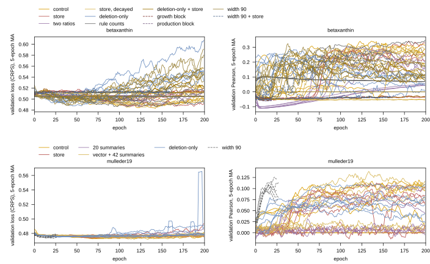

Script: `experiments/028-gene-essentiality/scripts/target_training_length_audit.py`. Output: `experiments/028-gene-essentiality/results/target_training_length_audit.json` and the figure below. Asked by the user on 2026.09.23: are the transfer cells (rounds 117 onward, 200 epochs) trained long enough, i.e. does the validation loss reach a minimum inside the budget?

## 2026.09.23 - Validation curves of every transfer arm

Per cell the script reads the result file's per-epoch `val_loss` (CRPS on the validation pool) and `val_pearson`, reports the epoch of the minimum loss (raw and 5-epoch centered moving average, the trainer's selection smoothing), the loss at epoch 199 minus the minimum, the slope of the moving-average loss over the last 20 epochs, the epoch of the maximum moving-average Pearson beside the selected epoch, and whether either extremum lies in the last 20 epochs. Running cells are parsed from their per-cell slurm log (newest by mtime) and marked partial.

Findings on the complete cells (six seeds per arm):

- **Betaxanthin: 200 epochs is past the minimum on every seed that escapes the plateau.** Validation loss reaches its minimum at moving-average epochs 13 to 160 on the control (median 130), 92 to 137 on the escaped store seeds, 23 to 69 on the deletion-only graph (median 32) and 27 to 94 on the deletion-only graph with the store (median 42); it then rises, by +0.01 to +0.03 on the control and +0.04 to +0.12 on the deletion-only arms, by epoch 199. No complete betaxanthin cell has its loss minimum in the last 20 epochs (0 of 42 escaped cells), and the moving-average Pearson peaks in the last 20 on only the plateau seeds (validation Pearson about -0.03, drifting) and on three `bxratio` seeds that are still climbing slowly out of the plateau at epoch 199 (0.04 to 0.05). The budget problem on this target is not length; it is seeds that never leave the constant predictor (3 of 6 on `bxstore`, 3 of 6 on `bxstorewd`, 3 of 6 on `bxratio` still climbing, 1 of 6 on `bxdelstore`).
- **Amino acids: the loss minimum is mid-run and the curve is flat; the Pearson peak is late on a few seeds.** Validation loss minima sit at median epochs 57 to 129 across the five arms and the end is within +0.000 to +0.02 of the minimum; the loss spans 0.472 to 0.481 over the whole run, a near-constant predictor's CRPS. Moving-average Pearson peaks at median epochs 111 to 151, in the last 20 epochs on one seed per arm (`aactx` s2701 at 192, `aastore` s2702 at 184, `aadel` s2705 at 198, selected 197). So some amino-acid seeds may still be rising at 200; the loss says the gain is small. Round 129 (w146, `aadel` at 300 epochs, six seeds) measures it against the same seeds at 200.
- **Width 90 (partial, jobs 2762/2763 at epoch 55 to 63):** the wide betaxanthin control escapes by epoch 10 to 40 and its loss minimum is at epochs 24 to 53 with the moving-average Pearson already off its peak (0.12 to 0.33 at epochs 9 to 44) by epoch 60. 200 epochs is more than these cells use. Partial, no verdict until the pack lands.
- **Width 90, complete (jobs 2762, 2763, 06:20):** all six wide betaxanthin cells escape; loss minima at moving-average epochs 9 to 107 (median 42), rise of +0.01 to +0.11 by epoch 199, Pearson maxima at epochs 9 to 107 (median 50), none in the last 20. Two seeds (2701, 2704) return to a constant predictor by the end (moving-average Pearson 0.000 at epoch 199) after peaking at 0.12 and 0.22. 200 epochs is about four times what a wide cell uses.
