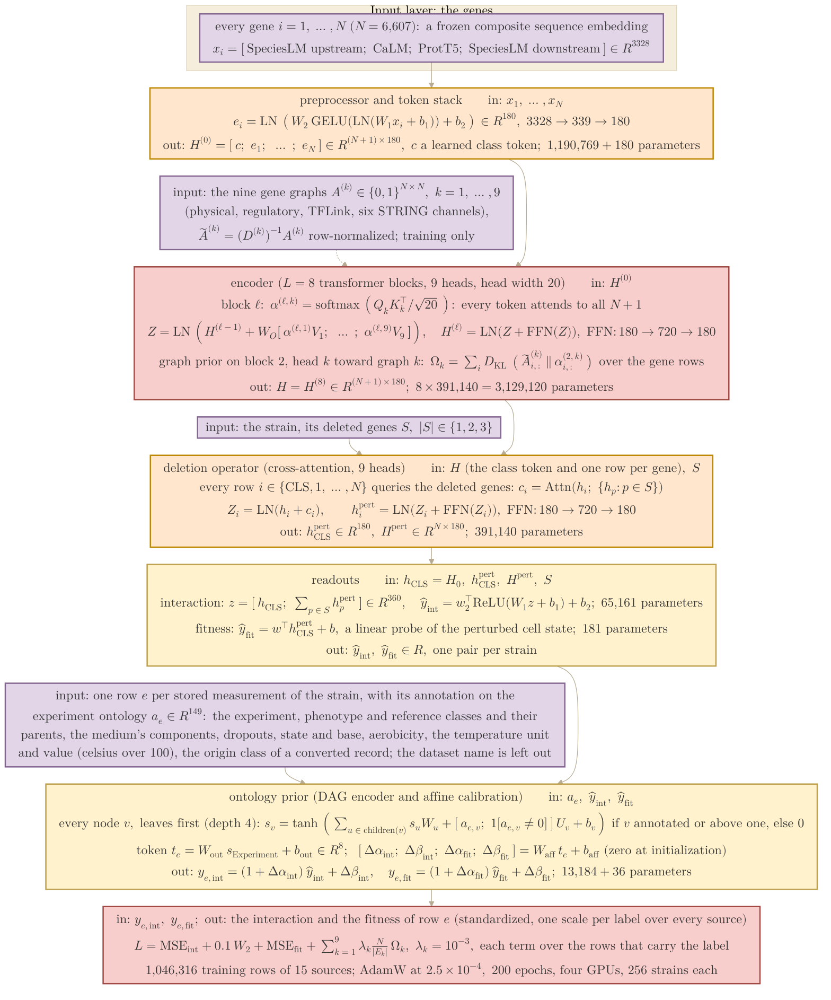
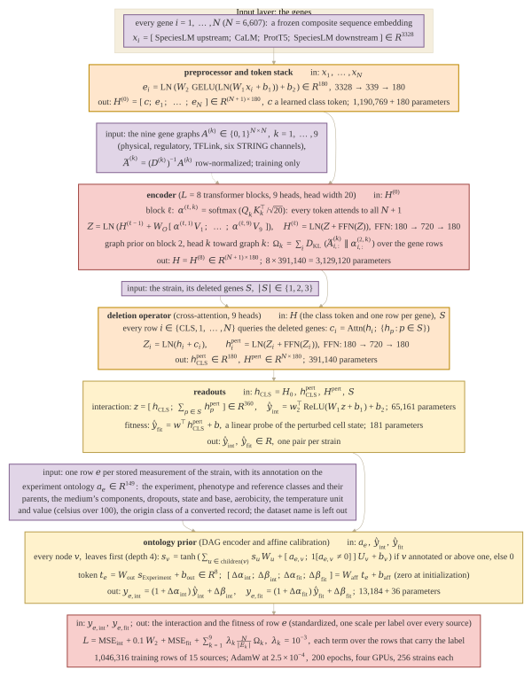

## 2026.10.31 - The multi-measurement Cell Graph Transformer with the experiment ontology as its prior

The model of thesis Section 3.7 (Fig. 3.10), configuration
`experiments/030-solid-growth-multi/conf/cgt_030_s3_r_onto_affine_010.yaml` on branch
`feat/030-token-affine` (chain `_010 -> _tok_embfit_003 -> _tok_fit_002 -> _tok_fit_000`):
the trigenic model of [[experiments.025-solid-growth.architecture-mermaid]] trained on the S3
closure pool (every stored single, double and triple measurement, 1,121,662 records of 15
sources) with four changes. The gene table is replaced by a frozen composite sequence embedding
through a parameter-matched preprocessor; the class token rides through the deletion operator
and a linear fitness head reads it; every stored measurement is its own training row; and the
row's experiment annotation on the schema ontology, propagated to the root by a DCell-style
encoder, sets a scale and shift on each head's output (`dataset_token: {mode: affine, source:
ontology}`), so the model is conditioned on what the experiment is and never on which dataset
reported it. Same function view and palette as the 025 diagram; rendered by
`bash notes/assets/publish/scripts/mermaid_pdf.sh notes/experiments.030-solid-growth-multi.architecture-mermaid.md`.

### Coherence audit against the code (2026.10.31)

Checked against branch `feat/030-token-affine` at `3c41725c4`:
`torchcell/models/equivariant_cell_graph_transformer.py` (`CellGraphTransformer.__init__`, the
preprocessor with `hidden_dim`, `dataset_token` and `perturb_cls`; `forward`, `entry_heads`,
`_entry_calibrate`; `PerturbationHead.combined` and `forward_entries`; `GlobalHead` with
`linear` and `use_gene_pool=False`), `torchcell/data/experiment_ontology.py`
(`ExperimentOntologyVocabulary.annotate`, `OntologyDagEncoder._propagate`),
`torchcell/trainers/int_transformer_cell.py` (`_shared_step_per_entry`, the fitness term),
`experiments/030-solid-growth-multi/scripts/equivariant_cell_graph_transformer.py` (the
vocabulary build and the model call) and the config chain. Parameter counts are the model's
own tally on an instance built from the config with the vocabulary the run wrote
(`results/experiment_ontology_vocab_030.json`, 149 nodes, depth 4) and a 3,328-wide input:
preprocessor 1,190,769 (parameter-matched to the 6,607 x 180 table it replaces, 1,189,260);
class token 180; encoder 3,129,120; operator 391,140; interaction head 65,161; fitness head
181; ontology encoder 13,184 (`child_proj` 149 x 8 x 8, `own_proj` 149 x 2 x 8, `bias`
149 x 8, `out` 8 x 8 + 8) and the affine map 36 (`entry_affine_proj`, 8 to 4); total
4,789,771. What the code fixes:

- `perturb_cls: true` sends the class token through the operator as query row 0 over the
  same deleted-gene keys; the gene rows are bit-identical to the 025 path. The interaction
  head still reads the wild-type class token (`perturbation_head_cls: wildtype`), the fitness
  head reads the perturbed one (`heads.global: {decoder: s1_pool, use_gene_pool: false,
  linear: true}`), so the fitness head is `w . h_CLS_pert + b`.
- In affine mode nothing about the source enters the heads (`token` is an empty tensor);
  the ontology token acts on the head outputs through `entry_affine_proj`, zero-initialized
  so training starts at the identity calibration, with both the scale and the shift free
  (`scale: true, shift: true`). The readout variant (`_011`, `mode: readout`) instead appends
  the 8-wide token to both head inputs (360 + 8 and 180 + 8) and has no calibration.
- The encoder is DCell-style over the vocabulary's DAG: each child projects its own state
  toward its parent with its own matrix (`child_proj[u]`), the parent sums the projections
  (a sum, not a mean), adds its own annotation through `own_proj[v]` over `[a_v, 1[a_v != 0]]`
  and a bias, applies tanh, and is zeroed unless it is annotated or above an annotated node
  (`active`); computed one depth at a time, leaves first; the token is `out(s_root)`.
- The annotation (`annotate`) marks the experiment class and its inheritance chain to the
  `Experiment` root, the phenotype class and its chain, `Environment` with the aerobicity
  value node, `Media` with its component, dropout, state and base-medium value nodes,
  `Temperature` with its unit node and `Temperature.value` = celsius / 100, the reference
  classes under `ref:`, and `Experiment.converted_from:<class>` for the SGD essentiality and
  SynthLethDB records; `dataset_name` is excluded by construction. The 15 sources of S3 fall
  into 8 distinct annotation profiles (the two Kuzmin screens share one).
- Rows: the processor emits one row per stored measurement with `phenotype_values_batch`
  naming its strain and `phenotype_ontology` its annotation; the interaction loss is the
  025 `PointDistGraphReg` (MSE, Wasserstein at 0.1, the graph term) over the rows that carry
  an interaction, and the fitness term is `fitness_lambda` (1.0) times the MSE over the rows
  that carry a fitness. Labels are standardized with one mean and sd per label over the
  whole pool (`normalization_stats_030_s3_r.json`), never per source.
- Optimizer: AdamW at a constant 2.5e-4 (`lr_scheduler: null`), 200 epochs, bf16-mixed, four
  A100s at batch 256 per card; the R split (random over triples) with the single and double
  rows unpinned to training.

