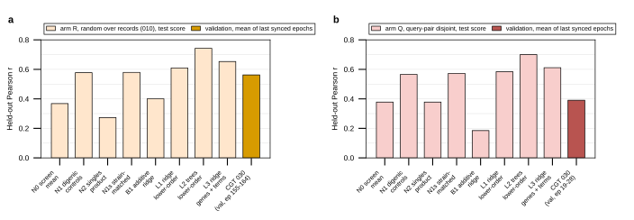

## 2026.10.11 - Baselines that see the lower-order terms

**Why.** The joint model on the S3 pool trains on every single, every closure double and
every training triple, with a fitness head beside the interaction head. For a held-out
triple, every term of the published identity tau = f_ijk - f_ij f_k - eps_ik - eps_jk
except f_ijk is a training record, so the model knows the triple's null expectation and
only f_ijk is unknown. The gene-identity ladder of 010 and 025 (one-hot ridge over the
three genes, trained on triples alone) never sees those terms, so it cannot separate
"learned biology" from "learned the arithmetic the closure gives it". These rungs can.
None of them touches the held-out triple's own fitness or interaction, which is the
same information boundary the trainer has: splits are by record, and a 030 record holds
all of a genotype's entries.

**Rungs** (fit on the arm's training triples, scored on its pinned val and test):

| rung | prediction | parameters |
|---|---|---|
| N0 screen mean | training mean of tau in the triple's screen | 2 |
| N1 mult., query double | -(eps_ik + eps_jk), i.e. f_ijk = f_ij f_k | 0 |
| N2 mult., singles | f_i f_j f_k - f_ij f_k - eps_ik - eps_jk | 0 |
| N1s strain-matched | N1 with the control scores matched on the triple's own array strain | 0 |
| B1 additive gene ridge | the 010 rung, one-hot over the three genes | genes |
| L1 ridge, lower-order | ridge over 13 terms, 4 products, a screen indicator, missing indicators | ~35 |
| L2 boosted trees, lower-order | HistGradientBoosting over the same raw terms, missing handled natively | trees |
| L3 ridge, genes + lower-order | B1's one-hot beside L1's design, one alpha | genes + 35 |
| F1 ridge, lower-order to f_ijk | the fitness side: how much of f_ijk is arithmetic | ~35 |

Where an arithmetic term is missing the rung falls back to N0 for that row, so every
rung is scored on identical rows, and the covered fraction is reported beside it.

**What each rung is.**

- **N0 screen mean.** The training mean of tau inside the triple's screen, Kuzmin 2018
  or Kuzmin 2020, two numbers. The screens differ in mean tau (about -0.046 against
  +0.004), so knowing only the screen gives a pooled Pearson near 0.37; within a screen
  it is zero by construction. Every pooled number in the ladder carries this component.
- **N1 digenic controls.** tau_hat = -(eps_ik + eps_jk). The published identity is
  tau = f_ijk - f_ij f_k - eps_ik - eps_jk, so if the triple's fitness equals its
  multiplicative expectation f_ij f_k, tau is exactly minus the two digenic control
  scores. Zero parameters. Reads the two digenic records of (query gene i, array gene k)
  and (query gene j, array gene k), selected by the policy with the triple's own year
  promoted. It measures how much of the released score is the two terms the score
  subtracts.
- **N2 singles product.** tau_hat = f_i f_j f_k - f_ij f_k - eps_ik - eps_jk: the
  triple's fitness replaced by the product of its three singles. Equal to N1 minus
  eps_ij f_k. Reads the three singles, the query-strain double and two digenic scores.
  On Q the held-out pair's double is masked, so it falls back to N0 on every val/test
  row (coverage 0) and the row is the floor. On R it is worse than N1 because the query
  pair's own digenic interaction, which Kuzmin chose query pairs to have, is dropped.
- **N1s strain-matched.** N1 with each control score taken from the entry measured
  against the triple's own array strain in the triple's own screen, the way the source
  computed it (`closure_recompute_030.py` showed this closes Kuzmin 2018 to r 0.987).
  Adds 0.003 to 0.007 over N1 here: the strain match matters for reproducing the score
  exactly, not for predicting it.
- **B1 additive ridge.** The 010 and 025 rung: ridge on a one-hot of the three genes,
  one coefficient per gene, trained on the training triples' tau, alpha chosen on val.
  It sees gene identity and no measurement. On Q a held-out query pair's joint effect
  has no training triple to be learned from, hence 0.185.
- **L1 ridge, lower-order.** Ridge on 35 columns: the 13 terms (f_i, f_j, f_k, the
  query-strain f_ij, the array-screen f_ij, f_ik, f_jk, eps_ij, eps_ik, eps_jk, the
  strain-matched eps_ik, eps_jk and f_k), four products (f_ij f_k, f_i f_j f_k,
  eps_ij f_k, eps_ik + eps_jk), the screen indicator, and a missing indicator per
  column; standardized on train, missing filled with the train median. The best linear
  combination of the terms.
- **L2 boosted trees, lower-order.** Gradient-boosted trees (600 trees, leaf count and
  learning rate chosen on val) over the 17 raw terms and products plus the screen,
  missing values handled natively. Nonlinear use of the same terms: for instance,
  whether tau depends on eps_ik differently when f_k is low. The highest rung.
- **L3 ridge, genes + lower-order.** B1's one-hot beside L1's design, one alpha for
  both blocks. Asks whether gene identity adds anything once the terms are present:
  0.04 over L1 on R, 0.03 on Q, and below L2 on both.
- **F1 ridge, lower-order to f_ijk.** L1's design with the triple's fitness as the
  target instead of tau. Not a tau rung; it reports how much of f_ijk is arithmetic in
  the lower-order terms (0.93 on R, 0.73 on Q).
- **CGT 030.** The composite-embedding transformer with the fitness head and the
  dataset token, seed 0, validation only: the mean of the last ten synced epochs, since
  no test evaluation of a 030 checkpoint exists yet.

**Terms.** Resolved under the trainer's `LabelPolicy` (`kuzmin-first`, promoted to the
triple's own year) from `closure/entries.parquet` and `closure/triple_roles.parquet`:
singles by `select`, f_ij by `select_double` (the double-mutant query strain's own
fitness where the build carries it), the array-screen doubles without query-strain
entries, the digenic scores by `select`, and the strain-matched control terms exactly
as `closure_recompute_030.py` resolves them. The target tau and the screen of every
pinned val/test triple are asserted equal to `results/pinned_eval_table_030.parquet`.

**Arm Q masks held-out pairs.** `subset_definitions_030_q.py` removes every double whose
pair is a held-out query pair from the training pool, so on Q the baselines set the
terms of any held-out pair to missing (f_ij, the array double, eps_ij for the query
pair; the secondary-pair terms where a secondary pair is itself held out). A Q baseline
never sees a held-out triple's query double, as the model never did. Arm R masks
nothing: doubles never leave its training pool.

**Readouts.** Pooled Pearson and Spearman, within-screen Pearson (both series centered
by screen), per-screen Pearson, rmse, and a 2,000-resample paired bootstrap of test
Pearson gains between rungs. Predictions per triple are written so the transformer's
own val/test predictions can be paired against them later.

**Transformer rows.** `--wandb` reads the rank-0 runs tagged with each arm's config and
takes the mean validation interaction Pearson over the last 10 synced epochs and the
max over epochs. The server holds only part of the R curve (epochs 0 to 26 of
`xy3xnpau`, 100 to 163 of the hand-synced continuation, 164 of `u28pgzde`), so the row
records the synced-epoch count and the last epoch; it is a validation number of a model
with no test evaluation.

Launcher: [[experiments.030-solid-growth-multi.scripts.gh_lower_order_baselines_030]].

## 2026.10.11 - Result: the lower-order arithmetic is a higher bar than the gene-identity ladder, and the transformer is under it

GilaHyper job 3902 (16 CPUs, 64 GB, 7 min end to end; commit b5d3c1a4e). Terms resolved
for 376,732 triples: every single present on 98 to 100 percent of rows, the query-strain
double on 99.7 percent, eps_ij on 94.5 percent, the secondary-pair terms on 100 percent.
The targets of all 75,346 pinned triples equal the trainer's eval table.

Pearson on the pinned triples, test unless marked. `results/lower_order_baselines_030.csv`.

| rung | R test | R within-screen | Q test | Q within-screen |
|---|---|---|---|---|
| N0 screen mean (the floor) | 0.368 | 0 | 0.378 | 0 |
| N1 -(eps_ik + eps_jk), zero parameters | 0.577 | 0.550 | 0.566 | 0.538 |
| N1s strain-matched controls | 0.580 | 0.551 | 0.573 | 0.544 |
| N2 f_i f_j f_k - f_ij f_k - eps_ik - eps_jk | 0.273 | 0.245 | masked on Q | |
| B1 additive gene ridge (the 010 rung) | 0.401 | 0.177 | 0.185 | 0.108 |
| L1 ridge, lower-order terms | 0.609 | 0.549 | 0.584 | 0.535 |
| L2 boosted trees, lower-order terms | 0.743 | 0.694 | 0.700 | 0.637 |
| L3 ridge, genes + lower-order | 0.653 | 0.581 | 0.611 | 0.536 |
| F1 ridge, lower-order to f_ijk | 0.927 | 0.924 | 0.734 | 0.714 |
| CGT 030 composite + fitness + token, VAL, last 10 synced epochs | 0.562 (ep 155-164) | 0.518 / 0.460 per screen (weekly note, ep 174-183) | 0.391 (ep 19-28) | 0.338 / 0.092 per screen (ep 13-22) |

Paired bootstrap on test, 2,000 resamples (`results/lower_order_baselines_030_paired.csv`):
L2 minus B1 +0.342 [+0.327, +0.359] on R and +0.515 [+0.501, +0.529] on Q; L2 minus N1
+0.165 [+0.152, +0.180] on R and +0.134 [+0.117, +0.153] on Q; L3 minus L2 -0.089 on both.

Readings.

1. **The zero-parameter null is above the transformer on both arms.** Predicting a
   held-out triple's tau as minus the sum of its two digenic control scores, every term
   a training record, scores 0.577 on R and 0.566 on Q; the model's validation reads
   0.562 on R and 0.391 on Q. Within-screen the gap on Q is larger: N1 0.538 against
   the model's 0.338 (2018) and 0.092 (2020). The joint model has not learned to use the
   digenic terms it was given.
2. **Boosted trees over the same terms reach 0.74 on R and 0.70 on Q**, and are still
   0.13 to 0.17 above N1, so there is structure beyond the identity's own terms that a
   small model reads from the lower-order measurements alone. On Q the query pair's
   double and digenic score are masked (74,404 and 68,920 rows), so this is reached
   without any measurement of the held-out pair.
3. **Gene identity adds nothing once the terms are present.** L3 (genes + terms) is
   below L2 and only 0.04 above L1 on R; on Q the one-hot rung alone is 0.185, below the
   floor, as in 025.
4. **The screens differ.** On Kuzmin 2020 the arithmetic alone gives 0.68 to 0.73; on
   Kuzmin 2018 it gives 0.22 and the trees 0.55. Hypothesis (untested): the 2020
   diagnostic-array screen measured its control queries on the same strains in the same
   batch as the triples, so eps_ik and eps_jk carry the batch; the 2018 genome-wide
   screen did not.
5. **The fitness side is arithmetic.** A ridge over the lower-order terms predicts
   f_ijk at 0.927 on R and 0.734 on Q, close to the fitness head's training-set 0.9.

What this says about the cheating question: the concern was that the joint model gets
tau "for free" through the lower-order terms. The free part is real and it is large,
0.58 to 0.74 on held-out triples, and the model does not collect it. The number to beat
is L2, not B1; the 025 additive-baselines document's ladder needs these rungs.

Not done here: the transformer's own test predictions on 030 for a paired comparison
(the checkpoints are on IGB; the per-triple predictions of every rung are written to
`results/lower_order_baselines_030_pred_<arm>.parquet` for that pairing), and a
Spearman readout of the model.

## 2026.10.12 - Job 4111: fits reproduced, references per seed, a `wandb` stage

Job 4111 refit both arms on the 16-CPU main partition and reproduced the committed
result CSVs byte for byte (`git diff` empty on `lower_order_baselines_030.csv` and
`_paired.csv`), then failed in the W&B step because arm Q now carries two seeds. The
W&B reader moved to [[experiments.030-solid-growth-multi.scripts.wandb_seed_histories]];
`WandbReference` gained `partial`, the ladder draws one CGT bar per seed with a full
window, and `--stage wandb` refreshes only the references of an existing summary, since
the fits are deterministic and on file. References on file: arm R seed 0, 92 synced
epochs to 164, last-window 0.562; arm Q seed 0, 45 epochs to 45, 0.399; arm Q seed 1, 2
epochs, partial. Ladder render: `lower_order_baselines_030_ladder_2026-10-12-07-22-20.svg`.
