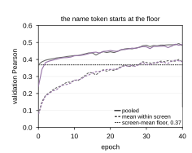

## 2026.10.29 - The ontology-as-input figure and the panel that left it

`ontology_token_figure_030.py` draws the data panels of the dissertation's Section 3.7
figure (a, c, e, f) at the 165 mm text width; the thesis generator
`notes/assets/drawio/fig-ch03-ontology-input.gen.py` draws b and d over the sheet. Every
number is in `results/ontology_token_figure_030_numbers.json`.

The epoch curves below were panel f of the 2026-10-29 draft and left the figure on the
author's review ("I don't find f that compelling"). They are kept here because they carry
the one read the figure now states only in words: pooled validation Pearson (solid) and the
mean of the two within-screen values (dashed), both arms, over the first forty epochs. At
epoch 0 the dataset-name token already scores the screen-mean floor pooled (0.371 against
0.076 within screen), because the token names the screen; the ontology token starts at
0.241 and reaches the floor by epoch 2, which only the genes can supply; from epoch 10 the
two arms run together (0.42 pooled, 0.28 within screen).

