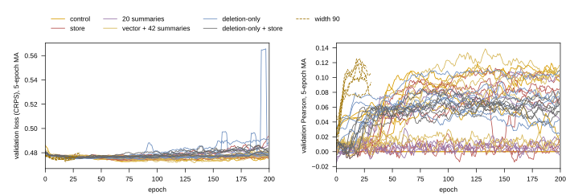
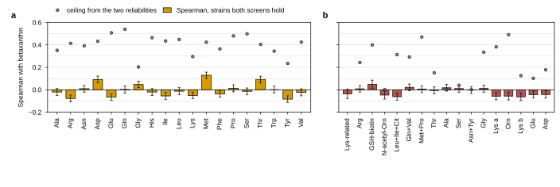

The metabolic module carried to Mulleder's 19 intracellular amino acids: its own experiment as of 2026.09.23, split out of [[experiments.028-gene-essentiality]] (rounds 118 to 129 there) at the user's request. W&B project `torchcell_032_amino_acid_module`; results in `experiments/032-amino-acid-module/results/`; packs in `conf/packs/`; the trainer is `experiments/028-gene-essentiality/scripts/train_essentiality.py` (shared), launched with `ESS_STUDY=032-amino-acid-module ESS_WANDB_PROJECT=torchcell_032_amino_acid_module ESS_WANDB_GROUP=gh_032_aa ESS_JOB_NAME=032-pack`. Scoring: 027's pinned split, epoch selected on validation Pearson (centered five-epoch moving average), mean per-column pinned-test Spearman over the 19 amino acids; every arm paired by seed (2700 to 2705).

## 2026.09.23 - Round map from 028, and state at the split

| round | 028 round | wave | arm | result |
|---|---|---|---|---|
| A1 | 118 | w135 | whole growth-vector affine vs control, width 12, old graph | 0.025 vs 0.034, -0.009 (2/6); ensembles 0.035 vs 0.058 |
| A2 | 121 | w138 | 19 synthesis ratios + growth ratio; growth vector + 42 summaries | -0.003 (2/6); -0.011 (2/6) |
| A3 | 124 | w141 | control on the deletion-only graph (the strain as built) | 0.049 vs 0.034, +0.015 (5/6), no collapsed seed; ensemble 0.062 |
| A4 | 126 | w143 | whole-vector affine on the deletion-only graph | 0.040 vs 0.049, -0.009 (1/6) |
| A5 | 122 | w139 | width-90 control (027's backbone) | running (jobs 2774, 2775) |
| A6 | 129 | w146 | A3's control at 300 epochs | pending (2776) |

State at the split: no form of the flux store beats its control (four forms, two controls). The graph correction is the only gain (+0.015). Comparators (027, same split): concentration readout 0.068, context-only 0.061, pooled 0.048, bilinear ridge 0.045. Records still inherit ARO4/ARO7/BTS1 from the other screens in the shared build; the deletion-only graph removes them from the cell graph but the aggregation is unchanged ([[torchcell.datasets.scerevisiae.mulleder2016]]).

## 2026.09.23 - Training-length audit figure (amino acids)

Produced by `experiments/031-betaxanthin-module/scripts/target_training_length_audit.py` (the module readouts serve both studies; findings in [[experiments.031-betaxanthin-module.scripts.target_training_length_audit]]).

## 2026.09.23 - Jobs resubmitted under 032; the essentiality finalists screened here

- A6 (w146, 300 epochs) resubmitted as job 2781 under this study (W&B project `torchcell_032_amino_acid_module`). A5 (w139_p2/p3, jobs 2774/2775) was already running under 028 and lands there; its result files move here.
- The essentiality finalists screened on the corrected graph, six seeds, paired against A3's control and A4's store affine: A7 (w150, job 2786) the flux vector with the six gene-rule columns beside it, store `ess_solve_encodings_SM_gem_pfbagpr.npz` (built 2026-09-23 with `isozyme_affine_store.py --medium SM --store-tag gem`); A8 (w151, job 2787) the cached solve head, hidden 256, over the SM_gem store.

## 2026.09.23 - Round A9: the MOMA store on the prototroph

- Same design as 031's B14 (see [[experiments.031-betaxanthin-module]] for the script and the direction-rule finding). Store `ess_solve_encodings_SM_gem_moma.npz` built by `experiments/031-betaxanthin-module/scripts/target_physics_store.py --target amino_acids --variant moma`: 1,161 genes in 29 s, 175 lethal against 161 in the parsimonious store, 63 growth ratios moved by more than 0.01, the log1p vector moved for 567 genes with a median relative distance of 0.0 (the SM parsimonious store is not degenerate, so MOMA and pFBA agree wherever the deletion does not force rerouting). Results `results/target_physics_store_amino_acids_moma.json`.
- The direction rule (sign10, sign30) leaves the prototroph infeasible on SM (84 and 44 fixed directions run against the parsimonious wild-type flux); `results/target_physics_store_amino_acids_sign10.json`, `_sign30.json`; no store written.
- A9 (w155, job 2793): A3's arm with the MOMA store in the affine slot, six seeds, paired against A3 (w141_aadel) and A4 (w143_aadelstore). Pack `conf/packs/w155_p0.pack`.

| round | 028 | pack | arm | status |
|---|---|---|---|---|
| A7 | 136 | w150 | flux vector with the six gene-rule columns | pending (2786) |
| A8 | 137 | w151 | cached solve head, hidden 256 | pending (2787) |
| A9 | 138 | w155 | linear MOMA store in the affine slot | pending (2793) |

## 2026.09.23 - CPU baselines over the store representations, and the second amino-acid screen

- `experiments/031-betaxanthin-module/scripts/target_store_baselines.py --target amino_acids` (results `results/store_baselines_amino_acids.json`, 15 min on 8 threads): every representation, every model, sits between 0.006 and 0.058 mean per-column Spearman on the 564 pinned genes (HiGHS parsimonious store kNN 0.045, ProtT5 forest 0.052, the two concatenated under a forest 0.058), against 0.045 for 027's bilinear ridge and 0.049 to 0.062 for the transformer arms. As on betaxanthin, 3,345 of 3,566 training genotypes are outside the model and read the wild-type row.

| representation | columns | ridge | kNN | forest |
|---|---|---|---|---|
| HiGHS parsimonious store (A4's store) | 4131 | +0.006 | +0.045 | +0.020 |
| linear MOMA store (A9's store) | 4131 | +0.018 | +0.014 | +0.032 |
| six gene-rule counts | 6 | +0.025 | +0.026 | +0.029 |
| eight flux statistics of the parsimonious build | 8 | +0.016 | +0.023 | +0.046 |
| ProtT5 | 1024 | +0.035 | +0.025 | +0.052 |
| HiGHS store with ProtT5 | 5155 | +0.033 | +0.050 | +0.058 |

- The second screen: Cooper 2010 does not corroborate Mulleder 2016 at the strain level (matched-pair Spearman -0.006 to +0.059 over 4,051 shared strains, Cooper's own duplicate strains at 0.06); full read in [[experiments.032-amino-acid-module.scripts.amino_acid_dataset_concordance]]. Together with Mulleder's retest at 0.20 Spearman, the amino-acid endpoint's strain-level rank is close to its noise floor, which is where every model above sits.

## 2026.09.23 - Round A11: the driving-force concentration store on the prototroph

- Same construction as 031's B17 (see [[experiments.031-betaxanthin-module]]): `target_driving_force_store.py --target amino_acids --max-abs-dg0 100`, 1,161 genes in 44 s. The wild type's max-min driving force on SM is -1.16 kJ/mol over 249 constrained carried reactions with 59 binding (phosphoglycerate dehydrogenase, glutamate 5-kinase, sulfate adenylyltransferase, triose-phosphate isomerase among them); 1,000 of 1,000 viable deletions negative, 200 move the optimum by more than 0.1 kJ/mol, 405 change the concentration vector. Uncapped the wild type sits at -325. Results `results/target_driving_force_store_amino_acids_mdfcap100.json`, `_mdf.json`; stores `ess_solve_encodings_SM_gem_mdfcap100.npz`, `_mdf.npz`.
- A11 (w158, job 2796): the `mdfcap100` store in the affine slot, six seeds, paired against A3 (w141_aadel) and A4 (w143_aadelstore). Pack `conf/packs/w158_p0.pack`.

| round | 028 | pack | arm | status |
|---|---|---|---|---|
| A11 | 141 | w158 | max-min driving-force concentration store (cap 100 kJ/mol) | pending (2796) |

- MEASURED, the ladder rerun with the concentration stores (`results/store_baselines_amino_acids.json`, 22 min): the driving-force concentrations read 0.013 to 0.019 under every model (capped 0.016 ridge, 0.016 kNN, 0.017 forest), inside the same 0.01 to 0.06 band as every other representation on this target.

## 2026.09.23 - Round A5 read (jobs 2774 and 2775, 7 h 36 min and 7 h 48 min)

- The wide control (width 90, two blocks, old graph): 0.034 (sd 0.010) against the width-12 control 0.034 (sd 0.025), +0.000 paired (sd 0.031, 3/6); six-seed ensemble 0.050 against 0.058 (corrected-graph control 0.062). Every seed escapes weakly (selected at epochs 10 to 59, validation Pearson 0.09 to 0.13); validation loss bottoms at epochs 6 to 21 and rises 0.05 to 0.07 by epoch 199. Width removes the collapsed seeds and tightens the spread, and does nothing to the level; the 027 cells of this form read 0.061 to 0.068 over three seeds, the six here 0.016 to 0.043. Written into `sec:target-transfer` as the amino-acid half of round 122; result files moved to `results/w139_aawide_h90l2p1_e200_s27*.json`.

## 2026.09.23 - Round A6 read (job 2781, 5 h 34 min)

- A6 (w146, deletion-only control for 300 epochs): 0.0485 (sd 0.009) vs the 200-epoch control (w141) 0.0492 (sd 0.007); paired -0.0007 (sd 0.003), 1/6; six-seed ensemble 0.060 vs 0.062. Four seeds select the same epoch and score in both runs (148, 88, 75, 37); the two whose peak moved past 200 (287, 217) read 0.036 vs 0.042 and 0.055 vs 0.054. Validation loss bottoms at epochs 20 to 169, up by at most 0.014 by epoch 299. The 200-epoch budget stands. Written into `sec:target-transfer` as round 129.

| round | 028 | pack | arm | result |
|---|---|---|---|---|
| A6 | 129 | w146 | deletion-only, 300 epochs | 0.049 (sd 0.009); ens 0.060 |

## 2026.09.24 - Round A7 read (job 2786, 3 h 40 min)

- A7 (w150, the parsimonious vector with the six rule counts, the essentiality best single store, in the affine slot): 0.033 (sd 0.009) vs the deletion-only control 0.049 (-0.016, sd 0.012, 1/6) and vs the plain store affine 0.040 (-0.007, sd 0.013, 2/6); six-seed ensemble 0.037 vs 0.062 and 0.043. Seeds select at epochs 47 to 186 on validation Pearson 0.06 to 0.09. The rule counts carry nothing for the amino-acid rank. Written into `sec:target-transfer` as round 136.

| round | 028 | pack | arm | result |
|---|---|---|---|---|
| A7 | 136 | w150 | del + vector with rule counts | 0.033 (sd 0.009); ens 0.037 |

## 2026.09.24 - Round A8 read (job 2787, 3 h 38 min)

- A8 (w151, the cached solve head, hidden 256, on the store vector instead of the affine): 0.053 (sd 0.008) vs the deletion-only control 0.049 (+0.004, sd 0.011, 4/6) and vs the store affine 0.040 (+0.013, sd 0.008, 6/6); six-seed ensemble 0.063 vs 0.062 and 0.043. Seeds select at epochs 24 to 192. The head recovers on every seed what the affine lost and lands at the control: the highest single 032 arm, inside the 027 band (0.049 to 0.062). Written into `sec:target-transfer` as round 137.

| round | 028 | pack | arm | result |
|---|---|---|---|---|
| A8 | 137 | w151 | del + solve head 256 | 0.053 (sd 0.008); ens 0.063 |

## 2026.09.24 - The study's own notes-tex document

- User (03:00): the target work no longer belongs in the essentiality chapter. The amino-acid sections (rounds 118 onward, the physically constrained stores on the prototroph, the store ladder, the Mulleder-versus-Cooper concordance) moved verbatim into `notes-tex/032-amino-acid-module/` (sections `1-endpoint`, `2-rounds`, `3-physics`, `4-concordance`, `5-standing`; tables generated by `experiments/031-betaxanthin-module/scripts/target_notes_tex_tables.py`; prose numbers checked by `experiments/032-amino-acid-module/scripts/verify_doc_numbers.py`, 110 checks). The essentiality chapter keeps a one-paragraph pointer. The betaxanthin half is `notes-tex/031-betaxanthin-module/`. First published version 0eabc049 (Zotero collection torchcell/notes-tex/032-amino-acid-module). Build: `make && make check` in the document directory; publish with `notes-tex/common/zotero_publish.py notes-tex/032-amino-acid-module`.

## 2026.09.24 - The driving-force polytope on the prototroph

- `target_concentration_polytope_store.py --target amino_acids` (see the 031 note for the method): the prototroph's wild-type region has 249 constrained reactions, 59 binding, 319 of 2,778 variable metabolites constrained, median sd of ln c over them 2.08 against 2.62 free; 405 viable rows differ from the wild type's under polytope-hash seeding; 95 s on eight processes (`results/target_concentration_polytope_store_amino_acids_mdfcap100poly.json`). Stores `ess_solve_encodings_SM_gem_mdfcap100polymean.npz` and `_polyspread.npz`.
- A13 (w165, job 2802): the polytope mean in the affine slot, paired against A4 (w141_aadel), A6' (w143_aadelstore) and A11 (w158_aadelmdf, the point). Ladder rows added; rerun started 03:55.

| round | 028 | pack | arm | status |
|---|---|---|---|---|
| A13 | 148 | w165 | driving-force polytope, mean over draws | pending (2802) |

## 2026.09.24 - The sampled-cone store on the prototroph

- `target_sampled_flux_store.py --target amino_acids --samples 6 --thinning 10 --processes 12`: the first run hung after 7.7 h with three workers cycling in GLPK's simplex inside the model copy OptGPSampler makes (py-spy; the cycling hang in memory); presolve on the source model removes the cycling but made the flux-variability warm-up (about 8,000 LPs per deletion) a cold solve, over an hour per deletion; the fix keeps presolve for the copy and restores warm starts for the warm-up (`HRSampler.generate_fva_warmup` wrapped). Third run: 1,161 deletions, 161 lethal, 260.5 min on twelve processes, median relative distance of the six-sample mean to the parsimonious point 5.9 (`results/target_sampled_flux_store_amino_acids.json`). Stores `ess_solve_encodings_SM_gem_sampledmean.npz` (4,131 columns) and `_sampledspread.npz`.
- A10 (w160, job 2803): the sampled mean in the affine slot, paired against A4 (w141_aadel) and A6' (w143_aadelstore). Ladder rerun with the `sampled_mean` row started 05:25.

| round | 028 | pack | arm | status |
|---|---|---|---|---|
| A10 | 143 | w160 | sampled-cone mean store | pending (2803) |

## 2026.09.24 - Round A9 read (job 2793, 3 h 40 min)

- A9 (w155, the linear MOMA store in the affine slot): 0.052 (sd 0.006) vs the deletion-only control 0.049 (+0.003, sd 0.011, 4/6) and vs the parsimonious store 0.040 (+0.012, sd 0.008, 5/6); ensemble 0.056 vs 0.062 and 0.043. Seeds select at epochs 86 to 197, none collapsed. The wild-type-anchored store (11 no-effect rows differ vs 324) does not carry the parsimonious store's loss and sits at the control, as the solve head did. Written into the 032 document as round 138.

| round | 028 | pack | arm | result |
|---|---|---|---|---|
| A9 | 138 | w155 | del + linear MOMA store | 0.052 (sd 0.006); ens 0.056 |

## 2026.09.24 - The annotation-only family on the amino acids

- `target_go_models.py --target amino_acids` (`results/go_models_amino_acids.json`): GO perceptron 0.054 (sd 0.002); ProtT5 0.054 (sd 0.008); GO + ProtT5 0.065 (sd 0.003), ensemble 0.069, the highest single-seed read on this target; store row 0.019; GO + store 0.042; all three 0.045; DCell hierarchy 0.035 (sd 0.015). The flux row lowers every read it joins, as the transformer's affine did (A6'). Written into the 032 document (`3-physics.tex`, table `go_models`; 135 checks; version 4).

## 2026.09.24 - Round A11 read (job 2796, 3 h 41 min)

- A11 (w158, the capped driving-force concentration store in the affine slot): 0.045 (sd 0.005) vs the deletion-only control 0.049 (-0.005, sd 0.007, 2/6) and vs the parsimonious store 0.040 (+0.004, sd 0.009, 5/6); ensemble 0.050. Seeds select at epochs 32 to 146, none collapsed. Between the flux vector and the control, inside both spreads. Written into the 032 document as round 141 (version 5).

| round | 028 | pack | arm | result |
|---|---|---|---|---|
| A11 | 141 | w158 | del + driving-force concentration store | 0.045 (sd 0.005); ens 0.050 |

## 2026.09.24 - Round A14 queued: GO in the affine slot

- GO affine stores on the prototroph (`target_go_affine_store.py --target amino_acids`): `ess_solve_encodings_SM_gem_go.npz` (6,607 genes, 2,362 columns) and `_gopfba.npz` (6,493 columns). A14 (w170, job 2808): GO alone in the affine slot vs A4 (w141) and A6' (w143). Round 153.

| round | 028 | pack | arm | status |
|---|---|---|---|---|
| A14 | 153 | w170 | del + GO multi-hot affine | pending (2808) |

## 2026.09.24 - Round A12 read (job 2800, 3 h 14 min)

- A12 (w163, the store arm at width 6 with two heads): 0.025 (sd 0.018) vs the width-12 store 0.040 (-0.015, sd 0.017, 1/6); ensemble 0.046. Three seeds near the constant predictor (validation Pearson 0.01 to 0.03). Half the width brings the collapse back; width 12 is the floor for nineteen outputs. Written into the 032 document as round 146 (version 6).

| round | 028 | pack | arm | result |
|---|---|---|---|---|
| A12 | 146 | w163 | del + store, width 6 | 0.025 (sd 0.018); ens 0.046 |

## 2026.09.24 - Round A13 read (job 2802, 3 h 38 min)

- A13 (w165, the driving-force polytope mean in the affine slot): 0.032 (sd 0.008) vs the deletion-only control 0.049 (-0.017, sd 0.011, 0/6), vs the parsimonious store 0.040 (-0.008, sd 0.012, 1/6) and vs the driving-force point 0.045 (-0.012, sd 0.009, 0/6); ensemble 0.035. Seeds select at epochs 84 to 184, none collapsed. The lowest of the three metabolite-side reads, under every control on every seed, where on betaxanthin it was the best ensemble. Written into the 032 document as round 148.

| round | 028 | pack | arm | result |
|---|---|---|---|---|
| A13 | 148 | w165 | del + driving-force polytope mean | 0.032 (sd 0.008); ens 0.035 |

## 2026.09.24 - Round A10 read (job 2803, 3 h 40 min)

- A10 (w160, the sampled-cone mean in the affine slot): 0.019 (sd 0.007) vs the deletion-only control 0.049 (-0.030, sd 0.007, 0/6) and vs the parsimonious store 0.040 (-0.021, sd 0.010, 0/6); ensemble 0.023, the lowest arm of the study. Seeds select at epochs 104 to 196; the validation loss bottoms at 3 to 21. The cone mean is the weakest flux representation on both targets. Written into the 032 document as round 143 (version 7).

| round | 028 | pack | arm | result |
|---|---|---|---|---|
| A10 | 143 | w160 | del + sampled-cone mean store | 0.019 (sd 0.007); ens 0.023 |

## 2026.09.24 - Round A15 queued: dropout 0.3

- A15 (w173, job 2811): the store arm on the deletion-only graph at transformer dropout 0.3 (betaxanthin's round 145 read +0.024); paired against A6' (w143, 0.1) and A4 (w141). Round 157.

| round | 028 | pack | arm | status |
|---|---|---|---|---|
| A15 | 157 | w173 | del + store, dropout 0.3 | pending (2811) |

## 2026.09.24 - Round A16 queued: GO appended to the HiGHS store

- A16 (w177, job 2815): the HiGHS deletion vector with GO appended on the prototroph (`SM_gem_gopfba`, 6,493 columns); paired against A14 (w170, GO alone) and A6' (w143). Round 160.

| round | 028 | pack | arm | status |
|---|---|---|---|---|
| A16 | 160 | w177 | del + HiGHS store with GO appended | pending (2815) |

## 2026.09.24 - Round A14 read (job 2808, 3 h 34 min)

- A14 (w170, the GO multi-hot in the affine slot): 0.058 (sd 0.001) vs the deletion-only control 0.049 (+0.009, sd 0.007, 5/6) and vs the parsimonious store 0.040 (+0.018, sd 0.005, 6/6); ensemble 0.059. Every seed selects at epoch 2 or 3 (validation Pearson 0.11 before the backbone moves); the affine's read is the whole cell. The highest single-seed transformer arm on this target and the first paired gain over the control on five seeds. Written into the 032 document as round 153 (version 8).

| round | 028 | pack | arm | result |
|---|---|---|---|---|
| A14 | 153 | w170 | del + GO multi-hot affine | 0.058 (sd 0.001); ens 0.059 |

## 2026.09.24 - Betaxanthin against the amino-acid pool (joint-training hope)

Script `experiments/032-amino-acid-module/scripts/betaxanthin_amino_acid_correlation.py`; results `results/betaxanthin_amino_acid_correlation.json`; figure below; section 4.1 of the 032 document (published v9) with two generated tables and 28 verifier checks.

- Strains matched on the systematic ORF: Cachera shares 4,477 with Mulleder and 4,225 with Cooper.
- Single amino acids (Mulleder, Spearman with a strain bootstrap): methionine +0.130 [0.100, 0.157], threonine +0.093, aspartate +0.091, tyrosine -0.083, arginine -0.077, glutamate -0.065; top-5% overlap 3.3x chance for aspartate, 3.0x for threonine. Ceilings (sqrt of the two reliabilities, betaxanthin 0.84) 0.20 to 0.54, so the singles sit well under them.
- The pool: ridge from the 19 standardized log concentrations to the betaxanthin score, five strain folds, out of fold, reads Spearman +0.226 (folds 0.182 to 0.272) against -0.002 (sd 0.016) with the target shuffled. That is at the level of the best genotype-side betaxanthin model (0.211, round 151), from a different input on a different strain set: the two endpoints share strain-level signal.
- Does the pool add to the gene's identity? Same strains and folds: ridge from the gene's GO multi-hot (2,362 columns; 557 strains outside the store read zeros) 0.165; GO with the pool appended (GO block scaled to the pool block's variance) 0.237, above the pool alone on 4/5 folds and above GO on 5/5. The pool adds 0.072 beyond GO: the amino-acid signal is not the one the annotation already carries.
- Cooper: no single peak beyond |0.063|; pool ridge +0.083 (shuffled -0.003); ceilings 0.00 to 0.49; GO 0.193, GO + Cooper pool 0.196 (+0.003).
- Hypothesis (untested): part of the shared signal is a growth or respiratory covariate common to both screens.

- Submitted A17 = w179 (GO + HiGHS affine at dropout 0.3 on the prototroph, job 2817; paired vs w177 and w173).
- CPU ladder rerun with GO added (29 min; every earlier cell reproduced): GO 0.044 ridge / 0.025 kNN / 0.063 forest; GO with the HiGHS vector 0.046 / 0.029 / 0.062. The annotation lifts the ladder's ceiling from 0.058 to 0.063, beside the GO perceptron 0.054 and the GO affine 0.058: the same band as every other input on this target. 032 published v11 (238 checks).

| round | 028 | pack | arm | result |
|---|---|---|---|---|
| A17 | -- | w179 | del + HiGHS store with GO, dropout 0.3 | job 2817, pending |

## 2026.09.25 - A15 read: dropout 0.3 on the store arm

- A15 (w173, store arm at dropout 0.3, job 2811, 3 h 38 min): 0.045 (sd 0.005) vs the store at 0.1 at 0.040 (+0.005, sd 0.009, 5/6) and vs the control 0.049 (-0.005, sd 0.009, 2/6); ensembles 0.049 vs 0.043 and 0.062. Seeds select at 39 to 187 on val Pearson 0.05 to 0.08, read 0.038 to 0.051. The lever moves this target the same direction as betaxanthin at a fifth of the size, inside the spread. Written as round 157; the standing section brought up to date through round 157; 032 published v12 (252 checks).
- Submitted A18 = w182 (GO affine at dropout 0.3, job 2823; vs w170 and w173).

| round | 028 | pack | arm | result |
|---|---|---|---|---|
| A15 | 157 | w173 | del + store, dropout 0.3 | 0.045 (sd 0.005); ens 0.049 |
| A18 | -- | w182 | del + GO affine, dropout 0.3 | job 2823, pending |

## 2026.09.25 - A16 read: the HiGHS vector with GO appended on the prototroph

- A16 (w177, HiGHS deletion vector + GO multi-hot in one affine, job 2815, 3 h 37 min): 0.055 (sd 0.002) vs GO alone (A14) 0.058 (-0.003, sd 0.002, 0/6) and vs the store alone (A4) 0.040 (+0.015, sd 0.004, 6/6); ensembles 0.057 vs 0.059 and 0.043. Every seed selects at epoch 2 on val 0.11 to 0.12. Where the flux vector added 0.009 to GO on betaxanthin, here it takes 0.003 from it on every seed, as every read the flux row has joined on this target. Written as round 160; 032 published v13 (266 checks).

| round | 028 | pack | arm | result |
|---|---|---|---|---|
| A16 | 160 | w177 | del + HiGHS store with GO | 0.055 (sd 0.002); ens 0.057 |
| A19 | -- | w186 | w170 seeds 2706 to 2711 (GO affine) | job 2826, pending |
| A20 | -- | w187 | w141 seeds 2706 to 2711 (the control) | job 2827, pending |

- A19 and A20 (jobs 2826, 2827): six more seeds of the GO affine and of its control, so the one paired gain on this target (+0.009 on 5/6) is read on twelve seeds.

## 2026.09.25 - A17 read: GO with the HiGHS vector at dropout 0.3

- A17 (w179, GO + HiGHS affine at dropout 0.3, job 2817, 3 h 40 min): 0.055 (sd 0.002) vs the same at 0.1 (A16) 0.055 (+0.000, sd 0.001, 4/6) and vs the store at 0.3 (A15) 0.045 (+0.011, sd 0.007, 6/6); ensembles 0.056 vs 0.057 and 0.049. Every seed selects at epoch 2. Dropout does not enter the annotation affine's read here either; the affine over the annotation is this target's best transformer arm and the backbone is not where its level is set. Written as round 162; 032 published v14 (280 checks).

| round | 028 | pack | arm | result |
|---|---|---|---|---|
| A17 | 162 | w179 | del + HiGHS store with GO, dropout 0.3 | 0.055 (sd 0.002); ens 0.056 |

## 2026.09.25 - A18 read: the GO affine at dropout 0.3

- A18 (w182, GO affine at dropout 0.3, job 2823, 3 h 40 min): 0.058 (sd 0.001) vs the GO affine at 0.1 (A14) 0.058 (+0.000, sd 0.001, 4/6) and vs the store at 0.3 (A15) 0.045 (+0.013, sd 0.005, 6/6); ensembles 0.059 vs 0.059 and 0.049. Selects at epoch 2 or 3. The third dropout read on this target: the annotation affine reads the same number at either dropout; the best arm is a linear read of the annotation the backbone does not enter. Written as round 165; 032 published v15 (293 checks).

| round | 028 | pack | arm | result |
|---|---|---|---|---|
| A18 | 165 | w182 | del + GO affine, dropout 0.3 | 0.058 (sd 0.001); ens 0.059 |

## 2026.09.25 - A19 and A20 read: the GO gain on twelve seeds

- A19 and A20 (w186, w187 = seeds 2706 to 2711 of w170 and w141, jobs 2826 and 2827, 3 h 37 min and 3 h 39 min): the arm reads 0.057 (sd 0.002) against the control's 0.048 (sd 0.010), +0.009 paired (sd 0.010), above on 10/12, where the first six gave +0.009 on 5/6. The gain holds at the same size on twice the seeds.
- The arms differ in character: the annotation arm spans 0.053 to 0.059 (range 0.007), the control 0.023 to 0.059 (range 0.036), because the control's score depends on whether its seed escapes the plateau. Consequence: the twelve-seed control ensemble reads 0.067, above the annotation's twelve-seed ensemble 0.058 and above every single cell of either arm. The one paired gain is real at 0.009 and smaller than what the control's seed noise is worth when averaged away.
- `target_transfer_readout.py` now accepts a per-pair seed set as an optional fifth element of a PAIRS entry (the extension rounds 127, 164, 168, 172 read twelve).
- Written as round 168; 032 published v16 (311 checks).

| round | 028 | pack | arm | result |
|---|---|---|---|---|
| A19 + A20 | 168 | w186, w187 | GO affine and control, seeds 2706 to 2711 | twelve seeds +0.009 (10/12); ensembles 0.058 vs 0.067 |

## 2026.09.25 - The ceiling corrected: the retest bounds a second screen, its square root bounds a model

- User question: does the retest set the upper bound on performance? Yes, but the document had the wrong number. The 194-strain retest Spearman of 0.20 is the agreement of two single-culture measurements of one strain, which bounds a second screen (and the cross-screen concordance). A model scored against one measurement is bounded by the square root of the reliability. The 027 read (`experiments/027-betaxanthin-metabolic/results/mulleder_retest_reliability.json`) already computes it: single-measurement sd 0.16 to 0.27 in log10 against an across-strain sd of 0.21 to 0.43, reliability 0.42 on average, Pearson ceiling 0.62 on average (asparagine 0.00, methionine 0.13, glutamine 0.85); from the Spearman retest the same rule gives about 0.45. The 237 QC injections put the instrument at 0.03 to 0.13 in log10, so the retest noise is culture to culture.
- Correction to the document: "sits at its noise floor" and "a 0.20 ceiling has no headroom" read the second-screen bound as the model bound. Rewritten in sections 1, 4 and 5 (published v17): every model reads at a tenth of the model ceiling, not at it; the target is hard to learn from single-culture labels, and no input has found more than a tenth of what the measurement allows. New table `tables/mulleder_retest.tex` (from `target_notes_tex_tables.py`, per amino acid: retest Pearson and Spearman, QC sd, single and across-strain sd, reliability, ceiling); eleven verifier checks added.
