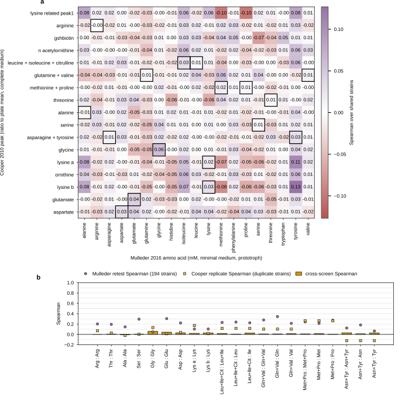

## 2026.09.23 - Do the two deletion-collection amino-acid screens agree?

User question: "we have another yko amino acid dataset right how do they differ can we see if they correlate". The other screen is Cooper 2010 (`amino_acid_cooper2010`, built on this machine from the loader on `main`, commit 53c869e9b); the 032 target is Mulleder 2016 (`amino_acid_mulleder2016`, commit f77f6c157). Script: `experiments/032-amino-acid-module/scripts/amino_acid_dataset_concordance.py`; results `experiments/032-amino-acid-module/results/amino_acid_dataset_concordance.json`.

How they differ:

| | Mulleder 2016 | Cooper 2010 |
|---|---|---|
| chemistry | LC-SRM/MS, 19 amino acids | CE-LIF, 17 peaks (4 composites, lysine as two peaks, 4 peaks with no Mulleder counterpart) |
| quantity | intracellular mM, batch-normalized | linear ratio to the plate mean (the legend says log2; the values are not) |
| strains | prototrophic collection (markers restored) | auxotrophic MATa collection (BY4741 background) |
| medium | synthetic minimal | synthetic complete minus seven supplements |
| replication | one culture per strain; 194 strains measured twice | duplicates averaged where two traces passed; 47 duplicate strain rows kept in the loader ledger |
| strains | 4,678 | 4,313 kept |

Shared strains, matched on the collection's own ORF name: 4,051.

MEASURED, they do not agree at the strain level. Over the shared strains the matched pairs' Spearman runs from -0.006 (alanine) to +0.059 (glycine, p 2e-4), with glutamate +0.043 and aspartate +0.031 the only other pairs off zero; the top-5-percent strains overlap at chance for every pair (largest enrichment 2.2x, lysine peak b, 22 of 202 against 10 expected). The full 17 x 19 matrix has a median |rho| of 0.018 and a maximum of 0.127 (Cooper's lysine peak b against Mulleder's tyrosine, not a matched pair), so the matched cells do not stand out from the background.

The retest references bound this. Mulleder's own retest over 194 strains averages Spearman 0.20 (Pearson on log10 0.43; 027's read). Cooper's 47 duplicate strains average Spearman 0.06 (log-Pearson 0.10; the ledger rows against the served rows, 19 to 47 pairs per peak). A cross-screen Spearman cannot exceed roughly the geometric mean of the two retests, about 0.11, and the observed 0.00 to 0.06 sits at or below that. Reading: Cooper 2010 carries almost no strain-level signal in its released table (its replicate agreement is near zero), so it cannot corroborate Mulleder strain by strain; and the two screens also measure different things (minimal versus complete medium, prototroph versus auxotroph), which is a biological difference rather than noise and cannot be separated from the noise with this replicate agreement. Cooper 2010 is therefore not a second target for the amino-acid module and not a validation set for it.

Figure. **a**, Spearman over the shared strains for every Cooper peak (rows) against every Mulleder amino acid (columns); matched pairs outlined. **b**, The matched pairs' cross-screen Spearman (bars) beside Mulleder's retest Spearman (194 strains, circles) and Cooper's duplicate-strain Spearman (squares).
