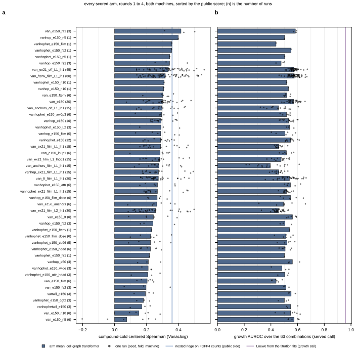
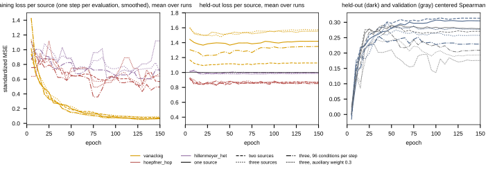

## 2026.10.10 - The 2021 inhibitor runs as validation of what the chemogenomic models can say about mixtures

The environment case study for the paper (R5, "drug exposure"): the in-house Bioscreen runs
of 2021 (strain bAID = BY4742-iAID6, YPD, six sorghum-hydrolysate inhibitors; the private
dataset `InhibitorBioscreenVolk2021Dataset`, 977 wells) were collected to ask whether the
inhibitors interact, and the chemogenomic models of experiments 031 to 038 were built to
predict a compound's deletion profile from its structure. This experiment joins the two.

**What the record says before anything is run.** Compound-cold on Vanacloig 2022, nested
ridge on FCFP4 counts is the bar (median centered Spearman 0.303 on build 001, 0.359 on the
corrected store) and the cell graph transformer, trained to saturation, ties it (035 rounds 8
to 15). Gains came from data (the learning curve rises about 0.05 per doubling of fitted
compounds), not architecture. No trained model predicts the host's own dose response: the
pooled table carries that only as IC30 anchors. Of the six inhibitors, only furfural and
5-HMF are in the corrected Vanacloig store (profile reliability 0.77 and -0.05; levulinic
acid and sodium acetate were among the tokens the paper did not report and were dropped in
build 002, issue #501), sodium acetate is measured in Hoepfner 2014 (125 to 150 mM, YPD, a
different screen), and formic and lactic acid are in no screen. The 2021 data (039, software
generation times): all six singles grew at the ex23 doses (mean fitness 0.788), 14 of 15
pairs (0.465), 5 of 20 triples, none of the 22 combinations of four or more. The served
dataset calls growth from the raw curves (rise of at least 0.3 OD) and disagrees with the
software on 12 of 197 ex23 wells, all three replicates of HMF + LA, HMF + LVA,
FF + AA + HMF and FF + HMF + FA, whose OD rose 0.085 to 0.277: under the served call 12 of
15 pairs and 3 of 20 triples grew (21 combinations, not 25). The served call is primary;
the software call is reported as a sensitivity, because the disputed wells are all HMF
combinations and that is where a synergy call would land.

**Pre-registered claims, each allowed to fail.**

1. Growth under combinations departs from independence. Reference rules from the ex21
   single-agent curves: Bliss independence, Loewe additivity, highest single agent; scored on
   the 63 ex23 combinations (grew within 85 h over 63; fitness over the 25 that grew) and the
   three isobole grids (front against the Loewe line). Hypothesis: synergistic relative to
   Bliss (Bliss gives 0.60 for the four mildest singles together; nothing with four grew).
2. Chemogenomic profile similarity anticipates which pairs deviate. Measured Vanacloig
   profiles where they exist, compound-cold ridge-FCFP4 profiles for formic and lactic acid
   (and, as the fairness check, for the shared compounds from their held-out folds). Tested
   on 15 pairs (permutation) and the three isoboles; HMF x acetic acid is shown but excluded
   (single run, growth islands; 039).
3. Deletion profiles compose under a mixture by a rule measurable on public data: Hillenmeyer
   HET's 26 two-compound environments against their single-compound partners (sum, mean,
   max, Bliss-style product); the base rate of emergent and masked genes.
4. Post-analysis only, not a validated prediction: composed profiles nominate the genes a
   screen under each combination would recover (core, compound-specific, conflict). The
   check is GO enrichment of the nominated sets, and whether it overlaps the terms the
   measured single-compound profiles carry. No in-house screen exists to test them (the
   thesis archive holds only the library-sequencing correspondence for that screen).

**Decisions taken.** Acetic acid is matched to sodium acetate for the measured profile (same
anion at YPD pH; a stated assumption). The learned model in the preliminary round is ridge
FCFP4; the CGT environment encoder enters from 038 round 2 (slurm 3697 control, 3698
encoder, submitted 2026-10-10 02:00 on the two cards named by the user). The wet-lab table
is read from the private dev LMDB with the raw-mirror manifest sha recorded, and is
re-pointed at the knowledge graph once the served build carries the private dataset; the
records are the same. Vanacloig doses come from the rebuilt dev store (Table S1, PR #765).

**Adapting the model to the wet-lab readout (step 3, after claims 1 to 4 are scored).** The
best-performing recipe on record is 035 round 11: the environment-encoder head (compound
token in front of the 6,607 gene tokens, one further layer, one-layer encoder, prior
weight 0, 50 epochs keeping the last, fit on the non-test pool), stacked with nested ridge
(median 0.334, +0.032 over ridge, compound CI through zero). 038 round 2 reproduces that
pair on the corrected store (slurm 3700 control, 3701 encoder, GilaHyper cards 0 and 3,
2026-10-10 02:10; a Delta twin launcher `delta_train_factorized.slurm` under
bfjt-delta-gpu for the follow-on rounds). The adaptation keeps that encoder and changes
three things, each an ablation: (i) a set of compound tokens, one per inhibitor in the
medium, in place of the single token; (ii) a log-molar dose scalar modulating each token
(FiLM), with the Vanacloig and Hoepfner IC30 doses and dose zero as the public anchors;
(iii) a host-growth head read from the mean of the cell-in-medium state and the compound
tokens after they read the genome (the empty-genotype path, since bAID carries no
deletion), fitted on the ex21 single-agent curves and scored on the 63 ex23 combinations
and the isoboles against the model-free Bliss and Loewe references of claim 1. The
gene-level head stays on the Vanacloig task so the compound representation is shared. The
run order is fixed: claims 1 to 4 first on CPU, because if the additive references already
explain the combinations there is nothing for the adapted model to add, and the figure
says so.

**Confounds carried into every caption.** Run lengths 72 / 85 / 96 h, so "no growth" is run
dependent; bAID in aerobic YPD against Vanacloig's haploid deletions in anaerobic SYNH3 at
IC30 and HET's heterozygous diploids in YPD; ex21's uninhibited wells grew slower than its
low-dose wells, so ex21 is normalized by curve fit, not control division.

## 2026.10.10 - Preliminary results, claims 1 to 4 (CPU round)

All numbers from the committed scripts in `experiments/040-inhibitor-synergy-wetlab/scripts/`
and their notes; growth calls as defined above (served = raw-curve, primary; software =
Bioscreen traits, sensitivity).

**Claim 1 holds: the combinations grow less than independence predicts and more than Loewe
additivity predicts** (`mixture_rules.py`). Growth or no growth over all 63 ex23
combinations: Loewe from the ex21 Hill fits reaches accuracy 0.825 and AUROC 0.958 (served)
and 0.825 / 0.952 (software); Bliss from the observed ex23 singles 0.556 / 0.872 and
0.397 / 0.846; Bliss from the ex21 fits 0.333 / 0.777; highest single agent 0.333 / 0.663.
Fitness over the combinations that grew (21 served, 25 software): Bliss from the ex23
singles Spearman 0.573 / 0.865 with observed minus predicted -0.142 / -0.097; Loewe 0.713 /
0.646 with +0.128 / +0.185. Pairs (observed minus Bliss, replicate bootstrap): 12 of 15
synergistic, 2 additive (5-HMF + acetic acid, 5-HMF + formic acid), 1 antagonistic (5-HMF +
furfural, +0.058 [+0.018, +0.103]) under the served call; 13 / 2 / 0 under the software
call; formic + lactic acid grew in no well under either. Isoboles (mean excess over Bliss,
81 interior cells): furfural x acetic acid -0.082 [-0.142, -0.017], formic x acetic acid
-0.446 [-0.536, -0.367] (31 cells where Bliss predicts growth and none grew), 5-HMF x
acetic acid -0.017 [-0.043, +0.007] (single run, flagged); in no grid did a cell grow less
than Loewe predicts. Single agents (`single_agent_curves.py`, ex21 IC30 in mM): furfural
9.8, acetic acid 56.7, 5-HMF 17.9, formic acid 43.8, levulinic acid 75.6, lactic acid 486;
the acids and most isobole axes hit the Hill-slope bound (growth falls to none between
adjacent doses). Vanacloig IC30 against ex21 IC30: furfural 8.0 vs 9.8 mM, 5-HMF 3.3 vs
17.9 mM (anaerobic SYNH3 at 48 h against aerobic YPD at 72 h). Hypothesis (untested): the
steep single-agent curves are what drive Bliss and Loewe this far apart.

**Claim 2 fails as pre-registered** (`similarity_vs_deviation.py`). With measured profiles
in the matrix no similarity measure associates with the pair deviation (15 pairs, every
permutation p above 0.26, signs flip across measures). The all-predicted matrix shows the
opposite sign (raw Spearman -0.686, p 0.006 under the software call; -0.493, p 0.066
served): the small acids have near-identical predicted profiles (fingerprint similarity
through the ridge fit, 0.91 to 0.99) and are the synergistic pairs, a chemistry-class
regularity the fingerprint encodes, not evidence that the chemogenomic profile carries the
interaction.

**Claim 3 holds on public data: deletion profiles compose as the MEAN of the singles**
(`het_mixture_composition.py`, Hillenmeyer HET, 26 two-compound environments, 22 with an
exact or within-twofold single match). The mean is the best fixed rule in 24 of 26 (median
R^2 0.365; sum, which equals Bliss on the log2 scale, 0.091; max 0.050); the free linear fit
gives a 0.529, b 0.593, a + b 1.06. The singles explain the pair far above a control-set
matched null (median Spearman 0.579 vs 0.114; 24 of 26 at p <= 0.05). Emergent (0.355
median) and masked (0.649) gene rates are inside the hit-calling noise: the only two
near-replicate singles disagree on 54 and 64 percent of their hits. On the methotrexate x
5-fluorouracil 3 x 3 grid the mean wins at all nine dose pairs but the weights move with
dose (a 0.13 to 0.76). Carrying the mean rule to the inhibitor profiles (haploid
deletions, anaerobic SYNH3) is a labeled hypothesis.

**Claim 4, post-analysis: the ridge-predicted profiles carry only the generic stress
component** (`inhibitor_profiles.py`, `inhibitor_nominations.py`). Leave-one-compound-out
ridge on the 32 corrected compounds: median centered Spearman 0.387 (IQR 0.241 to 0.482),
furfural 0.341, 5-HMF 0.425 (agreement with a noise profile; its reliability is -0.05).
Predicted acetic acid against the Hoepfner sodium acetate profile: -0.084 (n = 3453), and the
Vanacloig build-001 acetate against Hoepfner's: 0.034, so the two measured acetate profiles
do not agree with each other either. GO enrichment of the top-100 sensitive genes (FDR
0.05): the measured furfural profile carries no significant term (best, ribosome, FDR
0.057); the predicted profiles' terms are those of the gene mean over the 32 compounds (19
of 20 for furfural, 40 of 43 levulinic acid, 48 of 49 acetic acid), and on centered
profiles measured and predicted share no term for any compound. Core nominations (sensitive
in at least four of six singles): 68 genes in the best-available matrix, 105 all-predicted,
led by Golgi transport and chromatin genes (YPT6, RIC1, VPS63, COG5, SNF6). These are
hypotheses for a screen that has not been run.

**What this means for the model step.** The wet-lab data are a clean validation target
(synergy relative to independence, Loewe the better growth predictor, model-free), and the
chemogenomic representation we have adds no measurable signal to it yet: compound-cold ridge
profiles are generic, and similarity does not anticipate deviation once the measured
profiles are in. 038 round 2 (slurm 3700 / 3701) will give the CGT environment encoder's
compound-cold profiles for the same tests; on the 035 record it ties ridge, so the
expectation (hypothesis) is the same null. A dose- and mixture-aware model therefore has a
bar to clear (Loewe AUROC 0.958 on growth; Bliss Spearman 0.57 on fitness) and little
public-data signal to clear it with; the honest preliminary claim is the model-free one.

## 2026.10.10 - Figure plan for the hydrolysate panel (R5) and what fills each cell

Planned as 4 x 3, to be cut to 3 x 3 by merging rows 2 and 3. Status: on file = a committed
script already produces it; running = a job is producing it; to launch = planned round;
to build = code not yet written.

| row | panel | content | source | status |
|---|---|---|---|---|
| 1 concept | a | the task: genotype x environment -> phenotype; a compound enters the cell graph transformer as a token the genes attend to; the strain is read at its deleted genes; the host is read at the mean (empty genotype) | draw.io schematic of the 038 `EnvironmentEncoder` and the 040 host head | to build |
| 1 | b | what is trained on: the pooled chemogenomic table (four screens, 6.04M cells, 5,463 compounds, 5,863 genes; which carry a molar dose; which carry dose series) beside the private Bioscreen data (977 wells, six inhibitors, 63 combinations, three isoboles, one strain) | 033 `store_against_plan.py` tables; 040 `wetlab_table.py` | on file |
| 1 | c | how models are evaluated: compound-cold folds and the per-compound centered Spearman against each compound's reliability ceiling; the wet-lab test = growth/no-growth over 63 and fitness over the grown, against Bliss and Loewe | 038 protocol; 040 `mixture_rules.py` | on file |
| 2 benchmarks | d | the ladder on the corrected store: nested ridge on FCFP4 counts (0.359) vs kernels, kNN and twelve embeddings | 038 round 1 (slurm 3374) | on file |
| 2 | e | CGT vs ridge: bilinear control, environment-encoder head, nine-seed ensembles, the stack; per-compound view | 038 round 2 (GilaHyper 3700 / 3701, ETA 07:00) and round 11 (Delta, to queue) | running |
| 2 | f | learning curve in fitted compounds (ridge on file; encoder to rerun) and the effect of adding Hoepfner / HET sources to the gene-level task | 038 round 17 (Delta), 040 round 1 `sources` arms | to launch |
| 3 environment | g | dose: Vanacloig IC30 vs ex21 IC30 per shared compound (cross-medium potency); the dose-aware encoder's predicted single-agent curves vs ex21 | 040 `single_agent_curves.py` (on file); 040 round 1 `dose` arms | partly |
| 3 | h | mixture rule on public data: HET pair profile = mean of singles; emergent genes inside noise | 040 `het_mixture_composition.py` | on file |
| 3 | i | predicted vs measured profile (furfural, HMF) for ridge and for the CGT encoder; GO overlap against the gene-mean control | 040 `inhibitor_profiles.py` (ridge on file; CGT after 3701) | partly |
| 4 wet lab | j | ex21 single-agent curves with the model's predicted curves (model trained on anchors only, or calibrated on ex21: both shown) | 040 round 1 | to launch |
| 4 | k | the 63 combinations: observed vs Bliss, Loewe and the model, by number of inhibitors; growth AUROC and fitness Spearman in the panel | `mixture_rules.py` (rules on file); model to launch | partly |
| 4 | l | isoboles: observed grid, Loewe front, the model's predicted front; excess over Bliss | `mixture_rules.py` (on file); model to launch | partly |

The claim the bottom row is for: can a model trained on public screens predict the bAID host
under these environment perturbations. The bars are on file (Loewe growth AUROC 0.958,
Bliss-from-singles fitness Spearman 0.573, served call) and the model must beat them to
earn the panel; if it does not, panels j to l show the rules and the model side by side
and the text says so. After this round: joint training over the other datasets.

**Round 1 on Delta (account bfjt-delta-gpu, gpuA40x4, never -preempt; the 031/032 packs
are on bgcg and the 025 jobs on bflt).** 038 rounds 11 (four 15-config halves), 16 and 17
(six jobs, configs on file) as soon as the Delta smoke passes; 040 mixture round 1 (about
ten arms x three seeds, 12 h files at PARALLEL=2) as soon as `train_mixture.py` passes its
CPU smoke.

## 2026.10.10 - Round 1 launched: where each job runs and what it decides

**Delta** (`bfjt-delta-gpu`, the account with no running campaign; `bgcg` carries the
031/032 packs and `bflt` the 025 jobs), partition `gpuA40x4`, 12 h, never `-preempt`. Two
rsynced trees: `/scratch/bbub/mjvolk3/torchcell-038` and `/scratch/bbub/mjvolk3/torchcell-040`.
Three things had to be staged before anything ran, each found by a failing smoke: the
033 cell table and the 031 embedding tables (the trainers read them at GilaHyper absolute
paths, now overridable by `TC038_*` and `TC040_*`), the genome tier
`$DATA_ROOT/torchcell-genomes/sgd_S288C_R64-4-1_20230830` plus the GO release, which the
genome registry resolves and which did not exist on Delta, and the Vanacloig dev store for
the IC30 doses. Smoke 22786687 trained and scored in 22 min, which is what licensed the
round.

| job | round | what it decides |
|---|---|---|
| 22787115, 22787117 | 038 round 11, environment encoder, seed groups 3-5 and 6-8 | the nine-seed ensemble of the head that ties ridge, on the corrected store |
| 22787118, 22787120 | 038 round 11, bilinear control, same seed groups | the paired control for that ensemble |
| 22787121 | 038 round 16 | whether 150 epochs lifts the encoder (its validation loss was still falling at 50) |
| 22787122 | 038 round 17 | the learning curve in fitted compounds for the encoder, beside the ridge curve already on file |

**GilaHyper** keeps the faster lane. 038 round 2 (slurm 3700 bilinear control, 3701
environment encoder) has been running since 02:10 and finishes about 06:00; the first two
040 mixture arms chain onto those two cards as they free. The ten round-1 mixture files
are one arm each, five compound-cold folds of fold seed 0, three seeds per fold; fold
seeds 1 and 2 are round 2, run only on the arms that survive. The arms are the best-guess
joint arm (`sources: vanacloig`, `host_train: anchors+ex21`, `dose: film`, one environment
layer, `lambda_host` 1) and nine variants that change one field each: dose off, host
training on the anchors alone, the two-stage fine-tune with the head alone and with the
environment encoder unfrozen, two environment layers, `lambda_host` 0.1, and Hoepfner and
Hillenmeyer added as gene-level sources.

**Measured while assembling the data, each a correction to the plan.** Of the 32 published
Vanacloig compounds, 28 carry a dose that converts to molar; ethanol, gamma-valerolactone,
isobutanol and methyl methanesulfonate are percent-basis and leave the dose-aware panel.
Acetic acid already has a fingerprint row, so only formic and lactic acid were featurized
from SMILES. Hoepfner serves two compound names against two structures each, so the
compound table is keyed by InChIKey, not by name. Hillenmeyer's three media are pooled
behind one source token and its heterozygotes are read by the deletion operator; both are
stated simplifications.

## 2026.10.10 - Round 1, the first two arms: the model does not predict the wet lab

GilaHyper slurm 3720 (joint arm, `host_train: anchors+ex21`) and 3721 (anchors only, the
zero-shot host), each 2 h 04 at PARALLEL=2: five compound-cold folds of fold seed 0, three
seeds per fold, the recipe of 038 round 10 with a compound token per inhibitor, a log-molar
dose FiLM and the host head. ex23 and the isoboles were never trained on. Values are the
median over the five folds of the three-seed ensemble; the reference is the model-free rule
on the same wells.

| readout (served call) | joint | anchors only | reference |
|---|---|---|---|
| ex23 growth over 63 combinations, AUROC | 0.475 | 0.295 | Loewe **0.958** |
| ex23 worst-scenario Spearman, all 63, no growth as 0 | -0.009 | -0.319 | Loewe **0.772** |
| ex23 fitness over the 21 that grew, Spearman | 0.377 | -0.346 | Bliss **0.573** |
| isobole ex26 / ex27 / ex28, mean observed minus predicted | -0.75 / -0.71 / -0.75 | -0.60 / -0.42 / -0.59 | Bliss -0.08 / -0.45 / -0.02 |
| Vanacloig compound-cold, centered Spearman | 0.261 | 0.266 | ridge **0.359** |
| ex21 over 180 wells, Spearman | 0.945 (train fit) | **0.171** (held out) | |

**The claim fails, and it fails cleanly.** Growth over the 63 combinations is at chance for
the joint arm (0.475, fold range 0.442 to 0.502) and below chance for the anchors arm
(0.295); the worst-scenario ranking is zero and negative. Neither arm approaches Loewe on
either growth readout, and both isobole surfaces sit further from the observed grids than
Bliss does. On the gene-level task both arms read 0.26 against ridge at 0.359, in line with
038 round 2, so the wet-lab failure is not a model that was working elsewhere.

**Two things in the table are worth keeping.** The anchors-only arm, which never sees a
Bioscreen well, reads a Spearman of 0.171 over the 180 ex21 titration wells: weak, but it
is a genuine zero-shot transfer from IC30 anchors in a different medium and strain to a
dose response measured here. And the joint arm's fitness Spearman of 0.377 over the 21
grown combinations is non-trivial for a model that saw no combination, though it is below
Bliss at 0.573 and that arm did train on the single-agent curves.

**Hypothesis (untested), and the queued rounds test it.** The anchors arm is not
uninformative but anti-correlated (-0.346 fitness, -0.319 worst-scenario, both well below
zero with fold ranges that mostly exclude it), which is a systematic inversion rather than
noise. The reading to check is that a host head fitted on single-compound anchors alone
extrapolates the wrong way as compounds are added, so predicted fitness rises with the
number of inhibitors. The dose-off arms separate the FiLM from the token set, the two
fine-tune arms separate calibration from joint training, and a per-combination residual
against the inhibitor count settles the inversion directly; the first two are queued on
Delta (22788113 to 22788118) and the third is an analysis on the predictions already
written.

## 2026.10.10 - Round 1, the dose ablation: the dose FiLM makes the mixture readout worse

The two dose-off arms ran on Delta (bfjt-delta-gpu, jobs 22788113 and 22788114) and
finished between 13:58 and 16:43 CDT. Their per-fold CSVs sit in the Delta tree
(`/scratch/bbub/mjvolk3/torchcell-040/.../results/mixture/r1_mix_van_{ex21,anchors}_off_L1_lh1/`)
and are not yet rsynced here; the numbers below are the same values read from the W&B
run summaries (project `torchcell_040-inhibitor-synergy-wetlab`, runs
`mix_van_ex21_off_L1_lh1_f0` to `_f4` and `mix_van_anchors_off_L1_lh1_f0` to `_f4`).
Median over the five folds of fold seed 0, three-seed ensemble, served call, beside the
two dose-aware arms from GilaHyper 3720 / 3721.

| readout | joint, dose FiLM | joint, dose off | anchors, dose FiLM | anchors, dose off | reference |
|---|---|---|---|---|---|
| ex23 growth over 63, AUROC | 0.475 | 0.586 | 0.295 | 0.413 | Loewe **0.958** |
| ex23 worst-scenario Spearman, all 63 | -0.009 | 0.155 | -0.319 | -0.221 | Loewe **0.772** |
| ex23 fitness over the 21 grown, Spearman | 0.377 | 0.251 | -0.346 | -0.310 | Bliss **0.573** |
| isoboles ex26 / ex27 / ex28, observed minus predicted | -0.75 / -0.71 / -0.75 | -0.39 / -0.39 / -0.46 | -0.60 / -0.42 / -0.59 | -0.60 / -0.42 / -0.59 | Bliss -0.08 / -0.45 / -0.02 |
| Vanacloig compound-cold, centered Spearman | 0.261 | 0.276 | 0.266 | 0.252 | ridge **0.359** |
| ex21 over 180 wells, Spearman | 0.945 (train fit) | 0.433 (train fit, one value per compound) | 0.171 (held out) | 0.066 (held out) | |

**Switching the dose off raises the growth AUROC in both host regimes** (0.475 to 0.586
joint, 0.295 to 0.413 anchors), turns the worst-scenario ranking positive for the joint
arm, and halves the isobole residual (-0.75 to -0.39 on ex26). The dose-off arm cannot
fit ex21 (every well of a compound gets one value, so 0.433 is the between-compound
potency ordering alone), yet it predicts the combinations better than the arm that fits
the curves at 0.945. The isobole residuals are negative for every arm: observed minus
predicted below zero means the model predicts MORE growth in the interior cells than was
seen, and the dose-aware arms predict the most. Hypothesis (untested): the host head
fitted on single-agent curves composes compounds near-additively or less, so adding an
inhibitor lowers predicted fitness by less than it lowers observed fitness, and the
sharper the single-agent fit the larger that gap. Every arm still sits below the
model-free rule on every wet-lab readout; the dose ablation changes which arm is worst,
not the conclusion.

**On reading the zero-shot single-agent numbers.** The anchors arm's per-compound ex21
Spearman swings from -0.93 to +0.91 for the same compound across folds (HMF: -0.72,
-0.93, -0.77, 0.90, 0.91 for folds 0 to 4), and within one compound fitness falls
monotonically with dose, so a model that only knows "more dose, less growth" scores near
1.0 per compound. The per-compound Spearman is therefore not a zero-shot readout. The
readout that carries information is the pooled Spearman over all 180 wells, which needs
the six potencies ordered correctly, and it reads 0.171 (dose FiLM) and 0.066 (dose
off): at most a weak potency ordering, with six compounds.

## 2026.10.10 - Where a learned model can still earn the panel: regimes the rules cannot enter (proposal, awaiting a decision)

The question the user asked after the round-1 table: the data are the paper's
confirmation that Loewe or Bliss is the best predictor when the singles are known, so where
can a model show an advantage. The answer is the information regimes in which the
model-free rules have no prediction at all, or have one they cannot improve with data.
Every regime below needs its own honest baseline, because "the rule cannot run" is not the
same as "the model is good".

| regime | what is known at prediction time | what is predicted | what Loewe / Bliss can do | honest baseline for the model | data (served call) | status |
|---|---|---|---|---|---|---|
| A. zero-shot singles | public screens only; no Bioscreen well | the six ex21 dose-response curves, or their IC30s | nothing; both need the single curves | public IC30 transfer where it exists (Vanacloig furfural 8.0 and HMF 3.3 mM, Hoepfner acetate 125 to 150 mM) and the all-compound mean curve | 180 wells, six potencies | measured: pooled Spearman 0.171 (anchors, dose FiLM), 0.066 (dose off) |
| B. one inhibitor unknown | five ex21 curves and the public anchors; the sixth inhibitor's curve withheld | the sixth curve, and every ex23 combination that contains it | nothing for those combinations unless given a curve | the hybrid: the model's predicted curve for the sixth compound fitted as a Hill and fed to Loewe and Bliss; the ceiling is Loewe with the measured curve | six leave-one-inhibitor-out folds; 32 combinations contain any given inhibitor (15 pairs and 20 triples share it unequally) | to build: a `loco_ex21` host regime that folds over the inhibitor, and the hybrid scorer on the `_host.npy` predictions |
| C. singles and pairs known, higher orders predicted | ex21 and the 15 ex23 pairs | the 20 triples, 15 quadruples, 6 quintuples and the sextuple (48 combinations, 3 grew) | a fixed prediction; neither rule learns from the pairs | the calibrated rule: Loewe or Bliss with one interaction parameter fitted on the 15 pairs (a global combination index) | growth boundary over 48, fitness over 3 | to build: pairs become trainable in this arm only, which changes the pre-registered test set and must be stated |
| D. leave-one-pair-out | ex21 and 14 of the 15 pairs | the fifteenth pair | fixed prediction | the same calibrated rule, refitted per fold | 15 folds; 12 pairs grew, so the fitness ranking over 12 is the test | to build, with C |

The pairs are where the fixed rules are weakest, which is also why they are the regime
with room. On the 15 pairs alone (`mixture_rules.py`, `results/mixture_scores.csv`,
served call, subset 2): Bliss from the ex21 fits ranks the twelve grown pairs at Spearman
0.748 but calls growth at AUROC 0.333; Loewe calls growth at 0.611 and ranks at 0.357.
The two rules also disagree by chemical class: for the weak-acid pairs Loewe is close and
Bliss predicts 0.93 to 1.00 against observed 0.40 to 0.69, while for the aldehyde + acid
pairs Bliss is close and Loewe predicts 0.07 to 0.24 against observed 0.42 to 0.46; and
5-HMF with lactic or levulinic acid grew in no well although both rules predict growth
(Bliss 0.54 to 0.57, Loewe 0.09 but above tau). A rule that picks Loewe within a class
and Bliss across classes was tried as a scratch check (not a committed script, so no
number is recorded here) and does not beat Loewe on growth, because it inherits Bliss's
call on those two 5-HMF pairs. Which rule a pair follows is therefore the quantity a
learned model could predict from compound features, and regime D is its test.

What this costs. Regimes A and B need no new wet-lab data and keep ex23 untouched as a
test set; B needs one trainer regime and one analysis script. Regimes C and D make the 15
pairs training data in those arms, so the pre-registered "ex23 is never trained on" holds
only for the arms of rounds 1 and 2 and the note must say so. Each regime is one arm of
five or six folds at about two hours per card at PARALLEL=2. The decision to take is
whether to open the pairs to training (C and D); A and B can start on the next free card.

## 2026.10.10 - The boundary is the readout: no single rule draws it, and the choice splits by the acid

The user's reframing, agreed and adopted: for several inhibitors the useful prediction is
the shape in dose space inside which the host still grows, the line between alive and
dead at different concentrations. The fixed-dose ex23 set gives one point per
combination, so the boundary lives in the three isobole grids and in the single-agent
curves that fix its intercepts. Two committed scripts now score it:
`mixture_rules.py` (boundary table `results/isobole_boundary.csv`, the Bliss front on the
isobole figure; [[experiments.040-inhibitor-synergy-wetlab.scripts.mixture_rules]]) and
`rule_choice.py` (which rule each pair follows and whether anything predicts the choice;
[[experiments.040-inhibitor-synergy-wetlab.scripts.rule_choice]]).

**Bliss multiplies, Loewe adds.** Bliss multiplies surviving fractions, a sum on the log
scale, two independent hits. Loewe adds doses, each as a fraction of the dose of that
compound alone that gives the same effect, a shared capacity. With the steep ex21 curves
the two fronts sit far apart, so which one a pair follows is a large, visible difference.

**The grids (served call, 81 interior cells each, Jaccard of the predicted and observed
alive regions):** furfural x acetic acid follows Bliss (0.73 against Loewe 0.29; Loewe
kills 10 cells that grew), 5-HMF x acetic acid follows Bliss (0.70 against 0.29; 12 cells),
formic acid x acetic acid follows Loewe (0.88 against 0.44; Bliss keeps 31 dead cells
alive). The growth edge along acetic acid tracks the winning rule within a third to a half
of a dose step and misses by one to three steps under the other. The observed region is
scored raw and after a monotone closure (more inhibitor never rescues growth, so a grown
cell above a dead one is a call error and is dropped); only the 5-HMF grid changes, five
island cells go, and its Bliss overlap rises to 0.77 against Loewe 0.39. Any predicted
surface gets the same closure before it is scored as a boundary.

**The 15 fixed-dose pairs agree with the grids they share and refine the split.** All six
acid + acid pairs follow Loewe. The eight aldehyde + acid pairs split by the acid, not the
class: with acetic or formic acid the aldehyde pairs follow Bliss (HMF+AA, HMF+FA, FF+AA,
FF+FA), with lactic or levulinic acid they follow Loewe (HMF+LA, HMF+LVA, FF+LA, FF+LVA),
and the two 5-HMF pairs among those grew in no well, which Loewe calls and Bliss does not.
This corrects the earlier reading in this note that the split is "aldehyde with acid
follows Bliss": that holds for the two short acids only. Hypothesis (untested): acetic
and formic acid at the ex23 doses act on a different capacity from the aldehydes, while
lactic and levulinic acid at 20 and 6 g/L add to the same load the aldehydes draw on; the
ex21 curves alone do not say which.

**Can the choice be predicted? Not on these 15 pairs** (leave-one-pair-out, prediction =
w Loewe + (1 - w) Bliss): pure Loewe has the lowest error (mean absolute 0.197) and pure
Bliss the best growth call (0.800) and ranking of the grown pairs (0.748); a fitted
global w, the class rule, a fitted class w and six profile-similarity predictors all land
between the two (error 0.196 to 0.219). The no-parameter class hierarchy over all 63
combinations (Loewe within class, Bliss across) reads growth AUROC 0.887 against Loewe's
0.958, with the smallest fitness error over the grown combinations (RMSE 0.148 against
0.208); it does not replace Loewe for the boundary. For the panel: the boundary is
Loewe for the acids and Bliss for the short-acid + aldehyde pairs, both model-free; the
rule choice is the quantity a model would have to supply, and nothing on file supplies
it yet.

**Round 1 closes on GilaHyper; round 2 opens.** The two fine-tune arms (3748 head only,
3750 head + environment encoder, 2 h 04 and 2 h 06) read growth AUROC 0.556 and 0.582,
worst-scenario 0.093 and 0.154, isobole residuals -0.41 to -0.57, Vanacloig 0.271 and
0.256: the same band as the dose-off joint arm, still below every rule. The two-layer
joint arm runs as 3791. Round 2 began with the replication of the dose-off joint arm on
fold seeds 1 and 2 (`conf/mixture/r2_mix_van_ex21_off_L1_lh1.yaml`, ten configs, job
3792, 24 GB requested against a measured 9.7 GB peak). On Delta all six remaining
round-1 arms started about 21:20 CDT (22788115 to 22788120); 22788115, 22788116 and
22788117 duplicate arms GilaHyper has run or is running and can be cancelled. The 038
Delta rounds 11, 16 and 17 finished (W&B project
`torchcell_038-env-chemgen-vanacloig-cgt-corrected`, last run 21:32 CDT); their CSVs
await an rsync from the Delta tree before the 038 note can score them.

## 2026.10.11 - Where the training stands, and whether Lian, HIPHOP and a scaling curve can carry the generality claim

### The headline numbers of the last two days

**Wet lab, every arm with score files here** (served call, median over the folds on file of
the three-seed ensemble; the bars are model-free and from the same wells):

| arm | folds | growth AUROC | worst-scenario | fitness, grown | furfural grid | Vanacloig |
|---|---|---|---|---|---|---|
| joint, anchors + ex21, dose FiLM | 5 | 0.475 | -0.009 | 0.377 | -0.751 | 0.261 |
| anchors only, dose FiLM | 5 | 0.295 | -0.319 | -0.346 | -0.598 | 0.266 |
| two-stage, head only | 5 | 0.556 | 0.093 | 0.216 | -0.569 | 0.271 |
| two-stage, head + env encoder | 5 | 0.582 | 0.154 | 0.188 | -0.554 | 0.256 |
| joint, two env layers | 5 | 0.469 | 0.002 | 0.341 | -0.765 | 0.252 |
| **round 2: dose off, fold seeds 1 and 2** | 8 | 0.573 | 0.158 | 0.238 | -0.410 | **0.363** |
| bar | | Loewe 0.958 | Loewe 0.772 | Bliss 0.573 | Bliss -0.082 | ridge 0.359 |

**The fold seed moves the gene-level score more than any arm does, and the instability is
the model's, not the benchmark's.** The dose-off joint arm reads 0.276 on fold seed 0 and
0.363 on fold seeds 1 and 2. Nested ridge on the same store, scored per fold seed, reads
0.356, 0.373 and 0.367 (`038 results/ladder/ladder_r2_scores.csv`), a range of 0.017. So
the partitions are not of unequal difficulty; the transformer arm responds to which
compounds land in which fold and ridge does not.

Two consequences, and the first corrects an earlier reading in this note that called the
round-1 ranking invalid. Every round-1 arm was scored on the SAME partition (fold seed 0),
so comparisons AMONG them are paired and remain fair; what the spread shows is that the
architectural differences (0.252 to 0.276 across six arms) are a quarter of the shift one
arm shows between partitions, so they are small relative to the model's own partition
sensitivity and there is no reason yet to believe the ordering carries to another partition.
Second, and this is the real error, the ABSOLUTE comparison against ridge is unsafe on one
partition: the same arm looks well below ridge on fold seed 0 and level with it on fold
seeds 1 and 2. Any statement of the form "the cell graph transformer does not reach ridge"
that rests on fold seed 0 alone is not supported. The wet-lab columns are scored on the same
63 wells regardless of fold seed, so they are not affected this way, though the arms do still
share one partition of the gene-level training data.

**Public benchmark, the Delta rounds** (W&B project
`torchcell_038-env-chemgen-vanacloig-cgt-corrected`, 120 runs finished 2026-10-10 evening;
read from the run summaries because the per-compound CSVs are still in the Delta tree, so
these are the per-run mean over folds of the last epoch's held-out centered Spearman, NOT
the compound-level median the 038 note reports, and they are not directly comparable with
ridge at 0.359):

| round | arm | folds | median run score |
|---|---|---|---|
| 11 | bilinear control, seeds 3-5 / 6-8 | 15 / 15 | 0.311 / 0.311 |
| 11 | environment encoder, seeds 3-5 / 6-8 | 15 / 15 | 0.232 / 0.272 |
| 16 | environment encoder, 150 epochs | 15 | 0.276 |
| 17 | encoder learning curve, 8 / 16 / 24 fitted compounds | 15 each | 0.163 / 0.230 / 0.270 |

Two readings, both internal to this table and so unaffected by the scale caveat. The
bilinear control is at or above the environment encoder on the corrected store in both seed
groups, which repeats round 2's sign reversal against the build-001 record. And 150 epochs
does not lift the encoder above its 50-epoch self (0.276 against 0.272 and 0.232), so the
first hypothesis of the 038 note, that 50 epochs is not saturation, **fails**.

### The learning curve is the one axis that is paying, and it is the scaling-law hook

Round 17 is a clean data-axis sweep at fixed architecture and fixed compute per run. Fitting
`score = a + b log2(compounds)` gives **b = 0.0675 per doubling** (a = -0.040; residuals
within 0.0003, which with three points and two parameters is close to tautological and is
not evidence of a power law). Extrapolated inside its own units, the curve reaches ridge's
value at about 60 fitted compounds against the 28 the corrected store offers. That is the
quantitative form of the standing 035 finding that gains came from data, not architecture.

This is the corner where a scaling-law program could be run within scope, and
[[experiments.041-scaling-laws.scripts.scaling_law_forms]] is the vocabulary for it. Two
cautions that the 041 note itself makes. First, the forms there are floored
(`E + A N^-alpha`); a three-point curve cannot separate a pure power law from a floored one,
and panel c of that figure is the argument for fitting `L - E` rather than `L`, which needs
more points before any exponent is quoted. Second, `D` is counted in records consumed, not
in feature dimension, so the data axis here is compounds (28) crossed with strains (about
3,500), and which of the two is the scaling variable is itself a design decision: the
compound axis is the one the compound-cold protocol holds out, so it is the axis the forecast
should be in. A usable curve needs more compound counts, not more seeds: the current three
points are 8, 16 and 24, and 2, 4 and 28 are free to add.

### Lian 2019 as a validation target: the measurement says no

Measured in `scripts/lian_validation_feasibility.py`, written up in
[[experiments.040-inhibitor-synergy-wetlab.scripts.lian_validation_feasibility]]. Three
blockers, in order of severity:

1. **Representation.** Of MAGIC's three orthogonal modes only CRISPRd maps onto a deletion
   operator: 24,702 of 100,177 guides. CRISPRa and CRISPRi have no operator in any model on
   file, so three quarters of the screen is unaddressable today.
2. **The representable mode is the unreliable one.** Split-half reliability of the gene
   score is 0.085 for CRISPRd round 1 against 0.339 for CRISPRi. Nothing can correlate with
   a score that does not correlate with itself.
3. **The reliable mode disagrees.** In round 1, CRISPRi against the Vanacloig furfural
   profile reads +0.022 with an attenuation ceiling of 0.51. That is a measured null, not a
   noise floor. Tail overlap is at the hypergeometric expectation for every mode and tail.

**Correction, 2026.10.11.** The first version of this section read the three rounds as three
measurements at rising dose and used all three as evidence. They are an epistasis ladder:
each round screens the strain built from the previous round's best hit (round 1 the bAID
parent at 5 mM, round 2 the SIZ1i-integrated R1 at 10 mM, round 3 the SIZ1i plus NAT1a R2 at
15 mM), and the paper demonstrates with constructed strains that the round-2 and round-3
hits do essentially nothing in the reference strain and work only in the SIZ1i background.
So rounds 2 and 3 measure conditional effects and **only round 1 is comparable** with
single-perturbation chemogenomics; the numbers above are round 1. The conclusion is
unchanged, the evidence for it is one round rather than three, and the declining reliability
across rounds is a property of the design rather than of the data.

Two further facts. Lian is **single-compound**: furfural only, so it adds no compound
diversity to a compound-cold protocol. There is no genome-wide CRISPRi chemogenomic
reference in the store to validate the reliable mode against; Smith 2016 is a 20-gene tiling
screen, and the Choe 2025 and Niu 2019 CRISPR datasets are E. coli.

**What the ladder is worth instead.** Rounds 2 and 3 are the thing the deletion collections
do not hold: genuine two- and three-perturbation mixed-modality genotypes whose phenotype
the paper shows is not the sum of its parts, with the accumulated edits already stored in
the loader's `Genotype`. That is a multi-perturbation epistasis target for a model that can
represent activation and interference, which is a different and larger ask than the deletion
operator on file.

**What Lian is still good for, and it is not nothing.** It is the only public screen on the
bAID host, the same strain as the private Bioscreen runs. If the host head ever needs an
anchor on this exact strain, Lian's untreated arm is the one public measurement of it. That
is a host-identity use, not a profile-prediction validation, and it needs the enrichment
readout typed as its own measurement type rather than read as fitness.

### Does combining data help? The arms are running

The question the paper's second theme asks is already in flight as round-1 arms
`vanhop` (Hoepfner HIP/HOP added as a gene-level source) and `vanhophet` (Hoepfner plus
Hillenmeyer HET), Delta jobs 22788119 and 22788120, submitted 2026-10-10 21:20. Those two
arms are the direct test of whether the large chemogenomic screens lift compound-cold
Vanacloig prediction. Given the fold-seed finding above, **neither arm can be read against
the round-1 arms until all of them carry fold seeds 1 and 2**; the comparison that will be
valid is `vanhop` against `van` on the same fold seeds.

### The dose problem, which is the one that threatens the in-house use

The in-house Bioscreen data are a dose-response target: the point of the host head is to
draw a predicted line on an isobole grid and have it land near the observed front. The dose
ablation says the opposite of what that needs. Switching the log-molar dose modulation off
**improves** every wet-lab readout: growth AUROC 0.475 to 0.586 on fold seed 0 for the joint
arm, 0.295 to 0.413 for the anchors arm, and the furfural-grid residual from -0.751 to
-0.410. A model that predicts mixtures better when it cannot see the dose is not
concentration-sensitive in any useful sense, and the planned isobole panel (the model's
predicted front beside Loewe's and Bliss's, scored by the boundary overlap and the edge
error, and by how jagged the predicted front is against a monotone closure) cannot be drawn
honestly from an arm in that state. The boundary scorer and the monotone closure are on file
and apply unchanged to a predicted surface; what is missing is a dose-aware arm that earns
the panel. Hypothesis (untested), and the per-combination residual against inhibitor count
tests it directly: the host head composes inhibitors near-additively, so predicted fitness
falls too slowly as inhibitors are added, and the dose channel makes that worse by giving
the head a second way to fit the single-agent curves it is already fitting.

### The model is inside the cell graph transformer framework

`train_mixture.py` restates 038's `TokenLayer`, `StrainBatch`, `strain_batch` and
`build_encoder` verbatim (attribution block, commit 9427c0d4e), so the mixture model is the
038 environment-encoder head with a compound-token set and a host readout, not a separate
architecture. For the generality theme the claim available today is therefore that one
encoder spans gene-level chemogenomics and host-level growth; the wet-lab arms do not yet
support a claim that it spans them well.

### For the discussion, not for a round

Two ideas worth keeping in the SI rather than in a figure. First, the classical
pharmacological layer: Bliss and Loewe are the two limiting composition rules, the boundary
follows one or the other by pair, and nothing learned predicts the choice
([[experiments.040-inhibitor-synergy-wetlab.scripts.rule_choice]]); building the two rules
into the model as structure rather than asking it to rediscover them is the obvious next
architecture, and the failure of the free-form head is the motivation. Second, basal state as
a node feature: the models currently carry prior knowledge on the EDGES of the cell graph,
and the node carries only identity. Encoding a measured basal statistic on the node, paired
with a token naming the assay it came from, would put the same kind of prior on the node
side. Both are hypotheses about architecture and neither has been run.

## 2026.10.11 - Round 3: what made the data-combining question unreadable, and the screen that replaces it

### The multi-source arms were never trained to convergence, so rounds 1 and 2 cannot answer the question

The W&B history of every round-1 arm carries a per-source training loss. Reading them
together (project `torchcell_040-inhibitor-synergy-wetlab`, last-epoch values, three seeds
per run):

| arm | Vanacloig loss at epoch 50 | auxiliary loss at epoch 50 | drop over the last ten epochs, as a fraction of the first ten |
|---|---|---|---|
| `van`, one source | 0.25 to 0.28 | | 0.08 to 0.11 |
| `vanhop` | 0.27 | Hoepfner 0.55 to 0.85 | 0.82 |
| `vanhophet` | 0.23 | Hoepfner 0.49, Hillenmeyer 0.90 | 0.21 |

https://wandb.ai/zhao-group/torchcell_040-inhibitor-synergy-wetlab/runs/dcybes8q

https://wandb.ai/zhao-group/torchcell_040-inhibitor-synergy-wetlab/runs/ho094l4v

https://wandb.ai/zhao-group/torchcell_040-inhibitor-synergy-wetlab/runs/0nun8htb

The single-source arm has saturated by epoch 40 and the learning rate is at zero by 50
(OneCycle). The multi-source arms have not: the auxiliary sources are subsampled at
`cond_batch` 24 conditions per step, so 50 epochs over the Vanacloig genes is a fraction
of one pass over Hoepfner's 275 conditions or Hillenmeyer's 401. **So the Delta reading
that adding Hoepfner gives 0.266 against the single-source arm's 0.253 compares a
converged model with an unconverged one, and it is not evidence either way.**

Two further defects found with it. Under `fit_on: pool` the validation compounds are
inside the training set, so the curve logged as validation is in-sample (0.70 against a
held-out 0.39 on the same run), and no held-out loss was logged for any source at all.

### What the trainer now measures

- **A hold-out per auxiliary source.** `aux_holdout: compound` holds out a tenth of the
  source's compounds with every dose they were served at; `aux_holdout: dose` holds out one
  served dose of every compound served at two or more. Each carries its own centered
  Spearman per held-out condition and its own held-out loss, logged every evaluation.
- **A held-out loss for Vanacloig too**, so saturation is read rather than inferred from
  the training loss.
- **Wildenhain 2015 as a fourth source** (deletion arm only; its 22,407 conditional-allele
  cells have no operator in the model).
- **Two source encodings beside the per-source token**: typed attribute tokens (ploidy,
  perturbation, medium, label, assay) shared across sources that agree on an attribute, so
  Hoepfner HOP and Vanacloig share the deletion and barcode tokens but not the medium; and
  a per-source scale and shift on the shared decoder, which is one decoder with one linear
  head per label.
- **A gene-cold split**: whole deletion strains held out with every compound fitted, scored
  raw and gene-centered over the held-out strains. 1,017 Hoepfner deletion genes lie
  outside the Vanacloig panel, and no public source can validate a prediction on them
  (Wildenhain agrees with Vanacloig at 0.078 over 761 shared pairs), so the in-house
  deletion assay is the only test and this is where that claim starts.
- **A checkpoint per fold and seed**, which is what a counterfactual needs.

### A fabricated label, found by the four-source smoke

`anchor_records` read every single-dose public compound as an IC30 anchor at host fitness
0.70. Only Vanacloig and Hoepfner are dosed at an IC30. Hillenmeyer is dosed at a fixed or
unstated concentration and Wildenhain at one 20 uM screening concentration for all 5,170 of
its compounds, so the four-source smoke built **5,487 host anchors**, a hundred times the
55 wet-lab titration records the host head exists to learn from, each asserting a 30 percent
growth defect that was never measured, for compounds mostly inactive at that concentration.
`SourceSpec.anchors_are_ic30` now gates it. Every affected arm was still pending.

### The round, and where it runs

`scripts/r3_sweep.py` writes 25 arms as 32 single-GPU jobs: the five source sets at 150
epochs, 300 epochs on the heaviest, the round-1 length as a bridge, the three source
encodings, two auxiliary weighting choices, three dose arms, three gene-cold arms, three
capacity arms, and the two headline arms on fold seeds 1 and 2. One seed and three folds
per arm, because the question is which directions move at all; the seed ensemble is what
round 4 spends on the directions that do. No dependencies, no preemptible partition, and
every job asks the 12 hour partition limit rather than its estimate, since the estimates
are of a regime that has not converged. `results/r3_plan.csv` is the plan,
`conf/mixture/r3_submit_delta.sh` the submission.

Six arms are prescreened on GilaHyper (slurm 3893 to 3898): the three source sets, the
dose arm, the gene-cold arm and the attribute encoding.

### Posing a counterfactual

`scripts/query_mixture.py` loads a checkpoint and answers four kinds of question no score
table can, because each asks for a prediction at a point no experiment visited: the host's
fitness in any medium (compounds named or given as SMILES, doses in mM); a two-compound
dose grid with its alive region, the monotone closure of that region, and, where the pair
matches one of the three 2021 isoboles, the Jaccard overlap and signed residual against the
observed boundary on the model-free rules' own axis; the gene-level response under a medium
for any gene of the cell graph, including the 3,020 outside the Vanacloig panel; and any
genotype of any order under any medium. Every row says whether its compound and its genes
were fitted, so an extrapolation is never read as an interpolation. Verified on a smoke
checkpoint in all four modes.

**The jaggedness readout the discussion needs comes free.** The monotone closure drops
exactly the predicted surface's growth islands, which a rule-based front cannot have, so
the count of dropped cells is how far the model's boundary departs from a shape Bliss or
Loewe could draw.

### What is measured about the sources themselves

[[experiments.040-inhibitor-synergy-wetlab.scripts.source_axes]]: the per-source
comparison basis (the compound-cold score as a fraction of each source's own reliability
ceiling), the cross-source agreement that forbids treating the four labels as one quantity
(0.118 at best, 0.013 at worst), and the measured dose structure of the public screens,
where raising the dose scales a largely conserved profile rather than reordering it.

### Correction, the same day: the target task overfits while the auxiliary sources are still learning

The first 150-epoch arm (single source, `mix_van_e150_f0`) settles the length question and
reverses half of the section above.

https://wandb.ai/zhao-group/torchcell_040-inhibitor-synergy-wetlab/runs/erueq4ns

| epoch | training loss | Vanacloig held-out loss | held-out centered Spearman | in-sample validation |
|---|---|---|---|---|
| 35 | 0.269 | **0.629** | 0.200 | 0.515 |
| 85 | 0.124 | 0.639 | **0.304** | 0.844 |
| 115 | 0.092 | 0.717 | 0.274 | 0.884 |

The training loss falls throughout, the held-out loss bottoms near epoch 35 and rises
after, and the held-out score peaks near epoch 85. So on the TARGET task the arms are not
undertrained at 50 epochs; past about epoch 85 they are overtrained, and round 1's choice
of 50 sat near the held-out optimum by luck rather than by design.

Both readings stand together, and that is the point: the auxiliary losses were still
falling at epoch 50 while the Vanacloig held-out loss had already turned. **The right
training length is not one number across sources**, which is the argument for logging a
held-out loss per source rather than reading the pooled training loss.

The consequence for the round is the selection signal, not the length. Under `fit_on: pool`
the fold's validation compounds are inside the training set, so the logged validation score
is in-sample: it climbs to 0.88 while the held-out score falls. Every round-3 arm therefore
now uses `fit_on: train`, which holds the four validation compounds out, with `select: val`.
The cost is four fitted compounds of 24. The `vanhop_e50` bridge arm keeps round 1's
pool-and-last protocol so the two rounds still join, and it is the only arm that does.

## 2026.10.11 - Round 3, wave 2: the cells that need no reading, submitted while wave 1 queues

### Why a second wave before the first has run

Round 3's 32 jobs went to Delta on `bfjt-delta-gpu` the same morning, and on that
partition a job waits days before it starts. The screen will not be readable for most of a
week, so the budget question is what can be queued now without waiting for it. The answer
is every cell of the round-3 design that the paper needs whichever way the screen falls,
plus the one axis the 038 note called the scaling-law hook. `scripts/r3_sweep.py --wave 2`
writes them ([[experiments.040-inhibitor-synergy-wetlab.scripts.r3_sweep]]): 26 jobs, 60
configs, 161 estimated A40 hours, 312 requested, against the 14,431 hours the account
holds (wave 1 asks 384).

| block | arms | jobs |
|---|---|---|
| the ensemble on the source-set arms: seeds 1 and 2 on folds 0 to 2, three seeds on folds 3 and 4 | `van_e150`, `vanhop_e150`, `vanhophet_e150` | 11 |
| the three-source arm on the other two partitions | `vanhophet_e150_fs1`, `_fs2` | 2 |
| the host head under the held-out protocol | `van_e150_anchors`, `_ft`, `_ftenv`, `_lh0p1`, `vanhophet_e150_ftenv` | 5 |
| the dose FiLM twins wave 1 left out | `van_e150_film`, `vanhophet_e150_film` | 2 |
| the compound-count learning curve, with and without the public sources | `{van, vanhop, vanhophet}_e150_n{5, 10}` | 6 |

Three of the blocks are the same question as round 1 asked, re-posed under a protocol
that selects on a held-out signal. Round 1's host-head ranking (two-stage fine-tune of
head plus encoder best on growth AUROC at 0.582, anchors-only worst at 0.295) and its dose
ablation (FiLM off better on every wet-lab readout) were both read off models trained
under pool-and-last at 50 epochs, which the first 150-epoch run showed reports an in-sample
validation curve. Neither reading has been measured on a model selected on a held-out
signal, and the wet-lab readouts of those arms are the panel.

**The learning curve is the one block that adds a question.** Round 17 of 038 measured
the single-source curve at 8, 16 and 24 fitted compounds of 24 and found 0.0675 per
doubling; this wave measures 5, 10 and the fold's full train of 18 or 19 (the `e150`
arms) under the held-out protocol, and crosses it with the two- and three-source sets. Whether
an auxiliary source shifts the curve, rather than the single point at full data, is the
data-combining question in its data-efficiency form: hypothesis (untested), the public
screens are worth more at 5 fitted compounds than at 18.

### One trainer change, smoked before the wave was written

`n_fit_compounds` under `fit_on: train` now subsamples the fold's train compounds, so the
validation compounds stay held out at every point of the curve and the centering set is
the fitted compounds plus validation rather than train plus validation
([[experiments.040-inhibitor-synergy-wetlab.scripts.train_mixture]]). The index logic
is tested directly on all five folds (subsample inside train, disjoint from validation and
test, deterministic, centering set equal to subsample plus validation, unchanged behavior
with no subsample). The trainer cannot be smoked on the CPU: without flash attention the
cell-graph attention materializes the gene-by-gene matrix, and a gene batch of 32 reached
71 GB resident on the login node before it was killed, while gene batch 2 under a 48 GB
virtual cap failed a 1.5 GB allocation. The four-step GPU smoke
(`conf/mixture/r3w2_smoke.yaml`) is queued on GilaHyper, and the two learning-curve
prescreens depend on it.

The `_s12` seed configs (`mix_van_e150_s12_f0`, seeds 1 and 2) keep their own results
directory and W&B run, and `wandb_view.arm_of` strips the suffix so they group under the
arm with wave 1's seed-0 fold. The 111 `r3_*_p*.yaml` files of an earlier five-fold
packing that `r3_plan.csv` never referenced were removed; the plan table is the record of
what was submitted.

### Where the machines stand at submission

**Delta.** Neither wave had been submitted when the second was written: the queue at
04:49 held round 1's three-source arm (22788120, eighth hour, fold 4) and the eight 031
jobs, and the tree still carried the pre-round-3 trainer (no IC30 anchor gate, no
per-source hold-out). The tree was rsynced from the worktree at 04:55 (relative paths,
anchored excludes, no delete flags; 103 files changed, the `torchcell` package
unchanged), the new code verified in place, and both waves submitted on
`bfjt-delta-gpu`: wave 1 is 22806796 to 22806827 (32 jobs) and wave 2 is 22806828 to
22806853 (26 jobs), all pending on Priority at submission, 58 jobs asking 696 hours of
the account's 14,431.

**GilaHyper.** Four cards busy: the round-3 prescreens `vanhophet_e150` (3895) and
`vanhop_e150_film_dose` (3896) at epochs 10 to 20 on the new protocol (W&B config
confirms `fit_on: train`, `select: val`), the round-2 `ftenv` fold-seed replication
(3824, half done), and the metabolic session's 031 pack (3822). Pending behind them are
the other four prescreens, `van_e150_gene` (3897), `vanhophet_e150_attr` (3898), and
`van_e150` and `vanhop_e150` (3900, 3901), the last two resubmitted at 04:23 so they pick
up the protocol fix that 3893 and 3894 had started without. The first 150-epoch runs
(erueq4ns, kwbjxl73) were cancelled for the same reason and are the crashed runs on W&B.
Queued behind those are the wave-2 GPU smoke (3903) and seven single-source wave-2
prescreens: the host-head arms `ft`, `ftenv`, `anchors` and `lh0p1` (3904 to 3907), the
dose arm `film` (3908), and the learning-curve arms `n5` and `n10` (3909, 3910, which
start only after the smoke passes). That keeps the three cards full through the day; the
ensemble and three-source blocks are Delta's.

https://wandb.ai/zhao-group/torchcell_040-inhibitor-synergy-wetlab/runs/1ccu2v9b

https://wandb.ai/zhao-group/torchcell_040-inhibitor-synergy-wetlab/runs/2lacgu27

## 2026.10.11 - Round 3, first readings from the GilaHyper prescreens, and what they changed on Delta

Thirteen arms have scores on GilaHyper by 15:30 (one seed, folds 0 to 2 of fold seed 0):
the five wave-1 prescreens that ran and the seven wave-2 single-source prescreens. Read by
`scripts/r3_readout.py` ([[experiments.040-inhibitor-synergy-wetlab.scripts.r3_readout]])
into `results/r3_readout_arms.csv` and `results/r3_readout_selection.csv`. The gene-cold
prescreen (3897) died and is rerun below. Median over the three folds, served call:

| arm | Vanacloig held-out | growth AUROC | worst-scenario | grown fitness | FF x AA grid | per-source held-out |
|---|---|---|---|---|---|---|
| `van_e150` | 0.277 | 0.566 | 0.146 | 0.195 | -0.481 | |
| `vanhop_e150` | 0.285 | 0.539 | 0.105 | 0.325 | -0.395 | Hoepfner compound 0.035 |
| `vanhophet_e150` | 0.317 | 0.513 | 0.078 | 0.243 | -0.454 | Hoepfner 0.061, Hillenmeyer 0.028 |
| `vanhophet_e150_attr` | 0.193 | 0.529 | 0.112 | 0.265 | -0.399 | Hoepfner 0.041, Hillenmeyer 0.022 |
| `vanhop_e150_film_dose` | 0.281 | 0.493 | 0.056 | 0.200 | -0.695 | Hoepfner **dose** 0.182 |
| `van_e150_anchors` | 0.292 | 0.443 | -0.129 | -0.096 | -0.594 | |
| `van_e150_ft` | 0.247 | 0.530 | 0.090 | 0.259 | -0.591 | |
| `van_e150_ftenv` | 0.330 | 0.545 | 0.088 | 0.331 | -0.583 | |
| `van_e150_lh0p1` | 0.327 | 0.514 | 0.064 | 0.281 | -0.469 | |
| `van_e150_film` | 0.237 | 0.444 | -0.047 | 0.301 | -0.661 | |
| `van_e150_n10` | 0.093 | 0.500 | -0.004 | 0.238 | -0.442 | |
| `van_e150_n5` | -0.044 | 0.558 | 0.132 | 0.198 | -0.489 | |
| bar | ridge 0.359 | Loewe 0.958 | Loewe 0.772 | Bliss 0.573 | Bliss -0.082 | |

**The noise floor first.** `van_e150`, `anchors`, `ft`, `ftenv` and `lh0p1` are the same
gene-level model under five host-loss settings, and their single-seed gene-level scores
run 0.247 to 0.330. Per fold the same arm moves 0.20 to 0.39. So at one seed and three
folds a difference under about 0.08 on the gene-level score is not a reading, which is
what the seed ensemble now running is for.

**Data combining, screen reading only.** 0.277, 0.285, 0.317 for one, two and three
sources, inside the floor above; per fold the three-source arm is above the single-source
arm on folds 0 and 1 (0.333 and 0.317 against 0.203 and 0.277) and below on fold 2 (0.178
against 0.281). Not evidence either way yet. The per-source held-out compound scores are
the real news: Hoepfner 0.035 to 0.061 and Hillenmeyer 0.022 to 0.028 at `cond_batch` 24,
against ridge's 0.189 and 0.126 on the same hold-out kind
([[experiments.040-inhibitor-synergy-wetlab.scripts.source_axes]]). The transformer barely
predicts a cold compound on the public screens it is being asked to learn from, so what it
can transfer from them is in question before the Vanacloig score is.

**Dose, measured on the public screens and on the wet lab, and they disagree.** A held-out
DOSE of a seen Hoepfner compound is predicted at 0.182 to 0.191 on every fold by the FiLM
arm, five times its held-out-compound score, so the scale on the compound token does learn
the dose structure `source_axes` measured. On the wet lab the same channel costs what it
cost in round 1: growth AUROC 0.566 to 0.444 (single source) and 0.539 to 0.493 (two
sources), the furfural-grid residual -0.481 to -0.661. The round-1 dose finding therefore
replicates under the held-out protocol, and it is not that the channel cannot learn dose;
it is that a dose scale fitted on the public screens' log-molar axis makes the host head
worse on the Bioscreen doses. Hypothesis (untested): the public doses sit at one IC30 per
compound while the wet-lab doses span a titration, so the scale is fitted far from where
it is read.

**Selection, and the two Delta adjustments it forced.** Over all 36 round-3 runs the
selected epoch is 10 to 135 (median 35), and every source's held-out loss bottoms by epoch
100 (Vanacloig 5 to 135, Hoepfner 20 to 45 except the dose arm, Hillenmeyer 25 to 40). The
auxiliary losses that were "still falling at epoch 50" in the round-1 history were training
losses; their held-out losses turn at 35 to 45. Nothing wants 300 epochs, so the three
`vanhophet_e300` jobs (22806802 to 22806804) were cancelled. The selector itself is weak:
the test score at the selected step trails the best over the history by 0.05 to 0.16 on
most runs (`r3_readout_selection.csv`), four validation compounds being a noisy signal.
Both the selected and the last-step scores are in every history file, so an arm can be
read either way without a rerun.

**The learning curve is a selection artifact at this size.** `n10` reads 0.093 selected
but 0.219 to 0.275 best-over-history and 0.19 to 0.26 at the last step, which is where
038 round 17's pool-and-last curve sat (0.230 at 16 compounds); `n5` selects at epoch 10
to 35 and lands at -0.117 to 0.256 on the test compounds. With five or ten fitted
compounds the validation score peaks early and badly. The Delta curve arms stay queued,
since their histories carry the last-step reading, and the curve will be reported at the
last step with the selected step beside it.

**The gene-cold arm crashed, and the fix is in.** Job 3897 died at "no step was
selected": `make_gene_folds` carried no validation genes, so `select: val` never saw a
finite score. The folds now hold out a tenth of the non-test genes as validation (test
genes unchanged, checked), the validation score under the split is the same raw Spearman
over held-out genes the test uses, and under `fit_on: pool` those genes are fitted as the
validation compounds are under the compound split. GPU smoke 3930 ran both a one- and a
two-source gene-split config through. The three Delta gene jobs (22806815 to 22806817)
were cancelled and resubmitted after a re-rsync as 22812728 to 22812730; the two
single-machine prescreens run here as 3931 and 3932.

**The next 48 hours on two cards.** The user's rule stands at two cards for this work
(the other two are the metabolic session's). Queued in order, about 33 hours per card:
the gene-cold prescreens (3931, 3932), the seed ensemble of the three source-set arms on
the screened folds (3933 to 3938), and the six wave-1 arms most likely to move the Delta
plan: the per-source head (3939), the auxiliary weight 0.3 (3940), the two-source FiLM
compound hold-out (3941), the three-source FiLM dose hold-out (3942) and `cond_batch` 96
(3943, 3944), which is the arm that tests whether the near-zero per-source scores are a
sampling-depth problem. Delta holds 55 jobs for this experiment after the adjustments.

https://wandb.ai/zhao-group/torchcell_040-inhibitor-synergy-wetlab/runs/1ccu2v9b

https://wandb.ai/zhao-group/torchcell_040-inhibitor-synergy-wetlab/runs/2lacgu27

https://wandb.ai/zhao-group/torchcell_040-inhibitor-synergy-wetlab/runs/2myelt8n

## 2026.10.12 - Round 3 is complete on Delta; the machines disagree at a fixed seed; round 4 buys power

### Delta ran the round in ten hours, not days

Wave 1's 26 surviving jobs completed on Delta between 19:40 and 00:30 on 2026.10.11, and
24 of wave 2's jobs were running by midnight (the two gene-cold ones were cancelled as
duplicates of GilaHyper's, which ran). The "days in the queue" estimate from 2026.10.10
was wrong for this account, so a GilaHyper prescreen of a Delta arm is a duplicate rather
than a head start; the fourteen-job refill queued here at 02:50 duplicated finished or
running Delta arms and was cancelled, leaving the three-source gene-cold arm (4047). The
Delta result tables are pulled to `results/mixture-delta/` (no checkpoints were written
on Delta) and `scripts/r3_readout.py` now reads both trees with a `machine` column.

### The same config at the same seed differs between machines by as much as any arm effect

Twenty-two arms ran on both machines with seed 0 on the same folds. On the gene-level
score the two copies differ by a median of 0.05 and by up to 0.23 (`van_e150_n10` 0.093
here against 0.285 on Delta; `van_e150_lh0p1` 0.327 against 0.096; `van_e150` 0.277
against 0.332). The growth AUROC differs by a median of 0.03 and by up to 0.22
(`van_e150_anchors`, one fold). That is the run-to-run floor at a fixed seed, from
hardware and kernel nondeterminism, and it is the size of every single-seed difference
the screen reports. No single-seed reading in round 3 is a finding; the ensembles are.

### What the round says once the ensembles are read

**Data combining, three seeds on folds 0 to 2** (seed 0 from wave 1, seeds 1 and 2 from
wave 2, GilaHyper copies): per fold the single-source arm reads 0.25, 0.30, 0.29, the
two-source arm 0.30, 0.27, 0.24, the three-source arm 0.30, 0.27, 0.25; medians 0.290,
0.271, 0.267; within-fold seed spread 0.04 to 0.07. Growth AUROC of the three-seed
ensemble prediction: 0.587, 0.517, 0.542. Adding the public screens does not lift either
readout at this power. Null within noise, not yet a measured null.

**The partition is the largest effect in the round.** The single-source arm reads 0.332
on fold seed 0, 0.433 on fold seed 1 and 0.182 on fold seed 2 (Delta, one seed, three
folds each); the two-source arm 0.274, 0.322, 0.184. Any comparison has to be paired
within a partition, and the paper's number has to be reported over partitions.

**Gene-cold is a null.** A held-out deletion strain's profile is predicted at 0.019
(single source) and 0.047 (with Hoepfner) gene-centered, one seed; the three-source arm
is running. The cell graph alone does not carry a strain's inhibitor profile.

**Dose, now on eight paired comparisons.** FiLM against off at the same seed and machine:
growth AUROC is lower with FiLM in six of eight (the exceptions are Delta's two-source
pair, 0.562 against 0.519, and Delta's single-source fold 0), and the furfural-grid
residual is more negative in all eight (-0.63 to -0.86 against -0.38 to -0.48). The
held-out public dose is predicted at 0.12 to 0.19 by every FiLM arm on every fold. The
reading from yesterday stands: the channel learns the public dose axis and the host head
is worse for it.

**Nothing else moves at one seed.** Per-source head, attribute encoding, both together,
auxiliary weight 0.3, 96 conditions per step, two environment layers, two transformer
layers, the wide model and the Wildenhain source sets all land inside the floor above on
every readout (`results/r3_readout_arms.csv`). The per-source held-out compound scores
stay at 0.00 to 0.14 for Hoepfner and 0.01 to 0.06 for Hillenmeyer under every setting,
and Wildenhain's own held-out compounds read 0.13 to 0.29. The 50-epoch bridge arm reads
0.202 against 0.274 at 150 on Delta.

### Round 4: seeds 3 to 5 on every fold of the three source-set arms

The data-combining comparison is the paper's second theme and it is a null inside the
noise, so the two cards go to power on it rather than to more directions:
`scripts/r3_sweep.py --wave 3` writes `r4_*`, seeds 3 to 5 on folds 0 to 4 for the one-,
two- and three-source arms, which with round 3 makes six seeds on five folds per arm
(GilaHyper 4057 to 4068, about 33 hours on two cards). Delta's running wave-2 jobs supply
seeds 0 to 2 on folds 3 and 4 and the three-source arm on fold seeds 1 and 2. The
reading that follows is a paired difference over 30 runs per arm, which at a seed spread
of 0.05 resolves 0.03.

https://wandb.ai/zhao-group/torchcell_040-inhibitor-synergy-wetlab/runs/2myelt8n

## 2026.10.12 - Round 5 on Delta: power over partitions, regularization, the selector, and the auxiliary weight

Delta ran round 3 in ten hours and wave 2 in six, so the account can carry another round
before round 4 finishes here. Written by `scripts/r3_sweep.py --wave 4` as `r5_*`, 26
single-GPU jobs, 48 configs, no dependencies, 195 estimated A40 hours, submitted on
`bfjt-delta-gpu` at 04:50 as 22829316 to 22829341. Four blocks, each the next question
the readings of the day before pose:

- **The partition ensemble.** Seeds 1 and 2 of the three source-set arms on fold seeds 1
  and 2 (seed 0 ran in round 3; the three-source seed 0 is in wave 2). With rounds 3 and
  4 that gives six seeds on fold seed 0 and three on each of the other two, so the
  data-combining comparison can be reported over partitions, which the fold-seed swing
  of 0.18 to 0.43 says it must be. Twelve jobs.
- **Regularization on the single-source arm, three seeds.** The Vanacloig held-out loss
  bottoms near epoch 35 while the training loss keeps falling, and the width, dropout,
  learning rate and weight decay were taken from 038 round 10 and never moved here:
  dropout 0.4, weight decay 1e-3, both, learning rate halved and doubled, and a model of
  width 32. Six jobs.
- **The selector.** Eight validation compounds instead of four, and the round-1 length
  with last-step selection under the held-out fit, which separates the selector's cost
  from the length's. Two jobs.
- **The auxiliary weight.** The public screens are barely learned under every encoding,
  weight and capacity tried, and the one direction untried is weighting them UP:
  auxiliary weight 3.0 on the two-source arm, with and without the 96-condition batch,
  three seeds. Six jobs.

Every arm that already has a copy on GilaHyper is left out; `r3_readout.py` reads the
Delta tables once they are pulled. The overview of every scored arm so far, both machines,
is `scripts/r3_plots.py` ([[experiments.040-inhibitor-synergy-wetlab.scripts.r3_plots]]).

## 2026.10.12 - Convergence, per source, and round 5b

Measured by `scripts/r3_convergence.py`
([[experiments.040-inhibitor-synergy-wetlab.scripts.r3_convergence]]) over the 117
round-3 and round-4 runs on both machines before touching the Delta queue. The learning
rate is zero at epoch 150 on every arm, so no run is cut off by its schedule; what the
curves show is what each source does under it.

- **The target overfits in magnitude and holds in rank.** The Vanacloig training loss
  falls 0.59 to 0.09; its held-out loss removes 11 percent of its first value, bottoms
  near epoch 34 and rises by 0.14 by the end, more than it removed. The held-out centered
  Spearman, which is the score, plateaus near epoch 60 to 75 and barely declines. The
  standardized held-out MSE sits above 1 on most folds, which is the 010 finding again:
  ordering generalizes, magnitudes do not. Round 5's regularization grid is the response.
- **Hoepfner is half learned.** Training loss 0.85 to 0.59, held-out loss removes 13
  percent at epoch 53 and rises 0.04. Round 5's auxiliary weight 3.0 is the response.
- **Hillenmeyer HET is not learned.** Its training loss RISES over training, 0.85 to
  0.92, and to 1.12 under auxiliary weight 0.3; its held-out loss removes 5 percent. The
  source loses the gradient to the target and to Hoepfner. Nothing in round 5 addressed
  it.
- **Wildenhain is the one source the model learns, and the schedule cuts it off.** Held-out
  loss removes 41 percent, bottoms at epoch 81 to 100, and is still falling at 150 in
  every run.
- **The 50-epoch bridge arm is undertrained on the auxiliary source**: Hoepfner training
  loss 0.73 at its end against 0.59 at 150, and the target's held-out loss bottoms at
  epoch 12 under the shorter schedule.

**Round 5b** (`r3_sweep.py --wave 5`, 15 jobs, 18 configs, 128 estimated A40 hours,
Delta 22829489 to 22829503 on bfjt, no dependencies): Hillenmeyer weighted up at 3 and at
10 with the 96-condition batch on the three-source arm (two seeds, since three would run
eleven hours against the twelve-hour limit), the two-source arm with Hillenmeyer alone,
plain and weighted, so the source is seen without Hoepfner competing for the gradient;
and Wildenhain at 300 epochs and at the larger condition batch. Round 5 stands as
submitted: its regularization grid and Hoepfner weight are the responses to the first
two readings. Delta now holds 41 pending and 11 running jobs for this experiment.

### The three-source gene-cold arm is a null too

Job 4047 finished at 05:05: gene-centered Spearman over the held-out strains 0.037, raw
0.061, mean over three folds at one seed, against 0.019 and 0.047 for the one- and
two-source arms. Every gene-cold reading is within noise of zero; the cell graph alone does
not carry a deletion strain's inhibitor profile, with or without the public screens.

## 2026.10.12 - The four-by-three is populated, and the host head is flat in dose

Every panel of the main sheet now draws from a result file, and the bottom row carries
the model for the first time, read from the per-well host predictions every run writes
([[experiments.040-inhibitor-synergy-wetlab.scripts.r3_host_predictions]]). What the
model panels show is one fact three ways:

- **j, the titrations.** The host head trained on the public anchors alone predicts the
  anchors' assumed fitness, 0.70, for every inhibitor at every dose (Spearman 0.03 against
  the 54 observed single-agent conditions). The head trained on those wells sits near
  0.5, Spearman 0.45, and is still nearly flat in dose.
- **k, the grown combinations.** The model predicts the same fitness, 0.65, at one, two
  and three inhibitors. Growth AUROC 0.583, fitness Spearman 0.153. The head does not
  compose.
- **l, the isobole grids.** The model's monotone front sits at the grid's edge on all
  three runs, because a head that predicts the same fitness everywhere calls every cell
  alive; the closure drops 81 cells on the furfural grid.

So the round-1 observation that dose FiLM hurts has a simpler reading now: the host head
hardly uses dose at all, with or without the channel, and the wet-lab readouts are
measuring a near-constant. The hypothesis from 2026.10.10 that the head composes
near-additively was too generous; it composes not at all. The public side of the sheet
also filled in: the environment encoder's learning curve (0.127, 0.226, 0.295 at 8, 16,
24 compounds, below ridge at every count and closing), the transformer's held-out
profile for furfural (0.287 over 62 runs) and 5-HMF (0.369 over 56), and the mixture
trainer's single-source ensemble beside the 038 heads. Supplements five (convergence)
and six (every arm) are in the document; the build and its check are clean.

What the flat head says to do next (hypotheses, untested): the host readout is the mean
over genes of a representation shaped by the gene-level loss, with 180 titration wells
against a hundred thousand gene cells, so the dose channel has almost nothing to fit on
the host side; a host head with its own dose-response form (a Hill curve whose IC50 and
slope the model predicts per compound) would make the single-agent curve the thing the
model outputs rather than something it has to discover from 180 points.

## 2026.10.12 - The top row redrawn, the isoboles as observed fitness, and what one epoch visits

The main sheet's top row and its isobole panel are redrawn
(`scripts/figure_gate_panels.py`, sheet `gate_main_2026-10-12-08-00-57`):

- **a** is now the six inhibitors as skeletal structures. RDKit lays each molecule out
  from its curated SMILES (`results/profile_fingerprint_check.csv`; formic and lactic
  acid from `mixture_data.IDENTITY_GAP_SMILES`) and the bonds are drawn as matplotlib
  lines, so the structures stay vector in the SVG. The host's IC50 from the titration
  fit sits under each; the two furans and the four weak acids are the families a
  dilute-acid hydrolysate carries them in.
- **b** reads the trainer's own counts (`*_counts.csv`, written beside every run) rather
  than the 033 store axes, so the bars are what a four-source run trains on: Vanacloig
  97,772 cells over 3,587 genes and 28 compounds; Hoepfner HOP 1,234,523 cells, 275
  conditions; Hillenmeyer HET 2,345,856 cells, 401 conditions; Wildenhain 406,460 cells
  over 209 genes and 5,173 compounds; 4,084,611 cells in all. Each bar carries the
  screen's culture from the loaders' sourced values: Vanacloig is anaerobic and static
  (SynBase), Hoepfner aerobic at 550 rpm (YPD), Hillenmeyer YPD with no aeration
  statement, Wildenhain aerobic and static (SC), and the Bioscreen readout aerobic YPD
  (the archive states no shaking; the Bioscreen C is run shaken). The oxygen mismatch
  between the deletion profiles and the host readout is now on the sheet.
- **c** merges the model strip and the scoring boxes.
- **l** shows observed fitness per cell (white at none) instead of observed minus Bliss,
  with the Bliss front in red and the Loewe front in purple, each where the rule's
  predicted fitness crosses the growth threshold, a heavy border around each grid, and
  the model's monotone front dotted as before.

The public combinations are Hillenmeyer HET's 26 pairs (5FU x MTX, LV x MTX, FK506 x
NaCl, FLC x ITC, 5FU x LV, 5FC x FLC, 5FC x AmB, FK506 x LiCl, 5FC x KTC, 5FC x ITC;
`results/het_pair_matching.csv`), the ones panel h composes. Vanacloig's 32 compounds
are singles; no public screen in the pool carries a hydrolysate mixture.

**What one epoch visits.** A step draws 128 strains per source through the cell graph
transformer and scores them on every fitted Vanacloig condition (18 of 28 per fold: 6
test and 4 validation held out) but on only 24 drawn conditions of each auxiliary
source (`cond_batch`); 29 steps make an epoch, 4,350 steps a run. So a 150-epoch run
sees every fitted Vanacloig cell 150 times, each auxiliary source 13.4 million times
(Hoepfner 10.8 passes, Hillenmeyer 5.7, Wildenhain 33) and the 209 host records 333
times. Measured on an A40: 0.49 s per step one-source (2,127 s per fold-seed, job
22806796), 1.8 s per step four-source (7,841 s, job 22806799). The transformer forward
over 128 strains is the cost; conditions are nearly free in the readout.

**Logging and the queue.** Jobs 4058 and 4059 on GilaHyper had started at 05:51 and
05:57, before the logging commit at 06:48, so they were cancelled and resubmitted as
4282 and 4284 (van p1 at two processes, vanhop p0 at one); every Delta 040 job was still
pending and starts on the new code (trainer md5 identical on both machines). The held
GilaHyper jobs are now two `afterany` chains behind 4282 and 4284, so two cards stay
busy without a releaser. The two resubmitted jobs waited behind CPU-only work: the node
had 4 to 12 CPUs and 15 to 47 GB free with two cards idle, so their requests were cut to
2 CPUs and 15 GB each.

## 2026.10.12 - Round 7: every record is a cell

The framework claim of this case study is that one cell graph transformer handles a gene
perturbation and an environment perturbation (a compound, a mixture) as the same kind of
instance: a cell with a genotype set and an environment set, from which a phenotype is
read. Rounds 1 to 6 did not compute that. The trainer's step was a pass over genes, the
public screens were read at the deleted genes through a gene head, and the bAID host had
its own sigmoid head reached with no genotype; the per-gene bias was indexed by the
first gene of the strain (`strain[:, 0]`), so a two-deletion genotype would have read one
bias and dropped the other. The shared encoder (`EquivariantCellGraphTransformer`) was
already set-general, which is how 030 batches one- to three-deletion records and 031
batches multi-edit strains; the special case was 040's wrapper.

`readout: cell` in `train_mixture.py` makes the host the record with the EMPTY genotype
set: its perturbed-gene blocks are zero, it has no gene bias, it carries its own source
token, scale and shift, and it shares every other weight with the gene-level records,
through the one head. The gene bias is now summed over the set, so a strain with two
deletions carries both. The compound-free medium (the uninhibited anchor) has no compound
token, and the mean over an empty set is NaN: the first smoke (job 4310) died at "no
step was selected" with the host loss NaN from step 2, and the offset is zero for that
medium now. The gene-level computation is unchanged in form, so the single-source arm
under `cell` is the equivalence check on the public side.

Round 7 (`r3_sweep.py --wave 7`, `results/r7_plan.csv`): `van_e150_cell`,
`van_e150_cell_film` (a host that shares the gene-level head reading dose),
`van_e150_cell_lh3` (the 209 host records weighted 3 inside the shared head),
`vanhop_e150_cell`, `vanhophet_e150_cell`; folds 0 to 2, one seed, 25 estimated A40
hours. Delta triage before this: `r5b_vanwil_e300` (two jobs, 300 epochs; every run
selects before 135) and `r5b_vanhet_e150` (three jobs; the source-combining null is
already measured on vanhop and vanhophet) cancelled, 22829495 to 22829497 and 22829501
to 22829502; then every remaining round-5 and 5b job (36, all pending, all on the old
gene readout) cancelled as well, so no compute goes to a readout the framework has
moved past. Their questions (the partition ensemble on fold seeds 1 and 2, the
`cond_batch` 96 and `aux_weight` arms, the regularization grid, the selector) are
requeued under `readout: cell` once the first round-7 reading is in. Delta now holds
only round 7: 22846359 to 22846371 (the five arms at seed 0 and their seed-1-and-2
twins); GilaHyper runs 4326 (van cell, two processes) with 4327 (lambda_host 3) and
4328 (dose FiLM) behind it, and 4329 (vanhop cell) and 4330 (vanhophet cell) behind the
last old-readout round-4 job, 4282. The queued round-4 remainder and round 6 (4061 to
4068, 4212, 4213, 4227) are cancelled.

**First reading, the van cell arm complete (job 4326, three folds, seed 0).** The
equivalence on the public side holds: compound-cold centered Spearman 0.348 / 0.335 /
0.393 at the selected step against the round-3 gene readout's 0.309 / 0.344 / 0.332 on
Delta, within the same-config machine noise (median 0.06). The target overfits in
magnitude exactly as before: train loss 1.1 to 0.1, validation loss flat from epoch 20
(0.75, 0.68), test loss flat at its fold's level. The host side did not move: per-well
predictions (`r3_host_predictions.py`) range 0.41 to 1.02 over the single-agent
conditions with Spearman 0.435 against the titration (gene readout 0.47 to 1.00, 0.448),
and the combinations read 0.63 / 0.60 / 0.59 at one, two and three inhibitors (gene
readout 0.66 / 0.65 / 0.63), growth AUROC 0.556 against 0.602. Sharing the head did not
by itself make the host read dose or compose. The two arms behind it on card A are the
direct tests (host weight 3, dose FiLM through the shared head), and round 8 (`r3_sweep.py
--wave 8`, GilaHyper 4364 to 4369 chained behind round 7, Delta six more jobs) re-asks
the round-5 questions under the cell readout: anchors-only (zero-shot through the shared
head), the fine-tune on the titration, fold seeds 1 and 2, the 96-condition auxiliary
batch and auxiliary weight 3 on the two-source arm. The last old-readout job (4282) was
cancelled so both cards carry the cell readout.

Round 7 is the first time this was computed. An audit of the earlier environment work
(019, 030, 031, 033, 035, 038) finds no model that read a no-deletion record and the
deletion strains through one head: 035 and 038 put the compound token in front of the
wildtype gene tokens and read every record at its deleted genes, with the sensitized
background present as three extra deletions; 030 carries a per-dataset token and gene
records only; 019, 031 and 033 trained no environment model.

What is NOT yet general, stated so it is not mistaken for done: the batch is still
grouped by genotype (one encoder forward per strain against its conditions), which is a
cache rather than the data model, and no 040 source carries a multi-gene genotype, so
the set path is exercised only by the empty set (host) and by the unit check of the bias
sum; aerobicity, shaking, medium and temperature are environment attributes the record
carries in the schema and the model does not yet see.

## 2026.10.12 - Rounds 7 and 8 read, and round 9: the host averages its inhibitors by construction

Every round-7 arm and five of the six round-8 arms finished on GilaHyper (4326 to 4330,
4364 to 4367; the 96-condition batch 4368 is on fold 2, auxiliary weight 3 behind it).
Three folds at seed 0 each, scored at the selected step; the public score is the
compound-cold centered Spearman over the six test compounds, the host readouts come from
`r3_host_predictions.py` with the three folds' per-well predictions averaged (64 ex23
combinations, 22 grown; 55 ex21 single-agent wells).

| arm | public test, mean (min to max) | ex23 growth AUROC | ex23 Spearman | fitness at 1 / 2 / 3 inhibitors | titration fit (in sample) |
|---|---|---|---|---|---|
| gene readout, van (r3 / r3w2 s12 / r4 s345, three runs of one config) | 0.254 / 0.316 / 0.278 | 0.602 / 0.606 / 0.597 | 0.21 / 0.22 / 0.21 | 0.66 / 0.65 / 0.63 | 0.446 / 0.434 / 0.434 |
| cell, van | 0.335 (0.322 to 0.348) | 0.556 | 0.150 | 0.63 / 0.60 / 0.59 | 0.434 |
| cell, van, host weight 3 | 0.311 (0.252 to 0.374) | 0.508 | 0.042 | 0.65 / 0.65 / 0.64 | 0.434 |
| cell, van, dose FiLM | 0.139 (0.065 to 0.222) | 0.548 | 0.145 | 0.83 / 0.83 / 0.82 | 0.918 |
| cell, van, anchors only (zero-shot host) | 0.339 (0.278 to 0.387) | 0.597 | 0.245 | 0.69 / 0.67 / 0.67 | -0.06 (not trained) |
| cell, van, fine-tune on the titration | 0.306 (0.192 to 0.425) | 0.560 | 0.174 | 0.67 / 0.64 / 0.64 | 0.413 |
| cell, van, fold seed 1 / 2 | 0.365 / 0.221 | 0.521 / 0.535 | 0.09 / 0.10 | 0.71 / 0.71 / 0.71 and 0.64 / 0.62 / 0.61 | 0.434 / 0.434 |
| cell, van + Hoepfner | 0.316 (0.251 to 0.352) | 0.501 | 0.049 | 0.61 / 0.58 / 0.57 | 0.434 |
| cell, van + Hoepfner, cond batch 96 (folds 0, 1) | 0.306 (0.202 to 0.411) | 0.508 | 0.043 | 0.66 / 0.63 / 0.63 | 0.434 |
| cell, van + Hoepfner + Hillenmeyer | 0.224 (0.171 to 0.325) | 0.531 | 0.088 | 0.71 / 0.70 / 0.69 | 0.413 |
| gene readout, anchors only (r3w2) | 0.293 | 0.388 | -0.19 | 0.70 / 0.70 / 0.70 | 0.04 (not trained) |

Three readings. First, the public side is unchanged by the readout: every single-source
cell arm sits inside the gene readout's own three-run spread (0.25 to 0.32 for one
config), and the fold seed moves the cell arm from 0.22 to 0.37 as it moved the gene arm
from 0.18 to 0.43. Dose FiLM through the shared head is the one arm that falls out of
that band (0.139); the gene readout's FiLM arm also scored lowest of its wave (0.231), so
the dose channel costs the public score under either readout, one seed each. Second, the
one host-side change is zero-shot: with the gene readout, a host head that never saw a
titration well ordered the combinations below chance (AUROC 0.388); the shared head at
the empty genotype orders them at 0.597 with Spearman 0.245 against the observed
fitness, the highest ex23 rank correlation of any arm, and it does this without a single
host record beyond the two anchors. Fine-tuning the shared head on the titration then
does not improve on it (0.560), nor does fitting the titration during training (0.556),
nor host weight 3 (0.508). Third, nothing composes: on every arm the predicted fitness at
one, two and three inhibitors is one number (the widest gap is 0.04), against the
observed 0.81 / 0.35 / 0.05. The titration fit column says why the dose arms differ from
the rest: without a dose channel the host's prediction is constant across a compound's
doses, so the in-sample Spearman against the titration is fixed at 0.434 by the compound
ordering alone, identical on nine arms; with FiLM it reaches 0.918, so the dose channel
is read when it is trained on, and the combinations still come out flat.

Why they come out flat is in the model, not the data. Both places the host reads its
medium reduce the compound tokens by their MEAN: the medium offset is
`offset(e.mean(1))` and the token summary the head reads is `seq[:, :k].mean(1)`. A
three-inhibitor medium is therefore read as the average of its three inhibitors by
construction, and a sum of single-agent effects is not representable. Round 9
(`r3_sweep.py --wave 9`, `r9_*`, commit 4dc23c7d0) adds `compound_pool: sum` to the
trainer (identical at one compound; the CPU check holds the single-compound host logits
equal under both and the three-compound logits apart) and runs it four ways: the
single-source cell arm with the titration fitted, the anchors arm zero-shot, the sum with
dose FiLM (reads dose and adds), and the three-source arm, where Hillenmeyer's 26
heterozygous pairs are the only multi-compound training records the sum can learn from.
With them, host weight 0.1 (the best public gene arm of wave 2) under the cell readout,
and seeds 3 to 5 on folds 0 to 4 as the cell readout's noise floor. GilaHyper card A
runs the chain 4494 sum, 4495 anchors sum, 4496 host weight 0.1, 4497 three-source sum,
4500 sum with FiLM, 4501 and 4502 the seed ensemble; card B finishes round 8 (4368,
4369). Delta holds the seven round-9 jobs (22856729 to 22856734, 22856749) behind its
19 round-7 and round-8 jobs, all still pending.

Train against validation loss on the target, fold 0 of each arm, is one sheet
(`scratchpad/r78_train_vs_val_loss.png`, to be regenerated by `r3_convergence.py`
once round 9 is in): on every cell arm the train loss on the fitted compounds falls from
1.1 to 0.1 to 0.2 while the validation loss on the four held-out compounds is flat from
epoch 20 at 0.75 to 0.9 and the test loss flat at 0.6 to 0.7, the same shape as the gene
readout. The anchors arm's validation loss jumps to 1.7 at epoch 30 and settles at 1.2,
the one curve that differs; its public score is unaffected (0.339).

Hypothesis (untested until round 9 reads): the sum restores the ordering at two and
three inhibitors and the zero-shot AUROC rises above 0.6; if the sum arm with FiLM also
keeps the titration fit, the host reads dose and composes, and the main sheet's bottom
row can carry a model front. If the sum does not move the combinations, the flatness is
not the pooling and the next lever is the attention (the compound tokens attend to the
genome but not to each other through the offset).

W&B runs of the arms read above, fold 0 unless noted:

- cell, van: https://wandb.ai/zhao-group/torchcell_040-inhibitor-synergy-wetlab/runs/952clxf1
- cell, van, host weight 3: https://wandb.ai/zhao-group/torchcell_040-inhibitor-synergy-wetlab/runs/26awpzgb
- cell, van, dose FiLM: https://wandb.ai/zhao-group/torchcell_040-inhibitor-synergy-wetlab/runs/ogui2nzh
- cell, van, anchors only: https://wandb.ai/zhao-group/torchcell_040-inhibitor-synergy-wetlab/runs/cfvdkslp
- cell, van, fine-tune: https://wandb.ai/zhao-group/torchcell_040-inhibitor-synergy-wetlab/runs/lw6t1yls
- cell, van + Hoepfner: https://wandb.ai/zhao-group/torchcell_040-inhibitor-synergy-wetlab/runs/3d8pmdiw
- cell, van + Hoepfner + Hillenmeyer: https://wandb.ai/zhao-group/torchcell_040-inhibitor-synergy-wetlab/runs/0n92blb9
- round 9, cell, van, sum: https://wandb.ai/zhao-group/torchcell_040-inhibitor-synergy-wetlab/runs/qcy7pyln

## 2026.10.12 - The loss in full, the 040a project, the sum's wrong sign, and Bliss composition

The W&B logging was rewritten (commit 13ff6732a) because a running run could not be
read as training: the trainer logged every curve under fold- and seed-prefixed keys
(`fold0_seed0/total_loss`), and the shared `curve/` keys the view's panels draw existed
only after `wandb_view.py` re-logged a FINISHED run. From round 9 on:

- every (fold, seed) trajectory is its own W&B run, named `<config>_seed<s>`, grouped by
  arm at init, in a project of its own, `torchcell_040a-inhibitor-synergy-cell`, so the
  cell-readout program is not mixed with the 147 gene-head runs of rounds 1 to 8;
- the keys are the same on every run and read against the epoch: `train_loss/total`
  with its terms `train_loss/vanacloig`, `train_loss/<auxiliary source>`,
  `train_loss/host`, `train_loss/graph_penalty`; `val_loss/total` with
  `val_loss/vanacloig` (the fold's four validation compounds) and `val_loss/host` (the
  ex21 cells the fold does not fit; absent when all are fitted); `test_loss/vanacloig`
  (six test compounds), `test_loss/<auxiliary source>` (its held-out conditions),
  `test_loss/host_ex23` (the 63 combinations, the private test);
  `score/val_centered_spearman`, `score/test_centered_spearman`, `opt/*`, `sys/*`;
- each seed run's summary carries its own scores, and the fold ensemble and the mean
  over folds are written back to the seed runs under `ensemble/` and
  `mean_over_folds/` (the public API's `summary.update`, not `run.update()`, which
  pushed a stale copy and dropped a key on the smoke);
- the history CSV carries the same keys; `mixture_data.read_history` maps the round 1
  to 8 columns onto them, so `r3_convergence.py` and `r3_readout.py` read both.

The saved view for the project, loss first:
https://wandb.ai/zhao-group/torchcell_040a-inhibitor-synergy-cell?nw=dpr4810ts7s

Two things broke on the way. The Vanacloig dev store was rebuilt by another session at
19:18 (the seven-loader landing 54aef3e7f, which serves QUADRIS with the typed
`inchikey` gap), and job 4494, the first sum arm, failed on its second fold's
`build_context` with that gap; `VanacloigDose.inchikey` is now `str | None` and the
record, a percent dose, is dropped as before (37 of 45 conditions carry a molar dose,
unchanged). And the card B head sat behind the node's memory (7 GB free against a 12 GB
request) until its request was lowered to 7 GB, under the 5.2 GB the two-source arm
peaks at.

The sum's one finished fold (4494, van cell sum, fold 0) answers the pooling question
with the wrong sign: fitness at one, two and three inhibitors 0.744 / 0.782 / 0.863
(mean pooling 0.644 / 0.623 / 0.621 on the same fold), growth AUROC 0.302, Spearman
-0.312 against the observed fitness. A summed token is outside anything the head is
trained on, since no single-source record carries two compounds, and the head reads
"more medium" as fitter. The mean's flatness and the sum's inversion are the same fact
from two sides: the composition has to be made of readings the head is trained on.

`compound_pool: bliss` (commit 4e3cc2d23) does that. A k-compound medium is split into
k single-compound media before the medium transformer, each is read through the shared
head as the single-agent medium it is, and the readings are composed AFTER the head:
the host's fitness as the product of its single-agent fitness (Bliss independence, with
the uninhibited anchor at 1), a source's standardized log-ratio response as the sum.
No multi-compound token reaches the head and the composition has no free parameter;
the CPU check holds a single-compound medium identical under mean and Bliss, the host's
three-compound reading equal to the product of its three singles, and a source's
two-compound reading equal to the sum of its singles plus the gene bias once. What the
model can then contribute beyond the Bliss rule on measured singles is its own
single-agent predictions (for a compound or dose the titration did not measure), and
the three-source arm, where Hillenmeyer's 26 heterozygous pairs are two-compound
records, fits the additive composition on real pairs.

Round 9 as it runs (the sum arms other than the single-source record replaced by
Bliss):

| arm | GilaHyper | Delta |
|---|---|---|
| van cell sum (the three-fold record of the sum) | 4589, running since 23:22 | 22862421 |
| Bliss smoke (`r9b_smoke.yaml`: FiLM; van + Hillenmeyer HET for the pairs) | 4608 after 4589 | |
| van cell bliss | 4609 | 22862611 |
| van cell anchors bliss (zero-shot) | 4610 | 22862612 |
| van cell bliss with dose FiLM | 4611 | 22862613 |
| van + Hoepfner + Hillenmeyer cell bliss | 4612 | 22862614 |
| van cell host weight 0.1 | 4592 | 22862424 |
| van cell seeds 3 to 5, folds 0 to 4 | 4594, 4595 | 22862426, 22862427 |
| card B: two-source auxiliary weight 3, then the round-7 seed twins | 4596, 4597 to 4603 | r7 and r8 requeued, 22862402 to 22862420 |

Delta holds 27 jobs for 040, every one requeued on the new trainer (the old 26 were
cancelled; nothing had started). Both GilaHyper cards carry the cell readout.

Is there synergy in the model. Not yet, and the sheet now says so with the cell readout
as the model: `figure_gate_panels.py` draws `r7_van_e150_cell` as the fitted model and
`r8_van_e150_cell_anchors` as its zero-shot twin, and the rebuilt gate reads growth
AUROC 0.535 over the 63 combinations against Bliss 0.872 and Loewe 0.958, fitness
Spearman 0.316 over the combinations that grew against Bliss 0.573, the same fitness at
one, two and three inhibitors, and a model front at the isobole grids' edge on every
run. Hypothesis (untested until 4609 reads): under Bliss composition the model's front
falls between the measured-singles Bliss front and the observed cells, and the sheet's
bottom row carries a model front for the first time; whether it beats Bliss on measured
singles is then the question of the single-agent predictions, not of composition.

## 2026.10.13 - Round 9 read: Bliss composition takes the private readout from chance to the rule's level, zero-shot

Every round-9 arm but the seed ensemble finished on GilaHyper card A overnight (4589 sum,
4609 bliss, 4610 anchors bliss, 4611 bliss with FiLM, 4612 three-source bliss, 4592
host weight 0.1), and card B finished the round-7 seed twins of the single-source arms
(4597, 4598) with the two-source twins in progress. Nothing has run on Delta: its 27
jobs for 040 are pending behind the account's other work. Three folds at seed 0 per
arm, scored at the selected step; host readouts from `r3_host_predictions.py` with the
folds' per-well predictions averaged, 63 combinations (22 grew), the public score the
compound-cold centered Spearman over the six test compounds.

| arm | public test, mean (min to max) | ex23 growth AUROC | ex23 Spearman | fitness at 1 / 2 / 3 inhibitors | isobole grids, observed minus predicted (ex26 / ex27 / ex28) |
|---|---|---|---|---|---|
| observed | | | | 0.81 / 0.35 / 0.05 | |
| Bliss rule on measured singles | | 0.872 | 0.573 (grown) | | -0.08 / -0.45 / -0.02 |
| Loewe rule on measured singles | | 0.958 | 0.713 (grown) | | |
| cell, mean pooling (r7 van) | 0.335 (0.32 to 0.35) | 0.556 | 0.150 | 0.63 / 0.60 / 0.59 | -0.40 / -0.36 / -0.42 |
| cell, mean pooling, zero-shot (r8 anchors) | 0.339 (0.28 to 0.39) | 0.597 | 0.245 | 0.68 / 0.67 / 0.67 | |
| cell, sum pooling (r9) | 0.268 (0.18 to 0.33) | 0.269 | -0.377 | 0.69 / 0.79 / 0.91 | |
| **cell, Bliss composition** | 0.241 (0.12 to 0.37) | **0.896** | **0.690** | 0.54 / 0.30 / 0.17 | **-0.08 / +0.02 / -0.10** |
| **cell, Bliss, zero-shot (anchors only)** | 0.255 (0.18 to 0.34) | **0.912** | **0.716** | 0.68 / 0.46 / 0.31 | -0.34 / -0.16 / -0.35 |
| cell, Bliss with dose FiLM | 0.140 (0.06 to 0.22) | 0.739 | 0.431 | 0.77 / 0.61 / 0.49 | |
| cell, Bliss, van + Hoepfner + Hillenmeyer | 0.224 (0.09 to 0.37) | 0.881 | 0.663 | 0.66 / 0.43 / 0.28 | -0.18 / -0.15 / -0.20 |
| cell, host weight 0.1 | 0.176 (-0.03 to 0.33) | 0.518 | 0.064 | 0.74 / 0.71 / 0.70 | |
| cell, mean pooling, seeds 1 and 2 (r7 s12) | 0.291 (0.28 to 0.30) | 0.542 | 0.130 | 0.69 / 0.65 / 0.65 | |
| cell, two-source, auxiliary weight 3 (r8) | 0.246 (0.19 to 0.29) | 0.492 | 0.038 | 0.67 / 0.64 / 0.63 | |

The per-fold ensembles the trainer scores itself (`*_scores.csv`, member ensemble, mean
over the three folds) read the same: growth AUROC 0.865 fitted, 0.925 zero-shot, 0.877
three-source, against Loewe 0.958; worst-scenario Spearman over all 63 with no growth
as zero 0.63 / 0.72 / 0.65 against Loewe 0.772; fitness Spearman over the grown 0.564 /
0.568 / 0.571 against Bliss 0.573.

Four readings.

1. **The composition was the whole problem.** The same model, the same training
   records, the same head: read a medium one compound at a time and multiply, and the
   growth AUROC over the private combinations goes from 0.56 (mean pooling) and 0.27
   (sum pooling, the wrong sign, now three folds) to 0.90, and the predicted fitness
   falls with the inhibitor count (0.54 / 0.30 / 0.17 against the observed 0.81 /
   0.35 / 0.05) where every earlier arm read one number.
2. **Zero-shot is the best arm.** The anchors-only model never saw a titration well
   (its ex21 Spearman is 0.09, a flat line), and composed by Bliss it orders the
   combinations at AUROC 0.912, above the Bliss rule computed from the MEASURED singles
   (0.872) and 0.05 under Loewe (0.958). What it composes is its own single-agent
   reading of each inhibitor at its dose, learned from the public screens and two
   anchors; the measured singles are not in it. Fitting the titration (0.896) and
   adding the two public screens (0.881) do not improve on it, one seed each.
3. **The isobole grids are where the fitted arm separates from the rule.** On the
   formic acid x acetic acid grid the Bliss rule on measured singles overpredicts
   fitness by 0.45 (the grid where the observed cells sit far inside the Bliss front)
   and the fitted Bliss-composed model reads +0.02; on the other two grids it is within
   0.1 of the rule. Caveat stated plainly: the model's single-agent curves are nearly
   flat in dose (titration Spearman 0.44), so a product of two flat, low readings
   matching a low interior is not yet evidence that the model reads the interaction;
   the zero-shot arm, whose singles are flatter, reads -0.34 / -0.16 / -0.35 there.
   The test of a real front is panel l of the gate, now drawn from these arms.
4. **The public side pays a little, inside the noise.** The Bliss arms score 0.22 to
   0.26 against 0.34 for mean pooling at seed 0, with fold spreads of 0.25; the
   composition changes only the gene-level records that carry two compounds
   (Hillenmeyer's 26 pairs, present only in the three-source arm), so on the
   single-source arms the public difference is seed noise by construction, and the
   seed ensemble (4594, 4595, running) is what reads it. The dose channel still costs
   the public score (0.140) and under Bliss it also costs the host (0.739), one seed.

W&B, the 040a project, fold 0 of each arm:

- Bliss, fitted: https://wandb.ai/zhao-group/torchcell_040a-inhibitor-synergy-cell/runs/8yrhkyzg
- Bliss, zero-shot: https://wandb.ai/zhao-group/torchcell_040a-inhibitor-synergy-cell/runs/dg6cifuk
- Bliss, three sources: https://wandb.ai/zhao-group/torchcell_040a-inhibitor-synergy-cell/runs/nmx1orki
- Bliss with FiLM: https://wandb.ai/zhao-group/torchcell_040a-inhibitor-synergy-cell/runs/41n4tcd2
- sum pooling, fold 1: https://wandb.ai/zhao-group/torchcell_040a-inhibitor-synergy-cell/runs/llj4gs3f

The gate draws `r9_van_e150_cell_bliss` as the model and `r9_van_e150_cell_anchors_bliss`
as its zero-shot twin from here (`figure_gate_panels.py`, `MODEL_ARM` and
`ZERO_SHOT_ARM`).

## 2026.10.13 - The gate's figures: true size, panel b, the status key, and the encoders compared

Three placement fixes and one new sheet in the gate document, all in
`figure_gate_panels.py` and `sections/2-mockups.tex`. The main sheet was authored 214
mm tall and placed at 0.56 of the text width so it and its panel captions fit one page,
which read as narrow; it is now authored at the figure standard's cap, 179 by 170 mm,
placed at true size (`\tcfig`, the WYSIWYG contract) under a headline caption with the
panel text as the paragraph after, and every other sheet moves to `\tcfig` as well.
Panel b's two-line bar annotations at 3.9 pt collapsed into each other at the new
height; each bar now carries one line at 5 pt, the cell count and the culture. The
status key strip along the bottom of every sheet is off: the document's first-page
legend (`\tcstatuslegend`) is the one key, and a sheet carries the per-panel marks only.

The encoders, and how they were compared, are now a subsection and supplement seven of
the gate. One basis for every encoder: a compound-cold split of the Vanacloig profiles
(32 compounds on each of three fold seeds, 96 compound-evaluations), the centered
Spearman across strains between the predicted and the measured profile, the median over
evaluations as the score. The ladder's 15 chemistry encoders (four fingerprint
families, RDKit descriptors, seven pretrained molecular models, three concatenations)
under kernel ridge and nearest neighbors with linear, RBF and Tanimoto kernels, 62
learner-by-encoder arms: nested ridge on FCFP4 counts leads at 0.359, the best
pretrained model is Uni-Mol at 0.323, the lowest single encoder ChemBERTa-2 MLM at
0.219, and no concatenation beats the single best fingerprint except the all-embedding
concatenation under nearest neighbors at 0.334. The learned environment encoder (038
round 10) against its bilinear control (round 9), paired on compound and fold: median
difference -0.036, up on 37 of 96, neither above ridge. The mixture trainer scores on its
own basis (28 compounds with a molar dose, folds 0 to 2) and is read in its own round
tables. Supplement seven draws the ladder by encoder with the best learner as the bar
and every learner as a point, colored by family, and the paired encoder-versus-control
read sorted by the control's score.

## 2026.10.14 - The environment experiments against the three goals, Delta's 27 jobs read, and round 10

Delta ran every one of the 27 queued 040 jobs on 2026-10-13 (rounds 7 to 9 on the
new trainer, 22862402 to 22862427 and 22862611 to 22862614, 2.6 to 6.5 h each), so
every cell-readout arm now has three folds at seed 0 on BOTH machines and the seed
twins (`_s12`, `_s345`) are in. The tables were pulled to `results/mixture-delta/`
and the per-well host predictions to `$DATA_ROOT/.../predictions-delta/`;
`r3_host_predictions.py` reads both roots with a `machine` column and the gate's
`host_mean` averages every run an arm has (six for the Bliss arms: three folds on two
machines). The four GilaHyper jobs the KG session had held (4595, 4601 to 4603) had
FAILED at 14:12 on 2026-10-13 within a minute of starting, not from memory but from a
full scratch disk (`No space left on device` on the predictions directory; 1.6 TB free
again by 10:30 today); their configs are the Delta twins that completed, so nothing
is lost and nothing was resubmitted.

The three goals of the environment section, read against what has been run. The
thesis figures for the gene level (`fig-prelim-interactions`: the training pools S0
and S3, "lower-order data adds 0.04 r", "closure lifts the CGT most";
`fig-prelim-betaxanthin-module`: a model ladder from baselines through inductive and
transductive, each model's reach in genes, the top-50 call) are the template: a
ladder of data pools, a ladder of models against a rule, and a held-out level at
which the claim is made. The environment analog is the source ladder (which public
screens train with Vanacloig), the model ladder (Bliss and Loewe rules, ridge, the
mixture model fitted and zero-shot), and the private Bioscreen data as the held-out
level that no public screen reaches (titrations and combinations at dose).

**Goal 1 and 3, do the sources help one another, is any pair synergistic.** Measured
so far: nothing clears the noise floor. Under the gene readout the three-seed
ensemble on folds 0 to 2 read van 0.290, van + Hoepfner 0.271, van + Hoepfner +
Hillenmeyer 0.267 (round 4); under the cell readout at seed 0 the same ladder reads
0.335 / 0.344 / 0.175 on GilaHyper and 0.199 / 0.236 / 0.292 on Delta; under Bliss
0.238 / - / 0.211 and 0.156 / - / 0.311. The same config at the same seed differs by
up to 0.2 between the machines, so no single-seed ladder can be read. The other
direction (does Vanacloig plus the rest help a public screen) is the per-source
held-out compound score, and it is near zero everywhere: Hoepfner 0.02 to 0.13 against
ridge's 0.189, Hillenmeyer -0.02 to 0.06 against 0.126; only Wildenhain is learned
(0.13 to 0.29, round 3). On the private readout the three-source Bliss arm (0.883
over six runs) equals the single-source arm (0.887). Hypothesis (untested): the
public screens are not learned at a held-out compound by this model, so they cannot
help the target at one; a different fact from "they do not help", which the
three-seed Bliss ladder of round 10 is the first measurement of.

**Goal 2, concentration.** The private data is read at dose on every arm (`ex21`
titration Spearman, `ex23` growth AUROC and Spearman, the three isobole grids), so
the evaluation the goal asks for exists; what has not existed is a dose channel that
reads dose without cost. FiLM reads it (titration fit 0.93 on every FiLM arm) and
costs the public score under every readout (0.13 to 0.21 against 0.2 to 0.35) and,
under Bliss, the host too (AUROC 0.684 against 0.887 over six runs); without it the
host's single-agent curve is flat in dose (titration Spearman fixed at 0.434 by the
compound ordering), so the Bliss composition multiplies flat readings. Added `dose:
offset` to the trainer (commit below): the compound tokens stay dose-free, and the
dose enters as a gain on the medium offset alone, `offset x (1 + g(dose))` with `g`
an MLP started at zero, so the gene path reads the same token at every dose and only
the medium's potency moves with it; under Bliss each split single-compound medium
carries its own gain. CPU-checked (zero gain equals `dose: off` at one and three
compounds; the host reading moves with dose once the gain learns) and smoked on
GilaHyper (4902, both the fitted single-source arm and the two-source arm with a
held-out Hoepfner dose, 98 s, clean).

**The six-run ensemble of rounds 7 to 9** (`r3_host_predictions.py`, per-well mean
over every run, 63 combinations, 55 titration wells):

| arm | runs | ex23 growth AUROC | ex23 Spearman | fitness at 1 / 2 / 3 inhibitors | titration |
|---|---|---|---|---|---|
| cell, mean pooling (r7 van) | 6 | 0.517 | 0.068 | 0.63 / 0.60 / 0.60 | 0.434 |
| cell, mean pooling, seeds 3 to 5 on five folds (r9 s345) | 8 | 0.477 | -0.014 | 0.66 / 0.65 / 0.65 | 0.451 |
| cell, mean pooling, zero-shot (r8 anchors) | 6 | 0.574 | 0.205 | 0.70 / 0.69 / 0.68 | -0.24 (not trained) |
| cell, sum pooling | 6 | 0.270 | -0.380 | 0.65 / 0.72 / 0.82 | 0.451 |
| **cell, Bliss** | 6 | **0.887** | **0.665** | 0.58 / 0.34 / 0.21 | 0.451 |
| **cell, Bliss, zero-shot** | 6 | **0.924** | **0.717** | 0.67 / 0.45 / 0.31 | -0.10 (not trained) |
| cell, Bliss, three sources | 6 | 0.883 | 0.654 | 0.65 / 0.42 / 0.27 | 0.434 |
| cell, Bliss with dose FiLM | 6 | 0.684 | 0.331 | 0.82 / 0.70 / 0.60 | 0.932 |
| observed | | | | 0.81 / 0.35 / 0.05 | |

The round-9 reading holds on the second machine: composition is the whole
difference, zero-shot is the best arm, and the gate's headline moved from 0.891 to
0.887 (fitted) with the grown Spearman 0.677 to 0.647 when the Delta folds joined
the GilaHyper folds (the gate rebuilt clean, 0 errors).

**Round 10** (`r3_sweep.py --wave 10`, `r10_*`, 34 jobs, 48 configs, 249 estimated
A40 hours): the three questions under the one readout that composes, with seeds.
Submitted on Delta 2026-10-14 11:00 as 22897949 to 22897982 on bfjt-delta-gpu (the
040 account of every earlier round; 14,240 h left and no other campaign on it, the
other accounts carry the 030 and 025 scaling packs and the 031 series).

1. The source ladder under Bliss at three seeds on the screening folds: van (seeds
   1 and 2 join round 9's seed 0), van + Hoepfner, van + Hillenmeyer, van +
   Wildenhain, all four, van + Hoepfner + Hillenmeyer (seeds 1 and 2), every
   auxiliary source with a held-out compound set.
2. Zero-shot on more sources: anchors-only on one (seeds 1 and 2), two and three
   sources.
3. Dose: FiLM at three seeds (is the cost real), FiLM zero-shot (the channel trained
   on the public doses alone, applied to the titration it never saw), FiLM with a
   held-out public dose on the two-source arm, the titration fine-tune with FiLM,
   and `dose: offset` fitted, zero-shot and on two sources, three seeds each.

The four cells written for GilaHyper (the Bliss arm on fold seeds 1 and 2 and its
seed ensemble, seeds 3 to 5 on folds 0 to 4, `r10gh_*`) started there as 4903 to
4906 and were cancelled twelve minutes in: during the database build GilaHyper is
for smokes alone, at minimal memory and CPU, so they run on Delta as 22898135 to
22898138, 38 round-10 jobs in all. The 040a view was rebuilt over both machines'
runs.

W&B, the 040a project, fold 2 seed 0 of the Bliss arms on each machine:

- Bliss, fitted, GilaHyper: https://wandb.ai/zhao-group/torchcell_040a-inhibitor-synergy-cell/runs/t8zyll99
- Bliss, fitted, Delta: https://wandb.ai/zhao-group/torchcell_040a-inhibitor-synergy-cell/runs/lp2yygir
- Bliss, zero-shot, GilaHyper: https://wandb.ai/zhao-group/torchcell_040a-inhibitor-synergy-cell/runs/m077oum8
- Bliss, zero-shot, Delta: https://wandb.ai/zhao-group/torchcell_040a-inhibitor-synergy-cell/runs/8nswd4xs
- Bliss, three sources, Delta: https://wandb.ai/zhao-group/torchcell_040a-inhibitor-synergy-cell/runs/e00fsib2
- Bliss with FiLM, Delta: https://wandb.ai/zhao-group/torchcell_040a-inhibitor-synergy-cell/runs/k6hseoge
- the view over every cell-readout run: https://wandb.ai/zhao-group/torchcell_040a-inhibitor-synergy-cell?nw=dpr4810ts7s

## 2026.10.15 - Round 10 read: no source helps the target, public data lifts the zero-shot readout, and the dose offset reads dose at no public cost

Delta ran round 10 overnight: 37 of the 38 jobs COMPLETED (22897949 to 22897982 and
22898135 to 22898138, 3.1 to 7.1 h each; 22898137, seeds 3 to 5 on folds 0 to 2 of
the Bliss arm, was still running at noon). Nothing failed or was cancelled; the
queue the morning squeue showed was the round draining. Public side: the
compound-cold centered Spearman over the six test compounds, mean and sd over the
nine runs of an arm (three seeds on three folds; six for an `_s12` arm). Host side:
`r3_host_predictions.py` over every run of the arm on both machines, the per-well
predictions averaged (63 combinations, 55 titration wells), so the single-source
Bliss arm has 13 runs behind it and the zero-shot arm 9.

| arm | public, mean (sd) | held-out public compound | ex23 growth AUROC | ex23 Spearman | fitness at 1 / 2 / 3 | titration |
|---|---|---|---|---|---|---|
| Bliss, van | 0.253 (0.13) `_s12`; 0.325 (0.09) `_s345`; 0.29 / 0.25 fold seeds 1 / 2 | | 0.867 | 0.633 | 0.63 / 0.39 / 0.25 | 0.451 |
| Bliss, van + Hoepfner | 0.298 (0.08) | Hoepfner 0.039 | 0.875 | 0.641 | 0.70 / 0.48 / 0.33 | 0.434 |
| Bliss, van + Hillenmeyer | 0.283 (0.09) | Hillenmeyer 0.001 | 0.875 | 0.643 | 0.68 / 0.47 / 0.31 | 0.434 |
| Bliss, van + Wildenhain | 0.202 (0.08) | Wildenhain 0.209 | 0.840 | 0.592 | 0.73 / 0.53 / 0.38 | 0.434 |
| Bliss, van + Hoepfner + Hillenmeyer | 0.204 (0.07) `_s12` | 0.070 / -0.001 | 0.879 | 0.648 | 0.66 / 0.43 / 0.28 | 0.434 |
| Bliss, all four | 0.194 (0.14) | 0.105 / 0.034 / 0.128 | 0.880 | 0.649 | 0.69 / 0.48 / 0.32 | 0.413 |
| zero-shot, van | 0.324 (0.03) `_s12` | | 0.914 | 0.703 | 0.68 / 0.46 / 0.32 | -0.21 (not trained) |
| zero-shot, van + Hoepfner | 0.230 (0.08) | Hoepfner 0.059 | 0.938 | 0.735 | 0.71 / 0.51 / 0.37 | -0.30 |
| zero-shot, three sources | 0.283 (0.10) | 0.057 / 0.001 | **0.948** | **0.760** | 0.69 / 0.48 / 0.33 | 0.03 |
| Bliss with FiLM, van | 0.288 (0.07) `_s12` | | 0.642 | 0.266 | 0.89 / 0.81 / 0.74 | 0.943 |
| FiLM, zero-shot | 0.245 (0.11) | | 0.922 | 0.713 | 0.72 / 0.53 / 0.39 | -0.25 (not trained) |
| FiLM, held-out public dose (van + Hoepfner) | 0.244 (0.06) | Hoepfner dose 0.219 | 0.620 | 0.237 | 0.90 / 0.80 / 0.72 | 0.928 |
| FiLM, titration fine-tune | 0.285 (0.08) | | 0.929 | 0.695 | 0.76 / 0.57 / 0.42 | 0.788 |
| **dose offset, van** | **0.318 (0.13)** | | 0.849 | 0.597 | 0.82 / 0.66 / 0.54 | **0.890** |
| dose offset, zero-shot | 0.277 (0.06) | | 0.948 | 0.746 | 0.68 / 0.46 / 0.32 | -0.28 (not trained) |
| dose offset, van + Hoepfner | 0.229 (0.07) | Hoepfner 0.027 | 0.827 | 0.559 | 0.84 / 0.70 / 0.58 | 0.885 |
| observed | | ridge 0.189 / 0.126 / 0.288 | | | 0.81 / 0.35 / 0.05 | |

Four readings, each against the three goals.

1. **No source helps the target, and the public screens are not learned at a
   held-out compound (goals 1 and 3).** The single-source Bliss arm reads 0.25 to
   0.33 by seed set; adding Hoepfner 0.30, Hillenmeyer 0.28, Wildenhain 0.20, the
   three 0.20, all four 0.19, every sd 0.07 to 0.14. The order is more sources,
   lower, inside one sd. The other direction stays at zero: Hoepfner 0.03 to 0.11
   against ridge 0.189, Hillenmeyer 0.00 to 0.04 against 0.126; Wildenhain alone is
   learned (0.21 two-source, 0.13 four-source, ridge 0.288). Measured: no pair of
   screens is synergistic on either score; stated plainly, this model does not
   transfer across the screens at a held-out compound, so "synergy" has not been
   given a chance to show at the gene level.
2. **Public data lifts the zero-shot private readout (goal 1 in the inhibitor
   setting).** The anchors-only arm, which never sees a titration well, orders the
   63 combinations at AUROC 0.914 on Vanacloig alone, 0.938 with Hoepfner, 0.948
   with Hoepfner and Hillenmeyer, Spearman 0.70 / 0.74 / 0.76, every value above
   the Bliss rule on the measured singles (0.872) and the three-source value at
   Loewe's (0.958). Three runs per arm; the direction is consistent across the
   three but the step is 0.01 to 0.03 and no seed sd is below that, so this is a
   measured ordering, not yet a cleared difference. The fitted arms do not move
   with sources (0.867 / 0.875 / 0.879 / 0.880).
3. **The dose offset reads dose at no public cost; FiLM's cost is on the host, not
   the public score (goal 2).** With three seeds the FiLM arm's public score is
   0.288, inside the dose-free arm's band, so the public cost read at one seed was
   seed noise; its host cost is real: AUROC 0.642 over nine runs against 0.867, the
   combinations predicted fitter than any single (0.89 at one inhibitor). The dose
   offset fits the titration as well (0.890 against 0.943), keeps the public score
   (0.318, the highest of the round), and composes at 0.849, within 0.02 of the
   dose-free arm; its fitness at one inhibitor (0.82) is the observed 0.81, and the
   fall to 0.66 / 0.54 is shallower than the observed 0.35 / 0.05. The titration
   fine-tune with FiLM is the other dose arm that composes (0.929, titration 0.79).
   On the public side the dose channel predicts a held-out public dose at 0.219
   (FiLM, Hoepfner) where a held-out compound reads 0.04, so the channel is read.
   Hypothesis (untested): the gain on the offset is a one-parameter-per-compound
   potency curve, so it cannot sharpen the fall at two and three inhibitors that
   the product of two mid readings produces; a learned deviation term on the
   Hillenmeyer pairs is the next lever for the slope.
4. **The isobole grids separate the dose arms from the dose-free ones.** Per-fold
   ensembles, observed minus predicted on the three grids: dose-free Bliss arms
   -0.10 to -0.26 on every grid; every dose arm -0.37 to -1.0, over-predicting the
   interior fitness, the FiLM arms most (fa x aa grid -0.65 to -1.0). Reading dose
   makes the single-agent curves right and the interior wrong, which is what a
   missing interaction term looks like; the dose-free arm's agreement with the
   interior is two flat low readings multiplied (the round-9 caveat stands).

The gate now pools every sweep of an arm (`host_arm_of` in `figure_gate_panels.py`:
round 9 seed 0, round 10 seeds 1 and 2, the fold-seed twins and seeds 3 to 5, both
machines): 19 runs behind the fitted Bliss arm, growth AUROC 0.861, fitness Spearman
over the grown 0.566; the build is clean (0 errors).

W&B, the 040a project, one run per new arm:

- dose offset, fitted: https://wandb.ai/zhao-group/torchcell_040a-inhibitor-synergy-cell/runs/b9n66y8x
- dose offset, zero-shot: https://wandb.ai/zhao-group/torchcell_040a-inhibitor-synergy-cell/runs/3y6v41u6
- FiLM, titration fine-tune: https://wandb.ai/zhao-group/torchcell_040a-inhibitor-synergy-cell/runs/2m9gls79
- FiLM, held-out public dose: https://wandb.ai/zhao-group/torchcell_040a-inhibitor-synergy-cell/runs/nw2se1s0
- zero-shot, three sources: https://wandb.ai/zhao-group/torchcell_040a-inhibitor-synergy-cell/runs/76uly8o1
- Bliss, all four sources: https://wandb.ai/zhao-group/torchcell_040a-inhibitor-synergy-cell/runs/i4b97a21
- Bliss, van + Hoepfner: https://wandb.ai/zhao-group/torchcell_040a-inhibitor-synergy-cell/runs/hmhyld9s

## 2026.10.15 - The gate's figures, second pass: round 10 on the sheets

A pass over every sheet of the gate after round 10, in `figure_gate_panels.py` and
`sections/2-mockups.tex`.

- **The main sheet carries the dose offset.** Panel j draws a third model curve,
  dash-dot, the fitted Bliss arm with the dose offset, whose single-agent curves fall
  with dose (titration Spearman 0.890 on the 180 wells) where the two older curves
  are flat; panel k gets a fifth, lighter bar for the same arm (growth AUROC 0.849,
  grown Spearman 0.466, fitness at one inhibitor at the observed level and a
  shallower fall after); panel l draws its front dash-dot beside the dose-free
  model's dotted one, and on the furfural grid it is the first model front that
  runs diagonally through the grid rather than along an edge. The dose-free Bliss
  arm stays the headline model (19 runs, AUROC 0.861).
- **Panel i** lost the in-panel GO sentence, which sat on the bars at every corner
  it was moved to; the shared-term count is in the caption. Panel e's title was
  shortened so it no longer runs under panel f's axis label. Panel k's annotation
  is four short lines above the bars.
- **The concept sheet** no longer calls the mixture-as-a-set-of-tokens box
  "proposed, not run": it is the Bliss composition of rounds 9 and 10, drawn solid
  in the model color.
- **Supplement four** reads every round into its machine panel (116 config-fold
  pairs on both machines, median absolute difference 0.065) and its statuses are on
  file now that round 4 and the fold-seed twins are complete; its source ladder
  stays the gene readout's.
- **Supplement eight is new**: round 10 at three seeds. (a) the source ladder under
  Bliss at the gene level, one to four sources against ridge; (b) the same arms on
  the wet lab with the zero-shot ladder below, 0.914 / 0.938 / 0.948 on one, two,
  three sources against Loewe; (c) the seven dose arms, growth AUROC beside the
  titration Spearman, what the channel buys and what it costs; (d) the held-out
  public compound and dose scores of the Bliss arms against the chemistry-feature
  learners. The gate is 32 pages, 0 errors.

## 2026.10.15 - The main sheet, third pass: fifteen panels, the ACS structures, the model as a cartoon, and a review PDF of its own

The owner's read of figure 2 of the gate: sloppy, text clashing, white space in rows two to four, panel a's names running into the family labels, panel c a box of text, and the isobole panel's dashed fronts hard to read on the yellow fill with the pair names sitting on top of the grids. Every point is addressed in `figure_gate_panels.py`; the sheet is still a mockup and every panel keeps its status marks.

**Panel a draws the six inhibitors at the ACS 1996 standard.** ChemDraw's ACS Document 1996 template (bond 0.381 cm, line 0.021 cm, double bonds at 18 percent of the bond, Arial labels, implicit hydrogens on heteroatoms only, no terminal-carbon labels) is what Nature and the ACS journals accept, and RDKit implements it (`rdMolDraw2D.SetACS1996Mode`, RDKit 2026.03). The new `torchcell.utils.acs_structure(ax, smiles, xy)` runs that mode, rescales RDKit's 14.4 pt bond to 10.8 pt (0.381 cm), sets the label font to Arial at 6 pt (Nature's figure-text size), and converts RDKit's SVG (bond paths and FreeType glyph outlines) into matplotlib `PathPatch` objects inside a `DrawingArea` in points, placed by an `AnnotationBbox`. A structure therefore keeps its physical size whatever the axes' data scale, every bond on a sheet is the same length, and no font is needed at render time. The consequence for layout is that a structure cannot be scaled to a slot: panel a lays its two rows out from the structures' own widths (`acs_structure_svg` returns them; furfural 13.4 mm, 5-HMF 21.5, acetic 9.2, formic 9.9, levulinic 18.7, lactic 12.3 at the ACS bond length) in axes fraction, with the name and the IC50 on one line a fixed 1.5 pt under each drawing. The family labels and the pretreatment paragraph moved into the caption. The standard is recorded in CLAUDE.md (figure standards) and the paper style guide; `tests/torchcell/utils/test_utils.py` checks the bond paths, the 0.6 pt line and the glyph outlines on formic acid.

**Panel c is a cartoon of the model, in the manner of the interactions figure's panel m.** Row one: furfural (drawn as in a) becomes its 2,048 FCFP4 counts (a token strip), passes the compound MLP, and is one token; the dose offset of round ten scales the medium offset, so the token is dose-free. Row two: the token in front of the 6,607 gene tokens of the frozen cell graph transformer (two dark cells for a strain's deleted genes; the host is the empty set), one transformer layer and one head, with the two readouts as boxes (the deleted-gene rows give the strain's profile, the gene mean the host's growth). Row three: a mixture is a set of tokens, each read alone, and the readings compose as Bliss (a product on host fitness, a sum on a screen's log response), scored on the 63 combinations the model never saw. The counts are the trainer's (`train_mixture.py`, `mixture_data.fcfp4_count`); the drawing is a layout and the panel keeps its "idea" mark.

**Rows two to four carry four panels each (fifteen, a to o).** Three panels from the supplements moved onto the main sheet, one per row, because each answers one of the three goals: g, the source ladder under the Bliss cell readout at the gene level (goal one: no public screen lifts the task, every arm inside one spread and below nested ridge); k, profile similarity against the pair's departure from Bliss (goal three: the pre-registered test that fails); o, the same arms on the wet lab with the zero-shot arms and Loewe (goal one on the private readout: the zero-shot AUROC rises with every screen added, steps inside the spread). The letters of the old d to l shifted: dose is h, the composition rule i, the predicted profile j, the titrations l, the combinations m, the isoboles n; the captions, the sources table, and the letter references in the decision, remaining and state sections follow. Four columns only fit after every tick label set was compacted (`short_arm` for the ladder's kernels, `SHORT_LADDER` for the source arms, `SHORT_ENCODER`), the row widths were given ratios (`rows(..., widths=, heights=)`), and the titration legend went to two columns; the first attempt collapsed the constrained layout exactly as [[constrained-layout-collapse-means-overlap]] warns. Panel letters now sit at the row's top for every panel of the row (each row is a subfigure), so a panel with no legend above it is lettered level with its neighbors.

**The isobole panel (n) has solid fronts over a white halo and its labels on the edges.** No dashed line: Bliss red, Loewe purple, the Bliss-composed model's front in the transformer's blue, each a solid 0.8 pt line over a 1.8 pt white stroke so it reads on the yellow fitness fill and on an empty cell alike. The pair names left the top of the grids: each grid's inhibitor is named on its lower edge (its x axis), acetic acid is named once on the panel's y axis, and the axes spines are off so the grids' own frames are the only boxes. The dose-offset arm's front is no longer drawn (its numbers are still written, `isobole<Run>ModelDose{Islands,Cells}`, and supplement eight carries the arm).

**A review PDF of the sheet, apart from the document.** `save()` now writes `gate_<sheet>.pdf` under its bare name into `notes/assets/images/040-inhibitor-synergy-wetlab/` on every run (TrueType text, no timestamp, overwritten), beside the timestamped PNG and SVG the document converts; the owner opens `gate_main.pdf` to nitpick the figure on its own, as the interactions and metabolism cases do with their `_prelim` PDFs. The document embeds the same sheet as figure 2 through `make plots`.

A build note: the python rewrite of the mockups section duplicated the concept-sources table and the main figure once (the figure appeared as both figure 2 and figure 3 and the panel paragraph referenced figure 3); removed, the document builds at 32 pages with 0 errors and 1 warning.

## 2026.10.15 - The main sheet, fourth pass: a three-by-three with the Vanacloig neighbors, b inside its box, c and n uncontorted

The owner's second review of figure 2: a as a three-by-three of molecules with three similar Vanacloig compounds on a field, as the metabolism gate's betaxanthin highlight; better spacing on a; b's text inside its box; c still clashing; n contorted and short of width, i too, with their legends part of the cause.

**Panel a.** Each row is an acid, the aldehyde or keto inhibitor, and the Vanacloig 2022 compound nearest that inhibitor by FCFP4 count Tanimoto over the pool's curated SMILES (`profile_fingerprint_check.csv`, restricted to names the round-3 held-out lists carry as Vanacloig's): 4-hydroxybenzaldehyde beside furfural (0.29), vanillin beside 5-HMF (0.28), methylglyoxal beside levulinic acid (0.35); sodium acetate (0.42 to acetic acid) is the acetate identity gap, not a neighbor, and azelaic acid (0.38) is 39 mm wide at the ACS bond length. The third column sits on the measured-value fill, the sheet's color for a public screen, with the header "nearest in Vanacloig 2022", the same device as the aromatic field of the betaxanthin gate (`AROMATIC_HL` there). Because every structure has a fixed size, the panel now measures its own axes after a draw (`ax.get_window_extent`, drawn last in `fig_main`, 60.6 by 38.6 mm with row one at height ratio 1.6 and width ratio 1.4) and lays the grid out from the structures' widths and heights in points, centered in each row's band with the name one line under; every structure, the field and the header are `set_in_layout(False)` so an overhang can never shrink the axes, which is what had happened on the first attempt (the layout engine saw the overhang as a decoration and shrank the axes to 46 mm, the structures overlapped, and the panel letter was pushed off the page). Panel letters are placed from the layout-only tight box for the same reason.

**Panel b.** Short tick labels, two-line annotations at 4.4 pt, the x axis to ten million so the longest annotation ends inside the frame, and the legend inside the axes at the lower right (the host rows leave room) so it takes no height from the row.

**Panel c.** The cartoon's boxes were drawn for a 52 mm axes and the axes is 43.3 mm (`panelCWidthMm`), so the words overflowed their boxes; the strips are shorter and the boxes wider, the text is shorter, and the title shorter so it no longer touches b's.

**Panels i, k, n.** Row three's widths favor i (1.15) and row four's n (1.35); k's legend moved inside the axes (upper left, where no point sits); n's colorbar is thinner and shorter; j's x label and title shortened so k's y label is clear. The sheet legend is three columns, so row one gains the height.

The build: 32 pages, 0 errors, 1 warning; the review PDF `gate_main.pdf` rewritten.

## 2026.10.15 - The main sheet, fifth pass: the field, the arrows, edge-to-edge fronts, and a correction on the gene tokens

The owner's third review: round corners on a's field and full cover; c's labels on two lines, longer arrows, "frozen" hitting the transformer box, the row-three arrow starting on the 5-HMF label; n's fronts should meet the left and bottom edges, the plates wider, the grown-cell dots smaller, the border lighter; use the palette (more blue is fine); k's x axis crowded and its legend on the points.

**A correction.** The cartoon and its caption said the gene tokens are the frozen cell graph transformer's. They are not frozen and they are not the composite embedding: `train_mixture.build_encoder` builds the one-layer cell graph transformer with `node_embeddings=None` and a learnable gene table of `cgt_dim` (180) rows, and the optimizer trains the encoder's parameters at `cgt_lr` (5e-4) beside the rest; "frozen" holds only for the titration fine-tune stage. The label now reads "6,607 gene tokens (a learned table)" and the caption says so and names what it is not. Reusing the composite sequence embedding of the interactions figure (SpeciesLM, CaLM with ProtT5, 3,328 fixed dimensions per gene) is a config change, since `CellGraphTransformer` takes `node_embeddings`; whether it helps here is untested. Hypothesis (untested): it would need the graph prior on, because in the interactions figure the composite embedding did not train without it (panel m there), and this encoder runs with the prior weight at zero.

**Panel a.** The field is a `FancyBboxPatch` in axes fraction with `mutation_aspect` set to the axes' width over height, so the corners are round in points on a non-square axes; it is padded 5 pt sideways and 4 pt vertically past the column's widest structure and its last name.

**Panel c.** Arrows twice as long (six units, head scale six); the fingerprint label on two lines; the token labeled; the token's two-line note right-aligned under it; the gene-token label on two lines so it clears the transformer box; the mixture row ends in a box "each read alone, composed as Bliss" with the two composition formulas and the scoring line under the row.

**Panel n.** A front is now `front_steps` on the monotone-closed alive mask: a staircase of cell edges from the grid's left edge at the top of the highest growing row (the acetic acid dose the rule crosses alone) to the bottom edge at the right of row zero's growing cells (the inhibitor dose it crosses alone), so every front meets both edges as its dose-response does. Before, the front was a polyline through row centers that stopped short of both edges. The rules go through the same closure as the model (their surfaces fall with either dose, so it is the identity). Row four's widths are 0.85, 0.8, 1.6, 0.85, the dots are 0.5 pt, the plate border 0.6 pt, the colorbar thinner.

**Palette.** Every blue on the sheet is a palette member: steel blue (`PLOT_PALETTE[4]`) for the chemistry-feature learners, denim (`PLOT_PALETTE[10]`) for the transformer, and their `PLOT_PALETTE_FILL` partners for the token strips and boxes; the signed colormap runs palette blue through white to palette red, the fitness colormap white to the measured amber. No literal blue is typed anywhere in the script.

**Panel k.** Major ticks every half unit on both axes, the legend above the axes in one column again.

## 2026.10.15 - The main sheet, sixth pass: the field was clipped, the learners on two primaries, CGT by name

The owner, reading the fifth pass: the field on a still did not cover its text and molecules and had square corners; "transformer" is just the CGT, so name it as the other sheets do; b has empty space around the host-readout line, so squeeze it and bring rows two to four up; i's y label runs into its x labels; o's x label is cut; and too much blue, the two learners' blues too close to tell apart, so use the primary palette.

**The field.** The code drew it padded and round from the fifth pass on, and the saved SVG carried the curve commands; a patch added to an axes is clipped to the axes box by default, and the grid is taller than the axes, so the box's top and bottom, with their corners, were cut off at the axes edges. `set_clip_on(False)` on the field; the grid is also 1.5 pt tighter per row and row one a little taller (height ratio 1.65, the measured axes 65 by 42.5 mm), so the field now sits inside the axes with its 3 pt vertical and 5 pt horizontal margins and 5 pt corners.

**The two learners on two primaries.** Ridge and the other chemistry-feature learners moved from the primary blue to the primary gray (`PLOT_PALETTE[5]`, the baseline's conventional color on the interactions figure), and the cell graph transformer from the dark blue (`PLOT_PALETTE[10]`) to the primary blue (`PLOT_PALETTE[4]`), with the matching fills; the SI-7 encoder families' "pretrained" color takes the dark blue the transformer gave up. Every bar, line and legend entry across the sheets follows, since the color channel is one dictionary. The cartoon's boxes are white with the transformer's blue edge, the gene-token strip is gray cells with dark gray deletions, and only the tokens are filled blue; the box reads "CGT layer + one head" and the strip "6,607 gene tokens (a learned table, CGT)".

**Spacing.** Panel b's host rows sit one row closer to the sources with the italic readout line in the one-row gap; i's rule names are two upright lines; o's x label is "growth AUROC"; the rows are 3 pt apart (`h_pad`) with a 1.2 percent `hspace`, which is as close as the panel letters, placed above each row's layout box, allow without touching the row above's x labels (at zero they did).

## 2026.10.15 - The main sheet, seventh pass: b flush with a and c

The owner: reduce b's white space so its x label ends flush with a and c. In a constrained-layout row every axes shares one bottom, and b was the only panel of the top row with an x axis, so its tick labels and x label hung below a and c. Two mechanisms failed first: taking b out of the layout freed its cell and a and c spilled into it; nesting b in a sub-gridspec of its own cell collapsed b to zero width. What works is leaving b nothing to hang: its x tick labels are drawn inside the axes (`direction="in"`, negative pad) and the x label at axes fraction 0.125, in a blank band under the last bar (`ylim` to -2.6), with the legend anchored at the right of the host rows where no annotation reaches. b's axes bottom is then the row's bottom, level with a and c, and the row's axes gained the height the decorations held.

## 2026.10.15 - The main sheet, eighth pass: b's bottom edge level with a and c, one model curve on l

The owner: the x label inside b's axes was not what was asked; the bottom edges of a, b and c should line up. And on l, no multiple blue dashed lines.

**The top row is placed by hand.** `rows()` takes `placed`, a row's axes as explicit boxes in the row's fraction (`subfigure.add_axes`), which the constrained-layout engine leaves alone; so a and c run to the row's bottom (y from 0.02) and b stops short (y from 0.175) by the depth of its tick labels and x label, and the three bottom edges line up with b's label under its axes where it belongs. Rows two to four stay on gridspecs. The measured axes: a 64 by 46 mm, b 31 mm wide, c 48 mm.

**Panel l draws one model.** The three sheet models are still scored on the titration wells (their Spearman values stay in the caption), but only the dose-offset model is drawn, one solid blue curve per inhibitor against the amber Hill fits; the zero-shot and fitted-flat models read one value per compound and their eighteen lines in three dash patterns could not be told apart.
