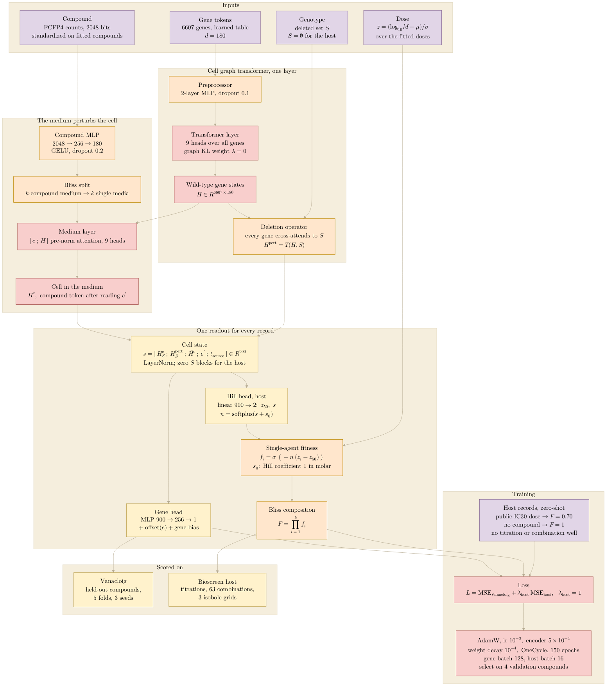

## 2026.10.18 - The leading round-11 arm, wired

The arm `van_e150_cell_bliss_hill_anchors` of round 11 (`conf/mixture/r11_van_e150_cell_bliss_hill_anchors.yaml`, trainer `experiments/040-inhibitor-synergy-wetlab/scripts/train_mixture.py`): the cell readout, Bliss split, a Hill curve per inhibitor on the host, trained on Vanacloig 2022 and the public IC30 anchors only. Every size and setting below is read from the trainer and that config; scores live in the gate document's generated tables, not here. With the graph-prior weight at zero the nine gene graphs enter only through a KL penalty that is computed and not added, so no graph signal reaches this arm. Rendered with `bash notes/assets/publish/scripts/mermaid_pdf.sh` to `notes/assets/pdf-output/experiments.040-inhibitor-synergy-wetlab.mermaid.hill-bliss-model.pdf`, which the gate document places as SI figure 8.

