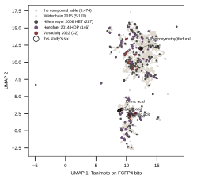

## 2026.10.19 - One compound table, drawn rather than asserted

The gate figure's join panel claimed "compounds: one table (FCFP4)" and showed six
squares, which asserts the claim without showing it. Owner, 2026-10-19: a small
low-dimensional embedding of the fingerprints, colored by dataset, to see how alike the
molecules of a dataset are; Tanimoto if that is the more relevant similarity.

The table is literally one array, `fcfp4_count.npz` of 031: 5,472 InChIKeys by 2,048
counts, the rows the trainer featurizes a compound token from. Formic and lactic acid
carry an identity gap, so no screen holds them and the store has no row; the trainer
featurizes them from curated SMILES and this script appends them the same way, giving
5,474 rows.

Placement is UMAP on the Tanimoto distance between the fingerprints taken as bit sets,
the same similarity `nearest_vanacloig` uses to pick a neighbor. The counts are binarized
first because Tanimoto is defined on the bit set. That distinction matters once: acetic
acid and cadmium acetate have IDENTICAL bit sets, Tanimoto 1.000, because the metal
contributes no FCFP feature, so similarity cannot tell them apart. Their counts differ by
a factor of two, so the model, which reads counts, can.

| source | compounds | median Tanimoto within | median to this study's six | max to this study |
|---|---|---|---|---|
| Vanacloig 2022 | 32 | 0.127 | 0.132 | 1.000 |
| Hoepfner 2014 HOP | 146 | 0.095 | 0.085 | 0.500 |
| Hillenmeyer 2008 HET | 287 | 0.107 | 0.091 | 0.433 |
| Wildenhain 2015 | 5,170 | 0.116 | 0.091 | 1.000 |
| this study | 6 | 0.154 | 1.000 | 1.000 |

Every library is chemically diverse: a median within-source Tanimoto near 0.10 means two
compounds drawn at random from a screen share about a tenth of their bits. The screens do
not occupy separate regions of the table; they spread over the same two clouds. Vanacloig's
1.000 is furfural and 5-HMF, which it genuinely holds. Wildenhain's 1.000 is the cadmium
acetate collision, not a compound this study dosed.

This study's six split in two: furfural and 5-HMF sit among the furans in the upper cloud,
and the four acids sit together in the lower one. Their median within-set Tanimoto, 0.154,
is higher than any screen's, which is what a set of six small hydrolysate inhibitors should
look like.

Of the 5,474 rows, 5,286 are held by exactly one screen, 152 by two, 15 by three, and 21 by
none, the last including the four inhibitors no screen dosed.

The preview: every row of the compound table placed by UMAP on Tanimoto, gray for the
table, a color per screen drawn largest set first, and this study's six ringed and named.
The figure panel is the same picture at panel size, keyed by the gene-coverage bars above
it, which now carry the same four colors.
