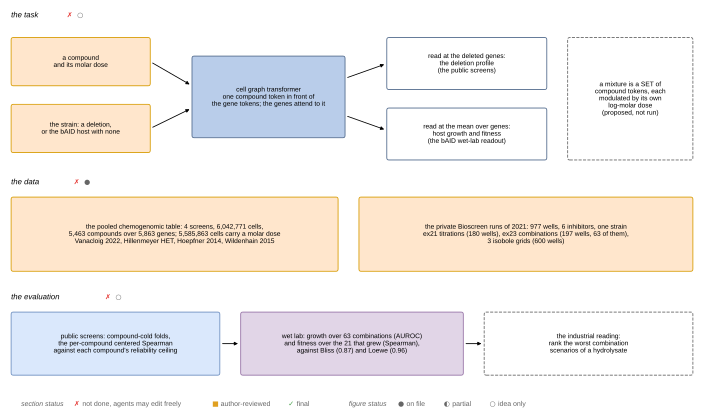
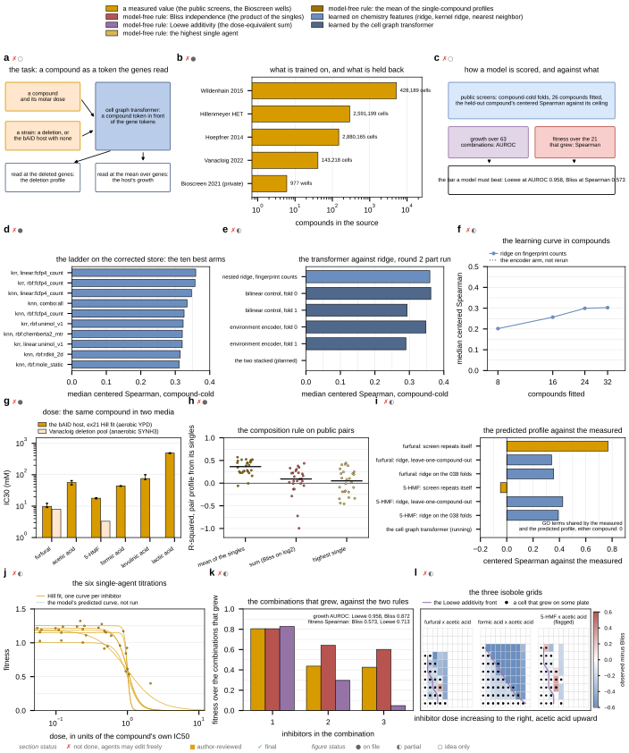
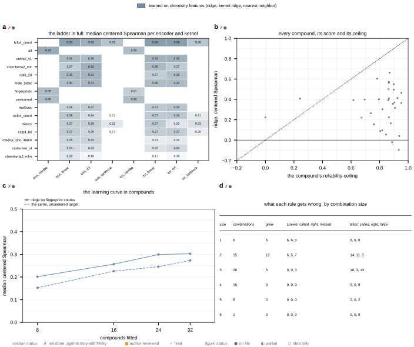
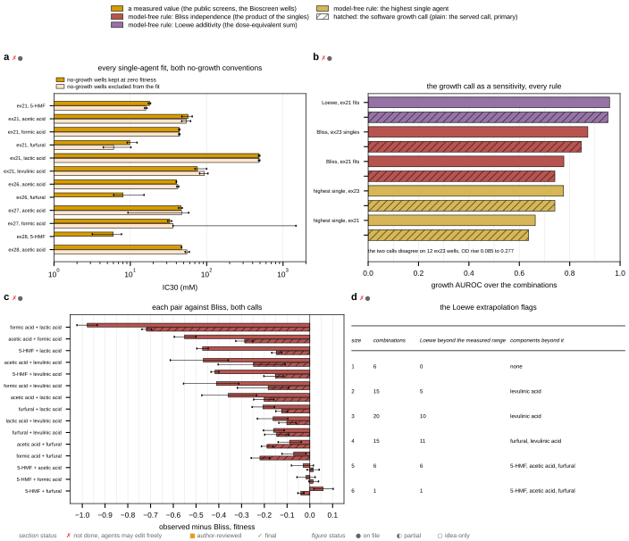
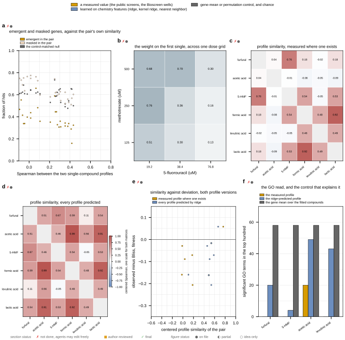
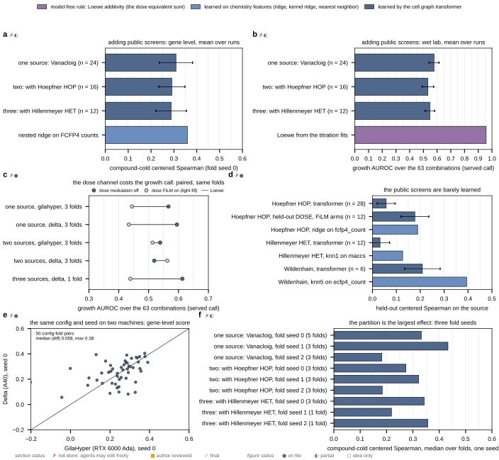

## 2026.10.10 - The figure gate for the hydrolysate panel

`figure_gate_panels.py` draws five mockup sheets for manuscript section R5, drug
exposure, and writes every number their captions print. It is the hydrolysate analog of
`experiments/031-betaxanthin-module/scripts/figure_gate_panels.py` (the metabolism Figure
6 gate) and copies its mechanism: a `Reads` class that opens every result file once, a
`num()` macro recorder whose keys become LaTeX commands with digits spelled out, panel
letters carrying two status symbols, and one sheet-level legend.

**Encoding, two channels.** Color is the SOURCE of a predicted value: a measured value;
a model-free rule, one color per rule (Bliss, Loewe, highest single agent, the mean of
the singles); a learned model (ridge and its kernel and nearest-neighbor siblings, the
cell graph transformer); and gray for a gene-mean or permutation control. Hatch is the
software growth call, drawn only where a panel shows both calls; plain is the served
raw-curve call, which is primary. The kernel and the encoder are written in the label and
never encoded.

**Status marks.** Filled circle, every drawn value is in a committed result file; half
circle, a run is unfinished or a planned arm has no file; open circle, idea only. The
section status beside it is red everywhere, because nothing has been reviewed. None of
the marks means approved.

**Cross-branch reads.** The 033, 035 and 038 result files live on unlanded worktree
branches, so they are read by absolute path and every path is recorded under
`external_sources` in `results/figure_gate_manifest.json`. The 038 factorized round 2
directories are globbed, so a panel fills in as that round writes.

### Sheets

### Outputs

- `$ASSET_IMAGES_DIR/040-inhibitor-synergy-wetlab/gate_*.png` and `.svg` (true size)
- `experiments/040-inhibitor-synergy-wetlab/results/figure_gate_manifest.json`
- `experiments/040-inhibitor-synergy-wetlab/results/figure_gate_numbers.json`
- `notes-tex/wet-lab/env-case-study-gate/tables/gate_numbers.tex` and
  `gate_figure_names.tex`

The document that places them is `notes-tex/wet-lab/env-case-study-gate/`; run
`make numbers plots all check` there.

## 2026.10.12 - Supplement four: the mixture rounds, read over both machines

A sixth sheet, `gate_si4_rounds`, reads every round-3 and round-4 score file on
GilaHyper (`results/mixture/r3*`, `r4*`) and pulled from Delta
(`results/mixture-delta/r3*`) through `Reads.round_scores`, which keeps a `machine`
column because the same config at the same seed was run on both for twenty-two arms. Six
panels: the one-, two- and three-source arms on the public side and on the growth call
(mean over every run on fold seed 0, the ridge and Loewe bars beside them); the dose
channel paired on and off per arm and machine; the per-source held-out compound and dose
scores beside the chemistry-feature learners' from `source_basis.csv`; the same config
and seed on the two machines as a scatter; and the three fold seeds per source-set arm.
The panels whose runs are still writing (round 4's seeds 3 to 5, the three-source arm on
fold seeds 1 and 2) carry the half circle. The gate document places it as Supplement
four with a source table, and the boundary section's "Round three" step reads it.

