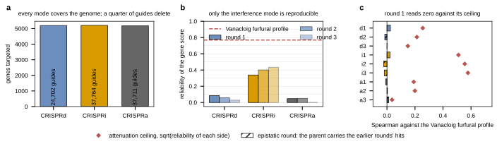

## 2026.10.11 - Three measurements that decide whether Lian can validate a model

Script: `experiments/040-inhibitor-synergy-wetlab/scripts/lian_validation_feasibility.py`,
reading the reprocessed per-guide table of the raw mirror
(`$DATA_ROOT/torchcell-raw/lianMultifunctionalGenomewideCRISPR2019/data/guide_enrichment_final.tsv`,
experiment 016's pipeline; the per-guide furfural enrichment was never released in a Nature
supplement) and the Vanacloig furfural profile of this experiment
(`results/profile_matrix.csv`, `results/profile_predicted_vs_measured.csv`). Controls and
corrupted targets dropped: 100,177 guides over 5,197 (CRISPRd), 5,206 (CRISPRi) and 5,178
(CRISPRa) genes.

**1. Representability.** The models of 031 to 040 carry a deletion operator and nothing
else, so of the three orthogonal modes only CRISPRd maps onto them: 24,702 of 100,177
guides, 24.7 percent. CRISPRi and CRISPRa have no operator in any model on file.

**What the rounds are, corrected 2026.10.11 after re-reading the paper.** An earlier
version of this note read the three rounds as three measurements of furfural tolerance at
rising dose and stacked all three as evidence. They are an epistasis ladder. Each round
transforms the library into the strain built from the previous round's best hit: round 1
screens the bAID parent at 5 mM, round 2 the R1 parent (SIZ1i integrated) at 10 mM, round 3
the R2 parent (SIZ1i and NAT1a integrated) at 15 mM. The paper settles what that means with
constructed strains rather than by inference: in Fig. 4 the round-2 and round-3 hits, alone
or together, "marginally improved furfural tolerance in the reference strain" and show a
phenotype only in the SIZ1i background, and the Results say the same of the whole round-2
set, "none of the second round targets improved furfural tolerance alone". So rounds 2 and
3 measure effects CONDITIONAL on the integrated edits. **Only round 1 is comparable with
single-perturbation chemogenomics**, and the later rounds below are reported for
completeness, not as evidence. Note also that NAT1a is an activation, so the round-3 parent
carries a gain-of-function that no model on file can encode either.

**2. Reliability of the Lian gene score** (guides of a gene split at random into halves,
halves averaged, the two half-scores correlated, 20 splits, Spearman-Brown to the full
score). The deletion mode, the only representable one, is the least reproducible:

| mode | round 1 | round 2 | round 3 |
|---|---|---|---|
| CRISPRd (deletion) | **0.085** | 0.062 | 0.029 |
| CRISPRi (interference) | 0.339 | 0.404 | 0.438 |
| CRISPRa (activation) | 0.070 | 0.056 | 0.012 |

The Vanacloig furfural profile's own measured reliability is 0.769, so it is not the weak
side of any comparison. The decline across rounds is expected from the design rather than a
statement about data quality: each round starts from a more tolerant parent at a higher
dose, so fewer guides can move the phenotype and there is less reproducible variance left
to find.

**3. Agreement with the Vanacloig furfural deletion profile, round 1 only**, 2,666 shared
genes, both sides carrying the same polarity (positive = the perturbation helps under
furfural). The attenuation ceiling `sqrt(reliability of each side)` says whether a flat
reading is a disagreement or a noise floor:

| mode, round 1 | Spearman | p | ceiling | fraction of the ceiling |
|---|---|---|---|---|
| CRISPRd (representable) | +0.025 | 0.21 | 0.26 | 0.10 |
| CRISPRi (reliable) | +0.022 | 0.26 | **0.51** | 0.04 |
| CRISPRa | -0.009 | 0.63 | 0.19 | -0.05 |

For the deletion mode the ceiling is 0.26, so the flat reading is mostly a statement about
noise. For the interference mode the ceiling is 0.51 and the reading is still zero: that is
a **measured disagreement**, not a noise floor, and it is the single most informative number
here. Hit overlap says the same at the tails: the top and bottom 100 and 200 genes of the
two lists overlap at the hypergeometric expectation in every combination of tails and mode
(every p above 0.16, `results/lian_hit_overlap.csv`). The epistatic rounds all read within
0.03 of zero too (`results/lian_vs_vanacloig.csv`), which is consistent with the round-1
result but is not independent evidence for it.

**The reprocessing is not the problem.** The paper's three validated hits sit at the 100th
percentile of their own mode in the reprocessed table (SAP30 CRISPRd round 1, SLX5 CRISPRi
round 1, PDR1 CRISPRi round 3), which is what the 016 pipeline was validated on. Two of
them are in the Vanacloig profile and both sit slightly negative there (SAP30 -0.336, SLX5
-0.205), the opposite sign to their enrichment, though two genes settle nothing.

**Reading.** Lian measures a different quantity from a deletion chemogenomic screen:
pooled competitive enrichment of a guide in a plasmid-borne library in SED-URA/G418 at
5 mM furfural, against relative fitness of a haploid deletion strain in anaerobic SYNH3 at
IC30. In round 1, the one round that asks the same question, the one mode a current model
could predict is also the one whose gene-level score carries almost no reproducible
variance, and the one mode that is reproducible is both unrepresentable and in measured
disagreement with the deletion profile. Hypothesis (untested): a 28 bp coding deletion in a
pooled plasmid library is a weaker and more variable perturbation per guide than a clean
deletion strain, which would explain the 0.085.

**What the epistasis ladder is good for instead.** Rounds 2 and 3 are not weaker versions
of round 1; they are something the deletion collections do not contain at all. Each
round-2 record is a genuine two-perturbation, mixed-modality genotype (an integrated
interference plus a library guide of any mode) and each round-3 record a three-perturbation
one, with a phenotype the paper demonstrates is not the sum of its parts. That is a
multi-perturbation epistasis dataset across modalities, which is the thing the knowledge
graph is built to hold, and the loader already stores the accumulated edits in the
`Genotype`. It is a target for a model that can represent activation and interference, not
for one with a deletion operator.

**a**, Genes targeted by each mode, with the guide count in the bar; a quarter of the
guides carry a deletion and the rest have no operator in any model on file. **b**,
Split-half reliability of the gene score per mode and round, with the Vanacloig furfural
profile's reliability as the dashed line. **c**, Spearman against the Vanacloig furfural
profile for each mode and round (centered target), with the attenuation ceiling as the
diamond; a hatched bar is an epistatic round, whose parent already carries the earlier
rounds' integrated hits and which therefore does not answer the same question. Mode and
round are labeled `d1` to `a3`.
