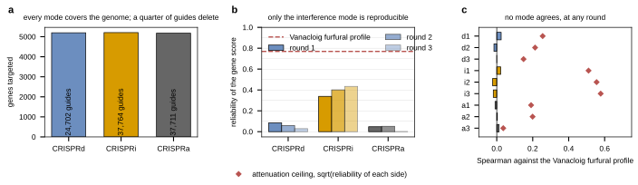

## 2026.10.11 - Three measurements that decide whether Lian can validate a model

Script: `experiments/040-inhibitor-synergy-wetlab/scripts/lian_validation_feasibility.py`,
reading the reprocessed per-guide table of the raw mirror
(`$DATA_ROOT/torchcell-raw/lianMultifunctionalGenomewideCRISPR2019/data/guide_enrichment_final.tsv`,
experiment 016's pipeline; the per-guide furfural enrichment was never released in a Nature
supplement) and the Vanacloig furfural profile of this experiment
(`results/profile_matrix.csv`, `results/profile_predicted_vs_measured.csv`). Controls and
corrupted targets dropped: 100,177 guides over 5,197 (CRISPRd), 5,206 (CRISPRi) and 5,178
(CRISPRa) genes.

**1. Representability.** The models of 031 to 040 carry a deletion operator and nothing
else, so of the three orthogonal modes only CRISPRd maps onto them: 24,702 of 100,177
guides, 24.7 percent. CRISPRi and CRISPRa have no operator in any model on file.

**2. Reliability of the Lian gene score** (guides of a gene split at random into halves,
halves averaged, the two half-scores correlated, 20 splits, Spearman-Brown to the full
score). The deletion mode, the only representable one, is the least reproducible:

| mode | round 1 | round 2 | round 3 |
|---|---|---|---|
| CRISPRd (deletion) | **0.085** | 0.062 | 0.029 |
| CRISPRi (interference) | 0.339 | 0.404 | 0.438 |
| CRISPRa (activation) | 0.070 | 0.056 | 0.012 |

The Vanacloig furfural profile's own measured reliability is 0.769, so it is not the weak
side of any comparison.

**3. Agreement with the Vanacloig furfural deletion profile**, 2,666 shared genes, both
sides carrying the same polarity (positive = the perturbation helps under furfural).
Every mode and round reads at zero, and the attenuation ceiling
`sqrt(reliability of each side)` says whether that is a disagreement or a noise floor:

| mode, round | Spearman | p | ceiling | fraction of the ceiling |
|---|---|---|---|---|
| CRISPRd, round 1 | +0.025 | 0.21 | 0.26 | 0.10 |
| CRISPRi, round 1 | +0.022 | 0.26 | **0.51** | 0.04 |
| CRISPRi, round 3 | -0.019 | 0.32 | **0.58** | -0.03 |
| CRISPRa, round 1 | -0.009 | 0.63 | 0.19 | -0.05 |

For the deletion mode the ceiling is 0.26, so the flat reading is mostly a statement about
noise. For the interference mode the ceiling is 0.51 to 0.58 and the reading is still
zero: that is a **measured disagreement**, not a noise floor. Hit overlap says the same at
the tails: the top and bottom 100 and 200 genes of the two lists overlap at the
hypergeometric expectation in every combination of tails, mode and round (every p above
0.16, `results/lian_hit_overlap.csv`).

**The reprocessing is not the problem.** The paper's three validated hits sit at the 100th
percentile of their own mode in the reprocessed table (SAP30 CRISPRd round 1, SLX5 CRISPRi
round 1, PDR1 CRISPRi round 3), which is what the 016 pipeline was validated on. Two of
them are in the Vanacloig profile and both sit slightly negative there (SAP30 -0.336, SLX5
-0.205), the opposite sign to their enrichment, though two genes settle nothing.

**Reading.** Lian measures a different quantity from a deletion chemogenomic screen:
pooled competitive enrichment of a guide in a plasmid-borne library in SED-URA/G418 at 5 to
15 mM furfural, against relative fitness of a haploid deletion strain in anaerobic SYNH3 at
IC30. The one mode a current model could predict is also the one whose gene-level score
carries almost no reproducible variance, and the one mode that is reproducible is both
unrepresentable and in measured disagreement with the deletion profile. Hypothesis
(untested): a 28 bp coding deletion in a pooled plasmid library is a weaker and more
variable perturbation per guide than a clean deletion strain, which would explain the 0.085.

**a**, Genes targeted by each mode, with the guide count in the bar; a quarter of the
guides carry a deletion and the rest have no operator in any model on file. **b**,
Split-half reliability of the gene score per mode and round, with the Vanacloig furfural
profile's reliability as the dashed line. **c**, Spearman against the Vanacloig furfural
profile for each mode and round (centered target), with the attenuation ceiling as the
diamond. Mode and round are labeled `d1` to `a3`.
